# Record of Designs

A single, chronological, scroll-through record of **every design** created in this
repository — and **every iteration** of each design — in the order each one was
made. This is a deliberate, repetitive log: a design that was revised five times
appears five times, each version placed at the moment it was created (by commit
date), not grouped with its siblings. The intent is a fast visual timeline of how
the powder-doser evolved from a hand-sketched scoop to a motorized, hinged
multi-part assembly, and from there (June–October 2026) through human-redrawn
CAD, a 13-powder test campaign, closed-loop dosing control and a multi-doser
concept. From October 2026 it follows the move of every part into Onshape and the
first builds of 25 repeat dosers, trials of generative CAD and of a DEM digital
twin, validated and production dosing (including atomizer cups), concepts for
in-house powder-property tests, and the next multi-doser designs.

Built in response to issue [#73](https://github.com/vertical-cloud-lab/powder-doser/issues/73).

<!-- FRONTMATTER:START -->
<!-- Machine-readable summary; regenerated by tools/design_log/build_design_log.py -->
```yaml
title: "Record of Designs"
kind: design-log
entries: 164
date_span: [2026-04-23, 2026-11-17]
iteration_chains: 18
subsystems:
  - name: "Scoop / excavator"
    entries: 13
  - name: "Sieve-cup alternatives (A–H)"
    entries: 11
  - name: "Auger"
    entries: 26
  - name: "Auger bracket"
    entries: 8
  - name: "Sealing cap"
    entries: 6
  - name: "Tap collar"
    entries: 6
  - name: "Doser module"
    entries: 13
  - name: "Mounting plate & hinge"
    entries: 31
  - name: "Electronics & PCB"
    entries: 11
  - name: "Firmware & control"
    entries: 10
  - name: "Test method & rig"
    entries: 12
  - name: "Powder characterization"
    entries: 3
  - name: "Multi-doser"
    entries: 2
  - name: "Simulation & digital twin"
    entries: 3
  - name: "Design tooling"
    entries: 9
```
<!-- FRONTMATTER:END -->

## How to read this log

- Entries are ordered **oldest → newest**. Each entry is one design or one
  iteration of a design. Jump straight to a subsystem or a specific iteration with
  the [Index by subsystem](#index-by-subsystem) below.
- **Trigger** names the issue, comment, or review that prompted that version, and
  who raised it.
- **Design** is a 1–2 sentence summary of the design and what changed.
- **Rationale** states *why* — the constraint, goal, or decision behind the change
  (the "because…"). Every entry carries one so the log records intent, not just
  geometry.
- **Outcome** (where known) records what happened when a design was built or
  reviewed, tagged ✅ pass / ⚠️ partial / ❌ fail, and — for an iteration that was
  abandoned or replaced — *why* the branch was a dead-end and what superseded it.
- Each entry shows one or more **render views** (iso / front / top / side /
  cross-section / assembly / exploded) to communicate the geometry. Where a design
  also has an **animated GIF** (a rotating spin or an actuation loop), that GIF is
  shown too. A few entries reference diagrams or sketches where those best capture
  the design at that moment.
- Where a design was physically printed and bench-tested, the entry also embeds the
  **printed-part photos** and links the **test videos** from the corresponding
  GitHub issue or pull-request comment.
- From June 2026 (entry [e098](#e098) on) the log also records build, electronics,
  firmware, test-method and design-tooling decisions, most of them made in issue
  threads rather than design PRs. These entries describe who acted as **a team
  member** or **the AI agent** (Copilot or Claude), and their photos link to the
  original GitHub attachments rather than to copies under `docs/assets/`. Entries
  from October 2026 on add two subsystems, **Simulation & digital twin** and
  **Powder characterization**; work on lab CAD that lives only in Onshape is
  described from its issue threads, since those parts have no committed renders.
- Every image and animation here is an **artifact that was actually generated** —
  a render, GIF, or photo committed to a branch or attached to a comment. Nothing
  was re-rendered ad-hoc for this log.
- Images are pinned to the exact commit they were generated at, so each thumbnail
  shows that *specific* iteration — even when a later version reused the same
  filename. Many designs live on still-open pull-request branches; the pinned
  commit SHAs keep these visuals stable. Printed-part **photos** attached to issue/PR
  comments are archived in-repo under [`docs/assets/`](docs/assets) so they survive
  even if the original attachment is removed; bench-test **videos** remain linked to
  their YouTube sources.
- The summary block above and the subsystem index below are **regenerated** from the
  entries by [`tools/design_log/build_design_log.py`](tools/design_log/build_design_log.py);
  edit the entries, then re-run it (`--check` verifies they are in sync).

<!-- INDEX:START -->
## Index by subsystem

Designs are logged chronologically below, but iterations of one object are scattered across that timeline. This index regroups them. Within a multi-version **iteration chain** each version is superseded by the next (`v1 → v2 → …`); follow a link to jump to that exact iteration.

| Subsystem | Entries | Iteration chains (oldest → newest) |
| --- | --: | --- |
| Scoop / excavator | 13 | [Original powder-excavator scoop concept](#e001)<br>[Powder excavator concept diagram](#e002)<br>[Powder excavator corrected subpanels](#e003)<br>[Ferris-wheel trough pivot](#e004)<br>[Longitudinal-pivot sideways-tilt trough](#e005)<br>[Pin-defined-path actuation variant](#e006)<br>[Mechanism-panel alignment refinement](#e007)<br>[Bimodal compliant trough mechanism](#e008)<br>[3D-printable bimodal trough prototype](#e009)<br>[Continuous chamfered rim lip](#e010)<br>**Parametric CAD excavator assembly:** [v1](#e011) → [v2](#e013)<br>[Bimodal flexure curve fix](#e012) |
| Sieve-cup alternatives (A–H) | 11 | [Preliminary sieve-cup concepts A/G](#e014)<br>[Alternative A tap-sieve cup](#e020)<br>[Alternative B Pez-style chamber strip](#e021)<br>[Alternative C capillary wiper](#e022)<br>[Alternative D brush-comb pickup](#e023)<br>[Alternative E shaker dispenser](#e024)<br>[Alternative F passive auger](#e025)<br>[Alternative G ERM-augmented sieve](#e026)<br>[Alternative H solenoid-tapped sieve](#e027)<br>[A–H annotated explainer panels](#e028)<br>[CadQuery-grounded A–H spatial scenes](#e034) |
| Auger | 26 | [Monolithic Archimedes auger preview](#e015)<br>[Print-ready monolithic auger](#e016)<br>[Auger internal-helix x-ray views](#e017)<br>[Two-part fixed-shaft/rotating-housing auger](#e018)<br>[Short workshop-test auger](#e019)<br>[Large integrated H2D auger](#e032)<br>[Through-cut loading slots](#e033)<br>[Central-supported helix](#e044)<br>[Hollow-core auger](#e045)<br>**Geared Archimedes auger assembly:** [v1](#e053) → [v2](#e055)<br>[Geared Archimedes auger full-length](#e056)<br>[Geared Archimedes auger short alternate](#e057)<br>[Large top opening with pour lip](#e061)<br>[Tapered-shaft auger exit](#e087)<br>[Continuous funnel helix auger](#e089)<br>[Phase-matched funnel helix auger](#e090)<br>[Nozzle test auger type 1](#e094)<br>[Nozzle test auger type 2](#e095)<br>[Nozzle test auger type 3](#e096)<br>[Nozzle test auger type 4](#e097)<br>[Auger type 4 adopted as main design](#e098)<br>[Threaded auger with screw-on cap](#e109)<br>[Reduced-volume 1 mL and 10 mL augers](#e112)<br>[Labelled campaign augers with separate caps](#e114)<br>[25-auger H2D batch](#e150) |
| Auger bracket | 8 | **Auger bracket:** [v1](#e049) → [v2](#e050) → [v3](#e051) → [v4](#e052) → [v5](#e058)<br>**Parametric auger clamp bracket:** [v1](#e062) → [v2](#e064)<br>[CADsmith-style auger bracket](#e063) |
| Sealing cap | 6 | **Bayonet plug sealing cap:** [v1](#e036) → [v2](#e046)<br>**Spring hatch sealing cap:** [v1](#e037) → [v2](#e047)<br>**Twist shutter sealing cap:** [v1](#e038) → [v2](#e048) |
| Tap collar | 6 | **Tap collar assembly:** [v1](#e059) → [v2](#e069) → [v3](#e070) → [v4](#e073)<br>[Plate-mounted tapper concepts](#e157)<br>[Plate-mounted solenoid bracket](#e158) |
| Doser module | 13 | [Inward collection cup architecture](#e031)<br>**Single-channel powder-doser module:** [v1](#e035) → [v2](#e039) → [v2.0b](#e040) → [v3-r1](#e041) → [v3-r2](#e042) → [v4](#e043)<br>**Current-design assembly render:** [v1](#e130) → [v2](#e132)<br>[Fastener BOM and assembly walkthrough](#e133)<br>**Print guidance for doser parts:** [v1](#e152) → [v2](#e164)<br>[Build hardware for the #193 assembly](#e160) |
| Mounting plate & hinge | 31 | [Hinged mounting plate + baseplate assembly](#e060)<br>**Mounting plate + hinged baseplate:** [v1](#e065) → [v2](#e067) → [v3](#e074) → [v4](#e076) → [v5](#e078) → [v6](#e081) → [v7](#e083)<br>[Mounting-plate/baseplate assembly](#e066)<br>[Real-geometry mounting assembly](#e068)<br>[Offset-hinge mounting plate](#e072)<br>[Drawing-aligned mounting assembly](#e075)<br>[Face-mounted motor and side-hinge assembly](#e077)<br>[Centered-auger hinge assembly](#e079)<br>[CADsmith mounting/base plates](#e080)<br>[Lifted-bracket sandwich-hinge assembly](#e082)<br>[Baseplate contact cleanup](#e084)<br>[Servo-driven hinge gear assembly](#e085)<br>[Involute servo-hinge gearing](#e086)<br>[Corrected MG996R hole-pattern mount](#e088)<br>[Raised-spline rescaled servo gearing](#e091)<br>[Dual-servo tilt drive](#e103)<br>[Locknuts against vibration loosening](#e113)<br>[Tap-collar clearance and flat-at-0° check](#e121)<br>**Servos-above baseplate:** [v1](#e135) → [v2](#e136)<br>**Repeat-doser mounting plate:** [v1](#e146) → [v2](#e151) → [v3](#e163)<br>[Pre-production review fixes to the Onshape parts](#e156)<br>[Hinge-bolt nut inset in the mounting plate](#e161) |
| Electronics & PCB | 11 | **Actuator electronics schematic:** [v1](#e029) → [v2](#e030)<br>[Satellite rev-a PCB](#e054)<br>[Single-Pico-W test-module schematic](#e071)<br>[Pico-W schematic alignment and shunt regulator](#e092)<br>[DRV8825 carrier schematic](#e093)<br>[Tic T500 stepper controller replaces DRV8825](#e099)<br>**Doser PCB:** [v1](#e100) → [v2](#e111) → [v3](#e128)<br>[Haptic motor reinstatement](#e118) |
| Firmware & control | 10 | [Closed-loop dosing on balance feedback](#e102)<br>[Three-phase bulk/fine/tap dosing controller](#e107)<br>[Kalman-filter bang-bang bulk stop](#e119)<br>[Actuator-gated balance filter](#e122)<br>[Chance-constrained trim method](#e125)<br>[Bayesian-optimization dosing campaign](#e127)<br>[Bulk-to-tap dosing variant](#e129)<br>[Refill-tap endgame](#e139)<br>[Cutoff-margin campaign](#e142)<br>[Powder-fingerprint transfer for the optimizer](#e153) |
| Test method & rig | 12 | [Rig livestream and balance data streaming](#e106)<br>[Pi Zero 2 W bridge for remote operation](#e108)<br>[On-device characterization sweep](#e110)<br>[Per-powder test battery, protocols A–G](#e115)<br>[Single-tap depletion test](#e116)<br>[Granite isolation slab for the balance](#e123)<br>[Protocol H small-dose targets](#e124)<br>[Balance drift traced to powder under the pan](#e126)<br>[Replicate validation of optimized salt profiles](#e137)<br>**Doser centering device:** [v1](#e138) → [v2](#e143)<br>[Al 4047 atomizer-cup production dosing](#e147) |
| Powder characterization | 3 | [Doser flowability proxies for LPBF spreading](#e140)<br>[In-house powder property test concepts](#e159)<br>[Per-jar campaign session plan](#e162) |
| Multi-doser | 2 | **Roller-chain multi-doser:** [v1](#e117) → [v2](#e120) |
| Simulation & digital twin | 3 | [DEM digital twin of the rig auger](#e144)<br>[Micro-auger geometry sweep](#e145)<br>[Physics-simulation method survey](#e155) |
| Design tooling | 9 | [Zoo Design Studio multi-doser trial](#e101)<br>[Spec-driven Copilot-only CadQuery assembly](#e104)<br>[Fusion 360 recreations of the AI-made parts](#e105)<br>[Onshape API assembly of the Fusion 360 parts](#e131)<br>[text-to-cad recreation of the current doser](#e134)<br>[fsgen native Onshape feature-tree trial](#e141)<br>[Native Onshape feature trees for the servos-above parts](#e148)<br>[Approval-gated remote printing](#e149)<br>[Onshape recreations of the Fusion 360 parts](#e154) |

<!-- INDEX:END -->

---

<!-- ENTRY date=2026-04-23T20:27:45Z pr=0 -->
<a id="e001"></a>
### 2026-04-23 — Original powder-excavator scoop concept · Issue #1 / #3
**Trigger:** @sgbaird opened issue #1 with a hand sketch proposing a purely mechanical mini-excavator: a deep ladle/scoop on a gantry that is pushed against a wall to tip and drop powder; @devoranajjar's issue #3 then worked through its technical viability.
**Design:** The founding concept was a 3D-printed semicircular scoop (mm–cm scale) mounted on a Genmitsu 3018-PROVer V2 gantry, with side pins catching a ledge to pivot and dump powder into a vial, paired with closed-loop gravimetric dosing, PTFE coating, and an ERM vibration motor to fight micron-powder adhesion.
**Rationale:** Establish a fully mechanical, gantry-only dosing concept that needs no second actuator while fighting micron-powder adhesion (PTFE + ERM) and closing the dose loop gravimetrically.


---

<!-- ENTRY date=2026-04-23T20:37:37Z pr=2 -->
<a id="e002"></a>
### 2026-04-23 — Powder excavator concept diagram v1 · PR #2
**Trigger:** @sgbaird opened issue #1 with a hand sketch and asked for a pure mechanical gantry-actuated scoop that could drop powder when pushed against a wall.
**Design:** The first cleaned visual translated the hand sketch into a mechanical trough/scoop concept with a fixed ledge interaction. It captured the initial idea before reviewer feedback clarified the pin, arms, lip, and powder-handling constraints.
**Rationale:** Turn the hand sketch into a shared visual baseline so reviewers could critique a concrete concept before details were fixed.

 

---

<!-- ENTRY date=2026-04-23T22:01:11Z pr=2 -->
<a id="e003"></a>
### 2026-04-23 — Powder excavator corrected subpanels v2 · PR #2
**Trigger:** @sgbaird's review said the pin was missing, the shaft needed two arms, the lip/sawtooth ledge was unclear, and the arm should stay vertical while the trough rotated.
**Design:** The design was redrawn as individual subpanels with an explicit pivot pin, two vertical arms, and a wall-mounted ledge/lip actuation story. The update also reframed the concept for cohesive micron-scale powders and 3D-printable parts.
**Rationale:** Fold in review corrections (missing pin, two arms, vertical arm) and reframe the concept for cohesive micron powders and printable parts.

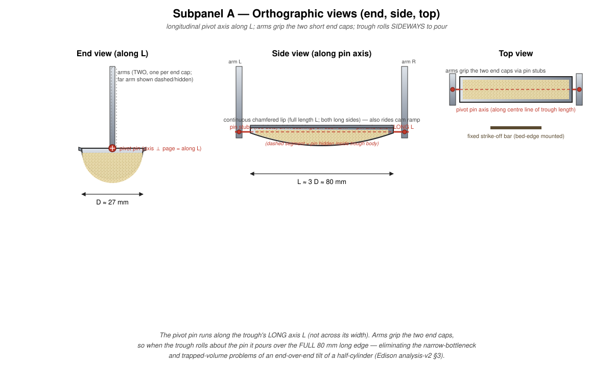 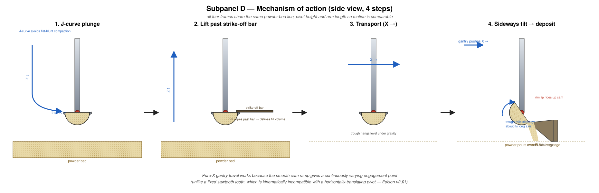

---

<!-- ENTRY date=2026-04-23T22:21:43Z pr=2 -->
<a id="e004"></a>
### 2026-04-23 — Ferris-wheel trough pivot v3 · PR #2
**Trigger:** @sgbaird clarified that the arms were on the wrong edges and the bucket should pivot like a ferris-wheel gondola, with arms secured to the flat sides.
**Design:** The geometry was rebuilt so arms straddle the long side walls and a transverse pin runs through side bosses. This replaced the earlier edge-mounted interpretation with a clearer end-over-end trough rotation.
**Rationale:** Match the reviewer's ferris-wheel intent so the trough rotates end-over-end on a transverse pin instead of the wrong edges.

 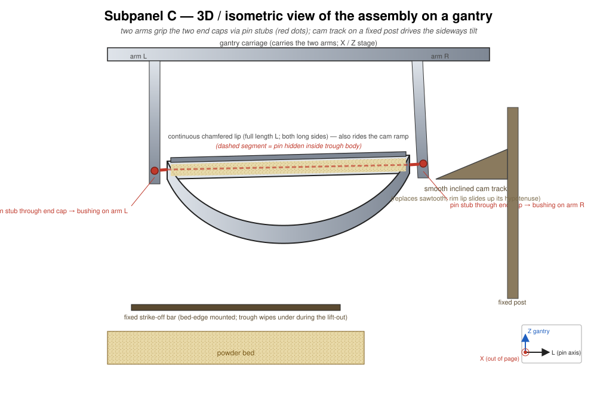 

---

<!-- ENTRY date=2026-04-23T23:20:02Z pr=2 -->
<a id="e005"></a>
### 2026-04-23 — Longitudinal-pivot sideways-tilt trough v4 · PR #2
**Trigger:** @sgbaird noted the isometric arms were inconsistent and suggested scoop-and-drag filling plus a possible bimodal/closed scoop behavior.
**Design:** The mechanism changed to a longitudinal pivot held at the short end caps, a sideways-tilting dump, and a J-curve plunge/drag with strike-off. The change tried to improve filling and dose repeatability without adding a bucket actuator.
**Rationale:** Improve fill consistency and dose repeatability with a longitudinal sideways tilt and J-curve scoop-drag, without adding a bucket actuator.

 

---

<!-- ENTRY date=2026-04-23T23:44:50Z pr=2 -->
<a id="e006"></a>
### 2026-04-23 — Pin-defined-path actuation variant v5 · PR #2
**Trigger:** @sgbaird asked for open CAD-esque feedback mechanisms and repeated Edison-analysis iterations under the no-second-axis gantry constraint.
**Design:** A pin-in-slot panel was added as an alternate way to make the gantry path define the trough rotation. It made the kinematic constraint more explicit than the free ledge/cam sketches.
**Rationale:** Make the kinematic constraint explicit by letting a pin-in-slot path define rotation under the no-second-axis gantry constraint.

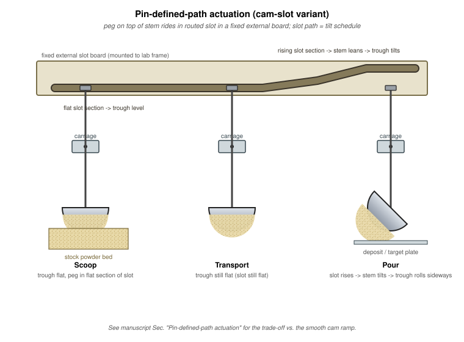 

---

<!-- ENTRY date=2026-04-24T01:08:08Z pr=2 -->
<a id="e007"></a>
### 2026-04-24 — Mechanism-panel alignment refinement v6 · PR #2
**Trigger:** @sgbaird said the mechanism GIF and panels were weird, not lined up, and had confusing connection points and scale/aspect.
**Design:** The visual panels were iterated through multiple cycles to show pin stubs, cam contact, an end-view pin marker, ghost arm, and a better-scaled pin-slot panel. This was primarily a clarity iteration to make the same mechanism legible.
**Rationale:** Purely a legibility pass: line up the mechanism panels/GIF and clarify connection points without changing the mechanism.

  
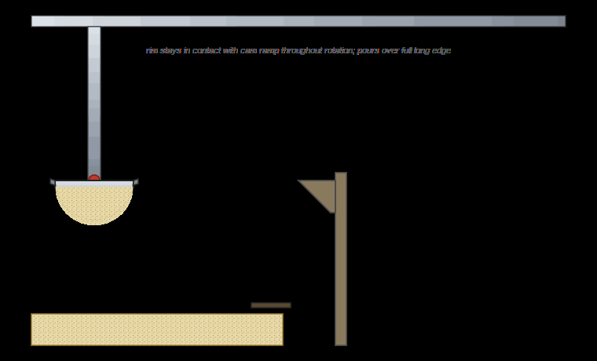

---

<!-- ENTRY date=2026-04-24T01:11:03Z pr=5 -->
<a id="e008"></a>
### 2026-04-24 — Bimodal compliant trough mechanism v1 · PR #5
**Trigger:** @sgbaird opened issue #4 asking to revisit the bimodal compliant mechanism as a secondary idea and install tools to test bimodal compliance.
**Design:** The first visualized compliant trough used flexural snap-through between scoop and hold/dump states, paired with an energy/bistability checker. It explored a passive way to get two stable powder-handling poses.
**Rationale:** Explore a passive bistable (snap-through flexure) route to two stable scoop/dump poses as an alternative to cam actuation.

 


---

<!-- ENTRY date=2026-04-24T01:21:19Z pr=5 -->
<a id="e009"></a>
### 2026-04-24 — 3D-printable bimodal trough prototype v2 · PR #5
**Trigger:** @sgbaird asked for help getting the design 3D printed for prototyping and testing.
**Design:** The mechanism was turned into a printable OpenSCAD prototype with a rendered iso view, STL, and print guide. The flexure arch and pre-compression were encoded geometrically so the part could be printed and bench-tested.
**Rationale:** Make the compliant mechanism physically testable by encoding the flexure and pre-compression as a printable part.

 

---

<!-- ENTRY date=2026-04-24T01:32:13Z pr=2 -->
<a id="e010"></a>
### 2026-04-24 — Continuous chamfered rim lip v7 · PR #2
**Trigger:** The earlier lip/spout interaction remained a point of confusion in @sgbaird's review, especially around how the ledge/cam contacted the trough.
**Design:** The trough rim changed to a continuous chamfered lip on both long sides instead of a spout-like feature. This simplified the contact geometry for strike-off/cam interaction and reduced special-case powder-catching features.
**Rationale:** Simplify cam/strike-off contact and remove special-case powder traps by using a continuous chamfered rim instead of a spout.

 

---

<!-- ENTRY date=2026-04-24T01:52:25Z pr=2 -->
<a id="e011"></a>
### 2026-04-24 — Parametric CAD excavator assembly v1 · PR #2
**Trigger:** @sgbaird asked to incorporate open CAD/generative-design feedback mechanisms that could be installed and run, rather than only static sketches.
**Design:** The concept became a CadQuery-derived assembly with trough, arms, pin, cam ramp, strike-off bar, and slot board render views. This moved the design history from drawings into a parametric CAD/DFM pipeline.
**Rationale:** Move from sketches to a parametric CAD/DFM pipeline so the concept could be measured, checked, and regenerated.

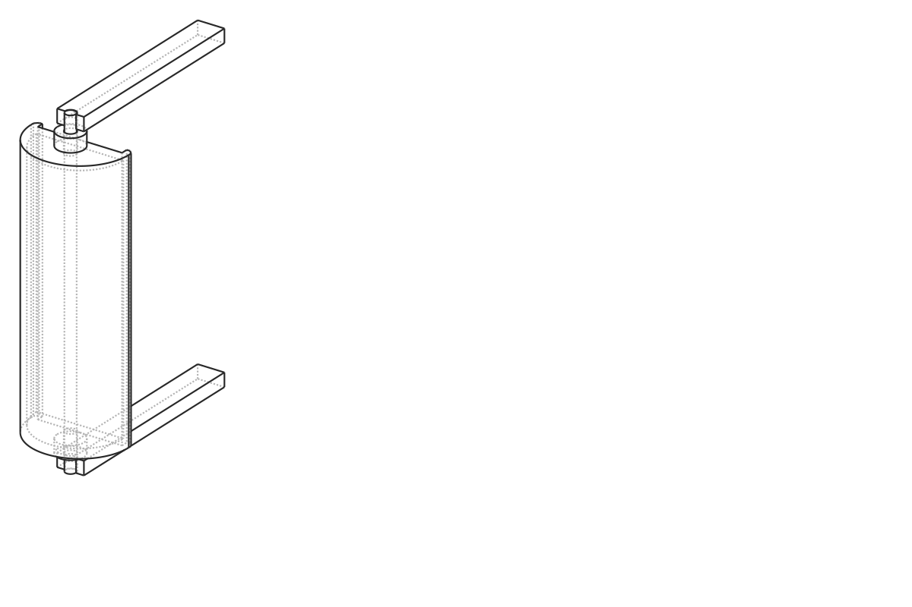 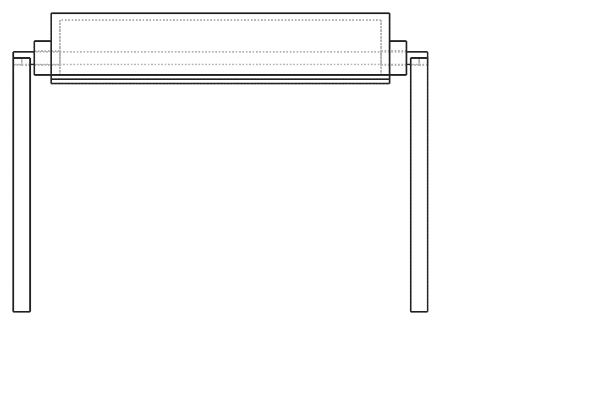 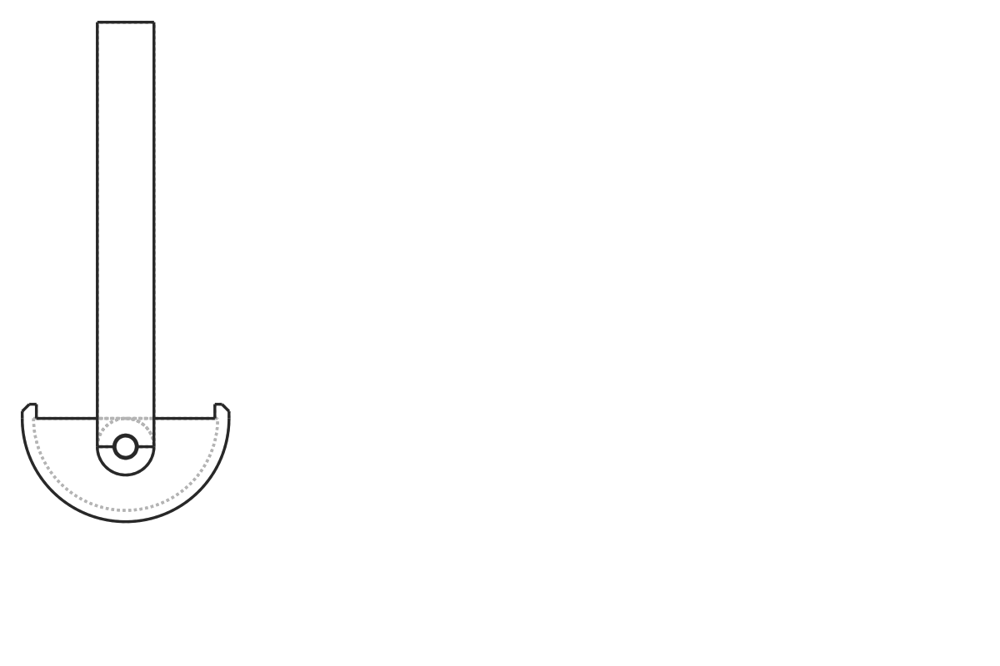


---

<!-- ENTRY date=2026-04-24T04:23:07Z pr=5 -->
<a id="e012"></a>
### 2026-04-24 — Bimodal flexure curve fix v3 · PR #5
**Trigger:** The follow-up render/recompile cycle exposed a CAD issue where the apex carrier appeared to float rather than connect cleanly to the flexure.
**Design:** The flexure curve was corrected so the apex carrier was physically connected in the rendered trough. The iteration tightened the printed geometry before final deterministic re-renders and Edison design review packaging.
**Rationale:** Fix a modeling defect (floating apex carrier) so the printed flexure is physically connected before final renders.

 
 

---

<!-- ENTRY date=2026-04-24T05:17:10Z pr=2 -->
<a id="e013"></a>
### 2026-04-24 — Parametric CAD excavator assembly v2 · PR #2
**Trigger:** Copilot review and Edison v3 feedback flagged mismatches in modeled statics, slot/cam documentation, and the cam-ramp-rise geometry.
**Design:** The CAD assembly and part renders were regenerated after geometry/documentation corrections, especially around the cam ramp and pivot/statics assumptions. This is the final PR #2 CAD-state visual after review-driven tuning.
**Rationale:** Reconcile statics, cam-ramp geometry, and documentation mismatches flagged in review to leave a consistent final PR #2 CAD state.

  


---

<!-- ENTRY date=2026-04-24T07:16:46Z pr=13 -->
<a id="e014"></a>
### 2026-04-24 — Preliminary sieve-cup concepts A/G · PR #13
**Trigger:** @sgbaird-alt asked for preliminary designs for the top recommended alternatives after Edison promoted ERM-assisted sieving over tap-only sieving.
**Design:** The first alternative CAD covered a passive gantry-tapped sieve cup, an ERM-augmented sieve cup, and a tap anvil. It followed the PR #2/#5 procedure with OpenSCAD, STL, iso renders, and a one-day workshop build focus.
**Rationale:** Prototype the Edison-preferred ERM-sieve direction as buildable parts within a one-day workshop scope.

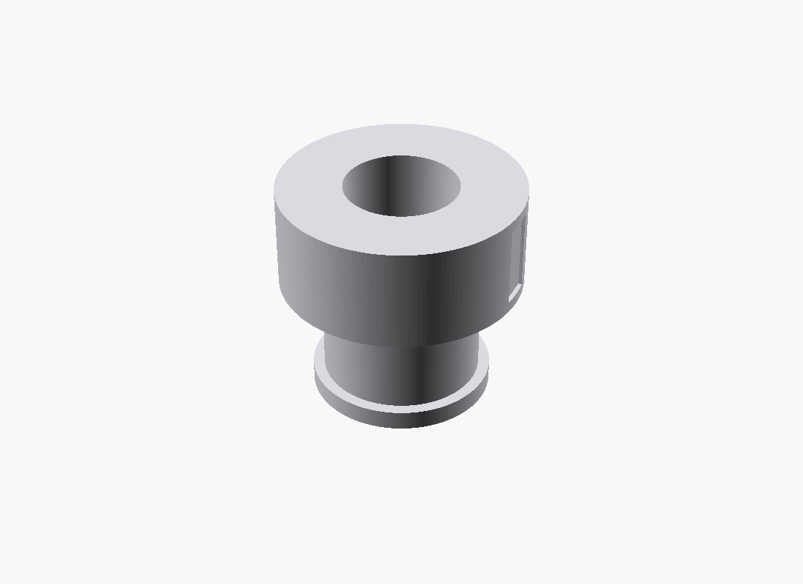 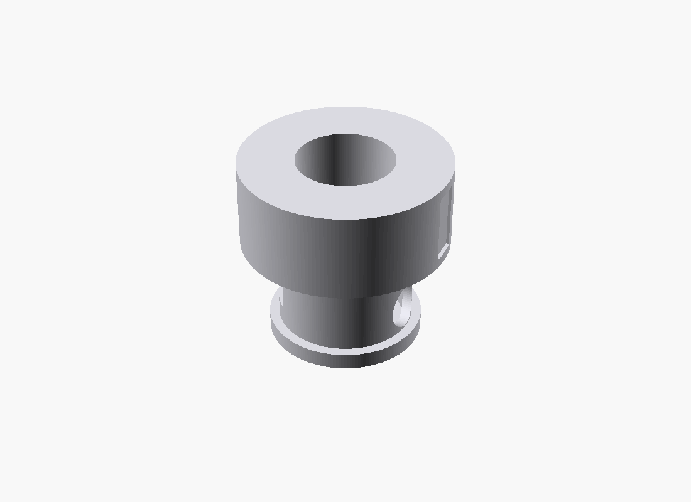 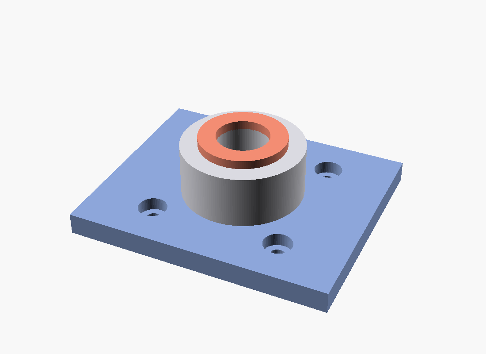
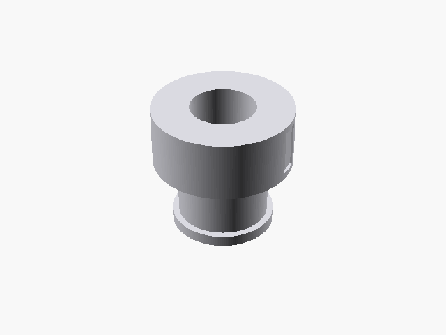 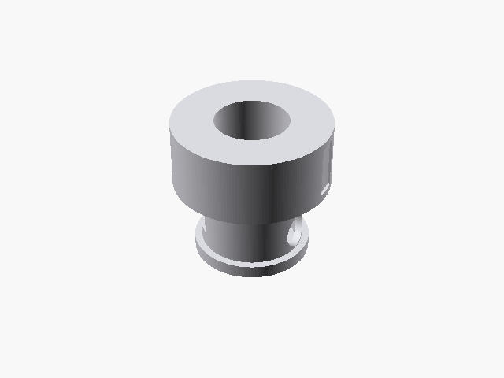 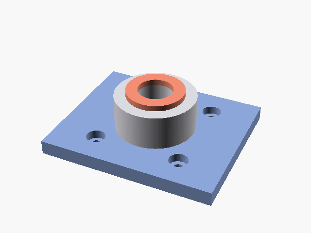

---

<!-- ENTRY date=2026-04-24T19:08:11Z pr=16 -->
<a id="e015"></a>
### 2026-04-24 — Monolithic Archimedes auger preview v1 · PR #16
**Trigger:** @sgbaird noted from issue #1 that the team was moving toward a vertical Archimedes screw with sieve/tapping/vibration options, and PR #16 opened with the initial auger CAD.
**Design:** The first visual preview showed a one-piece rotating helical dispenser with top spindle mount and bottom exit. It established the vertical screw-feed architecture before printability checks.
**Rationale:** Establish the vertical Archimedes screw-feed architecture as the primary direction before printability work.

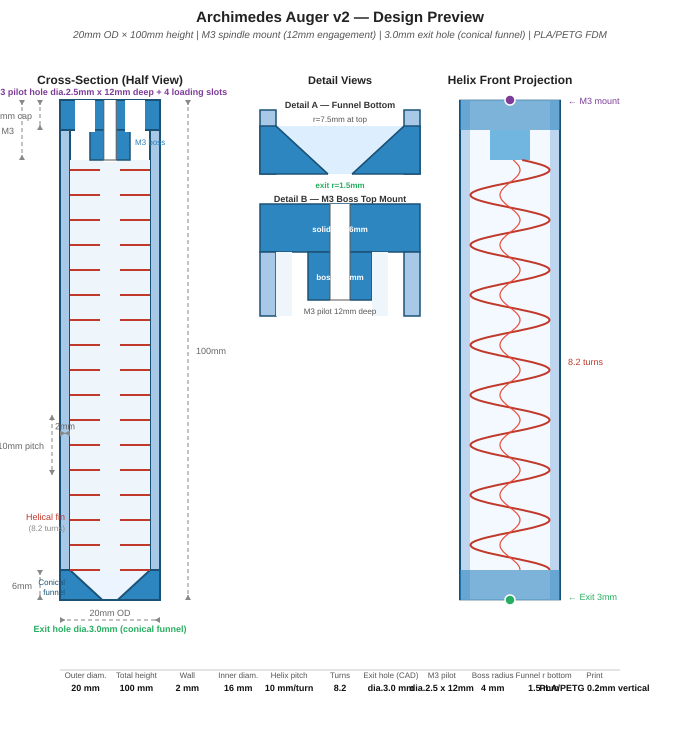

---

<!-- ENTRY date=2026-04-24T19:57:07Z pr=16 -->
<a id="e016"></a>
### 2026-04-24 — Print-ready monolithic auger v2 · PR #16
**Trigger:** @sgbaird asked to make the auger ready for 3D printing, convert to STL, run checks, and fix floating-part errors.
**Design:** The auger was made manifold and printable, with coincident/unsupported internal helix surfaces corrected and Ultimaker-oriented print-prep added. Iso and cutaway renders exposed the tube, internal helix, funnel, and M3 boss.
**Rationale:** Make the auger actually manufacturable — manifold, supported internal helix, correctly print-oriented.

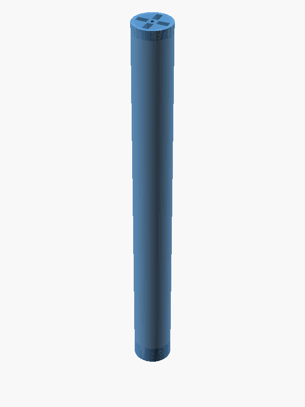 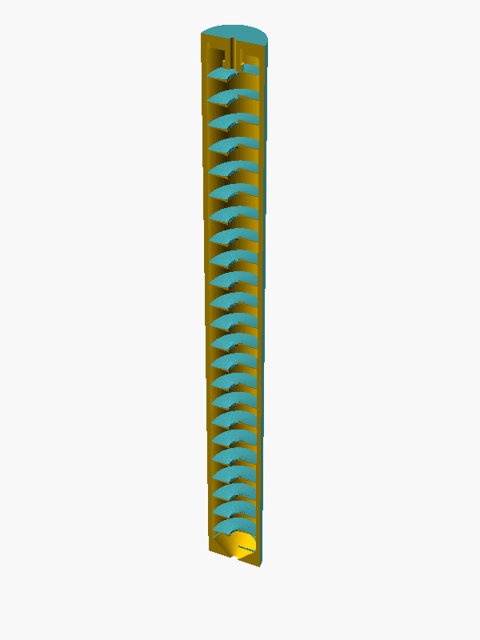

---

<!-- ENTRY date=2026-04-24T20:57:21Z pr=16 -->
<a id="e017"></a>
### 2026-04-24 — Auger internal-helix x-ray views v2.1 · PR #16
**Trigger:** @sgbaird clarified that he could not see the STL/STEP content in the slicer views, meaning the internal helix needed proof visuals.
**Design:** X-ray and layer cross-section views were added to demonstrate that the apparently plain cylinder contained the helix, funnel, loading slots, and exit path. This was a visual/debug iteration rather than a major geometry change.
**Rationale:** Provide proof visuals that the plain-looking cylinder really contains the helix/funnel/slots the slicer could not show.

 

---

<!-- ENTRY date=2026-04-24T23:15:23Z pr=16 -->
<a id="e018"></a>
### 2026-04-24 — Two-part fixed-shaft/rotating-housing auger v3 · PR #16
**Trigger:** @sgbaird said the real auger design should be two parts, with a fixed shaft and an outer tube rotating around it.
**Design:** The auger was refactored into a stationary inner shaft carrying the helix and a rotating outer housing. This changed the mechanism from a monolithic rotor to a more conventional screw-in-tube architecture.
**Rationale:** Adopt a more robust, conventional screw-in-tube split (fixed shaft, rotating housing) matching the intended real design.

 

---

<!-- ENTRY date=2026-04-24T23:20:56Z pr=16 -->
<a id="e019"></a>
### 2026-04-24 — Short workshop-test auger v3.1 · PR #16
**Trigger:** @sgbaird asked for the two-part auger to be made very short so it could print quickly before the workshop ended.
**Design:** The same fixed-shaft/rotating-housing architecture was compressed from 100 mm to 30 mm height. It preserved the fits and helix geometry while reducing print time for fast bench testing.
**Rationale:** Shrink the part so it prints within the remaining workshop time while preserving the fits and helix.

 

---

<!-- ENTRY date=2026-04-24T23:29:41Z pr=13 -->
<a id="e020"></a>
### 2026-04-24 — Alternative A tap-sieve cup · PR #13
**Trigger:** @sgbaird asked to use learnings from PRs #16, #7, #5, and #2 to refine each proposed alternative individually with slices, cross sections, and rotating visuals.
**Design:** Alternative A became a tap-driven sieve cup with dedicated OpenSCAD/STL, iso render, and cutaway. It keeps actuation gantry-mechanical by striking an anvil to meter powder through sieve holes.
**Rationale:** Keep actuation purely gantry-mechanical by tapping an anvil to meter powder through sieve holes (Alternative A).

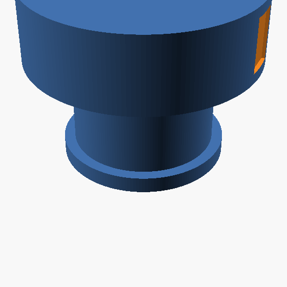 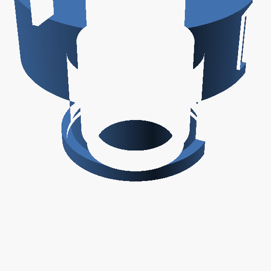
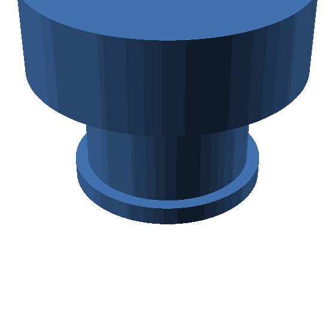

---

<!-- ENTRY date=2026-04-24T23:29:41Z pr=13 -->
<a id="e021"></a>
### 2026-04-24 — Alternative B Pez-style chamber strip · PR #13
**Trigger:** @sgbaird asked to refine each alternative individually and catch print/slicing issues before workshop testing.
**Design:** Alternative B modeled a Pez-like indexed strip of small powder chambers. The design explores discrete volumetric doses by translating chambers past a loading/dispense location.
**Rationale:** Explore discrete volumetric dosing by indexing Pez-like chambers past a dispense point (Alternative B).

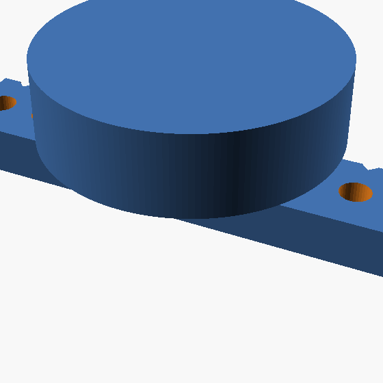 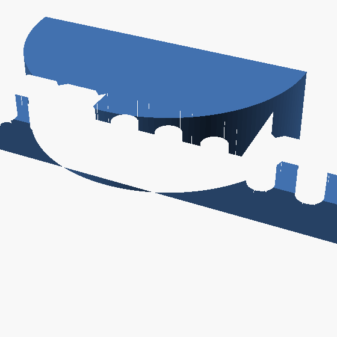
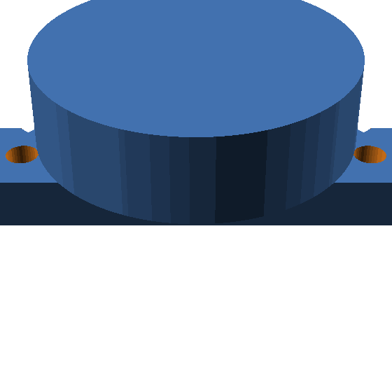

---

<!-- ENTRY date=2026-04-24T23:29:41Z pr=13 -->
<a id="e022"></a>
### 2026-04-24 — Alternative C capillary wiper · PR #13
**Trigger:** @sgbaird asked to treat all A–H alternatives separately and use cutaways to make the mechanisms understandable.
**Design:** Alternative C modeled a capillary pickup/wiper concept that loads powder by contact and meters it by wiping excess. The cutaway exposes the pickup channel and wiper path.
**Rationale:** Test whether contact pickup plus wipe-off can meter powder without a screw (Alternative C).

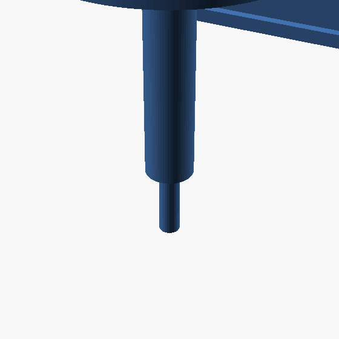 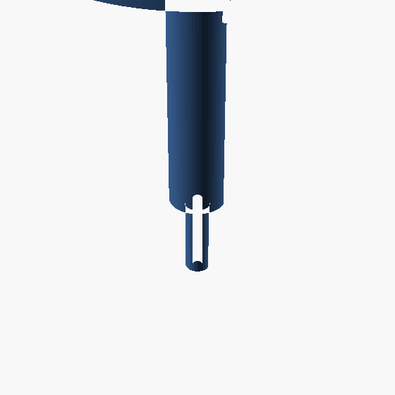
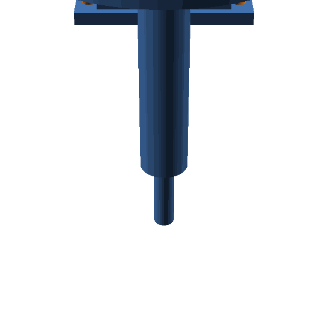

---

<!-- ENTRY date=2026-04-24T23:29:41Z pr=13 -->
<a id="e023"></a>
### 2026-04-24 — Alternative D brush-comb pickup · PR #13
**Trigger:** @sgbaird asked for individual design refinement and cross sections for each brainstormed alternative.
**Design:** Alternative D became a brush/comb pickup that carries powder mechanically and releases it by combing or scraping. The design tests whether bristles/teeth can manage cohesive powders without a full auger.
**Rationale:** Test whether bristles/teeth can carry and release cohesive powder mechanically (Alternative D).

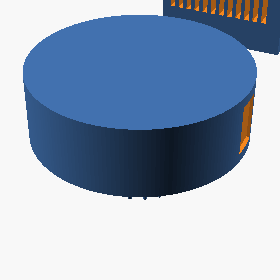 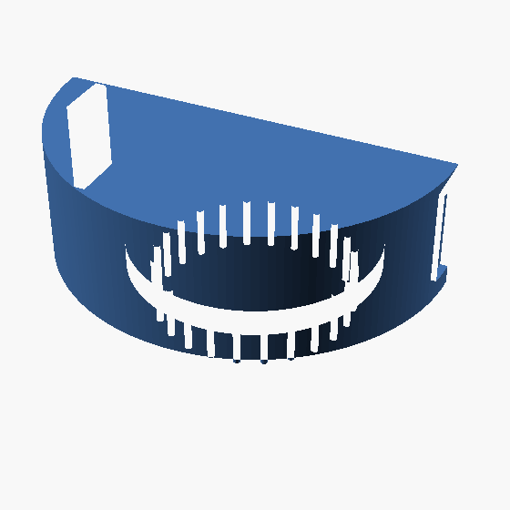
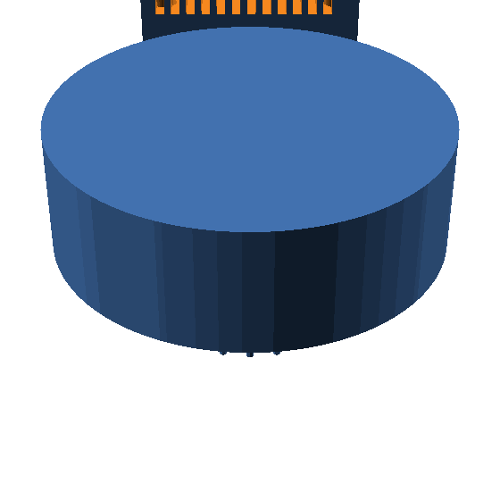

---

<!-- ENTRY date=2026-04-24T23:29:41Z pr=13 -->
<a id="e024"></a>
### 2026-04-24 — Alternative E shaker dispenser · PR #13
**Trigger:** @sgbaird asked for each alternative to be refined with visualizations and slicing so the concepts could be compared.
**Design:** Alternative E modeled a salt-shaker-like oscillating dispenser. It uses holes and vibration/gantry agitation to meter powder, trading dose precision for simplicity.
**Rationale:** Trade dose precision for mechanical simplicity using shaker-style agitation through holes (Alternative E).

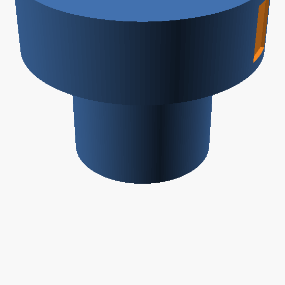 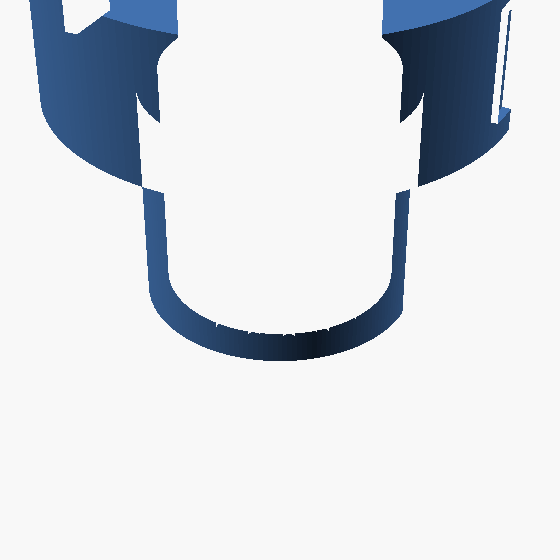
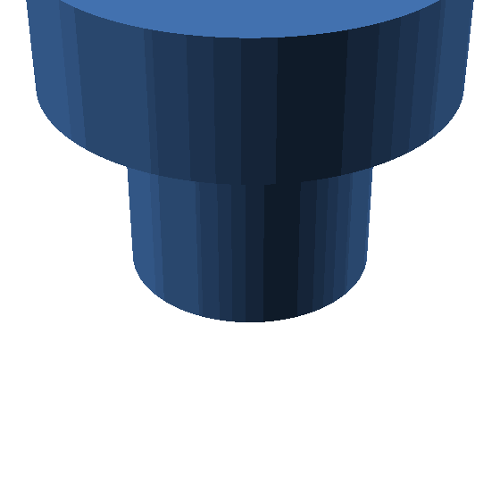

---

<!-- ENTRY date=2026-04-24T23:29:41Z pr=13 -->
<a id="e025"></a>
### 2026-04-24 — Alternative F passive auger · PR #13
**Trigger:** @sgbaird explicitly pointed to PR #16 learnings while asking that each alternative be refined individually.
**Design:** Alternative F captured a passive auger-style dispenser in the A–H comparison set. It borrowed the screw-feed direction from the vertical auger work while keeping the alternative compact for side-by-side evaluation.
**Rationale:** Carry the auger screw-feed principle into a compact, comparable alternative for side-by-side evaluation (Alternative F).

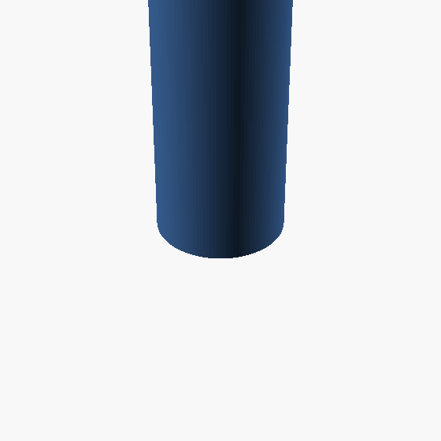 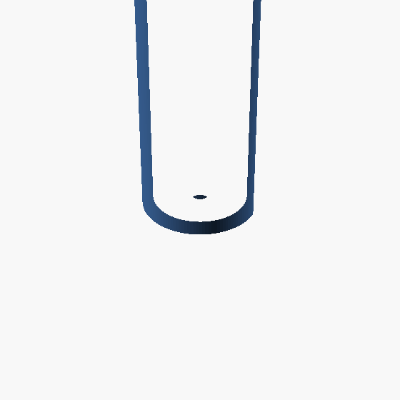
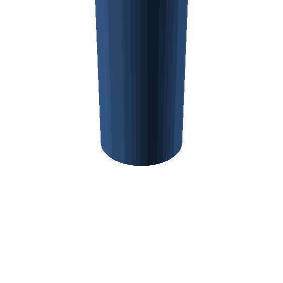

---

<!-- ENTRY date=2026-04-24T23:29:41Z pr=13 -->
<a id="e026"></a>
### 2026-04-24 — Alternative G ERM-augmented sieve · PR #13
**Trigger:** Edison feedback, summarized by @copilot, ranked ERM-augmented sieving above passive tapping because continuous bounded vibration better matches published vibratory-sieve/chute regimes.
**Design:** Alternative G added an ERM vibration path to the sieve-cup concept. The geometry provides motor/battery accommodation while preserving sieve metering as the powder-release primitive.
**Rationale:** Add continuous bounded ERM vibration to better match published vibratory-sieve regimes (Alternative G, ranked highest by Edison).

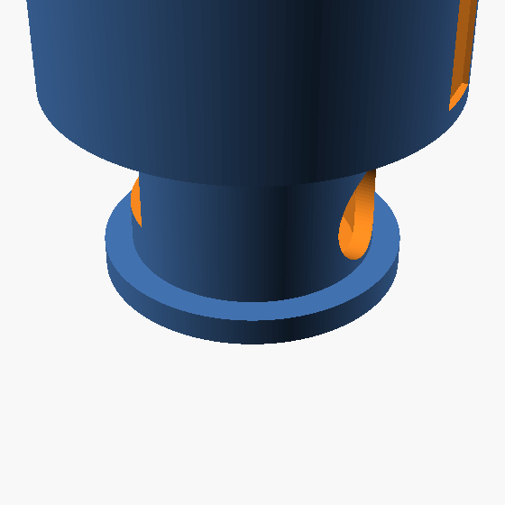 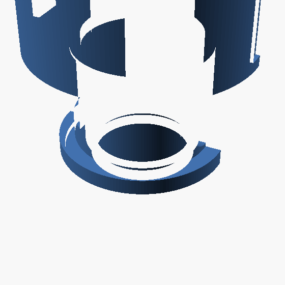
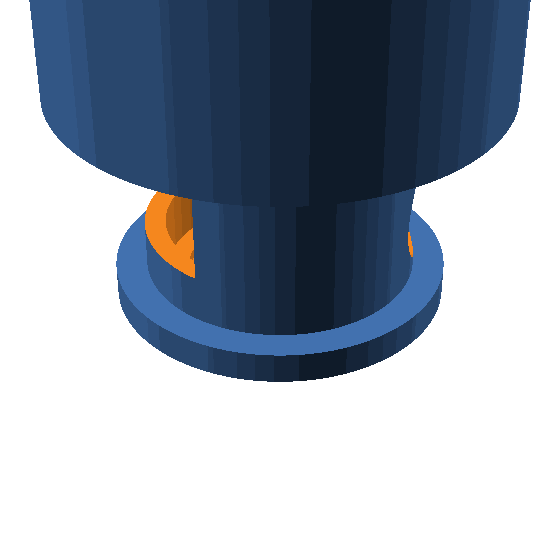

---

<!-- ENTRY date=2026-04-24T23:29:41Z pr=13 -->
<a id="e027"></a>
### 2026-04-24 — Alternative H solenoid-tapped sieve · PR #13
**Trigger:** Issue #12 allowed electronics if useful but warned that added motors/electronics increased one-day workshop risk.
**Design:** Alternative H modeled a solenoid-tapped sieve as the higher-actuation-risk member of the set. It separates the tapping actuator idea from the passive and ERM sieve options for comparison.
**Rationale:** Isolate the higher-risk solenoid-tap actuator as a distinct option to compare against passive and ERM sieving (Alternative H).

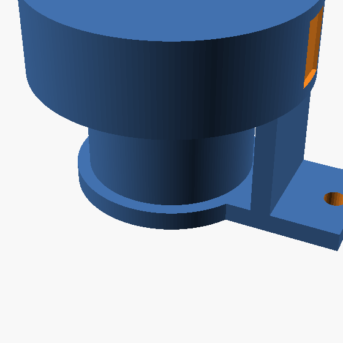 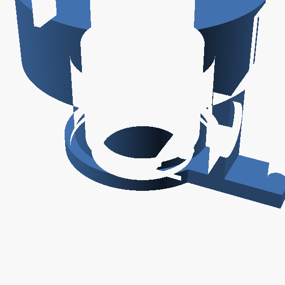
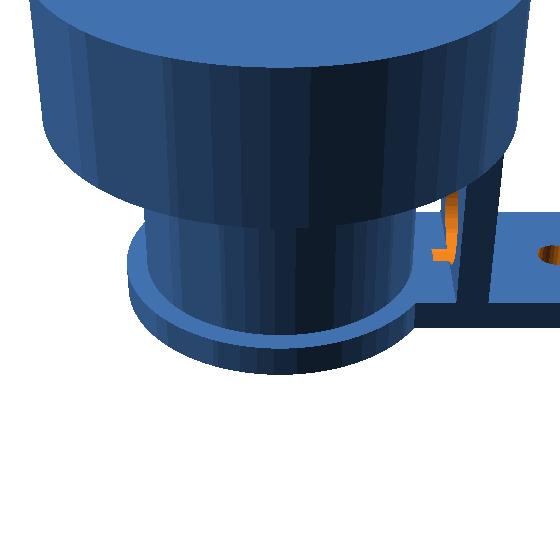

---

<!-- ENTRY date=2026-04-25T02:16:27Z pr=13 -->
<a id="e028"></a>
### 2026-04-25 — A–H annotated explainer panels v2 · PR #13
**Trigger:** @sgbaird said he was not sure what was going on in any of the alternative designs.
**Design:** Each A–H concept received an annotated panel with title, iso, cutaway, numbered parts, and a three-step operating cycle. This did not mainly change geometry; it was a visual iteration to make function and part roles understandable.
**Rationale:** Make each alternative's function legible (numbered parts + 3-step cycle) so the set could be understood and chosen.

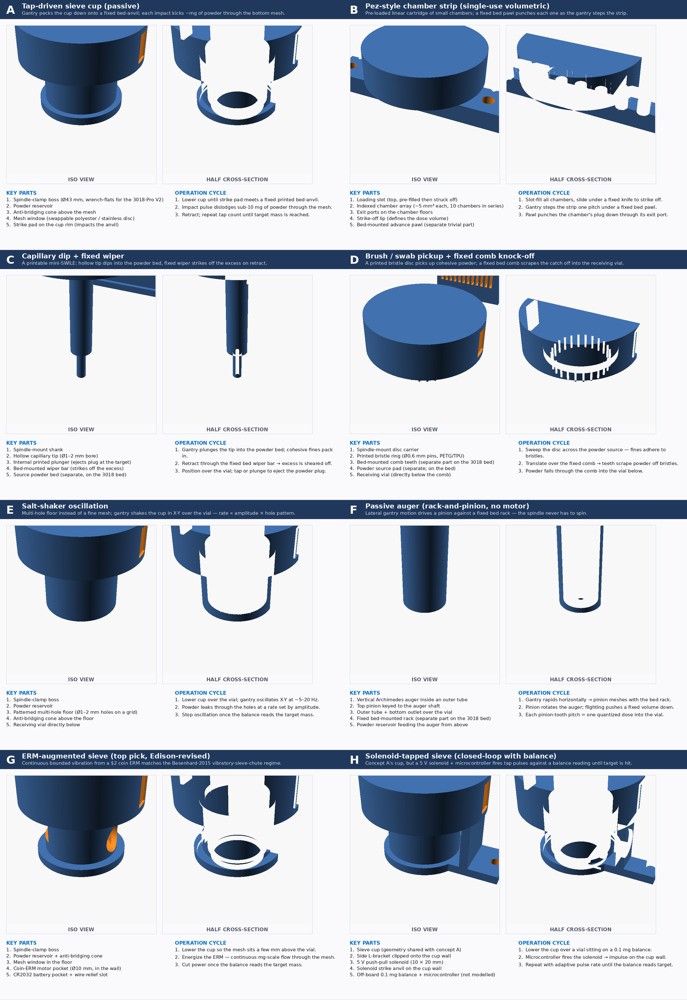 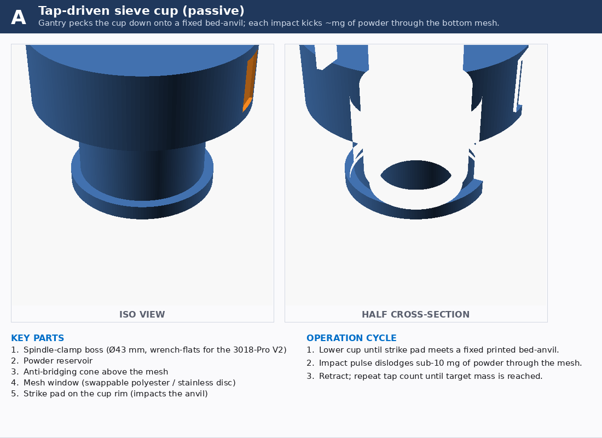 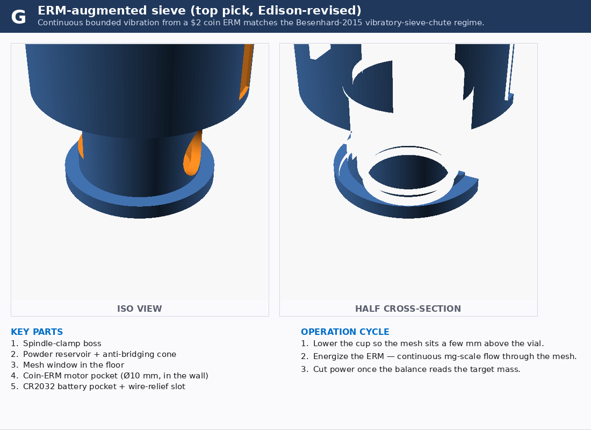
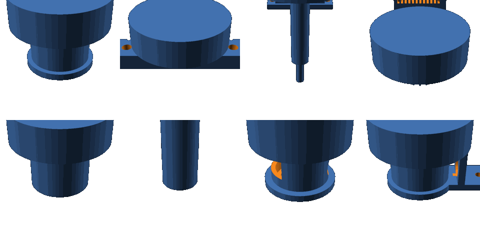

---

<!-- ENTRY date=2026-05-07T21:22:32Z pr=25 -->
<a id="e029"></a>
### 2026-05-07 — Actuator electronics schematic v1 · PR #25
**Trigger:** swcharles opened Issue #24 asking for small externally integrated solenoid/vibration hardware controllable from a Pi Zero 2 W, then requested a real KiCad schematic instead of unclear block/ASCII diagrams.
**Design:** Replaced the informal diagram with a KiCad 7 actuator schematic tying the Pi/bonnet to DRV2605L vibration, DRV8871 solenoid, and stepper-driver blocks, with placeholder symbols and explicitly listed connection assumptions.
**Rationale:** Replace ambiguous block/ASCII diagrams with a real KiCad schematic plus explicit connection assumptions for review.

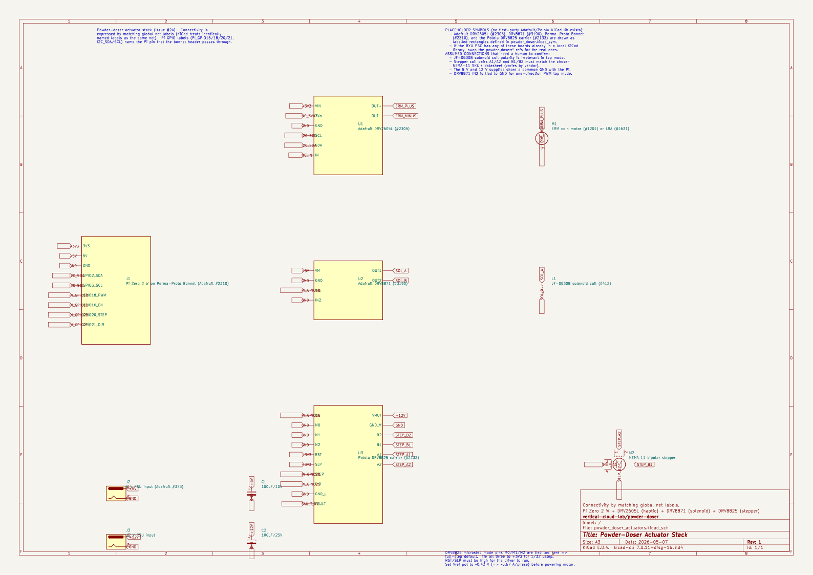

---

<!-- ENTRY date=2026-05-08T20:47:28Z pr=25 -->
<a id="e030"></a>
### 2026-05-08 — Actuator electronics schematic v2 · PR #25
**Trigger:** williamulbz reviewed the KiCad PNG and said net labels overlapped pin labels/routes and related components should be closer together.
**Design:** Re-rendered the schematic with short wire stubs pulling every global net label off the symbol bodies, preserving the functional grouping while making the actuator nets readable.
**Rationale:** Improve schematic readability by pulling net labels off the symbol bodies while keeping the functional grouping.


---

<!-- ENTRY date=2026-05-12T03:50:45Z pr=31 -->
<a id="e031"></a>
### 2026-05-12 — Inward collection cup architecture v1 · PR #31
**Trigger:** sgbaird asked for a visualization of the inward-pointing single collection point idea, preferably CAD with realistic dimensions and labels.
**Design:** Added a parametric CadQuery visualization of 12 Ø30 mm tubes on a 150 mm pitch circle tilted 30° inward toward an Ø80 mm collection cup/load-cell area, plus a 2D top/side sketch to test whether the shared-cup concept was physically plausible.
**Rationale:** Check whether a shared inward-pointing cup for 12 channels is geometrically plausible at realistic dimensions before committing.

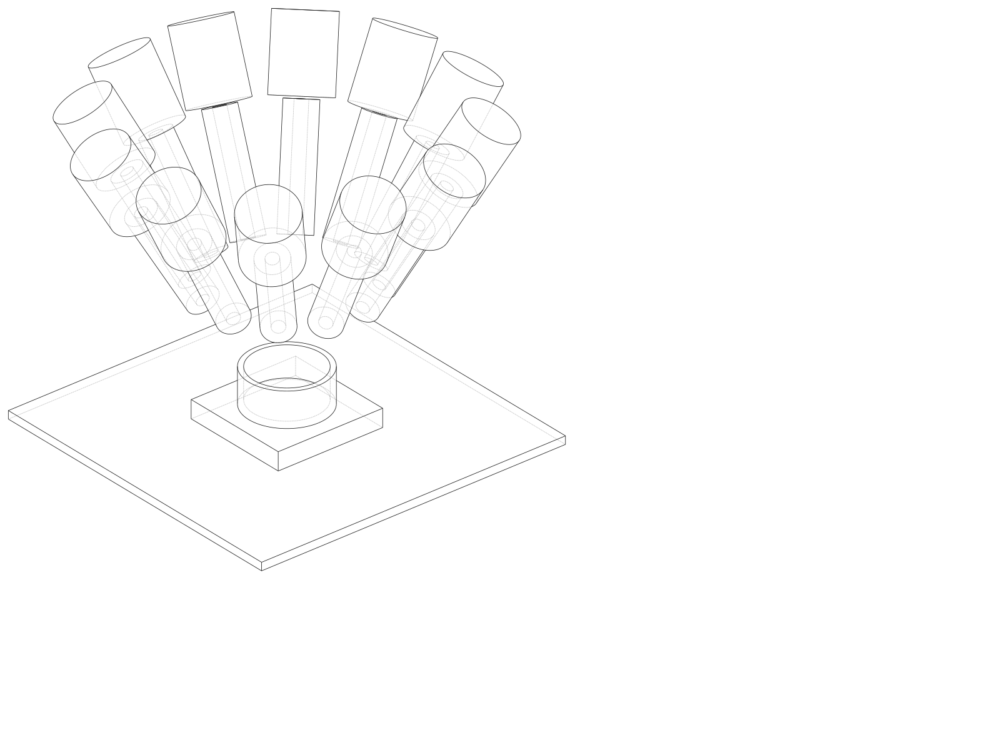 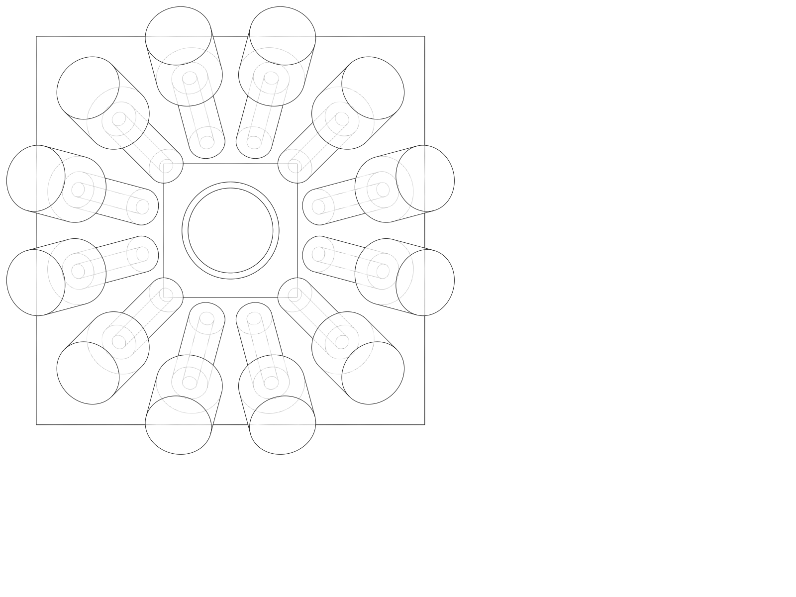 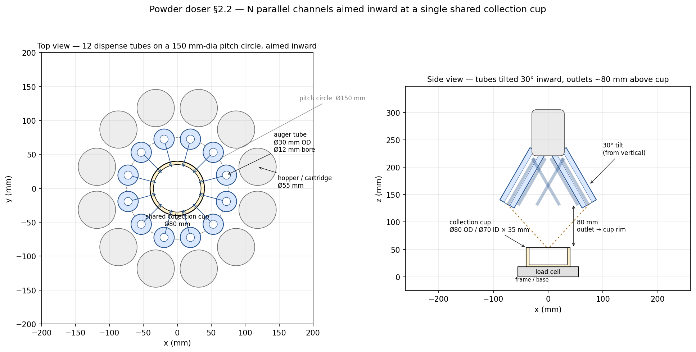

---

<!-- ENTRY date=2026-05-12T04:29:49Z pr=16 -->
<a id="e032"></a>
### 2026-05-12 — Large integrated H2D auger v4 · PR #16
**Trigger:** @sgbaird and @sgbaird-yolo reported that the integrated auger had worked surprisingly well with xanthan gum, leaned away from hoppers due to bridging/ratholing, and asked to assume an H2D printer.
**Design:** The design reverted to a monolithic integrated auger/tube and scaled up to 250 × 25 mm for larger capacity. It intentionally avoided a hopper and left de-bridging to planned solenoid/vibration additions.
**Rationale:** Maximize capacity and dodge hopper bridging/ratholing by reverting to a larger monolithic integrated auger sized for an H2D printer.

 

---

<!-- ENTRY date=2026-05-12T04:54:41Z pr=16 -->
<a id="e033"></a>
### 2026-05-12 — Through-cut loading slots v4.1 · PR #16
**Trigger:** @sgbaird-yolo said he could not see openings to the outside for loading powder into the tube.
**Design:** The top-cap slot cuts were fixed so the four loading slots actually broke through the outside surface. A top-down view was added to verify that powder could enter from the top/drive end.
**Rationale:** Ensure powder can actually be loaded by making the top slots break through to the outside surface.

 

**Outcome** ➡️ Superseded — the four small loading slots were later replaced by a single large top opening with a pour lip ([v6](#e061)).

---

<!-- ENTRY date=2026-05-12T06:03:30Z pr=13 -->
<a id="e034"></a>
### 2026-05-12 — CadQuery-grounded A–H spatial scenes v3 · PR #13
**Trigger:** @sgbaird-yolo said the spatial inconsistencies still were not addressed and suggested using something more physical, such as CAD software.
**Design:** A CadQuery-grounded scene/animator was added so the A–H mechanisms shared physical anchors and clearer load/dispense positions. The visuals move beyond schematic panels toward spatially consistent CAD-based operation frames.
**Rationale:** Anchor the A–H mechanisms in real CAD so their spatial relationships and load/dispense positions stay consistent.

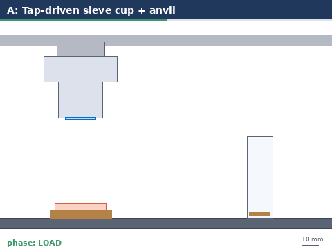  


---

<!-- ENTRY date=2026-05-12T16:38:00Z pr=35 -->
<a id="e035"></a>
### 2026-05-12 — Single-channel powder-doser module v1 · PR #35
**Trigger:** swcharles opened Issue #34 directing Copilot to move forward with Idea B: a repeatable single-channel doser module with integrated motor, vibrator, tapper, angle control, printable files, and images.
**Design:** Created the first CadQuery module package with a printed frame, auger/tube envelope, actuator placeholders, STEP/STL exports, and orthographic renders as an archetype for scaling to many powders.
**Rationale:** Establish a repeatable single-channel module archetype that can scale to many powders (Idea B).

 

---

<!-- ENTRY date=2026-05-12T17:04:05Z pr=37 -->
<a id="e036"></a>
### 2026-05-12 — Bayonet plug sealing cap v1 · PR #37
**Trigger:** swcharles opened Issue #36 asking for several cap/sealer concepts compatible with auger channels so stored/swapped channels would not spill or cross-contaminate.
**Design:** Added a bayonet plug concept: a receiver on the channel end and a twist-lock plug intended to mechanically seal the bore for storage while remaining printable as separate plug/receiver pieces.
**Rationale:** Seal a stored channel bore mechanically with a printable twist-lock plug to prevent spill and cross-contamination.

 

---

<!-- ENTRY date=2026-05-12T17:04:05Z pr=37 -->
<a id="e037"></a>
### 2026-05-12 — Spring hatch sealing cap v1 · PR #37
**Trigger:** swcharles's Issue #36 suggested hatch/linkage-style sealers as one possible way to keep channel powder contained during storage and transfer.
**Design:** Added a spring-hatch concept with a cap base and flap geometry, exploring a normally closed mechanical hatch that could be opened by the downstream dispensing mechanism.
**Rationale:** Explore a normally-closed hatch the downstream mechanism can open, as an alternative sealing primitive.

 

---

<!-- ENTRY date=2026-05-12T17:04:05Z pr=37 -->
<a id="e038"></a>
### 2026-05-12 — Twist shutter sealing cap v1 · PR #37
**Trigger:** swcharles's Issue #36 explicitly listed a twist-like shutter among acceptable cap/sealer mechanisms to brainstorm visually and in CAD.
**Design:** Added a two-disc twist-shutter proof of concept where overlapping sector openings rotate between blocked and aligned states to seal or open the channel outlet.
**Rationale:** Prove a rotating twin-disc shutter can toggle the channel outlet between sealed and open.

 

---

<!-- ENTRY date=2026-05-12T19:14:23Z pr=35 -->
<a id="e039"></a>
### 2026-05-12 — Single-channel powder-doser module v2 · PR #35
**Trigger:** williamulbz reviewed v1 and said the motor blocked powder entry, the plate-and-post frame was unintuitive for 3D printing, cartridges were needed, and powder flow should be visualized.
**Design:** Reworked the module around a printed spine, bearing collar, side-mounted belt drive, removable cartridge hopper, and adjustable cradle, eliminating the top/bottom plate frame and adding a powder-flow render.
**Rationale:** Resolve printability/usability review (motor blocking entry, unintuitive frame) with a spine, belt drive, and swappable cartridge.

 

---

<!-- ENTRY date=2026-05-12T20:58:19Z pr=35 -->
<a id="e040"></a>
### 2026-05-12 — Single-channel powder-doser module v2.0b · PR #35
**Trigger:** swcharles's v2 review said the powder-flow diagram needed a continuous arrow/nodes and requested angle visualizations; the thread also raised cartridge-throat bridging and one-powder-per-auger contamination concerns.
**Design:** Iterated the design visuals by adding a node-based continuous powder-flow diagram with scale, a tilt-sweep render over a cup, and notes that future swappable designs must swap rotor plus cartridge rather than hopper alone.
**Rationale:** Make powder flow and tilt legible, and flag that swaps must replace rotor plus cartridge to avoid contamination.

 

---

<!-- ENTRY date=2026-05-12T22:03:38Z pr=35 -->
<a id="e041"></a>
### 2026-05-12 — Single-channel powder-doser module v3-r1 · PR #35
**Trigger:** sgbaird instructed Copilot to do a comprehensive redesign using Edison Scientific VLM-Judge rounds after swcharles identified mechanically nonsensical parts, obstructions, uncoupled components, and printability concerns.
**Design:** Rewrote the CAD to address swcharles and Edison round-1 findings, including floating cartridge placement, solenoid plunger orientation, cradle/base relationships, exploded-looking brackets, and ERM placement in the flow path.
**Rationale:** Use Edison VLM-Judge rounds to fix the mechanically nonsensical, floating, and uncoupled parts flagged in review.

 

**Outcome** ⚠️ Edison round 2 caught new geometry bugs introduced by these edits (bracket/rotor interference, belt-plane height, clearances), fixed in [v3-r2](#e042).

---

<!-- ENTRY date=2026-05-12T22:12:08Z pr=35 -->
<a id="e042"></a>
### 2026-05-12 — Single-channel powder-doser module v3-r2 · PR #35
**Trigger:** Edison round 2 caught new geometry bugs introduced by the v3-r1 edits, including cheek-axis placement, bracket/rotor interference, belt-plane height, stale sketch dimensions, and pivot-height clearance.
**Design:** Folded in the second judge pass by moving the cheek workplane/offset logic, trimming the motor bracket away from the rotor, raising the belt plane, synchronizing the sketch, and raising the pivot to avoid cradle-base interference at high tilt.
**Rationale:** Clear the new geometry bugs the judge caught (interference, belt-plane, clearances) that the prior pass introduced.

 

---

<!-- ENTRY date=2026-05-13T15:32:46Z pr=35 -->
<a id="e043"></a>
### 2026-05-13 — Single-channel powder-doser module v4 · PR #35
**Trigger:** swcharles's next review ordered a v4 with full-assembly STL, lower pivot near the mouth, a true single-body bracket, labels, larger belt interface, and A&D scale/cup context.
**Design:** Lowered the tilt pivot from high on the spine to near the outlet, added a continuous bracket gusset, enlarged the rotor pulley/belt, added scale and cup context, exported full assembly STLs, and added a labeled component diagram.
**Rationale:** Lower the pivot to the outlet and strengthen/scale the bracket and belt per review, with real assembly STLs and scale context.

  

---

<!-- ENTRY date=2026-05-13T22:14:50Z pr=16 -->
<a id="e044"></a>
### 2026-05-13 — Central-supported helix v4.2 · PR #16
**Trigger:** @sgbaird-yolo reported that the print failed: the outer tube was fine but the inner screw became strings, matching the slicer's floating-cantilever warning.
**Design:** A central support shaft was added under the helix so the inner fin edge had material to land on during printing. This fixed the unsupported internal screw print failure, but introduced concern about powder trapping.
**Rationale:** Give the unsupported inner screw material to land on (a central shaft) to fix the strings/print failure.

 

**Outcome** ⚠️ Fixed the unsupported-screw print failure, but the added central core risked trapping powder; superseded by the hollow-core [v5](#e045).

---

<!-- ENTRY date=2026-05-13T22:23:01Z pr=16 -->
<a id="e045"></a>
### 2026-05-13 — Hollow-core auger v5 · PR #16
**Trigger:** @sgbaird-yolo said to leave the inner core out, enlarge the empty core space to reduce cantilevering, and avoid powder getting trapped.
**Design:** The inner core/central shaft was removed and the funnel was lengthened to improve self-supporting geometry. This kept the integrated auger but restored a hollow core better suited for powder flow and cleanup.
**Rationale:** Remove the central core to stop powder trapping and reduce cantilever, restoring a flow-friendly hollow bore.

 

---

<!-- ENTRY date=2026-05-14T15:28:17Z pr=37 -->
<a id="e046"></a>
### 2026-05-14 — Bayonet plug sealing cap v2 · PR #37
**Trigger:** swcharles reviewed the v1 bayonet and said the idea was good but the housing holes were blocked/not large enough, asking for assembly views and interference checks.
**Design:** Revised the bayonet geometry with widened J-slots, corrected ear/slot clearances, a locked/inserted assembly model, an interference check, and an exploded render showing how the plug engages the receiver.
**Rationale:** Open the blocked bayonet housing holes and verify engagement via assembly, interference, and exploded views.

 

---

<!-- ENTRY date=2026-05-14T15:28:17Z pr=37 -->
<a id="e047"></a>
### 2026-05-14 — Spring hatch sealing cap v2 · PR #37
**Trigger:** swcharles reviewed the spring-hatch STLs and said the design did not make sense visually, asking how the pieces fit together and requesting assembly/process diagrams.
**Design:** Converted the hatch into a unified PETG flexure print with base, flap, cam tab, and living-hinge webs as one body, while adding reference/exploded visuals to explain the flap-window-hinge relationship.
**Rationale:** Make the hatch buildable and understandable as one PETG living-hinge body with explanatory views.

 

---

<!-- ENTRY date=2026-05-14T15:28:17Z pr=37 -->
<a id="e048"></a>
### 2026-05-14 — Twist shutter sealing cap v2 · PR #37
**Trigger:** swcharles reviewed the twist shutter and asked what held the common-axis plates together, suggesting a screw or another retention mechanism so the plates would not fall apart.
**Design:** Added an M3 pan-head screw, clearance bore, top counterbore, captive M3 nut pocket, and exploded assembly render so the two shutter discs have a defined pivot/retainer and visible assembly order.
**Rationale:** Give the twin shutter discs a defined pivot/retainer (M3 screw + captive nut) so they cannot fall apart.

 

---

<!-- ENTRY date=2026-05-14T19:55:10Z pr=47 -->
<a id="e049"></a>
### 2026-05-14 — Auger bracket v1 · PR #47
**Trigger:** swcharles opened issue #46 asking Copilot to model a shaft-collar-like auger bracket from the sketch, with free-spinning tolerance, mounting holes, a screw clamp, rounded collar/plate transition, ready-to-print STL, and an explanatory diagram.
**Design:** Created the first parametric split shaft-collar auger bracket with a rectangular mounting plate, top tightening ears, collar/plate fillets, STL/STEP output, and assembly/renders. The initial bore was sized from an assumed small auger OD pending a real auger reference.
**Rationale:** Produce the first printable shaft-collar bracket to the sketch; bore sized provisionally pending a real auger reference.

 

---

<!-- ENTRY date=2026-05-14T20:12:48Z pr=47 -->
<a id="e050"></a>
### 2026-05-14 — Auger bracket v2 · PR #47
**Trigger:** williamulbz reviewed the assembly render and said the shaft-holding portion looked good, but the upper tightening-screw portion was not securely connected to the collar body and could fail.
**Design:** Integrated the clamp ears into the collar by sinking them into the collar wall, adding a fillet at the tab/collar joint, and thinning the top feature. This made the tightening-screw tabs grow continuously out of the collar instead of sitting on top of it.
**Rationale:** Tie the clamp ears into the collar wall so the tightening tabs cannot shear off the top.

 

---

<!-- ENTRY date=2026-05-14T20:22:31Z pr=47 -->
<a id="e051"></a>
### 2026-05-14 — Auger bracket v3 · PR #47
**Trigger:** swcharles reviewed v2 and clarified that the screw hole should remain centered between the part top and the collar-circle top, while the tabs should be thinner along the screw axis so the tightening screw passes through less material.
**Design:** Slimmed the clamp ears along the screw axis and raised the tab height so the M3 hole stayed centered with wall above and below. The change shortened the screw path while preserving a usable centered clamp hole.
**Rationale:** Center the M3 clamp hole with wall above and below and shorten the screw path through thinner tabs.

 

---

<!-- ENTRY date=2026-05-14T21:03:47Z pr=47 -->
<a id="e052"></a>
### 2026-05-14 — Auger bracket v4 · PR #47
**Trigger:** swcharles asked Copilot to use issue/PR #16 as the auger reference because the auger should be about 25 mm in diameter, then resize the brackets and report dimensions.
**Design:** Resized the bracket around a 25 mm auger OD with a 25.5 mm free-running bore, 33.5 mm collar OD, wider/deeper mounting plate, and longer assembly spacing for the 250 mm auger. This replaced the initial assumed small-shaft sizing with geometry tied to the printed auger design.
**Rationale:** Re-size the bracket to the real 25 mm PR #16 auger (25.5 mm running bore) instead of the assumed small shaft.

 

---

<!-- ENTRY date=2026-05-14T21:54:17Z pr=49 -->
<a id="e053"></a>
### 2026-05-14 — Geared Archimedes auger assembly v1 · PR #49
**Trigger:** swcharles opened issue #48 asking for a new auger based on #16 with external gear teeth about one-third toward the dispensing end, no internal auger changes, plus a matching NEMA stepper pinion and reported gear ratio.
**Design:** Created the first geared Archimedes auger and NEMA 11 pinion CAD set with gear/mesh preview renders. The design established the external toothed band and separate motor pinion, but later print/review feedback found that the auger internals had been altered and the gear/pinion layout was too small for motor clearance.
**Rationale:** Add an external gear band one-third toward the exit plus a NEMA pinion to drive the auger; first geared CAD for review.

  

**Outcome** ❌ Print and review found the auger internals had been altered and the gear/pinion layout was too small for motor clearance; superseded by [v2](#e055).

---

<!-- ENTRY date=2026-05-14T22:38:06Z pr=45 -->
<a id="e054"></a>
### 2026-05-14 — Satellite rev-a PCB v1 · PR #45
**Trigger:** williamulbz first asked for a topology-C PCB outline, then explicitly asked Copilot to design the PCB in KiCad as described in §3.4; swcharles forwarded the request.
**Design:** Added a KiCad 7 satellite PCB project for topology C with a 50 × 50 mm two-layer outline, M3 mounting pattern, RP2040, TMC2209 socket, DRV8871, DRV2605L, USB-C, 12 V, stepper, solenoid, ERM, servo, buttons, LED, and labeled control nets. The placement/renders were intended for review before follow-up copper routing.
**Rationale:** Lay out a reviewable topology-C satellite PCB (RP2040 + drivers) before committing to copper routing.

 

---

<!-- ENTRY date=2026-05-15T13:54:34Z pr=49 -->
<a id="e055"></a>
### 2026-05-15 — Geared Archimedes auger assembly v2 · PR #49
**Trigger:** swcharles commented that the first print meshed well, but the Archimedes screw was gone, the solid gear blocked powder flow, and the NEMA motor could not sit behind the pinion without interfering with the auger.
**Design:** Revised the geared auger with an open bore through the gear band, a larger 48-tooth auger gear, 16-tooth pinion, 32 mm center distance, and NEMA 11 assembly preview. The change addressed powder-flow blockage and motor-clearance issues while updating the reported gear ratio.
**Rationale:** Restore powder flow and motor clearance with an open gear bore, a larger 48T gear, and a 32 mm center distance.

  

**Outcome** ⚠️ The gear meshed and the motor cleared, but slicer inspection found the internal auger core missing; superseded by full-length [v3](#e056).

---

<!-- ENTRY date=2026-05-15T16:59:31Z pr=49 -->
<a id="e056"></a>
### 2026-05-15 — Geared Archimedes auger full-length v3 · PR #49
**Trigger:** williamulbz reported from slicer inspection that the inner auger core was completely missing and instructed Copilot not to submit new files unless the internal auger was confirmed present.
**Design:** Restored the central shaft and continuous helical Archimedes fin through the geared auger, keeping the v2 gear adjustments while adding cross-section renders to verify the core. Shared geometry was moved into a common core so future full and short variants could not drift apart.
**Rationale:** Restore the missing internal helix/shaft and share a common core so the full and short variants cannot diverge.

 

---

<!-- ENTRY date=2026-05-15T16:59:31Z pr=49 -->
<a id="e057"></a>
### 2026-05-15 — Geared Archimedes auger short alternate v1 · PR #49
**Trigger:** williamulbz also requested a separate shorter alternate, trimming 5–8 cm from the length between the gear and the “+” loading side while keeping the auger shape continuous.
**Design:** Added a short geared auger alternate, reducing total height from 250 mm to 180 mm by trimming the body above the gear band while preserving the gear-to-dispensing-end distance. Cross-section imagery verified that the internal helix remained continuous in the shortened part.
**Rationale:** Provide a shorter alternate (250→180 mm) while keeping the gear-to-exit distance and a verified continuous helix.

 

---

<!-- ENTRY date=2026-05-15T18:40:16Z pr=47 -->
<a id="e058"></a>
### 2026-05-15 — Auger bracket v5 · PR #47
**Trigger:** williamulbz noted that the larger gear in the geared auger from PR #49 required the auger to be lifted higher from the baseplate so the gear would not contact it.
**Design:** Increased the bracket plate thickness from 4 mm to 14 mm, lifting the collar and auger bore while keeping the clamp/collar geometry tied to the new height. The revised bracket gave the Ø50 mm gear radial clearance above the baseplate while preserving through mounting holes.
**Rationale:** Thicken the bracket plate (4→14 mm) to lift the Ø50 mm gear clear of the baseplate.

 

---

<!-- ENTRY date=2026-05-15T19:32:02Z pr=51 -->
<a id="e059"></a>
### 2026-05-15 — Tap collar assembly v1 · PR #51
**Trigger:** swcharles opened issue #50 asking for an independent tap collar around the auger with an integrated coin vibration motor and solenoid, plus a separate mounting plate with a hardstop so cords would not wind up.
**Design:** Created the first parametric tap-collar assembly: a split collar with clamp tabs and motor/solenoid mounting features, plus a separate bracket-like mount plate and raised hardstop. The design followed the issue sketch and reused bracket-family sizing concepts from PRs #46/#47.
**Rationale:** Build an independent tap collar (coin motor + solenoid) with a cord-winding hardstop per the issue sketch.

  

---

<!-- ENTRY date=2026-05-15T20:22:01Z pr=59 -->
<a id="e060"></a>
### 2026-05-15 — Hinged mounting plate + baseplate assembly v1 · PR #59
**Trigger:** swcharles opened issue #58 asking for a CADsmith foundation tying together the auger, brackets, tap collar, NEMA motor, cup, and scale, with a hinge on the auger discharge axis and linear-actuator tilt from 0° to 90°.
**Design:** Created the initial hand-authored CAD package for a printable mounting plate and elevated baseplate: placeholder upstream components, hinge coaxial with powder discharge, linear-actuator placeholder, cup/scale clearance, installation diagrams, powder-flow diagram, and 0°/45°/90° tilt renders.
**Rationale:** Lay a CADsmith foundation tying all parts together with a hinge on the discharge axis and 0–90° tilt.

 

---

<!-- ENTRY date=2026-05-15T22:31:39Z pr=16 -->
<a id="e061"></a>
### 2026-05-15 — Large top opening with pour lip v6 · PR #16
**Trigger:** @sgbaird-alt asked for one larger top opening and a small cup/funnel-like interface so powder would be easier to pour in.
**Design:** The four small loading slots were replaced by a single large pie-slice opening plus a one-sided pour lip/slide. This made loading less fiddly while keeping the change small and non-invasive.
**Rationale:** Make loading less fiddly with one large opening plus a pour lip, kept minimal and non-invasive.

  

**Outcome ✅ — printed & bench-tested** (issue [#16](https://github.com/vertical-cloud-lab/powder-doser/issues/16), @sgbaird): the auger printed cleanly (oriented upside-down to avoid a floating internal region) and was run with NaCl. ▶ [NaCl dispensing test](https://youtu.be/5nx-SDRfRgg)

 

---

<!-- ENTRY date=2026-05-18T12:49:12Z pr=53 -->
<a id="e062"></a>
### 2026-05-18 — Parametric auger clamp bracket v1 · PR #53
**Trigger:** swcharles opened issue #52 asking for a zoo.dev-generated bracket matching the sketch: a shaft-collar-like part that fits around the #16 auger with tolerance, is polished for 3D printing, and shows the auger fitting into two brackets.
**Design:** Added an OpenSCAD split shaft-collar bracket for the 25 mm OD auger with 0.8 mm diametral clearance, 4 mm ring wall, 2 mm top slit, M3 pinch ears, a flat print-on mounting plate, and hull-style smooth ring-to-plate transitions.
**Rationale:** Match the sketch with a one-piece printable shaft-collar bracket toleranced to the 25 mm auger.

 

---

<!-- ENTRY date=2026-05-18T12:51:55Z pr=55 -->
<a id="e063"></a>
### 2026-05-18 — CADsmith-style auger bracket v1 · PR #55
**Trigger:** After issue #54 requested a CADsmith bracket, swcharles commented that the agent should pull the auger from #16 and move forward, anticipating CADsmith-style models would be better than the current efforts.
**Design:** Added a parametric CadQuery split shaft-collar plus mounting-flange bracket around the PR #16 25 mm auger: 25.4 mm bore, 5 mm ring wall, 15 mm collar width, 2 mm clamp slit, M3 clamp screw, filleted flange, STEP/STL exports, and an assembly render with two brackets supporting the auger.
**Rationale:** Provide a CADsmith-style CadQuery split-collar-plus-flange bracket around the real PR #16 auger.

 

---

<!-- ENTRY date=2026-05-18T13:08:02Z pr=53 -->
<a id="e064"></a>
### 2026-05-18 — Parametric auger clamp bracket v2 · PR #53
**Trigger:** swcharles reviewed v1 and asked why a pyramidical-looking base had been added, emphasizing that the whole thing should be one piece and should stay as close as possible to the original drawing.
**Design:** Rewrote the bracket as a single 2D front-profile extrusion: ring, ears, slit, tangent flanks, and plate all share one uniform 10 mm depth, eliminating the pyramidal/frustum base while retaining the flat print face and M3 clamp/mount holes.
**Rationale:** Return to a single-piece, drawing-faithful profile by removing the pyramidal base via one uniform extrusion.

 

---

<!-- ENTRY date=2026-05-18T13:30:01Z pr=57 -->
<a id="e065"></a>
### 2026-05-18 — Mounting plate + hinged baseplate v1 · PR #57
**Trigger:** swcharles opened issue #56 asking for a compact printable foundation for the powder doser, with through-holes for all parts, a hinge axis through the auger dispensing point, a baseplate, linear actuator, and room underneath for a cup and scale.
**Design:** Created the first mounting-plate/baseplate assembly using placeholders for the auger, brackets, tap collar, NEMA motor, actuator, cup, and scale, plus labeled install diagrams, a powder-flow view, and 0°/45°/90° rotation about the dispensing axis.
**Rationale:** Establish a compact printable foundation with through-holes, a discharge-axis hinge, and cup/scale room (placeholders).

 

---

<!-- ENTRY date=2026-05-18T13:30:01Z pr=66 -->
<a id="e066"></a>
### 2026-05-18 — Mounting-plate/baseplate assembly v1 · PR #66
**Trigger:** @swcharles opened issue #62 asking for a printable baseplate, mounting plate, hinge, assembly, and dimensioned drawing based on the powder-doser module layout.
**Design:** The first assembly placed the module on a hinged mounting plate over a baseplate, with installation, powder-flow, and 0/45/90-degree rotation visuals to establish the dispense-axis hinge concept.
**Rationale:** Establish the dispense-axis hinge concept on a baseplate from the module layout, with rotation and flow visuals.


---

<!-- ENTRY date=2026-05-18T14:04:18Z pr=57 -->
<a id="e067"></a>
### 2026-05-18 — Mounting plate + hinged baseplate v2 · PR #57
**Trigger:** swcharles commented that v1 was promising but used placeholders where actual #46 sub-issue parts existed, making placements such as the motor nonsensical because the motor gear must mesh with the auger gear.
**Design:** Rebuilt the assembly around real upstream geometry imported from PR #49 (geared auger, pinion, NEMA 11), PR #51 (tap collar), and PR #55 (auger bracket), changing the layout to a parallel-axis pinion/motor relationship and updating the mounting plate/baseplate views accordingly.
**Rationale:** Replace nonsensical placeholders with real PR #49/#51/#55 geometry so the motor pinion actually meshes the auger gear.

 

---

<!-- ENTRY date=2026-05-18T14:04:18Z pr=66 -->
<a id="e068"></a>
### 2026-05-18 — Real-geometry mounting assembly v2 · PR #66
**Trigger:** @swcharles commented on PR #57 that placeholders were insufficient and asked Copilot to import the actual CAD from #46 sub-issues so the motor, auger, brackets, and tap collar would be mounted correctly.
**Design:** The assembly was rebuilt against real upstream geometry from PRs #49, #51, and #55, replacing nonsensical placeholder placement with the NEMA 11 pinion/auger gear mesh, actual bracket holes, tap-collar mount, and clearance slot.
**Rationale:** Mount the real imported parts correctly so gear mesh, bracket holes, and tap-collar placement are physically valid.


---

<!-- ENTRY date=2026-05-18T14:52:24Z pr=51 -->
<a id="e069"></a>
### 2026-05-18 — Tap collar assembly v2 · PR #51
**Trigger:** swcharles reviewed v1 and said the collar interfered with the mounting plate, the hardstop was too tall, the collar was too thin for the servo/solenoid holes, and the motor mounting plates were fragile.
**Design:** Reduced the hardstop to a short bump that the lower clamp tab could hit, lengthened the collar along the auger axis, and rebuilt the mounting pads as gusseted tapered wedges. The update eliminated the obvious hardstop/collar interference and put the actuator holes over solid collar material.
**Rationale:** Remove collar/plate interference, put the actuator holes over solid material, and strengthen the fragile motor pads.

 

---

<!-- ENTRY date=2026-05-18T16:22:18Z pr=51 -->
<a id="e070"></a>
### 2026-05-18 — Tap collar assembly v3 · PR #51
**Trigger:** swcharles said the hardstop was much better but asked for a countersink so the hardstop top stayed flat, a collar-shaped relief in the mounting plate with bracket-like tolerance, and stronger rectangular motor/solenoid pad roots.
**Design:** Added a flat-head countersink to the hardstop screw, cut a half-cylindrical relief into the plate for free collar rotation, and replaced fragile pad geometry with reinforced rectangular slabs sunk into the collar with fillets. The change used the bracket reinforcement idea as a template.
**Rationale:** Keep the hardstop flat (countersink), free collar rotation (plate relief), and reinforce pads using the bracket template.

 

---

<!-- ENTRY date=2026-05-18T17:12:47Z pr=61 -->
<a id="e071"></a>
### 2026-05-18 — Single-Pico-W test-module schematic v1 · PR #61
**Trigger:** @williamulbz opened issue #60 requesting a one-microcontroller electrical/software test module for dispensing angle, tapping, vibration, and auger rotation using parts from #25.
**Design:** The initial KiCad schematic connected a Pico-class controller to the stepper, haptic driver, solenoid driver, servo, buck regulator, and bench wiring contract for a single module.
**Rationale:** Stand up a one-microcontroller bench rig to exercise angle, tap, vibration, and rotation from the #25 parts.


---

<!-- ENTRY date=2026-05-18T17:39:09Z pr=63 -->
<a id="e072"></a>
### 2026-05-18 — Offset-hinge mounting plate v1 · PR #63
**Trigger:** @swcharles' issue #62 sketch asked for a baseplate/mounting plate with green-hole mounting points, a hinge at the base, 0/90-degree motion, and dimensions inferred from the real parts.
**Design:** This parametric CAD iteration produced the printable mounting plate, baseplate, hinge pin, 0/45/90-degree assembly renders, and an engineering drawing documenting the inferred hole spacing and thicknesses.
**Rationale:** Produce the printable plate/baseplate/hinge with 0–90° motion and document hole spacing inferred from the real parts.


---

<!-- ENTRY date=2026-05-18T17:45:48Z pr=51 -->
<a id="e073"></a>
### 2026-05-18 — Tap collar assembly v4 · PR #51
**Trigger:** williamulbz reported that the new printed parts worked great and asked for the mounting plate to be adjusted to the same width as the tap collar along the auger axis.
**Design:** Widened the mount plate depth from 12 mm to 18 mm so it matched the tap-collar depth, then locked the dimensions together parametrically. This preserved the working design while making the plate and collar align along the auger axis.
**Rationale:** Match the mount-plate depth to the tap collar (12→18 mm) and lock them parametrically so they align on the auger axis.

 

---

<!-- ENTRY date=2026-05-18T21:34:33Z pr=57 -->
<a id="e074"></a>
### 2026-05-18 — Mounting plate + hinged baseplate v3 · PR #57
**Trigger:** swcharles reviewed the design against issue #62, saying it had diverged from the drawing: one side should stay clear, relative placement/order should remain, latest components should be used, the motor axis should be parallel with the plate, and the hinge/dosing axes must align.
**Design:** Realigned the design to the issue #62 drawing with components on top, an asymmetric plate with the clear side preserved, top hinge-yoke wedges, and the hinge bore placed through the auger dispensing point so the red dispense point stays fixed through the rotation diagram.
**Rationale:** Realign to the issue #62 drawing: clear side, correct order, motor axis parallel, and hinge through the dispense point.

 

---

<!-- ENTRY date=2026-05-18T21:34:33Z pr=66 -->
<a id="e075"></a>
### 2026-05-18 — Drawing-aligned mounting assembly v3 · PR #66
**Trigger:** A PR #57 follow-up said the design had diverged from issue #62's drawing: one side should stay clear, components should occupy the other side, and the hinge should pass through the dispensing point.
**Design:** The layout moved all components to the top, made the plate asymmetric with a clear side, placed the hinge through the auger dispensing point, and added rotation visuals showing the dispense point fixed through tilt.
**Rationale:** Realign the layout to the drawing with a clear side and the hinge through the auger dispensing point.


---

<!-- ENTRY date=2026-05-18T22:33:42Z pr=57 -->
<a id="e076"></a>
### 2026-05-18 — Mounting plate + hinged baseplate v4 · PR #57
**Trigger:** swcharles called v3 the best version yet, authorized a front-face NEMA motor mount, and asked for the top-view layout to keep only the intended open front gap between the hinge sets so the auger end can overhang without extra plate gaps.
**Design:** Changed to a face-mounted NEMA 11 with M3 pattern and Ø22 pilot, raised the auger on integrated bracket plinths to remove the through-plate gear slot, added an open U-notch at the front, split the hinge into two side hinges, and added full-width front ramps.
**Rationale:** Adopt a front-face NEMA mount, raise the auger on plinths to drop the through-plate slot, and open a front U-notch.

 

---

<!-- ENTRY date=2026-05-18T22:33:42Z pr=66 -->
<a id="e077"></a>
### 2026-05-18 — Face-mounted motor and side-hinge assembly v4 · PR #66
**Trigger:** A PR #57 review called it the best version yet but asked to front-face-mount the NEMA motor, remove unnecessary plate gaps, use two separate side hinges, and leave the auger discharge open.
**Design:** The NEMA 11 was face-mounted, the auger axis was raised to remove the gear-band slot, two side hinges replaced the central tang, full-width front ramps were added, and the powder drop was left in front of the baseplate.
**Rationale:** Front-face-mount the motor, raise the auger to remove the gear slot, split into two side hinges, and leave the discharge open.


---

<!-- ENTRY date=2026-05-18T22:53:21Z pr=57 -->
<a id="e078"></a>
### 2026-05-18 — Mounting plate + hinged baseplate v5 · PR #57
**Trigger:** swcharles reviewed v4 as the best version so far but asked for the auger and front gap to be centered, the hinges to be equal and thicker, and the bracket blocks plus bottom feature to be removed.
**Design:** Centered the auger on a symmetric plate, moved the gap to the middle, made the side hinge eyes equal and thicker, removed bracket plinths so brackets bolt directly to the plate, and removed the underside feature while retaining only the needed gear/pinion clearance.
**Rationale:** Center the auger and gap, equalize and thicken the hinges, and bolt the brackets directly to the plate.

 

---

<!-- ENTRY date=2026-05-18T22:53:21Z pr=66 -->
<a id="e079"></a>
### 2026-05-18 — Centered-auger hinge assembly v5 · PR #66
**Trigger:** A PR #57 review asked to center the auger on the plate, make the hinges equal and thicker, drop bracket plinths, and remove an underside actuator lug.
**Design:** The plate became symmetric with the auger gap centered, hinge eyes grew to equal thicker lobes, brackets returned directly to the plate top, and the underside was cleared of actuator features.
**Rationale:** Symmetrize the plate, grow equal hinge lobes, drop the plinths, and clear the underside of actuator features.


---

<!-- ENTRY date=2026-05-18T23:06:30Z pr=59 -->
<a id="e080"></a>
### 2026-05-18 — CADsmith mounting/base plates v2 · PR #59
**Trigger:** swcharles commented that an Anthropic API key should now be available and asked Copilot to try CADsmith again.
**Design:** Ran CADsmith on both printable plates; the mounting plate and baseplate each converged on iteration 0, producing CADsmith STEP files, generated CadQuery scripts, full logs, and Judge three-view renders while keeping the hand-authored multi-part assembly as the source of truth.
**Rationale:** Re-attempt CADsmith now that the API key exists, while keeping the hand-authored assembly as the source of truth.

 

---

<!-- ENTRY date=2026-05-19T15:45:37Z pr=57 -->
<a id="e081"></a>
### 2026-05-19 — Mounting plate + hinged baseplate v6 · PR #57
**Trigger:** swcharles reviewed v5 and asked for the most updated lifted brackets from #46, the updated tap collar, no mounting-plate gap or extra bracket blocks, perfect motor-gear alignment with the auger gear, tightly packed bracket/tap-collar/gear spacing, and improved hinges.
**Design:** Swapped in lifted PR #47 brackets and refreshed PR #51 tap-collar geometry, raised the auger bore enough to eliminate the gear slot and plinths, centered the pinion on the gear band, packed the bracket/tap collar/gear with about 1 mm clearance, and revised the hinges into a three-layer sandwich spanning the ramp width.
**Rationale:** Pack the latest lifted brackets/tap-collar/gear to ~1 mm, align the pinion, and rework the hinges into a sandwich.

 

---

<!-- ENTRY date=2026-05-19T15:45:37Z pr=66 -->
<a id="e082"></a>
### 2026-05-19 — Lifted-bracket sandwich-hinge assembly v6 · PR #66
**Trigger:** A PR #57 follow-up asked to use the most updated lifted brackets from #46, pack the bracket/tap-collar/gear-band stack, align the pinion, and make sandwich-style hinges.
**Design:** Updated raised brackets and tap-collar geometry aligned the bores, removed the gear-band slot, packed the front bracket/tap collar/gear band with 1 mm clearances, and converted each side hinge to a three-layer sandwich on a long M5 pin.
**Rationale:** Align the bores with updated lifted brackets, pack the front stack to ~1 mm, and build robust sandwich hinges on an M5 pin.


---

<!-- ENTRY date=2026-05-19T18:13:06Z pr=57 -->
<a id="e083"></a>
### 2026-05-19 — Mounting plate + hinged baseplate v7 · PR #57
**Trigger:** williamulbz reviewed the baseplate and said the obsolete linear-actuator stand opposite the hinges should be removed and the hinge stands must fully contact the baseplate; swcharles then asked Copilot to address that comment.
**Design:** Removed the leftover linear-actuator base clevis and its actuator annotations, then extended the hinge-stand arms back onto the baseplate top so each arm has a continuous bottom-face contact patch instead of a cantilever.
**Rationale:** Delete the obsolete linear-actuator clevis and give the hinge stands full baseplate contact instead of a cantilever.

 

---

<!-- ENTRY date=2026-05-19T18:13:06Z pr=66 -->
<a id="e084"></a>
### 2026-05-19 — Baseplate contact cleanup v7 · PR #66
**Trigger:** @williamulbz reviewed PR #57 and said the old linear-actuator stand was no longer needed and the hinge stands needed full bottom-face contact with the baseplate.
**Design:** The baseplate actuator clevis was removed, and the hinge arms were extended back onto the baseplate top so each arm had a continuous contact patch rather than a cantilever.
**Rationale:** Remove the unused actuator stand and extend the hinge arms for continuous baseplate contact.


---

<!-- ENTRY date=2026-05-19T20:45:39Z pr=66 -->
<a id="e085"></a>
### 2026-05-19 — Servo-driven hinge gear assembly v8 · PR #66
**Trigger:** @williamulbz opened issue #65 asking to add an MG996R servo on the baseplate beside the hinge, mesh it to an integral hinge gear at 2:1, and check baseplate/mounting-plate interference.
**Design:** The first servo-angle-control CAD added a gear band on the mounting-plate hinge, a servo pinion, and a baseplate servo support so the hinge could be driven mechanically instead of by a linear actuator.
**Rationale:** Switch from a linear actuator to a 2:1 servo-driven hinge gear, checking baseplate/plate interference.


---

<!-- ENTRY date=2026-05-19T23:45:06Z pr=66 -->
<a id="e086"></a>
### 2026-05-19 — Involute servo-hinge gearing v9 · PR #66
**Trigger:** @williamulbz reviewed PR #66 and asked for normal gear teeth like #49, rounded/sloped hinge-stand backs to avoid 45-degree interference, and a mount connection strong enough to support servo loads.
**Design:** The hinge gear and servo pinion were rebuilt with involute teeth, the hinge-arm backs were sloped for sweep clearance, and the servo wall received a baseplate porch plus gusset so it was no longer floating off the edge.
**Rationale:** Use proper involute teeth (per #49), slope the hinge backs for sweep clearance, and anchor the servo wall against loads.


---

<!-- ENTRY date=2026-05-20T16:24:10Z pr=68 -->
<a id="e087"></a>
### 2026-05-20 — Tapered-shaft auger exit v1 · PR #68
**Trigger:** @williamulbz opened issue #67 because the geared auger's funnel cone intercepted the central shaft and closed the Archimedes-screw path to the exit hole.
**Design:** The funnel-region shaft was tapered from Ø8 mm down to Ø1 mm at the exit, opening an annular powder path around the shaft while leaving the outer tube, gear band, top cap, and main fin geometry unchanged.
**Rationale:** Open the closed exit by tapering the funnel shaft (Ø8→Ø1 mm) so an annular powder path clears around it.


**Outcome** ✅ Printable with a cleared exit path; review then asked to also carry the screw through the funnel ([v2](#e089)).

---

<!-- ENTRY date=2026-05-20T16:59:44Z pr=66 -->
<a id="e088"></a>
### 2026-05-20 — Corrected MG996R hole-pattern mount v10 · PR #66
**Trigger:** @williamulbz said the design had no interference in CAD but the servo mounting holes and head hole were wrong after a more precise MG996R dimension diagram was found.
**Design:** The servo body, flange, Ø5 mounting-hole pattern, and output collar clearance were updated to match the diagram while keeping the 40T/20T 2:1 gear pair meshed at the same center distance.
**Rationale:** Correct the servo holes and head to the precise MG996R diagram while keeping the 2:1 mesh at the same center distance.


---

<!-- ENTRY date=2026-05-20T17:10:40Z pr=68 -->
<a id="e089"></a>
### 2026-05-20 — Continuous funnel helix auger v2 · PR #68
**Trigger:** A PR #68 follow-up said this version was printable but asked to keep the previous tapering-screw idea by continuing the screw through the funnel area.
**Design:** The helical fin was extended continuously down through the conical funnel annulus to the exit hole, preserving the tapered shaft and annular exit gap while giving powder a flight surface through the funnel.
**Rationale:** Keep a flight surface through the funnel by continuing the helix down the tapered annulus to the exit.


**Outcome** ⚠️ Printable, but the funnel and upper helix phases were mismatched at the seam; fixed in [v3](#e090).

---

<!-- ENTRY date=2026-05-20T17:21:54Z pr=68 -->
<a id="e090"></a>
### 2026-05-20 — Phase-matched funnel helix auger v3 · PR #68
**Trigger:** A PR #68 review praised the exit and screw but noted a mismatch between the funnel helix and the upper screw, asking that the two be matched up.
**Design:** The upper and funnel fin phases were corrected at the seam by fixing the twist-hand mismatch, and a top-down funnel cross-section render was added to show the smooth continuous spiral around the tapered post.
**Rationale:** Fix the funnel/upper twist-hand mismatch so the spiral is continuous, verified by a top-down cross-section.


---

<!-- ENTRY date=2026-05-20T17:33:05Z pr=66 -->
<a id="e091"></a>
### 2026-05-20 — Raised-spline rescaled servo gearing v11 · PR #66
**Trigger:** @williamulbz compared the CAD to the current baseplate and said the servo head center was 7.5 mm from the face but should be 10 mm, requiring the side holes and gears to move too.
**Design:** The servo spline axis and side holes were raised to 10 mm above the baseplate top, then the 40T/20T gear module was back-solved to keep a 2:1 mesh at the new center distance without reintroducing interference.
**Rationale:** Raise the servo spline to the true 10 mm height and back-solve the gear module to keep a 2:1 mesh without interference.


**Outcome ✅ — hardware test** (issue [#65](https://github.com/vertical-cloud-lab/powder-doser/issues/65), @swcharles): the MG996R servo drove the printed mounting-plate hinge through its angle change on the baseplate. ▶ [Servo angle-change video](https://youtu.be/ASQb1NmKOFs)

---

<!-- ENTRY date=2026-05-26T18:01:52Z pr=61 -->
<a id="e092"></a>
### 2026-05-26 — Pico-W schematic alignment and shunt regulator v2 · PR #61
**Trigger:** @williamulbz reviewed PR #61 asking for slow servo angle moves, Pico W consistency, readable net/pin alignment, and an explanation or placement for the shunt regulator from #25.
**Design:** The schematic and wiring docs were revised around a Pico W, global-label stubs were realigned to component pin rows, a Pololu shunt regulator was added across +12V/GND near the DRV8825, and firmware angle moves became smooth ramps.
**Rationale:** Standardize on a Pico W, realign labels for readability, add the #25 shunt regulator, and ramp the servo moves smoothly.


---

<!-- ENTRY date=2026-05-27T17:41:24Z pr=61 -->
<a id="e093"></a>
### 2026-05-27 — DRV8825 carrier schematic v3 · PR #61
**Trigger:** @williamulbz reviewed the schematic and noted the real DRV8825 carrier has 8 pins per side with no VDD pin, and asked why the Tic T500 from #25 was absent.
**Design:** The DRV8825 symbol and nets were rebuilt as the real 2×8 Pololu #2133 carrier, the spurious VDD connection was removed, and the docs explained that the Pico W already supplies USB-serial control and STEP/DIR generation so the Tic T500 is redundant for this bench rig.
**Rationale:** Match the real 2×8 DRV8825 carrier (no VDD) and drop the redundant Tic T500 since the Pico W handles STEP/DIR.


**Outcome ✅ — bench tests** (issue [#60](https://github.com/vertical-cloud-lab/powder-doser/issues/60), @williamulbz): the assembled single-Pico-W module drove each actuator following the firmware/wiring docs from PR #61. ▶ [Haptic motor](https://youtu.be/hIK3kkgJRD4) · ▶ [Servo control](https://youtu.be/NQX6OudTasM) · ▶ [Solenoid control](https://youtu.be/HvvvGUM0XXY)

---

<!-- ENTRY date=2026-05-28T17:21:17Z pr=49 -->
<a id="e094"></a>
### 2026-05-28 — Nozzle test auger type 1 v1 · PR #49
**Trigger:** williamulbz asked for short 3–4 inch, gearless test designs for each of the four nozzle designs in swcharles’s issue #48 comment, preserving the same inlets/outlets and at least three full Archimedes-screw rotations.
**Design:** Added the type 1 test piece with direct screw cutoff into a large open funnel leading to the nozzle exit. It kept the production inlet/outlet geometry, omitted the external gear, and used a 90 mm body for bench testing.
**Rationale:** Bench-test nozzle type 1 gearless (production inlet/outlet, ≥3 turns) to characterize a direct-cutoff funnel exit.


**Outcome ⚠️ — printed & NaCl-tested** (issue [#48](https://github.com/vertical-cloud-lab/powder-doser/issues/48), @williamulbz / @swcharles): all four gearless nozzle augers were printed and dispensed table salt; type 1 worked well but dispensed large volumes and risked over-running when fully vertical. ▶ [Whole process](https://www.youtube.com/watch?v=rPkqHXSsHqU&t=20s) · ▶ [Auger 1](https://www.youtube.com/watch?v=eSp2F_uMj6o)


---

<!-- ENTRY date=2026-05-28T17:21:17Z pr=49 -->
<a id="e095"></a>
### 2026-05-28 — Nozzle test auger type 2 v1 · PR #49
**Trigger:** williamulbz asked for short 3–4 inch, gearless test designs for each of the four nozzle designs in swcharles’s issue #48 comment, preserving the same inlets/outlets and at least three full Archimedes-screw rotations.
**Design:** Added the type 2 test piece, continuing the screw to just before the exit with a straight center shaft and small funnel. The short test body was meant to isolate this small-gap outlet behavior without the integrated gear.
**Rationale:** Bench-test nozzle type 2 to isolate small-gap pre-nozzle outlet behavior, gearless and short.


**Outcome ❌ — NaCl test** (issue [#48](https://github.com/vertical-cloud-lab/powder-doser/issues/48), @swcharles): type 2 did not work for salt — the small pre-nozzle gap let it rattle like a maraca with the crystals stuck at the end; smaller powders might still pass. ▶ [Auger 2](https://www.youtube.com/watch?v=T0gh_4o2ak8)

---

<!-- ENTRY date=2026-05-28T17:21:17Z pr=49 -->
<a id="e096"></a>
### 2026-05-28 — Nozzle test auger type 3 v1 · PR #49
**Trigger:** williamulbz asked for short 3–4 inch, gearless test designs for each of the four nozzle designs in swcharles’s issue #48 comment, preserving the same inlets/outlets and at least three full Archimedes-screw rotations.
**Design:** Added the type 3 test piece with the screw directly cut off above a tapered shaft tip that shrinks toward a near-point. The design enabled testing whether the tapered tip controlled outflow without continuing the helix to the outlet.
**Rationale:** Bench-test nozzle type 3's tapered-tip metering without continuing the helix to the outlet.


**Outcome ✅ — NaCl test** (issue [#48](https://github.com/vertical-cloud-lab/powder-doser/issues/48), @swcharles): type 3 worked well, though crystals might jam in the small gap when fully vertical. ▶ [Auger 3](https://www.youtube.com/watch?v=lMtbQKnj60g)

---

<!-- ENTRY date=2026-05-28T17:21:17Z pr=49 -->
<a id="e097"></a>
### 2026-05-28 — Nozzle test auger type 4 v1 · PR #49
**Trigger:** williamulbz asked for short 3–4 inch, gearless test designs for each of the four nozzle designs in swcharles’s issue #48 comment, preserving the same inlets/outlets and at least three full Archimedes-screw rotations.
**Design:** Added the type 4 test piece combining the type 2 and type 3 ideas: the screw continues as the center shaft tapers down. This variant was created to test the combined metering effect in a short, gearless, printable sample.
**Rationale:** Bench-test nozzle type 4, combining the type 2 and type 3 ideas (continued screw plus tapering shaft) for combined metering.


**Outcome ✅ — NaCl test** (issue [#48](https://github.com/vertical-cloud-lab/powder-doser/issues/48), @swcharles): type 4 was the standout — it metered well in every orientation, even pushing uphill past horizontal, and started/stopped readily in small, consistent amounts. ▶ [Auger 4](https://www.youtube.com/watch?v=lWmswxWfWuA)

---

<!-- ENTRY date=2026-06-08T17:02:39Z pr=0 sub=auger -->
<a id="e098"></a>
### 2026-06-08 — Auger type 4 adopted as main design · Issue #48
**Trigger:** After the 29 May salt bench test of the four nozzle augers ([#48](https://github.com/vertical-cloud-lab/powder-doser/issues/48#issuecomment-4579506013)), a team member committed the type 4 auger to `main` as the "Main Design" ([`11ed351`](https://github.com/vertical-cloud-lab/powder-doser/commit/11ed351)).
**Design:** `Auger4.stl`, the nozzle with the screw continuing into a tapering centre shaft (entry [e097](#e097)), became the reference auger "to have as we continue to iterate".
**Rationale:** Type 4 was the only nozzle that metered small, consistent amounts in every orientation and started and stopped readily.

**Outcome — superseded:** the rig's auger was later redrawn by the team in Fusion 360 as the threaded auger with a screw-on cap (#117/#120, below), which is the auger used in the August–September test campaign.

---

<!-- ENTRY date=2026-06-08T18:56:55Z pr=61 sub=electronics -->
<a id="e099"></a>
### 2026-06-08 — Tic T500 stepper controller replaces DRV8825 · PR #61
**Trigger:** A team member asked to drive the stepper with a Pololu Tic T500 instead of the DRV8825 ([PR #61](https://github.com/vertical-cloud-lab/powder-doser/pull/61#issuecomment-4652112431)); the AI agent (Copilot) made the change in `147e505`.
**Design:** The schematic, nets, firmware and docs replaced the bare DRV8825 carrier with a Tic T500 commanded over TTL serial (UART1) from the Pico W, with the Tic doing step generation and motion planning. When the Tic's position telemetry proved unreliable on the bench, a team member switched moves to a time-based wait with a local position estimate (`1ea12fc`), which the AI agent synced into `main.py` (`980e906`).
**Rationale:** The DRV8825's current limit had to be set by trimming a potentiometer against Vref (risking the driver or motor) and it needed 8+ Pico pins, while the Tic needs only RX/TX plus power ([comment](https://github.com/vertical-cloud-lab/powder-doser/pull/61#issuecomment-4662767586)).


**Outcome ✅ — bench test** ([PR #61](https://github.com/vertical-cloud-lab/powder-doser/pull/61#issuecomment-4677219878), team): the auger turned under Tic control, with a NEMA 17 standing in for the NEMA 11; a full electronics system test followed on 15 Jun ([#60](https://github.com/vertical-cloud-lab/powder-doser/issues/60#issuecomment-4709497079)). ▶ [Auger lowered](https://youtu.be/YMwguvaTHJs) · ▶ [Auger raised](https://youtu.be/m59HDUy-1q0) · ▶ [System test](https://youtube.com/shorts/DVphlfnJmsY)

---

<!-- ENTRY date=2026-06-08T23:46:49Z pr=76 sub=electronics -->
<a id="e100"></a>
### 2026-06-08 — Doser PCB v1 · PR #76 / Issues #94, #95
**Trigger:** A team member asked the AI agent (Copilot) for a router-ready starter board ([PR #76](https://github.com/vertical-cloud-lab/powder-doser/pull/76#issuecomment-4654567043)); team members then ran it through DeepPCB ([#94](https://github.com/vertical-cloud-lab/powder-doser/issues/94#issuecomment-4665660451)) and Quilter.ai ([#95](https://github.com/vertical-cloud-lab/powder-doser/issues/95#issuecomment-4686751828)).
**Design:** An AI-drafted KiCad board for the Pico W, Tic and actuator drivers was auto-routed. The AI agent (Claude) later fixed a pin-count mismatch, added the second servo, cleared a Quilter candidate's DRC errors (152 → 0) and committed a JLCPCB Gerber/drill zip for a 4-layer 110 × 110 mm board (`b7ed14f`, 16 Jul).
**Rationale:** Test whether automated routers could turn an AI-drafted schematic into a board that could be ordered.


**Outcome — superseded** ([PR #76](https://github.com/vertical-cloud-lab/powder-doser/pull/76#issuecomment-5005378942), team review): there was no room to plug USB into the Pico or the Tic, and the board soldered connections that the modules' own terminal blocks made redundant. A hand-drawn board (v2, below) was ordered instead.

---

<!-- ENTRY date=2026-06-09T18:23:56Z pr=0 sub=tooling -->
<a id="e101"></a>
### 2026-06-09 — Zoo Design Studio multi-doser trial · Issue #92
**Trigger:** A team member asked for Zoo Design Studio best practice on the multi-doser, and two team members recorded a trial session ([#92](https://github.com/vertical-cloud-lab/powder-doser/issues/92#issuecomment-4662748474)).
**Design:** Zoo's AI agent generated a chain rack, a gripper and an auger holder for a vertical modular multi-doser; each iteration took about an hour.
**Rationale:** Look for better spatial reasoning and more editable output than the Copilot-generated CadQuery parts.


**Outcome ⚠️ — design session** ([#92](https://github.com/vertical-cloud-lab/powder-doser/issues/92#issuecomment-4672557336), team): rated "vastly superior to Copilot" (better after 1–2 iterations than Copilot after 7–8), but only agent-set parameters were editable, sketching on arbitrary faces was not possible, and the gripper run never finished. ▶ [Session 1](https://youtu.be/6YsOMIsOfkY) · ▶ [Session 2](https://youtu.be/DwFI1eQ_3bI)

---

<!-- ENTRY date=2026-06-12T23:17:10Z pr=100 sub=firmware -->
<a id="e102"></a>
### 2026-06-12 — Closed-loop dosing on balance feedback · PR #100 / Issue #99
**Trigger:** A team member asked to wire the A&D HR-100A balance into the electronics so the doser could dispense a requested mass for demonstrations ([#99](https://github.com/vertical-cloud-lab/powder-doser/issues/99)); the AI agent (Copilot) drafted the change.
**Design:** A Waveshare Pico-2CH-RS232 module (jumpered to UART0 GP12/GP13, powered from 3V3) links the Pico to the balance. `dosing.py` runs scale-checked auger increments to about 90 % of the target while learning g/rev, then finishes with tap bursts to ±5 mg.
**Rationale:** Dose a requested mass by weighing it, instead of commanding a fixed number of auger turns.

**Outcome ✅ — after a weeks-long silent link** ([PR #100](https://github.com/vertical-cloud-lab/powder-doser/pull/100#issuecomment-4909739940)): the faults were a flaky hand-made cable and a baud mismatch (firmware at 2400 7E1, balance still on its 19200 8N1 AutoTrickler preset). A team member then reported dosing with scale feedback working ([comment](https://github.com/vertical-cloud-lab/powder-doser/pull/100#issuecomment-4927430310)).

---

<!-- ENTRY date=2026-06-15T16:47:36Z pr=61 sub=mounting -->
<a id="e103"></a>
### 2026-06-15 — Dual-servo tilt drive · PR #61
**Trigger:** A team member asked for two servos on opposite sides of the baseplate for steadier tilt control ([PR #61](https://github.com/vertical-cloud-lab/powder-doser/pull/61#issuecomment-4710113405)); the AI agent (Copilot) implemented it in `0238e66`.
**Design:** A second servo signal (GP2) drives a mirrored servo in unison with the first from one angle command (`SERVO2_INVERT`), both turning the hinged plate through the 2:1 servo gearing of entry [e091](#e091). The same change was re-applied on the PR #100 branch with the servos on GP15 and GP2 (`55ac87b`, 9 Jul).
**Rationale:** Share the tilt load between two servos; the two never need independent control.


**Outcome ⚠️ — first full prototype** ([#65](https://github.com/vertical-cloud-lab/powder-doser/issues/65#issuecomment-4802963723), team): on 25 Jun the whole prototype ran, but the gears on the servo pinion stripped and the motor still had to be screwed down. Whether that build already had both servos is not stated. ▶ [Prototype run](https://youtu.be/XjOYifTg43s) · ▶ [Gear-stripping blooper](https://youtu.be/PGPNmwnJnoQ)

---

<!-- ENTRY date=2026-06-22T19:16:04Z pr=107 sub=tooling -->
<a id="e104"></a>
### 2026-06-22 — Spec-driven Copilot-only CadQuery assembly · PR #107
**Trigger:** A team member wrote one engineering-spec prompt (#104) and opened parallel runs for Copilot only (#106), the Zoo API (#108), Zoo Design Studio (#109) and CADSmith (#111); this entry is the AI agent (Copilot)'s run.
**Design:** A CadQuery package generates all 10 printed parts as solids and STEP files, with an automated interference report against the spec. The parts are an auger with the type 4 nozzle and a 48T gear band, a threaded-cap variant, a 16T stepper pinion, a 20T servo pinion, the plates, an M5 hinge pin, a bracket, the tap collar and its mount.
**Rationale:** Test whether a fully AI-generated assembly, gated by automatic checks against a written spec, could replace hand CAD.


**Outcome — superseded:** a team member found "The auger is just a hexagon" in the render, a tessellation bug the AI agent then fixed ([comment](https://github.com/vertical-cloud-lab/powder-doser/pull/107#issuecomment-4773388666)). This log does not record a verdict across the four tools; the doser's parts were redrawn by the team in Fusion 360 (#120, below).

---

<!-- ENTRY date=2026-07-02T21:06:14Z pr=0 sub=tooling -->
<a id="e105"></a>
### 2026-07-02 — Fusion 360 recreations of the AI-made parts · Issue #120
**Trigger:** A team member opened [#120](https://github.com/vertical-cloud-lab/powder-doser/issues/120) to recreate every AI-made part in conventional CAD.
**Design:** Two team members redrew the baseplate, storage auger, cap, brackets (rigid and flexible), servo mounts, mounting plate, stepper and servo pinions and tap collar in Fusion 360. The parts were "slightly altered to match original design intent, not the ai-generated parts", and each redesign was narrated on YouTube.
**Rationale:** Get editable parametric models for official releases, and a human baseline to compare with the AI-generated CAD.

**Outcome ✅ — parts redrawn** ([#120](https://github.com/vertical-cloud-lab/powder-doser/issues/120#issuecomment-4871276844), [PR #170](https://github.com/vertical-cloud-lab/powder-doser/pull/170#issuecomment-5939517081), team): the first four parts were uploaded the same day. By 1 Oct Fusion links existed for every part except the tap-collar base, which was still the AI version. ▶ [Playlist: Human re-design of AI-made parts](https://www.youtube.com/playlist?list=PLZTWCFxzhTQv42fTuW2Tjs9o1KuWA_b-I)

---

<!-- ENTRY date=2026-07-09T18:10:35Z pr=0 sub=test-rig -->
<a id="e106"></a>
### 2026-07-09 — Rig livestream and balance data streaming · Issues #125 / #126
**Trigger:** A team member opened [#125](https://github.com/vertical-cloud-lab/powder-doser/issues/125) (a camera stream of the dosing station) and [#126](https://github.com/vertical-cloud-lab/powder-doser/issues/126) (long-term balance capture).
**Design:** A public livestream in 8 h chunks framed on hands only. Separately, a scale-only streamer (no actuator code loaded, so the rig cannot move) polls the balance at 5 Hz into MongoDB Atlas time-series collections: `scale_raw` (90-day TTL) and a permanent `scale_1min`. This costs 0.85 MB/day, against 96.78 MB/day for a plain collection.
**Rationale:** Keep a long-term record of rig activity and balance drift that remote team members and the AI agent can check.


**Outcome ⚠️ — pipeline works** ([#126](https://github.com/vertical-cloud-lab/powder-doser/issues/126#issuecomment-5140067564)): a 20-minute idle capture logged 6,000 polls with no misses, and polling topped out at the balance's own 10.46 Hz. Continuous deployment was not reported. By September the AI agent was reading the balance display from livestream frames ([#157](https://github.com/vertical-cloud-lab/powder-doser/issues/157#issuecomment-5579207778)).

---

<!-- ENTRY date=2026-07-10T21:21:30Z pr=124 sub=firmware -->
<a id="e107"></a>
### 2026-07-10 — Three-phase bulk/fine/tap dosing controller · PR #124 / Issue #123
**Trigger:** A team member asked for a first-layer controller with three distinct phases and thresholds set in grams to goal ([PR #124](https://github.com/vertical-cloud-lab/powder-doser/pull/124#issuecomment-4939633700)); the AI agent (Claude) wrote it.
**Design:** `main_three_phase.py` runs full-turn auger rotations at a steep tilt until 0.5 g remain (bulk), then small rotations with a settled reading after each until 0.05 g remain (fine), then tap-and-wait cycles to the tolerance, nudging the auger if taps stall. Each phase has its own live-settable parameters; the defaults (tilts 90/45/0 in firmware units, increments 360°/30°) were untuned.
**Rationale:** Match each regime to the right actuator and expose per-phase parameters for later tuning and optimization (#123).

**Outcome ⚠️ — salt doses** ([PR #131](https://github.com/vertical-cloud-lab/powder-doser/pull/131#issuecomment-5048636436)): a 2 g dose landed at 2.0260 g and a 1 g dose at [1.0676 g](https://github.com/vertical-cloud-lab/powder-doser/pull/131#issuecomment-5061077805); a demonstration 1 g dose landed at [0.9993 g](https://github.com/vertical-cloud-lab/powder-doser/pull/131#issuecomment-5061923498). Later, 58 commanded taps delivered [0.0 mg](https://github.com/vertical-cloud-lab/powder-doser/pull/131#issuecomment-5134225990); the cause was an unplugged main supply ([#138](https://github.com/vertical-cloud-lab/powder-doser/issues/138#issuecomment-5134871005)).

---

<!-- ENTRY date=2026-07-15T16:10:04Z pr=0 sub=test-rig -->
<a id="e108"></a>
### 2026-07-15 — Pi Zero 2 W bridge for remote operation · Issue #127
**Trigger:** A team member planned to put a Raspberry Pi Zero 2 W in front of the Pico W, and the AI agent (Claude) wrote the procedure ([#127](https://github.com/vertical-cloud-lab/powder-doser/issues/127#issuecomment-4982762884)).
**Design:** The chain is laptop (or AI agent) → Tailscale SSH → Pi Zero 2 W → USB serial → Pico W, using `mpremote`.
**Rationale:** Let team members and the AI agent run and monitor the doser without being at the bench.

**Outcome ✅ — in use** ([#127](https://github.com/vertical-cloud-lab/powder-doser/issues/127#issuecomment-5081361812)): the bridge "has been working", and the AI agent dispensed on request through it ([#132](https://github.com/vertical-cloud-lab/powder-doser/issues/132)). The Pi went offline once (7 Aug) and was power-cycled.

---

<!-- ENTRY date=2026-07-17T14:55:19Z pr=0 sub=auger -->
<a id="e109"></a>
### 2026-07-17 — Threaded auger with screw-on cap · Issue #117
**Trigger:** A team member asked for printable augers so a University of Utah collaborator could hand-test them ([#117](https://github.com/vertical-cloud-lab/powder-doser/issues/117#issuecomment-4898733043)); a team member shared Fusion 360 models and STLs ([comment](https://github.com/vertical-cloud-lab/powder-doser/issues/117#issuecomment-5004533979)).
**Design:** "Auger Threaded Storage" and "Cap Threaded": the tube stores the powder and is closed by a screw-on cap, and the helical flight runs only along the outlet end. A 44-tooth gear on the tube meshes with a 20-tooth stepper pinion (2.2:1).
**Rationale:** Seal the stored powder in each auger, and keep the model parametric so size variants are easy.

**Outcome ✅ — campaign auger:** 16 of these augers with caps were printed for the #116 campaign ([#134](https://github.com/vertical-cloud-lab/powder-doser/issues/134#issuecomment-5183033746)), and the #165 render confirmed it fits the June layout unchanged ([#165](https://github.com/vertical-cloud-lab/powder-doser/issues/165#issuecomment-5939020302)). The tooth counts come from the AI agent's reading of the Fusion files on 1 Oct; a 13 Aug AI summary had called the drive 1:1, so exactly when the 44T gear entered is uncertain.

---

<!-- ENTRY date=2026-07-21T18:17:53Z pr=131 sub=test-rig -->
<a id="e110"></a>
### 2026-07-21 — On-device characterization sweep · PR #131 / Issue #130
**Trigger:** A team member asked for statistics on powder per auger rotation and per tap at each angle, with an editable number of repeats ([#130](https://github.com/vertical-cloud-lab/powder-doser/issues/130)).
**Design:** `characterize.py` measures per-rotation and tap-only yield at each tilt on the Pico, with repeats, scale-noise baselines, re-feed accounting and empty-hopper prompts. A host script on the Pi Zero writes CSV/JSON files stamped with a powder ID and uploads each run to MongoDB ([follow-up](https://github.com/vertical-cloud-lab/powder-doser/issues/130#issuecomment-5038077844)).
**Rationale:** The optimization work needed measured yields instead of the assumed 0.5 g per revolution.

**Outcome ✅ — pipeline** ([PR #131](https://github.com/vertical-cloud-lab/powder-doser/pull/131#issuecomment-5072562522)): remote runs were logged to MongoDB, giving about 7.2 mg/rev for salt with the tube horizontal. Whether the full angle sweep was ever run as designed is not recorded; the work moved on to targeted tests and the #116 battery.

---

<!-- ENTRY date=2026-07-21T18:53:08Z pr=76 sub=electronics -->
<a id="e111"></a>
### 2026-07-21 — Doser PCB v2 · PR #76
**Trigger:** A team member drew the board by hand "because the AI-designed files were difficult to edit" ([PR #76](https://github.com/vertical-cloud-lab/powder-doser/pull/76#issuecomment-5037859011)).
**Design:** An EasyEDA board on which the modules (Pico W, Tic, drivers) plug into female headers; it passed design checks and was ordered on 28 Jul. On the built board the barrel jack's footprint was wrong, so its wires were soldered directly, and the shunt and 5 V regulators hung off the board. A 21 Aug revision moved the shunt regulator onto the board, fixed the jack footprint and added mounting holes and a housing.
**Rationale:** The AI-routed layouts (v1) were hard to edit and had connector and USB-access problems.


**Outcome ✅ — built and running** ([PR #76](https://github.com/vertical-cloud-lab/powder-doser/pull/76#issuecomment-5219697229), team): "We now have a working PCB design for the powder doser!" Whether the 21 Aug revision was fabricated is not reported, and the Pico's I²C pins to the haptic driver could not be rerouted on this board ([#142](https://github.com/vertical-cloud-lab/powder-doser/issues/142#issuecomment-5221745010)).

---

<!-- ENTRY date=2026-07-24T20:39:05Z pr=0 sub=auger -->
<a id="e112"></a>
### 2026-07-24 — Reduced-volume 1 mL and 10 mL augers · Issue #117
**Trigger:** A team member suggested a lower-volume auger with the same outer diameter because the collaborator's catalyst is expensive ([#117](https://github.com/vertical-cloud-lab/powder-doser/issues/117#issuecomment-4994362624)), and the collaborator asked for 1–10 mL.
**Design:** Small, medium and large variants made by thickening the inner shaft rather than hitting exact volumes, with a small funnel at the top leading into the narrower bore.
**Rationale:** The standard auger holds far more powder than milligram-scale synthetic-chemistry doses need.

**Outcome ⚠️ — glovebox test at the University of Utah** ([notes](https://github.com/vertical-cloud-lab/powder-doser/issues/117#issuecomment-5074182337)): the 1 mL auger dispensed a chunky norbornene monomer, while the 10 mL auger with fine, hair-like AIBN may have clogged. The volumes are approximate. ▶ [Test 1](https://youtu.be/L0jCNZVXHoc) · ▶ [Test 2](https://youtu.be/2fNQdps7UoQ) · ▶ [Static in the glovebox](https://youtube.com/shorts/afXW0sF_Wm4)

---

<!-- ENTRY date=2026-07-27T22:17:21Z pr=0 sub=mounting -->
<a id="e113"></a>
### 2026-07-27 — Locknuts against vibration loosening · Issue #117
**Trigger:** In the glovebox the device "slowly pulled itself apart while running", and a team member traced this to loosening nuts rather than weak PLA ([#117](https://github.com/vertical-cloud-lab/powder-doser/issues/117#issuecomment-5097409563)).
**Design:** Replace the plain nuts with M3 locknuts and print the flexible brackets as part of the mounting plate so they need no bolts, keeping the parts in PLA.
**Rationale:** Vibration loosened the nuts until the auger no longer meshed with its gear.

**Outcome — partly applied:** locknuts were ordered ([comment](https://github.com/vertical-cloud-lab/powder-doser/issues/117#issuecomment-5145235236)) and fitted on 4 Aug ([#132](https://github.com/vertical-cloud-lab/powder-doser/issues/132#issuecomment-5181688024)). No dedicated retest is reported, and whether the brackets were merged into the plate is not recorded. ▶ [Pulling apart](https://youtube.com/shorts/GIiWz1mU6G0)

---

<!-- ENTRY date=2026-07-29T20:04:49Z pr=0 sub=auger -->
<a id="e114"></a>
### 2026-07-29 — Labelled campaign augers with separate caps · Issue #134
**Trigger:** A team member asked to print as many full-size augers as would fit on the printers ([#134](https://github.com/vertical-cloud-lab/powder-doser/issues/134)).
**Design:** The threaded augers were batch-printed with their caps as separate prints to fit more per plate, and each auger was labelled with a 6-character ID plus the powder details; powder exposed to air is not mixed back with sealed stock.
**Rationale:** One traceable auger per powder, so test powders never share a tube.


**Outcome ✅ — printed** ([#134](https://github.com/vertical-cloud-lab/powder-doser/issues/134#issuecomment-5183033746), team): "We now have 16 beautiful augers and caps!!", the augers printed on the H2D and the caps on the A1 mini ([#116](https://github.com/vertical-cloud-lab/powder-doser/issues/116#issuecomment-5168132697)).

---

<!-- ENTRY date=2026-07-29T21:30:53Z pr=0 sub=test-rig -->
<a id="e115"></a>
### 2026-07-29 — Per-powder test battery, protocols A–G · Issue #116
**Trigger:** A team member asked for one fixed set of tests to run on every powder at three tilts, and the AI agent (Claude) designed it ([#116](https://github.com/vertical-cloud-lab/powder-doser/issues/116#issuecomment-5123569921)).
**Design:** Seven protocols with frozen settings: A baseline readings; B 15 s static hold at each tilt; C 6 single 360° turns at 30 rpm per tilt; D 3 revolutions at 15/45/90 rpm with about 4 Hz balance polling; E 8 single taps; F like E with vibration bursts; G 3 closed-loop 1.000 g doses with the three-phase controller (±5 mg). Runs are driven remotely through the Pi Zero and uploaded to MongoDB. Tilts are recorded as 0/45/90 in servo units, where 90 is the firmware's "vertical" preset; the 2:1 servo-to-plate gear makes these tube angles of 0°, 22.5° and 45° (pre-flight "servo sweeps plate 0→22.5→45°", [comment](https://github.com/vertical-cloud-lab/powder-doser/issues/116#issuecomment-5184349151)). So 45° is the steepest tilt used in any test.
**Rationale:** Settings frozen across powders keep them comparable, and low flow is recorded as data rather than retried.


**Outcome ⚠️ — 13-powder campaign, 4 Aug – 15 Sep** ([summary](https://github.com/vertical-cloud-lab/powder-doser/issues/116#issuecomment-5635774083)): brown and white rice flour, sodium alginate, calcium lactate, xanthan gum, carboxymethyl cellulose, fumed silica, salt, sodium sulfate, two silicon grades, AlSi10Mg and barium chloride were tested. 12 of 13 have complete A–E data and 10 of 13 have closed-loop dose data; protocol F is empty because the haptic driver was dead. One 19 Aug camera caption called the 90 setting "fully vertical", which conflicts with the 2:1 conversion used in the analysis. ▶ [Livestream excerpt](https://youtu.be/w1D5DRiHFWM?t=6221)

---

<!-- ENTRY date=2026-07-31T16:01:55Z pr=131 sub=test-rig -->
<a id="e116"></a>
### 2026-07-31 — Single-tap depletion test · PR #131
**Trigger:** The AI agent (Claude) found that commanded taps had delivered nothing ([PR #131](https://github.com/vertical-cloud-lab/powder-doser/pull/131#issuecomment-5134225990)), and a team member asked for a dedicated tap test ([request](https://github.com/vertical-cloud-lab/powder-doser/pull/131#issuecomment-5144892863)).
**Design:** `tap_characterize.py` primes the auger, then fires 10 single taps (never bursts) at 4 tilts × 3 replicates, and fits a geometric decay to the per-tap yields; a follow-up covered 8 tilts (0–70°).
**Rationale:** Test whether taps only drain a limited amount of powder sitting at the tube lip.


**Outcome ✅ — hypothesis confirmed** ([PR #131](https://github.com/vertical-cloud-lab/powder-doser/pull/131#issuecomment-5144898440)): with salt at 25°, successive taps fell from 19.2 to 1.3 mg, and the first tap gave 2.93 mg at 0° against 19.17 mg at 25°, so tapping is a lip-depletion effect that depends strongly on tilt.

---

<!-- ENTRY date=2026-07-31T16:33:02Z pr=0 sub=multi-doser -->
<a id="e117"></a>
### 2026-07-31 — Roller-chain multi-doser v1 · Issue #128
**Trigger:** After a 15 Jul check-in, a team member posted the main multi-doser approach ([#128](https://github.com/vertical-cloud-lab/powder-doser/issues/128#issuecomment-5145184675)).
**Design:** Bought roller chain with custom PLA insert links that hold the augers, driven by printed sprockets on a NEMA 34 closed-loop stepper. A single-link arm with a gripper would move augers between the chain and the mounting plate at 0° tilt; vertical versus horizontal chain, auger orientation and front capping were left open.
**Rationale:** Buying cheap chain avoids printing "a million links".

**Outcome — superseded:** the chain purchase was approved ([comment](https://github.com/vertical-cloud-lab/powder-doser/issues/128#issuecomment-5145542734)); the gripper arm was replaced by the fixed-station design (v2, below), although no comment says explicitly that it was dropped. ▶ [Concept video](https://youtu.be/0Dwe6eFV3BM)

---

<!-- ENTRY date=2026-08-07T19:59:31Z pr=0 sub=electronics -->
<a id="e118"></a>
### 2026-08-07 — Haptic motor reinstatement · Issue #142
**Trigger:** A team member asked to reinstall the haptic (ERM) motor for fine doses ([#142](https://github.com/vertical-cloud-lab/powder-doser/issues/142)).
**Design:** The Pico's I²C pins to the DRV2605L driver were not working and a new Pico was needed. The AI agent (Claude) proposed a stronger cylindrical ERM (about 7 G against about 1 G for the coin motor) driven from the DRV8871, with a slip ring to power a motor mounted on the turning tube ([comment](https://github.com/vertical-cloud-lab/powder-doser/issues/142#issuecomment-5253518162)).
**Rationale:** The original coin motor had never been seen to move any powder.

**Outcome ❌ — not restored** ([#116](https://github.com/vertical-cloud-lab/powder-doser/issues/116#issuecomment-5635774083)): the DRV2605L haptic driver was dead for the whole campaign, so vibration (protocol F) was dropped from the test battery.

---

<!-- ENTRY date=2026-08-13T01:53:20Z pr=124 sub=firmware -->
<a id="e119"></a>
### 2026-08-13 — Kalman-filter bang-bang bulk stop · PR #124 / PR #131
**Trigger:** Stop-response tests showed that halting the auger at the first 0.5 g reading overshot by 86–181 mg ([PR #131](https://github.com/vertical-cloud-lab/powder-doser/pull/131#issuecomment-5221180886)), and a team member asked for bang-bang prototyping ([PR #124](https://github.com/vertical-cloud-lab/powder-doser/pull/124#issuecomment-5274991863)).
**Design:** The AI agent (Claude) wrote `bangbang.py`, which stops the auger on a predicted mass from a 3-state Kalman filter that treats the balance reading as a first-order lag of the true mass. A step-response test then measured the balance lag at 0.16 s, not the 0.7 s first assumed ([comment](https://github.com/vertical-cloud-lab/powder-doser/pull/131#issuecomment-5298061787)).
**Rationale:** In the digital twin, about 80 % of the overshoot came from balance lag rather than powder still in flight.


**Outcome ✅ — 24 salt trials** ([PR #131](https://github.com/vertical-cloud-lab/powder-doser/pull/131#issuecomment-5317950740)): the predicted stop landed +15 ± 29 mg across 0.1–2.0 g targets, against +109 ± 9 mg for a raw-threshold stop.

---

<!-- ENTRY date=2026-08-19T15:49:43Z pr=0 sub=multi-doser -->
<a id="e120"></a>
### 2026-08-19 — Roller-chain multi-doser v2 · Issue #128
**Trigger:** A team member's 18 Aug prototype pitch video was transcribed ([#128](https://github.com/vertical-cloud-lab/powder-doser/issues/128#issuecomment-5344559719)), and Onshape models followed ([comment](https://github.com/vertical-cloud-lab/powder-doser/issues/128#issuecomment-5441933422)).
**Design:** Auger cartridges ride on the roller chain; one fixed station below the chain uses a linear actuator that rises through a base-plate cutout and mates through kinematic couplings, engaging the stepper, bringing the solenoid to the tap collar and providing the tilt in one stroke. The Onshape model is split into electronics, auger and frame carriages, all sized for the A1 mini print bed.
**Rationale:** One actuation station serves every module: "retract, disengage, index to the next module".


**Outcome — not yet tested:** a printed prototype was shown on video ([comment](https://github.com/vertical-cloud-lab/powder-doser/issues/128#issuecomment-5444579610)) with no dosing test reported; the AI agent flagged seating and gear meshing on the up-stroke as the main open item ([walkthrough](https://github.com/vertical-cloud-lab/powder-doser/issues/128#issuecomment-5372087570)). ▶ [Pitch](https://www.youtube.com/watch?v=IkjBxqa06u0) · ▶ [Prototype](https://youtu.be/BSgpeKZgoXU)

---

<!-- ENTRY date=2026-08-19T16:02:14Z pr=0 sub=mounting -->
<a id="e121"></a>
### 2026-08-19 — Tap-collar clearance and flat-at-0° check · Issue #116
**Trigger:** A team member found that the solenoid tap collar had caught underneath the mounting plate, holding the plate 10–15° up when it should have been flat ([#116](https://github.com/vertical-cloud-lab/powder-doser/issues/116#issuecomment-5344711922)).
**Design:** The collar was freed, and the pre-flight check changed from "did the plate move" to "at 0°, the plate is flat against the baseplate", checked on camera frames.
**Rationale:** The old check missed a plate that could not return to 0°, which invalidated a run.


**Outcome ✅ — verified on camera** ([#116](https://github.com/vertical-cloud-lab/powder-doser/issues/116#issuecomment-5344717518)): frames show the plate flat at 0°.

---

<!-- ENTRY date=2026-08-20T17:32:43Z pr=0 sub=firmware -->
<a id="e122"></a>
### 2026-08-20 — Actuator-gated balance filter · Issue #116
**Trigger:** A team member asked the AI agent (Claude) to implement every software fix it could for noisy balance readings ([#116](https://github.com/vertical-cloud-lab/powder-doser/issues/116#issuecomment-5359453004)).
**Design:** `balance_filter.py` brackets each trial with windows in which no actuator is commanded and removes any mass change inside a bracket as non-powder; quality columns were added to the run records (battery version 2).
**Rationale:** Powder only moves while an actuator runs, so a mass change while everything is stopped is noise.

**Outcome ⚠️ — mixed** ([#116](https://github.com/vertical-cloud-lab/powder-doser/issues/116#issuecomment-5359457497)): the pre-flight passed (1.0698 g over 5 revolutions), but the extra balance reads lengthened protocol D's speed loop, which over-rotated by up to 54 % until it was diagnosed on 1 Sep ([#151](https://github.com/vertical-cloud-lab/powder-doser/issues/151#issuecomment-5500960019)); whether a firmware fix was deployed is not recorded.

---

<!-- ENTRY date=2026-08-20T17:49:47Z pr=147 sub=test-rig -->
<a id="e123"></a>
### 2026-08-20 — Granite isolation slab for the balance · Issue #146 / PR #147
**Trigger:** A team member opened a purchase request ([#146](https://github.com/vertical-cloud-lab/powder-doser/issues/146)) following the AI agent's recommendation in [#116](https://github.com/vertical-cloud-lab/powder-doser/issues/116#issuecomment-5358891531).
**Design:** A granite plate of at least 20 kg and 30 mm thickness (e.g. a 12 × 18 × 3 in surface plate) on four small pads of soft polyurethane in a single layer, aiming for a 5–7 Hz isolator; a four-arm comparison and a scoring script were planned ([PR #147](https://github.com/vertical-cloud-lab/powder-doser/pull/147#issuecomment-5360646120)).
**Rationale:** Remove the roughly 100 mg permanent step events in the balance record.

**Outcome — not reported:** PR #147 is still open, a 3 Sep request asked to finish protocol G "without the granite", and after the move to a new fume hood the ~100 mg steps were already gone ([#157](https://github.com/vertical-cloud-lab/powder-doser/issues/157#issuecomment-5579207778)).

---

<!-- ENTRY date=2026-09-03T13:42:54Z pr=0 sub=test-rig -->
<a id="e124"></a>
### 2026-09-03 — Protocol H small-dose targets · Issue #116
**Trigger:** A team member asked for a new protocol H dosing 50 mg and 200 mg alongside the 1 g doses of protocol G ([#116](https://github.com/vertical-cloud-lab/powder-doser/issues/116#issuecomment-5526710258)).
**Design:** Three doses each at 50 mg and 200 mg with the frozen protocol G controller; only the phase hand-over thresholds scale with the target (for 1000/200/50 mg targets, bulk hands over at 500/200/50 mg to go and fine at 50/50/25 mg to go), and the tolerance stays ±5 mg.
**Rationale:** About 0.12 g is still in flight when the bulk phase stops, more than twice a 50 mg dose, and a tolerance proportional to the target would be below what the balance resolves.

**Outcome ⚠️ — partial** ([#116](https://github.com/vertical-cloud-lab/powder-doser/issues/116#issuecomment-5623309132)): the protocol ran, but the doser could not read the balance while the rig moved ([comment](https://github.com/vertical-cloud-lab/powder-doser/issues/116#issuecomment-5528661410)); for AlSi10Mg, 6 of 9 G+H doses landed within ±5 mg.

---

<!-- ENTRY date=2026-09-03T21:26:24Z pr=154 sub=firmware -->
<a id="e125"></a>
### 2026-09-03 — Chance-constrained trim method · PR #154 / Issue #153
**Trigger:** A team member asked for trim methods because a bang-bang stop alone cannot reach the target without risking overshoot ([#153](https://github.com/vertical-cloud-lab/powder-doser/issues/153)).
**Design:** The AI agent (Claude) framed trim as increment-and-measure: each command is the largest one whose probability of overshooting the remaining budget is at most α, read with the balance at rest. In simulation this cut overshoot from 30.4 % to 8.8 % of doses for about 24 s more per dose.
**Rationale:** Near the target powder arrives in slugs, so trimming is a constrained stopping problem rather than smooth regulation.

**Outcome — simulation only, not adopted** ([PR #154](https://github.com/vertical-cloud-lab/powder-doser/pull/154#issuecomment-5610212555)): the study concluded ±5 mg is out of reach while one tap delivers about 6.5 mg (95th percentile 21.7 mg); the follow-up produced a hand-tuned PI trickle-and-tap firmware (`trickle_tap/`) instead.

---

<!-- ENTRY date=2026-09-15T19:07:18Z pr=0 sub=test-rig -->
<a id="e126"></a>
### 2026-09-15 — Balance drift traced to powder under the pan · Issue #157
**Trigger:** A team member reported the balance drifting after the move into a new fume hood ([#157](https://github.com/vertical-cloud-lab/powder-doser/issues/157)); the AI agent (Claude) recorded +224 mg in 30 min with no step events ([comment](https://github.com/vertical-cloud-lab/powder-doser/issues/157#issuecomment-5579207778)).
**Design:** Moving the balance out of the hood did not help; a team member removed the outer plates, found powder under a slightly misaligned dust plate, cleaned it and re-seated the plate.
**Rationale:** Powder inside the weighing mechanism, not air currents, was causing the drift.

**Outcome ✅ — fixed** ([#157](https://github.com/vertical-cloud-lab/powder-doser/issues/157#issuecomment-5686518259)): "the scale tares immediately and does not drift". ▶ [Fix video](https://youtube.com/shorts/GjIO17coxe8)

---

<!-- ENTRY date=2026-09-22T00:14:26Z pr=166 sub=firmware -->
<a id="e127"></a>
### 2026-09-22 — Bayesian-optimization dosing campaign · PR #166 / Issue #164
**Trigger:** A team member opened [#164](https://github.com/vertical-cloud-lab/powder-doser/issues/164) to optimize the dosing parameters (building on #161/#162) and save them per powder, minimizing both dose time and error.
**Design:** The `trickle_tap/` firmware gained bulk and trim tap settings at a fixed 2 Hz, a machine-readable `RESULT` line after every dose, a 2 s final settle and a 100 mg overshoot guard. `opt_campaign.py` screens with a fractional-factorial design, then searches with Ax (Sobol, then SAASBO) under 180 s / 20 mg limits, dosing one trial at a time through the Pi Zero; `dose.py` doses from the newest validated profile.
**Rationale:** Replace hand tuning with a search that avoids spills and jams, and reuse the result for each powder.


**Outcome ✅ — salt campaign** ([PR #166](https://github.com/vertical-cloud-lab/powder-doser/pull/166#issuecomment-5881930157)): an unattended 42-dose run recommended bulk taps on, trim taps off, tilts 40°/10°/15° and 100 rpm, giving a dose in 99.7 s at −2.4 mg against 180–343 s for the hand-tuned baseline. Reused on AlSi10Mg it gave 7.9928 g for an 8 g target ([comment](https://github.com/vertical-cloud-lab/powder-doser/pull/166#issuecomment-5900419828)); on Al 4047 the firmware ran out of memory at 3.47 g and, after a fix, reached 8.0010 g. These are single doses, not yet a validation set.

---

<!-- ENTRY date=2026-09-29T19:48:23Z pr=0 sub=electronics -->
<a id="e128"></a>
### 2026-09-29 — Doser PCB v3 · PR #115
**Trigger:** A collaborator ordering parts for the 25 new dosers asked about the custom PCBs, and a team member replied that the board might get "slight improvements to the existing one" before a new order ([PR #115](https://github.com/vertical-cloud-lab/powder-doser/pull/115#issuecomment-5828345601)). A team member shared the Gerbers on 29 Sep ([comment](https://github.com/vertical-cloud-lab/powder-doser/pull/115#issuecomment-5897474320)) and committed the same zip to `main` as `hardware/PCBs/POWDER_DOSER_V2.zip` on 2 Oct ([`dfaf8ca`](https://github.com/vertical-cloud-lab/powder-doser/commit/dfaf8ca)).
**Design:** An EasyEDA Pro export dated 29 Sep, still named V2. Compared file by file with the 21 Aug Gerbers (`PD_V2.zip`, entry [e111](#e111)), it is the same 101.6 × 76.2 mm two-layer board with the same set of through-holes, except that 18 header holes in four groups moved by 3.8–5.7 mm, with changes to the copper, and the three mounting holes became Ø4.06 mm drilled, non-plated holes at the same positions instead of Ø8.1 mm circles drawn on the outline layer.
**Rationale:** Give the collaborators a ready-to-order file for the 25 new dosers, with small improvements over the board already built.

**Outcome — not yet tested:** the AI agent's new-doser guide says to order 30 boards from this file ([PR #181](https://github.com/vertical-cloud-lab/powder-doser/pull/181#issuecomment-6376552823)), and on 3 Nov the inventory still showed 21 boards short ([comment](https://github.com/vertical-cloud-lab/powder-doser/pull/181#issuecomment-6616414342)); no order or fabricated board of this revision is recorded. The team member wrote that the boards they ordered from JLCPCB "turned out great", without saying which revision those were.

---

<!-- ENTRY date=2026-10-01T01:48:23Z pr=166 sub=firmware -->
<a id="e129"></a>
### 2026-10-01 — Bulk-to-tap dosing variant · PR #166
**Trigger:** A team member noted that the bulk stage could get close to the goal on a predicted stop and asked for an alternative campaign that uses only bulk and taps, with no PI trickle ([PR #166](https://github.com/vertical-cloud-lab/powder-doser/pull/166#issuecomment-5922820522)).
**Design:** The AI agent (Claude) added a firmware switch (`set trickle_enabled 0`) and `opt_campaign.py --variant bulk-tap`. A single bulk pass slows linearly to an approach speed and stops when the predicted final mass (reading plus the 2 s flow trend × τ) reaches the goal minus a searched stop margin, and the existing tap endgame finishes the dose. Eight bulk and tap knobs are searched, among them the stop margin (0–50 mg), approach speed (5–25 rpm) and slow-down start (0.05–0.30 g to go); a Kalman-filter stop is an option rather than the default, because the filter assumes a 0.7 s balance lag against the 0.16 s measured in August.
**Rationale:** Skipping the PI trickle could make doses much faster if the predicted bulk stop lands close enough for the taps to finish.


**Outcome — not yet tested:** on a simulated plant with no slugs, the bulk-to-tap campaign's clean doses had a median of 17.8 s and 2.3 mg against 125 s and 4.5 mg for the three-stage campaign ([PR #166](https://github.com/vertical-cloud-lab/powder-doser/pull/166#issuecomment-5922824511)); by 13 Oct it had still only run in simulation ([comment](https://github.com/vertical-cloud-lab/powder-doser/pull/166#issuecomment-6153020102)). On the rig, a team member watching the 6 Oct `corner-09` validation, where a 0.05 g handover left the PI little to do, saw the bulk stop leave the tube lip depleted and the taps slow ([comment](https://github.com/vertical-cloud-lab/powder-doser/pull/166#issuecomment-6009269922)).

---

<!-- ENTRY date=2026-10-01T20:02:33Z pr=170 sub=module -->
<a id="e130"></a>
### 2026-10-01 — Current-design assembly render v1 · PR #170 / Issue #165
**Trigger:** A team member noted the design had changed since the June render and asked for a new assembly image ([#165](https://github.com/vertical-cloud-lab/powder-doser/issues/165#issuecomment-5939012610)).
**Design:** The AI agent (Claude) re-rendered from the June camera with the real Fusion 360 threaded auger (44T) and cap, a 20T stepper pinion regenerated from spec, and the 12 V push-pull solenoid and tap collar approximated from an 11 Sep rig photo (#156); the plates, brackets, servo pinions and hard-stop are still the June models.
**Rationale:** The figure showed the June AI-generated parts, not the rig as built.


**Outcome — superseded:** the AI agent advised against using it in the paper yet; a team member then supplied Fusion links for the remaining parts ([PR #170](https://github.com/vertical-cloud-lab/powder-doser/pull/170#issuecomment-5939517081)), and the re-render with every part real followed about five hours later (v2, below).

---

<!-- ENTRY date=2026-10-01T21:06:15Z pr=170 sub=tooling -->
<a id="e131"></a>
### 2026-10-01 — Onshape API assembly of the Fusion 360 parts · PR #170 / Issue #165
**Trigger:** A team member posted Fusion 360 share links for the lab's current parts and asked for them to be uploaded to Onshape and assembled through the Onshape API, with simplified models of the solenoid, stepper and servos ([PR #170](https://github.com/vertical-cloud-lab/powder-doser/pull/170#issuecomment-5939517081)).
**Design:** The AI agent (Claude) downloaded the eight Fusion files as STEP through the lab Pi, modelled the NEMA 11, MG996R and Adafruit 412 from datasheet dimensions, and placed 19 instances in a lab Onshape document entirely through the API (`81486fc`). Each part was positioned from features in the STEP files, e.g. the stepper pilot 32 mm from the auger axis for the 20T/44T mesh and the servo splines 27.26 mm below the hinge for the 14T/28T mesh; the tap-collar base is the AI part from PR #51, which has no Fusion file.
**Rationale:** Put every current part into one shared, editable assembly instead of scattered Fusion links and June stand-ins.


**Outcome ⚠️ — placed, not mated** ([PR #170](https://github.com/vertical-cloud-lab/powder-doser/pull/170#issuecomment-5939524398)): parts sit at tilt 0 with fixed transforms and no mates, and the interference check found the MG996R case overlapping the servo posts by 0.35 mm per side (posts 40.0 mm apart, case 40.7 mm). Fasteners and a mounting board were added on 2 Oct (68 placements); the team later redrew the parts by hand in its own Onshape documents (#193, below).

---

<!-- ENTRY date=2026-10-02T00:57:07Z pr=170 sub=module -->
<a id="e132"></a>
### 2026-10-02 — Current-design assembly render v2 · PR #170 / Issue #165
**Trigger:** With Fusion links posted for the remaining parts, a team member asked for the figure to match what goes into the manuscript (#97) and for exact McMaster fasteners ([PR #170](https://github.com/vertical-cloud-lab/powder-doser/pull/170#issuecomment-5943299153)).
**Design:** The AI agent (Claude) re-rendered the overview from the same camera with every part real: the eight Fusion files, the AI tap-collar base, datasheet models of the stepper, servos and solenoid, and all fasteners with McMaster part numbers; the June stand-ins and the photo-based collar and solenoid are gone (`2394ab9`). In this geometry the outlet sits about 12 mm in front of the hinge (11.6 mm in the assembly), so at 45° it drops about 8 mm and moves 3.4 mm towards the hinge, whereas the June design had the hinge axis through the outlet.
**Rationale:** The 1 Oct render (v1) still showed June stand-ins for the plates, brackets and tap collar.


**Outcome ⚠️ — brackets out of date** ([PR #170](https://github.com/vertical-cloud-lab/powder-doser/pull/170#issuecomment-6237498939)): on 17 Oct a team member found that the brackets are the old bolted split clamp; the rig's snap-in C-clip was saved as a separate Fusion file that was never shared, so it is not in the render. Whether #97 adopted the new panel is not recorded in this thread.

---

<!-- ENTRY date=2026-10-02T01:08:57Z pr=170 sub=module -->
<a id="e133"></a>
### 2026-10-02 — Fastener BOM and assembly walkthrough · PR #170
**Trigger:** A team member asked for an assembly GIF with the full bill of materials ([PR #170](https://github.com/vertical-cloud-lab/powder-doser/pull/170#issuecomment-5939524727)), then for a step-by-step walkthrough ([comment](https://github.com/vertical-cloud-lab/powder-doser/pull/170#issuecomment-5943935011)), a board to clamp to with the gears, stepper and solenoid moving ([comment](https://github.com/vertical-cloud-lab/powder-doser/pull/170#issuecomment-5945769137)), and separate steps for the auger unit ([comment](https://github.com/vertical-cloud-lab/powder-doser/pull/170#issuecomment-5946124751)).
**Design:** `BOM.md` lists 23 items in build order: 11 printed parts, 4 purchased parts and 46 fasteners of 11 kinds, each placed from the hole geometry and checked against McMaster's catalog. The CAD departs from the rig on purpose in places: the hinge screw is flipped so its locknut sits outside the gear, and the plate's nuts go on top so the plate can reach 0°. The walkthrough grew to 19 steps on a 1.5 in board held by six #10 wood screws, and splitting out the auger unit showed the rear bracket cutting through the stepper (up to 1079 mm³), so that bracket now slides on last from the cap end.
**Rationale:** Give anyone building a doser a complete part list and an order of assembly that the CAD shows to be collision-free.

 

**Outcome — not yet tested** ([PR #170](https://github.com/vertical-cloud-lab/powder-doser/pull/170#issuecomment-5946129103)): the build order comes from the CAD, not from how the rig was built, and whether a printed bracket flexes the 0.5 mm it needs to pass over the cap thread was not checked. The new-doser inventory checklist uses this fastener list ([PR #115](https://github.com/vertical-cloud-lab/powder-doser/pull/115#issuecomment-6183822941)).

---

<!-- ENTRY date=2026-10-03T19:05:49Z pr=176 sub=tooling -->
<a id="e134"></a>
### 2026-10-03 — text-to-cad recreation of the current doser · PR #176 / Issue #172
**Trigger:** A team member asked the AI agent (Claude) to install text-to-cad and recreate the latest design with all electronics, fasteners and the PCB assembled, then run interference, printability and particle-based powder simulations and make an assembly GIF ([#172](https://github.com/vertical-cloud-lab/powder-doser/issues/172)).
**Design:** The AI agent rebuilt PR #170's doser with cadgen 0.7.10 and build123d in `cad/text-to-cad/`: printed parts matching the Fusion files to IoU ≥ 0.9995 (the auger and cap by volume only), purchased parts (parametric where step.parts had no model), step.parts fasteners and the POWDER_DOSER_V2 PCB from its Gerbers on a printed holder, assembled with tilt, auger and plunger kinematics, interference and clearance sweeps at 0–45°, and assembly and tilt/turn/tap GIFs. A coarse soft-sphere DEM of the auger outlet (0.8–1.0 mm spheres, repose angle calibrated to 32.6°) gave about 285 mg per revolution at 22.5–45°, no leakage at 45° with the tube stopped, and taps that only cleared the funnel with free-flowing powder but released 67 mg after cohesive powder bridged; the AI agent advised reading its trends, not absolute milligrams ([summary](https://github.com/vertical-cloud-lab/powder-doser/issues/172#issuecomment-5974028256)).
**Rationale:** Test whether text-to-cad could rebuild the whole doser from the lab's files as a base for a design variant, automated checks and powder simulation.

 

**Outcome ⚠️ — accurate parts, one assembly error** ([PR #176](https://github.com/vertical-cloud-lab/powder-doser/pull/176#issuecomment-6022854275), team review): the checks caught the auger cap half a thread pitch out of phase and a PCB-holder pose in the auger's path, but a team member found the front bracket and tap collar in the wrong order (inherited from PR #170's layout), fixed in both layouts on 6 Oct. The AI agent rated text-to-cad "mostly yes" for this mechanism, but helical geometry was slow and memory-heavy, and two earlier runs shut down mid-build, probably out of memory ([comment](https://github.com/vertical-cloud-lab/powder-doser/pull/176#issuecomment-6002735178)). By 10 Oct the rig stood on a new stand designed only in a lab Onshape document, so the model shows the doser as it was until 2 Oct ([comment](https://github.com/vertical-cloud-lab/powder-doser/pull/176#issuecomment-6094125789)); PR #176 is still open.

---

<!-- ENTRY date=2026-10-03T19:05:49Z pr=176 sub=mounting -->
<a id="e135"></a>
### 2026-10-03 — Servos-above baseplate v1 · PR #176 / Issue #172
**Trigger:** The same request asked to bring the nozzle much closer to the dispense cup by flipping the servos to drive from above, leaving the nozzle fairly unobstructed ([#172](https://github.com/vertical-cloud-lab/powder-doser/issues/172)).
**Design:** In the text-to-cad model the baseplate loses its front arms, legs and servo posts: the servos sit in open-top cradles on the hinge towers, a slot between the towers clears the tap-collar hardware, and the plate overhangs the base board's front edge by 44.6 mm. On the mounting plate the two 28T gears are turned 180° about the hinge so the 14T servo pinions mesh from above.
**Rationale:** With the servos below, the base board and the baseplate's front arms stopped any cup 40 mm or wider 73 mm below the outlet at 45° tilt.

 

**Outcome — superseded:** in CAD, cups up to 58 mm across reached 8.8 mm from the outlet at 45° (the auger tube's own end; moving the board back alone gave 35 mm), and the baseplate printed flat with 0.6 % of its surface needing support against 6.9 % for the current one ([#172](https://github.com/vertical-cloud-lab/powder-doser/issues/172#issuecomment-5974028256)). Two days later it was lowered 5 mm (v2, below).

---

<!-- ENTRY date=2026-10-05T21:25:09Z pr=176 sub=mounting -->
<a id="e136"></a>
### 2026-10-05 — Servos-above baseplate v2 · PR #176
**Trigger:** A team member asked whether the whole system could be lowered by removing material, noting that at least the "table" could be thinner ([PR #176](https://github.com/vertical-cloud-lab/powder-doser/pull/176#issuecomment-6002726948)), and asked for the same edits to be tried in Onshape through its API ([comment](https://github.com/vertical-cloud-lab/powder-doser/pull/176#issuecomment-6002751214)).
**Design:** The tilting system and servos drop 5 mm (hinge 38.25 mm above the base board, was 43.25; towers and servo cradles 5 mm shorter), the baseplate gets a relief pocket under the mounting plate's floor down to a 2 mm skin, and the slot widens from 54 to 57.8 mm. After the 6 Oct tap-collar correction, the base board's edge moved from y = 100 to 108 mm and its front screws to y = 120 ([comment](https://github.com/vertical-cloud-lab/powder-doser/pull/176#issuecomment-6022854275)).
**Rationale:** The mounting plate's floor already sat only 2.0 mm above the baseplate at rest, so lowering needed a pocket under the plate, not just shorter towers; the bracket screw heads (now 1.35 mm above the board) set the next limit.

 

**Outcome — not yet tested:** the CAD checks passed after a 0.5° tilt sweep caught the AI agent's own first pocket hitting the swinging plate at 4°; the baseplate went from 190 to 138 cm³ and still printed flat with 0.6 % support ([comment](https://github.com/vertical-cloud-lab/powder-doser/pull/176#issuecomment-6002735178)). The edit was reproduced in Onshape through the REST API as a FeatureScript feature on an imported STEP (baseplate IoU 1.0000; 52 counted API calls including a simpler 3 mm table trim, [comment](https://github.com/vertical-cloud-lab/powder-doser/pull/176#issuecomment-6002849700)). On 13 Oct a team member asked whether the new dosers should use it, since the raised servo mounts take high torques and their strength was untested ([comment](https://github.com/vertical-cloud-lab/powder-doser/pull/176#issuecomment-6152685674)); the new-doser parts reviewed in [#191](https://github.com/vertical-cloud-lab/powder-doser/issues/191#issuecomment-6552028706) were the current design, and no print of this variant is reported.

---

<!-- ENTRY date=2026-10-06T03:15:15Z pr=166 sub=test-rig -->
<a id="e137"></a>
### 2026-10-06 — Replicate validation of optimized salt profiles · PR #166 / PR #131
**Trigger:** A team member asked the AI agent (Claude) to validate the campaign's recommended salt point `bo-005` and `corner-09`, a point with a 0.05 g bulk→trim threshold, to see how the doser handles smaller thresholds ([PR #166](https://github.com/vertical-cloud-lab/powder-doser/pull/166#issuecomment-6008596237)).
**Design:** Each point is dosed 8 times at 0.5 g inside the campaign that found it (`--validate-point` picks a Pareto point by label, added 1 Oct). The block is saved to MongoDB `dosing_profiles` with its statistics and marked validated if no replicate jams and no spill is flagged, and `dose.py` then doses from the newest validated profile unless `--profile` names another ([how validation works](https://github.com/vertical-cloud-lab/powder-doser/pull/166#issuecomment-5936131097)).
**Rationale:** The campaign's recommendation rested on single doses, and the team wanted to see how a small handover threshold behaves before dosing from a profile.

 

**Outcome ✅ — 16 replicate doses** ([PR #166](https://github.com/vertical-cloud-lab/powder-doser/pull/166#issuecomment-6008601186)): `bo-005` passed 8 of 8 at a median 78 s and 1.8 mg, every dose 0.8–2.6 mg under 0.5 g; `corner-09` passed 8 of 8 at a median 2.6 mg but took 47–385 s (median 202 s). None overshot; spills were not watched for. A team member watching saw the `corner-09` taps run slowly because the bulk stop had left the tube lip depleted ([comment](https://github.com/vertical-cloud-lab/powder-doser/pull/166#issuecomment-6009269922)). The same afternoon a team member dosed salt from `bo-005` with `dose.py` at 0.005, 0.05, 0.5, 1.5 and 10 g; each ended 2.2–2.7 mg under target in 25–305 s, and the 10 g dose hit a Pico out-of-memory error after reaching tolerance ([PR #131](https://github.com/vertical-cloud-lab/powder-doser/pull/131#issuecomment-6808667883)).

---

<!-- ENTRY date=2026-10-06T16:16:05Z pr=0 sub=test-rig -->
<a id="e138"></a>
### 2026-10-06 — Doser centering device v1 · Issue #177
**Trigger:** A team member opened [#177](https://github.com/vertical-cloud-lab/powder-doser/issues/177) because the augers had been centred over the hole in the balance enclosure by eye.
**Design:** A printed jig, modelled in Onshape ("Doser Centering Device"), to centre the auger over the enclosure's hole; its dimensions are not recorded.
**Rationale:** Place the outlet over the balance the same way every time instead of by eye.

**Outcome ❌ — too wide** ([#177](https://github.com/vertical-cloud-lab/powder-doser/issues/177)): it "didn't work (too wide)"; a second team member's redesign in the same Part Studio was "much better" (v2, below).

---

<!-- ENTRY date=2026-10-06T18:06:07Z pr=154 sub=firmware -->
<a id="e139"></a>
### 2026-10-06 — Refill-tap endgame · PR #154 / PR #166
**Trigger:** A team member proposed a tap method that tracks a running average of tap yield and turns the auger between taps to refill the tube tip when that yield is far below what is still needed ([PR #154](https://github.com/vertical-cloud-lab/powder-doser/pull/154#issuecomment-6022056843)).
**Design:** The AI agent (Claude) wrote `main_trickle_refill.py`, which keeps the bulk and PI trickle and changes only the tap stage: after each tap, if 20 × the average of the last 4 tap yields is less than the mass still needed, the auger turns 10°, the balance is read and the average restarts. Refills are skipped inside the last 25 mg, within 2 taps of the previous refill, when the largest refill seen so far would overshoot, or after 20 refills. On 9 Oct it became a production-only option, `dose.py --endgame refill`, which campaigns never use ([PR #166](https://github.com/vertical-cloud-lab/powder-doser/pull/166#issuecomment-6088402864)).
**Rationale:** In 2695 logged taps, yield fell from 2.76 mg on the first tap after the auger moved to about 0.5 mg after 40 taps, the existing 5° nudge fired only 26 times, and taps took a median 76 % of dose time ([comment](https://github.com/vertical-cloud-lab/powder-doser/pull/154#issuecomment-6022065304)).


**Outcome — not reported:** in simulation, with an assumed refill response, 26 of 30 doses finished in tolerance against 12 of 30 without refills. Two undated rig doses with 9 and 10 refill rounds were recovered from the Pico's flash on 13 Oct ([PR #166](https://github.com/vertical-cloud-lab/powder-doser/pull/166#issuecomment-6153020102), [`a874eec`](https://github.com/vertical-cloud-lab/powder-doser/blob/a874eec/data/trickle-tap/2026-10_pico-flash-backup/README.md)), but no comparison with the stock endgame is reported.

---

<!-- ENTRY date=2026-10-07T06:13:22Z pr=0 sub=powder-tests -->
<a id="e140"></a>
### 2026-10-07 — Doser flowability proxies for LPBF spreading · Issue #163
**Trigger:** After an atomizer meeting asked for a flowability number for every atomized batch, a team member asked for a doser procedure that gives a couple of flowability proxies relevant to LPBF powder spreading, since a commercial spreadability tester costs tens of thousands of dollars ([#163](https://github.com/vertical-cloud-lab/powder-doser/issues/163#issuecomment-6032144810)).
**Design:** The AI agent (Claude), with an Edison literature query and an Edison analysis of the #116 and #166 data, proposed sieving and drying each batch, then a taps-off run of about 15 minutes against a same-session AlSi10Mg reference: prime at 45°/30 rpm, 20 single revolutions at 90°/30 rpm with a settled balance read after each, and 6 continuous revolutions at 45°/15 rpm (tilts in the #116 battery's units, where "90" is a 45° tube angle, entry [e115](#e115)). Two proxies come out: V_g, the volumetric feed per revolution at 90° relative to AlSi10Mg, and I_stop, the share of 15 rpm balance increments below max(2 mg, 3σ of the motor-off noise), with a provisional flag at V_g < 0.8, I_stop more than 0.30 above the reference, or a failed prime.
**Rationale:** Across the 10 conveying #116 powders, feed at 90° tracked literature angle of repose (Spearman ρ = −0.77) with a 2.8–4.5 % per-revolution CV on AlSi10Mg, and I_stop tracked it too (ρ = +0.76) while only partly overlapping V_g, so the doser could stand in for a spreadability tester.


**Outcome — not yet tested:** nothing was run on the rig and I_stop has no measured repeatability ([#163](https://github.com/vertical-cloud-lab/powder-doser/issues/163#issuecomment-6032150664)). Checked against old data, the unsieved Al 4047 batch from #166 would have failed on throughput alone (0.011 against 0.236 g/s for AlSi10Mg), which the agent put down to oversize chunks that sieving should remove.

---

<!-- ENTRY date=2026-10-08T11:40:26Z pr=178 sub=tooling -->
<a id="e141"></a>
### 2026-10-08 — fsgen native Onshape feature-tree trial · PR #178 / Issue #171
**Trigger:** A team member tried Fusion 360's agent mode and asked whether it was any good; the AI agent (Claude) found user reports rating it poor for modelling ([#171](https://github.com/vertical-cloud-lab/powder-doser/issues/171#issuecomment-5941114449)) and compared reports of agents driving Onshape ([comment](https://github.com/vertical-cloud-lab/powder-doser/issues/171#issuecomment-5946441515)). fsgen's author then suggested the tool ([comment](https://github.com/vertical-cloud-lab/powder-doser/issues/171#issuecomment-6055694044)), and a team member asked the AI agent to try it on PR #176's Onshape job and count the API calls ([comment](https://github.com/vertical-cloud-lab/powder-doser/issues/171#issuecomment-6058774043)).
**Design:** The AI agent wrote the servos-above baseplate (v2) as an fsgen script, built and checked it locally at 0 API calls, and pushed it to a public Onshape document as a 14-feature native tree driven by 7 variables, with the thinner-table edit on a branch. The study was repeated on 10 Oct with fsgen 0.2.0, which its author released in response ([comment](https://github.com/vertical-cloud-lab/powder-doser/pull/178#issuecomment-6096623233)).
**Rationale:** Get an editable native feature tree while spending fewer of the company's 2,500 metered API calls a year than PR #176's direct REST edits of an imported STEP.

 

**Outcome ⚠️ — fewer calls, partly parametric** ([PR #178](https://github.com/vertical-cloud-lab/powder-doser/pull/178)): the Onshape part matched text-to-cad's baseplate at IoU 1.000000 for 36 calls against 52; building the tree cost more than importing a STEP (19 calls against 2), but lookups, checks and exports fell from 34 calls to 11 and about a dozen local iterations cost none. fsgen's local build missed a mirror error that only Onshape caught, and `#hingeDrop` and `#plateThickness` had to be changed in the script and re-pushed rather than in Onshape's Variable Studio; with 0.2.0 the mirror built first time (35 calls), but the towers still followed no Variable Studio edit ([comment](https://github.com/vertical-cloud-lab/powder-doser/pull/178#issuecomment-6098789559)).

---

<!-- ENTRY date=2026-10-09T20:27:41Z pr=166 sub=firmware -->
<a id="e142"></a>
### 2026-10-09 — Cutoff-margin campaign · PR #166
**Trigger:** A team member observed that much of each dose was spent tapping after the PI trickle and asked what searching the "tap begin threshold" would change ([PR #166](https://github.com/vertical-cloud-lab/powder-doser/pull/166#issuecomment-6050096344)); after the AI agent's analysis, the team member asked for it in the campaign ([comment](https://github.com/vertical-cloud-lab/powder-doser/pull/166#issuecomment-6088395818)).
**Design:** `--variant three-stage-margin` adds the PI trickle's cutoff margin (`cutoff_margin_g`, until then fixed at 35 mg) as a 9th searched knob over 0–35 mg. The campaign warm-starts Ax with all 60 earlier salt doses at 35 mg, re-doses the 16 screening corners at 0 mg so the old fractional-factorial design is crossed with the margin, and scores an overshoot like a jam.
**Rationale:** At `bo-005` the PI handed over a median 53 mg short and the taps took a median 51 s of a 78 s dose, although the PI itself never passed its aim ([analysis](https://github.com/vertical-cloud-lab/powder-doser/pull/166#issuecomment-6050103978)).

 

**Outcome ⚠️ — salt runs, 13 and 15 Oct** ([PR #166](https://github.com/vertical-cloud-lab/powder-doser/pull/166#issuecomment-6153020102)): at a 0 mg margin the taps took over a median 32 mg short instead of 54 mg, and where the PI could finish the dose it was much faster (`corner-03` went from 227 s to 28 s with no taps), but two new trickle slugs (+87 and +103 mg) appeared at 30° trim tilt with trim taps. Tap yield that day had dropped to about 0.2 mg per tap, which confounded the comparison. A resumed run added 13 BO doses, the best two at 0 mg (71.7 s / 1.7 mg and 80.1 s / 1.3 mg), and, after repeated out-of-memory errors, a firmware fix that streams the RESULT line when memory is short; it was paused when the salt feed fell from 19 to 1 mg/s ([comment](https://github.com/vertical-cloud-lab/powder-doser/pull/166#issuecomment-6201054351)). No margin point has been validated.

---

<!-- ENTRY date=2026-10-09T21:35:08Z pr=0 sub=test-rig -->
<a id="e143"></a>
### 2026-10-09 — Doser centering device v2 · Issue #177
**Trigger:** A second team member redrew the jig after v1 proved too wide ([#177](https://github.com/vertical-cloud-lab/powder-doser/issues/177)).
**Design:** The new version, in the same Onshape Part Studio, is "adjusted so that the tip of the auger will be 5mm further over the opening of the scale lid" ([comment](https://github.com/vertical-cloud-lab/powder-doser/issues/177#issuecomment-6089643947)). Whether this is the redesign mentioned on 6 Oct or a further change to it is not stated.
**Rationale:** Bring the outlet further over the opening in the balance's lid.

**Outcome — not yet tested:** it was being printed on 9 Oct, and no fit or dosing result is recorded. The AI agent could not see it on the livestream and took it to be a setup jig ([PR #176](https://github.com/vertical-cloud-lab/powder-doser/pull/176#issuecomment-6094125789)).

---

<!-- ENTRY date=2026-10-10T05:34:14Z pr=180 sub=sim -->
<a id="e144"></a>
### 2026-10-10 — DEM digital twin of the rig auger · PR #180 / Issue #158
**Trigger:** A team member opened [#158](https://github.com/vertical-cloud-lab/powder-doser/issues/158) on using digital twins to iterate quickly on designs, then asked the AI agent (Claude) for extensive twin simulations grounded in the rig's data, how many particles one auger could hold, and how internal auger geometry affects very fine doses ([comment](https://github.com/vertical-cloud-lab/powder-doser/issues/158#issuecomment-6094250711)). The work moved to PR #180.
**Design:** A LIGGGHTS DEM model of the rig's `threaded-auger-final` auger: a 21 mm bore, a solid 8 mm core whose conical tip sits in the 3 mm exit and leaves a 1.07 mm annulus (about 2.5 salt grains), and a 0.5 mm flight at 10.4 mm pitch running down a 37° funnel. The funnel and 1.5 flights are filled with about 29k real-size salt grains (d50 0.425 mm) with textbook friction, no coarse-graining and no calibration.
**Rationale:** Test how closely a twin built on real particle contacts and gravity could reproduce the measured yields before using it to iterate on the auger's internal geometry.

 

**Outcome ✅ — rig yields reproduced without calibration** ([#158](https://github.com/vertical-cloud-lab/powder-doser/issues/158#issuecomment-6094253357)): 105 mg/rev at 27.5° and 60 rpm against 105 ± 11 measured (PR #166), within about 35 % from 0° to 45°, with the rig's one-slug-per-revolution delivery. Moving the core tip 0/0.5/1/2 mm back from the exit gave 105/112/224/427 mg/rev, so the annulus is the throttle; the agent suggested an axially adjustable core tip as a metering valve, and no build of one is reported. Up to 2.05 M grains ran on one core; a full salt auger (about 1.1 M grains) costs about 19 h per revolution on one core, or about 4 h with MPI, and the GPU engines would not run on the CPU-only runner ([PR #180](https://github.com/vertical-cloud-lab/powder-doser/pull/180#issuecomment-6099597902)). Asked which exit the rig really used, the agent simulated the open-end auger printed on 9 Sep (a 1.7 g dump, then about 0.6–0.7 g/rev, still one slug per turn, so more flight starts rather than a wider hole) and found that the only auger in the H2D's camera record (6–7 Oct) has the cone exit the twin uses ([comment](https://github.com/vertical-cloud-lab/powder-doser/pull/180#issuecomment-6104566896)); which exit was on the rig before 6 Oct is not recorded.

---

<!-- ENTRY date=2026-10-10T07:23:32Z pr=180 sub=sim -->
<a id="e145"></a>
### 2026-10-10 — Micro-auger geometry sweep · PR #180 / Issue #158
**Trigger:** The same request asked for geometry aimed at #117's milligram doses and very expensive powders such as scandium ([#158](https://github.com/vertical-cloud-lab/powder-doser/issues/158#issuecomment-6094250711)); the rig auger gives about 105 mg/rev with about 1 g parked in its funnel.
**Design:** The AI agent (Claude) swept a 10 mm bore micro-auger family in the DEM twin at the trickle tilt (15°, 55 rpm, salt), changing one internal dimension at a time from a baseline with an open 4 mm core, 5 mm pitch, 2.5 mm exit and 27° funnel: a solid shaft, a rig-style core tip in the exit, a 1.8 mm exit, 3 mm pitch, a 2-start flight, short 45° and long 17° funnels, an illustrative cohesive case, finer grains and a combined design.
**Rationale:** Find which internal dimensions set the dose per nudge, the afterflow and the powder parked in the auger for 0.1–10 mg doses.

 

**Outcome — simulation only** ([#158](https://github.com/vertical-cloud-lab/powder-doser/issues/158#issuecomment-6094253357)): the baseline gave 41 ± 3 mg/rev, and the single-change variants left 1–7 mg of afterflow against 37–54 mg for the rig twin. The exit was the strongest knob but arched at about 4 grain diameters (1.8 mm: 13 mg/rev, 21 % of 5° nudges empty), so the agent advised keeping it at about 6 or more grain diameters; a short 45° funnel parked 46 mg against 200 mg for a long one at the same yield, the 2-start flight had the smallest per-revolution scatter, and the cohesive case stopped flow (0.2 mg/rev). Combining the best features held the least powder (40 mg) but tripled afterflow to 15 mg. A 5° nudge carried 0.2–0.7 mg, near the grain-counting limit, so for 0.5–3 mg the agent pointed to a 10 mm micro-auger with a short funnel (about 1–2 g of inventory, roughly 20× less than the rig auger) and a free-flowing powder of 100 µm or finer. No micro-auger print is recorded in #158 or PR #180.

---

<!-- ENTRY date=2026-10-15T04:22:42Z pr=181 sub=mounting -->
<a id="e146"></a>
### 2026-10-15 — Repeat-doser mounting plate v1 · PR #181
**Trigger:** The AI agent (Claude) opened a getting-started guide for building 25 more dosers, with a print plan, inventory checklist and build order ([PR #181](https://github.com/vertical-cloud-lab/powder-doser/pull/181)), and a team member asked it to print a plate on the A1 mini ([comment](https://github.com/vertical-cloud-lab/powder-doser/pull/181#issuecomment-6184013368)).
**Design:** PR #170's Fusion 360 mounting-plate STEP was split into its five bodies and sliced for the A1 mini as two plates: the plate itself (46.8 g, 3 walls, 25 % infill, tree supports under the two hinge knuckles, which start 27.9 mm up) and the two 28T tilt gears with their links (19.2 g) ([comment](https://github.com/vertical-cloud-lab/powder-doser/pull/181#issuecomment-6184077134)). The plan's size check put every printed part except the 190 mm baseplate and the 250 mm auger on the A1 mini's 180 mm bed.
**Rationale:** Keep the H2D for the only two parts too big for the A1 mini, and build doser #1 end to end before the rest.

 

**Outcome ❌ — printed in pieces** ([comment](https://github.com/vertical-cloud-lab/powder-doser/pull/181#issuecomment-6376796564), team): the plate printed in 95 min with no errors on 22 Oct ([comment](https://github.com/vertical-cloud-lab/powder-doser/pull/181#issuecomment-6353032264)) and the gears and links followed on 23 Oct, but a team member found that "the gears and arms mounted on the base plate in the assembly printed as seperate parts instead of printing attatched". The AI agent traced this to PR #170's STEP, which stores the plate, gears and links as five bodies of what should be one part ([comment](https://github.com/vertical-cloud-lab/powder-doser/pull/181#issuecomment-6379308649)).

---

<!-- ENTRY date=2026-10-19T23:10:31Z pr=0 sub=test-rig -->
<a id="e147"></a>
### 2026-10-19 — Al 4047 atomizer-cup production dosing · Issue #186
**Trigger:** A team member asked the AI agent (Claude) to dose Al 4047 into weighed atomizer cups at set weight percentages for atomizer runs ([#186](https://github.com/vertical-cloud-lab/powder-doser/issues/186)), following the 30 Sep 8 g doses (entry [e127](#e127)).
**Design:** Each target comes from the weighed cup, with wt% defined as powder / (cup + plug + powder). Doses use the salt `bo-005` bulk settings (40°, 100 rpm, 2 Hz taps) in the bulk-only mode, aimed short, then a stepwise top-up with a stable reading after each step. When the tube clogged, half-turn reverse auger steps at 0° with 3-tap bursts, suggested by a team member, were the first reverse running of the auger ([comment](https://github.com/vertical-cloud-lab/powder-doser/issues/186#issuecomment-6281865650)), and hand-driven steps are now logged to MongoDB as `mode: "manual"` records ([comment](https://github.com/vertical-cloud-lab/powder-doser/issues/186#issuecomment-6305814412)).
**Rationale:** Each atomizer composition needs an exact powder mass, set by the cup's own weight rather than a fixed target.

 

**Outcome ✅ — two cups dosed, after clogs** ([#186](https://github.com/vertical-cloud-lab/powder-doser/issues/186#issuecomment-6281871091)): the 7.5 wt% dose stalled after 0.2028 g, and steeper tilts (60°, 75°) at 109 rpm with faster taps moved only 2.9 and 8.3 mg ([comment](https://github.com/vertical-cloud-lab/powder-doser/issues/186#issuecomment-6280920161)); about 13 reverse turns at 0° freed the outlet, and the cup reached 3.0432 g against 3.0407 g (+2.5 mg, 7.5056 wt%). For the 15 wt% cup (6.5674 g) three 40° doses stalled at 5.3120 g and reversing did not help; after a team member cleared large particles from the auger it finished at 6.5676 g, assuming 0.0765 g already on the balance was powder in the cup ([comment](https://github.com/vertical-cloud-lab/powder-doser/issues/186#issuecomment-6302887672)). The final check weighing is not reported, and the 22.5 wt% point is waiting on thin-walled crucibles ([comment](https://github.com/vertical-cloud-lab/powder-doser/issues/186#issuecomment-6428882791)).

---

<!-- ENTRY date=2026-10-20T22:30:19Z pr=0 sub=tooling -->
<a id="e148"></a>
### 2026-10-20 — Native Onshape feature trees for the servos-above parts · Issue #172
**Trigger:** A team member asked the AI agent (Claude) to build the auger in Onshape through the REST API with an editable feature tree ([#172](https://github.com/vertical-cloud-lab/powder-doser/issues/172#issuecomment-6302837422)), and later to resume the servos-above model there ([comment](https://github.com/vertical-cloud-lab/powder-doser/issues/172#issuecomment-6432839877)).
**Design:** The auger was pushed with fsgen as a 21-feature tree driven by 16 variables (53,361 mm³, against 53,358 mm³ for the Fusion auger). On 27 Oct the AI agent wrote fsgen scripts for all nine printed parts of the servos-above doser (IoU 0.9977–1.0 against text-to-cad's STEP, checked locally at 0 calls), plus paste-in FeatureScript features that build all 11 printed parts in place with Tilt and Auger-turn parameters.
**Rationale:** Parts imported into Onshape as STEP have no feature history, so the team could not edit them there.

 

**Outcome ⚠️ — auger only, then blocked by the API limit** ([comment](https://github.com/vertical-cloud-lab/powder-doser/issues/172#issuecomment-6432845252)): every auger feature regenerated in Onshape, but the run's share request failed and the document sat outside the lab's shared folder, so the team member could not find it ([comment](https://github.com/vertical-cloud-lab/powder-doser/issues/172#issuecomment-6433825473)). From 27 Oct every document request returned HTTP 402 "API limit exceeded", so the other eight parts were never pushed (the full push was estimated at 141 calls); on 29 Oct the AI agent offered a 16-call push of the cap with a personal key, an 11-step by-hand recipe (checked locally to IoU 1.0000) or the paste-in feature, none yet tried in Onshape ([comment](https://github.com/vertical-cloud-lab/powder-doser/issues/172#issuecomment-6504884310)).

---

<!-- ENTRY date=2026-10-22T22:49:39Z pr=181 sub=tooling -->
<a id="e149"></a>
### 2026-10-22 — Approval-gated remote printing · PR #181
**Trigger:** The A1 mini refused a print start sent from the doser Pi (`err_code 84033543`, Bambu's rejection of unsigned commands; [comment](https://github.com/vertical-cloud-lab/powder-doser/pull/181#issuecomment-6184077134)), so team members tested the approval-gated `@claude-print` workflow (PR #183) and then asked it to "Print a plate on the A1 mini" ([comment](https://github.com/vertical-cloud-lab/powder-doser/pull/181#issuecomment-6353015168)).
**Design:** A person comments `@claude-print`; once a member of the lab's print-approvers team approves the run, the AI agent (Claude) logs Bambu Studio in to the lab account on a virtual display with an authenticator code, reads the printer's state, nozzles and camera, posts a frame of the plate, waits for objections, then sends and watches the print. The first test found that Studio re-sliced the committed 3MF with stock settings (2 walls, 15 % infill, no supports) until the file's `different_settings_to_system` field was filled in (`d8f4674`, [comment](https://github.com/vertical-cloud-lab/powder-doser/pull/181#issuecomment-6352282576)).
**Rationale:** A printer bound to Bambu's cloud only starts prints signed by Bambu's own apps, so remote printing needs the lab login, which a person releases run by run.


**Outcome ⚠️ — mixed** ([comment](https://github.com/vertical-cloud-lab/powder-doser/pull/181#issuecomment-6448008026), team): the first send, doser #1's mounting plate, finished in 95 min with no errors ([comment](https://github.com/vertical-cloud-lab/powder-doser/pull/181#issuecomment-6353032264)), but the 25-auger H2D job and the 24 Oct mounting plate both stopped when their filament ran out, and Studio cannot switch AMS slots while a print is paused ([comment](https://github.com/vertical-cloud-lab/powder-doser/pull/181#issuecomment-6388665714)). On 27 Oct a team member stopped agent printing ("Too many failed prints occured"). Runs on #197 from 2 Nov sent nothing, held by the 190 mm base not fitting the A1 mini, an offline H2D and its 0.6 mm nozzles ([PR #200](https://github.com/vertical-cloud-lab/powder-doser/pull/200#issuecomment-6622502125)); sends resumed on 13 Nov, when an A1 mini plate finished and an H2D plate again paused when its PLA ran out ([PR #200](https://github.com/vertical-cloud-lab/powder-doser/pull/200#issuecomment-6845625577)).

---

<!-- ENTRY date=2026-10-23T05:41:45Z pr=181 sub=auger -->
<a id="e150"></a>
### 2026-10-23 — 25-auger H2D batch · PR #181
**Trigger:** A team member asked the print run to fill the H2D's plate "with whatever you can" while the printers were free ([comment](https://github.com/vertical-cloud-lab/powder-doser/pull/181#issuecomment-6357666126)).
**Design:** All 25 augers, one per doser, in a hand-laid 5 × 5 grid on a 60 mm pitch, standing on their solid outlet end with tree supports under the 44T gear's flat underside 80 mm up. They were sliced for the 0.6 mm nozzles then fitted (0.24 mm layers, 3 walls, 25 % infill, 5 mm brim): 1,680 g of PLA and about 1 d 15 h ([comment](https://github.com/vertical-cloud-lab/powder-doser/pull/181#issuecomment-6357672576)).
**Rationale:** The auger is the only current part too tall for the A1 mini, and the H2D was idle.


**Outcome ❌ — failed** ([#193](https://github.com/vertical-cloud-lab/powder-doser/issues/193#issuecomment-6551960707), team): the job paused at layer 75 on an extruder overload and, once resumed, at layer 147 of 1041 when the only black PLA ran out ([comment](https://github.com/vertical-cloud-lab/powder-doser/pull/181#issuecomment-6380386245)); the plates were cleared on 27 Oct. The team recorded that the 0.6 mm nozzle "caused problems with the surfaces of the archimedes screw" and that augers need a 0.4 mm nozzle at most. An auger printed on the H2D's 0.4 mm nozzle on 13 Nov had its 44T gear done when the PLA ran out at layer 751 of 1250 ([PR #200](https://github.com/vertical-cloud-lab/powder-doser/pull/200#issuecomment-6845625577)), and two more were printing on 17 Nov ([PR #200](https://github.com/vertical-cloud-lab/powder-doser/pull/200#issuecomment-6956144503)).

---

<!-- ENTRY date=2026-10-23T23:55:50Z pr=181 sub=mounting -->
<a id="e151"></a>
### 2026-10-23 — Repeat-doser mounting plate v2 · PR #181
**Trigger:** A team member reported that the gears and arms had printed as separate parts ([comment](https://github.com/vertical-cloud-lab/powder-doser/pull/181#issuecomment-6376796564)), and another asked the AI agent (Claude) to make any redesign needed in Onshape ([comment](https://github.com/vertical-cloud-lab/powder-doser/pull/181#issuecomment-6379304832)).
**Design:** The plate, both 28T tilt gears and both links as one solid. The AI agent first fused PR #170's five bodies (`c960e12`), then switched to a team member's Onshape Mounting plate, already one part, after moving its NEMA-11 holes from 24.4 × 23.0 mm onto the motor's 23 mm square (`52aaf8f`, [comment](https://github.com/vertical-cloud-lab/powder-doser/pull/181#issuecomment-6379308649)). It was sliced flat for the A1 mini with tree supports under both gears, both hinge knuckles and into the stepper bore: 68.71 g, 274 layers, 2 h 32 min.
**Rationale:** Each link's end sits inside its gear's hub, and both the team's slicer sheet and the Onshape model treat plate, gears and links as one part ([comment](https://github.com/vertical-cloud-lab/powder-doser/pull/181#issuecomment-6376552823)).

 

**Outcome ⚠️ — not finished by the agent** ([comment](https://github.com/vertical-cloud-lab/powder-doser/pull/181#issuecomment-6388665714)): the 24 Oct print paused at layer 29 of 274 when the A1 mini's black PLA ran out, and Studio could not move the paused job to another AMS slot. On 27 Oct a team member printed "the newest Mounting Plate OnShape file" by hand, rotated −90° in Y with the motor mount against the bed, on a 0.4 mm nozzle (2 h 51 min; [comment](https://github.com/vertical-cloud-lab/powder-doser/pull/181#issuecomment-6451194334)); whether that file had the corrected holes, and how it came out, are not reported.

---

<!-- ENTRY date=2026-10-27T16:42:18Z pr=0 sub=module -->
<a id="e152"></a>
### 2026-10-27 — Print guidance for doser parts v1 · Issue #144
**Trigger:** A team member added printing rules to the usage-instructions issue ([#144](https://github.com/vertical-cloud-lab/powder-doser/issues/144#issuecomment-6447810425)); another team member followed with photos of a failed 25-auger plate ([comment](https://github.com/vertical-cloud-lab/powder-doser/issues/144#issuecomment-6451425685)) and of a mounting plate printed in another orientation ([comment](https://github.com/vertical-cloud-lab/powder-doser/issues/144#issuecomment-6451584193)).
**Design:** Gears are printed face down for tooth strength and fidelity, including the gear on the mounting plate, which a team member designed so that its stepper mount acts as support when the plate is printed on its side; supports are allowed. Every part uses a 0.4 mm nozzle, and augers are printed 5–10 per plate.
**Rationale:** Layer lines are the failure point, and fidelity matters most for the augers.

 

**Outcome — superseded:** the rules follow two failed prints: the 25-auger H2D batch (above; [photos](https://github.com/vertical-cloud-lab/powder-doser/issues/144#issuecomment-6451425685)), after which 16 (entry [e114](#e114)) remains the most augers printed at once, hence the 5–10 per plate, and a mounting plate printed in another orientation ([comment](https://github.com/vertical-cloud-lab/powder-doser/issues/144#issuecomment-6451584193)). The team's 17 Nov print specs (v2, below) restate them part by part.

---

<!-- ENTRY date=2026-10-27T22:02:40Z pr=166 sub=firmware -->
<a id="e153"></a>
### 2026-10-27 — Powder-fingerprint transfer for the optimizer · PR #166
**Trigger:** A team member asked for an example of how powder properties could narrow the search for related powders ([PR #166](https://github.com/vertical-cloud-lab/powder-doser/pull/166#issuecomment-6454248349)).
**Design:** The AI agent (Claude) proposed a short fingerprint block before screening: bulk feed at 40° and 20 and 100 rpm, afterflow τ, mass per tap at 15°, and the lowest tilt that feeds. Properties enter Ax as hard limits only where the physics is clear (an afterflow constraint linking the bulk→trim threshold to rpm, and a no-feed tilt bound), and otherwise as context inputs held at the new powder's values, so earlier powders' doses carry over. It was worked through on real data for AlSi10Mg warm-started from salt.
**Rationale:** Reuse what the doser already measures, and the doses of related powders, to shrink the search for a new powder.


**Outcome — not yet tested** ([PR #166](https://github.com/vertical-cloud-lab/powder-doser/pull/166#issuecomment-6454258605)): on salt, the afterflow rule would have skipped 5 of the 42 September campaign doses, all of which overshot, while removing only about 1 % of the box; across both salt campaigns it caught 8 of the 9 bulk overshoots. With only salt in the model, AlSi10Mg predictions stayed wide (210–260 s ± 115–130 s). Nothing in the campaign loop changed and nothing was dosed.

---

<!-- ENTRY date=2026-10-29T18:12:51Z pr=0 sub=tooling -->
<a id="e154"></a>
### 2026-10-29 — Onshape recreations of the Fusion 360 parts · Issue #193
**Trigger:** A team member thanked a second team member for recreating the Fusion parts in Onshape and asked for the links and screen recordings ([PR #170](https://github.com/vertical-cloud-lab/powder-doser/pull/170#issuecomment-6226383850)), in line with the note that all lab files go on Onshape from now on ([#177](https://github.com/vertical-cloud-lab/powder-doser/issues/177)); [#193](https://github.com/vertical-cloud-lab/powder-doser/issues/193) collects them for building the 25 new dosers.
**Design:** The parts were transferred by hand into lab Onshape documents: baseplate, mounting plate, auger, tap collar, servo and stepper pinions, back and side stand brackets, a wood leg and an assembly ([list](https://github.com/vertical-cloud-lab/powder-doser/issues/193#issuecomment-6504703603)); the snap-in C-clip auger bracket ("Flexible Bracket") was added to the list on 7 Nov. The tap-collar base has no Onshape version and is still the AI part from PR #51 ([PR #170](https://github.com/vertical-cloud-lab/powder-doser/pull/170#issuecomment-6612576245)).
**Rationale:** One editable, current set of files for the new dosers, so nobody has to search earlier issues for Fusion links.

**Outcome ✅ — checked against the working doser** ([#191](https://github.com/vertical-cloud-lab/powder-doser/issues/191#issuecomment-6552028706)): critical dimensions were compared with the Fusion STEP files and with hand measurements of the rig, and fixed where needed (next entry). The lab account can open all 11 documents; the auger and bracket documents are not public ([comment](https://github.com/vertical-cloud-lab/powder-doser/issues/193#issuecomment-6760848670)). ▶ [Playlist: Fusion to Onshape transfers](https://youtube.com/playlist?list=PLRXHXy35n0lw&si=UubMl2zvcdALBx7s)

---

<!-- ENTRY date=2026-10-31T01:41:08Z pr=196 sub=sim -->
<a id="e155"></a>
### 2026-10-31 — Physics-simulation method survey · PR #196 / PR #184
**Trigger:** A team member asked on the optimization-paper PR #184 for Edison queries and full texts read through the doser Pi to find which physics-based simulations fit the paper's discussion, and for an attempt at running all of them ([PR #184](https://github.com/vertical-cloud-lab/powder-doser/pull/184#issuecomment-6537306678)); the AI agent (Claude) opened PR #196.
**Design:** 21 method families were catalogued and 31 small runs made in 11 codes (LIGGGHTS, LAMMPS, Yade, MercuryDPM, Chrono, LMGC90, OpenFOAM, 4C, Taichi, GrainLearning, GNS) plus self-written solvers. They covered the #180 auger twin, DEM versions of the standard tests (angle of repose, rotating drum, Hall/Carney, tapping, shear cell, blade spreading), liquid bridges, tribocharging, CFD–DEM, continuum models, closed-form orifice and screw models, cellular automata, Bayesian calibration and learned simulators, mostly with the #180 salt parameters run dry and cohesive (Bond number about 5).
**Rationale:** Find which simulations could tie the doser's response to measurable powder properties for the paper, at a cost of minutes per run on one core.

 

**Outcome — simulation only** ([PR #196](https://github.com/vertical-cloud-lab/powder-doser/pull/196)): 24 runs ran and 7 ran partly. For the doser, Beverloo flow through the core-tip annulus with no fitted parameter gave 0/136/149/185 mg/rev at 0/22.5/27.5/45° against 28/108/105/195 measured; with cohesion the twin's annulus arched shut; only about 14 Pa is available to break an arch over the exit, far below shear-cell stresses; and in an emulator study the tilt sweep alone left rolling friction unidentified. A 3 Nov follow-up used the twin to predict 12 held-out battery powders from handbook angle of repose: with one fitted offset it matched a plain regression on angle of repose (log RMSE 0.71 against 0.74 at 45°, 11 of 12 flow classes) but did no better: with handbook angle of repose as its only input it cannot out-rank that input, and salt-sized grains stall the annulus at almost no cohesion ([comment](https://github.com/vertical-cloud-lab/powder-doser/pull/196#issuecomment-6616177989)). The agent then advised measuring the properties on the jars themselves ([comment](https://github.com/vertical-cloud-lab/powder-doser/pull/196#issuecomment-6624119778)), which led to PR #205 (below).

---

<!-- ENTRY date=2026-11-01T01:55:47Z pr=0 sub=mounting -->
<a id="e156"></a>
### 2026-11-01 — Pre-production review fixes to the Onshape parts · Issue #191
**Trigger:** Before building the 25 new dosers, two team members reviewed the baseplate, side and back stand brackets and tap collar from #193 against the Fusion STEP files and hand measurements of the working doser ([#191](https://github.com/vertical-cloud-lab/powder-doser/issues/191#issuecomment-6552028706)).
**Design:** The side stand brackets were adjusted to match the original STEP file, the gap between the baseplate's servo-mount posts was widened by 0.1 mm, and the holes in those posts were moved to line up with the servos' holes. The AI agent had also edited the stepper mounting holes, and gear interference carried over from the Fusion files was fixed during the hand transfer; the mounting plate was declared ready for a one-unit test print.
**Rationale:** Catch dimensional errors before printing 25 dosers and give more tolerance for installing the servos (the 1 Oct Onshape assembly had found the MG996R case 0.7 mm wider than the post gap, [PR #170](https://github.com/vertical-cloud-lab/powder-doser/pull/170#issuecomment-5939524398)).

**Outcome — in progress:** a first assembly was under way by 10 Nov and led to the hinge-nut change below ([#191](https://github.com/vertical-cloud-lab/powder-doser/issues/191#issuecomment-6775216505)).

---

<!-- ENTRY date=2026-11-07T22:30:52Z pr=0 sub=tap-collar -->
<a id="e157"></a>
### 2026-11-07 — Plate-mounted tapper concepts · Issue #203
**Trigger:** A team member asked for concepts that make the tap collar and solenoid part of the mounting plate, so augers can be switched without removing and refitting the collar ([#203](https://github.com/vertical-cloud-lab/powder-doser/issues/203#issuecomment-6713572059)).
**Design:** The AI agent (Claude) modelled four CadQuery concepts on PR #170's assembly (`8312d30`): a bolt-on tap tower on the hard-stop base's two M3 holes, with slotted ears to set the plunger gap and a strike on the side of the tube; the same tower printed as one part with the front C-clip bracket; a see-saw hammer whose 2.4:1 lever knocks the tube from below; and a flip-away saddle, the old collar cut in half on a hinge pin. All four strike 42.3 mm behind the hinge, where the collar strikes now, and must hold the Adafruit 412's brass cap about 3–4 mm from the tube.
**Rationale:** With the brackets now snap-in C-clips, the collar was the only thing stopping an auger from lifting straight out.

 

**Outcome — not yet tested** ([#203](https://github.com/vertical-cloud-lab/powder-doser/issues/203#issuecomment-6713576689)): interference and lift-path checks were clean at 0° and 45° of tilt, but nothing was printed; the AI agent recommended trying concept 1 on the rig, with taps measured at gaps of about 2.5, 3.5 and 4.5 mm. A team member's own bracket followed the same day (below).

---

<!-- ENTRY date=2026-11-07T23:59:49Z pr=0 sub=tap-collar -->
<a id="e158"></a>
### 2026-11-07 — Plate-mounted solenoid bracket v1 · Issue #203
**Trigger:** A team member posted a "New solenoid bracket first iteration" in Onshape, with an assembly in the same document ([#203](https://github.com/vertical-cloud-lab/powder-doser/issues/203#issuecomment-6714762206)).
**Design:** A bracket that attaches the solenoid to the mounting plate instead of to a collar around the auger ([#203](https://github.com/vertical-cloud-lab/powder-doser/issues/203)); its geometry, and which of the AI agent's concepts it follows, are not described in the thread.
**Rationale:** Let augers be switched out without removing and replacing the tap collar.

**Outcome — not yet tested:** no print or tap test is recorded.

---

<!-- ENTRY date=2026-11-09T22:21:55Z pr=205 sub=powder-tests -->
<a id="e159"></a>
### 2026-11-09 — In-house powder property test concepts · PR #205 / PR #196
**Trigger:** After the AI agent recommended measuring angle of repose, size distribution and densities on the jars rather than using handbook values ([PR #196](https://github.com/vertical-cloud-lab/powder-doser/pull/196#issuecomment-6624119778)), a team member asked for a PR to design powder property tests the existing doser could run in-house ([PR #196](https://github.com/vertical-cloud-lab/powder-doser/pull/196#issuecomment-6753028389)).
**Design:** Ten concept tests that reuse the doser's stepper, tilt servo, solenoid tapper, 0.1 mg balance, Pi and camera with small printed fixtures, in three tiers. Tier 1: a heap angle of repose built by the doser on a 20 mm pedestal on the balance and photographed in silhouette, bulk and tapped density in a glass tube tapped by the doser's solenoid, a tilting plate for wall friction on PLA and steel at 50–400 Pa, and size and shape from macro images. Tier 2 adds an orifice cup with 1–6 mm discs, humidity chambers and a rotating drum on the auger's stepper; tier 3 unconfined strength, blade spreading and a Faraday cup.
**Rationale:** Handbook angle-of-repose ranges are 6–16° wide, which capped the property models at about 3.7° error; tests on the same jar and day as its dosing fingerprint give measured labels for the DEM and ML models from a few grams of powder.


**Outcome — not yet tested:** nothing has been built or run ([PR #205](https://github.com/vertical-cloud-lab/powder-doser/pull/205)). A team member asked which tests to build first ([comment](https://github.com/vertical-cloud-lab/powder-doser/pull/205#issuecomment-6778661439)), and no answer was recorded by 13 Nov ([PR #196](https://github.com/vertical-cloud-lab/powder-doser/pull/196#issuecomment-6867383775)). The agent later added a dimensioned drawing of the standard auger (250 mm long, Ø21 mm bore, a 6.6 mm² exit annulus, 44T gear) for fixtures that take its place, and noted that the README's "1:1 direct drive" is in fact 20T to 44T, 2.2:1 ([comment](https://github.com/vertical-cloud-lab/powder-doser/pull/205#issuecomment-6866432217)).

---

<!-- ENTRY date=2026-11-10T17:38:29Z pr=181 sub=module -->
<a id="e160"></a>
### 2026-11-10 — Build hardware for the #193 assembly · PR #181 / PR #200
**Trigger:** A team member started the first repeat-doser assembly on 5 Nov ([comment](https://github.com/vertical-cloud-lab/powder-doser/pull/181#issuecomment-6671271179)), and another asked for the parts list and an assembly diagram to match the #193 Onshape assembly, reporting that "all the m3 nuts should be nylon-insert locknuts" and the M5 × 45 hinge screws should be M5 × 40 ([comment](https://github.com/vertical-cloud-lab/powder-doser/pull/181#issuecomment-6774583379)).
**Design:** Per doser: 15 M3 nylon-insert locknuts, two M5 × 40 hinge screws, two C-clips in place of the split-clamp auger brackets, and a stand (Base, back and two side brackets, three wood legs, 12 bolts) in place of the Fusion baseplate and its board ([comment](https://github.com/vertical-cloud-lab/powder-doser/pull/181#issuecomment-6774592107)); the AI agent (Claude) drew exploded and hardware diagrams placing all 66 fasteners. The 190.4 × 190.4 × 52.6 mm Base fits only the H2D, where a team member printed one by hand on 4 Nov on the 0.4 mm nozzle (79.42 g, 261 layers; [PR #200](https://github.com/vertical-cloud-lab/powder-doser/pull/200#issuecomment-6642790988)).
**Rationale:** The list still asked for parts "from old prototypes" and for hardware of parts that "were done away with (ex. old auger brackets)".

 

**Outcome ⚠️ — fit checks open** ([comment](https://github.com/vertical-cloud-lab/powder-doser/pull/181#issuecomment-6775345197)): in the CAD only 2.2 mm of hinge-screw thread passes the knuckle with the auger tube 3.7 mm away, so a standard 5 mm M5 locknut does not fit, and an M3 × 30 flat head on the tap-collar base leaves about 3 mm for a 4 mm locknut; both were left to check on doser #1, which on 17 Nov was still short of six bought parts, including the servos and the M5 × 40 screws ([comment](https://github.com/vertical-cloud-lab/powder-doser/pull/181#issuecomment-6956360490)). The Base came out clean on the H2D's timelapse, but its fit is not reported ([PR #200](https://github.com/vertical-cloud-lab/powder-doser/pull/200#issuecomment-6755957188)). ▶ [Electronics setup](https://youtu.be/hfnQBAeRIg0)

---

<!-- ENTRY date=2026-11-10T18:06:30Z pr=0 sub=mounting -->
<a id="e161"></a>
### 2026-11-10 — Hinge-bolt nut inset in the mounting plate · Issue #191
**Trigger:** After reviewing the first assembly of the new dosers, a team member reported the decision to change the mounting plate ([#191](https://github.com/vertical-cloud-lab/powder-doser/issues/191#issuecomment-6775216505)).
**Design:** An inset hole on the auger side of the mounting plate's arms, so that a nut can go on the end of each M5 × 40 hinge bolt; the current design has no nuts there.
**Rationale:** The gap between the arms and the auger is too small for a nut, and a nut would make the doser more stable; on the rig the hinge screws had been backing out ([PR #170](https://github.com/vertical-cloud-lab/powder-doser/pull/170#issuecomment-5943304090)).

**Outcome — not yet tested:** no revised plate is linked yet.

---

<!-- ENTRY date=2026-11-10T20:49:09Z pr=196 sub=powder-tests -->
<a id="e162"></a>
### 2026-11-10 — Per-jar campaign session plan · PR #196
**Trigger:** A team member asked whether BO campaigns on every powder could also collect dosing data for the simulation and ML models, and for a draft of what that would look like ([PR #196](https://github.com/vertical-cloud-lab/powder-doser/pull/196#issuecomment-6778890390)).
**Design:** The AI agent (Claude) drafted each campaign as one session on one jar, with the BO between fixed blocks: the #205 tests, a fixed hopper load, an opening fingerprint (protocols C, D, E), a 22-dose screen identical for every powder, 14–20 BO doses, validation repeats plus 0.05, 0.5 and 5 g doses, a closing fingerprint and a same-day salt reference, about 5–6 h per jar with half of it unattended. Every dose would also log jar, lot, auger and session IDs, hopper fill, RH and temperature.
**Rationale:** In the salt campaign's 60 doses the BO sent 11 of 14 doses to the 40° edge of its box, and rates drifted (16 % below the August fingerprint at 22.5°, 14–17 % lower a week later, about 8 % per 10 g dosed out), so campaign doses alone cannot be compared across powders or days.


**Outcome — not yet tested:** on 13 Nov the agent's readiness review advised a salt pilot first, needing six code changes (one being a 1 s firmware clock that skews each dose's mg/rev by a median 8 %), eight design decisions, a humidity sensor and a calibration weight; the rig was last used on 20 Oct and none of the #205 fixtures was built ([PR #196](https://github.com/vertical-cloud-lab/powder-doser/pull/196#issuecomment-6867383775)).

---

<!-- ENTRY date=2026-11-13T00:53:45Z pr=200 sub=mounting -->
<a id="e163"></a>
### 2026-11-13 — Repeat-doser mounting plate v3 · PR #200 / Issue #197
**Trigger:** A team member opened [#197](https://github.com/vertical-cloud-lab/powder-doser/issues/197) so prints would use only the reviewed #193 Onshape files; another asked for one of each part and to "print all gears sideways (it's better for the cross section of the teeth)", the mounting plate included, plus the auger clips ([PR #200](https://github.com/vertical-cloud-lab/powder-doser/pull/200#issuecomment-6839800610)).
**Design:** The #193 mounting plate stands on its side, 108 mm tall, with one 28T gear face and the plate's edge on the bed and tree supports under the upper gear; it shares an A1 mini plate with two C-clips, two 14T servo pinions, a 20T stepper pinion and the tap collar (120.2 g, 4 h 53 min). The AI agent (Claude) chose the module 1.0 stepper pinion (the native Onshape one is module 1.3 and cannot mesh with the auger's 44T module 1.0 gear), the imported servo pinion (the native one exported without its 5.5 mm spline socket) and the original split tap collar (the recreation's clamp slot stops about 4 mm short of the bore) ([comment](https://github.com/vertical-cloud-lab/powder-doser/pull/200#issuecomment-6839815138)).
**Rationale:** Printing every gear with its circular face down is "better for the cross section of the teeth".

 

**Outcome ✅ — printed** ([PR #200](https://github.com/vertical-cloud-lab/powder-doser/pull/200#issuecomment-6845625577)): the plate finished (541/541 layers) by 09:32 UTC on 13 Nov, and the camera showed the tap collar, both C-clips and the three pinions flat and whole, with the mounting plate at the edge of the frame; support removal and fit are not reported. The team's 17 Nov print specs keep the mounting plate "face of the gear down, on edge closest to motor mount" ([#193](https://github.com/vertical-cloud-lab/powder-doser/issues/193#issuecomment-6956001314)).

---

<!-- ENTRY date=2026-11-17T17:40:57Z pr=0 sub=module -->
<a id="e164"></a>
### 2026-11-17 — Print guidance for doser parts v2 · Issue #193
**Trigger:** The 25-auger H2D batch (above) had failed because a 0.6 mm nozzle was installed, which spoiled the surfaces of the Archimedes screw, and a team member set a 0.4 mm maximum for augers ([#193](https://github.com/vertical-cloud-lab/powder-doser/issues/193#issuecomment-6551960707)); on 17 Nov a team member posted print specs for every production part.
**Design:** All parts at 0.4 mm nozzle or smaller; the baseplate on the H2D with the posts up; the mounting plate gear face down, on the edge closest to the motor mount; the tap collar as mounted on the plate; and augers on the H2D threaded end up, with organic supports on the base only up to the gear face ([spec](https://github.com/vertical-cloud-lab/powder-doser/issues/193#issuecomment-6956001314)).
**Rationale:** Fix the printer, nozzle and orientation of every production part after the 0.6 mm auger batch failed.

**Outcome — not yet tested:** posted on 17 Nov; no prints to this spec are reported yet.
