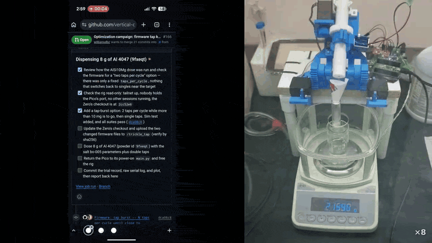

# Powder doser

**An open-source powder doser for autonomous alloy discovery, designed by engineers and modelled by AI agents.**

<p align="center">
  <a href="https://vertical-cloud-lab.github.io/powder-doser/"><b>Project page</b></a> ·
  <a href="https://github.com/vertical-cloud-lab/powder-doser/pull/209">Paper (in prep.)</a> ·
  <a href="https://vertical-cloud-lab.github.io/powder-doser/#build">CAD</a> ·
  <a href="https://www.youtube.com/watch?v=YmvaeqOQAU4&amp;t=514s">Talk</a> ·
  <a href="https://vertical-cloud-lab.github.io/powder-doser/#videos">Videos</a> ·
  <a href="https://vertical-cloud-lab.github.io/powder-doser/static/powder-doser-poster.pdf">Poster</a> ·
  <a href="https://vertical-cloud-lab.github.io/powder-doser/#talks">TMS 2027</a>
</p>

We built this doser at BYU's [Vertical Cloud Lab](https://github.com/vertical-cloud-lab) from 3D-printed parts and off-the-shelf electronics, for under $200 plus an analytical balance. One printed tube is both the powder reservoir and the dosing screw: the doser turns, tilts and taps it over a cup on the balance, which closes the loop, and an AI agent runs a dose when someone asks for one in a GitHub comment. Every 1 g dose on seven of the 13 powders we tested landed within ±5% of the target. **The [project page](https://vertical-cloud-lab.github.io/powder-doser/) has the rest:** the paper's figures, the CAD and firmware, the talk and videos, the poster and the TMS 2027 abstracts. The design discussion, the AI agents' work and the run data are in this repository's issues and pull requests.

<p align="center"><a href="https://vertical-cloud-lab.github.io/powder-doser/"></a></p>

<sub><b>Claude doses 8 g of Al 4047 for an atomizer charge</b> (30 Sep 2026, [#166](https://github.com/vertical-cloud-lab/powder-doser/pull/166)). Left, a phone's screen recording of the pull-request thread: Claude's checklist while the first pass runs, the follow-up to <code>@claude</code> typed on the phone after a clog, Claude's plan for a top-up, and its report. Right, the fixed camera over the balance at the same moment. 59 minutes in 22 s, sped up as marked. The full teaser on the [project page](https://vertical-cloud-lab.github.io/powder-doser/) starts with the auger being fitted.</sub>

<p align="center"><a href="https://vertical-cloud-lab.github.io/powder-doser/#dosing"></a></p>

<sub><b>A dose in three phases, replayed on the CAD</b> with the mass logged in the cup: bulk at 40° and 100 rpm with taps until 300 mg is left, trickle at 10° with no taps, then single taps at 15° until within 3 mg. The values in blue are the ones the optimizer sets, here the settings it recommended for 0.5 g of salt in the optimization campaign ([#166](https://github.com/vertical-cloud-lab/powder-doser/pull/166)), not those of the tests in the paper. Sped up as marked; from the campaign's slides ([#175](https://github.com/vertical-cloud-lab/powder-doser/pull/175)).</sub>

## Citation

Until the paper is out, please cite the repository:

```bibtex
@misc{charles2026powderdoser,
  title        = {An open-source powder doser for autonomous alloy discovery,
                  designed by engineers and modelled by AI agents},
  author       = {Charles, Sam and Mulberry, Will and Winters, Luke and
                  Robison, Carl and Erickson, Gage and Baird, Sterling G.},
  year         = {2026},
  note         = {Manuscript in preparation},
  howpublished = {\url{https://github.com/vertical-cloud-lab/powder-doser}}
}
```

## Outreach

A running list of individuals, academic groups, commercial vendors, and
open-source projects we could reach out to for help with accurate, automated
powder dispensing is kept in
[`paper/background/07-powder-dispensing-outreach-contacts.md`](paper/background/07-powder-dispensing-outreach-contacts.md)
(Edison-backed; per-entry `### Name` anchors and verifiable `(source: <URL>)`
tags). The synthesis is produced by
[`paper/background/edison_run_powder_dispensing_outreach_contacts.py`](paper/background/edison_run_powder_dispensing_outreach_contacts.py),
with raw artifacts under
[`paper/background/edison_artifacts/`](paper/background/edison_artifacts/),
and is compiled from the accelerated-discovery forum thread on [accurate
powder dispensing for chemistry and
materials-science applications](https://accelerated-discovery.org/t/accurate-powder-dispensing-for-chemistry-and-materials-science-applications/177),
the background notes in
[#29](https://github.com/vertical-cloud-lab/powder-doser/pull/29), and other
references throughout this repository. Same workflow as the generative-CAD
outreach note in [#43](https://github.com/vertical-cloud-lab/powder-doser/pull/43).

A companion list of **powder-properties** experts (flowability and
cohesion/friction measurement, DEM modeling and Bayesian calibration, AM
spreadability and powder-bed metrology) — anchored to the TMS 2027
calibration-optimization abstract from
[#78](https://github.com/vertical-cloud-lab/powder-doser/pull/78) — is kept
in
[`paper/background/08-powder-properties-experts.md`](paper/background/08-powder-properties-experts.md),
produced by
[`paper/background/edison_run_powder_properties_experts.py`](paper/background/edison_run_powder_properties_experts.py)
(three Edison `LITERATURE_HIGH` tasks plus direct web searching; raw
artifacts under the same
[`paper/background/edison_artifacts/`](paper/background/edison_artifacts/)
directory).

For actually reaching out, a narrowed **12-person shortlist** of the
powder-properties contacts who can *truly* help characterize powder for the
dynamic (DEM / cohesive-frictional) models — anchored to the on-device
characterization sweeps and tap / rapid-dose tests in
[#131](https://github.com/vertical-cloud-lab/powder-doser/pull/131), each with
a ready-to-send **template email** — is kept in
[`paper/background/09-powder-characterization-outreach-emails.md`](paper/background/09-powder-characterization-outreach-emails.md).
