# Powder doser

**An open-source powder doser for autonomous alloy discovery, designed by engineers and modelled by AI agents.**

Weighing out dry powders is still mostly done by hand, and commercial dosing heads cost tens to hundreds of thousands of dollars. This repository is the open-source alternative we built at BYU's [Vertical Cloud Lab](https://github.com/vertical-cloud-lab): a single-channel doser made from 3D-printed parts and off-the-shelf electronics for under $200, plus an analytical balance. It is meant for a self-driving materials-discovery loop in which the dosed powders feed ultrasonic atomization and laser powder bed fusion (L-PBF) of aerospace alloys.

  <a href="docs/poster/powder-doser-poster.pdf"><b>Poster (PDF)</b></a> ·
  <a href="#talks-abstracts-and-the-paper"><b>TMS 2027 abstracts</b></a> ·
  <a href="#build-one"><b>CAD models</b></a> ·
  <a href="#videos"><b>Videos</b></a> ·
  <a href="#more-animations"><b>Animations</b></a> ·
  <a href="https://github.com/vertical-cloud-lab/powder-doser/pull/209"><b>Paper figures (#209)</b></a>

**In short**

- **13 powders tested.** Ten moved, from 10 to 231 mg per auger revolution (at 22.5° tilt), and three delivered nothing measurable.
- **Closed loop:** every 1 g dose on seven of the 13 powders landed within ±5% of the target, and the nine on AlSi10Mg, coarse silicon and sodium sulfate landed within 1%. Smaller doses were less reliable.
- **In the alloy workflow:** the doser ran inside an inert-atmosphere glove box under the control of an AI agent, and weighed AlSi10Mg into a charge that our ultrasonic atomizer turned into new powder.
- **Engineers and AI:** the parts were designed by engineers and, from April to July 2026, modelled by AI agents. AI was most effective as a modelling assistant rather than an autonomous design agent.

The figures below are from the first paper, which is in preparation (Digital Discovery). Figure and table numbers are the paper's; the tables, and the alternative versions of some figures, are in [`FIGURES-AND-TABLES.md`](https://github.com/vertical-cloud-lab/powder-doser/blob/660bc15/paper/v2/FIGURES-AND-TABLES.md) on [#209](https://github.com/vertical-cloud-lab/powder-doser/pull/209).

## The doser

One printed tube does two jobs: it is the powder reservoir and the dosing screw. A stepper motor turns it, two servos tilt it, and a solenoid taps it, all over a cup on an analytical balance that closes the loop.

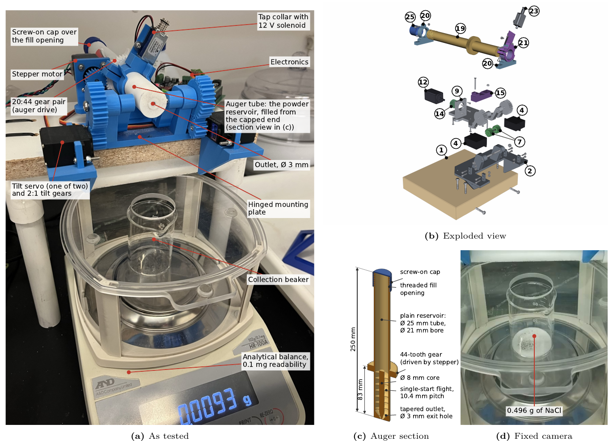

<b>Fig. 1 The doser.</b> One printed auger tube is both the powder reservoir and the dosing screw; the doser turns, tilts and taps it over a cup on an analytical balance. 
(a) The doser as tested in the second round (photographed 11 Sep 2026), with its main parts labelled; the auger tube is shown in section in (c). 
(b) Exploded view of the current design, assembled in CAD from the team's parts ([#170](https://github.com/vertical-cloud-lab/powder-doser/issues/170)), with the 13 main parts numbered beside them as in the bill of materials (SI Fig. S4): the auger (19) and its screw-on cap (25); the tap collar (21), its solenoid (23) and the tap-collar base (15); the two brackets that hold the auger (20); the hinged mounting plate (9); the stepper motor (12) and its pinion (14), which turn the auger's 44-tooth gear; the two tilt servos (4) and their pinions (7); the baseplate (2); and the mounting board (1). Screws and nuts are numbered only in SI Fig. S4. 
(c) Section through the tested auger and its screw-on cap, the team's Fusion 360 part: the flight fills only the outlet end, and the 44-tooth gear is on the outside of the tube. 
(d) The fixed livestream camera's view of the cup after a 0.5 g NaCl dose (15 Sep 2026; 0.496 g delivered; [#116](https://github.com/vertical-cloud-lab/powder-doser/issues/116)).

The three motions, close up on the same CAD assembly:

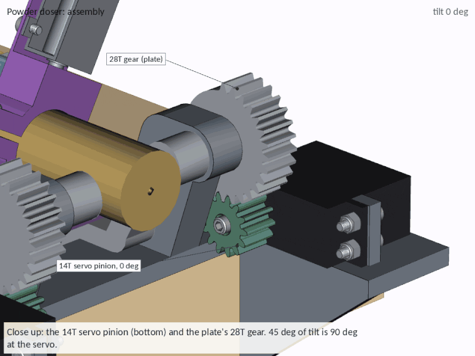

<b>Animation: tilt, turn and tap.</b> Each servo's 14-tooth pinion drives a 28-tooth gear on the hinged plate, so 90° at the servo tilts the plate 45°. The stepper's 20-tooth pinion turns the 44-tooth gear on the auger tube, 2.2 turns of the motor per turn of the auger; the brackets and the tap collar stay put while the tube and its cap turn. The solenoid's plunger drops 7.6 mm through the hole in the tap collar and hits the tube, and a spring pulls it back. CAD of the current design from [#170](https://github.com/vertical-cloud-lab/powder-doser/pull/170).

## Engineers design, AI agents model

The doser started at a three-day hackathon in April 2026 and was built in the open, in this repository's issues. AI agents modelled the first parts from text, sketches and dimensioned drawings. From July the engineers redrew in conventional CAD the parts that were built and tested, and the agents moved on to running the tests, analysing the data and assembling the CAD.

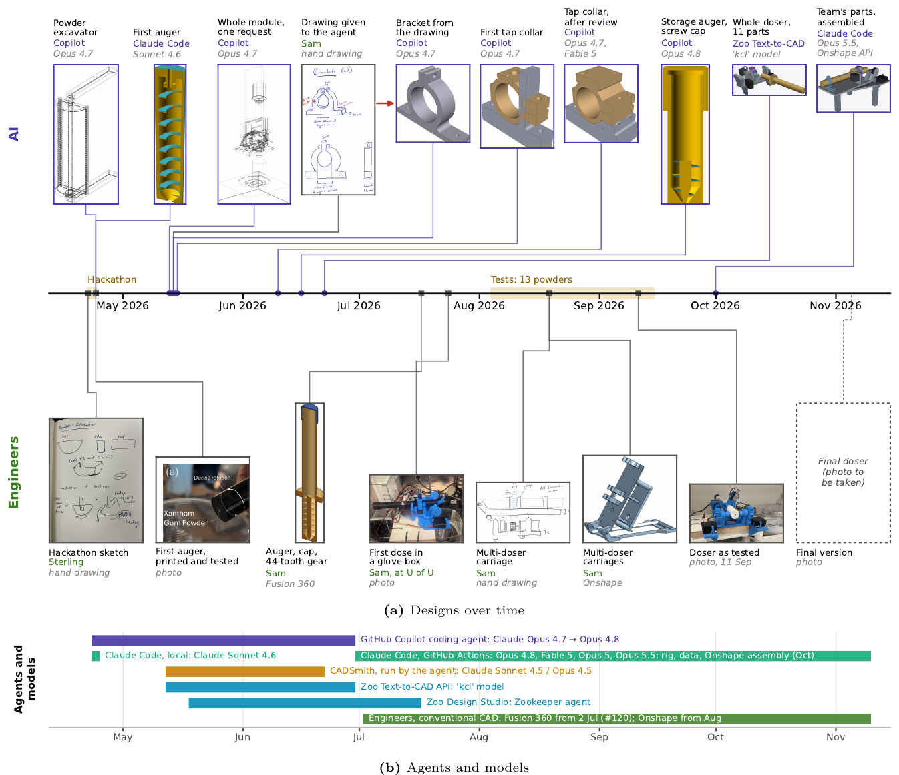

<b>Fig. 2 AI agents and engineers, April to November 2026.</b> AI agents modelled the first parts from text and drawings; from July the engineers redrew in conventional CAD the parts that were built and tested, and the agents moved on to running the tests and assembling the CAD. 
(a) Key designs on one date axis, each joined to its date. Above the axis are the designs modelled by AI agents, each tagged with the agent (purple) and model (grey): the powder excavator ([#2](https://github.com/vertical-cloud-lab/powder-doser/issues/2)) and the first auger ([#16](https://github.com/vertical-cloud-lab/powder-doser/issues/16)), from the hackathon (the first auger is the 24 Apr OpenSCAD design, in section); the whole module from a single request ([#35](https://github.com/vertical-cloud-lab/powder-doser/issues/35)); the bracket the agent modelled from the team's dimensioned drawing ([#46](https://github.com/vertical-cloud-lab/powder-doser/issues/46), [#47](https://github.com/vertical-cloud-lab/powder-doser/issues/47)), shown beside the drawing (grey frame; red arrow); the first tap collar and the collar after review ([#51](https://github.com/vertical-cloud-lab/powder-doser/issues/51)); the storage auger with its screw cap ([#49](https://github.com/vertical-cloud-lab/powder-doser/issues/49)); all 11 parts from one prompt through the Zoo Text-to-CAD API ([#104](https://github.com/vertical-cloud-lab/powder-doser/issues/104), [#110](https://github.com/vertical-cloud-lab/powder-doser/issues/110)); and the team's parts assembled through the Onshape API ([#170](https://github.com/vertical-cloud-lab/powder-doser/issues/170)). Below the axis is the engineers' work, each design tagged with who made it (green) and the tool (grey); photographs are labelled as photographs: the hackathon sketch ([#1](https://github.com/vertical-cloud-lab/powder-doser/issues/1)), the first printed auger, the Fusion 360 auger, cap and 44-tooth gear that turned in every test ([#120](https://github.com/vertical-cloud-lab/powder-doser/issues/120)), the first dose in a glove box, by Sam with colleagues at the University of Utah ([#117](https://github.com/vertical-cloud-lab/powder-doser/issues/117)), the multi-doser carriage sketch and Onshape model ([#128](https://github.com/vertical-cloud-lab/powder-doser/issues/128)), and the doser as tested ([#156](https://github.com/vertical-cloud-lab/powder-doser/issues/156)). The hackathon (22–24 Apr) and the 13-powder test campaign (4 Aug–15 Sep) are shaded on the axis. 
(b) When each agent and model was in use, on the same date axis. Claude Code ran locally at the hackathon and in GitHub Actions from 30 Jun; both are on one line. The engineers' conventional CAD is in green.

The parts the agents modelled were a starting point rather than the finished design: the tap collar, the auger and the bracket were all revised or replaced, before the tests or since.

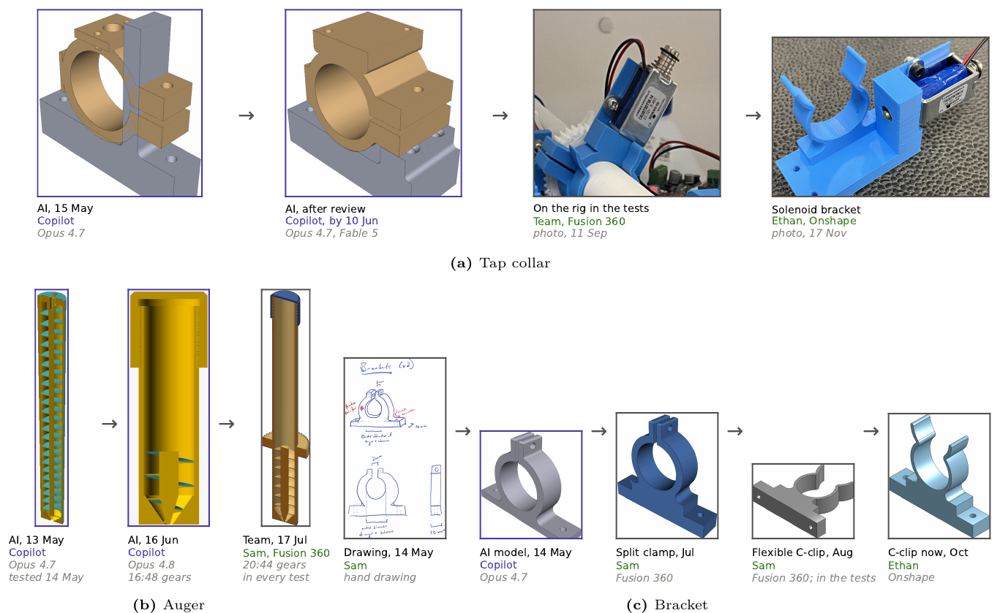

<b>Fig. 3 The original AI parts and what replaced them.</b> Every AI-modelled part was reviewed, printed and tested, but the tested doser ran on later versions, and the parts have kept changing since: the agent revised the tap collar and the team then replaced it, and the team redrew the auger in Fusion 360. AI parts have purple frames, the team's grey; each image is tagged with who made it and in what. 
(a) Tap collar to solenoid bracket: the first AI collar (15 May) and the collar after review ([#51](https://github.com/vertical-cloud-lab/powder-doser/issues/51), by 10 Jun), the collar on the rig during the tests (11 Sep, [#156](https://github.com/vertical-cloud-lab/powder-doser/issues/156)), and Ethan's solenoid bracket, which mounts the solenoid on the plate without a collar so that an auger can be swapped without taking the tapper off (first version 7 Nov, Onshape, [#203](https://github.com/vertical-cloud-lab/powder-doser/issues/203); photographed 17 Nov). 
(b) Auger, in section: the first auger to be printed and tested, begun at the hackathon and shown as the agent's version of 13 May with the flight on a central shaft, run with NaCl on 14 May ([#16](https://github.com/vertical-cloud-lab/powder-doser/issues/16)); the agent's storage auger with 16:48 gears (16 Jun, [#49](https://github.com/vertical-cloud-lab/powder-doser/issues/49)); and Sam's Fusion 360 recreation of it with 20:44 gears (17 Jul, [#120](https://github.com/vertical-cloud-lab/powder-doser/issues/120)), which turned in every test. 
(c) Bracket: the team's dimensioned drawing ([#46](https://github.com/vertical-cloud-lab/powder-doser/issues/46)) and the agent's model of it ([#47](https://github.com/vertical-cloud-lab/powder-doser/issues/47)), both 14 May, then the team's own versions: Sam's bolted split clamp (Fusion 360, Jul, [#120](https://github.com/vertical-cloud-lab/powder-doser/issues/120)), his open flexible C-clip, which was on the rig through the tests (from Aug), and Ethan's Onshape version of it on the current doser ([#193](https://github.com/vertical-cloud-lab/powder-doser/issues/193), Oct).

<b>Fig. S1</b> Asking for the whole doser at once, compared across generative-CAD tools

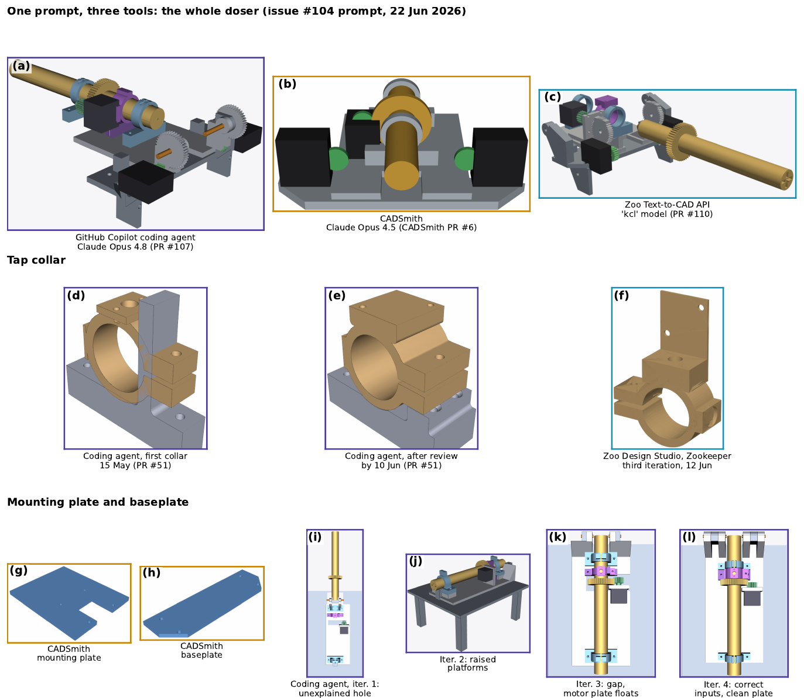

<b>Fig. S1 Generative-CAD comparison.</b> Asked for the whole doser at once, every tool returned parts that did not make a working assembly; one part at a time, with review, worked better. 
(a–c) The same prompt ([#104](https://github.com/vertical-cloud-lab/powder-doser/issues/104), 22 Jun 2026) given to the GitHub Copilot coding agent, CADSmith and the Zoo Text-to-CAD API, each rendered from the same viewpoint. 
(d–f) The tap collar from the coding agent (first version and after review) and from Zoo Design Studio (third Zookeeper iteration). 
(g, h) CADSmith's mounting plate and baseplate. 
(i–l) The coding agent's four mounting-plate iterations: out-of-date input files led to a hole, then platforms, then a gap, until the correct files were supplied.

## How a dose runs

A dose can be asked for in plain language in a GitHub comment. The agent passes the target to a three-phase controller on the doser's microcontroller, which reads the balance after every step and acts on the mass still to go: bulk, then fine, then tap.

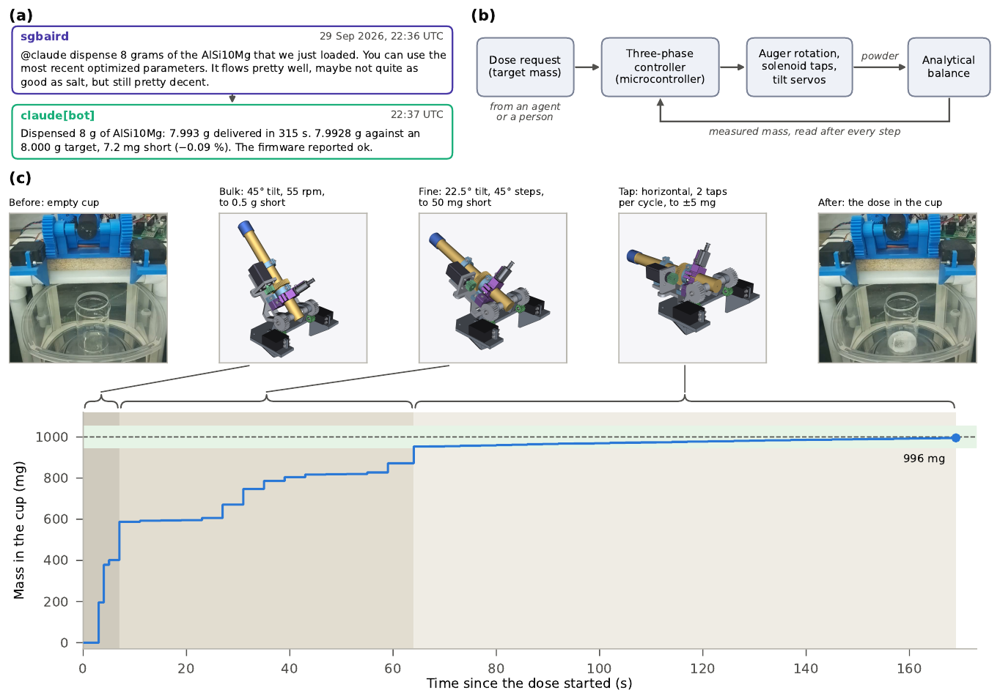

<b>Fig. 4 How a dose runs.</b> A person asks the AI agent for a dose in a GitHub comment; a three-phase controller on the doser's microcontroller then turns, tilts and taps the auger until the balance reads the target. 
(a) A request and the agent's reply (8 g of AlSi10Mg for an atomizer charge, [#166](https://github.com/vertical-cloud-lab/powder-doser/issues/166), 29 Sep 2026). 
(b) The control loop: the balance is read after every step, and the controller acts on the mass still to go. 
(c) One 1 g NaCl dose from the test campaign (12 Aug 2026), with its three phases shaded: bulk, fine and tap. A brace above the trace spans each phase, under the tube position in that phase (CAD renders of the current design at 45°, 22.5° and 0°); the fixed camera's stills before and after a 0.5 g salt dose (15 Sep 2026) are at either end. The green band is the ±5% acceptance limit.

The optimizer tunes the controller's settings. Here is a dose with the settings it recommended for salt, replayed on the CAD with the mass that was logged:

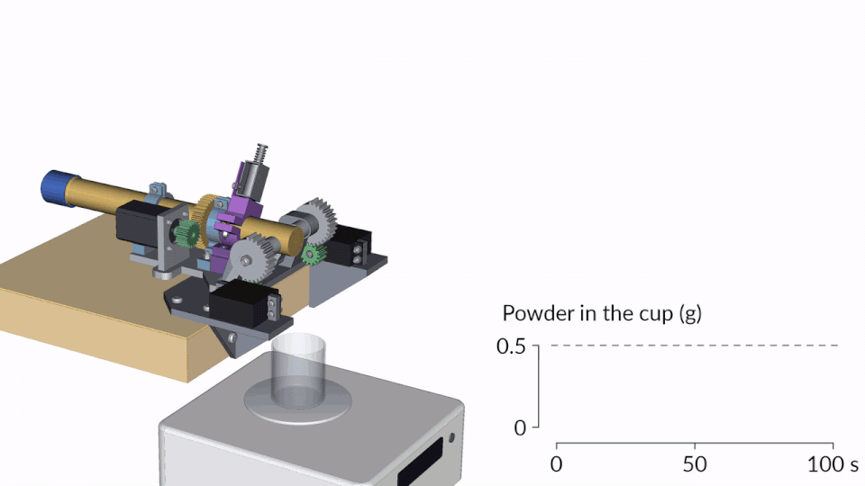

<b>Animation: a three-phase dose replayed on the CAD.</b> A 0.5 g salt dose (<code>bo-005</code>) from the optimization campaign of <a href="https://github.com/vertical-cloud-lab/powder-doser/pull/166">#166</a>, with the settings the optimizer recommended: <b>bulk</b> at 40° and 100 rpm with taps, until 300 mg is left; <b>trickle</b> at 10° with no taps, the auger speed set by the controller; then single <b>taps</b> at 15° until within 3 mg. The numbers in blue are the ones the optimizer sets, and the plot is the mass logged in the cup. The playback speed is in the bottom-left corner. From <a href="https://github.com/vertical-cloud-lab/powder-doser/pull/175">#175</a>.

## Using the doser

Each powder lives in its own auger, filled once, capped and stored loaded, so changing powder means swapping a tube rather than cleaning one.

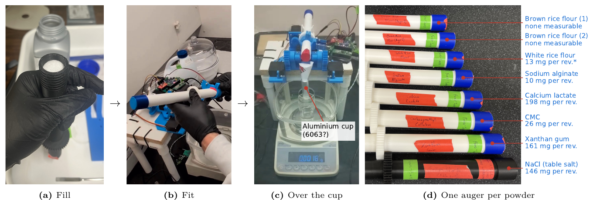

<b>Fig. 5 Using the doser.</b> Each powder has its own auger, filled once and stored loaded, so changing powder means swapping a tube. 
(a) Filling an auger with salt through its open end, then capping it (29 Jul 2026). 
(b) Fitting a filled auger to the doser, and (c) the doser ready over the cup, frames from the 30 Sep 2026 dose video: the powder falls through a paper funnel into an aluminium cup that stands in the glass beaker. The aluminium cup is part of the alloy workflow itself: the dose lands directly in the cup used for the next step in making the alloy, so the powder is never transferred. 
(d) The eight augers of the food-safe set (seven powders), capped and labelled (17 Nov 2026), each with the mass one auger revolution delivered (\*at 22.5° tilt; Fig. 6a).

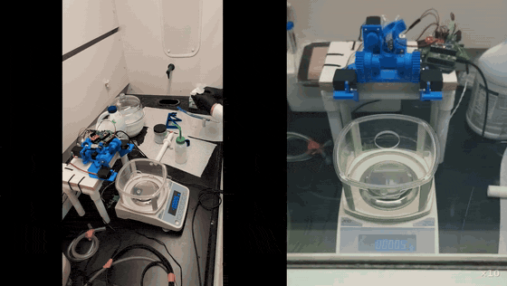

<b>Animation: loading an auger with Al 4047</b> (30 Sep 2026; <a href="https://github.com/vertical-cloud-lab/powder-doser/pull/166">#166</a>). Left, a phone camera on the bench; right, the bench livestream at the same moment. The auger is filled with Al 4047 at the back of the bench (×100), fitted to the doser (×12) and checked over the balance (×20). Claude then dosed 8.0010 g of it for an atomizer charge, in three passes after a firmware error and a clog; the full video is under <a href="#videos">Videos</a>. Cut from the slide video of <a href="https://github.com/vertical-cloud-lab/powder-doser/pull/174">#174</a>.

Here is the first of those passes, filmed by the camera that streams the bench to YouTube. The balance's own display shows the powder arriving in the aluminium cup:

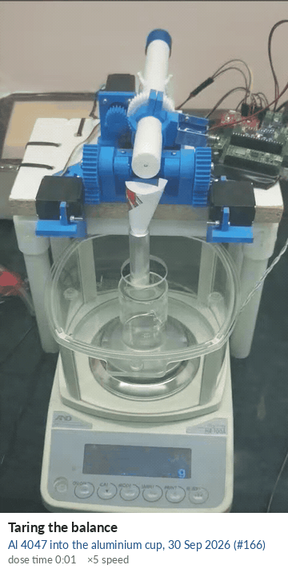

<b>Livestream: Al 4047 into the aluminium cup</b> (30 Sep 2026, 5× speed; <a href="https://github.com/vertical-cloud-lab/powder-doser/pull/166">#166</a>). After the balance is tared, the tube tilts to 40° and the auger turns at 100 rpm with a tap every 0.5 s: the <b>bulk</b> settings the optimizer recommended for salt (<code>bo-005</code>). The first 1.2 g came out in 7 s, then the feed slowed steadily, from 73 mg/s to 14 mg/s. The pass stopped after 100 s with 3.49 g in the cup, when the firmware's telemetry log ran out of memory (fixed the same day). A second pass and a bulk-only top-up then brought the cup to 8.0010 g. From the broadcast <a href="https://youtu.be/yOK01jYPknA?t=7045">yOK01jYPknA</a>, made with <a href="scripts/livestream_clip_gif.py"><code>scripts/livestream_clip_gif.py</code></a>.

## Results: 13 powders

We tested seven food-safe surrogates and six research powders, including gas-atomized AlSi10Mg and two grades of silicon. Open loop, under one fixed set of settings, the powders spanned more than an order of magnitude in mass per revolution, and the flow came in waves, one surge per revolution.

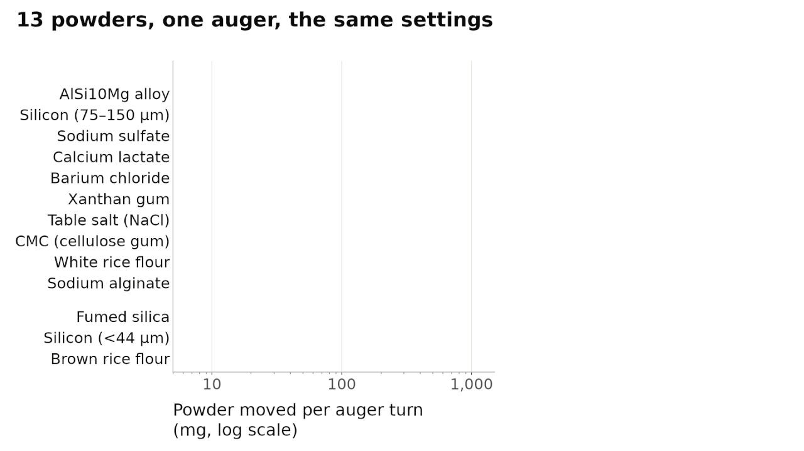

<b>Animation: one doser, 13 powders.</b> The same auger design and the same settings for every powder, built up one group at a time: table salt, then the food-safe stand-ins, then the research powders. Ten powders moved, from 10 to 231 mg per auger turn (a 24-fold range), and seven of them were dosed to 1 g within ±5%. An earlier layout of Figs. 6a and 7, from <a href="https://github.com/vertical-cloud-lab/powder-doser/pull/173">#173</a>.

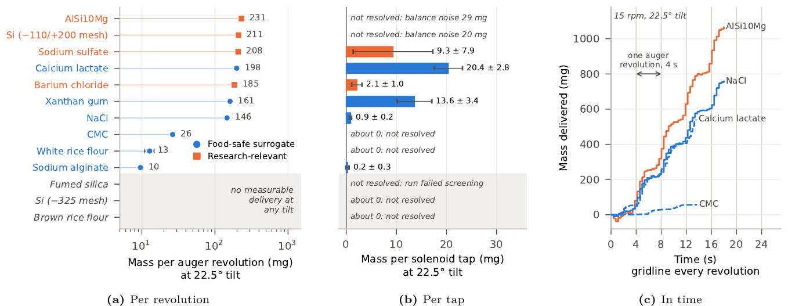

<b>Fig. 6 Open-loop delivery of 13 powders under one fixed set of settings.</b> Ten powders moved, from 10 to 231 mg per auger revolution, and three delivered nothing measurable; one solenoid tap released up to 20 mg, and under continuous rotation the powder arrived in waves, one surge per auger revolution. Every panel was measured with the tube tilted at 22.5°. 
(a) Mass per auger revolution at 22.5° tilt (protocol C; mean ± standard error of six revolutions; log axis). 
(b) Mass released by one solenoid tap at 22.5° tilt (protocol E): mean ± standard deviation of eight taps, the spread to expect from a single tap, drawn only where the tap was resolved (mean more than twice its standard error, as in Table S1). Each row without a bar says why. For AlSi10Mg and the coarse silicon, the balance noise with nothing moving (standard deviation 29 and 20 mg) was far larger than a tap; a tap cannot remove powder, and their negative means (−1.9 and −3.5 mg) were that noise. For CMC, the two rice flours and the fine silicon, most single taps read 0.0–0.1 mg. Fumed silica's only run failed screening. Table S1 gives the standard errors. 
(c) Mass against time while the auger turned continuously at 15 rpm (protocol D), for a representative selection of four powders, from the fastest (AlSi10Mg) to a slow one (CMC). The flow came in waves: AlSi10Mg and NaCl each arrived in surges of about 200 mg every 4 s, once per auger revolution, with little in between. Gridlines every 4 s mark the auger revolutions.

Closed loop, the 1 g doses were the most reliable. The misses at 50 and 200 mg are mostly a control problem rather than a limit of the hardware, and the controller is what we are working on now.

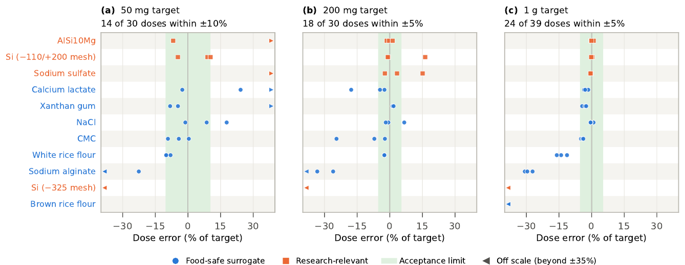

<b>Fig. 7 Closed-loop doses.</b> Doses of 1 g landed within ±5% for every powder that delivered at least 26 mg per revolution; smaller doses missed more often, fast powders tending to overshoot and slow ones to fall short. The misses are largely a control problem, which we are actively working on, rather than a limit of the hardware. Error of every valid closed-loop dose from both test rounds; each marker is one dose. One row per powder, ordered by mass per revolution (fastest at the top). The green band is the acceptance limit: ±10% below 100 mg, ±5% at and above. Times per dose are in Table 3 and SI Fig. S3.

<b>Fig. 7, version C</b> The same doses in milligrams, all targets on one axis

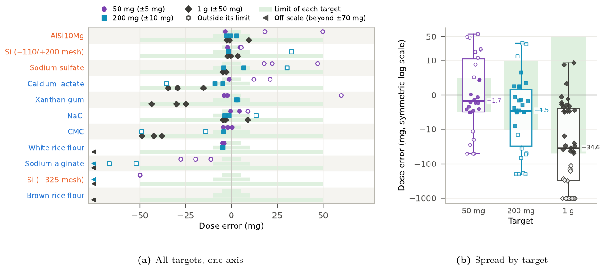

<b>Fig. 7, version C Closed-loop dose error in milligrams, all targets together.</b> On one milligram axis the three targets crowd each row, but the spread of the error clearly grows with the target: the middle half of the errors spans 16 mg at 50 mg, 32 mg at 200 mg and 298 mg at 1 g. 
(a) Every valid closed-loop dose on one axis. Each powder row has three lanes: 50 mg (purple circles, top), 200 mg (teal squares, middle) and 1 g (dark diamonds, bottom), each with its own green limit band (±5, ±10 and ±50 mg). Filled markers are within that target's limit, open markers outside; the 19 doses beyond ±70 mg are arrows at the edge. 
(b) Error by target as box plots, on a symmetric-log axis (linear within ±10 mg) so that a 5 mg miss and a 1000 mg miss show together. Every dose is drawn over its box, filled if it was within the limit; the boxes span the middle half of the errors, the whiskers reach the extremes, and the median is printed beside each box.

<b>Table 1</b> The 13 powders

| Powder | Group | mg per rev. (22.5°) | 50 mg | 200 mg | 1 g | Observed behaviour |
|---|---|---:|:---:|:---:|:---:|---|
| AlSi10Mg (gas-atomized) | Research | 231 | 1/3 | 3/3 | 3/3 | Fastest powder; fluid-like; overshoots small targets |
| Silicon, −110/+200 mesh | Research | 211 | 2/3 | 2/3 | 3/3 | Free-flowing |
| Sodium sulfate | Research | 208 | 0/3 | 2/3 | 3/3 | Free-flowing; overshoots small targets |
| Calcium lactate | Surrogate | 198 | 1/3 | 2/3 | 3/3 | Free-flowing; largest tap increment |
| Barium chloride | Research | 185 | -- | -- | -- | Absorbed moisture and caked in the tube in round 2 |
| Xanthan gum | Surrogate | 161 | 2/3 | 3/3 | 3/3 | Flows under rotation; can clog after bursts |
| Sodium chloride (NaCl) | Surrogate | 146 | 2/3 | 2/3 | 6/6 | Free-flowing baseline (control) |
| Carboxymethyl cellulose (CMC) | Surrogate | 26 | 3/3 | 1/3 | 3/3 | Slow; charges electrostatically |
| White rice flour | Surrogate | 13 | 3/3 | 3/3 | 0/3 | Slow and pulsing; most variable between revolutions |
| Sodium alginate | Surrogate | 10 | 0/3 | 0/3 | 0/3 | Slowest powder that moved |
| Brown rice flour | Surrogate | none | -- | -- | 0/3 | No delivery at any tilt |
| Silicon, −325 mesh | Research | none | 0/3 | 0/3 | 0/6 | No delivery at 0 or 22.5°; one pulse at 45° |
| Fumed silica | Research | none | -- | -- | -- | No delivery; very light and fluffy |

Mass per auger revolution: protocol C mean at 22.5° (Fig. 6a). Closed-loop columns: valid doses within the acceptance limit (±10% at 50 mg, ±5% at 200 mg and 1 g) out of the number run (Fig. 7); a dash means not run. Silicon grades by sieve size: −325 mesh passes a 44 µm sieve; −110/+200 mesh lies between about 75 and 150 µm.

## Build one

The current design, with every part numbered as in the bill of materials:

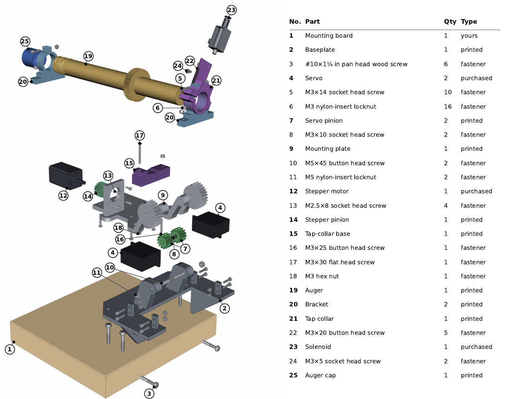

<b>Fig. S4 Every part of the doser.</b> Every part of the current design, screws and nuts included, numbered as in the bill of materials; Fig. 1b labels only the 13 main parts (bold here). 
Exploded view assembled in CAD from the team's parts ([#170](https://github.com/vertical-cloud-lab/powder-doser/issues/170)), with each number beside its part, and the bill of materials with the quantity of each part and whether it is printed, purchased or a fastener.

The same parts, put together in order:

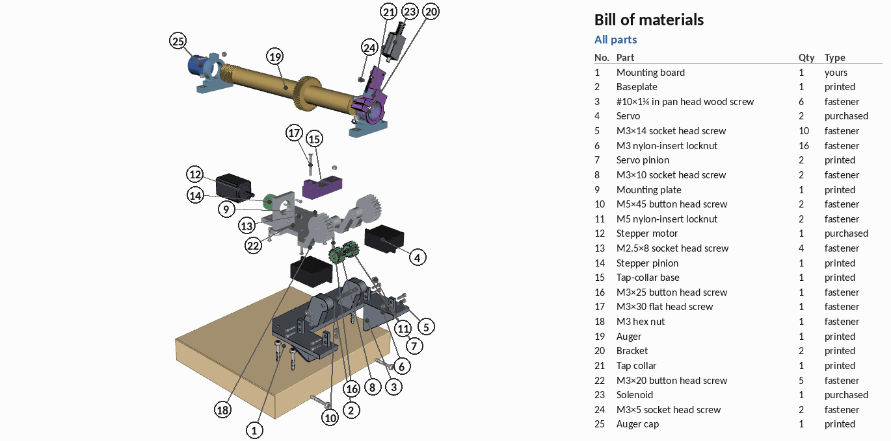

<b>Animation: assembling the doser.</b> The 19 steps, from the mounting board to the auger's cap, with the parts of each step highlighted in the bill of materials (numbered as in Fig. S4); at the end the plate tilts up to 45° and back. CAD of the current design from <a href="https://github.com/vertical-cloud-lab/powder-doser/pull/170">#170</a>, which also has a slower <a href="https://github.com/vertical-cloud-lab/powder-doser/blob/7f5b3b7/cad/full-assembly/renders/assembly_walkthrough.gif">walkthrough with written instructions for each step</a> (6.8 MB) and a <a href="https://github.com/vertical-cloud-lab/powder-doser/blob/7f5b3b7/cad/full-assembly/renders/assembly_presentation_720p.mp4">720p video</a>.

**CAD models (Onshape).** There is no public Onshape folder yet; these are the current documents, one per part, as listed by the team in [#193](https://github.com/vertical-cloud-lab/powder-doser/issues/193#issuecomment-6504703603), which also has the print settings.

| Part | Onshape document |
|---|---|
| Whole doser (assembly) | [Assembly](https://cad.onshape.com/documents/f866631c78fbefd61e6856e4/w/043fe020d0194e41cea13bc2/e/3156bac055c13d8160e229b4) |
| Auger | [Auger](https://cad.onshape.com/documents/51aa3e7d16cc046d79714a7a/w/e4a7f050613025f7f2cb4fb6/e/3c166b7f26f467535e63234e) |
| Brackets that hold the auger | [Flexible bracket](https://cad.onshape.com/documents/5e6db88e8a8d5328b172ba6d/w/7b4b2baa5fa65b95b0004aa0/e/59890746941ebde49fa31a66) |
| Tap collar | [Tap collar](https://cad.onshape.com/documents/b0b9aed3e11591e566530a68/w/7dc93c75a03ccff73030ba25/e/cf844b34a00ef7d2d52191c1) |
| Solenoid bracket (replaces the tap collar; [#203](https://github.com/vertical-cloud-lab/powder-doser/issues/203)) | [New solenoid setup](https://cad.onshape.com/documents/3db901b123bbee05f5c196f3/w/71800ea0548acad53e21d816/e/68af1a083e7d90e44c40f87c) |
| Hinged mounting plate | [Mounting plate](https://cad.onshape.com/documents/53e9cce7f09a50f89c120028/w/d45f5e9d7335aff0b1f1e88d/e/224d71f16476d8c27dc6e3e0) |
| Baseplate | [Baseplate](https://cad.onshape.com/documents/68b18e694d8672d95f496279/w/ca6615cd1f43e41c93dbf2f5/e/9f7a9b5e682bc05529f15125) |
| Servo pinion | [Servo pinion](https://cad.onshape.com/documents/35ecacf511109e3b823b3ed0) |
| Stepper pinion | [Stepper pinion](https://cad.onshape.com/documents/0401d55bca2deb006cc69926) |
| Stand | [Bracket (back)](https://cad.onshape.com/documents/6cb5182c1e0e0193cfea81bb/w/97676bb10a178925d14f31d1/e/ea82a43a82cf5f861b73a9e3), [bracket (sides)](https://cad.onshape.com/documents/3493a07ffbb9b140e0fcdf21/w/50e6d3a1a5f5feadde61da47/e/cbbebd3d1064640d9bce4c7f), [wood leg](https://cad.onshape.com/documents/659ee3322c5c9c9ce8146b43/w/f5c8346fbf02967b4d0261a6/e/bbd4667923221cda37cd63e1) |

Sam's Fusion 360 share links for the parts that ran in the tests (the auger, its cap, the baseplate and more) are in [#170](https://github.com/vertical-cloud-lab/powder-doser/pull/170#issuecomment-5939517081).

**Electronics and firmware.**

- [`hardware/test-module/firmware/`](hardware/test-module/firmware/): MicroPython firmware for the Raspberry Pi Pico W that drives the stepper, tilt servo, solenoid and vibration motor.
- [`hardware/kicad/`](hardware/kicad/) (schematic) and [`hardware/PCBs/`](hardware/PCBs/) (Gerber files for the single-doser board).
- [`hardware/vibration-motor-and-solenoid.md`](hardware/vibration-motor-and-solenoid.md): candidate motors, solenoid and driver boards.
- [Electronics setup tutorial](https://youtu.be/hfnQBAeRIg0) (video).
- Before loading anything that isn't food-safe, read the safety guidelines in [#141](https://github.com/vertical-cloud-lab/powder-doser/issues/141).

## Videos

- **[MS&T 2026 talk](https://www.youtube.com/watch?v=YmvaeqOQAU4&t=514s)**, *Let's discover stronger aerospace alloys 10x faster with AI at a tenth of the cost* (Sterling Baird), from 8:34.
- **[Powder doser playlist](https://www.youtube.com/playlist?list=PLZTWCFxzhTQv42fTuW2Tjs9o1KuWA_b-I)**, the video demo linked from the poster.
- [Three-phase closed-loop test on the balance](https://youtu.be/qYwFWl76y3c).
- [An autonomous 1 g dose on the livestream](https://youtu.be/xjtJNMo8DKw?t=15155) (3 Sep 2026, [#148](https://github.com/vertical-cloud-lab/powder-doser/issues/148)), and [xanthan gum and rice flour](https://youtu.be/JrdlEVz18R0?t=5832) (4 Sep 2026, [#116](https://github.com/vertical-cloud-lab/powder-doser/issues/116)).
- [Remote salt doses, 1 g](https://www.youtube.com/live/XJ5TRApc6pI?t=12835) and [5 g](https://www.youtube.com/live/XJ5TRApc6pI?t=14580) (15 Aug 2026, [#145](https://github.com/vertical-cloud-lab/powder-doser/issues/145)).
- [Dosing Al 4047 for an atomizer charge, with Claude](https://youtu.be/dXRB7c6GeDw), including a stall and a clog (30 Sep 2026, [#166](https://github.com/vertical-cloud-lab/powder-doser/issues/166)); [preparing the dose](https://youtu.be/QXSj0j1OqL8); [its first pass on the livestream](https://youtu.be/yOK01jYPknA?t=7045), the clip in [Using the doser](#using-the-doser).
- [First glove-box test, slow dispensing of salt](https://youtu.be/L0jCNZVXHoc), with the University of Utah's Lessard Lab ([#117](https://github.com/vertical-cloud-lab/powder-doser/issues/117)).
- [Trying out Zoo Design Studio](https://www.youtube.com/watch?v=6YsOMIsOfkY), with commentary ([#92](https://github.com/vertical-cloud-lab/powder-doser/issues/92)).
- Multi-doser, the next step: [pitch](https://www.youtube.com/watch?v=IkjBxqa06u0), [3D-printed prototype](https://www.youtube.com/watch?v=liB6YNSN8-Q) and [V1 demo](https://youtu.be/BSgpeKZgoXU) ([#128](https://github.com/vertical-cloud-lab/powder-doser/issues/128)).
- Livestreams of the rig: [BYU VCL Hardware Streams](https://youtube.com/@byu-vcl-hardware-streams).

## More animations

<table>
<tr>
<td align="center" valign="bottom" width="50%">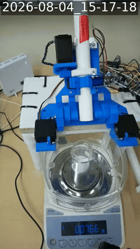</td>
<td align="center" valign="bottom" width="50%">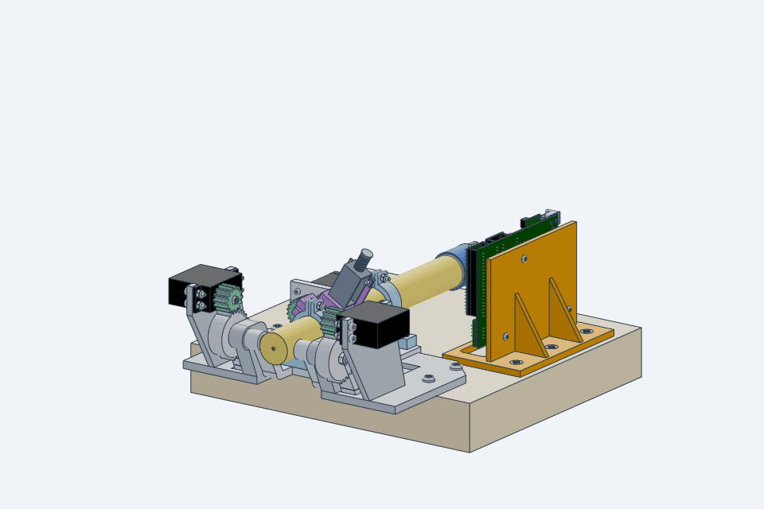</td>
</tr>
<tr>
<td valign="top"><b>White rice flour on the livestream</b> (4 Aug 2026, 4× speed; <a href="https://github.com/vertical-cloud-lab/powder-doser/issues/116">#116</a>). One of the open-loop measurements (protocol C), on the earlier rig: the auger turns with the tube at 90°, pointing straight down into the cup, and the balance display is at the bottom.</td>
<td valign="top"><b>An AI agent's recreation of the doser in code.</b> Claude Code rebuilt the current design (<a href="https://github.com/vertical-cloud-lab/powder-doser/pull/170">#170</a>) as build123d models with text-to-cad, matching the team's printed parts, then moved the servos above the plate so that at 45° the outlet comes within 8.8 mm of a cup up to 58 mm across (73 mm as built). From <a href="https://github.com/vertical-cloud-lab/powder-doser/issues/172">#172</a> and <a href="https://github.com/vertical-cloud-lab/powder-doser/pull/176">#176</a>.</td>
</tr>
<tr>
<td align="center" valign="bottom">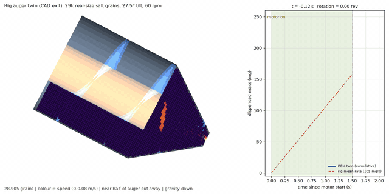</td>
<td align="center" valign="bottom">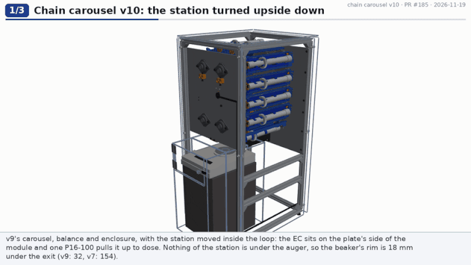</td>
</tr>
<tr>
<td valign="top"><b>A digital twin of the auger.</b> A discrete-element (DEM) simulation of the rig's auger with 29,000 real-size salt grains, at 27.5° tilt and 60 rpm for 1.5 turns; the near half of the auger is cut away and the grains are coloured by speed. The plot compares the simulated mass delivered with the rig's measured mean rate (dashed). From <a href="https://github.com/vertical-cloud-lab/powder-doser/issues/158">#158</a>.</td>
<td valign="top"><b>Next: many powders.</b> The chain-carousel multi-doser, in CAD only (nothing is built yet). Two chains carry auger modules past one station, which pulls the next module up to the balance, tilts it, turns its auger and doses into the beaker, then lets it go. Version 10, from <a href="https://github.com/vertical-cloud-lab/powder-doser/pull/185">#185</a> (<a href="https://github.com/vertical-cloud-lab/powder-doser/issues/128">#128</a>).</td>
</tr>
</table>

More animations are on the threads that made them:

- Every version of the chain carousel, v2 to v10, each with feature clips: [#185](https://github.com/vertical-cloud-lab/powder-doser/pull/185).
- Small runs of every physics method we found for powder flow (DEM, MPM, SPH, CFD-DEM and more): [#196](https://github.com/vertical-cloud-lab/powder-doser/pull/196).
- 3D walkthroughs of the standard powder tests (Hall flow, tap density, angle of repose, sieving, shear cells): [#190](https://github.com/vertical-cloud-lab/powder-doser/pull/190).
- The salt optimization campaign as slide builds (the dose, the math, the Pareto front): [#175](https://github.com/vertical-cloud-lab/powder-doser/pull/175).
- A time-lapse and recordings of printing the doser's parts on the lab's printers: [#200](https://github.com/vertical-cloud-lab/powder-doser/pull/200).
- The first concept, the powder excavator, and its tilt mechanism: [`docs/powder-excavator.md`](docs/powder-excavator.md).

Where each GIF in this README came from is in [`docs/readme/gifs/README.md`](docs/readme/gifs/README.md).

## Talks, abstracts and the paper

**Poster.** [*AI agents helped us design the best powder dispenser (maybe), but engineers still have job security*](docs/poster/powder-doser-poster.pdf) (PDF), Sam Charles, Will Mulberry, Luke Winters and Sterling Baird, 2026 Utah AI Convergence ([#101](https://github.com/vertical-cloud-lab/powder-doser/issues/101)).

<a href="docs/poster/powder-doser-poster.pdf">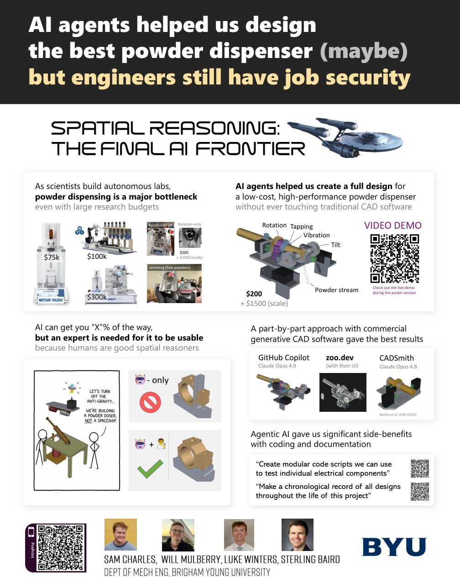</a>

**Accepted abstracts, TMS 2027 Annual Meeting & Exhibition:**

- [A Programmable Powder Doser with 15+ Reservoirs and Automated Auger Swapping for AI-Enabled Alloy-Development Workflows](https://www.programmaster.org/PM/PM.nsf/ApprovedAbstracts/B6383C9897FAF23585258E280014B8D5?OpenDocument). *AI-Enabled Materials Processing: Integrating Accelerated Experimental Workflows and Processing-Aware Machine Learning.*
- [Auger-Based Powder Dosing as a Mechanistic Probe of Powder Flow Behavior: Multi-Task Bayesian Calibration and Physics-Based Property Inference](https://www.programmaster.org/PM/PM.nsf/ApprovedAbstracts/B309C32B4F06F84485258E2800150419?OpenDocument). *Powder Materials Processing and Fundamental Understanding.*
- [Agentic Systems Design of an Open-Source Powder Doser for L-PBF Feedstock Research: CAD, PCB, and Firmware](https://www.programmaster.org/PM/PM.nsf/ApprovedAbstracts/2711856F2A84241585258E2800155BBF?OpenDocument). *Accelerating Innovation in Materials and Manufacturing.*

**Slides.** [POSE 2026 presentation](https://docs.google.com/presentation/d/1SZyMInTeK6V5QMu_9ptvdzXFou06gq9Mr7xBxdh9StA/edit?usp=sharing).

**Paper.** In preparation for *Digital Discovery*. The figures, tables, title and abstract are in [#209](https://github.com/vertical-cloud-lab/powder-doser/pull/209) and the draft manuscript in [#97](https://github.com/vertical-cloud-lab/powder-doser/pull/97).

## Repository map

| Path | What's there |
|---|---|
| [`hardware/`](hardware/) | Firmware, schematic, PCB, vendor files and parts research for the doser |
| [`docs/candidate-powders.md`](docs/candidate-powders.md) | The powders we intend to dispense (high-purity Si, AlSi10Mg and the digital-alloy-lab element palette), with handling and storage constraints |
| [`design/brainstorming.md`](design/brainstorming.md) | Brainstorm of dispenser architectures (parallel-channel, carousel, gantry, vibratory, pneumatic, shared auger) under the 30-powder, autonomous-loop requirements |
| [`cad/`](cad/) | Parametric CadQuery and OpenSCAD models from the hackathon, including the first Archimedes auger |
| [`docs/powder-excavator.md`](docs/powder-excavator.md) | The project's first concept, a pure-mechanical gantry trough, with its Edison Scientific review and figures (this README until Nov 2026) |
| [`paper/`](paper/) | Digital Discovery LaTeX template (`latexmk -pdf main.tex`) and background literature notes; the draft itself is on [#97](https://github.com/vertical-cloud-lab/powder-doser/pull/97) |
| [`docs/readme/`](docs/readme/) | The figures in this README, cropped from the paper's previews by [`scripts/readme_figures.py`](scripts/readme_figures.py) |
| [`docs/readme/gifs/`](docs/readme/gifs/) | The animations in this README, fetched from the threads that made them by [`scripts/readme_gifs.py`](scripts/readme_gifs.py), and the livestream clip of Al 4047, made by [`scripts/livestream_clip_gif.py`](scripts/livestream_clip_gif.py); provenance in its [`README.md`](docs/readme/gifs/README.md) |
| [`docs/poster/`](docs/poster/) | The poster as a PDF |

## License

[MIT](LICENSE), © 2026 Vertical Cloud Lab @ BYU.
