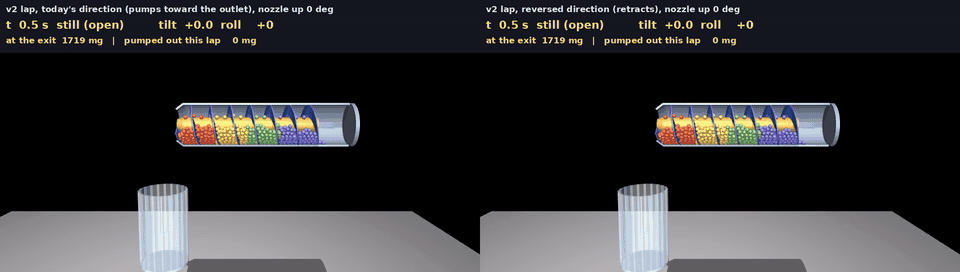
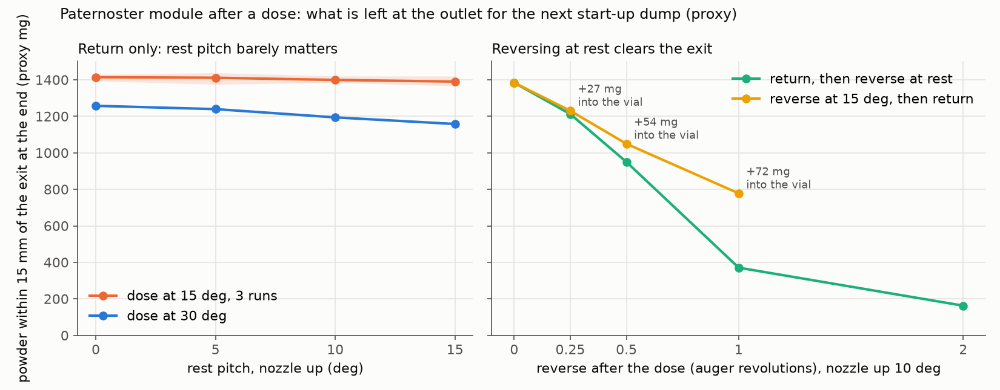
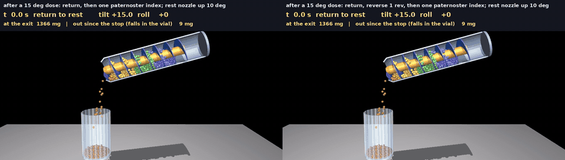
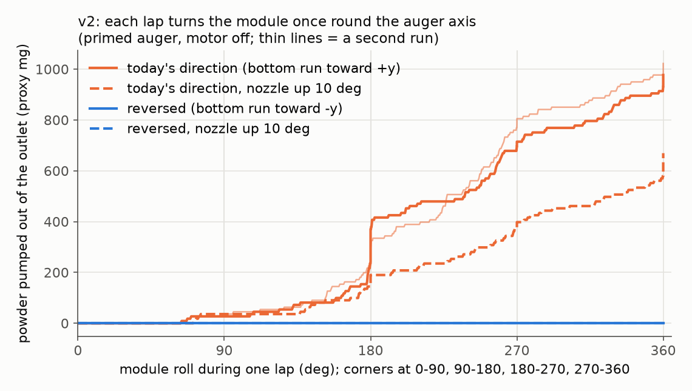

# Auger leakage on the carousels: nozzle-up storage, reversing, and v2's lap pumping

Sterling asked in [PR 185](https://github.com/vertical-cloud-lab/powder-doser/pull/185) whether the modules should
ride with the auger nozzles pitched slightly up, and whether running the auger in reverse helps. This folder
answers both with the paternoster's MuJoCo granular proxy of the lab auger
([`../paternoster/sim/AUGER-SIM.md`](../paternoster/sim/AUGER-SIM.md)). The module now moves the way it does on each
carousel: it doses at the station, tilts back, sits at rest, rides a paternoster index, or rolls round a v2 lap.



*One v2 lap with the motor off, from a primed auger (cut-away, real time). Left: today's direction, where each
corner turns the auger forward relative to gravity and powder is pumped out. Right: the same lap run the other way,
where the roll pulls powder back from the exit. Full-resolution MP4: [`out/v2_lap_directions.mp4`](out/v2_lap_directions.mp4).*

## Answers

1. **Nozzle-up storage is not needed in this proxy.** Pitching a module 5, 10 or 15 deg nozzle-up changed nothing
   that leaks. After a dose and the tilt back, a level module leaked **0 grains**:
   * in a real paternoster index (gondola swing up to 1.7 deg);
   * under a vertical vibration ramp to 1.5 g;
   * under an axial (along-the-auger) vibration ramp to 2 g.

   Pitching it up only trims the powder sitting near the exit by 2 to 8 %. A still auger holds its powder for
   three reasons: the exit is on the axis, the funnel wall climbs 37 deg to reach it, and the last flight turn
   blocks the bore. The #116 rig said the same about real powders: 0.0000 g in 15 s still holds at every tilt,
   straight down included ([issue 128](https://github.com/vertical-cloud-lab/powder-doser/issues/128)). In this proxy
   **leakage comes from rotation, not attitude**, so a machine pitch would cost station range and frame work for
   nothing measurable.
2. **Reverse after the dose, but only once the module is back at rest: about 1 revolution.** Reversing at rest
   leaks nothing, adds no dose, and cuts the powder within 15 mm of the exit from 1380 to 370 proxy mg (-73 %) for
   1 revolution, or to 160 mg (-88 %) for 2. That powder is what the next dose dumps in its first revolution.
   Reversing while still tilted is worse on both counts:
   * the flight end sweeps powder out into the vial (+27 to +72 mg for 0.25 to 1 revolution);
   * it clears the exit only half as well (780 mg left after 1 revolution).
3. **v2 must run the other way round.** A v2 module rolls once round an axis parallel to its auger on every lap.
   For the powder, that is one auger revolution. In today's direction the bottom run moves toward +y, which is
   counter-clockwise seen from the cap end. That roll turns the auger forward, and a primed auger **pumped 108
   grains (980 proxy mg) out during one lap**, about one revolution's dose. A second run gave 113. Reversed, the
   lap pumped **0 grains** in both runs and pulled the powder near the exit down from 186 to 81 and from 183 to 73
   grains. Pitching the module 10 deg nozzle-up cut today's-direction pumping by a third, to 74 grains, but did not
   stop it. Changing the direction does.
4. **Motor off at rest, with taps (4 N, 10 ms, 2 Hz, for 2 s):**
   * after a dose and the tilt back: 0 grains at 0 and 10 deg;
   * a primed, settled auger: 1 grain (9 mg) when level, 0 at 10 deg.

What leaves the outlet at the end of a dose (7 to 11 grains in the first 0.2 s after the motor stops at 15 deg)
falls into the vial. The outlet sits on the hinge axis, so it doesn't move while the module tilts back. That is
the tail of the dose, not a leak. Holding at the dose tilt for 0.6 s before tilting back gives the same count.

## What was simulated

* **Model.** The paternoster's auger model, unchanged: the measured tube, flight, core and funnel, 1100 grains of
  2 mm (9.05 mg each), the exit widened so a proxy grain fits, and the vial on a spring balance. The only change is
  that the auger's frame sits on a free joint whose pose and velocity are prescribed every step. It is a 1 t body
  with gravity compensation, so the grains can't push it about. The module's translation through the loop enters
  as an inertial body force, gravity minus the outlet's acceleration, which is exact for a rigid module.
  [`leak_sim.py`](leak_sim.py) imports `auger_geom` and `auger_model` from `../paternoster/sim`.
* **Check.** The 30 deg dose of 2 revolutions at 60 rpm gave 216 grains (977 mg/rev), against 950 mg/rev in
  AUGER-SIM.md at the same tilt. Three independent runs (jittered starting lattice) gave 208 to 216.
* **Machine pitch.** Orientation = R_y(alpha) R_x(roll) R_tilt. The whole machine is pitched nozzle-up by alpha.
  The station tilt is measured from the machine, so the world dose tilt stays 30 deg (or 15 deg). After the dose
  the module tilts back to -alpha at 20 deg/s, about the P16-P's speed on the paternoster linkage.
* **Paternoster transit.** [`pat_transit.py`](pat_transit.py) runs the paternoster's own carousel model
  (`carousel_sim.run_carousel`) for its recommended index: a trapezoid, 1.5 s per index, ramps of one pendulum
  period, bronze pivots with mu = 0.1. It then takes gondola 1's pivot path and swing. The auger axis is 16 mm
  below the pivot. In the first index the swing peaks at 1.7 deg, and the outlet's acceleration is 0.45 m/s² rms,
  3.2 m/s² peak (chordal impacts, 10 ms filtered). The leak runs apply that index's swing and acceleration.
* **v2 lap.** Four 90 deg corner rolls at the chain's index speed (50 mm/s on a 48.6 mm sprocket radius is
  59 deg/s, with 0.2 s ramps), each followed by 0.4 s at rest. The outlet's corner acceleration (36.9 mm radius)
  is included. The straights are shortened to those 0.4 s rests: the module only translates there, at under 3 % of
  g. The tube is assumed to turn with the plate in Sam's clamp rings (clamp friction), which is the worst case. A
  tube free to spin would hang from its powder like a pendulum and wouldn't pump. The sim keeps the module over the
  vial, so pumped grains land in it; on the real rig they would fall into the machine.
* **Stress tests** (after a 30 deg dose and the tilt back):
  * vertical sine at 25 Hz, amplitude ramped from 0 to 1.5 g over 3 s;
  * axial sine (along the auger) at 25 Hz, ramped to 2 g;
  * axial at 5 Hz, ramped to 1 g, which moves the module up to 10 mm per cycle.
* **Protocols.** (a) return only. (b) reverse R revolutions at the dose tilt, then return. (c) return, then
  reverse R at rest. R = 0.25, 0.5, 1 and 2 revolutions, at 60 rpm.

## Results

Counts are proxy grains (9.05 mg each). "At the exit" means grains within 15 mm of the outlet plane at the end of
the run. Every case is in [`out/leak_results.json`](out/leak_results.json).

### 1. Rest pitch, paternoster

| case | rest pitch | out after the module is back at rest | dose tail into the vial on the way back | at the exit |
|---|---|---|---|---|
| dose at 30 deg, motor off 0.3 s, tilt back, one index | 0 / 5 / 10 / 15 deg | **0 / 0 / 0 / 0** | 0 | 139 / 137 / 132 / 128 |
| dose at 15 deg, tilt back at once, one index (3 runs each) | 0 / 5 / 10 / 15 deg | **0 in all 12 runs** | 7 to 11, the same at every pitch | 156 / 156 / 155 / 154 (mean) |
| dose at 15 deg, hold 0.6 s, then tilt back | 0 deg | 0 | 7 (during the hold) | 154 |

All tail grains left within 0.2 s of the motor stopping, while the module was still between 12.5 and 15 deg.

### 2. Stress tests after a 30 deg dose (level or pitched module, motor off)

| test | rest pitch | grains out |
|---|---|---|
| vertical, 25 Hz, ramp to 1.5 g | 0, 5 deg | **0, 0** |
| axial, 25 Hz, ramp to 2 g | 0, 5, 10, 15 deg | **0, 0, 0, 0** |
| axial, 5 Hz, ramp to 1 g (up to 10 mm per cycle) | 0, 10 deg | **0, 0** |
| solenoid taps, 4 N x 10 ms at 2 Hz for 2 s | 0, 10 deg | **0, 0** |

### 3. Post-dose protocols (15 deg dose, rest pitch 10 deg)





*Left: return only. Right: return, then 1 reverse revolution at rest, which pulls the powder back a pocket. Both
then ride one paternoster index. The 63 mg counted at the top is the tail of the dose, falling into the vial while
the module starts to tilt back. MP4: [`out/post_dose.mp4`](out/post_dose.mp4).*

| protocol | out while reversing at the dose tilt (into the vial) | out at rest | at the exit (grains) |
|---|---|---|---|
| return only | - | 0 | 153 |
| return, reverse 0.25 / 0.5 / 1 / 2 rev at rest | - | **0** | 134 / 105 / **41** / 18 |
| reverse 0.25 / 0.5 / 1 rev at 15 deg, then return | 3 / 6 / 8 | 0 | 136 / 116 / 86 |

### 4. v2 lap pumping (primed auger, motor off)



| run | rest pitch | pumped out in one lap (grains, per corner) | at the exit, start to end |
|---|---|---|---|
| today's direction (bottom run toward +y) | 0 deg | **108** (3, 38, 38, 25), 980 mg | 186 to 196 |
| today's direction, second run | 0 deg | **113** (4, 29, 56, 21), 1020 mg | 183 to 197 |
| today's direction | 10 deg | **74** (4, 17, 23, 27), 670 mg | 173 to 199 |
| reversed (bottom run toward -y) | 0 deg | **0** | 186 to 81 |
| reversed, second run | 0 deg | **0** | 183 to 73 |
| reversed | 10 deg | **0** | 173 to 58 |

The 9 mg on the reversed side of the video is one grain that fell while the outlet was first opened, before the lap
started. The counts per corner include the 0.4 s rest after each corner; 3 to 4 more grains fell in the final rest.

The pumping starts once the module is past 90 deg on corner 2. From there the outlet end is on its side or upside
down, and the powder bed slides along the flight with each corner.

**Mapping.** In v2 the outlet is at the front chain (x = 0) and the cap toward +x, so the auger's outlet-to-cap
axis is machine +x. Positive rotation about that axis drives the right-handed flight toward the outlet; that is
how the station doses. `layout.py` runs the loop counter-clockwise seen from +x looking toward -x. Along the
bottom the travel is toward +y, then up the +y side. The carriage frame turns from +y toward +z, which is
**+360 deg about +x per lap: the dosing direction.**

## Recommendations

* **Both designs: no machine pitch.** Keep the modules level at rest (alpha = 0).
* **Both designs: post-dose sequence.**
  1. Stop the motor at the dose tilt and wait about 0.5 s; the tail falls into the vial and the balance sees it.
  2. Tilt back to rest.
  3. Reverse the auger 1 revolution (2.2 NEMA 11 revolutions through 20:44) before indexing.
  4. Never reverse while still tilted.

  The next dose then needs about one forward revolution to re-prime. A dose-by-weight controller absorbs that.
* **v2: run the loop the other way** (bottom run toward -y). That is a DIR polarity or move-sign change in
  `test/chain_rig.py`, plus homing in the new direction. If v2 must keep today's direction, each module needs
  either a left-handed flight or its outlet at the back chain. The alternative is a gear lock that lets the tube
  hang free while the module rolls.
* **Paternoster: nothing to change.** Its gondolas never roll the module, and the real index motion leaked nothing.

## Limits

* **Coarse proxy.** The grains are 2 mm, 10 to 100 times too big, cohesionless and more free-flowing than real
  powders (angle of repose 14 to 23 deg, against 32 to 50). The exit is widened 26 times. So the numbers are proxy
  milligrams that show trends and mechanisms, not real doses. Free-flowing grains flow more easily than real
  powders, so zero leakage here is a conservative result; the v2 pumping is a mechanism any powder in a turning
  auger will follow.
* **Short disturbances.** The stress tests are 3 s ramps and the transit is one index. Hours of carousel vibration,
  creep of fine powders, electrostatics and air currents are not in the model.
* **Single realizations** for most protocol and stress cases (three seeds for the 15 deg rest-pitch set and two
  for the v2 laps). Differences of one or two grains are noise.
* **v2 tube coupling.** The pumping assumes the tube turns with the plate. If Sam's clamps let it slip, the real
  pumping is smaller.
* **Module swaps** are not simulated. An operator carrying a module outlet-down for a while is a different case.

## Rerun

```bash
cd cad/auger-leakage
pip install mujoco numpy scipy matplotlib imageio imageio-ffmpeg pillow
python pat_transit.py                      # paternoster index motion from its carousel model (10 s)
python run_all.py                          # every run below, two at a time (about 80 min of CPU)
python run_all.py --list                   # the job list
python leak_plots.py                       # figures + out/leak_results.json
MUJOCO_GL=glfw xvfb-run -a -s "-screen 0 1920x1080x24" python leak_render.py v2_a0_fwd v2_a0_rev --name v2_lap_directions --start 0.5
```

Single runs, for example (`--transit pat` needs `out/pat_transit.npz` from `pat_transit.py`):

```bash
python leak_sim.py prefix --dose-tilt 15 --stop 0 --name prefix15       # dose, saves the state
python leak_sim.py branch --prefix prefix15 --alpha 10 --protocol returnrev --R 1 --transit pat --tag r15retrev_a10_R1
python leak_sim.py v2lap --alpha 0 --dir rev --tag v2_a0_rev
```

## Files

* [`leak_sim.py`](leak_sim.py): the model wrapper (prescribed free-joint frame) and the runs. `prefix` doses and saves
  the state. `branch` covers the post-dose protocols and transit. `v2lap` and `store` are the other two run types.
* [`pat_transit.py`](pat_transit.py): the paternoster index motion, from `../paternoster/sim/carousel_sim.py`.
* [`run_all.py`](run_all.py): the job list and a two-process runner.
* [`leak_plots.py`](leak_plots.py): figures and `out/leak_results.json`.
* [`leak_render.py`](leak_render.py): cut-away MP4 + GIF, one run or two side by side.
* `out/`:
  * `leak_results.json`, `exit_powder.png`, `v2_lap_pumping.png`;
  * `v2_lap_directions.mp4` / `.gif` / `_still.png`: a v2 lap, today's direction against reversed;
  * `post_dose.mp4` / `.gif` / `_still.png`: after a 15 deg dose, return only against return + 1 reverse revolution;
  * `<tag>.json` for every run, `pat_transit.json`, `logs/`.

  The `<tag>.npz` state and frame files are ignored by git (rerun to regenerate them).
