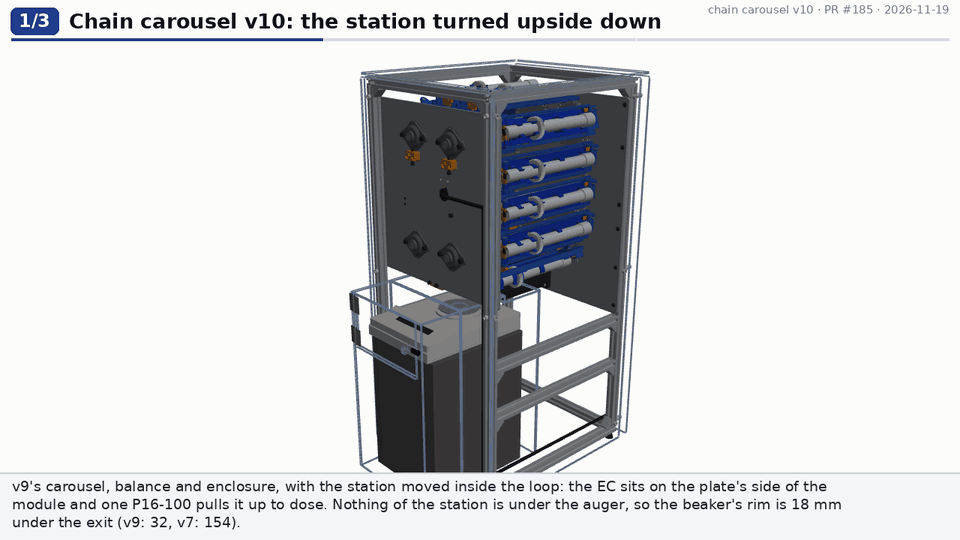
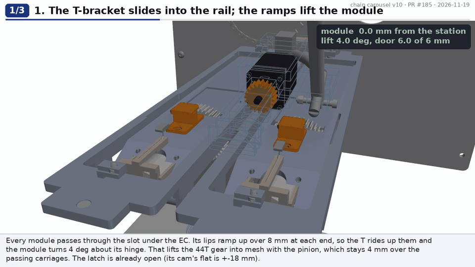
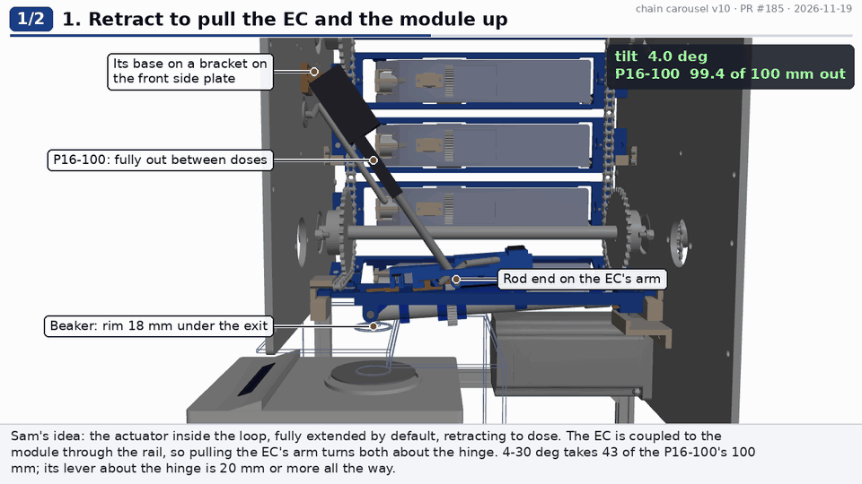
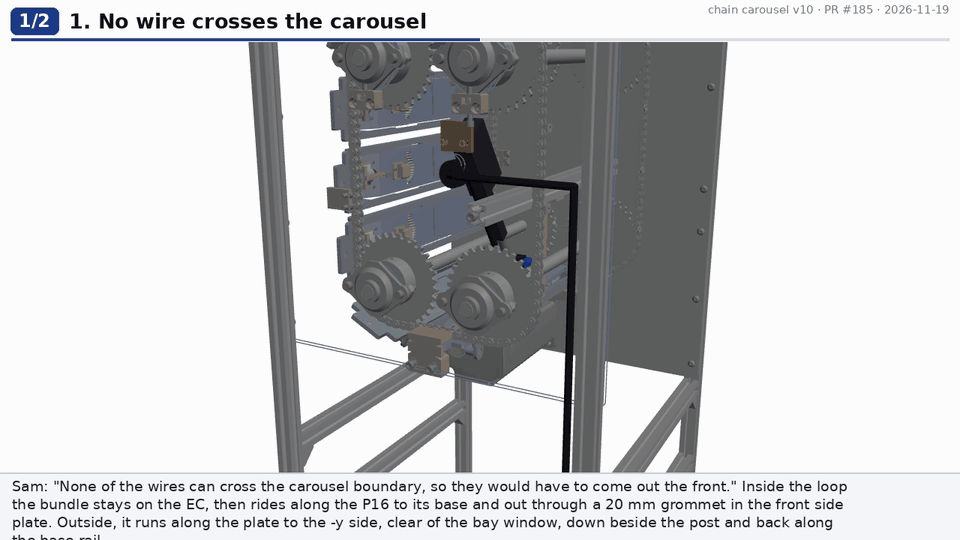
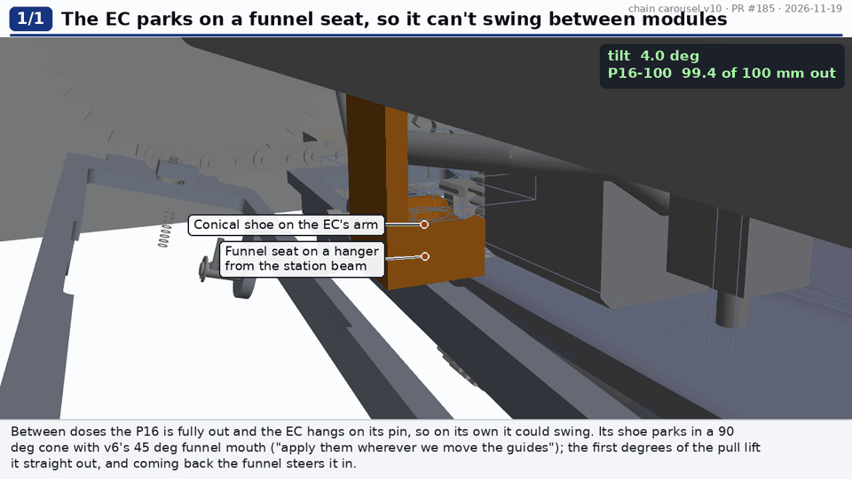
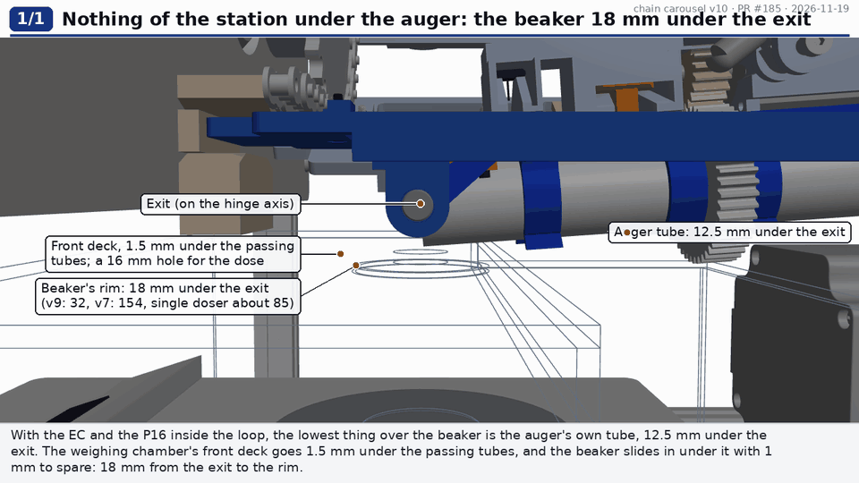
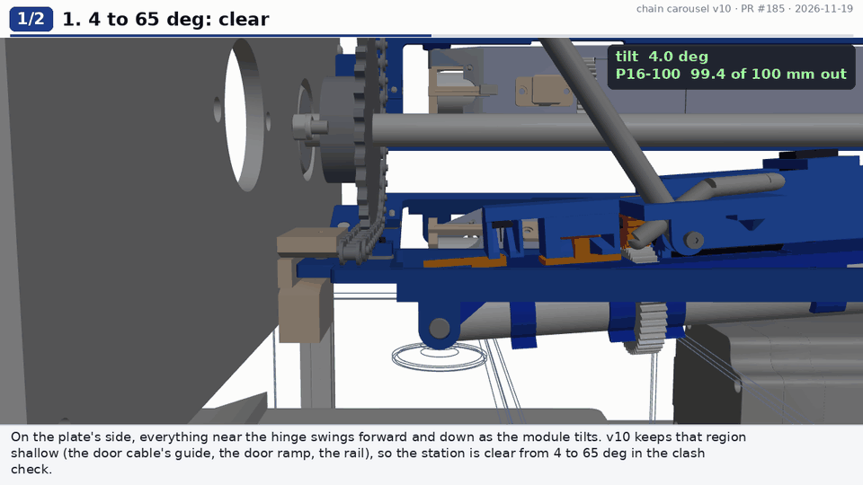

# Chain carousel v10: the station inside the loop, a keyed rail, the beaker 18 mm under the exit

> **v11** ([README](../chain-carousel-v11/README.md), Sam's notes of 2026-11-25) builds on v10: 0-90 deg (longer carriages, a P16-150 through the front side plate), a straight rail with no lift, the door opened by the EC through a rod, the solenoid over clip 1, and the tall-cage balance on the bench.

**v10 is a variation on [v9](../chain-carousel-v9/README.md)** (the balance on a granite block with no draft cage, a bay window and
a weighing chamber), and so on [v7](../chain-carousel-v7/README.md), which stays the main version. It follows Sam's note of
2026-11-19 ([PR #185](https://github.com/vertical-cloud-lab/powder-doser/pull/185)):

> instead of a linear actuator on the bottom pushing the augers up, what if it was inside, defaulting to fully extending, and then
> pulling it up to dose? ... None of the wires can cross the carousel boundary, so they would have to come out the front and wrap
> around to the electronics at the back ... try having a keyed rail of some kind on the electronics carriage, instead of the
> kinematic couplings ... each mounting plate would have some kind of T or L bracket that would slot into the electronics carriage
> every time an auger passed the dosing station. Give the entrance and exit a ramp ... give the electronics carriage some guides so
> it's not flopping around in between augers.

Nothing is built. Every number here is a prediction from the CAD.

**Onshape (public):** [Multi-doser chain carousel, test rig v10](https://cad.onshape.com/documents/99bd983c585992043f2eff96/w/7b5725dc5dfb7fe370fa0c71/e/56a319b93daf812d262f5eab)
(ids in [`onshape/onshape_document.json`](onshape/onshape_document.json); 11 API calls in [`onshape/api_calls.jsonl`](onshape/api_calls.jsonl):
10 for the import, 1 to confirm it is public). It was imported from `step/chain_carousel_rig_v10.step` by
[`onshape/onshape_build.py`](onshape/onshape_build.py). Earlier versions:
[v9](https://cad.onshape.com/documents/9aadc21a931d5337ff05de71/w/1dea03d63eb704d060d84c2a/e/caa98ea728a9da9006767590),
[v8](https://cad.onshape.com/documents/a093aef97b81fce9ce0f322f/w/7b029051ee0ec62ff198253f/e/7518535395874b79077ff86b),
[v7 (main)](https://cad.onshape.com/documents/291664f38c67a4672a86f025/w/e67d1b706aa4b873fa8c68e8/e/4802634f69ef3323004d7bf6).



## What changed, and why

| # | Sam asked | v10 | How it works | Clip |
|---|---|---|---|---|
| 1 | "what if it was inside, defaulting to fully extending, and then pulling it up to dose? That would let us get way closer to the scale" | **The station is inside the loop, on the plate's side of the module.** One Actuonix **P16-100** (100 mm stroke, pot feedback) runs from a bracket on the front side plate's inner face to an arm on the electronics carriage (EC). It sits beside the module's path (world y −34; the module is within ±27 of the station), so its body never meets the module | The P16 is fully extended between doses (99.4 of 100 mm). Retracting pulls the EC's arm, and the module coupled to the EC turns with it about the hinge: 56.7 mm out at 30°, 11.3 at 65° (the limit). Its lever about the hinge is 93 mm at the start, 92 mm at 30° and 47 mm at 65°. About 6 N holds an estimated 0.55 N·m (module and EC) at the dose angles, against the P16's 50 N. v7-v9 used a P16-150 | [pull](renders/v10/pull_v10.gif) |
| 1 | (the same) | **Nothing of the station is under the auger.** The beaker's rim is **18 mm under the exit** (v9: 32, v7: 154, the single doser about 85). It is set by the auger's own tube, 12.5 mm under the exit | The weighing chamber's front deck runs 1.5 mm under the passing tubes with a 16 mm hole under the exit for the dose. The beaker slides in under it with 1 mm to spare. Behind clip 1 the deck steps down to v9's level under the passing gears. The balance stays on its granite block, now 319 mm tall | [drop](renders/v10/drop_v10.gif) |
| 2 | "None of the wires can cross the carousel boundary, so they would have to come out the front and wrap around to the electronics at the back. This might also mean some cuts in the front metal panel" | **The NEMA 11's, the solenoid's and the P16's leads run in one 7 mm braided bundle** along the EC's arm and the P16 to the P16's base, then out through a **20 mm grommet in the front side plate**. Outside, the bundle runs along the plate's outer face to the −y side (clear of the bay window and the balance's block), down beside the −y front post and back along the base rail | Inside the loop the bundle only touches the EC, the P16 and the front plate. It bends only at the P16's two pins (a service loop at each). The front side plate gets three new holes: the grommet and the P16 bracket's two M5. Both side plates get one more, for the station beam | [wiring](renders/v10/wiring_v10.gif) |
| 3 | "a keyed rail ... each mounting plate would have some kind of T or L bracket that would slot into the electronics carriage every time an auger passed the dosing station. Give the entrance and exit a ramp ... Then we don't need any magnets" | **A printed T-bracket on every plate** (two M3 into inserts) reaches 10 mm past the plate's underside, through the carriage's opening. **Under the EC, a T-slot runs along the travel.** Both ends of its lips ramp up over 8 mm and its mouth flares 2.5 mm in each direction | Every index slides the next module's T into the slot. The lips lift it, and the module turns **4°** about its hinge. That brings its 44T gear up into mesh with the EC's 20T pinion, which then sits **4 mm over the passing carriages**. On the flat (±1.5 mm) the T sets the gear-to-pinion centre distance (32.25 mm). The exit ramp sets the module back on its rest. No kinematic coupling, no magnets, no electromagnet | [rail](renders/v10/rail_v10.gif) |
| 4 | "give the electronics carriage some guides so it's not flopping around in between augers" | **The EC's conical shoe parks in a funnel seat** on a printed hanger from a new **station beam inside the loop**. That beam is a 2020 from the front side plate to the back one, at world y −56, passing between the bottom and top sprockets | Between doses the EC hangs on the P16's pin and rests on the seat, so it can't swing. The seat is a 90° cone in v6's 45° funnel mouth ("apply them wherever we move the guides"). The first degrees of the pull lift the shoe straight out, and coming back the funnel steers it in | [guide](renders/v10/guide_v10.gif) |
| 5 | "I think the v7 carriage (my compact design) might be nice and easy now that it's above the auger, plus allow for a shorter linear actuator" | **EC v10 is a new print with Sam's carriage's parts:** the NEMA 11, the 20T steel pinion and the solenoid. The motor now sits **behind the gear** with its shaft forward, as v8's did | As drawn, Sam's carriage (motor in front of the gear) would let the module tilt only about 30°: on the plate's side, everything near the hinge swings forward toward the front sprockets. So the EC is shallow near the hinge (the rail and the door ramp) and deep only behind the gear. **The actuator is shorter:** a P16-100 instead of the P16-150 | [overview](renders/v10/overview_v10.gif) |
| 6 | "if you see any other places that would need support, adjust for them" | **The outlet door's push strip under the exit is gone.** Each shutter hangs on a short cable in a PTFE sleeve: it runs up through the door's spring and the housing's cap, back along the plate's underside, and up to a tab. A second ramp on the EC lifts the tab 6 mm as the module arrives | The door is open within 6.5 mm of the station and shut again beyond 16.5 mm. The cable's path never moves (only the tab does), so nothing near the hinge sweeps into the carriage's front edge. A first try with a bent wire did, at 38° | [rail](renders/v10/rail_v10.gif) (chapter 3) |
| 6 | (the same) | **The carriages' stiffening ribs move to their outer face**, so the inner face is flat under the EC. **The latch cam's flat is ±18 mm** (v4-v9: ±4), with 30° ramps | The pinion, the motor and the rail's lips clear every passing carriage by 4, 1.7 and 1 mm. The latch's pin is already out of its keeper when the rail starts lifting a module (17.5 mm out), and goes back in after the module is set down | [rail](renders/v10/rail_v10.gif) |

| The keyed rail: the T slides in, the ramps lift the module into mesh, the door ramp opens the outlet | The P16-100 inside the loop pulls the EC and module up |
|---|---|
|  |  |

| The wiring out through the front side plate | The EC's guide between modules |
|---|---|
|  |  |

**The beaker 18 mm under the exit** ([MP4](renders/v10/drop_v10.mp4)):



## One dose

1. **Index.** The NEMA 34 moves both chains 8 links, with the NEMA 11 left free (de-energised), or turned slowly.
   - The latch cam pulls the arriving module's pin out.
   - The T rides up the rail's ramp, and the module turns 4° about its hinge.
   - Its gear slides into mesh with the pinion from the side, over the last 10 mm or so.
   - The door ramp lifts the cable's tab, which opens the door.
2. **Pull up.** The P16 retracts, and the EC and module turn about the hinge to the dose angle (30° by default). The EC's shoe lifts out of its seat.
3. **Dose.** The NEMA 11 turns the auger; the solenoid taps the plate over clip 2. The dose falls 18 mm from the exit into the beaker. The exit is on the hinge axis, so it doesn't move with the tilt.
4. **Back.**
   - Hold 0.5 s, then the P16 extends fully: the module returns to 4° and the shoe re-seats.
   - Reverse the auger one turn at rest (the leakage study).
5. **Next index.** The exit ramp sets the module back on its carriage, the door shuts, and the latch closes behind it.

## The tilt range

**4° to 65° with the clash check clear** (v7-v9: 0-90°). The studies' dose range is 20-40°, with 30° the default.

**Why not 90°.** In v7-v9 the EC was on the auger's side, under the module, so it turned back and up out of the way. In v10 it is on
the plate's side, inside the loop. As the module tilts, everything on that side near the hinge swings forward and down, toward the
carriage's front edge, the front chain and the front sprockets. The [limit clip](renders/v10/limit_v10.gif) shows it:

| Tilt | What touches (`check_interference.py --tilt10`, [`checks/tilt_a.json`](checks/tilt_a.json), [`checks/tilt_b.json`](checks/tilt_b.json)) |
|---|---|
| 4, 20, 30, 40, 50, 60, 65° | nothing |
| 70° | the front of the EC (the door ramp's front web) meets the station carriage's front A-1 link (4.9 mm³) and its tab screw (2.0 mm³) |
| 75° | the EC also meets the front chain's links (up to 64 mm³), and the door cable's tab meets the A-1 link |

The design was pushed this far by three fixes the check found:
- **The first door's bent pull wire** reached carriage 1's front edge at 38°. The door now hangs on a cable in a fixed guide, and
  only its tab moves.
- **The EC's spine** started 11.5 mm further forward and met the front chain at 60°.
- **The door ramp** was in front of the tab, and met carriage 1's front at 60-65°.

To get past 65°, the EC's front 10 mm (the door ramp) would have to move further back, which means moving each door's tab back with
it. Past about 80° the NEMA 11 reaches the front sprockets, so 90° would need the EC back on the auger's side, which is what put it
under the auger.



**The P16-100's extension** (`layout.p16_10_ext`, for `test/chain_rig.py`):

| Tilt | 4° (coupled, between doses) | 10° | 20° | 30° | 40° | 50° | 60° | 65° |
|---|---|---|---|---|---|---|---|---|
| P16 out, of 100 mm | 99.4 | 89.6 | 73.1 | 56.7 | 41.2 | 27.3 | 15.8 | 11.3 |
| its lever about the hinge | 93 mm | 94 | 95 | 92 | 85 | 74 | 57 | 47 |

## Auger-to-beaker height: the single doser, v7, v9 and v10

| From the auger's exit | Single doser | v7 | v9 | **v10** |
|---|---|---|---|---|
| to the beaker's rim | about 85 mm (±15) | 154 mm | 32 mm | **18 mm** |
| to the beaker's floor | about 153 mm | 201 mm | 80 mm | **67 mm** |
| what sets it | | the cage's lid under the EC | the EC's slim door finger, parked | the auger's own tube (12.5 mm under the exit) and the deck under it |

## Checks

These are OCC boolean overlaps between parts; anything over 0.5 mm³ counts as a clash. By-design contacts are skipped by part key
(v10's are at the end of SKIP in [`check_interference.py`](check_interference.py)). The balance, its block, the beaker and the
weighing chamber are in every check.

| Check | What moves | Result |
|---|---|---|
| Home ([`checks/home.json`](checks/home.json)) | Every pair of the 841 instances, the station module coupled at 4° | **0** |
| `--tilt10` ([`tilt_a.json`](checks/tilt_a.json), [`tilt_b.json`](checks/tilt_b.json)) | Module 1, the EC, the P16 (its body swings on its base pin, its rod slides) and the bundle on the EC, at 4, 20, 30, 40, 50, 60, 65, 70 and 75°, against everything else | **0 at 4-65°**; contacts at 70 and 75° (above) |
| [`sweep_station.py`](sweep_station.py) ([`checks/sweep_station.json`](checks/sweep_station.json)) | Every carriage and module within 2.2 modules of the station, over one module of travel in 1-link steps (9 poses), each module lifted by the rail and its door opened by the ramp as it passes, against the EC, the P16, the guide, the beam, the cables, the balance, its block, the beaker and the weighing chamber | **0** |

Two pairs are by-design contacts and are skipped: the T-bracket on the rail's lips, and the door cable's tab on the door ramp. The
first runs also found and fixed these:
- the motor plate touching the 44T gear (the motor moved back 1.5 mm);
- the latch cam's longer flat touching the NEMA 34 (its ramps went from 25° to 30°);
- the outside run of the bundle crossing the balance's block (it now runs to the −y side first);
- the bundle along the P16 touching the station beam (it now rides on the P16's narrow side);
- the P16's base bracket overlapping the grommet (the grommet moved down 8 mm);
- the door cable's guide boss under the door ramp (the ramp is now two rails with the cable between them).

## Cost

**$2,352.10, or $2,210.71 without test gear** ([BOM.md](BOM.md)). v9 was $2,406.05 ($2,264.66): $53.95 less. Lines marked estimate add
up to $689.34.
- **Removed:**
  - v7's kinematic dock: the 1/4 in ball, the vee dowels and the D44-N52 dock magnets, plus the plates' magnets in the posts;
  - v7's two cross bars and guides;
  - the P16-150.
- **Added:**
  - the P16-100 (about $85, estimated: Actuonix's page refused the request);
  - EC v10 and 13 T-bracket prints, with their M3 screws and inserts;
  - the door cables, guides and tabs;
  - the station beam (from the same 2020 stock), the guide hanger and the P16's bracket;
  - the grommet, the braided sleeve, the ties, and hook-up wire to extend the leads (the route to the board is about 2.2 m).
- **The same:** the NEMA 11, the pinion, the solenoid, the one LAC, the balance, its block (now 319 mm tall) and the enclosure.

## Check before building

1. **The gear slides into mesh sideways (TEST-PLAN T6a).** Every index brings a 44T gear into mesh with the stationary pinion over
   its last 10 mm of travel. Leave the NEMA 11 free during indexes, so the pinion turns out of the way instead of the auger turning
   (a held pinion would turn the auger about 50° per pass). Count tooth clashes over 200 indexes, free and seeking.
2. **The ramp lift.** The module rides 4° up the rail's lips. Check that the T doesn't wear the lips, and that the module's weight on
   the flat sets the centre distance repeatably. Print the rail in PETG-CF or line its lips with PTFE tape if they wear.
3. **The door cable.** A 0.6 mm stainless rope in a PTFE sleeve with two bends. Check that the door's spring (0.3-0.6 N) still
   shuts it against the sleeve's friction, upside down on the top run too.
4. **The P16 inside the loop.** It hangs from its base pin with the EC on its rod end, and the EC rests on its guide seat. Check
   that the EC repeats within 0.05 mm over 20 cycles. Check that the T always finds the slot's flared mouth, including after a
   2 mm push by hand.
5. **The wiring.** 1000 tilt cycles to 60°; look for chafe at the service loops at both of the P16's pins.
6. **Every carriage is reprinted** (its ribs move outside), every plate gets two inserts and a relief, and every door gets the cable
   and guide. The latch cam is reprinted with its longer flat.
7. v9's open items stand: whether the lab's balance runs with its draft cage off, whether the closed enclosure keeps it quiet, and
   which balance the lab uses.

## Not done

- **Not simulated:** the station's dynamics and the gear's sideways engagement (a tooth-contact model, as in
  [`../gear-mesh/`](../gear-mesh/README.md), would be the next study). The checks are static poses.
- **Not drawn:** the bundle's service loops at the P16's two pins (the bundle is drawn straight between its tie points), and
  strain reliefs.
- **Not rerun:** `--swap` and `--latch` (the side hatch and the latch are v9's; only the cam's flat changed, and the home and
  station-sweep checks include it).
- **Not regenerated:** the stills, the step-by-step ASSEMBLY renders and the Bambu slices. The STLs are exported.

## Files

| File | What |
|---|---|
| [`params.py`](params.py) | v7/v9's numbers with v10's at the end |
| [`parts10.py`](parts10.py) | The T-bracket, the rail's slot and its ramps, the door's cable, guide and tab, EC v10, the P16-100 and its bracket, the guide, carriage v10, the plate's changes, the chamber and bay |
| [`layout.py`](layout.py) | v9's layout with the station inside the loop (`_station_v10`, `ec10_frame`, `p16_10_ext`, `cable_paths_v10`), the modules' lift on the rail (`module_offset`, `parts10.module_lift`) and the door (`parts10.door_open_at`) |
| [`check_interference.py`](check_interference.py), [`sweep_station.py`](sweep_station.py) | Home, `--tilt10`, station sweep |
| [`explain10.py`](explain10.py) | The v10 clips in `renders/v10/` (GIF + MP4 each) |
| [`build.py`](build.py) | STEP assembly and components, the printed parts' STLs (`ec10.stl`, `t_bracket.stl`, `door_guide10.stl`, `door_tab10.stl`, `p16_bracket10.stl`, `guide10.stl`, `mounting_plate_v10.stl`, `carriage.stl`), the DXFs |
| [`bom.py`](bom.py) / [`BOM.md`](BOM.md) | The BoM |
| [`TEST-PLAN.md`](TEST-PLAN.md) | v9's tests with the station's rewritten for v10 |
| [`test/chain_rig.py`](test/chain_rig.py) | The Pi driver: one P16-100 (fully out between doses, `tilt_to_ext` from the table above), the NEMA 11 freed (or seeking with `--seek`) during every index, the DRV8825's EN on BCM 20 |

To re-run:

```
pip install cadquery vtk pillow imageio imageio-ffmpeg numpy matplotlib
python check_interference.py && python check_interference.py --tilt10 && python sweep_station.py
xvfb-run -a python explain10.py overview rail pull wiring guide drop limit
python build.py && python bom.py
```
