# Assembly: chain-carousel test rig v11

Twelve steps in build order, then the test set-up. Each step's title is `layout.STEPS` and its render is v11's CAD (`xvfb-run -a python render.py --steps` writes `renders/steps/step_NN.png`): the parts from earlier steps are pale, and the step's new parts are in colour, lifted along the way they go in. The table under each render is the BoM lines that step uses ([BOM.md](BOM.md) item numbers). [`renders/assembly_steps.gif`](renders/assembly_steps.gif) runs through the twelve renders. The written instructions under each table are carried over from v4 and not yet rewritten for v11 (v11's station, module and balance are in the step titles, the BoM lines and the [README](README.md)).

Tools: chain breaker, metric hex keys, 8 mm and 7/16 in wrenches, M5 tap, chop or band saw for the 2020 and the shafts, soldering iron, heat-set insert tip, e-clip pliers, feeler gauges.

## Step 1. Base frame: side rails and the back cross rail (a U round the balance), corner brackets, leveling feet

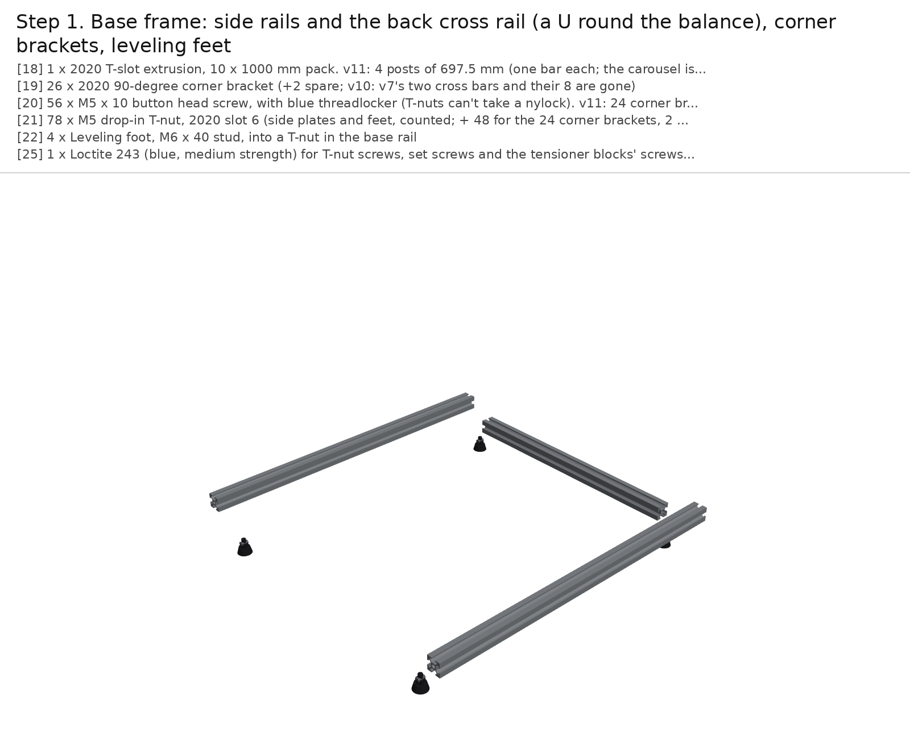

| # | Qty | Part |
|---|---|---|
| 18 | 1 | 2020 T-slot extrusion, 10 x 1000 mm pack. v11: 4 posts of 697.5 mm (one bar each; the carousel is 98.5 mm lower), 4 long rails of 457.7 mm (2 per bar), 4 rungs of 417.7 mm (2 per bar), 3 cross rails of 340 mm, the 405 mm station beam and the 380 mm front bar (340 + 405 on one bar, 340 + 380 on another, 340 on the last; tap the beam's ends M5): ten bars, one pack |
| 19 | 26 | 2020 90-degree corner bracket (+2 spare; v10: v7's two cross bars and their 8 are gone) |
| 20 | 56 | M5 x 10 button head screw, with blue threadlocker (T-nuts can't take a nylock). v11: 24 corner brackets x 2, the EC's guide hanger to the station beam (2), the P16's clevis to the front bar (2), 4 spare |
| 21 | 78 | M5 drop-in T-nut, 2020 slot 6 (side plates and feet, counted; + 48 for the 24 corner brackets, 2 for the guide hanger in the station beam's bottom slot, v11: 2 for the P16's clevis in the front bar's bottom slot and 2 for the bar's screws in the front posts' front slots) |
| 22 | 4 | Leveling foot, M6 x 40 stud, into a T-nut in the base rail |
| 25 | 1 | Loctite 243 (blue, medium strength) for T-nut screws, set screws and the tensioner blocks' screws; Loctite 222 (purple, low strength) where a part is meant to come apart |

The frame uses nine bars of one VEVOR 10-pack of 1000 mm 2020 (v4's frame is wider and taller than v3's, because
the modules ride outside the loop). Cut four posts of 698 mm (one bar each; two of the offcuts give the cradle post,
221 mm, and the station-rails post, 241 mm), four long rails of 457.7 mm (two per bar), and six rails of
340 mm (two per bar): four cross rails and the two station rails. Square every cut.

Lay two long rails on the bench, 360 mm apart centre to centre, with a cross rail between them at each
end, the actuator's station rail 131 mm behind the front chain's plane and the latch-rail post's station
rail at 204 mm (two corner brackets each). Screw the
four leveling feet up into T-nuts in the long rails' bottom slots, 15 mm in from each end. Blue Loctite on every
screw that goes into a T-nut.

## Step 2. Posts, top frame, and the ladder: two rungs between the front and back posts on each side (v11: under the back plate's lower edge)

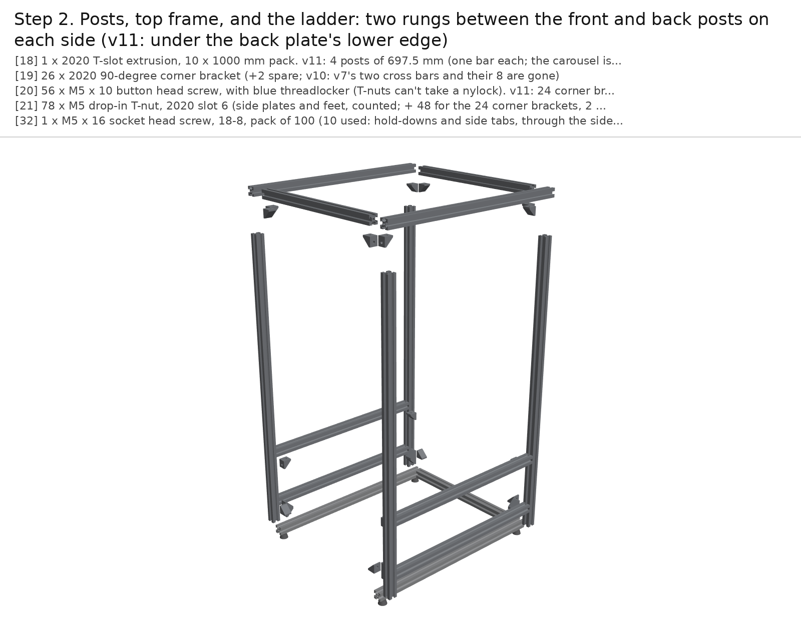

| # | Qty | Part |
|---|---|---|
| 18 | 1 | 2020 T-slot extrusion, 10 x 1000 mm pack. v11: 4 posts of 697.5 mm (one bar each; the carousel is 98.5 mm lower), 4 long rails of 457.7 mm (2 per bar), 4 rungs of 417.7 mm (2 per bar), 3 cross rails of 340 mm, the 405 mm station beam and the 380 mm front bar (340 + 405 on one bar, 340 + 380 on another, 340 on the last; tap the beam's ends M5): ten bars, one pack |
| 19 | 26 | 2020 90-degree corner bracket (+2 spare; v10: v7's two cross bars and their 8 are gone) |
| 20 | 56 | M5 x 10 button head screw, with blue threadlocker (T-nuts can't take a nylock). v11: 24 corner brackets x 2, the EC's guide hanger to the station beam (2), the P16's clevis to the front bar (2), 4 spare |
| 21 | 78 | M5 drop-in T-nut, 2020 slot 6 (side plates and feet, counted; + 48 for the 24 corner brackets, 2 for the guide hanger in the station beam's bottom slot, v11: 2 for the P16's clevis in the front bar's bottom slot and 2 for the bar's screws in the front posts' front slots) |
| 32 | 1 | M5 x 16 socket head screw, 18-8, pack of 100 (10 used: hold-downs and side tabs, through the side plates, 8; v10: one through each side plate into the station beam's tapped ends, 2), with blue threadlocker |

Stand a post on each end of the long rails. Each post gets four corner brackets: at its foot, one on the
long rail's top on the inner side and one on the cross rail's top; at its head, the same two under the top rails.
Use M5 x 10 button heads into drop-in T-nuts. Put the two top long rails and two top cross rails on the posts the
same way as the base, then square the box by its diagonals (equal within 1 mm) and tighten.

Don't put brackets on the posts' inner x faces between 226 and 712 mm: the side plates sit there.

## Step 3. Side plates onto the posts (v11: the front plate's P16 slot and grommet hole)

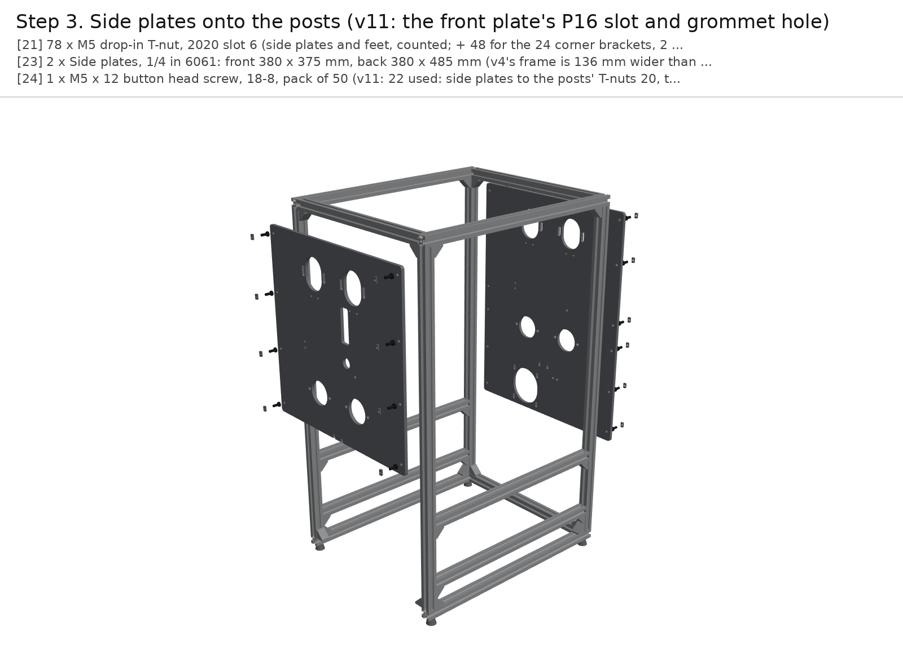

| # | Qty | Part |
|---|---|---|
| 21 | 78 | M5 drop-in T-nut, 2020 slot 6 (side plates and feet, counted; + 48 for the 24 corner brackets, 2 for the guide hanger in the station beam's bottom slot, v11: 2 for the P16's clevis in the front bar's bottom slot and 2 for the bar's screws in the front posts' front slots) |
| 23 | 2 | Side plates, 1/4 in 6061: front 380 x 375 mm, back 380 x 485 mm (v4's frame is 136 mm wider than v3's), both from one 24 x 36 in plate; cut and drilled from dxf/ (BYU shop, or SendCutSend: price on upload) |
| 24 | 1 | M5 x 12 button head screw, 18-8, pack of 50 (v11: 22 used: side plates to the posts' T-nuts 20, the latch cam 2), with blue threadlocker |

Have the two side plates cut from one 24 x 36 in sheet of 1/4 in 6061 (`dxf/side_plate_front.dxf`,
`dxf/side_plate_back.dxf`, by the BYU shop or SendCutSend). The front plate is 380 x 375 mm. The back
plate runs down to 226 mm above the bench, 380 x 485 mm, because it carries the motor.
Tap the four M5 holes under the top bearing slots on each plate.

Bolt each plate to the inner faces of its two posts with M5 x 12 button heads from the inside into drop-in T-nuts.
Set the front plate's bottom edge 336 mm above the bench and the back plate's 226 mm. The plates' inner
faces end up 405 mm apart, 30 mm outside each chain.

## Step 4. Flange bearings and top-shaft tensioners on the side plates

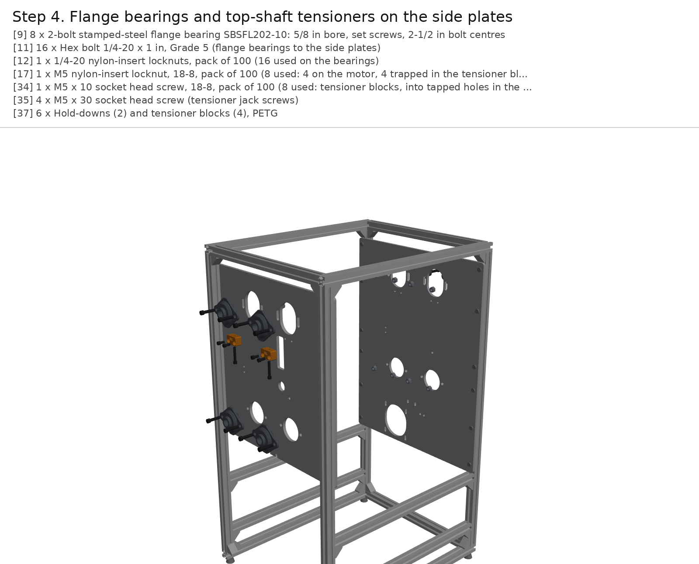

| # | Qty | Part |
|---|---|---|
| 9 | 8 | 2-bolt stamped-steel flange bearing SBSFL202-10: 5/8 in bore, set screws, 2-1/2 in bolt centres |
| 11 | 16 | Hex bolt 1/4-20 x 1 in, Grade 5 (flange bearings to the side plates) |
| 12 | 1 | 1/4-20 nylon-insert locknuts, pack of 100 (16 used on the bearings) |
| 17 | 1 | M5 nylon-insert locknut, 18-8, pack of 100 (8 used: 4 on the motor, 4 trapped in the tensioner blocks as jack-screw nuts) |
| 34 | 1 | M5 x 10 socket head screw, 18-8, pack of 100 (8 used: tensioner blocks, into tapped holes in the plates) |
| 35 | 4 | M5 x 30 socket head screw (tensioner jack screws) |
| 37 | 6 | Hold-downs (2) and tensioner blocks (4), PETG |

Mount the eight SBSFL202-10 flange bearings on the plates' outer faces, bolt line horizontal, with
1/4-20 x 1 in bolts and nylon-insert locknuts on the plates' inner faces. Each bearing's rear dome sits in its
plate's 49 mm hole. The bottom shafts are 415.1 mm above the bench. Put the four top bearings at the bottom of their
slots, 6 mm below the nominal 643.7 mm, which leaves room to fit the chains. Snug those bolts only.

Under each top bearing, screw a printed tensioner block to the plate (two M5 x 10 into the tapped holes, blue
Loctite). Drop an M5 nylon-insert locknut into the block's slot and run an M5 x 30 jack screw up through it until it
touches the underside of the bearing's front dome. The locknut keeps the jack screw from turning with the vibration.

## Step 5. Corner shafts with their sprockets (back set screws loose)

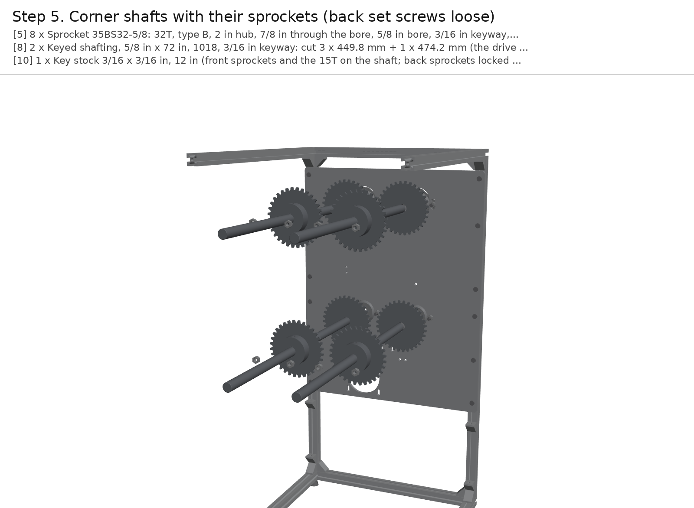

| # | Qty | Part |
|---|---|---|
| 5 | 8 | Sprocket 35BS32-5/8: 32T, type B, 2 in hub, 7/8 in through the bore, 5/8 in bore, 3/16 in keyway, 2 set screws |
| 8 | 2 | Keyed shafting, 5/8 in x 72 in, 1018, 3/16 in keyway: cut 3 x 449.8 mm + 1 x 474.2 mm (the drive shaft). v11: 40 mm longer each (the chains are 345 mm apart), so the four no longer come out of one 72 in bar with the saw's kerf: two bars |
| 10 | 1 | Key stock 3/16 x 3/16 in, 12 in (front sprockets and the 15T on the shaft; back sprockets locked by set screws after phasing) |

Cut the 72 in keyed bar into three shafts of 449.8 mm and one of 474.2 mm. The long
one is the drive shaft and goes in the bottom +y corner (B+). Each shaft carries two sprockets. Feed it through the
front bearing, slide on the front sprocket with its hub toward the front, then the back sprocket with its hub toward
the back, and push the shaft on through the back bearing.

Centre each sprocket's teeth on its chain line, 345 mm apart, the front one 30 mm inside the front plate. Key
the front sprocket and tighten its set screws (blue Loctite). Leave the back one's key out and its set screws loose:
the carriages set its phase in step 10. Tighten the bearings' set screws on the shaft.

## Step 6. NEMA 34 on the back plate, 15T sprockets, drive chain

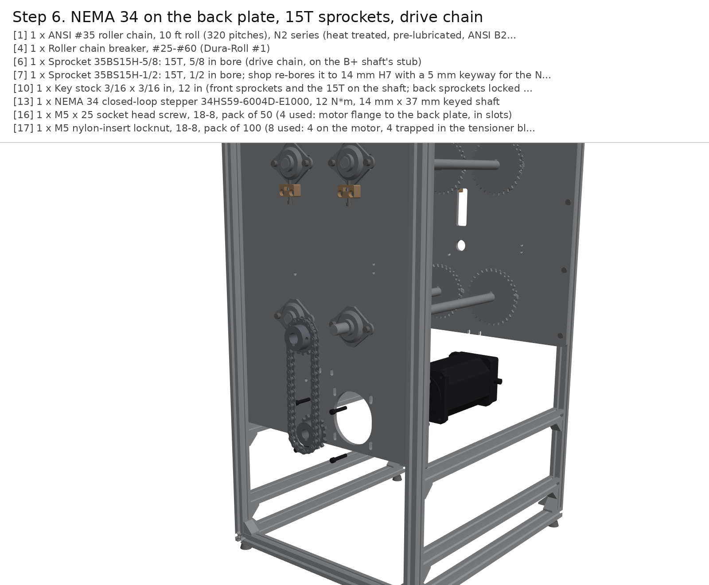

| # | Qty | Part |
|---|---|---|
| 1 | 1 | ANSI #35 roller chain, 10 ft roll (320 pitches), N2 series (heat treated, pre-lubricated, ANSI B29.1): two 104-link loops + the 44-link drive chain. v11: the model is drawn to this chain (Sam, 2026-11-25: "find a cheap but still good quality chain online ... apply those dimensions"): Nitro's P, b1, d1, d2, L, h2 and T, its waisted plates and its 0.518 in connecting links |
| 4 | 1 | Roller chain breaker, #25-#60 (Dura-Roll #1) |
| 6 | 1 | Sprocket 35BS15H-5/8: 15T, 5/8 in bore (drive chain, on the B+ shaft's stub) |
| 7 | 1 | Sprocket 35BS15H-1/2: 15T, 1/2 in bore; shop re-bores it to 14 mm H7 with a 5 mm keyway for the NEMA 34 |
| 10 | 1 | Key stock 3/16 x 3/16 in, 12 in (front sprockets and the 15T on the shaft; back sprockets locked by set screws after phasing) |
| 13 | 1 | NEMA 34 closed-loop stepper 34HS59-6004D-E1000, 12 N*m, 14 mm x 37 mm keyed shaft |
| 16 | 1 | M5 x 25 socket head screw, 18-8, pack of 50 (4 used: motor flange to the back plate, in slots) |
| 17 | 1 | M5 nylon-insert locknut, 18-8, pack of 100 (8 used: 4 on the motor, 4 trapped in the tensioner blocks as jack-screw nuts) |

Have the shop re-bore the 35BS15H-1/2 sprocket to 14 mm H7 with a 5 mm keyway, then slide it onto the NEMA 34's
shaft, hub outward, over the key. Offer the motor up to the back plate's inner face from inside the frame, with its
pilot in the plate's slot and the shaft and sprocket out the back. Bolt it on with four M5 x 25 from outside and
nylon-insert locknuts on the flange. The motor's axis is 277.0 mm above the bench, right under the drive shaft.
It is 6 kg, so support it while you fit the bolts.

Key the 35BS15H-5/8 sprocket onto the drive shaft's stub, in line with the motor's sprocket. Cut 44 pitches from
the 10 ft roll and close them round both sprockets. Pull the motor down in its slots (+-4 mm) until the
chain has about 2 mm of play at mid-span, then tighten its bolts.

## Step 7. Chains: 13 Nitro CL35-A1 links per chain, close both loops

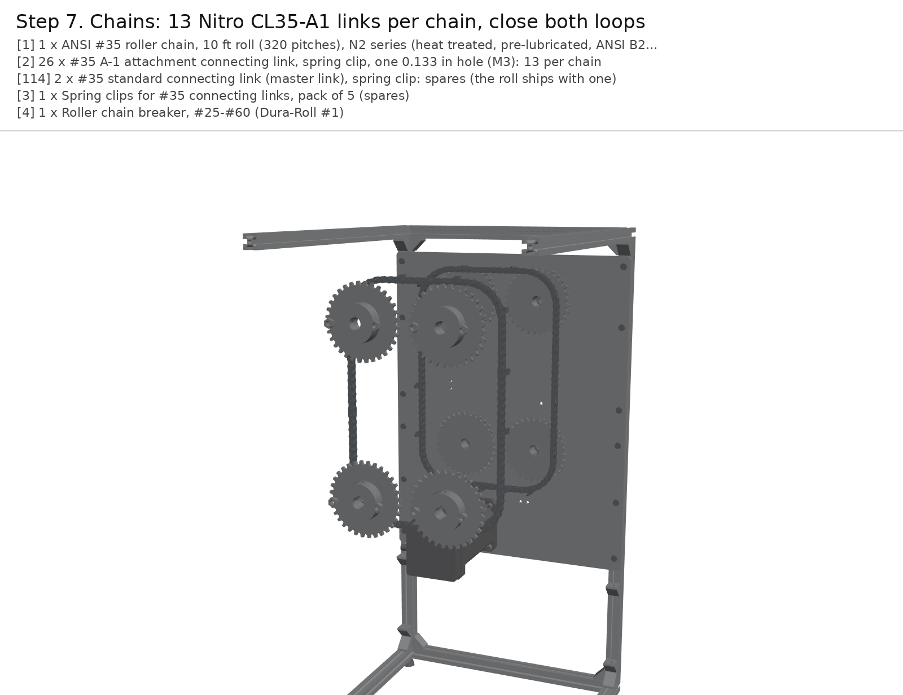

| # | Qty | Part |
|---|---|---|
| 1 | 1 | ANSI #35 roller chain, 10 ft roll (320 pitches), N2 series (heat treated, pre-lubricated, ANSI B29.1): two 104-link loops + the 44-link drive chain. v11: the model is drawn to this chain (Sam, 2026-11-25: "find a cheap but still good quality chain online ... apply those dimensions"): Nitro's P, b1, d1, d2, L, h2 and T, its waisted plates and its 0.518 in connecting links |
| 2 | 26 | #35 A-1 attachment connecting link, spring clip, one 0.133 in hole (M3): 13 per chain |
| 114 | 2 | #35 standard connecting link (master link), spring clip: spares (the roll ships with one) |
| 3 | 1 | Spring clips for #35 connecting links, pack of 5 (spares) |
| 4 | 1 | Roller chain breaker, #25-#60 (Dura-Roll #1) |

**First measure the chain** (see the BoM note): about 4.78 mm between the inner plates and a 5.08 mm bushing
means ANSI 35, which is what the sprockets are.

Cut two loops of 104 pitches from the 10 ft roll. In each, take out an outer link every 8 pitches and fit an A-1
attachment connecting link in its place, 13 per chain. On the front chain the tabs point back (+x, toward the
other chain); on the back chain they point forward. Number the A-1 links 1-13 the same way on both chains.

Wrap each chain round its four sprockets with the tabs on the outside of the loop, then close it with its 13th A-1
link. Each spring clip's closed end points the way the chain travels (bottom run toward -y). The chains hang slack,
because the top shafts are still at the bottom of their slots.

## Step 8. Station: hold-downs, hall switches; the station beam inside the loop and the EC's guide on it; the front bar across the front posts and the P16-150's clevis under it; EC v11 (door ramp, solenoid over clip 1, straight rail, NEMA 11 and 24T pinion, the arm) on the P16's rod end, through the front plate's slot; the latch cam; the side tabs

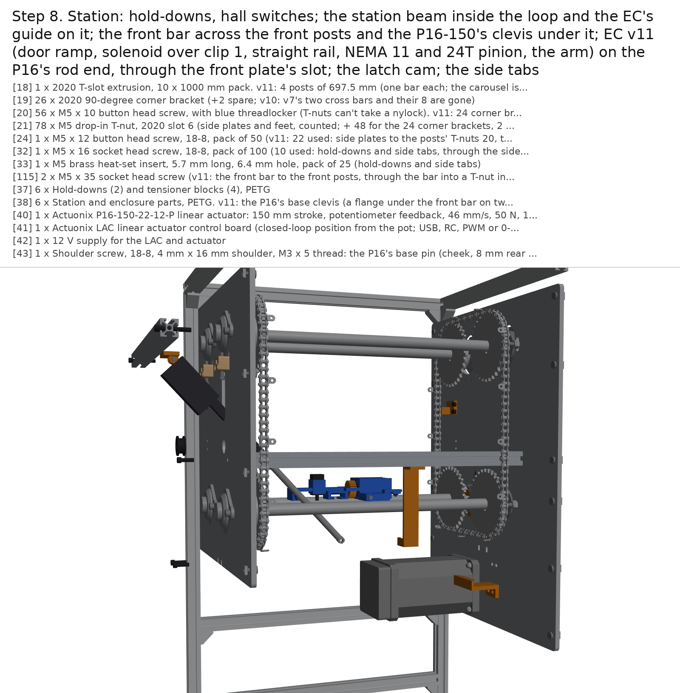

| # | Qty | Part |
|---|---|---|
| 18 | 1 | 2020 T-slot extrusion, 10 x 1000 mm pack. v11: 4 posts of 697.5 mm (one bar each; the carousel is 98.5 mm lower), 4 long rails of 457.7 mm (2 per bar), 4 rungs of 417.7 mm (2 per bar), 3 cross rails of 340 mm, the 405 mm station beam and the 380 mm front bar (340 + 405 on one bar, 340 + 380 on another, 340 on the last; tap the beam's ends M5): ten bars, one pack |
| 19 | 26 | 2020 90-degree corner bracket (+2 spare; v10: v7's two cross bars and their 8 are gone) |
| 20 | 56 | M5 x 10 button head screw, with blue threadlocker (T-nuts can't take a nylock). v11: 24 corner brackets x 2, the EC's guide hanger to the station beam (2), the P16's clevis to the front bar (2), 4 spare |
| 21 | 78 | M5 drop-in T-nut, 2020 slot 6 (side plates and feet, counted; + 48 for the 24 corner brackets, 2 for the guide hanger in the station beam's bottom slot, v11: 2 for the P16's clevis in the front bar's bottom slot and 2 for the bar's screws in the front posts' front slots) |
| 24 | 1 | M5 x 12 button head screw, 18-8, pack of 50 (v11: 22 used: side plates to the posts' T-nuts 20, the latch cam 2), with blue threadlocker |
| 32 | 1 | M5 x 16 socket head screw, 18-8, pack of 100 (10 used: hold-downs and side tabs, through the side plates, 8; v10: one through each side plate into the station beam's tapped ends, 2), with blue threadlocker |
| 33 | 1 | M5 brass heat-set insert, 5.7 mm long, 6.4 mm hole, pack of 25 (hold-downs and side tabs) |
| 115 | 2 | M5 x 35 socket head screw (v11: the front bar to the front posts, through the bar into a T-nut in each post's front slot), with blue threadlocker |
| 37 | 6 | Hold-downs (2) and tensioner blocks (4), PETG |
| 38 | 6 | Station and enclosure parts, PETG. v11: the P16's base clevis (a flange under the front bar on two M5 into T-nuts, two cheeks round the P16's rear tab), the EC's guide hanger (v10's, from the station beam, now at y -56), the latch cam (v10's, its web and foot moved beside the back hold-down), 2 side tabs, the side hatch's turn button |
| 40 | 1 | Actuonix P16-150-22-12-P linear actuator: 150 mm stroke, potentiometer feedback, 46 mm/s, 50 N, 10 N side load, 197.4 mm closed hole to hole, 20 % duty cycle (datasheet rev B; modelled from Actuonix's STEP). v11: the only actuator, back from v10's P16-100 because 0-90 deg needs 131 mm of travel: its rear tab in a clevis under the front bar, outside the front side plate (26 mm in front of it), through a slot in the plate, its rod end on the EC's arm. Fully out between doses (139.2 of 150 mm), it retracts to 8.3 mm at 90 deg; its lever about the hinge is 87 mm at rest and 30 mm or more all the way |
| 41 | 1 | Actuonix LAC linear actuator control board (closed-loop position from the pot; USB, RC, PWM or 0-3.3 V in). v7-v10: one, for the one P16 (v6: three) |
| 42 | 1 | 12 V supply for the LAC and actuator |
| 43 | 1 | Shoulder screw, 18-8, 4 mm x 16 mm shoulder, M3 x 5 thread: the P16's base pin (cheek, 8 mm rear tab, cheek) + an M3 nylock from item 27. v11: one, in the printed clevis under the front bar |
| 101 | 1 | Shoulder screw, 18-8, 4 mm x 20 mm shoulder, M3 thread (the length the CAD places; the clevis is 13.8 mm across its cheeks): v10: the P16's rod-end pin through the clevis on the EC's arm, the rod end's 6 mm tab and a PTFE washer each side; an M3 nylock from item 27. Same family as item 43 |
| 102 | 1 | PTFE washer for M4, 4.3 x 9 x 0.8 mm, pack of 50: v10: 2 used, either side of the P16's rod-end tab in the clevis on the EC's arm |
| 66 | 1 | Steel spur gear, module 1, 24T, 20 deg, 10 mm face, 6 mm bore with an M4 set screw (KHK SS1-24A; v2-v10: SS1-20A). v11: 24T so the 44T gear meets it at rest with the NEMA 11's body 2.25 mm off the passing plates (centre distance 34.25 mm). No stock module 1 24T comes with a 5 mm bore, so it goes on the NEMA 11's 5 mm shaft over a 5 x 6 mm sleeve (item 121). Face the hub off; Loctite 638 on the sleeve |
| 121 | 1 | Shaft sleeve for the 24T pinion: 6 mm OD x 0.5 mm wall brass tube (5 mm bore for the NEMA 11's shaft), a 10 mm length slotted lengthwise under the pinion's M4 set screw, Loctite 638 (2026-11-27: no stock module 1 24T has a 5 mm bore) |
| 119 | 1 | NEMA 11 stepper StepperOnline 11HS18-0674S (the auger's drive on EC v11; the single doser's, in the lab) |
| 120 | 1 | Solenoid, small push-pull, 12 V (Adafruit 412): the tap, over clip 1 on EC v11 (the single doser's, in the lab) |
| 72 | 1 | Dry PTFE lubricant spray (pinion and gear teeth; keeps the separating force near 0.47 x the tangential load; v10: also the EC's T-slot and ramps and its door ramp, where the T-brackets and the door tabs slide) |
| 77 | 1 | Electronics carriage v11 (new), PETG: inside the loop on the plate's side of the module, 1 mm or more over the passing plates, carriages and T-brackets: the door ramp at its front, over the outlet (two wedge lips that catch each door rod's head and draw it 6 mm); a spine back to the motor; the solenoid's collar over clip 1 (plunger toward the plate); the rail block with the straight T-slot (level lips, ends flared 2.5 mm); the motor plate and two cheeks round the NEMA 11 (behind the gear, shaft forward to the 24T pinion) with a strap; an arm out to the -y side with the P16's rod-end clevis and the guide shoe |
| 53 | 2 | Hall-effect switch US5881 (unipolar, open drain, TO-92): INDEX and HOME |
| 110 | 1 | Rubber grommet for a 3/4 in (20 mm) hole in 1/4 in plate, about 3/8 in inside: the station's cable bundle out through the front side plate; a pack, 1 used |
| 111 | 1 | Expandable braided sleeving, PET, 1/4 in (expands to about 3/8 in), 10 ft: the 7 mm bundle (the NEMA 11's 4 leads, the solenoid's 2, the P16's 5) from the EC along its arm and the P16, through the grommet and outside to the board, about 2.3 m |
| 112 | 1 | Nylon cable ties, 4 in, pack of 100: the bundle along the EC's arm and the P16's body, and outside down the -y front post and along the base rail |
| 113 | 1 | Hook-up wire, 22 AWG stranded, 6 colours x 25 ft: extends the NEMA 11's 4, the solenoid's 2 and the P16's 5 leads from the EC out through the front side plate to the board behind the rig, about 2.3 m each |

The station, under the bottom run:

1. Hold-downs: as v2. Melt two M5 inserts into each printed hold-down, push a US5881 into each lip's pocket (INDEX
   front, HOME back) and screw them to the plates' inner faces with two M5 x 16 (blue Loctite).
2. Side tabs (item 5a) at the loading position (+y side, mid-height): the same way, two M5 inserts each, on the plates'
   inner faces. Their lips cover only the bottom 8 mm of a tongue, so a carriage slid 10 mm up comes out.
3. Actuator: the printed base clevis on the actuator's station rail (two M5 into T-nuts); the P16-150's rear tab on a
   4 x 16 mm shoulder screw (McMaster 90265A123) and an M3 locknut.
4. Electronics carriage v4 (print `stl/electronics_carriage_v4.stl`, Sam's carriage printed upside down with the new
   features). It parks under the module and reaches up round the auger to the plate's auger side:
   - press the four 1/4 in steel balls into the base's three pockets and into the +y arm's boss (ball C), 3.8 mm proud;
   - push a D44-N52 magnet into the pocket behind the cone (+y arm), behind the vee (-y arm) and behind ball C, then press
     the vee's two 1/8 x 5/16 in dowels in over its magnet. There is no electromagnet in v4: the module's own weight,
     resting on the EC, and the three magnets hold the dock;
   - fit the NEMA 11 and the solenoid as Sam's carriage; bond the KHK SS1-20A pinion (hub faced off) onto the motor shaft
     with Loctite 638;
   - put the P16's rod-end tab between the clevis cheeks and push a 4 x 20 mm shoulder screw through cheeks, two PTFE
     washers each side and the tab; M3 locknut. The pin rides in 2 mm slots, so the actuator can stop short of the dock
     or the seat without forcing either.
5. Guide cradle (`stl/cradle.stl`, v3's turned over): press its two vee dowels in, bond the M4 washer into the flat pocket,
   bolt the cradle's arm onto the cradle post's top end and the post onto the station rail beside the P16. Lower the EC
   into it: its three balls sit in the cone, the vee and on the washer. It parks 28 mm below its dock, clear of the passing augers.
6. Station rails (`stl/latch_rail.stl`, one part on its own post on the second station rail): the latch rail, whose face
   runs along the travel 4.5 mm inside the carriages' latch followers' tips with 25 degree ramps at both ends,
   and the tube rest, 0.5 mm under the passing augers' tubes behind the keeper. At the station the rail holds the latch
   open and the module rests on the tube rest until the EC lifts it off.

## Step 9. Modules on the bench: plate v11 with its T-bracket, the auger into clips 1 and 2 and onto the cap saddle, the outlet door with its rod and head; plate pinned onto a carriage's outer face, latch bolt over the keeper

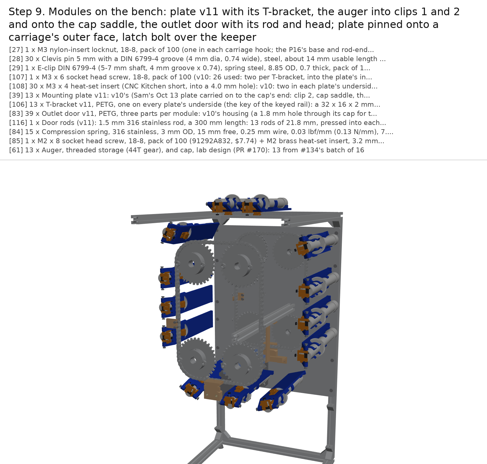

| # | Qty | Part |
|---|---|---|
| 27 | 1 | M3 nylon-insert locknut, 18-8, pack of 100 (one in each carriage hook; the P16's base and rod-end pins) |
| 28 | 30 | Clevis pin 5 mm with a DIN 6799-4 groove (4 mm dia, 0.74 wide), steel, about 14 mm usable length (module hinge pins, 2 per module; 4 spare) |
| 29 | 1 | E-clip DIN 6799-4 (5-7 mm shaft, 4 mm groove x 0.74), spring steel, 8.85 OD, 0.7 thick, pack of 100 (26 used on the hinge pins) |
| 107 | 1 | M3 x 6 socket head screw, 18-8, pack of 100 (v10: 26 used: two per T-bracket, into the plate's inserts, outside the T's head so a hex key reaches them) |
| 108 | 30 | M3 x 4 heat-set insert (CNC Kitchen short, into a 4.0 mm hole): v10: two in each plate's underside for the T-bracket; 26 + 4 spare |
| 39 | 13 | Mounting plate v11: v10's (Sam's Oct 13 plate carried on to the cap's end: clip 2, cap saddle, the latch keeper, the door housing's inserts, the T-bracket's two M3 inserts), without v10's relief over the NEMA 11 (the 24T pinion keeps the motor 2.25 mm off it). Print all 13 flat |
| 106 | 13 | T-bracket v11, PETG, one on every plate's underside (the key of the keyed rail): a 32 x 16 x 2 mm foot held by two M3 x 6 into heat-set inserts in the plate (items 107, 108), a 6 mm stem and a 16 x 16 x 3 mm head 6-9 mm past the plate's underside (v10: 10-13), its ends chamfered so it finds the EC's flared slot |
| 83 | 39 | Outlet door v11, PETG, three parts per module: v10's housing (a 1.8 mm hole through its cap for the rod), v10's shutter (no push strip), and a 6 x 6 x 2.5 mm head pressed and glued on the rod's end (item 116), which the EC's door ramp draws 6 mm toward the loop to open the door |
| 116 | 1 | Door rods (v11): 1.5 mm 316 stainless rod, a 300 mm length: 13 rods of 21.8 mm, pressed into each shutter's boss, up the spring's axis and out through the housing's cap to the printed head (no cable, sleeve or guide: Sam, "so it can directly open it") |
| 84 | 15 | Compression spring, 316 stainless, 3 mm OD, 15 mm free, 0.25 mm wire, 0.03 lbf/mm (0.13 N/mm), 7.3 mm long at its 0.2 lb max. load, pack of 1: 15 used (13 doors + 2 spare). Nearest McMaster spring to the 16 mm, 0.06 N/mm drawn, which no listed spring matches (none reaches the 5.5 mm open length): lengthen the spring pocket 2 mm (13.5 shut, 7.5 open: about 0.2 N shut, 0.9 N open); OD +/-0.4 mm, so a bore of about 3.6 mm |
| 85 | 1 | M2 x 8 socket head screw, 18-8, pack of 100 (91292A832, $7.74) + M2 brass heat-set insert, 3.2 mm long for a 3.2 mm hole, pack of 50 (94459A767, $7.73): 26 of each used, the door housings to the plates (v10's door cable guides are gone) |
| 61 | 13 | Auger, threaded storage (44T gear), and cap, lab design (PR #170): 13 from #134's batch of 16 |

Modules on the bench (one per carriage, 13 in all):

1. Plate v4 (`stl/mounting_plate_v4.stl`: Sam's plate with the dock on its auger side, the latch keeper with its 4.2 mm
   pin hole, two M2 insert holes). Press two 1/4 in balls into the pockets at Sam's (44, +-19.5) on the auger
   side, 3.8 mm proud, and bond an M5 steel washer flush into the pocket at (64, 19.5) (the dock's flat).
2. Outlet door (v3's, turned over: the shutter slides toward the plate to open): melt two M2 inserts into the plate beside
   the tube, drop the shutter into the printed housing with the spring behind it, and screw the housing's two arms to the
   plate (M2 x 8). The shutter covers the 3 mm exit; its push strip runs out past the auger, where the EC's finger meets it.
3. Slide the lab auger into the plate's clamp rings (the 44T gear behind the rear ring), outlet against the door's
   housing, and screw on the cap.
4. Put the plate between a carriage v4's lugs on the carriage's outer face, hinge end at the front, and push a 5 mm clevis
   pin through each lug into the plate's knuckles; e-clip on each pin's inner end. Pull the latch's follower back with a
   finger, lay the plate down and let go: the latch's 4 mm pin goes 4 mm into the keeper's hole and holds the plate
   both ways (the carriage's opening leaves nothing under the plate).

## Step 10. Carriages onto the chain at the loading position, one index at a time; phase and tension

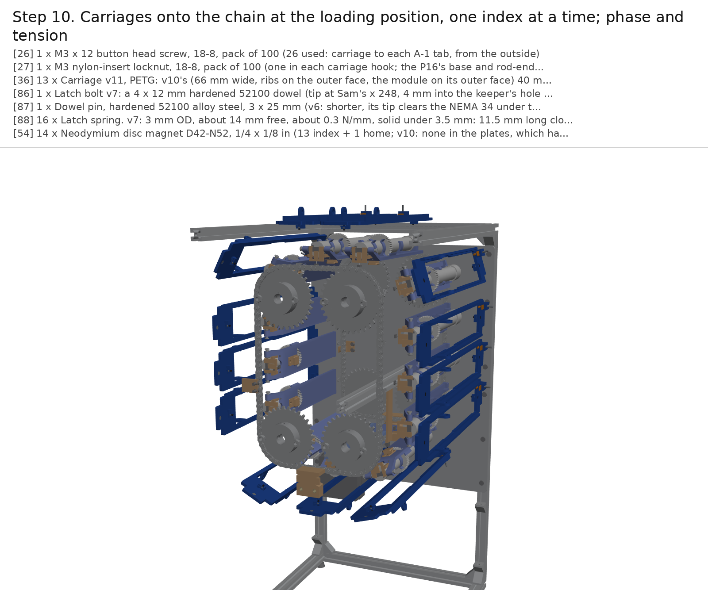

| # | Qty | Part |
|---|---|---|
| 26 | 1 | M3 x 12 button head screw, 18-8, pack of 100 (26 used: carriage to each A-1 tab, from the outside) |
| 27 | 1 | M3 nylon-insert locknut, 18-8, pack of 100 (one in each carriage hook; the P16's base and rod-end pins) |
| 36 | 13 | Carriage v11, PETG: v10's (66 mm wide, ribs on the outer face, the module on its outer face) 40 mm longer, 391 mm over its tongues (the chains are 345 mm apart, the hinge 73 mm behind the front chain), its opening run forward to 38 mm in front of the hinge, and the hinge lugs 5 mm nearer the plate (the mounting plate sinks into the opening). On the H2D's bed diagonal (it fits to about 400 mm at 66 mm wide); break-off webs under the hooks' fingers |
| 86 | 1 | Latch bolt v7: a 4 x 12 mm hardened 52100 dowel (tip at Sam's x 248, 4 mm into the keeper's hole on the plate's back end, 2 mm into the carrier) pressed into a printed PETG carrier with the rest shelf (stl/latch_bolt.stl), one per carriage. v7: the carrier is 8 mm long (v6: 12) so the spring has room behind it, and the shelf reaches 7 mm over the keeper (v6: 8): 2.5 mm under it at the cam's 4.5 mm, clear by 1 mm at the 8 mm hand release. Dowels pack of 50: 13 used; McMaster's 4 mm 91595A family read so far has 8, 14, 22, 24 and 38 mm, not 12 |
| 87 | 1 | Dowel pin, hardened 52100 alloy steel, 3 x 25 mm (v6: shorter, its tip clears the NEMA 34 under the bottom run), pack of 25: 16 used (13 + 3 spare); the 3 x 40 pack (91595A142) is the verified price |
| 88 | 16 | Latch spring. v7: 3 mm OD, about 14 mm free, about 0.3 N/mm, solid under 3.5 mm: 11.5 mm long closed (0.75 N), 7.0 at the cam's 4.5 mm (2.1 N), 3.5 at the 8 mm hand release (3.2 N, 75 % of its free length). TO SELECT: the 3 mm OD stainless springs read from McMaster so far (8969T21, 8969T261: 15 mm free) stop at 7.3-8.2 mm at their maximum load, so neither reaches the cam's 7.0; if none does, drop the hand release (the cam alone needs 50 %). 16: 13 + 3 spare |
| 54 | 14 | Neodymium disc magnet D42-N52, 1/4 x 1/8 in (13 index + 1 home; v10: none in the plates, which have no dock posts) |

At the loading position (the +y side, mid-height), with the auger facing out toward the side hatch: hold the unit
beside the two A-1 tabs, 10 mm
up from position, push it in until the carriage plate touches the tabs, slide it 10 mm down so the printed hooks
take the tabs and the tongues go under the side tabs' lips, and drive an M3 x 12 button head from outside through the
plate and each tab into the locknut in the hook. Index one module (bottom run toward -y) and fit the next. After 13,
tighten the back sprockets' set screws on the round of the shaft and spot a dimple under each.

To tension, turn the four jack screws the same amount until each long side deflects 3-4 mm under a 5 N side push at
mid-span (about 80 N per chain). Do the front and back together, so the top shafts stay level, then tighten the top
bearings' bolts.

## Step 11. Electronics board: supply, driver, Pi, interface board, LAC, e-stop

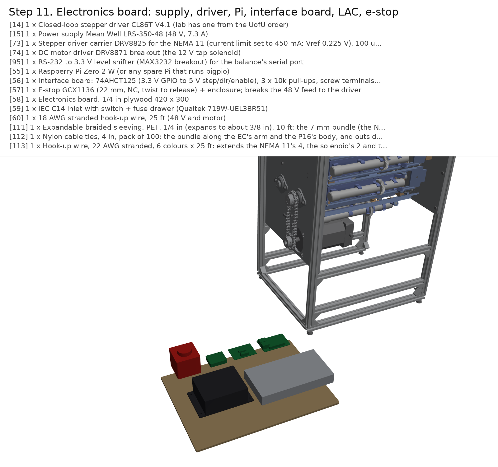

| # | Qty | Part |
|---|---|---|
| 14 | 1 | Closed-loop stepper driver CL86T V4.1 (lab has one from the UofU order) |
| 15 | 1 | Power supply Mean Well LRS-350-48 (48 V, 7.3 A) |
| 73 | 1 | Stepper driver carrier DRV8825 for the NEMA 11 (current limit set to 450 mA: Vref 0.225 V), 100 uF across VMOT; v10: its EN pin on a GPIO, so the motor can be left free while a module slides into mesh |
| 74 | 1 | DC motor driver DRV8871 breakout (the 12 V tap solenoid) |
| 95 | 1 | RS-232 to 3.3 V level shifter (MAX3232 breakout) for the balance's serial port |
| 55 | 1 | Raspberry Pi Zero 2 W (or any spare Pi that runs pigpio) |
| 56 | 1 | Interface board: 74AHCT125 (3.3 V GPIO to 5 V step/dir/enable), 3 x 10k pull-ups, screw terminals, perfboard |
| 57 | 1 | E-stop GCX1136 (22 mm, NC, twist to release) + enclosure; breaks the 48 V feed to the driver |
| 58 | 1 | Electronics board, 1/4 in plywood 420 x 300 |
| 59 | 1 | IEC C14 inlet with switch + fuse drawer (Qualtek 719W-UEL3BR51) |
| 60 | 1 | 18 AWG stranded hook-up wire, 25 ft (48 V and motor) |
| 111 | 1 | Expandable braided sleeving, PET, 1/4 in (expands to about 3/8 in), 10 ft: the 7 mm bundle (the NEMA 11's 4 leads, the solenoid's 2, the P16's 5) from the EC along its arm and the P16, through the grommet and outside to the board, about 2.3 m |
| 112 | 1 | Nylon cable ties, 4 in, pack of 100: the bundle along the EC's arm and the P16's body, and outside down the -y front post and along the base rail |
| 113 | 1 | Hook-up wire, 22 AWG stranded, 6 colours x 25 ft: extends the NEMA 11's 4, the solenoid's 2 and the P16's 5 leads from the EC out through the front side plate to the board behind the rig, about 2.3 m each |

The electronics board sits on the bench behind the rig. Wire it like this:

| From | To |
|---|---|
| Mains (IEC inlet, fuse, switch) | LRS-350-48 AC input |
| LRS-350-48 +V | E-stop (NC) -> 10 A fuse -> CL86T +VDC |
| LRS-350-48 -V | CL86T GND |
| NEMA 34 A+/A-/B+/B- | CL86T A+/A-/B+/B- |
| NEMA 34 encoder | CL86T encoder port |
| Pi GPIO 17 / 27 / 22 | 74AHCT125 inputs 1A / 2A / 3A (VCC 5 V, OE tied low) |
| 74AHCT125 outputs 1Y / 2Y / 3Y | CL86T PUL+ / DIR+ / ENA+ (logic selector at 5 V) |
| CL86T PUL- / DIR- / ENA- | Pi GND |
| Pi 3.3 V via 10k | GPIO 23 (INDEX), GPIO 24 (HOME), GPIO 25 (CL86T ALM+; ALM- to GND) |
| Pi GPIO 18 | LAC RC input (1.0-2.0 ms = 0-150 mm); LAC on its 12 V supply |
| Pi GPIO 13 / 21 | DRV8825 STEP / DIR for the NEMA 11 (current limit 0.45 A: Vref 0.225 V) |
| Pi GPIO 12 | DRV8871 IN1 for the tap solenoid |
| Pi UART RX/TX (GPIO 15 / 14) | MAX3232 -> HR-100A RS-232 (DB-9) |

Set the CL86T DIP switches to 4000 pulses/rev and the motor current to 6.0 A. Run `sudo pigpiod`, then
`python3 test/chain_rig.py --sim lap` to check the software and `python3 test/chain_rig.py home` to check the
hardware. At 4000 pulses/rev one module is exactly 1000 steps.

## Step 12. The balance with its tall draft cage on the bench through the front doorway, the dosing lid in its top, the pillar and beaker; acrylic panels on standoffs, the side hatch (swaps)

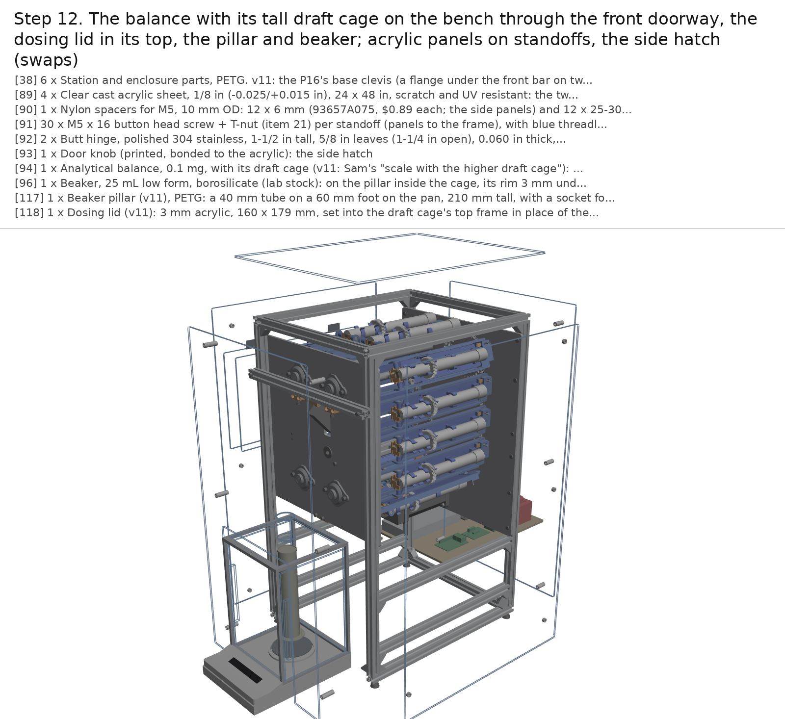

| # | Qty | Part |
|---|---|---|
| 38 | 6 | Station and enclosure parts, PETG. v11: the P16's base clevis (a flange under the front bar on two M5 into T-nuts, two cheeks round the P16's rear tab), the EC's guide hanger (v10's, from the station beam, now at y -56), the latch cam (v10's, its web and foot moved beside the back hold-down), 2 side tabs, the side hatch's turn button |
| 89 | 4 | Clear cast acrylic sheet, 1/8 in (-0.025/+0.015 in), 24 x 48 in, scratch and UV resistant: the two side panels (481.7 x 751.5 mm), the front (398 x 751.5, with the balance's open doorway, 240 x 330 from the bench up) and the back, one per sheet; the top (519 x 398), the side hatch's door and the balance's dosing lid come out of the offcuts. v11: no bay window or weighing chamber, and the walls are 98.5 mm shorter |
| 90 | 1 | Nylon spacers for M5, 10 mm OD: 12 x 6 mm (93657A075, $0.89 each; the side panels) and 12 x 25-30 mm (93657A093 family, $1.78 each; the back panel past the drive sprocket, and v11's front panel, which stands 30 mm off the front posts to clear the front bar and the P16's housing) |
| 91 | 30 | M5 x 16 button head screw + T-nut (item 21) per standoff (panels to the frame), with blue threadlocker |
| 92 | 2 | Butt hinge, polished 304 stainless, 1-1/2 in tall, 5/8 in leaves (1-1/4 in open), 0.060 in thick, fixed pin, two countersunk holes per leaf for No. 8 screws (the side hatch's door) + 8 M4 flat head screws and nylocks. v11: the bay window's door is gone |
| 93 | 1 | Door knob (printed, bonded to the acrylic): the side hatch |
| 94 | 1 | Analytical balance, 0.1 mg, with its draft cage (v11: Sam's "scale with the higher draft cage"): drawn as v7's weighing base and cage with the cage 315 mm tall, the lab's HR-100A's height (200 x 263 mm over the base; the HR-100A is 198 x 253). It stands on the bench under the station, its pan's centre under the exit; the passing 44T gears clear the cage's top by 4 mm and it touches nothing of the doser; its top door is replaced by the dosing lid (item 118). RS-232C (2400 7E1). Counted as the lab's, as asked. A new HR-202i (220 g x 0.1 mg) was $2,989 at MNM Scales (out of stock, 2026-11-04; A&D's replacement is the GH-202). A smaller balance can stand on a block with its cage off, the beaker on its pan up to 14 mm under the exit |
| 96 | 1 | Beaker, 25 mL low form, borosilicate (lab stock): on the pillar inside the cage, its rim 3 mm under the dosing lid and 33 mm under the exit |
| 117 | 1 | Beaker pillar (v11), PETG: a 40 mm tube on a 60 mm foot on the pan, 210 mm tall, with a socket for the beaker; 0.85 mm walls (two 0.42 mm lines, printed normally: vase mode can't print the socket's floor) keep it to 29.9 g (Bambu Studio, 2026-11-27; the 1.6 mm walls drawn until then sliced to 53.6 g), so it and the beaker take about half of the HR-100A's 102 g |
| 118 | 1 | Dosing lid (v11): 3 mm acrylic, 160 x 179 mm, set into the draft cage's top frame in place of the top door, flush with the frame, a 24 mm hole under the exit (laser cut from an offcut of item 89) |

Enclosure (item 5): laser-cut the panels and the two hatch doors from 1/8 in clear cast acrylic (`dxf/panel_*.dxf`,
`dxf/hatch_*.dxf`). Each panel stands 6 mm off the frame on nylon spacers (M5 x 16 button heads into T-nuts), so it
clears the side runs' carriages and the side tabs; the back panel's spacers are 30 mm, past the drive sprocket. The front
panel's hatch (300 x 330 mm, under the station) and the +y panel's hatch (400 x 230 mm, at the
loading position) each get a door 4 mm larger all round on two stainless butt hinges, a printed knob and a turn
button.

The HR-100A: v4 draws the balance where it has to stand, its pan under the dose point. It doesn't fit there yet: the
guide cradle, EC v4 and the P16 stand inside its breeze break's footprint (`check_interference.py --scale`,
`checks/scale.json`, README item 6). Until the station is moved, test doses go into a beaker on a bench balance placed
by hand under the dose point with the station parked.

## Step 13. Test set-up (not in the CAD)

| # | Qty | Part |
|---|---|---|
| 62 | 1 | Digital indicator 0-1 in / 0.01 mm with arm and magnetic base (index, lift, sag tests) |
| 63 | 1 | Digital hanging scale 50 kg (torque lever, push-up and snap forces; a 50 N push-pull gauge is better if the lab has one) |
| 64 | 1 | ADXL343 accelerometer breakout (transit vibration) |
| 65 | 3 | Table salt, 26 oz (test fill for the augers) |

Fill the augers to a working mass with salt (or the powder under test). Clamp the dial indicator's magnetic base to a steel plate screwed to the front side plate's inner face beside the station, and stick the ADXL343 to module 1's mounting plate near the outlet. Then run [TEST-PLAN.md](TEST-PLAN.md).
