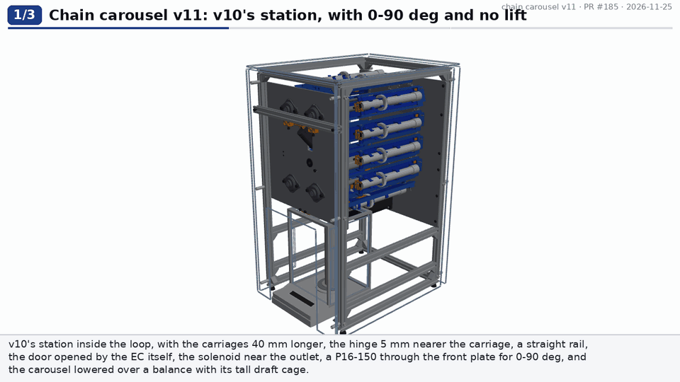
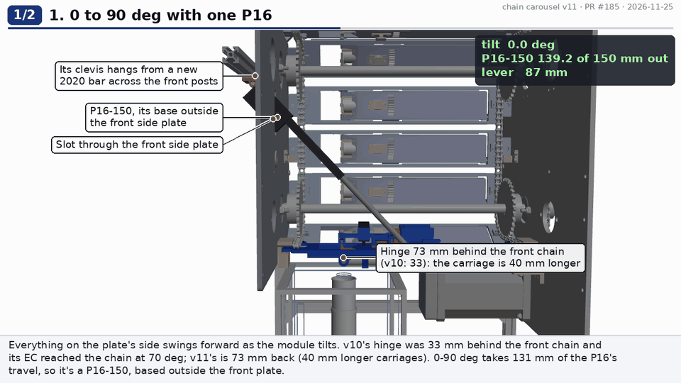
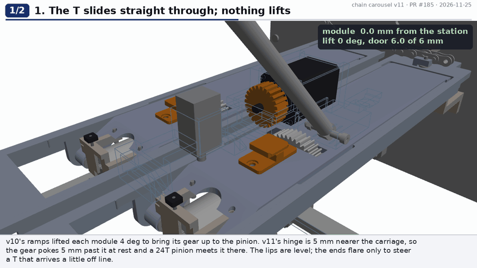
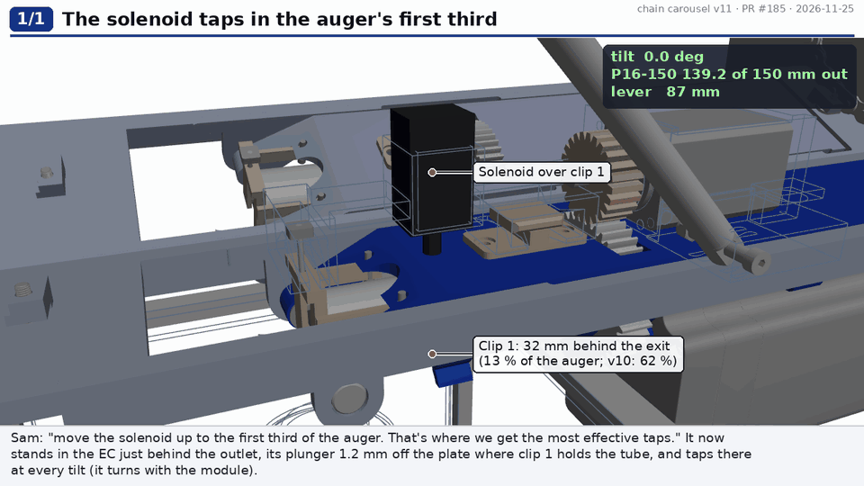
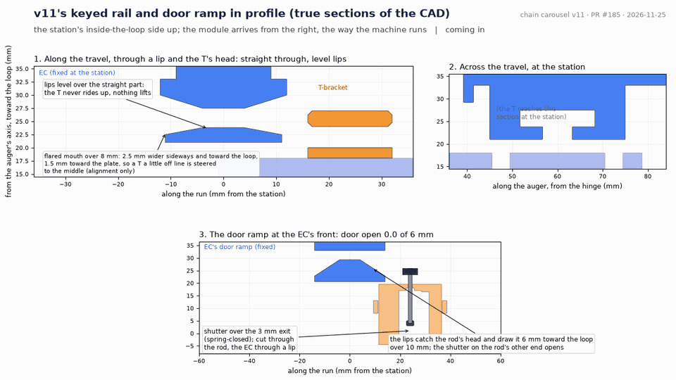
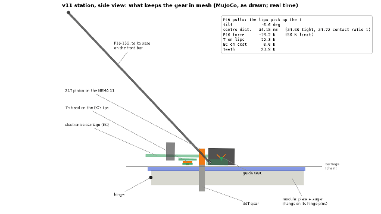
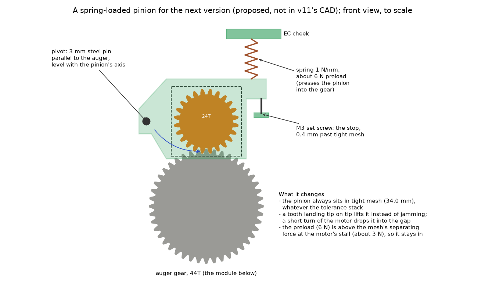
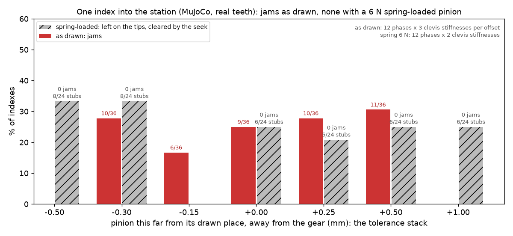

# Chain carousel v11: 0-90° with the station inside the loop, a straight rail, the door opened by the EC

> **2026-11-27: [v12](../chain-carousel-v12/README.md) supersedes v11.** It is v11 with the spring-loaded pinion proposed below (a cradle, a 1 N/mm spring, a set-screw stop, a hall switch and the seek), the EC's second seat, and three fixes to v11's drawings (the P16's rod-end slot, the NEMA 11's shaft, the door's tower and rod). In its model nothing jams in 504 indexes. v11's Onshape document is renamed SUPERSEDED.

**v11 is a variation on [v10](../chain-carousel-v10/README.md)** (the station inside the loop, Sam's favourite so far), and so on
[v7](../chain-carousel-v7/README.md), which stays the main version. It follows Sam's notes of 2026-11-25
([PR #185](https://github.com/vertical-cloud-lab/powder-doser/pull/185)):

> If the base plates need to be a bit longer, i.e. to give some more room for the rotation in the front, then go ahead and do that.
> The auger can move a bit as well to get the hinge closer to the plate, or the holes in the plate can be bigger ... The augers still
> need to be able to go up to 90 degrees. I was assuming this would mean punch a hole through the metal plate so the linear actuator
> has some more room ... I'm still confused about how the T rail thing works. Give me a profile view. Why is there a ramp? ... for the
> cap: ... [the EC] can extend all the way down to the dispensing end of the auger ... so it can directly open it ... move the
> solenoid up to the first third of the auger ... scale it to fit the scale with the higher draft cage (with the beaker sitting on a
> cylindrical pillar) ... Find a cheap but still good quality chain online, link it here, and apply those dimensions ... just make an
> open door for the scale ... no need to include wires in the model unless it changes.

Nothing is built. Every number here is a prediction from the CAD.

**Onshape (public):** [Multi-doser chain carousel, test rig v11, rev. 2026-11-27](https://cad.onshape.com/documents/3e99376a80ac21e730425ec0/w/9e9e05ab391f2d3a16998fca/e/cd46c1a5e6c910443d6daad8), with the CAD fixes of 2026-11-27
(ids in [`onshape/onshape_document.json`](onshape/onshape_document.json); 10 API calls on 2026-11-27 in
[`onshape/api_calls.jsonl`](onshape/api_calls.jsonl): 8 for the import, 1 to rename the first v11 document "SUPERSEDED", 1 to confirm
the new one is public). The first v11 document ([868943ea](https://cad.onshape.com/documents/868943ea72f58c7a9d6e421e/w/b69337d1a5f8ee47f70e6908/e/951aa82be5a4c3bfe1ed5b08), 2026-11-26, 11 API calls) is kept, renamed
SUPERSEDED: the API key can't delete documents. It was imported from `step/chain_carousel_rig_v11.step` by
[`onshape/onshape_build.py`](onshape/onshape_build.py). Earlier versions:
[v10](https://cad.onshape.com/documents/99bd983c585992043f2eff96/w/7b5725dc5dfb7fe370fa0c71/e/56a319b93daf812d262f5eab),
[v9](https://cad.onshape.com/documents/9aadc21a931d5337ff05de71/w/1dea03d63eb704d060d84c2a/e/caa98ea728a9da9006767590),
[v8](https://cad.onshape.com/documents/a093aef97b81fce9ce0f322f/w/7b029051ee0ec62ff198253f/e/7518535395874b79077ff86b),
[v7 (main)](https://cad.onshape.com/documents/291664f38c67a4672a86f025/w/e67d1b706aa4b873fa8c68e8/e/4802634f69ef3323004d7bf6).



## What changed, and why

| # | Sam asked | v11 | How it works | Clip |
|---|---|---|---|---|
| 1 | "The augers still need to be able to go up to 90 degrees ... If the base plates need to be a bit longer, i.e. to give some more room for the rotation in the front, then go ahead" | **The carriages are 40 mm longer** (the chains 345 mm apart instead of 305; each carriage 391 mm over its tongues) and **the hinge is 40 mm further back** (73 mm behind the front chain's centre plane, v10: 33) | On the plate's side everything near the hinge swings forward as the module tilts. In v10 the EC's front reached the front chain's A-1 link at 70°. With the hinge 73 mm back, the module and the EC stand clear at 90°: the nearest approaches are the EC to the carriage's opening edge (2.5 mm), and the solenoid to the carriage (2.5 mm) and its front tab's locknut (3.7 mm) | [tilt90](renders/v11/tilt90_v11.gif) |
| 1 | "punch a hole through the metal plate so the linear actuator has some more room. If this requires new mounts (i.e. a new bar of 8020 across the outside, or just a 3D-printed mount) then design those" | **A P16-150 (back from v10's P16-100), its base outside the front side plate, through a 22 × 68 mm slot in the plate.** Its rear tab sits in a printed clevis under a **new 2020 bar across the front posts' front faces** (z 620-640, in front of the top bearings) | 0-90° takes 131 mm of travel, more than a P16-100 has. Laid out numerically, no base position inside the front plate gets the module to 90°: the line of pull runs over centre, or the actuator hits the top sprocket. With the base pin 26 mm in front of the plate, the P16-150 runs from 139.2 mm out (rest) to 8.3 mm out (90°). That leaves 10.8 mm short of full extension and 8.3 mm over full retraction, with a lever about the hinge of 30 mm or more. The front acrylic panel moves out to 30 mm standoffs to clear the bar and the P16's housing | [tilt90](renders/v11/tilt90_v11.gif) |
| 2 | "Why is there a ramp? I was assuming each carriage would just move straight through it ... not lifting if it's not necessary" and "The auger can move a bit as well to get the hinge closer to the plate, or the holes in the plate can be bigger to accommodate the mounting plate" | **No lift.** The rail's lips are level; its ends only flare (2.5 mm sideways and toward the loop, 1.5 mm toward the plate, over 8 mm) to steer a T that arrives a little off line. **The hinge sits 5 mm nearer the carriage plate**, so the mounting plate sinks into the carriage's opening. **The pinion is 24T** (KHK SS1-24 class, v2-v10: 20T) | v10 lifted every module 4° only to bring its 44T gear up to the pinion while keeping the pinion over the passing carriages. With the hinge 5 mm nearer the carriage, the gear pokes 5 mm past the carriage at rest, and a 24T pinion (centre distance 34.25 mm) meets it there. At rest each module sits on its own carriage, its T 0.2 mm over the lips; the lips take it only when the P16 pulls. A 20T pinion would put the NEMA 11's body 0.25 mm off the passing plates; the 24T puts it 2.25 mm off | [rail profile](renders/v11/rail_profile_v11.gif), [rail](renders/v11/rail_v11.gif) |
| 3 | "if the electronics carriage is already taking up space on the inside, I think it can extend all the way down to the dispensing end of the auger ... so it can directly open it ... Maybe that part can have a ramp ... Keep this part as simple as possible" | **The EC reaches forward over the outlet.** Each shutter (v10's) carries a 1.5 mm stainless rod up its spring's axis and out through the housing's cap to a small printed head. **The EC's front is a ramp slot** whose two wedge lips catch the head and draw it 6 mm toward the loop as the module arrives | No cable, sleeve or guide (v10 had all three). The door is fully open within 7 mm of the station and shut again 16.5 mm out. It is still v4's door: the shutter opens toward the plate, so it stays out of the falling dose | [door](renders/v11/door_v11.gif), [rail profile](renders/v11/rail_profile_v11.gif) (part 3) |
| 4 | "move the solenoid up to the first third of the auger. That's where we get the most effective taps" | **The solenoid sits over clip 1**, 32 mm behind the exit: 13 % of the auger's length (v10: over clip 2, 156 mm, 62 %) | It stands in a collar in the EC's spine, plunger toward the plate, 1.2 mm off it where clip 1 holds the tube. It turns with the module, so it taps the same spot at every tilt | [solenoid](renders/v11/solenoid_v11.gif) |
| 5 | "scale it to fit the scale with the higher draft cage (with the beaker sitting on a cylindrical pillar). This means that smaller scales could work on a block without the draft cage, but the draft cage would also be fine" | **The balance keeps its tall draft cage and stands on the bench** (v7's model, its cage 315 mm tall like the lab's HR-100A). **The carousel is 98.5 mm lower** (the bottom run at z 366.5, v10: 465), so the passing 44T gears clear the cage's top by 4 mm. **The beaker sits on a cylindrical pillar** (a printed 40 mm tube) inside the cage; a **dosing lid** with a 24 mm hole replaces the top door | The exit is 33 mm over the beaker's rim (v10 had no cage: 18): 27 mm down to the cage's top (the gear's 23 mm radius and its 4 mm clearance), then the lid and 3 mm under it. A smaller balance can stand on a block with its cage off: the beaker on its pan can then come up to 14 mm under the exit, under the passing tubes. The pillar and beaker take about half of the HR-100A's 102 g | [balance](renders/v11/balance_v11.gif) |
| 6 | "Find a cheap but still good quality chain online, link it here, and apply those dimensions to the chain in the model" | **[Nitro Chain RC35-1R-10FT](https://www.nitrochain.com/35-roller-chain-10ft), $23.53 per 10 ft roll** (N2 series: heat treated, pre-lubricated, ANSI B29.1; read 2026-11-26), with Nitro's [CL35-A1](https://www.nitrochain.com/35-a1-standard-attachment-connecting-link) links ($2.55) and [CL35](https://www.nitrochain.com/35-standard-connecting-link) connecting links ($0.79) | The model already matched Nitro's published numbers (pitch, bushing, inner width, pin, h2, T, width over the pins). Two things were missing and are now drawn: the 0.518 in width over a connecting link (the A-1 links the carriages bolt to), and the plates' waist (0.75 × h2, scaled off Nitro's drawing, which doesn't give it; v2-v10 drew it shallower). U.S. Tsubaki's RS35 is the premium alternative, at about 4.7 times the price | [chain](renders/v11/chain_nitro_v11.png) |
| 7 | "for this version, just make an open door for the scale to go into--don't make the whole enclosure for the scale" | **The front acrylic panel has an open doorway, 240 × 330 mm from the bench up**, that the balance slides through. No bay window, no weighing chamber, no granite block | The balance's display sticks out through the doorway; its own cage is its draft shield | [balance](renders/v11/balance_v11.gif) |
| 8 | "no need to include wires in the model unless it changes. Just keep a hole in the plate so the wires can get out and run down" | **No wires drawn.** The 20 mm grommet hole stays in the front side plate, under the P16's slot | The bundle runs as in v10, along the EC's arm and the P16, out through the grommet | |

| 0-90° with one P16-150 ([MP4](renders/v11/tilt90_v11.mp4)) | The door, opened by the EC's front ramp ([MP4](renders/v11/door_v11.mp4)) |
|---|---|
|  |  |

| The rail in 3D: straight in, the gear meets the pinion at rest ([MP4](renders/v11/rail_v11.mp4)) | The solenoid over clip 1 ([MP4](renders/v11/solenoid_v11.mp4)) |
|---|---|
|  |  |

**The balance with its tall cage, the pillar and the dosing lid** ([MP4](renders/v11/balance_v11.mp4)):


## How the rail works, in profile (Sam's question)

True sections of the CAD ([`rail_profile.py`](rail_profile.py), [MP4](renders/v11/rail_profile_v11.mp4)), with the inside of the
loop at the top:



1. **Along the travel, through a lip and the T's head.** The module arrives from the right, the way the machine runs. The T's head
   enters the slot's flared mouth and runs along level lips. Nothing lifts it.
2. **Across the travel, at the station.** The T's head sits under the EC's ceiling and over the two lips, its stem between them,
   0.3 mm clear each side. At rest the head is 0.2 mm over the lips: the module rests on its own carriage (hinge pins and latch
   shelf), and the lips pick it up only when the P16 pulls the EC.
3. **The door ramp, through the door rod.** This is the one ramp that moves something. Its lips catch the rod's head and draw it
   6 mm toward the loop, which slides the shutter off the exit.

**Why v10 had a ramp.** In v10 the gear's tip was level with the carriage's inner face at rest. The pinion has to sit over the
passing carriages, so the gear couldn't reach it without the module turning 4°. That is what the ramps did. v11 moves the hinge
5 mm nearer the carriage instead, so the gear meets the pinion at rest. The ramps were only there for the mesh, so they're gone;
the flares stay for alignment.

## How the auger gear engages and lets go without gravity (Sterling, 2026-11-27)

> *"I also need a better explanation for how the auger gear engages and disengages now that it's not gravity keeping contact.
> Random aside: perhaps a spring or similar could help at some point."*

The full study, with the model, every table and the files, is [`sim/README.md`](sim/README.md): a MuJoCo model of v11's station with
real tooth contact (the auger's 44T from the lab's STEP, the 24T involute pinion), the chain's index profile, the hinged module on
its latch shelf, the EC on the P16 with the clevis's give, the guide seat and the T in its slot. 432 indexes in, 15 out, 192 more to
find what the jams depend on, and 24 station cycles and stall ramps.

**How it works:**
1. **What sets the mesh.** Nothing presses the gear and the pinion together. The 34.25 mm between their axes is set by where two
   separate parts sit: the module, on its hinge pins and the latch's shelf (it can swing in, toward the EC, but not out), and the
   EC, on its guide seat and the P16's pin (the P16 holds its length; it back-drives only above 75 N).
2. **Engaging, every index.** The NEMA 11's driver is off, so the pinion is free. The gear's teeth first touch the pinion's 12 mm
   before the station and roll into its gaps over those 12 mm, turning it about 50°, the way a rack turns a pinion.
3. **Holding, while it doses.** The P16 pulls the EC off its seat, and after 0.2 mm the lips under the T's head pick the module up.
   From then on the module, the T, the EC and the pinion turn about the hinge as one piece. The teeth's separating force (up to
   about 3 N at the NEMA 11's stall) pushes the T's head onto the lips, which it is already resting on, so the centre distance can't
   grow. That holds at 90° too, where the module's weight acts along the auger and helps nothing.
4. **Letting go, the next index.** The P16 sets the module back on its shelf and the EC on its seat, the driver goes off, and the
   chain rolls the gear out of the pinion the way it came in.

| One index into the station, as the model sees it ([MP4](renders/v11/mesh_entry_v11.mp4)) | A station cycle, side view: what holds the mesh ([MP4](renders/v11/mesh_hold_v11.mp4)) |
|---|---|
|  |  |

**What the simulations found:**
- **Holding works as drawn.** No tooth jumped in any cycle (0°, 30°, 90°, dosing with the solenoid tapping, the pinion up to 0.5 mm
  too far or 0.3 mm too near). With the auger's load ramped, the NEMA 11 stalled first every time, at 0.077-0.090 N·m on the auger.
- **Engaging is the weak moment.** When a gear tooth lands on the tip of a pinion tooth, nothing in v11 can give: the module can't
  swing out past its shelf, and the EC can't rise off its pin and seat. **1 index in 4 jams at nominal tolerances** (9 of 36), and
  46 of 180 over −0.3 to +0.5 mm of tolerance, the chain driving the tips together at 109-214 N. Leaving the pinion free, holding
  it or seeking (2-4 in 12), indexing at 25 or 100 mm/s (4 in 12) and the motor's detent (2-3 in 12) all still jam. As a stopgap for
  testing, backing the chain off and turning the pinion half a tooth before re-indexing clears 42 of the 46 (7 of the 9 at nominal),
  if the NEMA 34 is slowed and its current lowered for the last 12 mm so a jam stalls it gently.
- **At rest, gravity is still in play, on the EC.** Its pin and its shoe both sit on the arm, on one line 36 mm to the side of the
  pinion, so its body rolls on the clevis's play until the pinion's teeth wedge into the gear's: 34.03-34.36 mm, up to 25 N on the
  teeth.
- **The centre distance has a 0.72 mm window:** below 34.00 mm the teeth bind, above 34.72 mm the contact ratio drops below 1.

**Would a spring help? Yes.** Put the NEMA 11 and its pinion on a small cradle that pivots in the EC, a spring pressing the pinion into
the gear (1 N/mm, about 6 N) past a set-screw stop 0.4 mm beyond tight mesh:
- **0 jams in 216 indexes** (and 0 in 72 with a 4 N spring), over −0.5 to +1.0 mm of tolerance, at every clevis stiffness, friction,
  speed and detent tried;
- the centre distance stays at 34.03-34.25 mm at every tilt, whatever the tolerance stack;
- still no tooth jumps; the motor stalls first, at 0.056-0.066 N·m on the auger (the preloaded mesh's friction costs about a quarter
  of the torque at 30 rpm; a 4 N spring 0.066-0.075);
- about a third of the indexes leave the pinion resting on the gear's tips, lifted on its spring, with nothing forced; a slow turn of
  the pinion after the index that reverses once (0.25 rev/s, 0.2 s each way) dropped 98 of 99 into mesh (288 indexes, 0 jams). The one
  left needs a second try; a hall switch on the spring's cradle would tell the driver.

It isn't in v11's CAD. It is the first change I'd make for the next version, together with a second seat for the EC on the far side
of the module, so the EC's body can't roll onto the gear.

| The spring-loaded pinion, to scale (proposed, not drawn in v11) | Entry outcomes against the tolerance stack |
|---|---|
|  |  |

## 90°: what stopped v10, and what v11 changes

| | v10 | v11 |
|---|---|---|
| Hinge behind the front chain's centre plane | 33 mm | **73 mm** (carriages 40 mm longer) |
| First contact | 70°: the EC's front at the station carriage's front A-1 link | **none at 0-90°** |
| Actuator | P16-100, base on the front side plate's inner face | **P16-150, base outside the front side plate, through a slot** |
| Travel for the range | 88 mm for 4-65° | **131 mm for 0-90°** |

**The P16-150's extension and lever** (`layout.p16_11_ext`, `layout.p16_11_lever`; the table in [`test/chain_rig.py`](test/chain_rig.py)):

| Tilt | 0° (rest) | 10° | 20° | 30° | 40° | 50° | 60° | 70° | 80° | 90° |
|---|---|---|---|---|---|---|---|---|---|---|
| P16 out, of 150 mm | 139.2 | 123.5 | 106.8 | 89.6 | 72.4 | 55.6 | 40.1 | 26.4 | 15.6 | 8.3 |
| Its lever about the hinge, mm | 87 | 93 | 97 | 99 | 98 | 93 | 84 | 71 | 53 | 30 |

The module and the EC at 90° (by a minimum-distance check on the CAD): the EC passes the station carriage's extended opening by
2.5 mm, and the solenoid passes the carriage by 2.5 mm and its front tab's locknut by 3.7 mm. The mounting plate runs 0.8 mm
inside the opening's sides, as in v4-v10.

## Auger-to-beaker height

| From the auger's exit | Single doser | v7 | v9 | v10 | **v11** |
|---|---|---|---|---|---|
| to the beaker's rim | about 85 mm (±15) | 154 mm | 32 mm | 18 mm | **33 mm** |
| to the beaker's floor | about 153 mm | 201 mm | 80 mm | 67 mm | **82 mm** |
| the balance | HR-100A, cage on | cage on, beaker on a riser | cage off, on a block | cage off, on a block | **tall cage on, on the bench; beaker on a pillar** |
| what sets it | | the cage's lid under the EC | the EC's door finger | the auger's tube and the deck | the passing gears over the cage's top, and the cage's top frame |

With a smaller balance on a block and its cage off, v11 can bring the rim to 14 mm under the exit: the tube passes 12.5 mm under
the exit, with 1.5 mm to spare.

## One dose

1. **Index.** The NEMA 34 moves both chains 8 links, with the NEMA 11 left free.
   - The latch cam pulls the arriving module's pin.
   - The T slides straight into the rail, and the 44T gear slides into mesh with the 24T pinion from the side.
   - The EC's front ramp draws the door's rod 6 mm and opens the outlet.
2. **Pull up.** The P16 retracts from 139.2 mm, and the EC and the module turn about the hinge to the dose angle (30° by default:
   89.6 mm out). The EC's shoe lifts out of its seat.
3. **Dose.** The NEMA 11 turns the auger; the solenoid taps the plate over clip 1. The dose falls 33 mm from the exit through the
   lid's hole into the beaker on its pillar. The exit is on the hinge axis, so it doesn't move with the tilt.
4. **Back.**
   - Hold 0.5 s, then the P16 extends fully: the module sets down on its carriage, and the shoe re-seats.
   - Reverse the auger one turn at rest (the leakage study).
5. **Next index.** The T slides out of the rail's far end, the door shuts, and the latch closes behind it.

## 2026-11-27: what slicing, the vendors and the checks found, and what changed

Sterling asked for every item the last report left undone. Doing them turned up these, now fixed in the CAD (a "v11" fix, not a new
version; [VENDOR-CHECK.md](VENDOR-CHECK.md), [`../print/README.md`](../print/README.md#chain-carousel-v11-pr-185), [`sim/`](sim/README.md)):

| Found by | What was wrong | Now |
|---|---|---|
| Slicing EC v11 in Bambu Studio | **The EC was five separate solids.** Its spine ran to the motor plate and ended inside the plate's 22.4 mm hole, so the front (door ramp, solenoid collar, rail) never met the back (motor plate, cheeks, arm); on the way it ran **through the 24T pinion** (652 mm³) and the motor's shaft. The door ramp's lips stopped 0.05 mm short of their walls. The check missed the pinion because it skipped the EC-pinion pair | The spine stops at x 71.5, widens there, and two 4 × 4.5 mm bars run beside the pinion (2.5 mm off its tips) to the motor's cheeks; the lips are 2.3 mm wide (`DOOR11_LIP_W`). One solid; the EC-pinion pair is no longer skipped |
| The same | **The guide's seat sat inside the EC's arm** (1759 mm³). v11 had lowered the arm to z −20..−30 (the P16's pin at −25) but left the shoe at v10's −38..−31, floating 1 mm over the arm, and the seat is built under the shoe's tip. The check skipped the EC-guide pair | The shoe hangs from a bracket off the arm's back (x 133-145, 36 mm to the side, nose down), and the seat sits behind the arm, 1 mm over the passing plates (the seat can't go under the arm: the plates pass 2 mm below it). The nose is a true 90° cone, 0.35 mm clear of the 90° seat. The pair is checked again |
| Slicing the door housing | **Its two mounting arms floated 0.3 mm off the rails**, and each 2.2 mm M2 hole was wider than its 1.8 mm arm | The arms run 12.45-16.25 mm either side of the centre line, with the M2 screws (and the plate's inserts) at ±14.35 mm; the plate's channel wall is cut back to ±16.3 mm along them (it is 10 mm thick there). One solid, clear of the plate |
| Slicing the T-bracket | Its head was a separate solid, 0.01 mm off the stem | The stem runs 0.01 mm into the head |
| Slicing the latch bolt | v11's STL was the steel dowel fused to the printed carrier | `build.py` exports the carrier with the dowel's 4 mm hole |
| Slicing the pillar | 53.6 g with its 1.6 mm wall, not the BoM's "about 30 g": half the HR-100A's 102 g before the beaker | 0.85 mm wall (two lines, printed normally): 29.9 g |
| The swap check, re-run | A whole 391 mm carriage didn't fit out through the 330 mm side hatch (the auger swap was clear) | The hatch is 400 mm wide (`HATCH_SIDE`) |
| McMaster's grommet table | No grommet with a 3/8 in inside fits a 3/4 in hole in 1/4 in plate | The front plate's hole is 13/16 in, 20.6 mm (`GROMMET11`) |
| McMaster's chain CAD, through the Pi | The model's plates were all 8.79 high with a 6.59 waist (scaled off Nitro's drawing) | Inner plates 8.79 high with a 7.49 waist; outer plates and connecting links 7.76 high, the outer plates' waist 6.39 |
| KHK's catalogue | The 24T pinion was to be "bored 5 mm H8"; no module 1 24T comes with a 5 mm bore | KHK SS1-24A (6 mm bore, set screw) on a 5 × 6 mm sleeve |
| A&D's manual | (assumed) the tall cage's 315 mm | Confirmed as the HR-100A's overall height, to its top door's grips; its frame is about 297 mm (TEST-PLAN T8c) |

**Still open:** the door shutter has no hole for its 1.5 mm rod, and a hole on the rod's axis would break out of the shutter's 1.8 mm
boss (0.4 mm). The rod needs a boss about 3.1 mm across, which means re-laying the housing's tower channel, the spring's axis and the
cap's hole round it. Until then the rod can only be glued to the boss's face.

## The walkthrough video (2026-11-27)

[`walkthrough/walkthrough_v11.mp4`](walkthrough/walkthrough_v11.mp4) is a narrated tour of v11, made by
[`walkthrough/make_walkthrough.py`](walkthrough/make_walkthrough.py) from this folder's own clips, stills and simulation plots, with
the chapters in [`walkthrough/script_v11.py`](walkthrough/script_v11.py). The chapters are: what v11 is, the frame and the chain,
a module, building it step by step, indexing, how the gear meets the pinion, what holds the mesh, 0-90°, dosing into the balance, the
checks, printing and buying, and the spring-loaded pinion. The narration is Piper's offline text-to-speech with the public-domain
LJ Speech voice; the captions are the narration ([`walkthrough_v11.srt`](walkthrough/walkthrough_v11.srt)), and
[`description.txt`](walkthrough/description.txt) is a YouTube description with the chapters' timestamps. It isn't on YouTube yet: this
repo's `claude.yml` doesn't pass the upload token ([`../../youtube/README.md`](../../youtube/README.md) has the two steps and the
one-command upload).

## Checks

These are OCC boolean overlaps between parts; anything over 0.5 mm³ counts as a clash. By-design contacts are skipped by part key
(v11's are at the end of SKIP in [`check_interference.py`](check_interference.py)). The balance, its pillar and the beaker are in
every check.

| Check | What moves | Result |
|---|---|---|
| Home ([`checks/home.json`](checks/home.json)) | Every pair of the 829 instances (re-run 2026-11-27 on the fixed CAD: the EC, the guide, the door housing, the T-bracket, the 400 mm side hatch and the chain's plates; the EC-pinion and EC-guide pairs no longer skipped) | **0** |
| `--tilt11` ([`tilt_a.json`](checks/tilt_a.json), [`tilt_c.json`](checks/tilt_c.json), [`tilt_b.json`](checks/tilt_b.json)) | Module 1, the EC and the P16 (its body swings on its base pin, its rod slides) at 0, 10, 20 ... 80, 85 and 90° against everything else (re-run 2026-11-27 on the fixed CAD) | **0 at every angle** |
| [`sweep_station.py`](sweep_station.py) ([`checks/sweep_station.json`](checks/sweep_station.json)) | Every carriage and module within 2.2 modules of the station, over one module of travel in 1-link steps (9 poses), each door opened by the EC's ramp as it passes, against the EC, the P16 and its bar, the guide, the beam, the balance, the pillar and the beaker | **0** |
| `--swap` ([`checks/swap.json`](checks/swap.json)) | Module 4 at the loading position, the side hatch open: its auger pulled 5-140 mm straight off its plate through the hatch (8 poses); then the whole carriage, its two screws backed out 10 mm, slid 10 mm and lifted 0-100 mm in 15 mm steps (8 poses) | **0**: the auger, and the whole carriage out through the 400 mm hatch (the 330 mm one stopped it: below) |
| `--latch` ([`checks/latch.json`](checks/latch.json)) | The latch cam against every other part while carriage 1 passes it in quarter-link steps over ±3 links (25 poses: the cam's ±18 mm flat and 30° ramps end 25.8 mm out), then with module 1, the EC and the P16 at 10, 20 ... 90° (9 poses) | **0**. Carriage 1's follower overlaps the cam only on the ramps, by at most 1.22 mm³ (a 0.2 mm sliver: the round 3 mm dowel placed by the ramp's straight-line kinematics; v5's 25° ramp gave 0.57), and not at all on the flat |

The first runs found and fixed these:
- the P16's housing on the top-front bearing's tensioner block (25 mm³): the P16's plane moved from world y −33 to −31;
- the ladder's upper rungs and their brackets in the back side plate, and the lower rungs' brackets on the posts' foot brackets
  (the lower carousel brought the back plate's edge down): the rungs moved to z 86 and 214;
- the latch cam's foot in the back hold-down (1,096 mm³; with the hinge 5 mm nearer the carriage the cam came 5 mm nearer): its web
  and foot moved beside the hold-down;
- the T-bracket's foot 1 mm into the rail block (313 mm³): the rail's underside moved to 1 mm over the passing feet;
- the EC's guide hanger across the B− shaft (80 mm³): the station beam moved from y −60 to −56;
- the front bar's screws drawn head-inward, into the front panel;
- at 90° the EC passed the station carriage's opening edge by only 0.5 mm: the opening now runs 2 mm further forward;
- a whole carriage lifted out at the loading position hit the +y panel beside the 330 mm side hatch (238 mm³ at 75 mm out; v4's lifts
  of 0, 30 and 100 mm had stepped over the panel): the carriage is 391 mm over its tongues, so the hatch is now 400 mm wide
  (`HATCH_SIDE`; 4.5 mm clear of the tongues each side, 8.85 mm inside the posts), its door 408 × 238 mm.

## Cost

**$2,118.48, or $1,977.09 without test gear** ([BOM.md](BOM.md)). v10 was $2,352.10 ($2,210.71). Lines marked estimate add up
to $133.69 (was $473.94 before the vendor check of 2026-11-27, below).
- **2026-11-27:** every estimated line that a vendor lists was read through the doser Pi ([VENDOR-CHECK.md](VENDOR-CHECK.md)); the total
  rose $35.17. The 24T pinion (KHK SS1-24A, $15.20) has a 6 mm bore, since no module 1 24T comes with a 5 mm one, so it needs a
  5 x 6 mm sleeve on the NEMA 11's shaft (item 121). The NEMA 11 and the solenoid now have their own $0 lines (both the single
  doser's, in the lab).
- **Removed:** v10's granite block, the bay window and the weighing chamber (two of v10's six acrylic sheets, the cement, the bay
  door's hinges), the door cables, the P16-100 and its bracket's inserts, half of the M2 screws and inserts (the cable guides').
- **Added:**
  - the P16-150 ($90, back from v7-v9);
  - a second 72 in shaft bar (the shafts are 40 mm longer);
  - the 24T pinion (estimated);
  - the front bar's screws and T-nuts, the P16's printed clevis;
  - the door rods (estimated) and their printed heads;
  - the beaker's pillar and the dosing lid (from an acrylic offcut);
  - two spare Nitro CL35 connecting links.
- **The same:** the NEMA 11, the solenoid, the one LAC, the balance (the lab's), the enclosure's other panels, the wiring lines.

## Check before building

1. **The P16-150 through the front plate (TEST-PLAN T6).** Print the clevis and check that the P16 swings freely through the slot
   over 0-90° and that the 30 mm lever at 90° holds the module and EC still (the module's weight is nearly over the hinge there).
2. **The gear meets the pinion at rest, from the side (T6a): expect jams.** Every index slides a 44T gear into mesh with the
   stationary pinion over its last 12 mm. The model ([`sim/README.md`](sim/README.md)) jams about 1 index in 4 at nominal tolerances,
   whether the NEMA 11 is free, held or seeking, because nothing can give when a tooth lands tip-on-tip. Run T6a with the NEMA 34's
   current turned down so a jam stalls it gently (the model drives the tips together at 109-214 N), and count. If jams come near that
   rate, the fix is the spring-loaded pinion (above). Measure the centre distance at rest (*34.03-34.36 mm: the EC leans on the gear*)
   and at 30° (*34.1-34.7*): the window is 34.00-34.72 mm.
3. **The door rod (T8a).** Check that the door's spring (0.3-0.6 N) shuts it against the rod's friction in the cap's hole, upside
   down on the top run too, and that the head stays on its rod (glued) after 1000 passes through the ramp.
4. **The solenoid over clip 1 (T8d):** check that its taps move powder better than v10's over clip 2, as Sam expects.
5. **The tall cage under the carousel (T8c):** the passing gears clear the cage's top frame by 4 mm. A&D's manual confirms the
   HR-100A's 315 mm ([VENDOR-CHECK.md](VENDOR-CHECK.md)), but that is to its top door's grips: the fixed top frame is about 297 mm, so
   with the top door swapped for a lid the carousel could come down 14-18 mm (a drop of about 15-19 mm instead of 33). Its breeze
   break is a round glass cylinder (156 mm inside) with the pan 86.5 mm up, not the rectangular cage drawn, so its lid is a disc and
   the pillar is 36.5 mm shorter. The pillar plus the beaker weighs about 50 g.
6. **Reprints:** every carriage (40 mm longer, the opening longer, the lugs 5 mm shorter), every plate (no motor relief), every
   door (the rod and head), the latch cam. The shafts are 40 mm longer, so they need two 72 in bars.
7. v10's open items stand: the latch spring, and which balance the lab uses.

## Not done

- **The door shutter's rod** (above): the shutter has no hole for the rod, and its boss is too small for one. Fixing it means
  re-laying the door housing's tower round a 3.1 mm boss.
- **The spring-loaded pinion** and a second seat for the EC across the module are proposals from the simulations, not drawn.
- **Estimated prices left ($133.69):** the clevis pins (no stock 5 mm grooved pin), the 3 × 25 dowels (priced as 3 × 24), the latch
  spring (no stock spring fits yet), the pinion's sleeve, the interface board's parts, the plywood board and the salt.
- **The YouTube upload** of the walkthrough ([`walkthrough/`](walkthrough/)): this repo's `claude.yml` doesn't pass the upload
  token yet ([`../../youtube/README.md`](../../youtube/README.md)).

## Files

| File | What |
|---|---|
| [`params.py`](params.py) | v10's numbers with v11's at the end; the base changes at the top (`CHAIN_L` 345, `HINGE_X` 73, `HINGE_RAISE11` 5, `Z_RUN` 366.5) and the chain's (`PIN_LEN_CL`, `PLATE_WAIST`) |
| [`parts11.py`](parts11.py) | The T-bracket and the straight rail, the door rod, head and ramp, EC v11 and the 24T pinion, the P16's clevis, carriage v11, the plate's additions, the tall-cage balance and its lid, the pillar, the latch cam |
| [`parts.py`](parts.py) | v2's builders; the chain links drawn to Nitro's RC35 (waisted plates, straight connecting-link plates, 0.518 in over a connecting link) |
| [`layout.py`](layout.py) | v10's layout with v11's station (`_station_v11`, `ec11_frame`, `p16_11_ext`, `p16_11_lever`, `p16_slot11_z`), the balance on the bench and the front doorway |
| [`check_interference.py`](check_interference.py), [`sweep_station.py`](sweep_station.py) | Home, `--tilt11`, `--swap`, `--latch`, station sweep |
| [`render.py`](render.py) | The stills (`renders/rig_*.png`: the rig, the station at rest, 30° and 90°, the P16's bar and slot, the rail, the gear and pinion, the door, the solenoid, the latch, the balance, the drop, the side hatch and a swap) and the assembly steps ([`renders/steps/`](renders/steps/), [`renders/assembly_steps.gif`](renders/assembly_steps.gif), in [ASSEMBLY.md](ASSEMBLY.md)) |
| [`explain11.py`](explain11.py), [`rail_profile.py`](rail_profile.py), [`chain_nitro.py`](chain_nitro.py) | The clips in `renders/v11/` (GIF + MP4 each), the rail's profile view, the chain figure |
| [`build.py`](build.py) | STEP assembly and components, the printed parts' STLs (`ec11.stl`, `t_bracket.stl`, `door_head11.stl`, `p16_bracket11.stl`, `guide11.stl`, `latch_rail11.stl`, `pillar11.stl`, `mounting_plate_v11.stl`, `carriage.stl`), the DXFs |
| [`bom.py`](bom.py) / [`BOM.md`](BOM.md) | The BoM |
| [`TEST-PLAN.md`](TEST-PLAN.md) | v10's tests with the station's rewritten for v11; T6a, T6d and T8c with the simulations' and A&D's numbers (2026-11-27) |
| [`sim/`](sim/README.md) | The station in MuJoCo with real tooth contact: how the gear engages, holds and lets go; the spring-loaded pinion (2026-11-27) |
| [`VENDOR-CHECK.md`](VENDOR-CHECK.md), [`checks/vendor_v11.json`](checks/vendor_v11.json) | The vendor check through the doser Pi: A&D's HR-100A drawing, McMaster's chain CAD, every estimated price (2026-11-27) |
| [`walkthrough/`](walkthrough/) | The narrated walkthrough video, its script, captions, chapters and description (2026-11-27) |
| [`ec_fix_still.py`](ec_fix_still.py) | `renders/ec11_fixed.png`: EC v11 as fixed, with the pinion, the NEMA 11 and the guide |
| [`test/chain_rig.py`](test/chain_rig.py) | The Pi driver: one P16-150 (0-90°, `P16_TABLE` from `layout.p16_11_ext`), the 24T pinion's ratio |

To re-run:

```
pip install cadquery vtk pillow imageio imageio-ffmpeg numpy matplotlib
python check_interference.py && python check_interference.py --tilt11 && python sweep_station.py
python check_interference.py --swap && python check_interference.py --latch
xvfb-run -a python explain11.py overview tilt90 rail door solenoid balance
xvfb-run -a python render.py --stills
python rail_profile.py && python chain_nitro.py && python build.py && python bom.py
```
