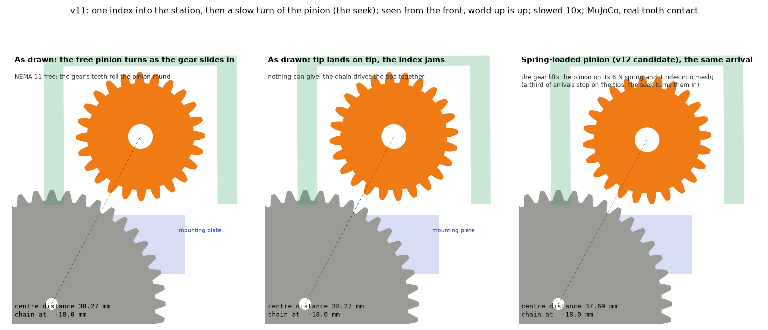
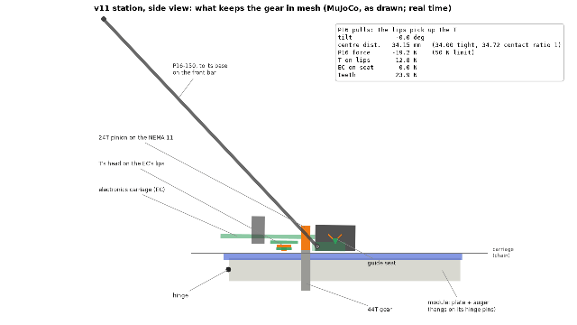
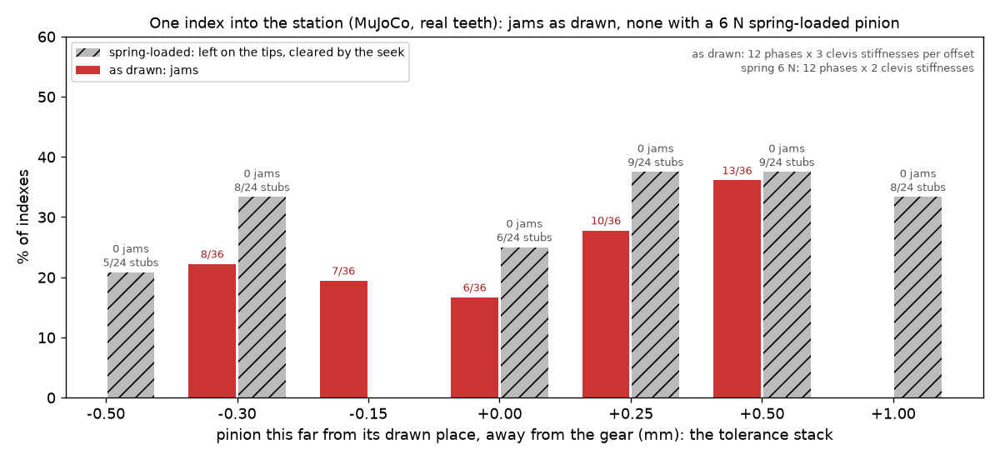
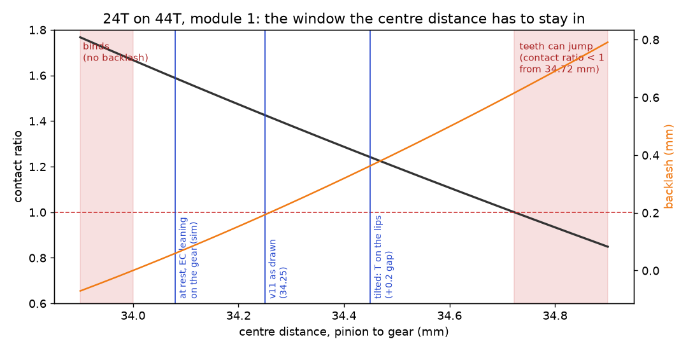

# v11 station: how the auger gear meets the pinion, stays in mesh and lets go (MuJoCo, real tooth contact)

Sterling ([PR #185](https://github.com/vertical-cloud-lab/powder-doser/pull/185), 2026-11-27): *"I also need a better explanation for
how the auger gear engages and disengages now that it's not gravity keeping contact. Random aside: perhaps a spring or similar could
help at some point."* v11's README also listed *"the station's dynamics, and the gear's sideways engagement"* as not simulated. This
folder does both, on v11's own geometry. Nothing is built, so every number here is a prediction.



*One index into the station, seen from the front with world up drawn up, slowed 10x ([MP4](../renders/v11/mesh_entry_v11.mp4)).
Left: the free pinion turns about 50° as the gear's teeth roll in. Middle: a gear tooth lands on a pinion tooth's tip and nothing
can give, so the chain drives the tips together. Right: the proposed spring-loaded pinion lifts instead, and a slow turn of the motor
after the index drops it into the gap.*

## The short answer

- **It isn't a force that keeps the gear in mesh in v11; it's where the parts sit.** The 34.25 mm between the pinion's axis and the
  auger's is set by the module on its hinge pins and latch shelf and by the EC on its seat and the P16's pin. While the module is
  tilted, the T's head is caught on the EC's lips, so the teeth's own separating force has nowhere to push the gear.
- **Holding works as drawn.** In every simulated cycle (0°, 30°, 90°; the pinion up to 0.5 mm too far or 0.3 mm too near; three
  clevis stiffnesses) no tooth jumped. Ramping the auger's load, the NEMA 11 stalled before any tooth jumped, at 0.077-0.090 N·m on
  the auger, at rest and at every tilt.
- **Engaging is the weak moment.** The gear slides into mesh sideways as the chain indexes, and when a gear tooth lands on the tip of
  a pinion tooth, nothing in v11 can give: the module can't swing outward past its shelf, and the EC can't rise off its pin and
  seat. In the model 6 of 36 indexes jam at nominal tolerances (1 in 6) and 44 of 180 over the tolerance sweep, with the chain
  driving the tips together at 53-158 N. Leaving the pinion free, holding it, seeking, indexing at 25 or 100 mm/s, or changing the
  motor's detent made no difference; dry teeth, packed powder and a stiffer EC made it worse (3-4 in 12).
- **At rest, gravity is still in play, on the EC.** Its pin and its shoe both sit on the arm, on one line 36 mm to the side of the
  pinion, so only the clevis's play holds its body up. In the model it rolls up to 1.1° and the pinion's teeth wedge into the gear's
  (34.04-34.38 mm, up to 27 N on the teeth at rest).
- **The window is narrow.** Below 34.00 mm the teeth bind; above 34.72 mm the contact ratio drops below 1. As drawn the dose runs at
  34.06-34.71 mm, and at up to 35.2 mm with the pinion 0.5 mm too far.
- **Yes, a spring helps** (Sterling's aside). With the NEMA 11 and pinion on a spring-loaded carrier pressing the pinion into the
  gear (1 N/mm, 6 N at a stop 0.4 mm past tight mesh; [schematic](../renders/v11/spring_pinion_v12.png)): **0 jams in 216 indexes**
  over −0.5 to +1.0 mm of tolerance; the centre distance stays at 34.02-34.25 mm at every tilt whatever the stack; still no tooth
  jumps, the motor stalling first. A third of the indexes leave the pinion resting on the gear's tips, lifted on its spring; a slow turn of the pinion after the
  index (0.25 rev/s, 0.2 s each way) dropped every one of them into mesh: 88 stubs in 288 indexes, 0 left (0 jams).
  The cost: the preloaded mesh's friction lowers the stall to 0.056-0.066 N·m on the auger at 30 rpm (0.066-0.075 with a 4 N spring),
  against 0.077-0.090 as drawn. It isn't in v11's CAD; it is the first change I'd make for the next version, with the EC given a
  second seat on the far side of the module so its body can't roll onto the gear.

## How it works, step by step

**1. What sets the mesh.** In v2-v9 the electronics carriage (EC) pushed the pinion up into the gear from below, and gravity or a
magnet kept it there. In v11 the EC is inside the loop, above the module, and the 44T gear pokes up through the carriage's opening.
Nothing presses the two together. The 34.25 mm between the pinion's axis and the auger's is set by where two separate parts sit:
- the module, hanging on its two hinge pins and resting on the latch's shelf (it can swing inward, toward the EC, but not outward);
- the EC, on its guide's seat and the P16's rod-end pin (the P16 holds its length: Actuonix rates the P16-150-22 to back-drive only
  above 75 N).

**2. Engaging (every index).** The Pi driver switches the NEMA 11's driver off before the chain moves, so the pinion is free. The
gear's tip circle first touches the pinion's about 12 mm before the station. Over those 12 mm its teeth roll into the pinion's gaps
and turn it about 50°, the way a rack turns a pinion, while the T slides into the rail. Nothing lifts or presses. The free motor's
detent (about 3 mN·m) and the auger's drag decide which of the two turns.

**3. Holding (the dose).** The P16 pulls the EC up. The EC's shoe leaves its seat, and after 0.2 mm the lips under the T's head pick
the module up. From then on the module, the T, the EC and the pinion turn about the hinge as one piece, and the mesh is held by
the T, not by a weight:
- the teeth push the gear away from the pinion (the separating force, W<sub>t</sub> tan 21° plus friction, up to about 3 N at the
  NEMA 11's stall);
- that pushes the T's head onto the lips, which it is already resting on;
- so the centre distance can't grow past 34.25 + 0.2 mm, at 0°, 30° or 90°. At 90° the module's weight acts along the auger and
  helps nothing, and the mesh holds the same.

**4. Letting go (the next index).** The P16 extends: the module sets back on its shelf, the EC's shoe back in its seat. The chain moves
on, the driver off again, and the gear rolls out of the pinion the way it came in (peak chain force under 5 N in every exit run).



*A station cycle in the model, as drawn ([MP4](../renders/v11/mesh_hold_v11.mp4)): the P16 pulls the EC off its seat, the lips pick up
the T, the module tilts to 30°, doses with the solenoid tapping, goes on to 90° and doses, comes back down, and the auger reverses
one turn at rest. The panel gives the centre distance, the P16's force, the T's force on the lips and the EC's on its seat.*

## What the simulations found

| Question | Answer from the model | Where |
|---|---|---|
| What sets the centre distance at rest? | The module on its pins and shelf, the EC on its pin, seat **and the gear itself**: the EC rolls 0.3-1.1° on the clevis's play (its pin and shoe are on one line, 36 mm to the side) until the pinion's teeth wedge into the gear's: 34.04-34.38 mm, up to 27 N on the teeth | [entry](out/entry.json) |
| Does the gear slide into mesh? | Yes, in most indexes: the free pinion turns 13-60° and the auger 1-19° as the teeth roll in over the last 12 mm; peak tooth force about 17 N (2 ms average, median), chain force under 17 N | [entry](out/entry.json) |
| How often does it jam? | **1 index in 6 at nominal tolerances** (6/36), 44 of 180 over −0.3 to +0.5 mm. A gear tooth lands on a pinion tooth's tip; with nothing able to give, the chain drives the tips together (53-158 N in the model) | [entry](out/entry.json), [outcomes plot](out/entry_outcomes.png) |
| Does the pinion's mode or the index speed help? | No: free, held or seeking 2/12 each; 25, 50 and 100 mm/s 2/12 each; 1-8 mN·m of detent 2/12. Dry teeth (μ 0.3) 3/12, packed powder (30 mN·m) 3/12, a stiffer EC sideways 4/12 | [robust](out/entry_robust.json) |
| Does it let go cleanly? | Yes, always: the next index rolls the gear out, under 5 N of chain force in all 15 runs | [exit](out/exit.json) |
| Does the mesh hold while tilting and dosing? | Yes: 0 tooth jumps in 7 cycles (0 → 30° → dose with taps → 90° → dose → 0 → reverse turn), the P16 under 29 N (50 N rated), the EC within 0.5 mm sideways | [cycle](out/cycle.json) |
| What gives first when the auger jams? | The NEMA 11 stalls, at 0.077-0.090 N·m on the auger (30 rpm, 450 mA, 12 V), at 0°, 30°, 60° and 90°, also with the pinion 0.5 mm too far; never a tooth | [cycle](out/cycle.json) |
| Would a spring-loaded pinion help? | Yes: 0 jams in 216 indexes (6 N) and 72 (4 N), at every tolerance, clevis stiffness, friction, speed and detent tried; the centre distance stays 34.02-34.25 mm; no tooth jumps; the motor stalls first, at 0.056-0.075 N·m | [entry](out/entry.json), [robust](out/entry_robust.json), [seek2](out/entry_seek2.json), [cycle](out/cycle.json) |





**What this means for v11 as drawn, if it is built:** T6a (200 indexes) should see a jam in roughly 1 index in 6. A jam looks like the
NEMA 34 stalling (or its driver alarming) in the last 12 mm of an index, with the pinion pressed tip-to-tip on the gear. Backing the
chain off 2 mm and turning the pinion by hand clears it. The checks before building now list it.

## The model ([`mesh11.py`](mesh11.py))

MuJoCo 3, a 20 µs step, everything in the station module's frame (x along the auger, z out of the loop, so gravity is +z):

| Body | What it is | Joints and limits |
|---|---|---|
| carriage | the station carriage on the chain | slides along the travel (y), servoed (2 N/µm) along the Pi driver's index profile: 50 mm/s, 250 mm/s² |
| module | plate v11, T-bracket, door: 81 g, from the STLs (PETG 1.27 g/cm³ at 80 % solid) | hinge pins (y axis); the latch shelf as the hinge's lower limit at 0° |
| auger | tube, flights and cap with the 44T gear: 72.8 g (gear-mesh's mass properties); the teeth are convex prisms of the lab STEP's own tooth outline | turns on its axis against a drag (5 mN·m empty, 30 with packed powder) and the dose load |
| P16 | Actuonix P16-150 from its base pin under the front bar to the EC's arm | pivot (y) at the base; the rod a position-held slide (0.1 N/µm, giving way above 50 N; Actuonix's back-drive rating is 75 N), moved at 30 mm/s |
| EC | EC v11: 305 g with the NEMA 11, the pinion and the solenoid; its lips, ceiling and slot walls round the T's head (0.2, 0.5 and 0.3 mm as drawn), its shoe's nose over the guide's 90° seat (0.5 mm as drawn) | free about the rod-end pin (y); the clevis's and the P16's give as springs: roll and yaw 3, 10 or 100 N·m/rad, sideways 10 N/mm |
| pinion | 24T, module 1, steel, standard involute; the NEMA 11's rotor (9 g·cm²) | free (driver off, 3 mN·m detent), held, or driven by a stepper torque-angle model at 450 mA, 12 V (gear-mesh's) |
| spring option | the NEMA 11 and pinion on a slide toward the gear: 1 N/mm, 6 N (or 4 N) at a stop 0.4 mm (or 0.2) past the zero-backlash centre distance | the v12 candidate, [schematic](../renders/v11/spring_pinion_v12.png) |

Tooth contact uses the gear-mesh study's calibration (single-pair stiffness from its FEA), friction 0.15 (steel on PETG with dry
PTFE). The tolerance stack is modelled as the pinion's axis placed `a_err` further from the gear than drawn (negative: nearer).

**Not modelled:** the door's spring and rod (0.3-0.6 N), the latch cam, the chain's own stretch and sag, printed-part flexibility
other than the contacts' (the teeth's stiffness is calibrated, the EC's body is rigid), backlash in the P16's gears, the powder.
The clevis's play is a linear spring, not play. Starting phases are 12 evenly spaced over one pinion pitch.

## Results

Generated by [`summarize11.py`](summarize11.py) from `out/*.json` (also in [`out/summary.md`](out/summary.md)).

#### Entry: outcomes by tolerance (12 starting phases each, the pinion free, 5 mN m auger drag)

| Design | Clevis roll stiffness (N·m/rad) | Pinion offset (mm) | Meshed | Stubbed, cleared by the seek | Jammed | Peak tooth force, 2 ms avg (N) | Teeth at rest (N) |
|---|---|---|---|---|---|---|---|
| as drawn | 3 | -0.30 | 9/12 | 0/12 | **3/12** | 24 | 12.5 |
| as drawn | 3 | -0.15 | 10/12 | 0/12 | **2/12** | 21 | 10.5 |
| as drawn | 3 | +0.00 | 11/12 | 0/12 | **1/12** | 22 | 8.9 |
| as drawn | 3 | +0.25 | 9/12 | 0/12 | **3/12** | 15 | 6.2 |
| as drawn | 3 | +0.50 | 7/12 | 0/12 | **5/12** | 12 | 0.1 |
| as drawn | 10 | -0.30 | 9/12 | 0/12 | **3/12** | 35 | 18.1 |
| as drawn | 10 | -0.15 | 10/12 | 0/12 | **2/12** | 21 | 11.0 |
| as drawn | 10 | +0.00 | 10/12 | 0/12 | **2/12** | 15 | 7.5 |
| as drawn | 10 | +0.25 | 7/12 | 0/12 | **5/12** | 10 | 4.5 |
| as drawn | 10 | +0.50 | 7/12 | 0/12 | **5/12** | 19 | 0.1 |
| as drawn | 100 | -0.30 | 10/12 | 0/12 | **2/12** | 48 | 25.3 |
| as drawn | 100 | -0.15 | 9/12 | 0/12 | **3/12** | 28 | 12.8 |
| as drawn | 100 | +0.00 | 9/12 | 0/12 | **3/12** | 18 | 5.9 |
| as drawn | 100 | +0.25 | 10/12 | 0/12 | **2/12** | 22 | 0.1 |
| as drawn | 100 | +0.50 | 9/12 | 0/12 | **3/12** | 4 | 0.1 |
| spring-loaded 4 N | 10 | -0.50 | 9/12 | 3/12 | **0/12** | 26 | 15.7 |
| spring-loaded 4 N | 10 | -0.30 | 8/12 | 4/12 | **0/12** | 28 | 15.6 |
| spring-loaded 4 N | 10 | +0.00 | 8/12 | 4/12 | **0/12** | 31 | 15.5 |
| spring-loaded 4 N | 10 | +0.25 | 8/12 | 4/12 | **0/12** | 30 | 15.6 |
| spring-loaded 4 N | 10 | +0.50 | 7/12 | 5/12 | **0/12** | 32 | 15.5 |
| spring-loaded 4 N | 10 | +1.00 | 7/12 | 5/12 | **0/12** | 32 | 15.6 |
| spring-loaded 6 N | 3 | -0.50 | 10/12 | 2/12 | **0/12** | 33 | 22.2 |
| spring-loaded 6 N | 3 | -0.30 | 7/12 | 5/12 | **0/12** | 32 | 20.1 |
| spring-loaded 6 N | 3 | +0.00 | 10/12 | 2/12 | **0/12** | 85 | 22.1 |
| spring-loaded 6 N | 3 | +0.25 | 7/12 | 5/12 | **0/12** | 33 | 21.3 |
| spring-loaded 6 N | 3 | +0.50 | 8/12 | 4/12 | **0/12** | 37 | 22.0 |
| spring-loaded 6 N | 3 | +1.00 | 7/12 | 5/12 | **0/12** | 33 | 21.6 |
| spring-loaded 6 N | 100 | -0.50 | 9/12 | 3/12 | **0/12** | 33 | 23.3 |
| spring-loaded 6 N | 100 | -0.30 | 9/12 | 3/12 | **0/12** | 36 | 21.7 |
| spring-loaded 6 N | 100 | +0.00 | 8/12 | 4/12 | **0/12** | 38 | 21.0 |
| spring-loaded 6 N | 100 | +0.25 | 8/12 | 4/12 | **0/12** | 35 | 21.1 |
| spring-loaded 6 N | 100 | +0.50 | 7/12 | 5/12 | **0/12** | 31 | 20.7 |
| spring-loaded 6 N | 100 | +1.00 | 9/12 | 3/12 | **0/12** | 37 | 20.8 |

#### Entry: pinion mode and auger drag (as drawn, clevis 10 N·m/rad, nominal)

| Pinion during the index | Auger drag (mN·m) | Meshed | Stubbed | Jammed |
|---|---|---|---|---|
| free | 5 | 10/12 | 0/12 | **2/12** |
| held | 5 | 10/12 | 0/12 | **2/12** |
| seek | 5 | 10/12 | 0/12 | **2/12** |
| free | 30 | 9/12 | 0/12 | **3/12** |

Spring-loaded, every run: 216 runs, 0 jams, 70 stubbed, of which 64 cleared by the seek.

#### Spring-loaded, with the seek reversing once (0.25 rev/s, 0.2 s forward then 0.2 s back)

| Spring | Clevis (N·m/rad) | Offset (mm) | Meshed at the stop | Stubbed | Cleared by the seek | Left stubbed | Jammed |
|---|---|---|---|---|---|---|---|
| 4 N | 10 | -0.50 | 9/12 | 3/12 | 3 | 0 | **0** |
| 4 N | 10 | -0.30 | 8/12 | 4/12 | 4 | 0 | **0** |
| 4 N | 10 | +0.00 | 8/12 | 4/12 | 4 | 0 | **0** |
| 4 N | 10 | +0.25 | 8/12 | 4/12 | 4 | 0 | **0** |
| 4 N | 10 | +0.50 | 7/12 | 5/12 | 5 | 0 | **0** |
| 4 N | 10 | +1.00 | 7/12 | 5/12 | 5 | 0 | **0** |
| 6 N | 3 | -0.50 | 10/12 | 2/12 | 2 | 0 | **0** |
| 6 N | 3 | -0.30 | 7/12 | 5/12 | 5 | 0 | **0** |
| 6 N | 3 | +0.00 | 10/12 | 2/12 | 2 | 0 | **0** |
| 6 N | 3 | +0.25 | 7/12 | 5/12 | 5 | 0 | **0** |
| 6 N | 3 | +0.50 | 8/12 | 4/12 | 4 | 0 | **0** |
| 6 N | 3 | +1.00 | 7/12 | 5/12 | 5 | 0 | **0** |
| 6 N | 10 | -0.50 | 9/12 | 3/12 | 3 | 0 | **0** |
| 6 N | 10 | -0.30 | 10/12 | 2/12 | 2 | 0 | **0** |
| 6 N | 10 | +0.00 | 9/12 | 3/12 | 3 | 0 | **0** |
| 6 N | 10 | +0.25 | 9/12 | 3/12 | 3 | 0 | **0** |
| 6 N | 10 | +0.50 | 8/12 | 4/12 | 4 | 0 | **0** |
| 6 N | 10 | +1.00 | 9/12 | 3/12 | 3 | 0 | **0** |
| 6 N | 100 | -0.50 | 9/12 | 3/12 | 3 | 0 | **0** |
| 6 N | 100 | -0.30 | 9/12 | 3/12 | 3 | 0 | **0** |
| 6 N | 100 | +0.00 | 8/12 | 4/12 | 4 | 0 | **0** |
| 6 N | 100 | +0.25 | 8/12 | 4/12 | 4 | 0 | **0** |
| 6 N | 100 | +0.50 | 7/12 | 5/12 | 5 | 0 | **0** |
| 6 N | 100 | +1.00 | 9/12 | 3/12 | 3 | 0 | **0** |

#### Entry: what the jams depend on (12 phases each, nominal tolerance)

| Change | Design | Meshed | Stubbed (cleared) | Jammed |
|---|---|---|---|---|
| detent 0.001 | as drawn | 10/12 | 0/12 (0) | **2/12** |
| detent 0.001 | spring-loaded | 9/12 | 3/12 (3) | **0/12** |
| detent 0.008 | as drawn | 10/12 | 0/12 (0) | **2/12** |
| detent 0.008 | spring-loaded | 11/12 | 1/12 (1) | **0/12** |
| drag 0.03 | as drawn | 9/12 | 0/12 (0) | **3/12** |
| drag 0.03 | spring-loaded | 10/12 | 2/12 (2) | **0/12** |
| index at 100 mm/s | as drawn | 10/12 | 0/12 (0) | **2/12** |
| index at 100 mm/s | spring-loaded | 9/12 | 3/12 (3) | **0/12** |
| index at 25 mm/s | as drawn | 10/12 | 0/12 (0) | **2/12** |
| index at 25 mm/s | spring-loaded | 10/12 | 2/12 (2) | **0/12** |
| k_lat 100000 | as drawn | 8/12 | 0/12 (0) | **4/12** |
| k_lat 100000 | spring-loaded | 8/12 | 4/12 (4) | **0/12** |
| k_lat 1e+06 | as drawn | 8/12 | 0/12 (0) | **4/12** |
| k_lat 1e+06 | spring-loaded | 8/12 | 4/12 (4) | **0/12** |
| mu 0.3 | as drawn | 9/12 | 0/12 (0) | **3/12** |
| mu 0.3 | spring-loaded | 7/12 | 5/12 (1) | **0/12** |

#### Exit: the next index pulls the gear out

| Design | Pinion | Offset (mm) | Clevis (N·m/rad) | Peak chain force (N) | Peak tooth force (N) | Chain lag (mm) |
|---|---|---|---|---|---|---|
| as drawn | free | -0.30 | 3 | 4.1 | 49.0 | 0.001 |
| as drawn | held | -0.30 | 3 | 3.8 | 46.5 | 0.001 |
| as drawn | free | -0.30 | 100 | 4.4 | 48.1 | 0.001 |
| as drawn | held | -0.30 | 100 | 4.9 | 36.4 | 0.001 |
| as drawn | free | +0.00 | 3 | 3.5 | 41.1 | 0.001 |
| as drawn | held | +0.00 | 3 | 3.5 | 34.4 | 0.001 |
| as drawn | free | +0.00 | 100 | 2.2 | 12.5 | 0.001 |
| as drawn | held | +0.00 | 100 | 2.6 | 10.8 | 0.001 |
| as drawn | free | +0.50 | 3 | 3.3 | 9.4 | 0.001 |
| as drawn | held | +0.50 | 3 | 3.3 | 11.6 | 0.001 |
| as drawn | free | +0.50 | 100 | 1.8 | 2.5 | 0.001 |
| as drawn | held | +0.50 | 100 | 1.6 | 0.6 | 0.001 |
| spring-loaded | free | -0.30 | 10 | 1.8 | 32.3 | 0.001 |
| spring-loaded | free | +0.00 | 10 | 1.7 | 34.8 | 0.001 |
| spring-loaded | free | +0.50 | 10 | 1.8 | 33.5 | 0.001 |

#### Station cycle: tilt to 30 deg, dose 1 s (30 rpm, 20 mN m with a slug per turn, 4 N solenoid taps every 0.25 s), on to 90 deg, dose, back down, one reverse turn at rest

| Case | Phase | Tilt reached (deg) | Centre distance (mm) | P16 force (N) | T on the lips (N) | Teeth, 10 ms avg max (N) | EC roll (deg) | EC sideways (mm) | Seat at the end (N) |
|---|---|---|---|---|---|---|---|---|---|
| as drawn | tilt_30 | 29.4 | 34.15-34.62 | -19 to 12 | 23 | 12 | -0.84 to -0.05 | -0.07 to +0.13 | 0.0 |
| as drawn | dose_30 | 29.4 | 34.08-34.63 | -13 to -3 | 70 | 8 | -0.45 to -0.32 | -0.13 to -0.04 | 0.0 |
| as drawn | tilt_90 | 91.5 | 34.11-34.69 | -22 to 21 | 33 | 17 | -0.62 to +0.75 | -0.09 to +0.49 | 0.0 |
| as drawn | dose_90 | 91.6 | 34.10-34.21 | 5 to 13 | 51 | 16 | +0.20 to +0.54 | -0.01 to +0.14 | 0.0 |
| as drawn | back | -0.0 | 34.05-34.59 | -16 to 24 | 43 | 32 | -0.73 to +0.91 | -0.15 to +0.32 | 1.1 |
| as drawn | reverse | -0.0 | 34.07-34.15 | -2 to 1 | 13 | 26 | -0.18 to -0.02 | +0.01 to +0.06 | 1.1 |
| as drawn | tooth jumps over the cycle | 0 | | | | | | | |
| as drawn, k_roll 3 | tilt_30 | 29.3 | 34.14-34.50 | -19 to 12 | 53 | 9 | -2.25 to -0.10 | -0.13 to +0.09 | 0.0 |
| as drawn, k_roll 3 | dose_30 | 29.3 | 34.06-34.52 | -10 to -2 | 80 | 14 | -1.22 to -0.88 | -0.10 to -0.04 | 0.0 |
| as drawn, k_roll 3 | tilt_90 | 91.8 | 34.12-34.47 | -22 to 21 | 39 | 39 | -1.50 to +0.78 | -0.08 to +0.47 | 0.0 |
| as drawn, k_roll 3 | dose_90 | 92.1 | 34.17-34.38 | 5 to 14 | 41 | 19 | +0.53 to +1.46 | +0.05 to +0.20 | 0.0 |
| as drawn, k_roll 3 | back | -0.0 | 34.08-34.45 | -16 to 29 | 69 | 67 | -2.15 to +1.58 | -0.14 to +0.19 | 0.6 |
| as drawn, k_roll 3 | reverse | -0.0 | 34.08-34.15 | -1 to 1 | 18 | 28 | -0.19 to -0.02 | +0.01 to +0.06 | 0.7 |
| as drawn, k_roll 3 | tooth jumps over the cycle | 0 | | | | | | | |
| as drawn, k_roll 100 | tilt_30 | 29.5 | 34.15-34.71 | -19 to 13 | 38 | 0 | -0.10 to +0.00 | -0.04 to +0.15 | 0.0 |
| as drawn, k_roll 100 | dose_30 | 29.5 | 34.12-34.69 | -12 to -1 | 61 | 5 | -0.06 to -0.00 | -0.12 to +0.00 | 0.0 |
| as drawn, k_roll 100 | tilt_90 | 91.2 | 34.10-34.67 | -22 to 21 | 41 | 13 | -0.10 to +0.12 | -0.10 to +0.25 | 0.0 |
| as drawn, k_roll 100 | dose_90 | 91.4 | 34.06-34.15 | 4 to 11 | 77 | 16 | +0.01 to +0.07 | -0.05 to +0.07 | 0.0 |
| as drawn, k_roll 100 | back | -0.0 | 34.06-34.69 | -16 to 24 | 48 | 12 | -0.08 to +0.14 | -0.09 to +0.15 | 1.2 |
| as drawn, k_roll 100 | reverse | -0.0 | 34.05-34.14 | -3 to 1 | 0 | 22 | -0.07 to +0.01 | -0.01 to +0.06 | 1.1 |
| as drawn, k_roll 100 | tooth jumps over the cycle | 0 | | | | | | | |
| as drawn, a_err 0.5 | tilt_30 | 29.4 | 34.25-35.13 | -20 to 12 | 24 | 0 | -0.82 to -0.21 | -0.09 to +0.13 | 0.0 |
| as drawn, a_err 0.5 | dose_30 | 29.4 | 34.49-35.12 | -14 to -2 | 53 | 2 | -0.44 to -0.33 | -0.14 to -0.05 | 0.0 |
| as drawn, a_err 0.5 | tilt_90 | 92.4 | 34.15-35.19 | -22 to 19 | 38 | 13 | -0.61 to +0.90 | -0.12 to +0.50 | 0.0 |
| as drawn, a_err 0.5 | dose_90 | 92.4 | 34.13-34.22 | 4 to 15 | 55 | 18 | +0.31 to +0.57 | -0.01 to +0.20 | 0.0 |
| as drawn, a_err 0.5 | back | -0.0 | 34.12-35.09 | -19 to 25 | 54 | 17 | -0.78 to +1.01 | -0.16 to +0.36 | 2.2 |
| as drawn, a_err 0.5 | reverse | -0.0 | 34.26-34.26 | -2 to -2 | 2 | 1 | -0.48 to -0.47 | +0.01 to +0.03 | 2.2 |
| as drawn, a_err 0.5 | tooth jumps over the cycle | 0 | | | | | | | |
| as drawn, a_err -0.3 | tilt_30 | 29.4 | 34.11-34.32 | -19 to 12 | 42 | 13 | -0.81 to -0.04 | -0.05 to +0.16 | 0.0 |
| as drawn, a_err -0.3 | dose_30 | 29.4 | 34.06-34.33 | -19 to -2 | 96 | 16 | -0.47 to -0.24 | -0.15 to -0.02 | 0.0 |
| as drawn, a_err -0.3 | tilt_90 | 91.0 | 34.10-34.39 | -22 to 20 | 59 | 48 | -0.63 to +0.42 | -0.09 to +0.19 | 0.0 |
| as drawn, a_err -0.3 | dose_90 | 91.1 | 34.09-34.20 | 2 to 14 | 77 | 43 | +0.18 to +0.47 | -0.10 to +0.07 | 0.0 |
| as drawn, a_err -0.3 | back | -0.0 | 34.05-34.29 | -10 to 25 | 66 | 63 | -0.73 to +0.47 | -0.13 to +0.13 | 0.0 |
| as drawn, a_err -0.3 | reverse | -0.0 | 34.04-34.11 | -1 to 8 | 31 | 38 | +0.03 to +0.46 | -0.02 to +0.09 | 0.0 |
| as drawn, a_err -0.3 | tooth jumps over the cycle | 0 | | | | | | | |
| spring-loaded | tilt_30 | 29.5 | 34.10-34.19 | -16 to 12 | 74 | 24 | -0.26 to +0.18 | -0.02 to +0.12 | 0.0 |
| spring-loaded | dose_30 | 29.5 | 34.09-34.19 | -10 to -2 | 71 | 41 | -0.02 to +0.13 | -0.12 to +0.00 | 0.0 |
| spring-loaded | tilt_90 | 90.4 | 34.16-34.25 | -22 to 20 | 40 | 20 | -0.19 to +0.69 | -0.08 to +0.26 | 0.0 |
| spring-loaded | dose_90 | 90.5 | 34.09-34.18 | 2 to 9 | 39 | 29 | +0.22 to +0.41 | -0.12 to +0.03 | 0.0 |
| spring-loaded | back | -0.0 | 34.05-34.23 | -14 to 24 | 34 | 29 | -0.30 to +0.71 | -0.22 to +0.16 | 0.0 |
| spring-loaded | reverse | -0.0 | 34.02-34.10 | -1 to 3 | 8 | 43 | -0.00 to +0.38 | -0.00 to +0.06 | 0.0 |
| spring-loaded | tooth jumps over the cycle | 0 | | | | | | | |
| spring-loaded, a_err 0.5 | tilt_30 | 29.5 | 34.10-34.19 | -17 to 12 | 70 | 23 | -0.26 to +0.17 | -0.01 to +0.12 | 0.0 |
| spring-loaded, a_err 0.5 | dose_30 | 29.5 | 34.09-34.19 | -10 to -2 | 60 | 42 | -0.02 to +0.13 | -0.12 to +0.01 | 0.0 |
| spring-loaded, a_err 0.5 | tilt_90 | 90.4 | 34.16-34.25 | -22 to 20 | 40 | 21 | -0.19 to +0.68 | -0.08 to +0.26 | 0.0 |
| spring-loaded, a_err 0.5 | dose_90 | 90.5 | 34.09-34.18 | 3 to 9 | 44 | 28 | +0.22 to +0.41 | -0.12 to +0.03 | 0.0 |
| spring-loaded, a_err 0.5 | back | -0.0 | 34.05-34.23 | -14 to 24 | 36 | 29 | -0.30 to +0.71 | -0.22 to +0.16 | 0.0 |
| spring-loaded, a_err 0.5 | reverse | -0.0 | 34.02-34.10 | -1 to 3 | 8 | 44 | -0.00 to +0.38 | -0.00 to +0.06 | 0.0 |
| spring-loaded, a_err 0.5 | tooth jumps over the cycle | 0 | | | | | | | |
| spring-loaded, f_spring 4, stop_deep 0.2 | tilt_30 | 29.5 | 34.10-34.23 | -17 to 12 | 46 | 23 | -0.61 to +0.19 | -0.06 to +0.09 | 0.0 |
| spring-loaded, f_spring 4, stop_deep 0.2 | dose_30 | 29.4 | 34.04-34.21 | -12 to -2 | 88 | 25 | -0.48 to -0.10 | -0.18 to -0.04 | 0.0 |
| spring-loaded, f_spring 4, stop_deep 0.2 | tilt_90 | 91.0 | 34.13-34.27 | -22 to 20 | 37 | 17 | -0.44 to +0.73 | -0.08 to +0.38 | 0.0 |
| spring-loaded, f_spring 4, stop_deep 0.2 | dose_90 | 91.2 | 34.09-34.19 | 4 to 9 | 27 | 22 | +0.18 to +0.38 | -0.04 to +0.09 | 0.0 |
| spring-loaded, f_spring 4, stop_deep 0.2 | back | -0.0 | 34.05-34.27 | -15 to 24 | 34 | 26 | -0.69 to +0.82 | -0.10 to +0.31 | 0.0 |
| spring-loaded, f_spring 4, stop_deep 0.2 | reverse | -0.0 | 34.02-34.12 | -1 to 2 | 4 | 37 | -0.00 to +0.28 | +0.00 to +0.07 | 0.0 |
| spring-loaded, f_spring 4, stop_deep 0.2 | tooth jumps over the cycle | 0 | | | | | | | |

#### Stall ramps: the auger's load rises until something gives (30 rpm)

| Design | Offset (mm) | Tilt (deg) | What gives | At (N·m at the auger) | Centre distance then (mm) |
|---|---|---|---|---|---|
| as drawn | +0.00 | 30 | motor stall | 0.0899 | 34.613 |
| as drawn | +0.00 | 60 | motor stall | 0.09 | 34.687 |
| as drawn | +0.00 | 90 | motor stall | 0.0767 | 34.185 |
| as drawn | +0.50 | 30 | motor stall | 0.0894 | 35.119 |
| spring-loaded, 6 N | +0.00 | 30 | motor stall | 0.0564 | 34.145 |
| spring-loaded, 6 N | +0.00 | 60 | motor stall | 0.0569 | 34.166 |
| spring-loaded, 6 N | +0.00 | 90 | motor stall | 0.0655 | 34.132 |
| spring-loaded, 6 N | +0.50 | 30 | motor stall | 0.0564 | 34.147 |
| spring-loaded, 4 N | +0.00 | 30 | motor stall | 0.0658 | 34.16 |
| spring-loaded, 4 N | +0.00 | 90 | motor stall | 0.0754 | 34.142 |
| as drawn | +0.00 | 0 | motor stall | 0.0833 | 34.11 |
| spring-loaded, 6 N | +0.00 | 0 | motor stall | 0.0563 | 34.058 |
| spring-loaded, 4 N | +0.00 | 0 | motor stall | 0.0655 | 34.062 |


## Files

| File | What |
|---|---|
| [`mesh11.py`](mesh11.py) | The model and the three runs: `entry` (one index into the station), `exit_run` (the next index out), `cycle` (tilt, dose, back, reverse; or a stall ramp) |
| [`run11.py`](run11.py) | The studies, in parallel: `entry`, `exit`, `cycle`, `robust`, `seek2`, `stall0` |
| [`summarize11.py`](summarize11.py) | The tables above, from `out/*.json` |
| [`viz11.py`](viz11.py) | The clips (`mesh_entry_v11`, `mesh_hold_v11`), the plots, the spring schematic |
| [`out/`](out) | `entry.json`, `entry_robust.json`, `entry_seek2.json`, `exit.json`, `cycle.json`; `centre_distance_window.png`, `entry_outcomes.png` |

```
pip install mujoco numpy scipy shapely matplotlib imageio imageio-ffmpeg cadquery
python run11.py entry ; python run11.py exit ; python run11.py cycle ; python run11.py robust ; python run11.py seek2
python summarize11.py ; python viz11.py plots ; python viz11.py entry ; python viz11.py tilt ; python viz11.py spring
```
