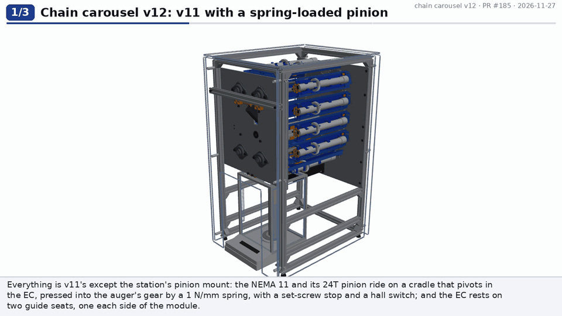
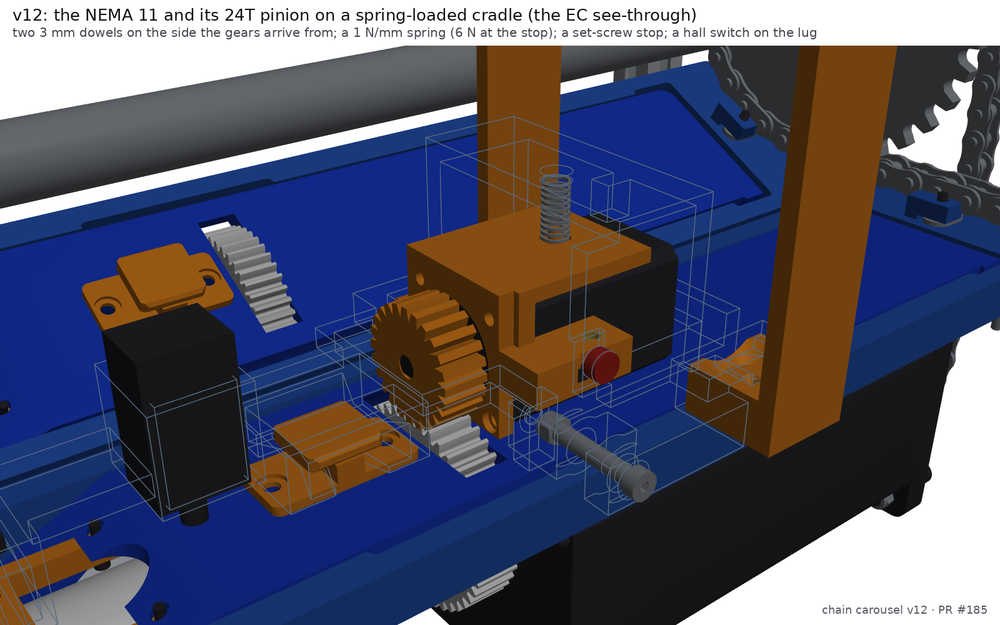
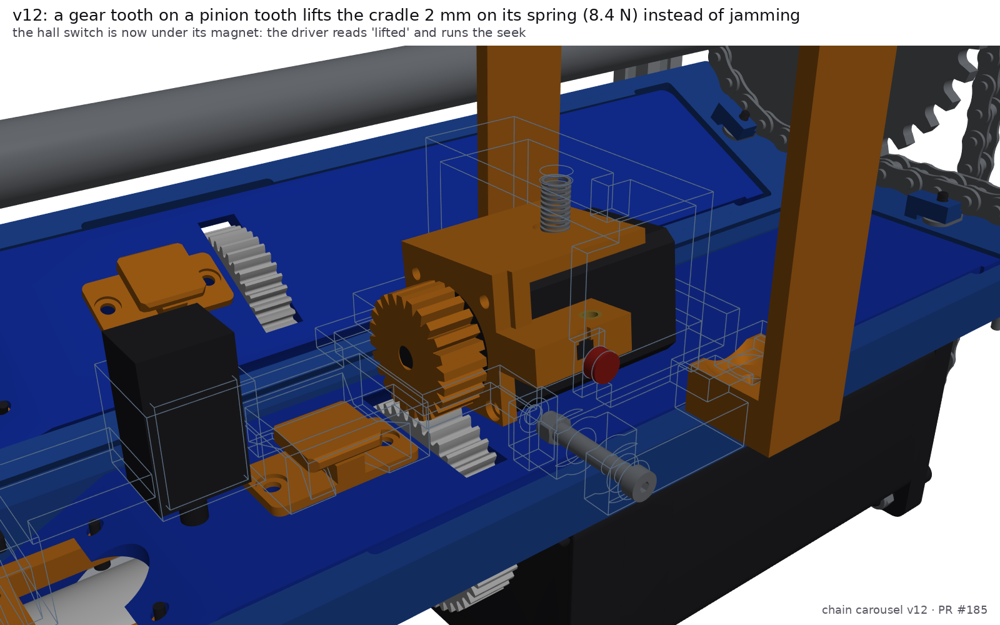
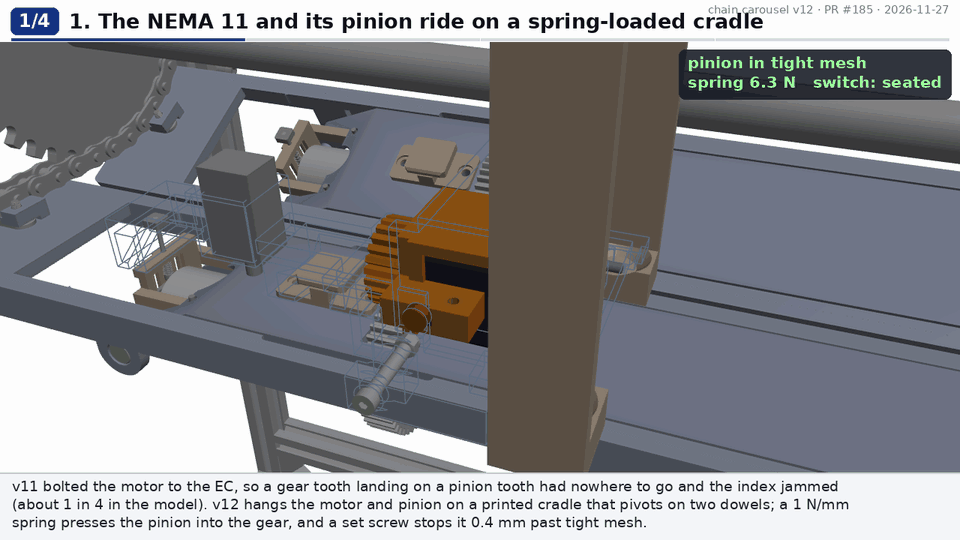
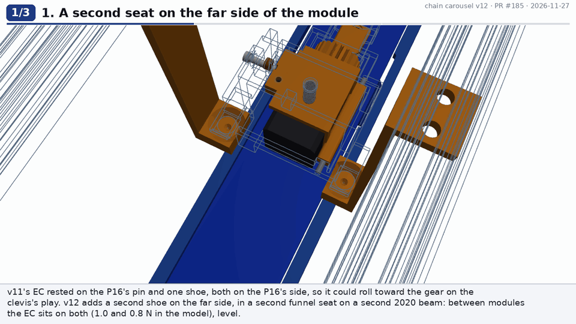
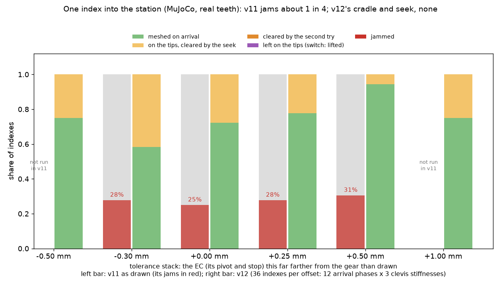
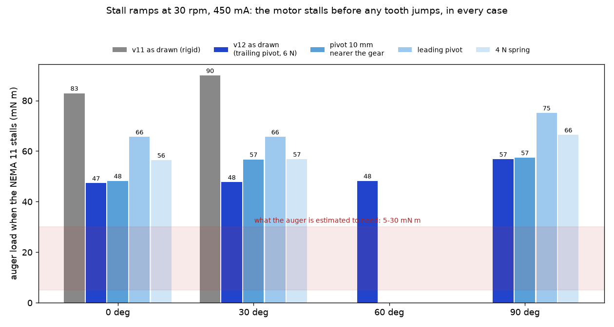
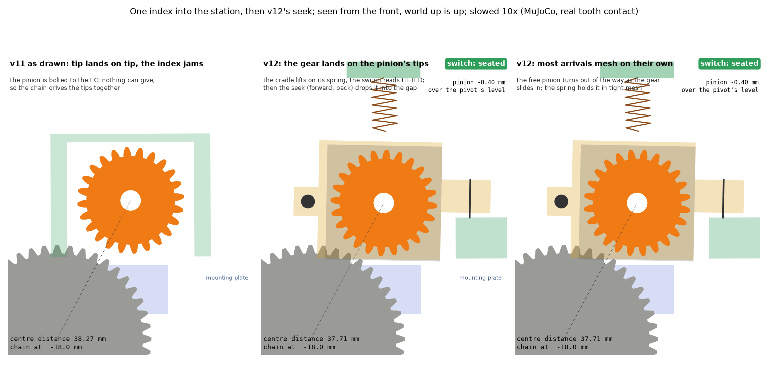
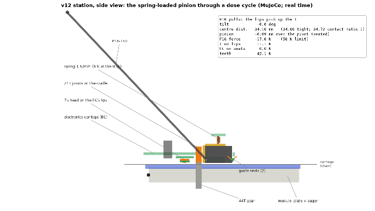
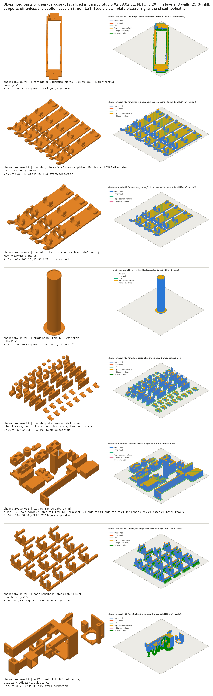

# Chain carousel v12: the spring-loaded pinion, its hall switch and seek, and the EC's second seat

**v12 is [v11](../chain-carousel-v11/README.md) with the spring-loaded pinion that v11's gear study proposed**
([v11 sim/README.md](../chain-carousel-v11/sim/README.md)). [v7](../chain-carousel-v7/README.md) stays the main version. Sterling's
request of 2026-11-27 ([PR #185](https://github.com/vertical-cloud-lab/powder-doser/pull/185)):

> Go with the spring-loaded pinion. Make v12 from v11 with what your last report proposed:
> - the NEMA 11 and its pinion on a cradle that pivots in the EC, with a spring pressing the pinion into the gear (about 1 N/mm and 6 N
>   preload) and a set-screw stop;
> - a hall switch on the cradle, so the driver knows when the pinion is resting on the gear's tips;
> - the slow seek after each index (turn the pinion slowly, reversing once), with a second try when the switch still reads "lifted";
> - a second seat for the EC on the far side of the module, so its body can't roll onto the gear.
>
> Then redo every check for v12, and fix anything they find.

Nothing is built. Every number here is a prediction from the CAD and the MuJoCo model.

**Onshape (public):** [**Multi-doser chain carousel, test rig v12, rev. 2026-11-27**](https://cad.onshape.com/documents/fab22582b674da0aa4f55a73/w/fc13e6204b748c1ec907acab/e/890e883cfe283daf84776743)
(ids in [`onshape/onshape_document.json`](onshape/onshape_document.json)).
- **Why a revision:** the first v12 import ([918e9cd2](https://cad.onshape.com/documents/918e9cd2e623d78cf67c9972/w/6e5fa1c0246103eb719a8b8b/e/6bb5766b165cba75d7ac02b3)) went in
  before Bambu Studio's slice found the cradle's defects (Checks). It is renamed SUPERSEDED, pointing at the revision, because the API
  key can't delete documents.
- **v11:** its document ([rev. 2026-11-27](https://cad.onshape.com/documents/3e99376a80ac21e730425ec0/w/9e9e05ab391f2d3a16998fca/e/cd46c1a5e6c910443d6daad8))
  is renamed "SUPERSEDED by v12" too.
- **API calls:** 28 today, all in [`onshape/api_calls.jsonl`](onshape/api_calls.jsonl):
  - two imports (11 and 10 calls);
  - three renames;
  - four checks that the documents are public and renamed.
- [**v7, the main version.**](https://cad.onshape.com/documents/291664f38c67a4672a86f025/w/e67d1b706aa4b873fa8c68e8/e/4802634f69ef3323004d7bf6)

**Walkthrough video:** [**on YouTube**](https://www.youtube.com/watch?v=abZlIeTuC0A), 7.5 min. It is public, on the BYU Vertical Cloud Lab
channel, and subscribers weren't notified. The MP4 is also in [`walkthrough/`](walkthrough/walkthrough_v12.mp4), with
[captions](walkthrough/walkthrough_v12.srt), the [chapters](walkthrough/chapters.txt) and its sources
([`script_v12.py`](walkthrough/script_v12.py), [`make_walkthrough.py`](walkthrough/make_walkthrough.py)). The narration is Piper's
offline text-to-speech, in the public-domain LJ Speech voice.

## What changed from v11, and why

| | v12 | Why |
|---|---|---|
| **The cradle** | The NEMA 11 and its 24T pinion ride on a printed cradle ([`parts12.cradle_v12`](parts12.py)). It pivots in the EC on **two 3 x 12 mm 316 dowels** (McMaster 93600A335). The dowels sit along the auger, level with the pinion's axis, 18.5 mm to the side the gears arrive from (Sam −y). The cradle is the old EC motor plate, plus a pivot tube along the motor's −y side, a top bar over the motor and a lug on its +y side | v11 bolted the motor to the EC. When a gear tooth landed on a pinion tooth's tip, nothing could give, and the model jammed about 1 index in 4. With the pivot on the arriving side (a trailing arm), an arriving gear's drag lifts the pinion instead of wedging it |
| **The spring** | **McMaster 9657K284**: 0.98 N/mm, 19.05 mm free, 6.1 mm OD. It sits on the pinion's line, over the motor between the cradle's top bar and the EC's roof, so its rate and force act 1:1 at the pinion. **5.9 N at the stop, 6.3 N in tight mesh, 8.3 N on a gear's tips**, 9.3 N at the roof's up-stop (3.0 mm of lift; the spring is rated to 8.64 mm) | Sterling: about 1 N/mm and 6 N. No stainless spring matches both; this one is music wire (BoM item 124 lists the stainless options) |
| **The stop** | An **M3 x 6 flat-point set screw** (McMaster 92605A100) down through an insert in the lug, its tip on the EC's arm. It is set **0.4 mm past tight mesh**: with no gear at the station, the pinion's centre sits 33.6 mm from where the gear's axis comes | With no gear there, the stop keeps the pinion and the NEMA 11 1.6 mm over the passing plates (1.0 mm once the EC settles 0.5 mm into its seats). A flat point, because a cup point would dent the printed arm |
| **The hall switch** | A **US5881** in a pocket on the lug's +y face. Its magnet (K&J D42-N52) is in a post on the EC, 2.5 mm off the switch and 3.5 mm further into the loop. The switch reads **"lifted" when the pinion rises 0.8 mm** or more over tight mesh. The lug moves 2.1 times as far as the pinion, so the switch slides under the magnet's face. It is on BCM 26 | So the driver knows when the pinion rests on the gear's tips (about 2.0 mm up) instead of in mesh |
| **The seek** | [`test/chain_rig.py`](test/chain_rig.py) `Rig.seek_mesh()` runs after every index: the pinion turns forward at 0.25 rev/s for 0.2 s, then back for 0.2 s, so the auger ends where it started. If the switch still reads lifted, a **second try** runs back first, then forward. If that fails too, it **backs the chain off 13 mm**, turns the pinion half a tooth, indexes again and seeks once more. Then it stops and says so | The model clears every stub on the first seek with the teeth lubricated. The re-index is for dry teeth (below) |
| **The second seat** | A second guide shoe on the EC's far side (Sam y −32), in a second funnel seat ([`parts12.guide_hanger_v12`](parts12.py)). The seat hangs from a **second 2020 station beam** at world y +56, the first one's mirror, with an M5 through each side plate into its tapped ends | Between modules the EC sits on both seats. With the loosest clevis it rolls 0.24° instead of 1.32° on v11's one seat. That keeps the NEMA 11 1.0 mm over the passing plates instead of 0.6 |
| **EC v12** | v11's front half (door ramp, spine, solenoid collar, straight rail). Behind the pinion: the cradle's two pivot bosses, an outer −y rail and a cross bar behind the motor, a roof over the spring with an up-stop pad, the magnet's post, the arm (its inner edge 3 mm further out, for the cradle's swing) and both shoes ([`parts12.ec_v12`](parts12.py)) | |

**Found on the way, in v11's drawings, and fixed.** All three were hidden because the check skipped the pair:
1. **EC v11's arm had no slot for the P16's rod-end tab.** The tab, 6 mm thick, sat in solid arm between the clevis cheeks. v12 cuts a slot through the arm round the pin for the tab's swing (47-148° about the pin over 0-90°), and pockets for the pin's nut and head.
2. **The NEMA 11's 20 mm shaft ran 1.5 mm into the EC's rail block**, 4.8 mm past the pinion. v12 cuts the shaft to 15 mm (BoM item 119, ASSEMBLY step 8).
3. **The outlet door's spring was buried in a solid tower.** v4-v11 drew the tower in front of the shutter solid. The shutter's spring boss stood only 0.35 mm in front of the rod's axis, so the rod had no hole: v11's one "still open" item. v12 bores the tower 3.6 mm and carries its front wall 0.85 mm further forward, so 0.8 mm of wall stays in front of the bore. The shutter's boss is now round, 3.2 mm across on the spring's axis, with a 1.55 mm press fit for the 1/16 in rod. The rod is 0.9 mm longer, 22.7 mm, so it runs the boss's full 2 mm ([`parts12.door_shutter_v12`](parts12.py), [`door_housing_v12`](parts12.py)). The door's parts are no longer skipped against each other, and nothing touches open or shut.

| The cradle, at rest in tight mesh | A gear tooth on a pinion tooth: the cradle lifts 2 mm |
|---|---|
|  |  |

*[MP4](renders/v12/cradle_v12.mp4). The parts on the cradle; the cradle dropping onto its stop as a module leaves; a tooth landing on a tooth
(the cradle lifts, the switch reads "lifted"); the seek, after which the pinion drops into the gap. The lift during the index follows
the model's numbers; the frames are the CAD.*

## How the gear meets the pinion now, step by step

1. **Between modules.** The spring pushes the cradle onto its set screw, 0.4 mm past tight mesh. The EC rests on both guide seats and the P16's pin.
2. **The index.** The NEMA 34 moves the chain 8 links with the NEMA 11's driver off, so the pinion is free. The arriving gear's teeth first touch the pinion's about 12.9 mm before the station.
   - In three arrivals out of four, the free pinion turns out of the way and the gear rolls into mesh. It pushes the pinion up 0.4 mm off its stop, into **tight mesh: no backlash, the spring holding it there**, whatever the tolerance stack.
   - In about one in four, a gear tooth lands on a pinion tooth's tip. The pinion rides up about 2 mm on its spring (8.3 N), and the chain finishes the index at under 19 N. v11's jams drove the tips together at 109-214 N.
3. **The switch and the seek.** After every index the driver turns the pinion forward and back (0.25 rev/s, 0.2 s each way) and reads the switch. A pinion on the gear's tips drops into the next gap, and the switch reads "seated". The model cleared every such stub on the first seek; the second try and the re-index are there in case.
4. **Dosing.** The P16 pulls the EC up about the hinge. The rail's lips pick up the module's T, and the EC, the cradle and the module turn together. The spring keeps the pinion in the gear at every angle, including 90°, where the module's weight acts along the auger and helps nothing.
5. **A jam in the auger.** The NEMA 11 stalls before any tooth jumps, at every angle. The preloaded mesh's friction costs some torque (next section).
6. **The next index** rolls the gear out of the free pinion (under 5 N of chain force), and the cradle drops back onto its stop.

**One thing that works differently from the proposal: what the second seat does.** The spring pushes the pinion into the gear with about 6 N, and its reaction pushes the EC up with the same force. That is twice the EC's 3 N weight. So with a module in mesh, the EC lifts off **both** seats: 0 N on them at rest in every simulated case. That was true of v11's proposed slide too, whose single seat also carried 0 N. The P16's pin and the rail's lips under the module's T hold the EC instead, at 0-5.5 N. That is fine for the mesh, because the spring sets the centre distance whatever the EC does.

The second seat matters **between modules**, with no gear pushing on the pinion. There it stops the EC rolling on the clevis's play toward the next gear's path. The seats are push-only, so neither can hold the EC down against the spring. A hold-down that the tilt could still swing out of would have to be near the hinge axis, where the EC first moves forward rather than up; v12 doesn't need one.

*[MP4](renders/v12/seats_v12.mp4): the EC on its two seats; the P16 pulls and both shoes lift out; back down, the funnels steer them home.*

## What the simulations found

| Question | v11 as drawn | **v12 as drawn** | Where |
|---|---|---|---|
| Indexes that jam (12 arrival phases x 6 tolerance offsets, −0.5 to +1.0 mm, x 3 clevis stiffnesses) | about 1 in 4 (46 of 180) | **0 of 216** (0 of 504 with the variants) | [entry](sim/out/entry.json) |
| Arrivals on the gear's tips | — (they jam) | 53 of 216: the cradle lifts about 2 mm (8.3 N) | [entry](sim/out/entry.json) |
| Cleared by the first seek | — | **53 of 53**; the second try was needed once in 504 (leading-arm variant) | [entry](sim/out/entry.json) |
| The switch after the seek | — | **right in 504 of 504** | [entry](sim/out/entry.json) |
| Peak chain force over an index | 109-214 N in a jam | **18.9 N** | [entry](sim/out/entry.json) |
| Centre distance after the index (window 34.00-34.72) | 34.03-36.0 | **34.03-34.21 mm** (tight mesh, the spring) | [entry](sim/out/entry.json) |
| Tooth jumps holding the mesh (0 → 30° → dose → 90° → dose → back → reverse) | 0 | **0** in 8 cycles (clevis 3/10/100 N·m/rad, tolerance −0.3/+0.5/+1.0 mm, 4 N spring, one seat) | [cycle](sim/out/cycle.json) |
| Stall at the auger (30 rpm, 450 mA), the motor stalling first | 0.083 (0°), 0.090 (30°) N·m | **0.047 (0°), 0.048 (30°, 60°), 0.057 (90°) N·m**, against the 0.005-0.030 the auger is estimated to need | [cycle](sim/out/cycle.json), [plot](sim/out/stall_vs_tilt.png) |
| Letting go (the next index) | under 6 N | **under 5.0 N** in 16 runs | [exit](sim/out/exit.json) |
| Dry teeth (μ 0.3) | — | 0 jams; 6 of 36 left on the tips after the seek, the second try and the re-index (all read "lifted") | [dry](sim/out/entry_dry.json) |
| The parked EC's roll between modules (loosest clevis) | 1.32° on one seat | **0.24° on two seats** | [`mesh12.py`](sim/mesh12.py) |

**The stall: what the spring costs, and the choices.** In tight mesh both flanks of the teeth carry the spring's load, and their friction
takes torque from the motor. The trailing-arm pivot adds to it: the dose's drive torque presses the pinion harder into the gear (that same
geometry is what lets an arriving gear lift the pinion). Both alternatives index with 0 jams in 72 runs each:

| Variant | Stall at 0°, 30°, 90° (N·m at the auger) | Entry: arrivals on the tips; ones needing a second try |
|---|---|---|
| v12 as drawn (trailing pivot level with the pinion, 6 N) | 0.047, 0.048, 0.057 | 25 % (the 216 as drawn); none |
| The dowels 10 mm nearer the gear (the drive torque's push cancels) | 0.048, 0.057, 0.057 | 33 % (24 of 72); none |
| A 4 N spring | 0.056, 0.057, 0.066 | 40 % (29 of 72); none |
| A leading-arm pivot (on the far side) | 0.066, 0.066, 0.075 | 19 % (14 of 72); 1 |

v12 keeps 6 N and the trailing arm, as asked. The margin over the auger's heavy estimate is 1.6x. If T6d measures a running torque
within half the stall, the 4 N spring is a parts swap (the set screw and the switch need no change).

Details, every table and the model: [`sim/README.md`](sim/README.md).

| One index into the station, MuJoCo, real teeth ([MP4](renders/v12/mesh_entry_v12.mp4)) | A dose cycle, side view ([MP4](renders/v12/mesh_hold_v12.mp4)) |
|---|---|
|  |  |

## Checks

These are OCC boolean overlaps between parts; anything over 0.5 mm³ counts as a clash. By-design contacts are skipped by part key, and
v12's are at the end of SKIP in [`check_interference.py`](check_interference.py). The door's parts are no longer skipped against each other.

| Check | What moves | Result |
|---|---|---|
| Home ([`checks/home.json`](checks/home.json)) | Every pair of the 841 instances (v11: 829; v12 adds the cradle, its dowels, spring, stop, insert, hall switch and magnet, the second guide, the second beam and its screws) | **0** |
| `--cradle` ([`checks/cradle.json`](checks/cradle.json)) | The cradle, the NEMA 11, the pinion, the spring, the stop and the hall switch at −0.4 (on the stop), 0, 1, 2 (a stub), 2.6 and 3.0 mm of lift (the roof's pad), at 0, 30 and 90° of tilt (18 poses), against everything | **0** (re-run on the fixed cradle; also 0 at 10, 20, 40 ... 85° in [`cradle_tilts.json`](checks/cradle_tilts.json)) |
| `--tilt11` ([`tilt_a`](checks/tilt_a.json), [`tilt_b`](checks/tilt_b.json), [`tilt_c`](checks/tilt_c.json)) | Module 1, the EC with its cradle and the P16 at 0, 10, 20 ... 80, 85 and 90° against everything else | **0 at every angle** |
| [`sweep_station.py`](sweep_station.py) ([`checks/sweep_station.json`](checks/sweep_station.json)) | Every carriage and module within 2.2 modules of the station, one module of travel in 1-link steps (9 poses), against the parked station with the cradle **on its stop** (its lowest), both guides and beams, the balance | **0**. The passing gears run through the pinion by design: in the machine they lift it on its spring |
| `--swap` ([`checks/swap.json`](checks/swap.json)) | Module 4 at the side hatch: its auger pulled 5-140 mm off its plate, then the whole carriage out (16 poses) | **0** |
| `--latch` ([`checks/latch.json`](checks/latch.json)) | The latch cam while carriage 1 passes it in quarter-link steps over ±3 links, then module 1 pulled up to 10-90° (34 poses) | **0**. The follower overlaps the cam's ramps by at most 1.22 mm³ (a sliver of the round dowel on the ramp, as in v11) |
| `--door12` ([`checks/door.json`](checks/door.json), new) | Every module's outlet door (the bored housing, the shutter with its round boss, the rod, its head, the spring) against everything: module 1 at 0-90°, then a module of travel in 1-link steps (15 poses) | **0** |

The first runs found and fixed:
- **EC v12 was two solids:** the up-stop pad stood 0.01 mm off the roof.
- **The cradle's tube swung into the EC's outer rail** when lifted (72 mm³ at 3.2 mm). The cradle's −y side now stops at −16, and the rail moved 1 mm out.
- **The cross bar and the arm's extension ran into the first guide's seat block** (633 mm³). They now stop at Sam y 27.5.
- **The magnet was drawn pointing into the lug.**
- **Bambu Studio's first slice found three cradle defects** (below, Printing):
  - the top bar hung on a 0.7 mm strip of the plate;
  - a 0.31 mm web;
  - two counterbores broke out of the plate's edges.

  The bar is now 32 mm wide and meets both cheeks. The plate runs up to the bar and out to y 14.5. The web is 1.7 mm, and only the two lower heads are counterbored (1.5 mm, to stay behind the passing gears).
- The three v11 defects at the top of this README.

## Printing

Every printed part was sliced in Bambu Studio 02.08.02.61's command line, in PETG, and nothing was logged in. Each H2D plate uses its left
0.4 mm nozzle only. The plates, times and per-part audit are in [`cad/print/README.md`](../print/README.md) and
[`cad/print/chain-carousel-v12/`](../print/chain-carousel-v12):
- **21 prints, 84.7 h and 1.94 kg** of PETG.
  - H2D: 18 prints, 75 h 03 min, 1,766 g.
  - A1 mini: 3 prints, 9 h 38 min, 170 g.
  - v11 was 83.0 h and 1.90 kg.
- **The new parts** are on the H2D plate with EC v12 (3 h 55 min, 78.3 g, tree supports): the cradle and the second guide.
  - **The cradle slices clean with supports off**, motor plate down: 1 h 08 min, 9.9 g. Its first version didn't (the defects under Checks).
  - **EC v12 prints on its +y side.** v11's EC printed on its −y side, but that side would now stand only on the second shoe.
  - The plate needed 25 mm between parts: at the usual 8 mm, the EC's supports ran into the guide.
- **Every part is one solid and fits its bed.** EC v12 and the door housing need tree supports, as their v11 versions did. The door
  shutter, with its new round boss, slices clean with supports off.

## Cost

**$2,148.71, or $2,007.32 without test gear** ([BOM.md](BOM.md)). v11 was $2,118.48 ($1,977.09); v12 is
$30.23 more. Lines marked estimate add up to $133.69, the same as v11's.
- **Added:**
  - 3 x 12 mm 316 dowels, McMaster 93600A335, $9.73 for 25;
  - the spring, McMaster 9657K284, $12.74 for 12;
  - an M3 x 6 flat-point set screw, McMaster 92605A100, $3.81 for 25;
  - a second US5881 ($2.00) and D42-N52 ($0.52);
  - the second beam's screws and T-nuts;
  - the cradle and the second guide (printed).
- **The same:** everything else. The second 405 mm beam comes from the same 2020 pack (340 + 405 on its last bar).
- **The new parts' prices were read on 2026-11-27** from McMaster's family tables and part panels. A headed Chromium did the reading,
  logged out, through the doser Pi ([`checks/vendor_v12.json`](checks/vendor_v12.json)). Adafruit's and K&J's pages were read too.
  v11's other prices were read through the Pi the same day ([v11 VENDOR-CHECK.md](../chain-carousel-v11/VENDOR-CHECK.md)).

## Check before building

1. **Set the stop with module 1 at the station** (ASSEMBLY step 8.7). The spring holds the pinion in tight mesh. Turn the set screw down
   until its tip touches the arm and the dial on the motor just moves, then back it out 1.7 turns. That is 0.85 mm at the lug and
   0.4 mm at the pinion.
2. **Set the switch** (step 8.8). It must read "seated" in mesh and "lifted" with 0.6-1.0 mm of lift at the pinion; shim the magnet.
   In the model, the reading after the seek was right in every index. Before the seek, it read "seated" on 9 stubs when the EC sat
   1.0 mm farther from the gear than drawn, because the stub then lifts the pinion only 0.77-0.87 mm. The driver always seeks before
   it reads, so this didn't matter.
3. **Keep the teeth lubricated** (dry PTFE, BoM item 72). With dry teeth (μ 0.3) the seek alone left 5 of 12 stubs on the tips, all
   read as "lifted". With the driver's fallback (back off 13 mm, turn half a tooth, re-index, seek), 6 of 36 dry-teeth indexes still stayed on the tips, all read as "lifted", and none jammed ([`sim/README.md`](sim/README.md)). Re-spray the teeth when T6a's log shows re-indexes.
4. **TEST-PLAN T6a** now counts stubs, seeks and re-indexes over 200 indexes; the prediction is 0 jams and about 1 stub in 4, each
   cleared by the first seek.
5. **The stall torque** is lower than v11's (next to last section); T6d measures it against the auger's running torque, which nobody has
   measured yet.
6. v11's open items stand: the latch spring (no stock spring fits yet) and the lab's balance's cage.

## Not done

- **Nothing was built, printed or bought.** The print times and filament weights are Bambu Studio's estimates.
- **The model's limits** ([`sim/README.md`](sim/README.md#not-modelled)):
  - the cradle's dowels have no play or friction;
  - the spring is linear;
  - the printed parts are rigid apart from their contacts;
  - there is no powder;
  - each case has 12 evenly spaced arrival phases.
- **What the auger needs is still an estimate** (0.005-0.030 N·m). T6d measures it.
- **The hall switch's threshold is a design figure.** The switch trips at 0.8 mm of lift at the pinion, set with shims at assembly. Its field against the gap wasn't modelled.
- **v11's open items stand:**
  - the latch spring (no stock spring fits the pocket yet);
  - the lab's balance: its cage, and whether the carousel can come down 14-18 mm with the HR-100A.

## Files

- **CAD:** [`parts12.py`](parts12.py) holds the cradle, EC v12, the dowels, the spring, the stop, the hall magnet, the second guide, the NEMA 11 with its cut shaft, and the door's shutter, rod and housing. The layout is in [`layout.py`](layout.py) (`_station_v12`, `cradle12_M`, `State.cradle_lift`), and the numbers are in [`params.py`](params.py) (v12's at the end).
- **Checks:** [`check_interference.py`](check_interference.py) (`--cradle`, `--door12`, `--tilt11`, `--latch`, `--swap`) and [`sweep_station.py`](sweep_station.py). Results are in [`checks/`](checks).
- **Simulations:** [`sim/`](sim): [`mesh12.py`](sim/mesh12.py), [`run12.py`](sim/run12.py), [`summarize12.py`](sim/summarize12.py), [`viz12.py`](sim/viz12.py), with results in `out/`.
- **Clips:** [`explain12.py`](explain12.py) and [`sim/viz12.py`](sim/viz12.py), with output in [`renders/v12/`](renders/v12). Stills are in [`renders/`](renders), and the assembly steps in [ASSEMBLY.md](ASSEMBLY.md).
- **Pi driver:** [`test/chain_rig.py`](test/chain_rig.py) (`seek_mesh`, `PIN_HALL_CRADLE` 26, `--sim-stub`).
- **Vendors:** [`checks/vendor_v12.json`](checks/vendor_v12.json): the dowels, the spring and the set screw, read from McMaster's tables through the doser Pi, logged out.
- **Exports:** [STEP assembly](step/chain_carousel_rig_v12.step), [`stl/`](stl), [`dxf/`](dxf). The side plates gain the second beam's end-screw holes.
- **Printing:** [`../print/chain-carousel-v12/`](../print/chain-carousel-v12).
- **Onshape:** [`onshape/`](onshape).
- **Video:** [`walkthrough/`](walkthrough).
