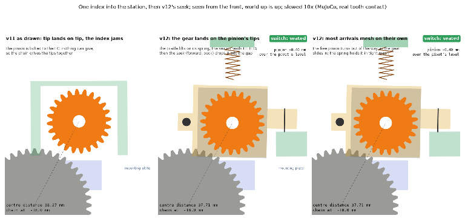

# v12 station: the spring-loaded pinion in MuJoCo (real tooth contact)

Sterling ([PR #185](https://github.com/vertical-cloud-lab/powder-doser/pull/185), 2026-11-27): *"Go with the spring-loaded pinion ... Then redo
every check for v12, and fix anything they find: the MuJoCo entry, hold, exit and robustness runs, against the same tolerance stack; the
stall torque with the preloaded mesh, against what the auger needs."* This is v11's model ([`../../chain-carousel-v11/sim/`](../../chain-carousel-v11/sim/README.md))
rebuilt round v12's cradle, its spring and stop, the hall switch, the driver's seek and the EC's second seat. Nothing is built, so every
number here is a prediction.



*One index into the station, seen from the front with world up drawn up, slowed 10x ([MP4](../renders/v12/mesh_entry_v12.mp4)).*

## The short answer

- **No jams.** 504 simulated indexes, 0 jams, against about 1 in 4 for v11 as drawn (46 of 180 over the same stack in v11's model).
  - That covers v12 as drawn over the tolerance stack (−0.5 to +1.0 mm) and three clevis stiffnesses (216 indexes).
  - It also covers four variants of 72: a 4 N spring, the dowels 10 mm nearer the gear, a leading-arm pivot, and v11's one seat.
- **About 1 arrival in 4 lands on the gear's tips** (53 of 216 as drawn). The cradle lifts about 2 mm on its spring, and the chain finishes the index at 18.9 N at most. v11's jams drove the tips together at 109-214 N.
- **The seek clears every stub on its first try** (53 of 53 as drawn). The second try was needed once in all 504: with the leading-arm pivot.
- **The switch.** After the seek it was right in all 504 indexes. Before the seek, it read "seated" on 9 stubs when the EC sat a whole 1.0 mm farther from the gear than drawn: those stubs lifted the pinion only 0.77-0.87 mm against a 0.8 mm threshold. The driver always seeks before it reads, so this changed nothing.
- **The centre distance after the index is 34.03-34.21 mm.** That is inside the 34.00-34.72 window, tight mesh held by the spring. Only where the stack puts the stop short of tight mesh (+0.5 and +1.0 mm) does the pinion rest on its stop, with that much backlash, as v11 always did.
- **Holding works.** In every cycle (0 → 30° → dose with taps → 90° → dose → back → reverse) no tooth jumped, at every clevis stiffness, tolerance and spring. The P16 stayed under 24 N (50 N rated).
- **Stall against what the auger needs.**
  - Ramping the auger's load, the NEMA 11 stalls first at every angle: **0.047 N·m at rest, 0.048 at 30° and 60°, 0.057 at 90°**.
  - That is against v11's 0.083-0.090 with the rigid mount, and the 0.005-0.030 N·m the auger is estimated to need (gear-mesh study; unmeasured).
  - So the margin over the heavy estimate is 1.6x. The cost is the preloaded mesh's friction: in tight mesh both flanks carry load. The trailing-arm pivot adds to it, because the drive torque presses the pinion harder into the gear.
  - A 4 N spring (0.056-0.066 N·m) or the dowels 10 mm nearer the gear (0.048-0.057) recover some, with no jams either way. With the stack at +0.5 or +1.0 mm the cradle sits on its stop with no preload: 0.086-0.090.
- **Letting go is clean:** under 5.0 N of chain force in all 16 exit runs.
- **Dry teeth (μ 0.3) are the one case the seek alone didn't clear:** 5 of 12 stubs stayed on the tips through both seeks. The switch read "lifted" every time, so the driver stops rather than jams. The driver's fallback ran on 36 dry-teeth indexes (−0.3, 0 and +0.5 mm): back off 13 mm, turn half a tooth, re-index, seek. 22 meshed on arrival, 1 cleared by the second try, 7 by re-indexing, and **6 stayed on the tips**. The switch read "lifted" on all 6, so the driver stopped and asked for a hand. 0 jammed. Holding the pinion on the way back made it worse (10 left). So keep the teeth lubricated: with dry PTFE (μ 0.15) every stub cleared on the first seek.
- **The second seat works between modules.** With no gear at the station and the loosest clevis, the parked EC rolls 0.24° on two seats against 1.32° on v11's one. The NEMA 11 sits 1.0 mm over the passing plates instead of 0.6. With a module in mesh, the spring's reaction (about 6 N, twice the EC's weight) lifts the EC off **both** seats: 0 N on them at rest, in v11's proposal too. The P16's pin and the rail's lips under the module's T hold it instead, at 0-5.5 N at rest.

## What changed in the model from v11's

| | v11's model ([`mesh11.py`](../../chain-carousel-v11/sim/mesh11.py)) | v12's ([`mesh12.py`](mesh12.py)) |
|---|---|---|
| The pinion's mount | Rigid in the EC, 34.25 mm from the gear (or the proposed slide: 1 N/mm, 6 N at a stop 0.4 mm past tight mesh) | **The cradle**: a hinge about x through the pivot dowels (18.5 mm to Sam −y, level with the pinion), carrying the NEMA 11, the pinion and the printed cradle (224 g). A torsional spring equal to the 1 N/mm spring at the pinion, 6 N at the set screw's stop 0.4 mm past tight mesh (the joint's upper limit), and the roof's pad 3.2 mm over tight mesh (its lower limit) |
| The EC's seats | One, on the P16's side | **Two**, one each side of the module (Sam y +36 and −32), each a 90° cone 0.5 mm under its shoe's nose |
| The hall switch | — | Reads "lifted" when the pinion is more than 0.8 mm over the pivot's level (tight mesh as drawn) |
| After the index | One slow turn (0.25 rev/s, 0.2 s forward and 0.2 s back) | **v12's seek**: the same forward-and-back turn, the switch read; a **second try** (back first) if it still reads lifted; then the **re-index**: the chain backs off 13 mm (past where the tips first touch, 12.9 mm), the pinion turns half a tooth, the chain comes back with the NEMA 11 free, one more seek |
| The tolerance stack `a_err` | The pinion's axis this far farther from the gear | The EC's pivot **and its stop** this far farther from the gear (the set screw is set once, with module 1): at +0.4 mm or more the cradle sits on its stop in mesh, with that much less preload |
| Masses | EC v11 (45.1 cm³) | EC v12 (48.1 cm³) and the cradle (7.7 cm³) from their CAD |

Everything else is v11's: the chain servo and its index profile (50 mm/s, 250 mm/s²), the module on its hinge pins and latch shelf,
the auger with the lab STEP's tooth outline, the P16 as a position-held slide with a 50 N limit, the clevis's give as springs, the
tooth contact's calibration (gear-mesh's FEA), the stepper's torque-angle model at 450 mA and 12 V, friction 0.15 (dry PTFE).

## Results

Generated by [`summarize12.py`](summarize12.py) from `out/*.json` (also [`out/summary.md`](out/summary.md)). The cycle and exit runs with a tolerance offset start with the cradle in tight mesh (2026-11-27: a first run started it at its drawn angle, so at −0.3 mm the teeth began overlapping and the module started on the tips; those cases were re-run).

#### Entry: one index into the station, then the seek (12 arrival phases per row; the pinion free during the index)

| Design | Clevis roll stiffness (N·m/rad) | Tolerance stack (mm) | Meshed on arrival | On the tips, cleared by the seek | ... by the second try | Left on the tips | Jammed | Peak chain force (N) | Centre distance after (mm) |
|---|---|---|---|---|---|---|---|---|---|
| v12 | 3 | -0.50 | 9/12 | 3/12 | 0/12 | 0/12 | **0/12** | 18.9 | 34.03-34.10 |
| v12 | 3 | -0.30 | 7/12 | 5/12 | 0/12 | 0/12 | **0/12** | 14.2 | 34.03-34.10 |
| v12 | 3 | +0.00 | 9/12 | 3/12 | 0/12 | 0/12 | **0/12** | 12.6 | 34.02-34.06 |
| v12 | 3 | +0.25 | 10/12 | 2/12 | 0/12 | 0/12 | **0/12** | 11.7 | 34.03-34.04 |
| v12 | 3 | +0.50 | 11/12 | 1/12 | 0/12 | 0/12 | **0/12** | 10.0 | 34.06-34.13 |
| v12 | 3 | +1.00 | 9/12 | 3/12 | 0/12 | 0/12 | **0/12** | 9.3 | 34.18-34.20 |
| v12 | 10 | -0.50 | 8/12 | 4/12 | 0/12 | 0/12 | **0/12** | 17.1 | 34.03-34.10 |
| v12 | 10 | -0.30 | 6/12 | 6/12 | 0/12 | 0/12 | **0/12** | 17.8 | 34.03-34.10 |
| v12 | 10 | +0.00 | 8/12 | 4/12 | 0/12 | 0/12 | **0/12** | 13.7 | 34.03-34.03 |
| v12 | 10 | +0.25 | 11/12 | 1/12 | 0/12 | 0/12 | **0/12** | 13.2 | 34.03-34.03 |
| v12 | 10 | +0.50 | 11/12 | 1/12 | 0/12 | 0/12 | **0/12** | 10.1 | 34.06-34.12 |
| v12 | 10 | +1.00 | 8/12 | 4/12 | 0/12 | 0/12 | **0/12** | 15.4 | 34.18-34.20 |
| v12 | 100 | -0.50 | 10/12 | 2/12 | 0/12 | 0/12 | **0/12** | 16.1 | 34.03-34.10 |
| v12 | 100 | -0.30 | 8/12 | 4/12 | 0/12 | 0/12 | **0/12** | 12.9 | 34.03-34.06 |
| v12 | 100 | +0.00 | 9/12 | 3/12 | 0/12 | 0/12 | **0/12** | 10.1 | 34.03-34.06 |
| v12 | 100 | +0.25 | 7/12 | 5/12 | 0/12 | 0/12 | **0/12** | 11.9 | 34.03-34.04 |
| v12 | 100 | +0.50 | 12/12 | 0/12 | 0/12 | 0/12 | **0/12** | 7.7 | 34.06-34.06 |
| v12 | 100 | +1.00 | 10/12 | 2/12 | 0/12 | 0/12 | **0/12** | 9.6 | 34.21-34.21 |
| 4 N spring | 10 | -0.50 | 7/12 | 5/12 | 0/12 | 0/12 | **0/12** | 17.9 | 34.03-34.10 |
| 4 N spring | 10 | -0.30 | 6/12 | 6/12 | 0/12 | 0/12 | **0/12** | 11.2 | 34.02-34.10 |
| 4 N spring | 10 | +0.00 | 9/12 | 3/12 | 0/12 | 0/12 | **0/12** | 32.5 | 34.03-34.05 |
| 4 N spring | 10 | +0.25 | 5/12 | 7/12 | 0/12 | 0/12 | **0/12** | 11.0 | 34.03-34.04 |
| 4 N spring | 10 | +0.50 | 8/12 | 4/12 | 0/12 | 0/12 | **0/12** | 10.0 | 34.06-34.13 |
| 4 N spring | 10 | +1.00 | 8/12 | 4/12 | 0/12 | 0/12 | **0/12** | 17.6 | 34.18-34.21 |
| pivot 10 mm nearer the gear | 10 | -0.50 | 7/12 | 5/12 | 0/12 | 0/12 | **0/12** | 21.2 | 34.03-34.10 |
| pivot 10 mm nearer the gear | 10 | -0.30 | 7/12 | 5/12 | 0/12 | 0/12 | **0/12** | 10.7 | 34.03-34.10 |
| pivot 10 mm nearer the gear | 10 | +0.00 | 8/12 | 4/12 | 0/12 | 0/12 | **0/12** | 15.9 | 34.03-34.06 |
| pivot 10 mm nearer the gear | 10 | +0.25 | 8/12 | 4/12 | 0/12 | 0/12 | **0/12** | 10.2 | 34.03-34.05 |
| pivot 10 mm nearer the gear | 10 | +0.50 | 10/12 | 2/12 | 0/12 | 0/12 | **0/12** | 11.3 | 34.06-34.13 |
| pivot 10 mm nearer the gear | 10 | +1.00 | 8/12 | 4/12 | 0/12 | 0/12 | **0/12** | 17.3 | 34.18-34.20 |
| leading arm | 10 | -0.50 | 7/12 | 5/12 | 0/12 | 0/12 | **0/12** | 14.9 | 34.03-34.10 |
| leading arm | 10 | -0.30 | 10/12 | 2/12 | 0/12 | 0/12 | **0/12** | 17.2 | 34.03-34.10 |
| leading arm | 10 | +0.00 | 8/12 | 3/12 | 1/12 | 0/12 | **0/12** | 11.8 | 34.03-34.03 |
| leading arm | 10 | +0.25 | 11/12 | 1/12 | 0/12 | 0/12 | **0/12** | 10.4 | 34.03-34.10 |
| leading arm | 10 | +0.50 | 12/12 | 0/12 | 0/12 | 0/12 | **0/12** | 13.0 | 34.06-34.13 |
| leading arm | 10 | +1.00 | 10/12 | 2/12 | 0/12 | 0/12 | **0/12** | 8.9 | 34.18-34.20 |
| one seat | 3 | -0.50 | 7/12 | 5/12 | 0/12 | 0/12 | **0/12** | 14.2 | 34.02-34.10 |
| one seat | 3 | -0.30 | 6/12 | 6/12 | 0/12 | 0/12 | **0/12** | 12.9 | 34.03-34.10 |
| one seat | 3 | +0.00 | 7/12 | 5/12 | 0/12 | 0/12 | **0/12** | 18.5 | 34.03-34.06 |
| one seat | 3 | +0.25 | 8/12 | 4/12 | 0/12 | 0/12 | **0/12** | 13.5 | 34.03-34.09 |
| one seat | 3 | +0.50 | 9/12 | 3/12 | 0/12 | 0/12 | **0/12** | 9.2 | 34.06-34.08 |
| one seat | 3 | +1.00 | 6/12 | 6/12 | 0/12 | 0/12 | **0/12** | 15.9 | 34.12-34.12 |

- **v12**: 216 indexes, 163 meshed on arrival, 53 cleared by the first seek, 0 by the second try, 0 left on the tips, **0 jammed**; the switch's reading after the seek right in 216/216.
- **4 N spring**: 72 indexes, 43 meshed on arrival, 29 cleared by the first seek, 0 by the second try, 0 left on the tips, **0 jammed**; the switch's reading after the seek right in 72/72.
- **pivot 10 mm nearer the gear**: 72 indexes, 48 meshed on arrival, 24 cleared by the first seek, 0 by the second try, 0 left on the tips, **0 jammed**; the switch's reading after the seek right in 72/72.
- **leading arm**: 72 indexes, 58 meshed on arrival, 13 cleared by the first seek, 1 by the second try, 0 left on the tips, **0 jammed**; the switch's reading after the seek right in 72/72.
- **one seat**: 72 indexes, 43 meshed on arrival, 29 cleared by the first seek, 0 by the second try, 0 left on the tips, **0 jammed**; the switch's reading after the seek right in 72/72.

#### Entry: what the outcome depends on (v12 as drawn, nominal tolerances, 12 arrival phases each)

| Change | Meshed | On the tips, cleared by the seek | ... by the second try | Left | Jammed | Peak chain force (N) |
|---|---|---|---|---|---|---|
| EC 10x stiffer sideways | 9/12 | 3/12 | 0/12 | 0/12 | **0/12** | 11.2 |
| EC 100x stiffer sideways | 8/12 | 4/12 | 0/12 | 0/12 | **0/12** | 12.0 |
| dry teeth (mu 0.3) | 7/12 | 0/12 | 0/12 | 5/12 | **0/12** | 11.9 |
| detent 1 mN m | 8/12 | 4/12 | 0/12 | 0/12 | **0/12** | 13.7 |
| detent 8 mN m | 9/12 | 3/12 | 0/12 | 0/12 | **0/12** | 9.4 |
| packed powder (30 mN m) | 9/12 | 3/12 | 0/12 | 0/12 | **0/12** | 14.9 |
| index at 25 mm/s | 10/12 | 2/12 | 0/12 | 0/12 | **0/12** | 12.1 |
| index at 100 mm/s | 6/12 | 6/12 | 0/12 | 0/12 | **0/12** | 18.6 |
| pinion held during the index | 9/12 | 2/12 | 1/12 | 0/12 | **0/12** | 25.5 |
| pinion seeking during the index | 10/12 | 2/12 | 0/12 | 0/12 | **0/12** | 16.5 |

#### Dry teeth (μ 0.3) with the driver's whole sequence: the seek, the second try, the re-index (13 mm back, half a tooth, back in, a seek)

| Tolerance stack (mm) | Meshed on arrival | Cleared by the seek | ... by the second try | ... by re-indexing | Left on the tips (switch: lifted) | Jammed |
|---|---|---|---|---|---|---|
| -0.30 | 5/12 | 0/12 | 0/12 | 3/12 | 4/12 | **0/12** |
| +0.00 | 7/12 | 0/12 | 0/12 | 3/12 | 2/12 | **0/12** |
| +0.50 | 10/12 | 0/12 | 1/12 | 1/12 | 0/12 | **0/12** |

#### Exit: the next index pulls the gear out

| Pinion | Tolerance stack (mm) | Clevis (N·m/rad) | Peak chain force (N) | Peak tooth force (N) | Chain lag (mm) |
|---|---|---|---|---|---|
| free | -0.30 | 3 | 4.2 | 68.1 | 0.001 |
| held | -0.30 | 3 | 5.0 | 64.8 | 0.001 |
| free | -0.30 | 100 | 4.4 | 57.9 | 0.001 |
| held | -0.30 | 100 | 4.8 | 59.4 | 0.001 |
| free | +0.00 | 3 | 4.4 | 59.1 | 0.001 |
| held | +0.00 | 3 | 4.3 | 45.1 | 0.001 |
| free | +0.00 | 100 | 4.7 | 52.3 | 0.001 |
| held | +0.00 | 100 | 4.2 | 38.0 | 0.001 |
| free | +0.50 | 3 | 4.3 | 27.6 | 0.001 |
| held | +0.50 | 3 | 4.1 | 24.4 | 0.001 |
| free | +0.50 | 100 | 3.5 | 22.4 | 0.001 |
| held | +0.50 | 100 | 4.2 | 24.4 | 0.001 |
| free | +1.00 | 3 | 4.3 | 2.5 | 0.001 |
| held | +1.00 | 3 | 4.3 | 0.5 | 0.001 |
| free | +1.00 | 100 | 3.2 | 0.6 | 0.001 |
| held | +1.00 | 100 | 3.6 | 0.6 | 0.001 |

#### Station cycle: tilt to 30 deg, dose 1 s (30 rpm, 20 mN m with a slug per turn, 4 N solenoid taps every 0.25 s), on to 90 deg, dose, back down, one reverse turn at rest

| Case | Phase | Tilt reached (deg) | Centre distance (mm) | P16 force (N) | T on the lips (N) | Teeth, 10 ms avg max (N) | EC roll (deg) | Seats at the end (N) |
|---|---|---|---|---|---|---|---|---|
| v12 as drawn | tilt_30 | 29.56 | 34.10-34.19 | -17 to 13 | 71 | 25 | -0.24 to +0.15 | 0.0 |
| v12 as drawn | dose_30 | 29.52 | 34.10-34.19 | -9 to -2 | 34 | 49 | -0.05 to +0.14 | 0.0 |
| v12 as drawn | tilt_90 | 90.4 | 34.17-34.24 | -22 to 20 | 40 | 21 | -0.13 to +0.65 | 0.0 |
| v12 as drawn | dose_90 | 90.49 | 34.09-34.18 | 3 to 9 | 56 | 31 | +0.21 to +0.41 | 0.0 |
| v12 as drawn | back | -0.0 | 34.05-34.23 | -14 to 23 | 52 | 24 | -0.27 to +0.69 | 0.0 |
| v12 as drawn | reverse | -0.0 | 34.02-34.11 | -1 to 3 | 12 | 45 | -0.00 to +0.37 | 0.0 |
| v12 as drawn | tooth jumps over the cycle | 0 | | | | | | |
| clevis 3 N·m/rad | tilt_30 | 29.56 | 34.10-34.19 | -17 to 13 | 68 | 25 | -0.51 to +0.16 | 0.0 |
| clevis 3 N·m/rad | dose_30 | 29.52 | 34.10-34.19 | -10 to -2 | 33 | 52 | -0.07 to +0.14 | 0.0 |
| clevis 3 N·m/rad | tilt_90 | 90.36 | 34.17-34.30 | -22 to 20 | 40 | 23 | -0.17 to +0.99 | 0.0 |
| clevis 3 N·m/rad | dose_90 | 90.58 | 34.13-34.22 | 0 to 9 | 30 | 37 | +0.40 to +0.64 | 0.0 |
| clevis 3 N·m/rad | back | -0.0 | 34.05-34.31 | -15 to 24 | 51 | 28 | -0.35 to +1.16 | 0.0 |
| clevis 3 N·m/rad | reverse | -0.0 | 34.02-34.10 | -1 to 2 | 12 | 43 | -0.00 to +0.42 | 0.0 |
| clevis 3 N·m/rad | tooth jumps over the cycle | 0 | | | | | | |
| clevis 100 N·m/rad | tilt_30 | 29.56 | 34.10-34.19 | -18 to 13 | 63 | 25 | -0.04 to +0.06 | 0.0 |
| clevis 100 N·m/rad | dose_30 | 29.52 | 34.10-34.19 | -8 to -1 | 53 | 50 | -0.02 to +0.04 | 0.0 |
| clevis 100 N·m/rad | tilt_90 | 90.2 | 34.13-34.18 | -22 to 20 | 40 | 21 | -0.05 to +0.11 | 0.0 |
| clevis 100 N·m/rad | dose_90 | 90.4 | 34.05-34.18 | 2 to 9 | 42 | 39 | +0.01 to +0.09 | 0.0 |
| clevis 100 N·m/rad | back | -0.0 | 34.07-34.15 | -13 to 23 | 37 | 24 | -0.05 to +0.13 | 0.0 |
| clevis 100 N·m/rad | reverse | -0.0 | 34.02-34.12 | -1 to 4 | 11 | 42 | -0.00 to +0.06 | 0.0 |
| clevis 100 N·m/rad | tooth jumps over the cycle | 0 | | | | | | |
| tolerance +0.5 mm | tilt_30 | 29.42 | 34.12-34.48 | -18 to 13 | 34 | 8 | -0.82 to +0.03 | 0.0 |
| tolerance +0.5 mm | dose_30 | 29.42 | 34.06-34.49 | -14 to -1 | 54 | 13 | -0.42 to -0.28 | 0.0 |
| tolerance +0.5 mm | tilt_90 | 91.24 | 34.12-34.53 | -22 to 20 | 35 | 24 | -0.58 to +0.58 | 0.0 |
| tolerance +0.5 mm | dose_90 | 91.41 | 34.09-34.21 | 3 to 8 | 24 | 23 | +0.12 to +0.52 | 0.0 |
| tolerance +0.5 mm | back | -0.0 | 34.08-34.46 | -14 to 24 | 37 | 20 | -0.70 to +0.86 | 0.0 |
| tolerance +0.5 mm | reverse | -0.0 | 34.04-34.13 | -2 to 2 | 10 | 23 | -0.01 to +0.10 | 0.6 |
| tolerance +0.5 mm | tooth jumps over the cycle | 0 | | | | | | |
| tolerance -0.3 mm | tilt_30 | 29.56 | 34.10-34.19 | -17 to 13 | 57 | 26 | -0.23 to +0.15 | 0.0 |
| tolerance -0.3 mm | dose_30 | 29.52 | 34.10-34.19 | -8 to -2 | 34 | 47 | -0.06 to +0.13 | 0.0 |
| tolerance -0.3 mm | tilt_90 | 90.37 | 34.16-34.23 | -22 to 20 | 40 | 22 | -0.14 to +0.61 | 0.0 |
| tolerance -0.3 mm | dose_90 | 90.46 | 34.08-34.18 | 3 to 9 | 42 | 34 | +0.19 to +0.43 | 0.0 |
| tolerance -0.3 mm | back | -0.0 | 34.04-34.21 | -14 to 23 | 39 | 29 | -0.24 to +0.67 | 0.0 |
| tolerance -0.3 mm | reverse | -0.0 | 34.02-34.10 | -1 to 3 | 11 | 46 | -0.00 to +0.38 | 0.0 |
| tolerance -0.3 mm | tooth jumps over the cycle | 0 | | | | | | |
| tolerance +1 mm | tilt_30 | 29.42 | 34.18-34.99 | -20 to 13 | 20 | 0 | -0.77 to -0.15 | 0.0 |
| tolerance +1 mm | dose_30 | 29.42 | 34.41-34.97 | -14 to -2 | 61 | 2 | -0.42 to -0.27 | 0.0 |
| tolerance +1 mm | tilt_90 | 92.02 | 34.14-35.03 | -22 to 20 | 33 | 16 | -0.57 to +0.79 | 0.0 |
| tolerance +1 mm | dose_90 | 92.07 | 34.10-34.37 | 4 to 9 | 44 | 20 | +0.27 to +0.65 | 0.0 |
| tolerance +1 mm | back | -0.0 | 34.10-34.96 | -13 to 24 | 28 | 13 | -0.70 to +0.97 | 1.7 |
| tolerance +1 mm | reverse | -0.0 | 34.19-34.19 | -2 to -1 | 2 | 1 | -0.12 to -0.12 | 1.7 |
| tolerance +1 mm | tooth jumps over the cycle | 0 | | | | | | |
| 4 N spring | tilt_30 | 29.52 | 34.10-34.19 | -17 to 13 | 32 | 20 | -0.32 to +0.14 | 0.0 |
| 4 N spring | dose_30 | 29.49 | 34.08-34.19 | -12 to -1 | 47 | 40 | -0.14 to +0.12 | 0.0 |
| 4 N spring | tilt_90 | 90.58 | 34.15-34.27 | -22 to 20 | 41 | 21 | -0.25 to +0.73 | 0.0 |
| 4 N spring | dose_90 | 90.6 | 34.08-34.18 | 2 to 9 | 54 | 23 | +0.20 to +0.45 | 0.0 |
| 4 N spring | back | -0.0 | 34.06-34.23 | -15 to 23 | 40 | 22 | -0.39 to +0.71 | 0.0 |
| 4 N spring | reverse | -0.0 | 34.02-34.11 | -1 to 2 | 9 | 36 | -0.00 to +0.31 | 0.0 |
| 4 N spring | tooth jumps over the cycle | 0 | | | | | | |
| 1 seat, clevis 3 N·m/rad | tilt_30 | 29.56 | 34.10-34.19 | -17 to 13 | 68 | 25 | -0.51 to +0.16 | 0.0 |
| 1 seat, clevis 3 N·m/rad | dose_30 | 29.52 | 34.10-34.19 | -10 to -2 | 33 | 52 | -0.07 to +0.14 | 0.0 |
| 1 seat, clevis 3 N·m/rad | tilt_90 | 90.36 | 34.17-34.30 | -22 to 20 | 40 | 23 | -0.17 to +0.99 | 0.0 |
| 1 seat, clevis 3 N·m/rad | dose_90 | 90.58 | 34.13-34.22 | 0 to 9 | 30 | 37 | +0.40 to +0.64 | 0.0 |
| 1 seat, clevis 3 N·m/rad | back | -0.0 | 34.05-34.31 | -15 to 24 | 51 | 28 | -0.35 to +1.16 | 0.0 |
| 1 seat, clevis 3 N·m/rad | reverse | -0.0 | 34.02-34.10 | -1 to 2 | 12 | 43 | -0.00 to +0.42 | 0.0 |
| 1 seat, clevis 3 N·m/rad | tooth jumps over the cycle | 0 | | | | | | |

#### Stall ramps: the auger's load rises until something gives (30 rpm, 450 mA)

| Case | Tilt (deg) | What gives | At (N·m at the auger) | Centre distance then (mm) |
|---|---|---|---|---|
| 4 N spring | 0 | motor stall | 0.0564 | 34.057 |
| 4 N spring | 30 | motor stall | 0.0568 | 34.137 |
| 4 N spring | 90 | motor stall | 0.0664 | 34.149 |
| leading pivot | 0 | motor stall | 0.0656 | 34.076 |
| leading pivot | 30 | motor stall | 0.0656 | 34.166 |
| leading pivot | 90 | motor stall | 0.0751 | 34.156 |
| pivot 10 mm nearer the gear | 0 | motor stall | 0.0482 | 34.093 |
| pivot 10 mm nearer the gear | 30 | motor stall | 0.0567 | 34.141 |
| pivot 10 mm nearer the gear | 90 | motor stall | 0.0574 | 34.157 |
| tolerance +0.5 mm | 30 | motor stall | 0.0862 | 34.464 |
| tolerance +1 mm | 30 | motor stall | 0.0896 | 34.977 |
| tolerance -0.3 mm | 30 | motor stall | 0.0471 | 34.141 |
| v11 as drawn (rigid) | 0 | motor stall | 0.0829 | 34.083 |
| v11 as drawn (rigid) | 30 | motor stall | 0.0899 | 34.612 |
| v12 as drawn | 0 | motor stall | 0.0473 | 34.066 |
| v12 as drawn | 30 | motor stall | 0.0477 | 34.143 |
| v12 as drawn | 60 | motor stall | 0.0482 | 34.162 |
| v12 as drawn | 90 | motor stall | 0.0568 | 34.129 |

## Not modelled

The door's spring and rod (0.3-0.6 N), the latch cam, the chain's stretch and sag, printed-part flexibility other than the contacts',
backlash in the P16's gears, the powder; the clevis's play is a linear spring; the cradle's dowels have no play or friction; the spring
is a torsional spring at the pivot (linear at the pinion for the cradle's few degrees); 12 evenly spaced starting phases per case.

## Files

| File | What |
|---|---|
| [`mesh12.py`](mesh12.py) | The model and the runs: `entry` (an index, the seek, its fallbacks), `exit_run`, `cycle` (tilt, dose, back, reverse; or a stall ramp) |
| [`run12.py`](run12.py) | The studies, in parallel: `entry`, `robust`, `exit`, `cycle` |
| [`summarize12.py`](summarize12.py) | The tables above, from `out/*.json` (also [`out/summary.md`](out/summary.md)) |
| [`viz12.py`](viz12.py) | The clips (`mesh_entry_v12`, `mesh_hold_v12`) and the plots |
| [`out/`](out) | `entry.json`, `entry_robust.json`, `entry_dry.json`, `exit.json`, `cycle.json`, the plots |

```
pip install mujoco numpy scipy shapely matplotlib imageio imageio-ffmpeg cadquery
python run12.py all ; python summarize12.py > out/summary.md ; python viz12.py plots ; python viz12.py entry ; python viz12.py hold
```
