# Assembly: chain-carousel test rig v2 (vertical twin chain)

Eleven steps in build order, then the test set-up. In each render the parts from earlier steps are pale, and the step's new parts are in colour, lifted along the way they go in. The table under each render is the BoM lines that step uses ([BOM.md](BOM.md) item numbers). The same order is the Onshape assembly's tree (`01 Base frame` ... `11 Electronics board`).

Tools: chain breaker, metric hex keys, 8 mm and 7/16 in wrenches, M5 tap, chop or band saw for the 2020 and the shafts, soldering iron, heat-set insert tip, feeler gauges.

## Step 1. Base frame: rails, corner brackets, leveling feet

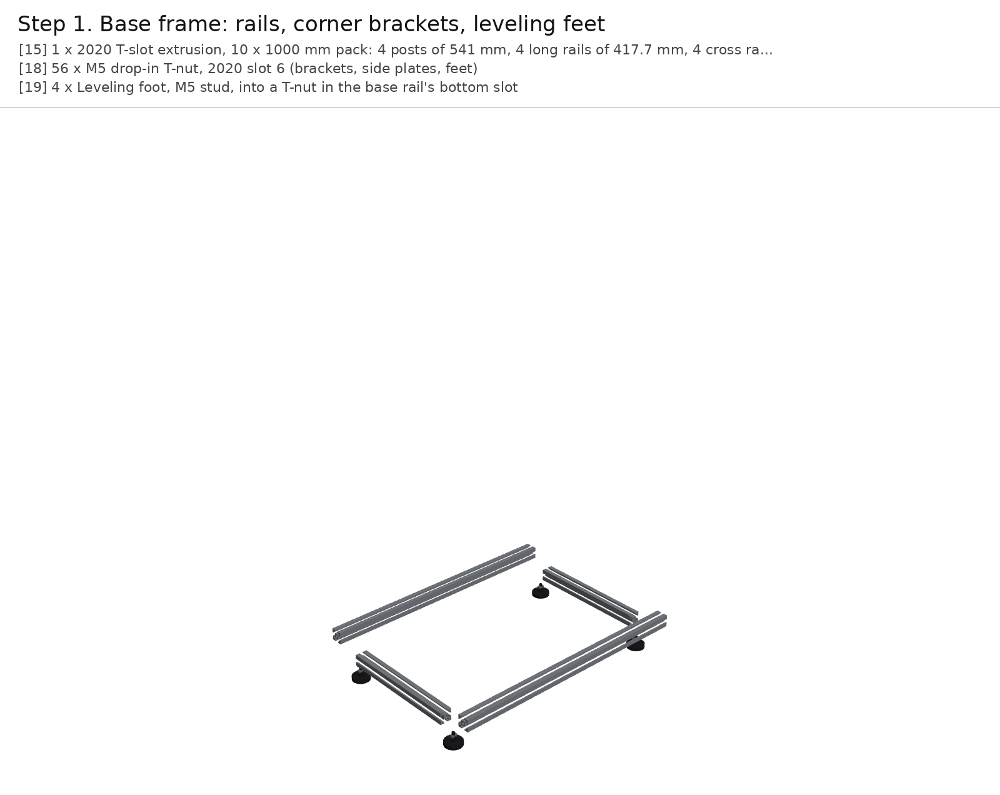

| # | Qty | Part |
|---|---|---|
| 15 | 1 | 2020 T-slot extrusion, 10 x 1000 mm pack: 4 posts of 541 mm, 4 long rails of 417.7 mm, 4 cross rails of 204 mm (5 bars) |
| 18 | 56 | M5 drop-in T-nut, 2020 slot 6 (brackets, side plates, feet) |
| 19 | 4 | Leveling foot, M5 stud, into a T-nut in the base rail's bottom slot |

The frame uses half of one VEVOR 10-pack of 1000 mm 2020 bars. Cut four posts of 541 mm, four long
rails of 417.7 mm (one post and one long rail come out of each of four bars) and four cross rails of
204 mm (all four from a fifth bar). Square every cut.

Lay two long rails on the bench, 224 mm apart centre to centre, and put a cross rail between them at
each end, flush with the rail ends. Screw the four leveling feet up into drop-in T-nuts in the long rails'
bottom slots, 15 mm in from each end. The cross rails are held by the post brackets in step 2, so leave them
loose for now.

## Step 2. Posts and top frame

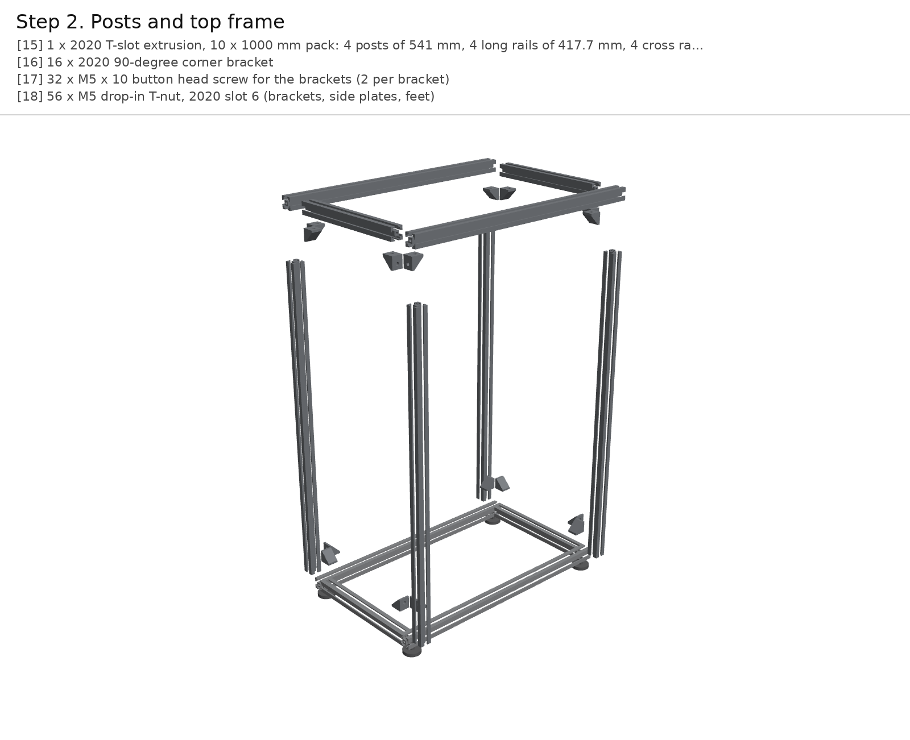

| # | Qty | Part |
|---|---|---|
| 15 | 1 | 2020 T-slot extrusion, 10 x 1000 mm pack: 4 posts of 541 mm, 4 long rails of 417.7 mm, 4 cross rails of 204 mm (5 bars) |
| 16 | 16 | 2020 90-degree corner bracket |
| 17 | 32 | M5 x 10 button head screw for the brackets (2 per bracket) |
| 18 | 56 | M5 drop-in T-nut, 2020 slot 6 (brackets, side plates, feet) |

Stand a post on each end of the long rails (the cross rails butt against them underneath). Each post
gets four corner brackets: at its foot, one on the long rail's top on the inner side and one on the cross
rail's top; at its head, the same two under the top rails. Use M5 x 10 button heads into drop-in T-nuts.
Put the two top long rails and two top cross rails on the posts the same way as the base, then square the
box by its diagonals (equal within 1 mm) and tighten.

Don't put brackets on the posts' inner x faces between 180 and 555 mm: the side plates sit there.

## Step 3. Side plates onto the posts

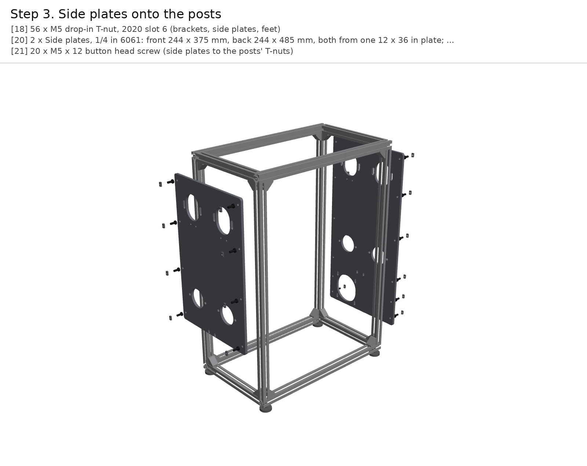

| # | Qty | Part |
|---|---|---|
| 18 | 56 | M5 drop-in T-nut, 2020 slot 6 (brackets, side plates, feet) |
| 20 | 2 | Side plates, 1/4 in 6061: front 244 x 375 mm, back 244 x 485 mm, both from one 12 x 36 in plate; cut and drilled from dxf/ (BYU shop, or SendCutSend: price on upload) |
| 21 | 20 | M5 x 12 button head screw (side plates to the posts' T-nuts) |

Have the two side plates cut from one 12 x 36 in sheet of 1/4 in 6061 (`dxf/side_plate_front.dxf`,
`dxf/side_plate_back.dxf`, by the BYU shop or SendCutSend). The front plate is 244 x 375 mm. The back
plate runs down to 70 mm above the bench, 244 x 485 mm, because it carries the motor.
Tap the four M5 holes under the top bearing slots on each plate.

Bolt each plate to the inner faces of its two posts with M5 x 12 button heads from the inside into drop-in
T-nuts: four per post at the front, six at the back. Set the front plate's bottom edge 180 mm above the
bench and the back plate's 70 mm; blocks on the base rails hold them while you tighten. The plates'
inner faces end up 365 mm apart, 30 mm outside each chain.

## Step 4. Flange bearings and top-shaft tensioners on the side plates

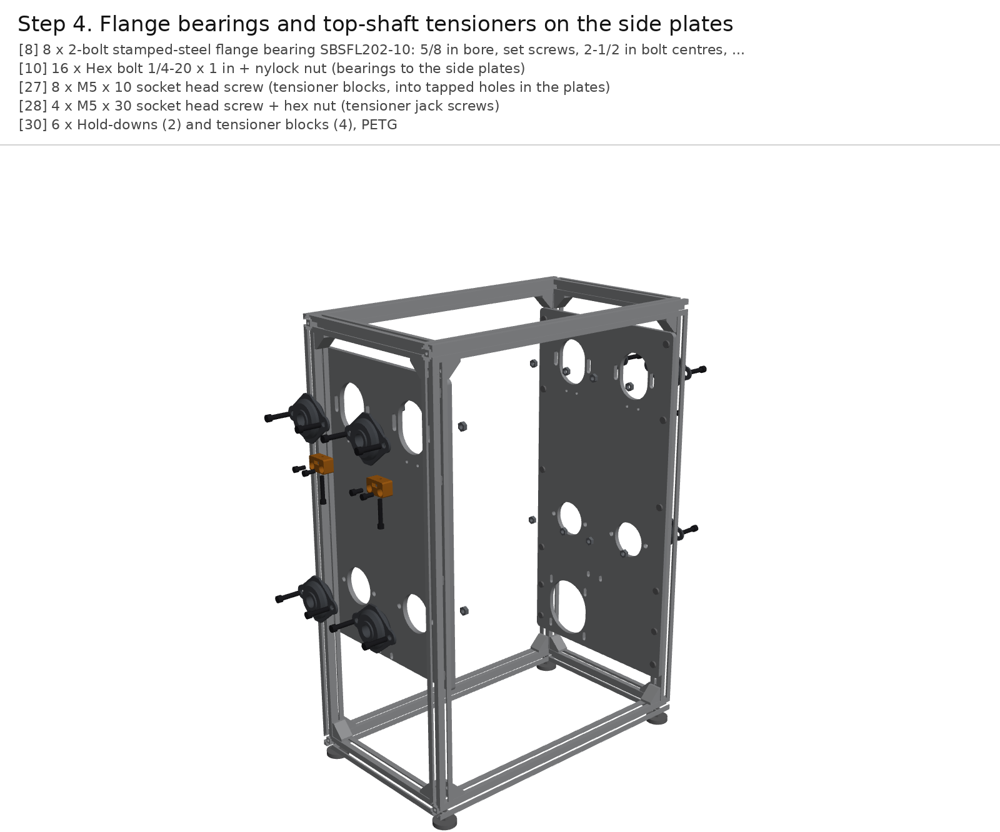

| # | Qty | Part |
|---|---|---|
| 8 | 8 | 2-bolt stamped-steel flange bearing SBSFL202-10: 5/8 in bore, set screws, 2-1/2 in bolt centres, 1/4 in bolts |
| 10 | 16 | Hex bolt 1/4-20 x 1 in + nylock nut (bearings to the side plates) |
| 27 | 8 | M5 x 10 socket head screw (tensioner blocks, into tapped holes in the plates) |
| 28 | 4 | M5 x 30 socket head screw + hex nut (tensioner jack screws) |
| 30 | 6 | Hold-downs (2) and tensioner blocks (4), PETG |

Mount the eight SBSFL202-10 flange bearings on the plates' outer faces, bolt line horizontal, with
1/4-20 x 1 in bolts and nylock nuts. Each bearing's rear dome sits in its plate's 49 mm hole. The four bottom
bearings are fixed; their shafts are 258.6 mm above the bench. Put the four top bearings at the bottom of their
slots, 6 mm below the nominal 487.2 mm, which leaves room to fit the chains in step 7.
Snug those bolts only.

Under each top bearing, screw a printed tensioner block to the plate (two M5 x 10 into the tapped holes).
Drop an M5 nut into the block's slot and run an M5 x 30 jack screw up through it until it touches the
underside of the bearing's front dome.

## Step 5. Corner shafts with their sprockets (set screws loose)

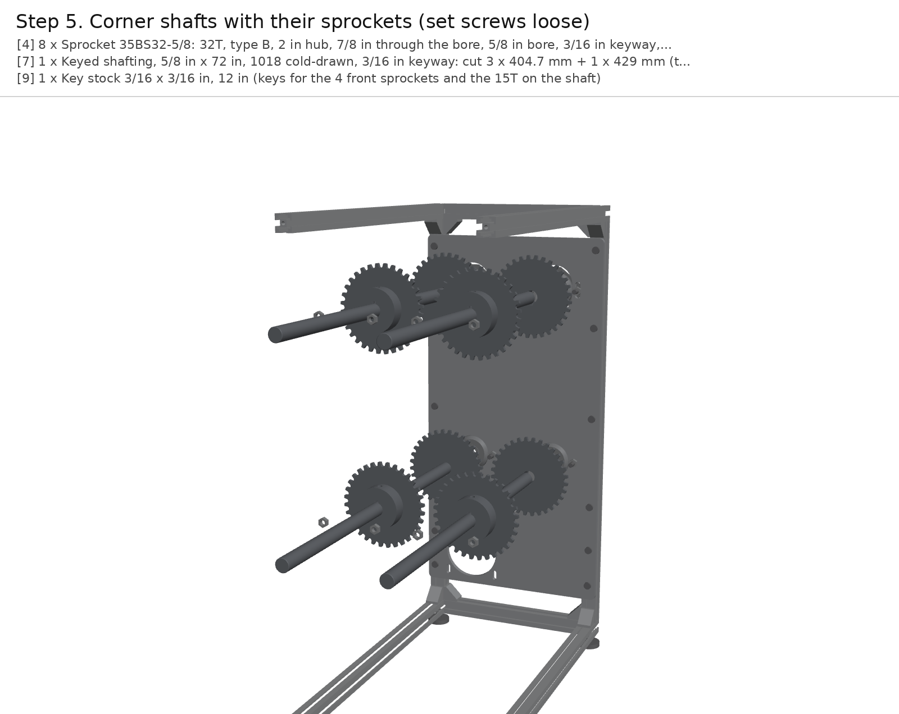

| # | Qty | Part |
|---|---|---|
| 4 | 8 | Sprocket 35BS32-5/8: 32T, type B, 2 in hub, 7/8 in through the bore, 5/8 in bore, 3/16 in keyway, 2 set screws |
| 7 | 1 | Keyed shafting, 5/8 in x 72 in, 1018 cold-drawn, 3/16 in keyway: cut 3 x 403 mm + 1 x 427 mm (the drive shaft) |
| 9 | 1 | Key stock 3/16 x 3/16 in, 12 in (keys for the 4 front sprockets and the 15T on the shaft) |

Cut the 72 in keyed bar into three shafts of 402.9 mm and one of 427.3 mm. The long
one is the drive shaft and goes in the bottom +y corner (B+). Each shaft carries two sprockets. Feed it through
the front bearing, slide on the front sprocket with its hub toward the front, then the back sprocket with its
hub toward the back, and push the shaft on through the back bearing.

Centre each sprocket's teeth on its chain line, 305 mm apart, with the front one 30 mm inside the
front plate. A 30 mm spacer block between the plate and the tooth ring sets it. Key the front sprocket and
tighten its set screws. Leave the back one's key out and its set screws loose: the carriages set its
phase in step 8. Tighten the bearings' set screws on the shaft. The drive shaft sticks out of the back
bearing by 24 mm for the drive chain.

## Step 6. NEMA 34 on the back plate, 15T sprockets, drive chain

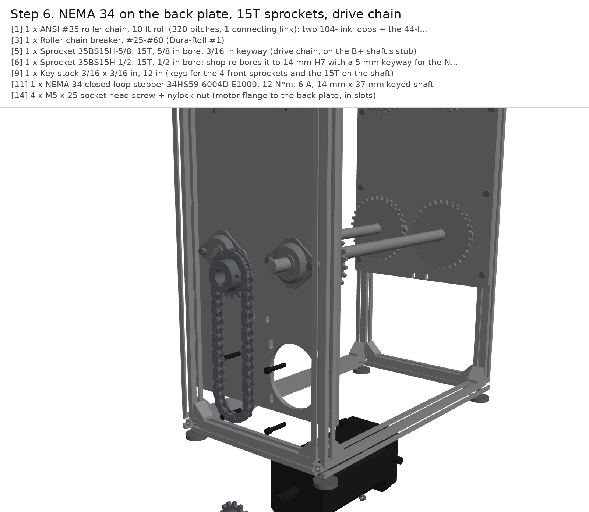

| # | Qty | Part |
|---|---|---|
| 1 | 1 | ANSI #35 roller chain, 10 ft roll (320 pitches, 1 connecting link): two 104-link loops + the 44-link drive chain |
| 3 | 1 | Roller chain breaker, #25-#60 (Dura-Roll #1) |
| 5 | 1 | Sprocket 35BS15H-5/8: 15T, 5/8 in bore, 3/16 in keyway (drive chain, on the B+ shaft's stub) |
| 6 | 1 | Sprocket 35BS15H-1/2: 15T, 1/2 in bore; shop re-bores it to 14 mm H7 with a 5 mm keyway for the NEMA 34 |
| 9 | 1 | Key stock 3/16 x 3/16 in, 12 in (keys for the 4 front sprockets and the 15T on the shaft) |
| 11 | 1 | NEMA 34 closed-loop stepper 34HS59-6004D-E1000, 12 N*m, 6 A, 14 mm x 37 mm keyed shaft |
| 14 | 4 | M5 x 25 socket head screw + nylock nut (motor flange to the back plate, in slots) |

Have the shop re-bore the 35BS15H-1/2 sprocket to 14 mm H7 and broach a 5 mm keyway, then slide it onto
the NEMA 34's shaft, hub outward, over the key. Offer the motor up to the back plate's **inner** face from inside
the frame, with its pilot in the plate's slot and the shaft and sprocket out the back. Bolt it on with four
M5 x 25 from outside and nylock nuts on the flange. The motor's axis is 120.5 mm above the bench, right
under the drive shaft. It is 6 kg, so support it while you fit the bolts.

Key the 35BS15H-5/8 sprocket onto the drive shaft's stub, hub outward, in line with the motor's sprocket:
both tooth rings sit 20.1 mm outside the plate. Cut 44 pitches from the 10 ft roll and close
them round both sprockets with the roll's connecting link. Pull the motor down in its slots (+-4 mm) until
the chain has about 2 mm of play at mid-span, then tighten its bolts.

## Step 7. Chains: 12 A-1 links per chain, close both loops

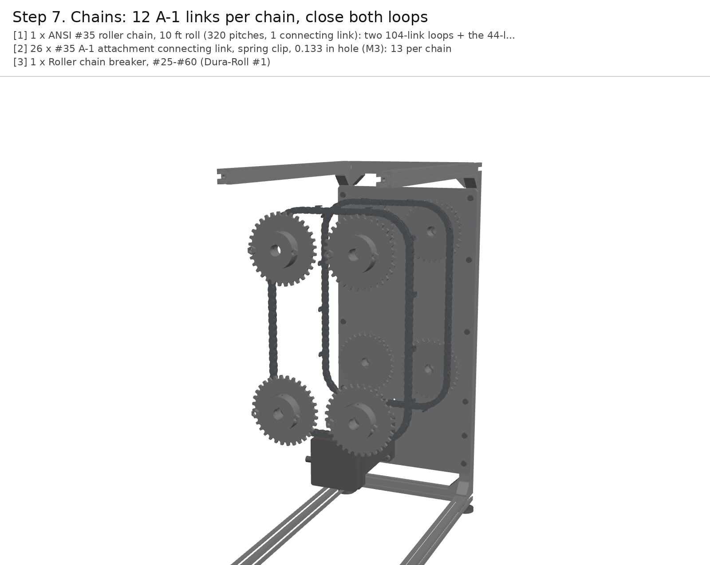

| # | Qty | Part |
|---|---|---|
| 1 | 1 | ANSI #35 roller chain, 10 ft roll (320 pitches, 1 connecting link): two 104-link loops + the 44-link drive chain |
| 2 | 26 | #35 A-1 attachment connecting link, spring clip, 0.133 in hole (M3): 13 per chain |
| 3 | 1 | Roller chain breaker, #25-#60 (Dura-Roll #1) |

**First measure the chain** (see the BoM note): about 4.78 mm between the inner plates and a 5.08 mm
bushing means ANSI 35, which is what the sprockets are.

Cut two loops of 104 pitches from the 10 ft roll with the chain breaker (the drive chain in step 6 used
another 44). In each, take out an outer link
every 8 pitches and fit an A-1 attachment connecting link in its place, 13 per chain. On the front chain
the tabs point back (+x, toward the other chain); on the back chain they point forward. Number the A-1
links 1-13 the same way on both chains.

Wrap each chain round its four sprockets with the tabs on the outside of the loop, then close it with its
13th A-1 link. Each spring clip's closed end points the way the chain travels. The chains hang slack,
because the top shafts are still at the bottom of their slots.

## Step 8. Carriages across both chains; phase and tension

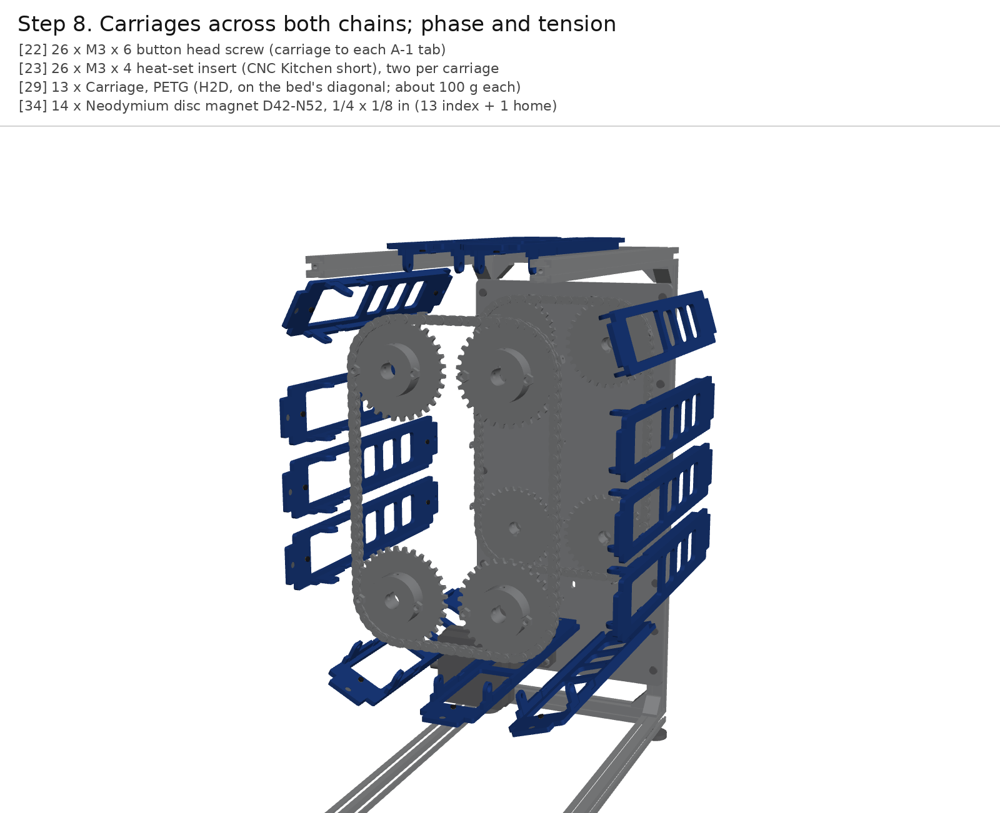

| # | Qty | Part |
|---|---|---|
| 22 | 26 | M3 x 6 button head screw (carriage to each A-1 tab) |
| 23 | 26 | M3 x 4 heat-set insert (CNC Kitchen short), two per carriage |
| 29 | 13 | Carriage, PETG (H2D, on the bed's diagonal; about 100 g each) |
| 34 | 14 | Neodymium disc magnet D42-N52, 1/4 x 1/8 in (13 index + 1 home) |

Print 13 carriages in PETG on the H2D, outer face down, laid on the bed's diagonal (each is
351 mm long). Use 0.2 mm layers, 4 walls and 30% gyroid. On each carriage:

1. Melt an M3 heat-set insert into each end, under where the A-1 tab sits.
2. Glue a 1/4 x 1/8 in magnet, **south pole up**, into the front tongue's pocket (INDEX).
3. On carriage 1 only, glue a second one into the back tongue's pocket (HOME).

Turn the drive shaft by hand until A-1 link 1 on both chains is on the bottom run, then lay carriage 1
under the two tabs and screw it on with two M3 x 6 button heads, one through each tab. Index on and fit
the other twelve. The carriages now lock the chains in phase. Tighten the back sprockets' set screws on the
round of the shaft and spot a dimple under each.

To tension, turn the four jack screws the same amount until each long side deflects 3-4 mm under a 5 N
side push at mid-span. Do the front and back together, so the top shafts stay level. Then tighten the top
bearings' bolts.

## Step 9. Station: hold-downs and hall switches

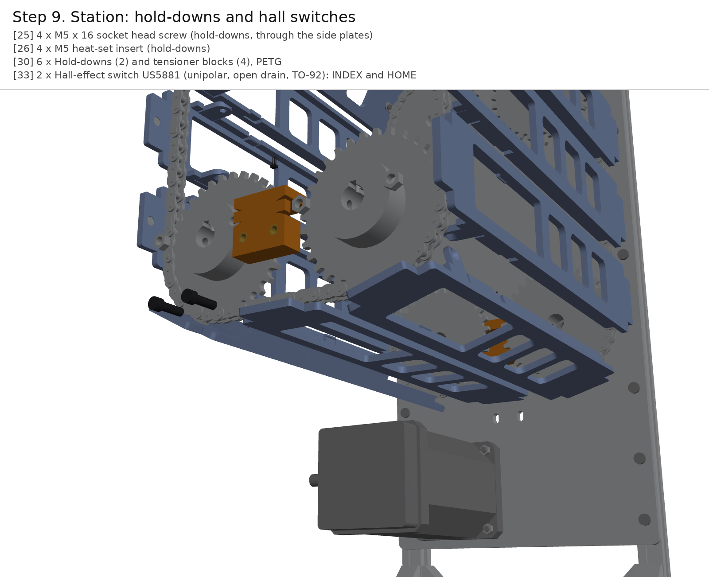

| # | Qty | Part |
|---|---|---|
| 25 | 4 | M5 x 16 socket head screw (hold-downs, through the side plates) |
| 26 | 4 | M5 heat-set insert (hold-downs) |
| 30 | 6 | Hold-downs (2) and tensioner blocks (4), PETG |
| 33 | 2 | Hall-effect switch US5881 (unipolar, open drain, TO-92): INDEX and HOME |

Melt two M5 heat-set inserts into the plate-side face of each printed hold-down. Push a US5881 hall
switch into each lip's pocket, flat (branded) face down, and lead the wires out of the top. The front
switch is INDEX and the back one is HOME.

With carriage 1 at the station, hold each hold-down against its plate's inner face with its C round the
carriage's tongue, and screw it on from outside with two M5 x 16. The holes are slotted, so set the lip
0.5 mm over the tongue with a feeler gauge before tightening. Then index all 13 carriages through by
hand. Each tongue must slide into both C's without catching.

## Step 10. Modules: Sam's plate, auger and cap on every carriage

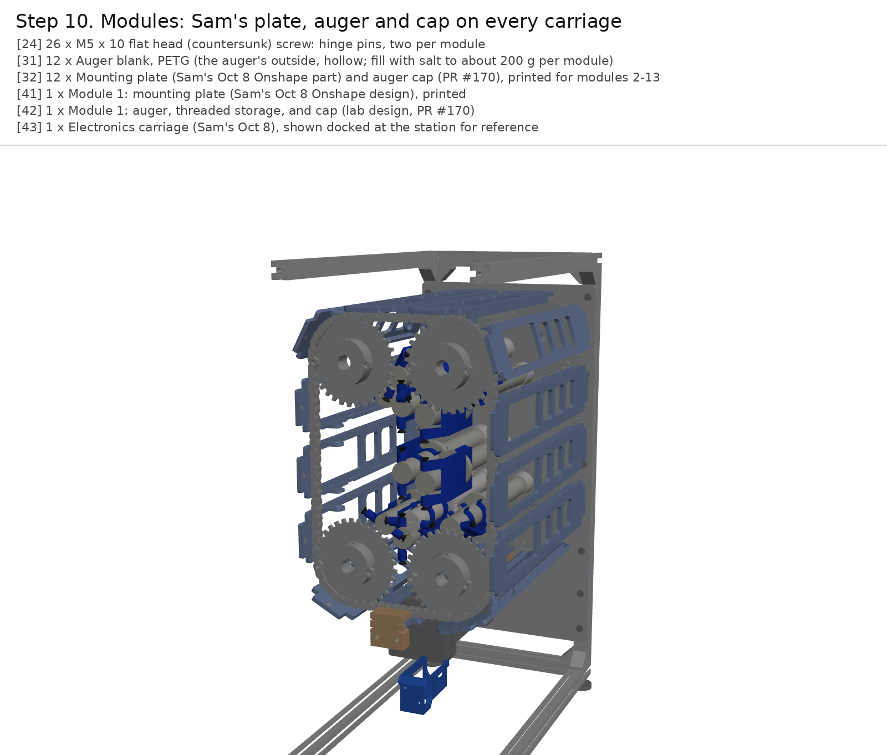

| # | Qty | Part |
|---|---|---|
| 24 | 26 | M5 x 10 flat head (countersunk) screw: hinge pins, two per module |
| 31 | 12 | Auger blank, PETG (the auger's outside, hollow; fill with salt to about 200 g per module) |
| 32 | 12 | Mounting plate (Sam's Oct 8 Onshape part) and auger cap (PR #170), printed for modules 2-13 |
| 41 | 1 | Module 1: mounting plate (Sam's Oct 8 Onshape design), printed |
| 42 | 1 | Module 1: auger, threaded storage, and cap (lab design, PR #170) |
| 43 | 1 | Electronics carriage (Sam's Oct 8), shown docked at the station for reference |

Module 1 is the lab's: Sam's Oct 8 mounting plate holding the lab auger (threaded storage + cap). The
44T gear sits in the 10.1 mm gap between his second and third clamp rings, with the outlet end at the
hinge. Modules 2-13 are stand-ins of the same size and mass: a printed mounting plate (Sam's Onshape
part), a printed auger blank (stl/auger_blank.stl: the auger's outside, hollow) filled with table salt to
about 200 g in all, and a printed cap.

Put each plate between its carriage's lugs, hinge end at the front, and pin it with two M5 x 10 flat
heads through the lugs into the knuckle. Then press the plate's free end down past the two snap hooks.
The hooks hold it shut on the top run, where it hangs upside down. The hinge axis is 33 mm behind
the front chain and 11.65 mm inside the chain line.

Sam's electronics carriage is shown docked under module 1 at the station. It belongs to the station
(linear actuator not yet designed), not to this rig.

## Step 11. Electronics board: supply, driver, Pi, interface board, e-stop

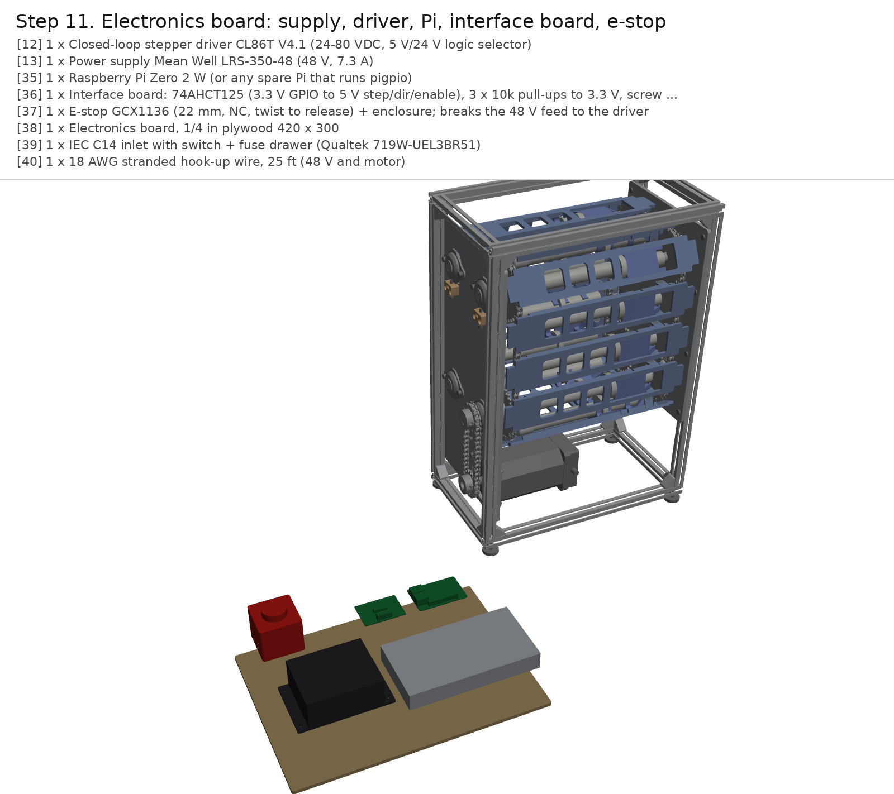

| # | Qty | Part |
|---|---|---|
| 12 | 1 | Closed-loop stepper driver CL86T V4.1 (24-80 VDC, 5 V/24 V logic selector) |
| 13 | 1 | Power supply Mean Well LRS-350-48 (48 V, 7.3 A) |
| 35 | 1 | Raspberry Pi Zero 2 W (or any spare Pi that runs pigpio) |
| 36 | 1 | Interface board: 74AHCT125 (3.3 V GPIO to 5 V step/dir/enable), 3 x 10k pull-ups to 3.3 V, screw terminals, perfboard |
| 37 | 1 | E-stop GCX1136 (22 mm, NC, twist to release) + enclosure; breaks the 48 V feed to the driver |
| 38 | 1 | Electronics board, 1/4 in plywood 420 x 300 |
| 39 | 1 | IEC C14 inlet with switch + fuse drawer (Qualtek 719W-UEL3BR51) |
| 40 | 1 | 18 AWG stranded hook-up wire, 25 ft (48 V and motor) |

The electronics board sits on the bench behind the rig. Wire it like this:

| From | To |
|---|---|
| Mains (IEC inlet, fuse, switch) | LRS-350-48 AC input |
| LRS-350-48 +V | E-stop (NC) -> 10 A fuse -> CL86T +VDC |
| LRS-350-48 -V | CL86T GND |
| NEMA 34 A+/A-/B+/B- | CL86T A+/A-/B+/B- |
| NEMA 34 encoder (EA+/EA-/EB+/EB-/VCC/GND) | CL86T encoder port |
| Pi GPIO 17 / 27 / 22 | 74AHCT125 inputs 1A / 2A / 3A (VCC 5 V, OE tied low) |
| 74AHCT125 outputs 1Y / 2Y / 3Y | CL86T PUL+ / DIR+ / ENA+ (logic selector at 5 V) |
| CL86T PUL- / DIR- / ENA- | Pi GND |
| Pi 3.3 V via 10k | GPIO 23 (INDEX), GPIO 24 (HOME), GPIO 25 (CL86T ALM+; ALM- to GND) |
| Pi 5 V, GND | Both US5881 VCC, GND; outputs to GPIO 23 / 24 |

Run the hall-switch leads down the front and back plates' inner faces in adhesive cable clips, clear of
the tongues.

Set the CL86T DIP switches to 4000 pulses/rev and the motor current to 6.0 A. Run `sudo pigpiod`, then
`python3 test/chain_rig.py --sim lap` to check the software and `python3 test/chain_rig.py home` to check the
hardware. At 4000 pulses/rev one module is exactly 1000 steps.

## Step 12. Test set-up (not in the CAD)

| # | Qty | Part |
|---|---|---|
| 44 | 1 | Digital indicator 0-1 in / 0.01 mm with arm and magnetic base (index, lift, sag tests) |
| 45 | 1 | Digital hanging scale 50 kg (torque lever, push-up and snap forces; a 50 N push-pull gauge is better if the lab has one) |
| 46 | 1 | ADXL343 accelerometer breakout (transit vibration) |
| 47 | 3 | Table salt, 26 oz (fills the 12 auger blanks to working mass) |

Fill the auger blanks on carriages 2-13 with salt to about 200 g per module. Clamp the dial indicator's magnetic base to a steel plate screwed to the front side plate's inner face beside the station, and stick the ADXL343 to module 1's mounting plate near the outlet. Then run [TEST-PLAN.md](TEST-PLAN.md) T0-T8.
