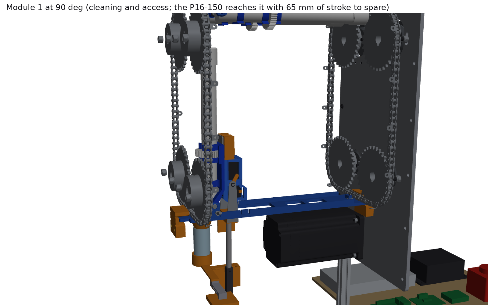
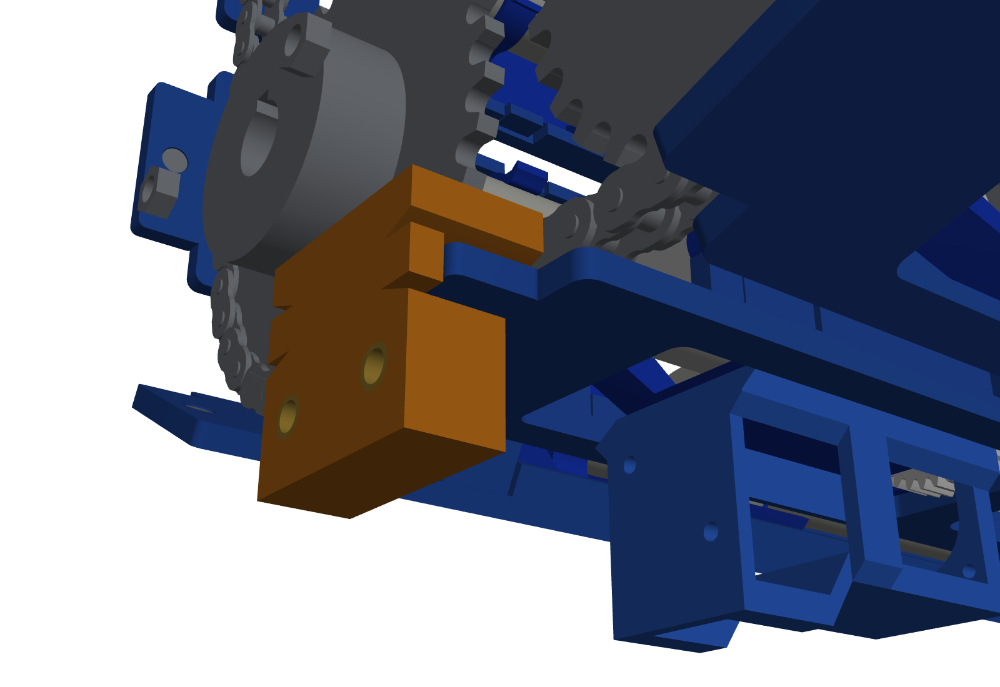

# Multi-doser chain carousel: test rig v2, vertical twin chain (#128)

The second version of the chain test rig, after [Sam's review of v1](https://github.com/vertical-cloud-lab/powder-doser/issues/128) on 2026-10-13. **Two #35 chains run in vertical planes, one at the front of the carriages (the auger's outlet and hinge end) and one at the back (the cap end), 305 mm apart, so a whole module fits between them.** Each chain goes round four 32T sprockets at the corners of a rectangle. The front and back sprockets at each corner share one shaft, so there are four "gear points" and the two chains can't drift out of step. Each carriage bolts to an A-1 tab on each chain from the outside of the loop. The tabs' holes run vertically at the station, square to the augers and to the travel. The modules ride on the inside. The station is on the bottom straight (the short end of the rectangle), with hold-down tabs at both the front and back ends. The frame is 2020 built vertically.

v1 (`cad/chain-carousel/`, the flat loop) is unchanged. Everything here is a copy that was then changed.

**Onshape (public, owned by Vertical Cloud Lab), built through the REST API:**
[Multi-doser chain carousel - test rig v2, vertical twin chain (#128)](https://cad.onshape.com/documents/5263dae97a3922029b5cccf3/w/30f999cdf6cf5f4014d88b2a/e/f8db64562886e92e866b11ed) (version `v2 vertical twin chain`). The assembly tree is the build sequence (`01 Base frame` … `11 Electronics board`).

| Front chain loop (front plate hidden) | Module 1 tilted to 90° at the station |
|---|---|
|  |  |
| **Back: the NEMA 34 inside the frame drives the bottom +y shaft through a #35 chain** | **Station: front hold-down round carriage 1's tongue** |
|  |  |

## What Sam asked for, and what the model does

| Ask (2026-10-13) | In v2 |
|---|---|
| Chain moving vertically, gears vertical | Both loops lie in vertical planes; the sprockets turn on horizontal shafts along the augers |
| Two chains, front and back, far enough apart for the whole auger | Chain centre planes 305 mm apart. Each module spans 28–285 mm from the front chain (hinge knuckle to cap end), clear of both A-1 tabs |
| Footprint just what a vertical module needs | **435 x 244 mm** frame (feet 254 mm) and 596 mm tall. v1's deck was 1050 x 740 mm, so this is 14% of v1's footprint |
| Four gear points, one at each corner | Four corner shafts (5/8 in), each carrying the front and the back sprocket, so 8 x 35BS32 in all |
| Electronics carriage interfaces at the bottom of the loop, the short end | Station on the 12-link bottom straight. Carriage 1 has a window for Sam's electronics carriage, shown docked under module 1. Under the front half of the bottom run, 35–198 mm above the bench is clear for the station; the motor sits under the back half |
| 8020, built vertically | 2020 frame: four posts, base and top rails, with two 1/4 in 6061 side plates that carry the bearings |
| Tabs at both the front and back ends | A hold-down at each tongue: a C with a lip 0.5 mm above the tongue and a foot 2 mm below it, so the station's push and any pull go into the frame, not the chain |
| Two holes per carriage, front and back, running vertically; augers inside the loop, connections outside | Each carriage sits on the outer faces of two A-1 tabs, with one M3 through each tab's 0.133 in hole into a heat-set insert. The holes are radial: vertical at the station, square to the augers and the travel |

## The design in numbers

| | Value | Why |
|---|---|---|
| Chains | 2 x ANSI #35, 104 pitches each, in vertical planes 305 mm apart | Cut from one 10 ft roll (320 pitches), which also gives the 44-link drive chain |
| Sprockets | 8 x 35BS32-5/8 (32T, 2 in hub), centres on a **114.3 x 228.6 mm** rectangle (12 x 24 pitches) | With 32 teeth a 90° wrap is exactly 8 links, so the loop closes exactly: 2 x 12 + 2 x 24 + 32 = 104 ([`layout.chain_pins`](layout.py)). 12-link runs keep the 102 mm sprockets 12 mm apart |
| Why 32T | The auger's 44T gear (46 mm across) passes the corner shafts | The gear sits 34.7 mm inside the chain line. With v1's 19T sprockets (29 mm radius) it would sweep straight through the shaft line. 32T gives 5.8 mm to a 5/8 in shaft |
| Modules | **13, every 8 pitches (76.2 mm)** | 104 / 8. One module is a quarter turn of a 32T sprocket, exactly 1000 steps at 4000 pulses/rev |
| Attachment | 26 x Nitro CL35-A1 A-1 connecting links, the same 13 link positions on both chains | Steel stays in the tension path. The carriage sits on the tabs' outer faces, outside the loop, so it never meets a sprocket |
| Carriage | PETG, 60 x 351 mm, tongues past both chains, chamfered hinge lugs, two snap hooks | On a corner two neighbours are 90° apart about the sprocket axis, so anything at a carriage's edge more than about 45 mm inside the chain line would hit the next one. The snap hooks keep Sam's plate shut on the top run, where it hangs upside down |
| Shafts and bearings | 4 x 5/8 in keyed 1018, 8 x SBSFL202-10 stamped flange bearings, top pair slotted with jack screws | The top shafts move together to tension both chains. No vendor checked sells a 1/2 in-bore 32T |
| Drive | NEMA 34 34HS59-6004D-E1000 inside the frame on the back plate, 1:1 #35 drive chain (15T/15T, 44 links) to the B+ shaft | Coaxial direct drive would hang the 6 kg motor about 300 mm off the back. Inside, nothing sticks out more than about 20 mm |
| Station | Bottom run, carriage 1 at y = 4.76 mm; front and back hold-downs carry the INDEX and HOME hall switches over magnets in the tongues | Reacts the station's push locally (Aug 18 pitch, [12:41]–[13:23]). Both sensors are in parts that are already at the station |
| Clearance | **No overlaps over 0.5 mm³** among 576 instances at home, over an 8-pitch indexing sweep (every module through every corner position), and with module 1 tilted 15–90° at the station ([`check_interference.py`](check_interference.py)) | Tightest gaps: carriage to carriage on a corner 4.3 mm, gear to corner shaft 5.8 mm, carriage plate to sprocket tips 3.6 mm. At 90° tilt the cap end is about 27 mm under the module on the top run |
| Cost | **$1,035; $894 without test gear** ([BOM.md](BOM.md)) | Prices checked 2026-10-13; lines carried from v1 were checked 2026-10-10. The NEMA 34, module 1 and Sam's electronics carriage are already in the lab |

## Things to look at before ordering or printing

1. **13 modules and a 10 ft roll, not 12 and the 3 ft box.** The 32T sprockets are 102 mm across, so with 8-link bottom and top runs (76 mm centres) they overlapped. At 12 links the loop needs 104 pitches if the sides stay 24 links long, which is what leaves room to tilt module 1 to 90°. The 3 ft box on the ME order (96 links) becomes spares.
2. **Each module rolls a full turn about its own axis every lap and hangs upside down on the top run.** That is inherent to a vertical loop with the augers along the shafts. It makes the open-outlet question from the July 15 meeting the first thing to test ([TEST-PLAN.md](TEST-PLAN.md) T6).
3. **Sam's plate needs holding shut upside down.** The carriage's two printed snap hooks do it without changing his part. The station's tilt has to pull the plate past them, so T4 measures that force.
4. **The carriage is 351 mm long.** It prints in one piece only on the H2D, laid on the bed's diagonal. An A1 mini version would need splitting at the window.
5. **Sprocket phase:** key the front sprocket on each shaft and lock the back one with its set screws after the carriages are on. A 32T tooth is 11.25°, so two keyed sprockets could land up to 4.8 mm out of step.
6. **Shop work:** cut and drill the two side plates from [`dxf/`](dxf), and re-bore one 15T sprocket from 1/2 in to 14 mm with a 5 mm keyway for the motor.
7. **The station itself is still not designed.** The rig gives it the window, the hold-downs, the sensors, and clear space under the bottom run. The linear actuator, couplings and tilt drive come next. The CAD shows Sam's electronics carriage docked so the interface can be checked.

## How it goes together

[**ASSEMBLY.md**](ASSEMBLY.md) has 11 steps, each with a render and the BoM lines it uses.


## Testing the chain

[**TEST-PLAN.md**](TEST-PLAN.md) covers T0 fit, T1 tension and phase, T2 drive torque, **T3 index repeatability**, T4 station push-up, hold-downs and snap force, T5 tilt clearance, T6 transit vibration and powder over full laps, T7 endurance and T8 corners on video. [`test/chain_rig.py`](test/chain_rig.py) runs them from a Pi (pigpio step/dir into the CL86T, hall-switch homing, CSV log, `--sim` for a dry run).

## Onshape

[`onshape/onshape_build.py`](onshape/onshape_build.py) creates the document in the Vertical Cloud Lab company, makes it public, uploads [`step/chain_carousel_rig_v2.step`](step/chain_carousel_rig_v2.step) as one composite import, saves Onshape's shaded views to [`renders/onshape/`](renders/onshape) and marks a version. That took **10 API calls**, all logged in [`onshape/api_calls.jsonl`](onshape/api_calls.jsonl), on top of v1's 39. The ids are in [`onshape/onshape_document.json`](onshape/onshape_document.json). Git stays the source of truth: change `params.py`, run `build.py`, re-import.


## Files

| File | What |
|---|---|
| [`params.py`](params.py) | Every dimension, with its source |
| [`parts.py`](parts.py) | CadQuery models: chain links (inner, outer, A-1), 32T and 15T sprockets with real tooth gaps, stamped flange bearing, NEMA 34, 2020 profile, printed parts, the auger blank, fasteners, electronics envelopes |
| [`layout.py`](layout.py) | Exact chain solutions (the 104-link loops and the drive chain), carriage frames, side-plate holes, placements and assembly steps |
| [`build.py`](build.py) | STEP assembly (tree = assembly steps) + per-part STEP in `step/components/`, print STLs, DXF drilling templates for both side plates, `placements.json` |
| [`render.py`](render.py) | Hero views (some with the front plate hidden), one image per step, GIF (VTK, `xvfb-run`) |
| [`check_interference.py`](check_interference.py) | OCC boolean clash check: home pose, `--sweep` over 8 pitches of indexing, `--tilt` for module 1 at 15–90° |
| [`docs.py`](docs.py) | Writes BOM.md, bom.csv and ASSEMBLY.md from the BoM table and the step text |
| [`bom.py`](bom.py) | The BoM table, with sources and verified/estimate flags; quantities counted from the CAD |
| [`reference/`](reference) | Sam's Oct 8 Part Studio (mounting plate and electronics carriage) and the lab auger + cap (PR #170), as in v1 |
| [`onshape/`](onshape) | API client with a call budget and ledger, build script, document ids |
| [`test/chain_rig.py`](test/chain_rig.py) | Pi driver and logger for the tests |

```bash
pip install cadquery vtk pillow requests
python build.py && python docs.py && python check_interference.py && xvfb-run -a python render.py
python check_interference.py --sweep && python check_interference.py --tilt
cd onshape && python onshape_build.py create        # needs ONSHAPE_ACCESS_KEY / ONSHAPE_SECRET_KEY
```

## Not done yet

- **No station mechanism** (linear actuator, kinematic couplings, tilt drive). Sam's electronics carriage is placed docked under module 1 for reference only.
- **No mates in Onshape.** The import places every instance. Onshape has no chain mate, so animating the loop would mean driving instance transforms from `layout.py`.
- **Not built or run.** Every number in TEST-PLAN.md is a prediction until T0–T8 are done.
- **Modelled from catalogue figures, not drawings:** the SBSFL202-10's dome and insert are an envelope built from its listed 3.189 x 2.3125 x 0.875 in and FYH's 49 mm mounting hole. The NEMA 34's flange is from the NEMA 34 standard (StepperOnline's drawing wasn't reachable). Check both in hand before drilling the plates.
- **Unverified prices** (marked "estimate" in BOM.md): generic metric and imperial fasteners, key stock, leveling feet, the Pi and the interface board. SendCutSend only prices a part once a DXF is uploaded.
