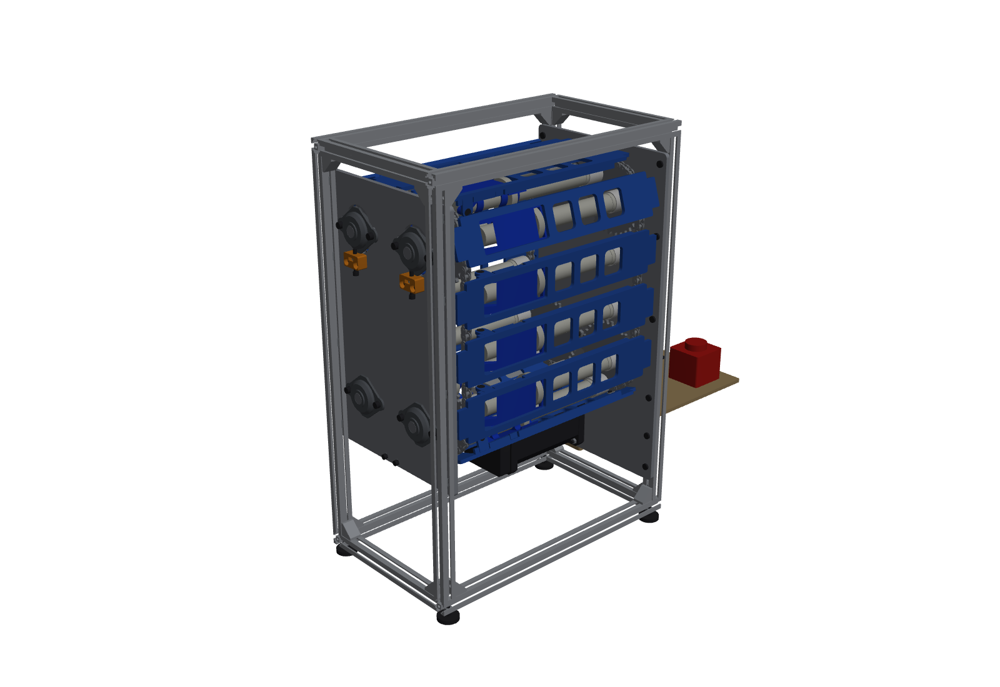
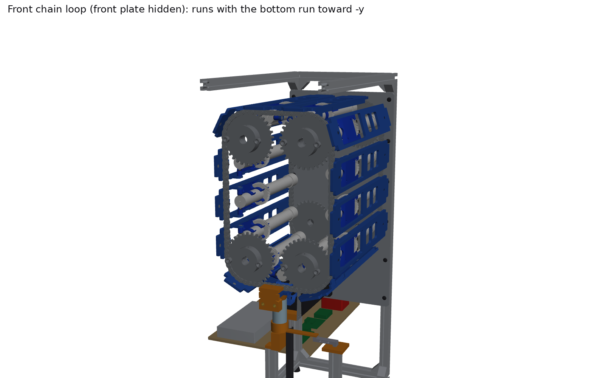
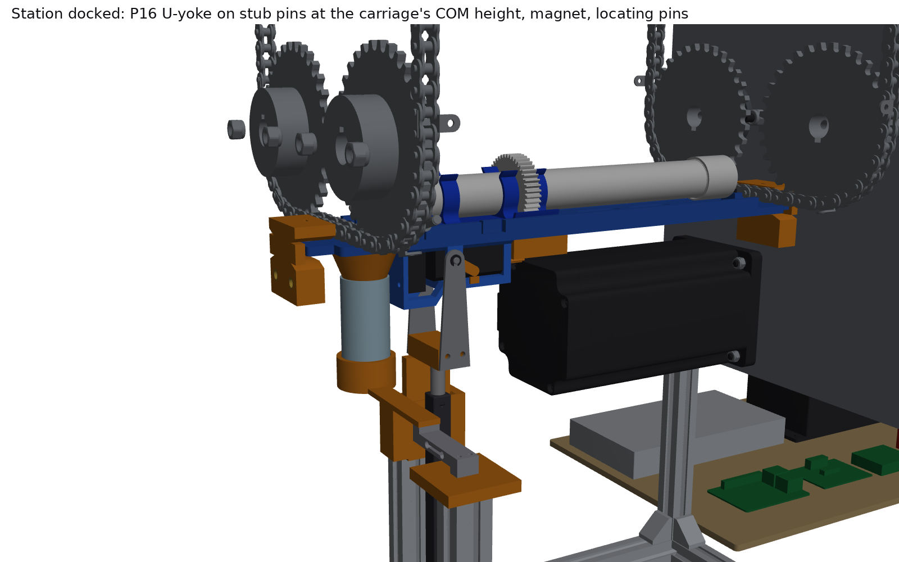
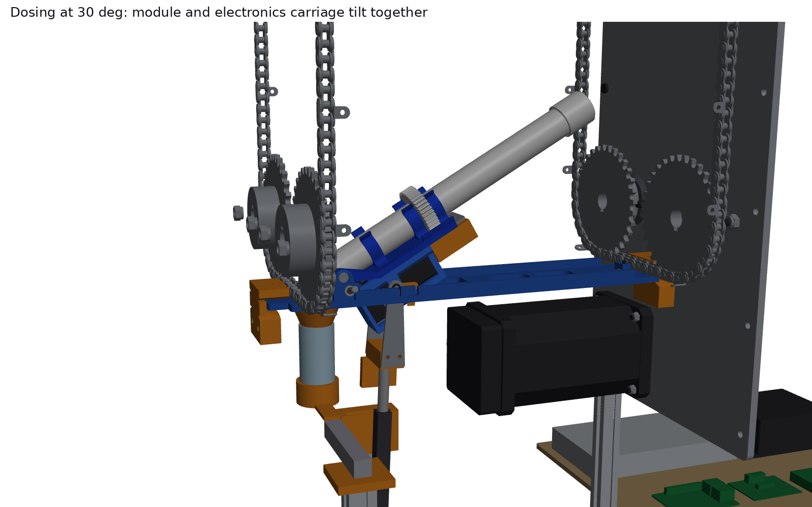
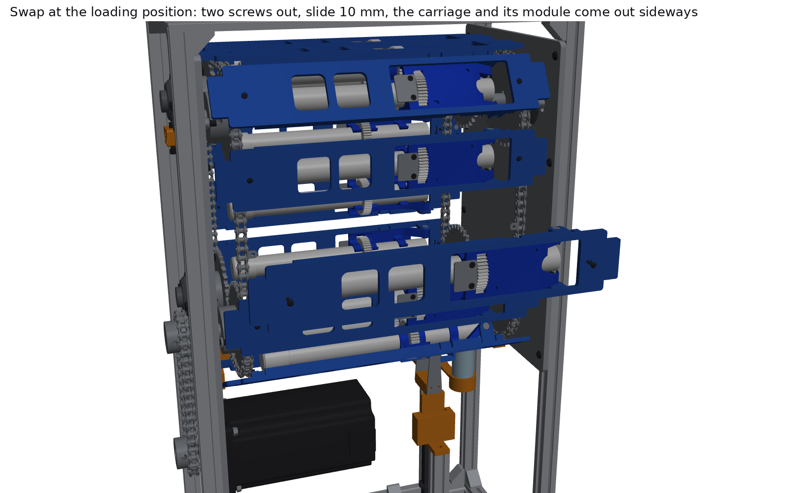
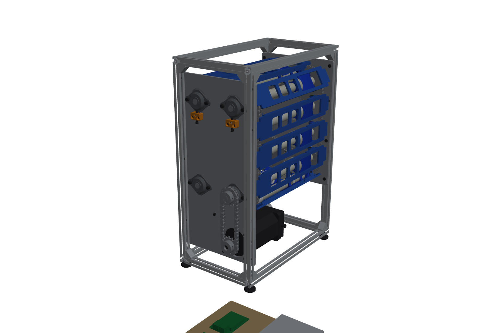
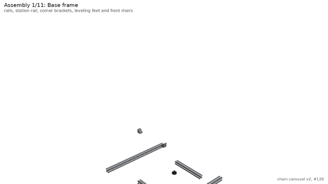
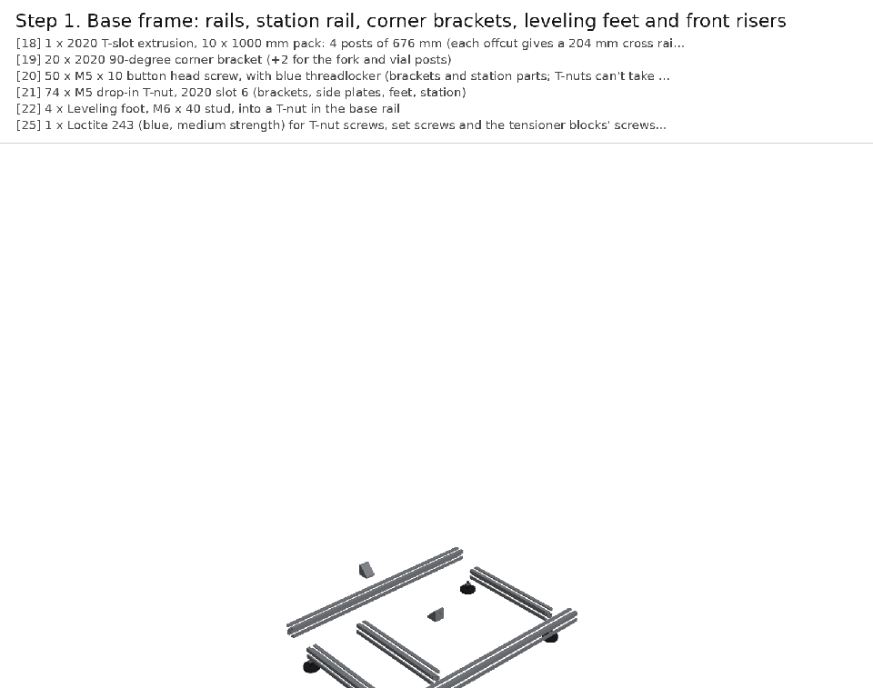
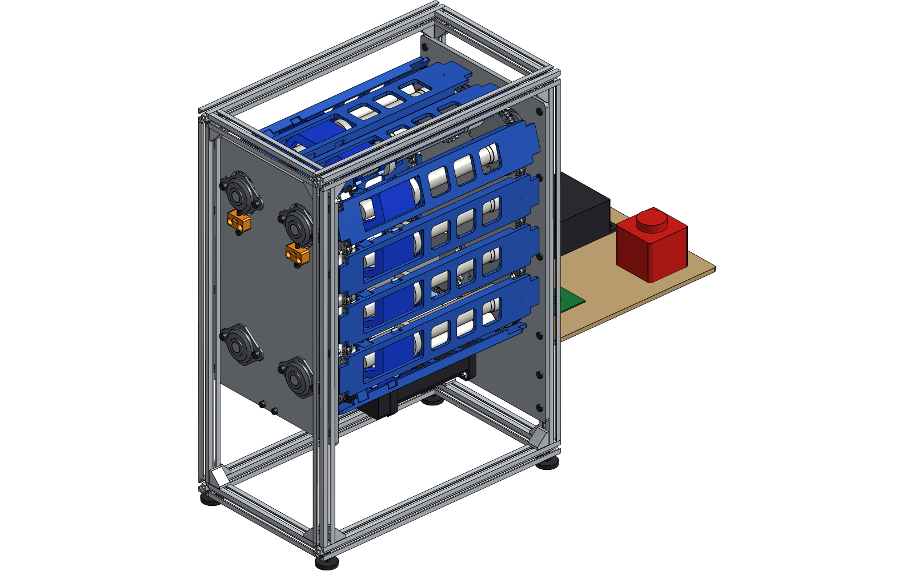

# Multi-doser chain carousel: test rig v2, vertical twin chain (#128)

The second version of the chain test rig, after [Sam's review of v1](https://github.com/vertical-cloud-lab/powder-doser/issues/128) on 2026-10-13. **Two #35 chains run in vertical planes, one at the front of the carriages (the auger's outlet and hinge end) and one at the back (the cap end), 305 mm apart, so a whole module fits between them.** Each chain goes round four 32T sprockets at the corners of a rectangle. The front and back sprockets at each corner share one shaft, so there are four "gear points" and the two chains can't drift out of step. Each carriage bolts to an A-1 tab on each chain from the outside of the loop. The tabs' holes run vertically at the station, square to the augers and to the travel. The modules ride on the inside. The frame is 2020 built vertically.

The station is on the bottom straight (the short end of the rectangle). An **Actuonix P16-150-22-12-P** lifts Sam's electronics carriage through carriage 1's window on a U-yoke, docks it under the module's plate (dock electromagnet, locating pins, a docking "seek" of the pinion), and tilts module and carriage together about the hinge, cap end up into the loop. Hold-downs at both ends of the carriage take the station's push into the frame. The station is shared with the [paternoster](../paternoster/README.md); the [gear-mesh](../gear-mesh/README.md) and [auger-leakage](../auger-leakage/README.md) studies shaped it, and the leakage study reversed v2's run direction.

v1 (`cad/chain-carousel/`, the flat loop) is unchanged. Everything here is a copy that was then changed.

| Home: 13 carriages, module 1 docked at the station | Front chain loop (front plate hidden) |
|---|---|
|  |  |
| **Station docked (cutaway): the U-yoke's steel arm on the carriage's stub pin, the approach fork, the vial under its D-funnel** | **Dosing at 30°: module and electronics carriage tilt together** |
|  |  |
| **Swap at the loading position: two screws out, slide 10 mm, out sideways** | **Back: the NEMA 34 inside the frame drives the bottom +y shaft through a #35 chain** |
|  |  |

**Animation** ([MP4](renders/chain_carousel_v2.mp4), 70 s): assembly from scratch; an auger going into Sam's mounting plate and the plate onto a carriage; all 13 carriages loaded onto the chain one index at a time; a full lap; at the station the approach, the docking seek with the magnet on, the tilt to 30°, the dose, the 0.5 s hold, the tilt back, one reverse auger turn at rest and the undock; and a module swap. Every frame uses the exact chain kinematics and the real station linkage.



**Real parts, shop work and printing (2026-10-27).** Every bought part was checked against its vendor's drawing, spec
sheet or CAD ([`../vendor/`](../vendor/README.md)), every part we make or modify has an animated shop process
([`../shop/`](../shop/README.md)), and every printed part is sliced in Bambu Studio ([`../print/`](../print/README.md)).
What that changed here:
- **The P16 and the McMaster fasteners, dowels and e-clips are now the vendors' own STEP files.** Actuonix's drawing
  showed the rod end is a 9 x 6 tab and the rear clevis an 8 mm tab, so the U-yoke's socket and the base clevis were
  refitted; the yoke's M4 cross bolt (no room for its head or nut between the steel arms) is now a captured 4 x 38 dowel;
  the base pin is a 4 x 16 shoulder screw (90265A123), now in the assembly.
- **The chain was drawn with 5 mm pins:** the hinge pin's `PIN_D = 5.0` overrode the chain's 3.58 mm in `params.py`.
  Nitro's table also gives longer pins (12.40 mm overall) and lower plates (8.79 mm); the carriages got a 1.6 mm relief
  for the A-1 links' pin ends.
- **Real dimensions moved things:** the flange bearings stand 3.45 mm further off the plates (shafts now 3 x 409.8 and
  434.2 mm), the TAL221 load cell is 47 mm long, not 80 (the vial cup's arm is now 63 mm), and the VEVOR bore, magnet,
  solenoid, pinion, hall switch and foot follow their drawings. The NEMA 34 is StepperOnline's STEP.
- **Not printable as drawn:** the fork arm was a 20 x 0.5 x 12 mm sliver (now a 6 mm plate on the post's top), and the
  carriage's tab-slot fingers print as bridges only with a break-off web (`carriage(print_web=True)`, used for the STL).
- **The hinge pins' e-clip groove was 0.6 mm wide** for a DIN 6799-4 clip that is 0.7 thick (McMaster 98543A112): now 0.74.
- **The BoM names a real part number for every McMaster line**, at today's pack prices.

## What Sam asked for, and what the model does

| Ask (2026-10-13) | In v2 |
|---|---|
| Chain moving vertically, gears vertical | Both loops lie in vertical planes; the sprockets turn on horizontal shafts along the augers |
| Two chains, front and back, far enough apart for the whole auger | Chain centre planes 305 mm apart. Each module spans 28-285 mm from the front chain (hinge knuckle to cap end), clear of both A-1 tabs |
| Footprint just what a vertical module needs | **417.7 x 244 mm frame** (feet on 387.7 x 224 mm centres), **731 mm tall**; the drive sprockets stand 17 mm past the back rails. v1's deck was 1050 x 740 mm, so this is 13 % of v1's footprint |
| Four gear points, one at each corner | Four corner shafts (5/8 in), each carrying the front and the back sprocket, so 8 x 35BS32 in all |
| Electronics carriage interfaces at the bottom of the loop, the short end | Station on the 12-link bottom straight: the P16 under carriage 1 lifts Sam's electronics carriage through the carriage's 130 mm window and docks it under the plate; the vial and its load cell sit in front of it |
| 8020, built vertically | 2020 frame: four posts, base and top rails, a station rail under the actuator, and two 1/4 in 6061 side plates that carry the bearings |
| Tabs at both the front and back ends | A hold-down at each tongue: a C with a lip 2 mm above the tongue and a foot 4 mm below it, 3 mm lead-ins, so the station's push and any pull go into the frame, not the chain. They carry the INDEX and HOME hall switches |
| Two holes per carriage, front and back, running vertically; augers inside the loop, connections outside | Each carriage sits on the outer faces of two A-1 tabs, with an M3 x 12 from outside (head flush in a counterbore) through each tab's 0.133 in hole into a nylon-insert locknut held in a printed hook under the tab. The holes are radial: vertical at the station, square to the augers and the travel |

## The design in numbers

| | Value | Why |
|---|---|---|
| Chains | 2 x ANSI #35, 104 pitches each, in vertical planes 305 mm apart | Cut from one 10 ft roll (320 pitches), which also gives the 44-link drive chain |
| Sprockets | 8 x 35BS32-5/8 (32T, 2 in hub), centres on a **114.3 x 228.6 mm** rectangle (12 x 24 pitches) | With 32 teeth a 90° wrap is exactly 8 links, so the loop closes exactly: 2 x 12 + 2 x 24 + 32 = 104 ([`kinematics.py`](kinematics.py)). 12-link runs keep the 102 mm sprockets 12 mm apart |
| Why 32T | The auger's 44T gear (46 mm across) passes the corner shafts with **6.0 mm** to spare (`params.SHAFT_CLEAR`) | The gear sits 34.7 mm inside the chain line. With v1's 19T sprockets (29 mm radius) it would sweep straight through the shaft line |
| Modules | **13, every 8 pitches (76.2 mm)** | 104 / 8. One module is a quarter turn of a 32T sprocket, exactly 1000 steps at 4000 pulses/rev |
| Run direction | **Bottom run toward -y** (clockwise seen from the back) | Each lap rolls every module once about its own axis, like one auger turn. The other way, a primed auger pumped about one revolution's dose out per lap (leakage study) |
| Attachment | 26 x Nitro CL35-A1 A-1 connecting links, the same 13 link positions on both chains | Steel stays in the tension path. The carriage sits on the tabs' outer faces, outside the loop, so it never meets a sprocket |
| Carriage | PETG, 60 x 351 mm, tongues past both chains, chamfered hinge lugs, two snap hooks, a 130 x 47 mm station window | On a corner two neighbours are 90° apart about the sprocket axis, so anything at a carriage's edge more than 45 mm inside the chain line would hit the next one. The snap hooks keep Sam's plate shut on the top run, where it hangs upside down |
| Hinge | Two 5 mm clevis pins with e-clips through the lugs into Sam's knuckles, heads flush | A threaded pin would loosen; a protruding head would hit the next carriage on a corner |
| Shafts and bearings | 4 x 5/8 in keyed 1018, 8 x SBSFL202-10 stamped flange bearings, top pair slotted with jack screws | The top shafts move together to tension both chains: **80 N per chain**, 3-4 mm under a 5 N side push |
| Drive | NEMA 34 34HS59-6004D-E1000 inside the frame on the back plate, 1:1 #35 drive chain (15T/15T, 44 links) to the B+ shaft | Coaxial direct drive would hang the 6 kg motor 300 mm off the back. Simulated drive torque stays under 1.7 N·m (loop model) against 12 N·m |
| Station | P16-150-22-12-P, pinned at both ends, with a U-yoke rigid on its rod: 2 mm steel arms carry the carriage's two 4 mm stub pins at Sam's (32, -34), the carriage's centre-of-mass height. Base pin 46 mm above the bench. **20 mm approach** in a printed fork, 30° uses 40.7 mm, 90° uses 85 of the 150 mm | P16 + yoke is a two-force member, so the carriage hangs balanced on its pins and the dock holds its attitude. With the pin under the carriage it was an inverted pendulum that tipped off the plate once tilted (gear-mesh study, station sim) |
| Gear mesh | NEMA 11 inside the carriage on its back wall; **steel 20T KHK SS1-20A** on the auger's 44T at **32.25 mm**; **Adafruit 3872 electromagnet** behind the pinion pulls a **2 mm steel tab** under each plate (10.6 N at the 0.15 mm design gap); two locating pins into a hole and a slot in each plate; **docking seek** (pinion at 0.25 rev/s through the last 3 mm, magnet on); driver current **450 mA** | The module's weight holds only 1.1 N at the gear (0 at 90°) against 3.6-6.6 N of separating force at stall. With these changes the mesh carries the motor's full torque at every tilt 0-90° in MuJoCo ([gear-mesh](../gear-mesh/README.md)) |
| Dose protocol | Dock, tilt (30° default), dose, **hold 0.5 s**, tilt back, **reverse the auger 1 revolution at rest**, undock (pull the plate back into the snap hooks, magnet off) | The dose's tail falls during the hold; one reverse turn at rest cuts the powder at the exit by 73 % and adds nothing to the dose; reversing while tilted adds dose ([leakage](../auger-leakage/README.md)) |
| Dispense | 20 mL vial on a 100 g load cell under a printed D-cut funnel whose flat stops 1 mm ahead of the docked carriage | At 30° the dose stream's centre line lands 1.0 mm inside the cut's edge (`layout.stream_check`); no frame pitch, since a pitch moves the stream out of the funnel |
| Frame | 80/20 20-2020, 1/4 in 6061 side plates (DXF), 4 leveling feet | Every T-nut screw takes blue Loctite; every other nut is a nylock |
| Clearance | **0 clashes over 0.5 mm³** in all four checks: 701 instances at home, the chain swept through a full module, the station's approach and tilt to 90°, and a swap ([`checks/`](checks)) | See [Checks](#checks) |
| Cost | **$1,415.35; $1,273.96 without test gear** ([BOM.md](BOM.md)) | Prices checked 2026-10-10 to 2026-10-27 (each line has its date); every McMaster line is McMaster's pack price read 2026-10-27; lines marked estimate add up to $147.90 |

## What the studies found, and what changed

Three v2 simulations ([sim/README.md](sim/README.md)), the [gear-mesh study](../gear-mesh/README.md), the [auger-leakage study](../auger-leakage/README.md) and the interference checks drove these changes. The PyBullet model runs the chain on real sprocket teeth; one index, drawn with the CAD ([MP4](sim/results/idx_test/idx_test_loop.mp4)):


| Finding | Change |
|---|---|
| PyBullet (chain on real teeth): tongues snagged on a hold-down lip 0.5 mm above them | Lip **2 mm** above the tongue, 3 mm lead-ins |
| PyBullet: a tongue's leading corner dips about 1.2 mm as its carriage swings off a bottom sprocket; it hit the foot's end face and stalled the drive | Foot **4 mm** under the tongue (was 2), 3 mm lead-in |
| PyBullet: 2-4 mm of bottom-run sag at 40 N per chain, enough to hang a tongue on the foot | **80 N per chain** (T1's 3-4 mm under 5 N). One index at 80 N then ran with 0 clash events and carriage 1 0.35 mm short of its target. Slider rails under the station carriage were proposed and are kept as an option (`params.SLIDER_*`, `--sliders`), not built |
| Loop model (MuJoCo): the snap hooks see up to 5.6 N per module at 100 mm/s, 4.4 N static upside down; a power cut at 100 mm/s coasts 7.3 mm | Hooks must hold at least 6 N (T4); the station sim releases them at 8 N. The e-stop (cuts the driver's 48 V) is enough |
| Gear mesh: the module's weight can't hold the 20T:44T mesh (1.13 N at the gear at 0°, 0.04 N at 90°, against 3.6 N of separating force at stall) | **Dock electromagnet** (Adafruit 3872) and a 2 mm steel armature tab under each plate's back strip |
| Gear mesh and the v2 station sim: on its rod-end pin Sam's carriage is an inverted pendulum and tips off the plate at 30° and above; at its COM height the dock carried 13.3 N of separating force at 30°, against 6.1 N for the old pin | **Stub pins at the carriage's COM height** in a **U-yoke** on the P16's rod, stop blocks for the approach |
| Gear mesh: a printed pinion chattered; friction raises the separating force | **Steel pinion** KHK SS1-20A, dry PTFE lube |
| Gear mesh: at 32.1 mm a 0.05 mm gear runout bound the mesh and jumped teeth; the magnet bends the plate 78 µm toward the pinion (FEA) | **32.25 mm** centre distance (NEMA 11 0.15 mm lower): 0.18 mm backlash, about 0.12 mm under the magnet |
| Gear mesh: with the pinion held, half the starting phases park the gear on the pinion's tips 2 mm high | **Docking seek**: pinion at 0.25 rev/s through the last 3 mm, magnet on |
| Gear mesh: the motor must stall before the mesh can open the dock | **450 mA** driver current (DRV8825 Vref 0.225 V): 0.067 N·m at the pinion, 0.15 N·m at the auger |
| Gear mesh: tilted, the along-plate load would ride on friction | **Two locating pins** on the carriage rim, in a hole and a slot in each plate |
| Leakage: v2's lap the old way (bottom run toward +y) pumped 108-113 proxy grains out of a primed auger; reversed, 0, and it pulled the powder near the exit from 186 to 81 grains | **Run direction reversed**: bottom run toward -y (`RUN_DIRECTION = -1`, `test/chain_rig.py`, the movie) |
| Leakage: a still auger doesn't leak; nozzle-up storage (5-15°) changes nothing; one reverse turn at rest cuts the exit powder 73 %; reversing while tilted adds dose | **No frame pitch** (`FRAME_PITCH_DEG = 0`). Post-dose: hold 0.5 s, tilt back, reverse 1 auger revolution at rest |
| Checks (this round): the yoke's stop blocks sat in the carriage's path; past 70° of tilt its front-bottom corner swung into them. The -y block was also turned 180° about z, so it sat ahead of the pins | Stop blocks and pin plates with tails moved outside the carriage's \|y\| 18, as the paternoster's; mirror-image -y parts (`yoke_stop_m`, `pin_boss_m`) |
| Checks: the tab screws were placed with their heads 1.65 mm proud of the carriage, not in their 1.8 mm counterbores, and crossed the D-funnel's rim (0.7 mm³) as carriage 1 left the station | Heads seated flush as designed; a swap now backs them out 10 mm, which still keeps the tips in the plate |

## Checks

[`check_interference.py`](check_interference.py): OCC boolean volume of every pair of instances, reporting anything over 0.5 mm³. Pairs that touch by design (a pin in its bore, a screw in its nut or insert, a bearing on its shaft, the gear mesh) are skipped by part key. The one by-design contact that can't be skipped by key is the plate's edge passing the carriage's two snap-hook lips (0.8 mm overlap, the hooks flex) while the station tilts it: the overlap inside the lips is logged in `checks/tilt.json` and anything else between plate and carriage still counts. Results are in [`checks/`](checks). **All four come out at 0 clashes:**

| Check | What moves | Result |
|---|---|---|
| Home | Nothing: every pair of the 701 instances | **0** |
| `--sweep` | The chain indexed one full module the machine's way in half-link steps (17 poses). The 13 carriages together pass every point of the loop, including all four corners, against the frame, shafts, sprockets, drive, station and each other | **0** |
| `--tilt` | The electronics carriage rising 0-20 mm in the fork, then module 1 + electronics carriage + actuator tilting 5-90°, against everything, carriage 1 included | **0** (the plate passing the snap lips, by design, logged at 5°: up to 17.3 mm³) |
| `--swap` | Carriage 4 at the loading position: screws backed out 10 mm, slid 10 mm, lifted 150 mm out with its module | **0** |

## Things to look at before ordering or printing

1. **13 modules and a 10 ft roll, not 12 and the 3 ft box.** The 32T sprockets are 102 mm across, so with 8-link bottom and top runs (76 mm centres) they overlapped. At 12 links the loop needs 104 pitches if the sides stay 24 links long, which is what leaves room to tilt module 1 to 90°. The 3 ft box on the ME order (96 links) becomes spares.
2. **Each module rolls a full turn about its own axis every lap and hangs upside down on the top run.** That is inherent to a vertical loop with the augers along the shafts. The run direction makes the roll pull powder back; T8 checks that on real powder.
3. **Sam's plate needs holding shut upside down.** The carriage's two printed snap hooks do it without changing his part. The station's tilt pulls the plate past them, and the undock pulls it back in through the magnet; T4 measures both forces.
4. **The dose stream is close to the funnel's cut.** At 30° the outlet's centre line lands 1.0 mm inside the D-funnel's flat edge (`layout.stream_check`), and that edge stops 1 mm ahead of the docked carriage's front face. T7 looks for powder outside the funnel; if there is any, the funnel needs a lip that reaches under the carriage's front face.
5. **Sam's plate gets two M3 inserts, a 4.2 mm hole and a 4.2 x 6 mm slot** for the steel tab and the locating pins. The CAD cuts them into his Oct 13 part; print modules 2-13 with them, and drill module 1.
6. **The carriage is 351 mm long.** It prints in one piece only on the H2D, laid on the bed's diagonal. An A1 mini version would need splitting at the window.
7. **Sprocket phase:** key the front sprocket on each shaft and lock the back one with its set screws after the carriages are on. A 32T tooth is 11.25°, so two keyed sprockets could land up to 4.8 mm out of step.
8. **Shop work:** cut and drill the two side plates from [`dxf/`](dxf); re-bore one 15T sprocket from 1/2 in to 14 mm with a 5 mm keyway for the motor; face the steel pinion's hub off; laser-cut the 13 armature tabs and the two yoke arms (`dxf/armature_tab.dxf`, `dxf/uyoke_arm.dxf`).

## How it goes together

[**ASSEMBLY.md**](ASSEMBLY.md) has 11 steps, each with a render and the BoM lines it uses.



## Testing

[**TEST-PLAN.md**](TEST-PLAN.md) covers T0 fit, T1 tension and phase, T2 drive torque, **T3 index repeatability**, T4 hold-downs and snap hooks, T5 tilt clearance, **T6 the station** (T6a magnet pull against shims, T6b the docking seek, T6c auger torque and jam at 450 mA, T6d backlash and runout), T7 dosing with the post-dose sequence, **T8 powder over full laps in both directions**, T9 endurance, T10 corners on video and T11 the swap. [`test/chain_rig.py`](test/chain_rig.py) runs them from a Pi: pigpio step/dir into the CL86T in the machine's direction, hall-switch homing, the LAC for the P16, the docking seek, the dock magnet, the dose protocol and the load cell, with a CSV log and `--sim` for a dry run.

## Onshape

[`onshape/onshape_build.py`](onshape/onshape_build.py) creates the document in the Vertical Cloud Lab company, makes it public, uploads [`step/chain_carousel_rig_v2.step`](step/chain_carousel_rig_v2.step) as one composite import, saves Onshape's shaded views to [`renders/onshape/`](renders/onshape) and marks a version. That took **10 API calls**, all logged in [`onshape/api_calls.jsonl`](onshape/api_calls.jsonl), on top of v1's 39. The ids are in [`onshape/onshape_document.json`](onshape/onshape_document.json). Git stays the source of truth: change `params.py`, run `build.py`, re-import.

**Onshape (public, owned by Vertical Cloud Lab), built through the REST API:**
[Multi-doser chain carousel - test rig v2, vertical twin chain (#128)](https://cad.onshape.com/documents/5263dae97a3922029b5cccf3/w/30f999cdf6cf5f4014d88b2a/e/f8db64562886e92e866b11ed) (version `v2 vertical twin chain`). The assembly tree is the build sequence (`01 Base frame` … `11 Electronics board`). **It was imported on 2026-10-13 and predates the station, the raised loop and the run-direction change**; re-run the import to bring it up to date.



## Files

| File | What |
|---|---|
| [`params.py`](params.py) | Every dimension, with its source |
| [`kinematics.py`](kinematics.py) | Exact chain kinematics: the 104-link loop's pins for any travel, polygonal action included |
| [`parts.py`](parts.py) | CadQuery models: chain links (inner, outer, A-1), 32T and 15T sprockets with real tooth gaps, stamped flange bearing, NEMA 34, 2020 profile, the carriage and other printed parts, the station (P16, U-yoke, stub pins, dock magnet and bracket, steel pinion, fork, vial, funnel, load cell), fasteners, electronics envelopes |
| [`layout.py`](layout.py) | Carriage frames, the drive chain, side-plate holes, the station linkage, placements of every instance for any machine state (travel, tilt, actuator extension, a carriage half-way through a swap) and the assembly steps |
| [`build.py`](build.py) | STEP assembly (tree = assembly steps) + per-part STEP in `step/components/`, print STLs, DXF templates for both side plates and the two laser-cut steel parts, `placements.json` |
| [`check_interference.py`](check_interference.py) | OCC boolean clash check: home, `--sweep`, `--tilt`, `--swap` |
| [`render.py`](render.py) | Stills, one image per step, the steps GIF, and the MP4/GIF animation (VTK, `xvfb-run`) |
| [`bom.py`](bom.py), [`docs.py`](docs.py) | The BoM table (sources, dates, verified/estimate flags; quantities counted from the CAD) and the generated BOM.md, bom.csv and ASSEMBLY.md |
| [`sim/`](sim) | PyBullet chain on real teeth, MuJoCo loop and station models, results ([README](sim/README.md)) |
| [`test/chain_rig.py`](test/chain_rig.py) | Pi driver and logger for the tests |
| [`reference/`](reference) | Sam's Oct 13 Part Studio export (mounting plate and electronics carriage; the Oct 8 one v1 used is kept) and the lab auger + cap (PR #170) |
| [`onshape/`](onshape) | API client with a call budget and ledger, build script, document ids |

```bash
pip install cadquery vtk pillow imageio imageio-ffmpeg mujoco pybullet numpy scipy matplotlib requests
python build.py && python docs.py
python check_interference.py && python check_interference.py --sweep && python check_interference.py --tilt && python check_interference.py --swap
xvfb-run -a python render.py && xvfb-run -a python render.py --movie
python sim/station_sim.py all && python sim/loop_sim.py && python sim/carousel_sim.py index --run idx_test
cd onshape && python onshape_build.py create        # needs ONSHAPE_ACCESS_KEY / ONSHAPE_SECRET_KEY
```

## Not done yet

- **Not built or run.** Every number in TEST-PLAN.md is a prediction until T0-T11 are done.
- **The Onshape document predates the station** (see above), and has no mates: Onshape has no chain mate, so animating the loop would mean driving instance transforms from `layout.py`.
- **The station's linkage is new and shared with the paternoster.** Sam's carriage docks with its own features; whether the yoke's tongue, the 20 mm approach and the seek suit his part needs a print-and-try (T6).
- **The PyBullet chain model is good for one index** (its loop closure drifts after about 80 mm), so laps come from the kinematic MuJoCo model.
- **Slider rails** under the station carriage are designed in `params.py`/`parts.py` but not placed or bought; they are the fallback if T1/T6 find more sag than the sim.
- **Modelled from catalogue figures, not drawings:** the SBSFL202-10's dome and insert are an envelope built from its listed 3.189 x 2.3125 x 0.875 in and FYH's 49 mm mounting hole. The NEMA 34's flange is from the NEMA 34 standard. Check both in hand before drilling the plates.
- **Unverified prices** (marked "estimate" in BOM.md): generic metric and imperial fasteners, dowels and e-clips, key stock, the laser-cut steel parts, the two small drivers, the Pi and the interface board. SendCutSend only prices a part once a DXF is uploaded.
