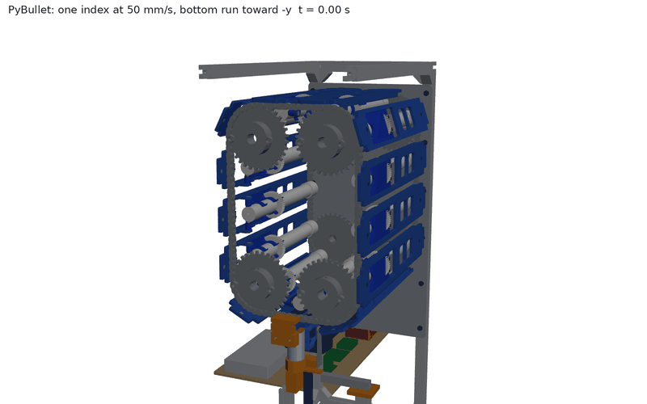

# Chain carousel v2: simulations

Three models of the v2 rig, all built from `../params.py`, `../layout.py` and `../kinematics.py`, so they follow the CAD:

| Script | Engine | What it answers | Results |
|---|---|---|---|
| [`carousel_sim.py`](carousel_sim.py) | PyBullet (Featherstone multibody) | Does the chain run on real sprocket teeth, and do the carriages' tongues get into the station's hold-downs? | [`results/idx_test/`](results/idx_test) |
| [`loop_sim.py`](loop_sim.py) | MuJoCo, kinematic chain | What do the snap hooks and the drive see over indexes, laps and a hard stop; how far does the loop coast on a power cut? | [`results/loop/`](results/loop) |
| [`station_sim.py`](station_sim.py) | MuJoCo | Dock, tilt, dose and undock with the dock magnet: actuator force, hold-down loads, and whether the dock stays shut against the gear mesh | [`results/station/`](results/station) |

The gear mesh itself (tooth contact, runout, the docking seek) is modelled in [`../../gear-mesh/`](../../gear-mesh/README.md), and the powder in a turning or tilting auger in [`../../auger-leakage/`](../../auger-leakage/README.md). Both studies cover v2 and changed it (see the [README](../README.md#what-the-studies-found-and-what-changed)).

## How to run

```bash
cd cad/chain-carousel-v2
pip install pybullet mujoco numpy scipy matplotlib
python sim/carousel_sim.py index --speed 50 --moves 1 --run idx_test    # one index, 80 N per chain (8 min on one core)
python sim/loop_sim.py                                                  # index, lap, hard stop, coast-down (a few min)
python sim/station_sim.py all                                           # cycle with and without the magnet, dock-opening thresholds
```

`carousel_sim.py` also takes `lap`, `estop`, `--tension`, `--hook`, `--salt`, `--direction` (+1 runs the old way) and `--sliders` (the slider rails below). [`render_sim.py`](render_sim.py) draws a `carousel_sim.py` trajectory with the CAD:

```bash
xvfb-run -a python sim/render_sim.py sim/results/idx_test --cam loop --mp4 --gif     # or --stills 0 1.9 for PNGs
```

## 1. `carousel_sim.py`: the chain on real teeth (PyBullet)

**Model.**
- Each chain is one articulated body of 104 pin-jointed links (reduced coordinates, so it can't stretch), closed by a point constraint at pin 0. The pins start where `layout.chain_pins()` puts them.
- The four corner shafts are revolute bodies, each carrying its front and back 32T sprocket. Every tooth is a convex prism with the ANSI 35 flank (17° off radial from the seat circle) on a root disc at the seat bottom, so the chain is driven by tooth-on-bushing contact.
- B+ carries the motor: velocity control with a 12 N·m limit. The other three shafts are idlers with 0.02 N·m of bearing drag. The two top shafts ride vertical slides and are pushed up with twice the chain tension, as the jack screws do.
- Each carriage (0.099 kg) is bolted rigid to its A-1 link on the front chain and by a ball joint to the back one (one M3 through a 1.3 mm tab is a pin, not a moment joint). Its module rides on a hinge with a stop at the closed position: Sam's plate 34.5 g, steel tab 9.2 g, pins and screws 3.5 g, auger 66.2 g, cap 5.4 g and 100 g of salt.
- The snap hooks are a detent holding up to `--hook` newtons (10 N here) until the plate lifts past their 0.8 mm overlap.
- Static obstacles: the side plates, both hold-downs (lip, foot and their 3 mm lead-ins), the NEMA 34, the retracted electronics carriage and the bench.
- 1 ms steps, 150 solver iterations; engine units cm, kg, s.

**Result** ([`results/idx_test/metrics.json`](results/idx_test/metrics.json)): one index (76.2 mm) at 50 mm/s and 250 mm/s², the machine's way (bottom run toward -y), 80 N per chain, no slider rails. 3.72 s simulated in 467 s.



*The PyBullet trajectory drawn with the CAD by [`render_sim.py`](render_sim.py): chains, carriages, modules and sprockets at their simulated poses, front plate hidden. [MP4](results/idx_test/idx_test_loop.mp4).*

| | |
|---|---|
| Drive torque | 0.68 N·m peak, 0.17 N·m rms, 0.034 N·m holding |
| Chain tension at the sensor pins | 78.0 N peak, 56.1 N mean |
| Carriage 1 | travelled 75.85 mm for 76.20 mm commanded (0.35 mm short); 0.013 mm of drift along the augers; started 0.86 mm under its nominal height at the station (bottom-run sag) |
| Top shafts | lifted 0.40 and 0.14 mm on their slides |
| Corners | turned -90.4 to -90.8°: a quarter turn per module |
| Modules | none opened (largest hinge movement 0.001°) |
| Clash events (module or carriage against anything, deeper than 0.2 mm) | **0**: the arriving carriage's tongues entered both hold-downs cleanly |
| Constraint forces (loop closure, carriage bolts) | 393 N peak |

**What it changed** (recorded in `params.py`; those first runs' result folders were not kept):
- **Hold-down lip 0.5 to 2 mm** above the tongue (`HOLD_DOWN_GAP`): tongues snagged on a 0.5 mm lip.
- **Hold-down foot 2 to 4 mm** under the tongue (`HOLD_DOWN_FOOT_GAP`), with **3 mm lead-ins** on lip and foot: a tongue's leading corner dips about 1.2 mm below the run line while its carriage swings off a bottom sprocket, hit the foot's end face and stalled the drive.
- **80 N pretension per chain** (`CHAIN_TENSION_N`): at 40 N the bottom run sagged 2-4 mm, enough to hang a tongue on the foot. 80 N is what T1's 3-4 mm under a 5 N side push gives.
- **Slider rails** under the station carriage (`SLIDER_*` in `params.py`, `parts.slider_block`, `--sliders`) were proposed after the 40 N runs, so the plate's height at the station would not depend on sag. They are **not in the CAD or the BoM**: the index above, at 80 N with the 4 mm foot and without the rails, ran with 0 clash events. They stay as the fix to fit if T1 or T6 find more sag than this.

**Limits.** The loop closure is a soft constraint and drifted after about 80 mm of travel in either direction, so this model is good for one index. Laps, hook loads and stops come from `loop_sim.py`. Chain stretch and the bushing's own clearance are not modelled.

## 2. `loop_sim.py`: hooks, drive torque and coast-down (MuJoCo)

**Model.** The chain is inextensible and moves exactly as `kinematics.pins_at` says (polygonal action included). Each carriage (0.098 kg) follows its A-1 link through a stiff weld to a mocap target, so the weld force is what the chain applies. Each module (0.219 kg: plate, steel tab, pins, auger, cap and 100 g of powder; COM at Sam's (107.5, 0, -4.4) mm) sits on its hinge and is held shut by a stiff detent, whose torque is the hook demand, reported as the force at the hooks 52 mm from the hinge. Drive torque is the power the welds put into carriages and modules divided by the shaft speed, plus the chain's, sprockets' and rotor's inertia and 0.23 N·m of friction (from the PyBullet index). 0.5 ms steps. All moves run the machine's way.

**Results** ([`results/loop/results.json`](results/loop/results.json), [`loop.png`](results/loop/loop.png)):

| Run | Peak speed (mm/s) | Largest hook demand (N, module) | Largest opening (°) | Drive torque peak, total / carriages + modules (N·m) |
|---|---|---|---|---|
| Index, 50 mm/s, 250 mm/s² | 50 | 5.1 (8) | 0.076 | 0.52 / 0.26 |
| Index, 100 mm/s, 500 mm/s² | 100 | 5.6 (8) | 0.083 | 1.01 / 0.73 |
| Lap, 50 mm/s | 50 | 5.1 (11) | 0.076 | 0.46 / 0.43 |
| Lap, 100 mm/s | 100 | 5.62 (3) | 0.084 | 1.37 / 1.33 |
| Hard stop from 100 mm/s at the motor's 12 N·m | 100 | 5.6 (8) | 0.083 | 1.63 / 0.13 |

- **Snap hooks:** the static demand upside down on the top run is 4.44 N; the dynamics add at most 1.2 N. T4's pass mark (hold at least 6 N) and the station sim's 8 N release come from this.
- **Drive:** under 1.7 N·m in every run against the NEMA 34's 12 N·m. The loop is balanced, so the load is inertia and friction, not weight.
- **Coast-down on a power cut:** the loop's inertia at the shaft is 0.0163 kg·m² (carriages and modules 0.0097, chains 0.0021, sprockets and shafts 0.0041, rotor 0.0004). Against 0.23 N·m of friction it stops in 0.146 s and 7.3 mm from 100 mm/s, 0.073 s and 1.8 mm from 50 mm/s. So the e-stop, which cuts the driver's 48 V, stops the chain within a few millimetres.

**Limits.** The chain is rigid and the carriage follows it exactly, so this shows inertial and gravity loads, not chain vibration or tooth impacts. The friction torque is one number from one PyBullet run.

## 3. `station_sim.py`: dock, tilt and dose with the magnet (MuJoCo)

**Model** (frame coordinates from `layout.py`, SI inside):
- The station's carriage on its two A-1 tabs, with the chains as vertical springs at the tabs (80 N pretension: k = T (1/a + 1/b) for a carriage a and b from the two bottom sprockets, 2.8 N/mm per tab). The hold-down lips sit 2 mm above the tongues, the feet 4 mm below.
- The module on its hinge, held by the snap hooks: 8 N to release, until the plate has lifted past their 0.8 mm overlap, and 6 N to press back in.
- Sam's electronics carriage (0.285 kg with the NEMA 11, solenoid, magnet and bracket) hangs on its stub pins in the U-yoke at its centre-of-mass height, Sam's (32, -34) as drawn; the P16 and yoke form one link pinned to the station rail. The rod is a position servo limited to the P16's 50 N. The yoke's tongue rides the approach fork; the pin plates' tails rest on the yoke's stop blocks during the approach. The carriage's rim is a contact against the plate's underside, and the two locating pins run in a hole and a slot.
- The dock magnet pulls the steel tab with F = 20 N / (1 + g / 0.4 mm)² (10.6 N at the 0.15 mm design gap).
- The gear mesh is a force pair at the pitch points: tangential T / r, and separating 0.55 x tangential (steel pinion on the printed gear, dry PTFE). Dosing: 0.03 N·m at the auger. Stall pulse: the NEMA 11's 0.10 N·m at the pinion.
- Taps: 4 N for 10 ms between carriage and module near the outlet.
- Once seated, carriage and module are welded and the weld's wrench is read back as what the dock has to carry. The dock "holds" while that contact force is compressive and its centre of pressure stays between the rim's front edge (Sam x 25) and the magnet face's back edge (x 109.5).

**Cycle** at 30°: approach at 18 mm/s, magnet on, tilt, 2 s of dosing with four taps, the stall pulse, tilt back 1.5 mm past level into the hooks, magnet off, retract ([`results/station/results.json`](results/station/results.json), [`station_cycle.png`](results/station/station_cycle.png)):

| | magnet on while docked | gravity only (no magnet) |
|---|---|---|
| Tilt reached (frame, deg) | 30.3 | 30.5 |
| Actuator force: peak / docked / dosing (N) | 26.1 / 7.4 / 7.6 | 26.0 / 7.3 / 7.4 |
| Hold-down lips, peak (N, both) | 11.2 | 11.1 |
| Hold-down feet, peak (N) | 0.0 | 0.0 |
| Tongue rise / drop at the tabs, peak (mm) | 1.99 / -0.89 | 1.99 / -0.98 |
| Hinge reaction, up / down peak (N) | 4.8 / -20.4 | 5.1 / -20.3 |
| Dock gap at the gear end while dosing / at the stall pulse (mm; negative = closed) | -0.119 / -0.097 | 0.674 / 0.703 |
| Magnet pull while dosing (N) | 20.0 | 0.0 |
| Dock holds: tilt / dose / stall / back | yes / yes / yes / yes | no / no / no / no |
| Dock contact force, minimum while dosing / at stall (N) | 19.0 / 18.3 | -1.1 / -1.8 |
| Plate back under the snap hooks at the end | yes | yes |

**Dock-opening threshold** (`threshold`): docked and held at each tilt, the gear's separating force is ramped up (with its tangential share) until the dock stops holding; module empty, the worst case:

| Tilt (deg) | 0 | 15 | 30 | 45 | 60 | 75 | 90 |
|---|---|---|---|---|---|---|---|
| Separating force that opens the dock, magnet on (N) | 13.3 | 13.3 | 13.3 | 11.9 | 9.6 | 7.8 | 7.0 |
| Separating force that opens the dock, no magnet (N) | 0.04 | 0.04 | 0.04 | 0.04 | 0.04 | 0.04 | 0.04 |
| Pinion torque at that point, magnet on (N·m; 450 mA stall: 0.067) | 0.241 | 0.242 | 0.241 | 0.217 | 0.175 | 0.142 | 0.128 |

- **With the magnet the dock stayed shut** through the tilt, the dose, the stall pulse and the tilt back: contact force at least 16.8 N, centre of pressure inside the support throughout (closest 0.4 mm from its edge, while tilting back). The gap at the gear end stayed closed. The plate went back under the snap hooks.
- **Without the magnet the dock opened** 0.67 mm at the gear end while dosing and 0.70 mm at the stall pulse, and gravity alone carried no separating force at any tilt (the threshold run lost the dock at its first 0.04 N step). The magnet is what holds the mesh.
- With the magnet the dock carries 13.3 N of separating force at 0-30° and 7.0 N at 90°. The NEMA 11 at 450 mA stalls at 0.067 N·m, 3.7 N of separating force, so the motor stalls before the dock opens at every tilt (1.9 times margin at 90°, 3.6 at 30°).
- The actuator peaks at 26 N at the start of the tilt (the P16 is rated 50 N) and holds 7.6 N while dosing. The tongues rise until the 2 mm lips stop them (rise 1.99 mm, up to 11.2 N on the lips); the feet see nothing.

**What it changed:** the carriage's pivot. With the pin under the carriage (the paternoster's first station, (40, -72)) the carriage was an inverted pendulum on it, and the dock opened at a few newtons of gear load once tilted. At the carriage's centre-of-mass height the dock carried 13.3 N of separating force at 30° (10.2 N at (45, -34), 6.1 N for the old pin, 0.4 N with the pin on the mesh line), as recorded in `params.py`. That, with the gear-mesh study, gave the shared station its U-yoke and stub pins. The stop blocks and pin-plate tails were moved outside the carriage's |y| 18 on 2026-10-19 (as the paternoster's): the old blocks sat in the carriage's path past 70° of tilt (`check_interference.py --tilt`), and this run uses the new ones.

**Limits.** The chain is two springs, not a chain; the dock is welded once seated (contact-only docking tipped the carriage about the rim's back edge in MuJoCo, so it was not used for loads); tooth contact is not modelled here (it is in the gear-mesh study); the gear loads, hook forces and magnet law are assumptions that T4 and T6a-c measure.
