# Assembly: chain-carousel test rig v3

Twelve steps in build order, then the test set-up. In each render the parts from earlier steps are pale, and the step's new parts are in colour, lifted along the way they go in. The table under each render is the BoM lines that step uses ([BOM.md](BOM.md) item numbers). The animation ([MP4](renders/chain_carousel_v3.mp4)) shows the same sequence moving.

Tools: chain breaker, metric hex keys, 8 mm and 7/16 in wrenches, M5 tap, chop or band saw for the 2020 and the shafts, soldering iron, heat-set insert tip, e-clip pliers, feeler gauges.

## Step 1. Base frame: rails, two station rails, corner brackets, leveling feet

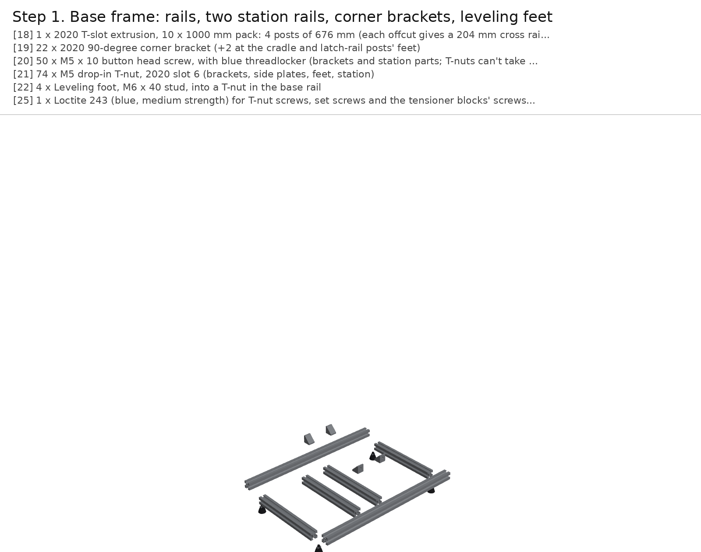

| # | Qty | Part |
|---|---|---|
| 18 | 1 | 2020 T-slot extrusion, 10 x 1000 mm pack: 4 posts of 676 mm (each offcut gives a 204 mm cross rail), 4 long rails of 417.7 mm (2 per bar), two station rails of 204 + the cradle post 231 + the latch-rail post 286 from a seventh bar |
| 19 | 22 | 2020 90-degree corner bracket (+2 at the cradle and latch-rail posts' feet) |
| 20 | 50 | M5 x 10 button head screw, with blue threadlocker (brackets and station parts; T-nuts can't take a nylock) |
| 21 | 74 | M5 drop-in T-nut, 2020 slot 6 (brackets, side plates, feet, station) |
| 22 | 4 | Leveling foot, M6 x 40 stud, into a T-nut in the base rail |
| 25 | 1 | Loctite 243 (blue, medium strength) for T-nut screws, set screws and the tensioner blocks' screws; Loctite 222 (purple, low strength) where a part is meant to come apart |

The frame uses seven bars of one VEVOR 10-pack of 1000 mm 2020. Cut four posts of 676 mm (each
offcut gives a 204 mm cross rail), four long rails of 417.7 mm (two per bar), and from a seventh bar
two station rails (204 mm each), the cradle post (231 mm) and the latch-rail post (292 mm).
Square every cut.

Lay two long rails on the bench, 224 mm apart centre to centre, with a cross rail between them at each
end, the actuator's station rail 91 mm behind the front chain's plane and the latch-rail post's station
rail at 164 mm (two corner brackets each). Screw the
four leveling feet up into T-nuts in the long rails' bottom slots, 15 mm in from each end. Blue Loctite on every
screw that goes into a T-nut.

## Step 2. Posts and top frame

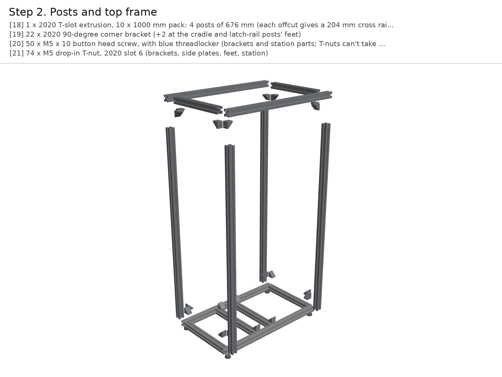

| # | Qty | Part |
|---|---|---|
| 18 | 1 | 2020 T-slot extrusion, 10 x 1000 mm pack: 4 posts of 676 mm (each offcut gives a 204 mm cross rail), 4 long rails of 417.7 mm (2 per bar), two station rails of 204 + the cradle post 231 + the latch-rail post 286 from a seventh bar |
| 19 | 22 | 2020 90-degree corner bracket (+2 at the cradle and latch-rail posts' feet) |
| 20 | 50 | M5 x 10 button head screw, with blue threadlocker (brackets and station parts; T-nuts can't take a nylock) |
| 21 | 74 | M5 drop-in T-nut, 2020 slot 6 (brackets, side plates, feet, station) |

Stand a post on each end of the long rails. Each post gets four corner brackets: at its foot, one on the
long rail's top on the inner side and one on the cross rail's top; at its head, the same two under the top rails.
Use M5 x 10 button heads into drop-in T-nuts. Put the two top long rails and two top cross rails on the posts the
same way as the base, then square the box by its diagonals (equal within 1 mm) and tighten.

Don't put brackets on the posts' inner x faces between 205 and 690 mm: the side plates sit there.

## Step 3. Side plates onto the posts

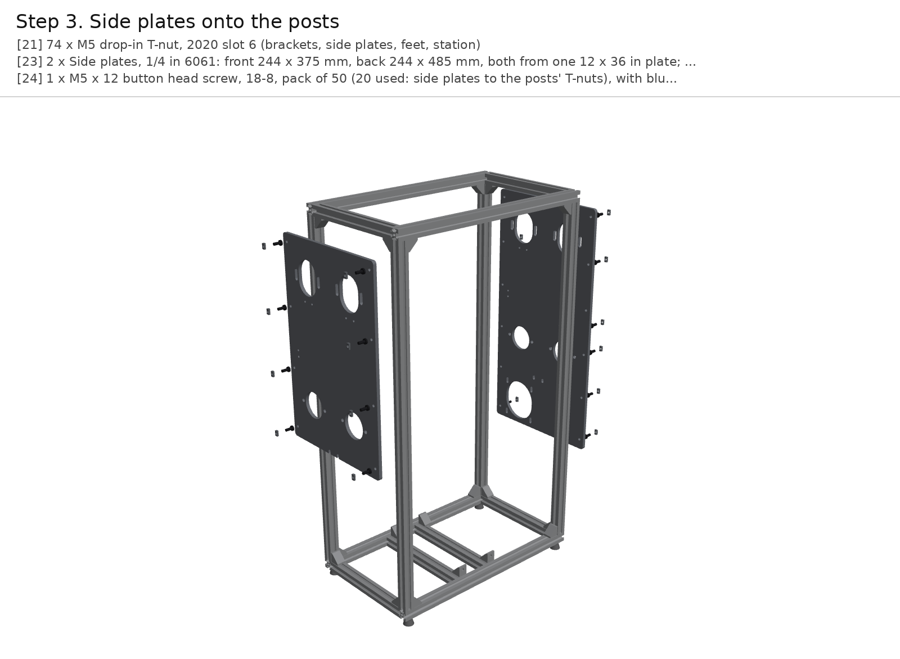

| # | Qty | Part |
|---|---|---|
| 21 | 74 | M5 drop-in T-nut, 2020 slot 6 (brackets, side plates, feet, station) |
| 23 | 2 | Side plates, 1/4 in 6061: front 244 x 375 mm, back 244 x 485 mm, both from one 12 x 36 in plate; cut and drilled from dxf/ (BYU shop, or SendCutSend: price on upload) |
| 24 | 1 | M5 x 12 button head screw, 18-8, pack of 50 (20 used: side plates to the posts' T-nuts), with blue threadlocker |

Have the two side plates cut from one 12 x 36 in sheet of 1/4 in 6061 (`dxf/side_plate_front.dxf`,
`dxf/side_plate_back.dxf`, by the BYU shop or SendCutSend). The front plate is 244 x 375 mm. The back
plate runs down to 205 mm above the bench, 244 x 485 mm, because it carries the motor.
Tap the four M5 holes under the top bearing slots on each plate.

Bolt each plate to the inner faces of its two posts with M5 x 12 button heads from the inside into drop-in T-nuts.
Set the front plate's bottom edge 315 mm above the bench and the back plate's 205 mm. The plates' inner
faces end up 365 mm apart, 30 mm outside each chain.

## Step 4. Flange bearings and top-shaft tensioners on the side plates

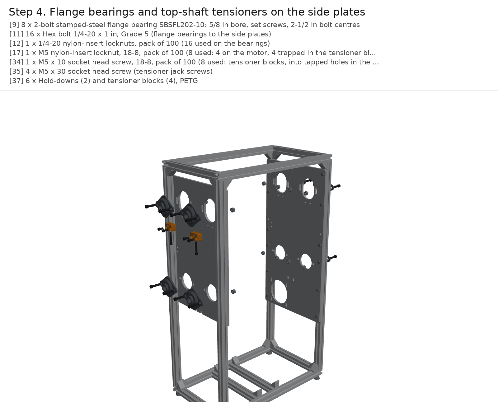

| # | Qty | Part |
|---|---|---|
| 9 | 8 | 2-bolt stamped-steel flange bearing SBSFL202-10: 5/8 in bore, set screws, 2-1/2 in bolt centres |
| 11 | 16 | Hex bolt 1/4-20 x 1 in, Grade 5 (flange bearings to the side plates) |
| 12 | 1 | 1/4-20 nylon-insert locknuts, pack of 100 (16 used on the bearings) |
| 17 | 1 | M5 nylon-insert locknut, 18-8, pack of 100 (8 used: 4 on the motor, 4 trapped in the tensioner blocks as jack-screw nuts) |
| 34 | 1 | M5 x 10 socket head screw, 18-8, pack of 100 (8 used: tensioner blocks, into tapped holes in the plates) |
| 35 | 4 | M5 x 30 socket head screw (tensioner jack screws) |
| 37 | 6 | Hold-downs (2) and tensioner blocks (4), PETG |

Mount the eight SBSFL202-10 flange bearings on the plates' outer faces, bolt line horizontal, with
1/4-20 x 1 in bolts and nylon-insert locknuts on the plates' inner faces. Each bearing's rear dome sits in its
plate's 49 mm hole. The bottom shafts are 393.6 mm above the bench. Put the four top bearings at the bottom of their
slots, 6 mm below the nominal 622.2 mm, which leaves room to fit the chains. Snug those bolts only.

Under each top bearing, screw a printed tensioner block to the plate (two M5 x 10 into the tapped holes, blue
Loctite). Drop an M5 nylon-insert locknut into the block's slot and run an M5 x 30 jack screw up through it until it
touches the underside of the bearing's front dome. The locknut keeps the jack screw from turning with the vibration.

## Step 5. Corner shafts with their sprockets (back set screws loose)

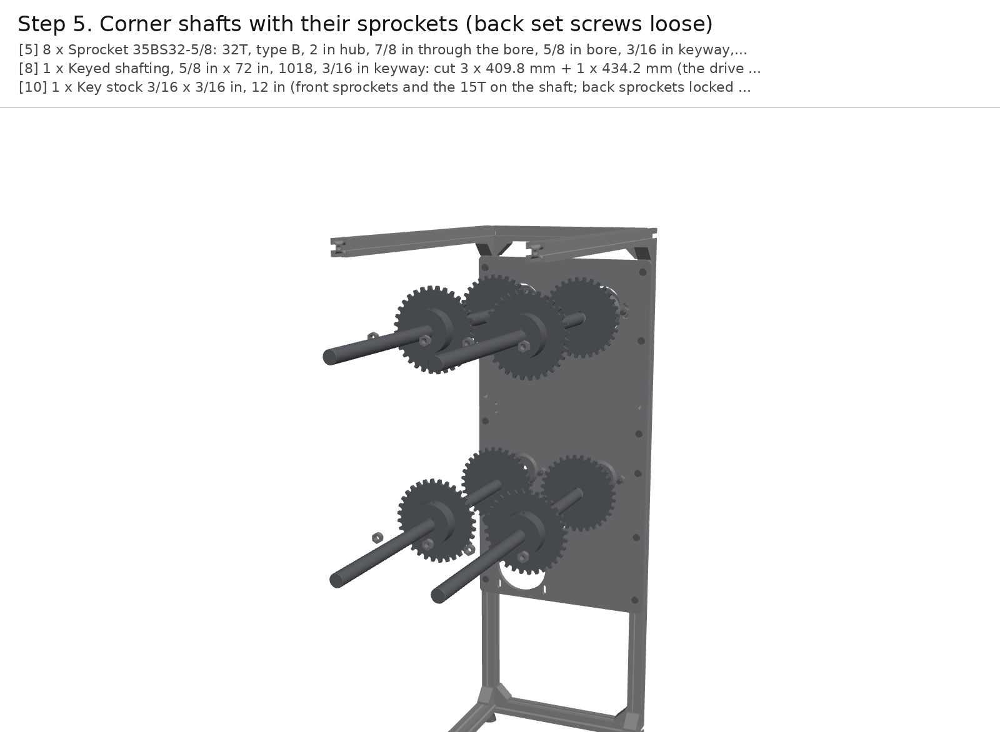

| # | Qty | Part |
|---|---|---|
| 5 | 8 | Sprocket 35BS32-5/8: 32T, type B, 2 in hub, 7/8 in through the bore, 5/8 in bore, 3/16 in keyway, 2 set screws |
| 8 | 1 | Keyed shafting, 5/8 in x 72 in, 1018, 3/16 in keyway: cut 3 x 409.8 mm + 1 x 434.2 mm (the drive shaft); lengths from the CAD after the flange bearing's real 16.05 mm stand-off (was 403 / 427) |
| 10 | 1 | Key stock 3/16 x 3/16 in, 12 in (front sprockets and the 15T on the shaft; back sprockets locked by set screws after phasing) |

Cut the 72 in keyed bar into three shafts of 409.8 mm and one of 434.2 mm. The long
one is the drive shaft and goes in the bottom +y corner (B+). Each shaft carries two sprockets. Feed it through the
front bearing, slide on the front sprocket with its hub toward the front, then the back sprocket with its hub toward
the back, and push the shaft on through the back bearing.

Centre each sprocket's teeth on its chain line, 305 mm apart, the front one 30 mm inside the front plate. Key
the front sprocket and tighten its set screws (blue Loctite). Leave the back one's key out and its set screws loose:
the carriages set its phase in step 10. Tighten the bearings' set screws on the shaft.

## Step 6. NEMA 34 on the back plate, 15T sprockets, drive chain

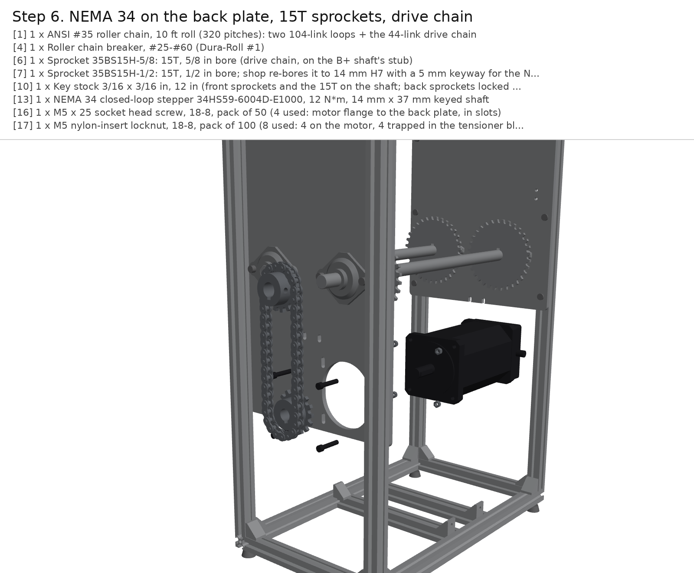

| # | Qty | Part |
|---|---|---|
| 1 | 1 | ANSI #35 roller chain, 10 ft roll (320 pitches): two 104-link loops + the 44-link drive chain |
| 4 | 1 | Roller chain breaker, #25-#60 (Dura-Roll #1) |
| 6 | 1 | Sprocket 35BS15H-5/8: 15T, 5/8 in bore (drive chain, on the B+ shaft's stub) |
| 7 | 1 | Sprocket 35BS15H-1/2: 15T, 1/2 in bore; shop re-bores it to 14 mm H7 with a 5 mm keyway for the NEMA 34 |
| 10 | 1 | Key stock 3/16 x 3/16 in, 12 in (front sprockets and the 15T on the shaft; back sprockets locked by set screws after phasing) |
| 13 | 1 | NEMA 34 closed-loop stepper 34HS59-6004D-E1000, 12 N*m, 14 mm x 37 mm keyed shaft |
| 16 | 1 | M5 x 25 socket head screw, 18-8, pack of 50 (4 used: motor flange to the back plate, in slots) |
| 17 | 1 | M5 nylon-insert locknut, 18-8, pack of 100 (8 used: 4 on the motor, 4 trapped in the tensioner blocks as jack-screw nuts) |

Have the shop re-bore the 35BS15H-1/2 sprocket to 14 mm H7 with a 5 mm keyway, then slide it onto the NEMA 34's
shaft, hub outward, over the key. Offer the motor up to the back plate's inner face from inside the frame, with its
pilot in the plate's slot and the shaft and sprocket out the back. Bolt it on with four M5 x 25 from outside and
nylon-insert locknuts on the flange. The motor's axis is 255.5 mm above the bench, right under the drive shaft.
It is 6 kg, so support it while you fit the bolts.

Key the 35BS15H-5/8 sprocket onto the drive shaft's stub, in line with the motor's sprocket. Cut 44 pitches from
the 10 ft roll and close them round both sprockets. Pull the motor down in its slots (+-4 mm) until the
chain has about 2 mm of play at mid-span, then tighten its bolts.

## Step 7. Chains: 13 A-1 links per chain, close both loops

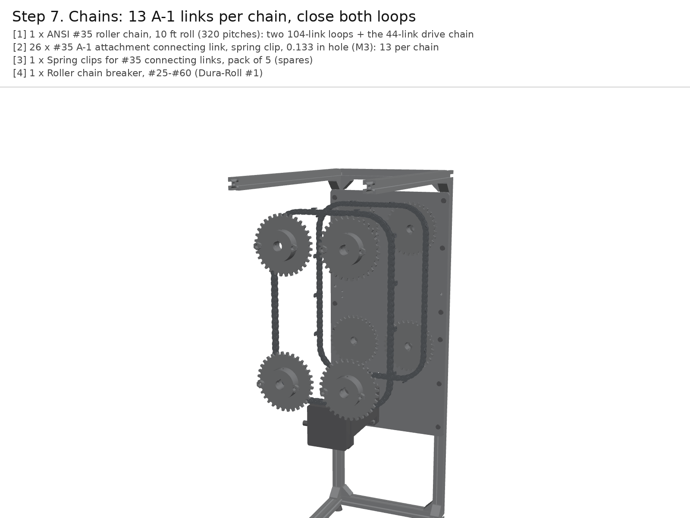

| # | Qty | Part |
|---|---|---|
| 1 | 1 | ANSI #35 roller chain, 10 ft roll (320 pitches): two 104-link loops + the 44-link drive chain |
| 2 | 26 | #35 A-1 attachment connecting link, spring clip, 0.133 in hole (M3): 13 per chain |
| 3 | 1 | Spring clips for #35 connecting links, pack of 5 (spares) |
| 4 | 1 | Roller chain breaker, #25-#60 (Dura-Roll #1) |

**First measure the chain** (see the BoM note): about 4.78 mm between the inner plates and a 5.08 mm bushing
means ANSI 35, which is what the sprockets are.

Cut two loops of 104 pitches from the 10 ft roll. In each, take out an outer link every 8 pitches and fit an A-1
attachment connecting link in its place, 13 per chain. On the front chain the tabs point back (+x, toward the
other chain); on the back chain they point forward. Number the A-1 links 1-13 the same way on both chains.

Wrap each chain round its four sprockets with the tabs on the outside of the loop, then close it with its 13th A-1
link. Each spring clip's closed end points the way the chain travels (bottom run toward -y). The chains hang slack,
because the top shafts are still at the bottom of their slots.

## Step 8. Station: hold-downs, hall switches, the P16, the guide cradle on its post, the electronics carriage v3 (dock seats, magnets, balls), the latch rail, the side tabs

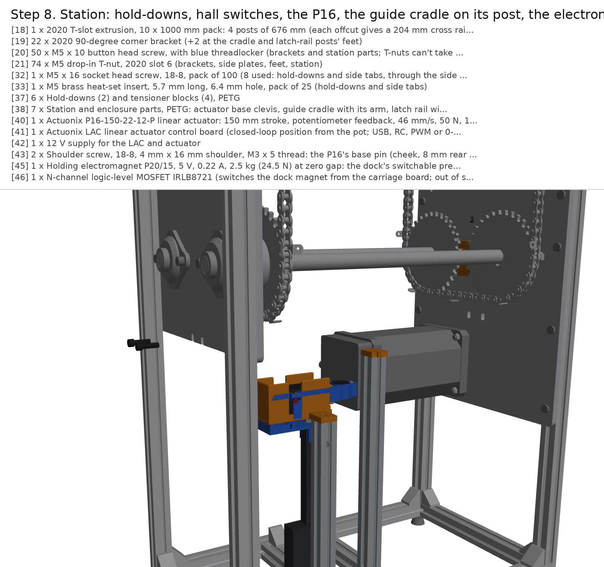

| # | Qty | Part |
|---|---|---|
| 18 | 1 | 2020 T-slot extrusion, 10 x 1000 mm pack: 4 posts of 676 mm (each offcut gives a 204 mm cross rail), 4 long rails of 417.7 mm (2 per bar), two station rails of 204 + the cradle post 231 + the latch-rail post 286 from a seventh bar |
| 19 | 22 | 2020 90-degree corner bracket (+2 at the cradle and latch-rail posts' feet) |
| 20 | 50 | M5 x 10 button head screw, with blue threadlocker (brackets and station parts; T-nuts can't take a nylock) |
| 21 | 74 | M5 drop-in T-nut, 2020 slot 6 (brackets, side plates, feet, station) |
| 32 | 1 | M5 x 16 socket head screw, 18-8, pack of 100 (8 used: hold-downs and side tabs, through the side plates), with blue threadlocker |
| 33 | 1 | M5 brass heat-set insert, 5.7 mm long, 6.4 mm hole, pack of 25 (hold-downs and side tabs) |
| 37 | 6 | Hold-downs (2) and tensioner blocks (4), PETG |
| 38 | 7 | Station and enclosure parts, PETG: actuator base clevis, guide cradle with its arm, latch rail with its arm, 2 side tabs, 2 turn buttons |
| 40 | 1 | Actuonix P16-150-22-12-P linear actuator: 150 mm stroke, potentiometer feedback, 46 mm/s, 50 N, 10 N side load, 197 mm closed hole to hole, 20 % duty cycle (datasheet rev B; modelled from Actuonix's STEP) |
| 41 | 1 | Actuonix LAC linear actuator control board (closed-loop position from the pot; USB, RC, PWM or 0-3.3 V in) |
| 42 | 1 | 12 V supply for the LAC and actuator |
| 43 | 2 | Shoulder screw, 18-8, 4 mm x 16 mm shoulder, M3 x 5 thread: the P16's base pin (cheek, 8 mm rear tab, cheek) and the EC's clevis pin (cheek, rod-end tab, cheek, in 2 mm slots) + an M3 nylock each from item 27 |
| 45 | 1 | Holding electromagnet P20/15, 5 V, 0.22 A, 2.5 kg (24.5 N) at zero gap: the dock's switchable preload, 12 mm ahead of the flat contact |
| 46 | 1 | N-channel logic-level MOSFET IRLB8721 (switches the dock magnet from the carriage board; out of stock on 2026-10-18, any logic-level N-MOSFET such as FQP30N06L works) |
| 47 | 1 | 1N4001 diode, 10-pack (flyback across the magnet coil) |
| 66 | 1 | Steel spur gear KHK SS1-20A: module 1, 20T, 20 deg, 5 mm H8 bore, 10 mm face (S45C). Face the 10 mm hub off and bond it to the NEMA 11's shaft with Loctite 638; replaces the printed 20T. KHK USA lists it at $14.77 (10 on hand), plus shipping |
| 72 | 1 | Dry PTFE lubricant spray (pinion and gear teeth; keeps the separating force near 0.47 x the tangential load) |
| 77 | 1 | Electronics carriage v3: Sam's Oct 13 carriage printed with the dock ears (cone seat, vee), the back bracket (dock electromagnet, ball C), the base (three seat balls) and the slotted clevis (stl/electronics_carriage_v3.stl); the doser's NEMA 11 and 12 V solenoid move into it |
| 78 | 36 | Precision ball, 1/4 in, hardened 52100 chrome steel, grade 25: 2 per mounting plate (the dock), 4 on the EC (the flat and the parking seat), 6 spare |
| 79 | 6 | Dowel pin, hardened steel, 1/8 x 5/16 in: two per vee groove (the EC's dock vee and the cradle's), 2 spare |
| 80 | 2 | Neodymium magnet D44-N52, 1/4 x 1/4 in: under the EC's cone and vee, pulls each plate ball into its seat |
| 81 | 1 | Steel flat washer, M4, case-hardened if available, bonded in the cradle floor (the parking seat's flat) |
| 53 | 2 | Hall-effect switch US5881 (unipolar, open drain, TO-92): INDEX and HOME |

The station, under the bottom run:

1. Hold-downs: as v2. Melt two M5 inserts into each printed hold-down, push a US5881 into each lip's pocket (INDEX
   front, HOME back) and screw them to the plates' inner faces with two M5 x 16 (blue Loctite).
2. Side tabs (item 5a) at the loading position (+y side, mid-height): the same way, two M5 inserts each, on the plates'
   inner faces. Their lips cover only the bottom 8 mm of a tongue, so a carriage slid 10 mm up comes out.
3. Actuator: the printed base clevis on the actuator's station rail (two M5 into T-nuts); the P16-150's rear tab on a
   4 x 16 mm shoulder screw (McMaster 90265A123) and an M3 locknut.
4. Electronics carriage v3 (print `stl/electronics_carriage_v3.stl`, Sam's carriage with the new features):
   - press the four 1/4 in steel balls into the base's three pockets and the back boss (ball C), 3.8 mm proud;
   - push a D44-N52 magnet into the pocket under the cone seat (+y ear) and one under the vee (-y ear), then press
     the vee's two 1/8 x 5/16 in dowels in over the second magnet;
   - bond the dock electromagnet (Adafruit 3872) into the back bracket's cup, face 0.15 mm under the armature's plane
     (shim with a feeler gauge on a flat plate);
   - fit the NEMA 11 on the back wall and the solenoid in the front bay, as Sam's carriage; bond the KHK SS1-20A pinion
     (hub faced off) onto the motor shaft with Loctite 638;
   - put the P16's rod-end tab between the clevis cheeks under the base and push a 4 x 16 mm shoulder screw through
     cheeks and tab; M3 locknut. The pin rides in 2 mm slots, so the actuator can stop short of the dock or the seat
     without forcing either.
5. Guide cradle (`stl/cradle.stl`): press its two vee dowels in, bond the M4 washer into the flat pocket, bolt the cradle's
   arm onto the cradle post's top end (M6 into the tapped centre bore) and the post onto the station rail beside the P16.
   Lower the EC into it: its three balls sit in the cone, the vee and on the washer, its body 0.3 mm inside the side
   walls, its front face 0.3 mm behind the front wall. It parks 20 mm under the passing carriages.
6. Latch rail (`stl/latch_rail.stl`) on its post on the second station rail: its working face runs along the travel
   4.5 mm behind the carriages' latch followers, with 25 degree ramps at both ends.

## Step 9. Modules on the bench: auger into the v3 plate, dock balls, steel armature, outlet door; plate pinned onto a carriage, latch closed

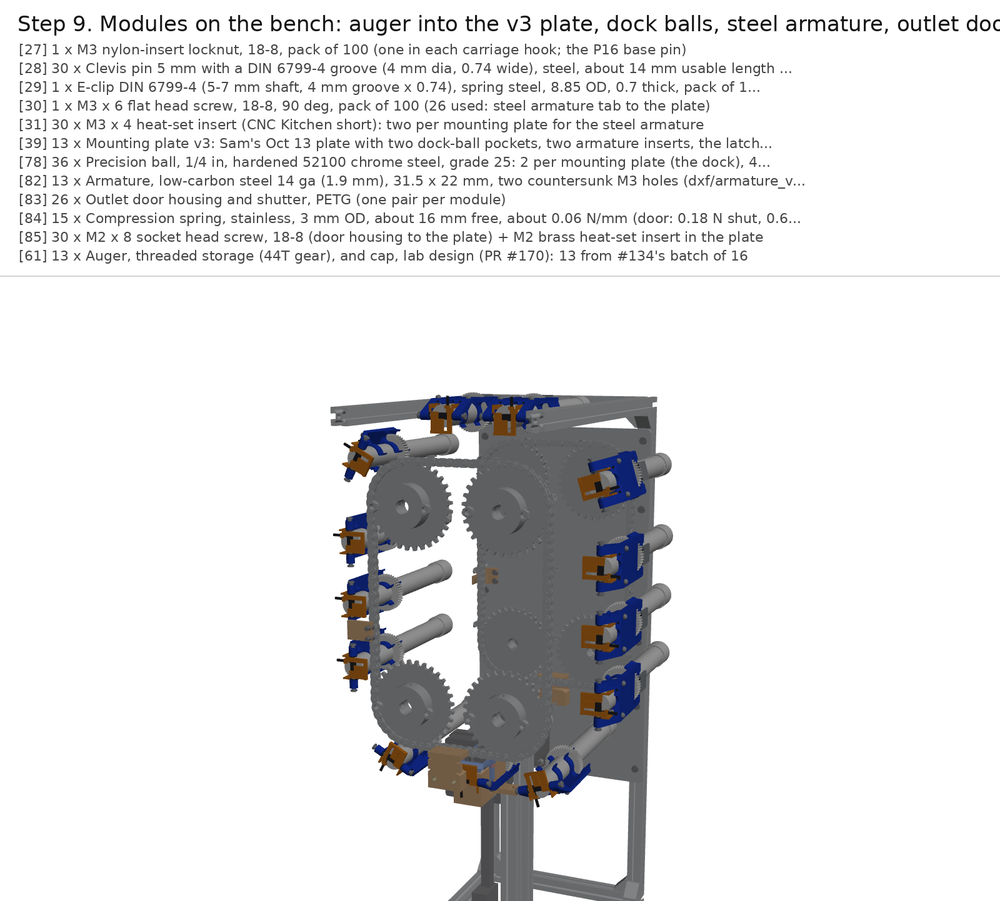

| # | Qty | Part |
|---|---|---|
| 27 | 1 | M3 nylon-insert locknut, 18-8, pack of 100 (one in each carriage hook; the P16 base pin) |
| 28 | 30 | Clevis pin 5 mm with a DIN 6799-4 groove (4 mm dia, 0.74 wide), steel, about 14 mm usable length (module hinge pins, 2 per module; 4 spare) |
| 29 | 1 | E-clip DIN 6799-4 (5-7 mm shaft, 4 mm groove x 0.74), spring steel, 8.85 OD, 0.7 thick, pack of 100 (26 used on the hinge pins) |
| 30 | 1 | M3 x 6 flat head screw, 18-8, 90 deg, pack of 100 (26 used: steel armature tab to the plate) |
| 31 | 30 | M3 x 4 heat-set insert (CNC Kitchen short): two per mounting plate for the steel armature |
| 39 | 13 | Mounting plate v3: Sam's Oct 13 plate with two dock-ball pockets, two armature inserts, the latch keeper and a 1 mm relief over the NEMA 11 (stl/mounting_plate_v3.stl): print all 13 (module 1's existing plate has none of these) |
| 78 | 36 | Precision ball, 1/4 in, hardened 52100 chrome steel, grade 25: 2 per mounting plate (the dock), 4 on the EC (the flat and the parking seat), 6 spare |
| 82 | 13 | Armature, low-carbon steel 14 ga (1.9 mm), 31.5 x 22 mm, two countersunk M3 holes (dxf/armature_v3.dxf): the flat of the dock and the electromagnet's target |
| 83 | 26 | Outlet door housing and shutter, PETG (one pair per module) |
| 84 | 15 | Compression spring, stainless, 3 mm OD, about 16 mm free, about 0.06 N/mm (door: 0.18 N shut, 0.69 N open) |
| 85 | 30 | M2 x 8 socket head screw, 18-8 (door housing to the plate) + M2 brass heat-set insert in the plate |
| 61 | 13 | Auger, threaded storage (44T gear), and cap, lab design (PR #170): 13 from #134's batch of 16 |

Modules on the bench (one per carriage, 13 in all):

1. Plate v3 (`stl/mounting_plate_v3.stl`: Sam's plate with two ball pockets, two insert holes, the latch keeper on its back
   end, a 1 mm relief over the NEMA 11). Press two 1/4 in balls into the pockets at Sam's (30, +-18.5), 3.8 mm proud.
   Melt two M3 inserts into the back strip and screw the steel armature on with two M3 x 6 flat heads: it runs from
   behind the 44T gear's slot out past the plate's back edge, under the EC's flat ball.
2. Outlet door: melt two M2 inserts into the plate's top face beside the tube, drop the shutter into the printed housing
   with the spring above it, and screw the housing's two arms to the plate (M2 x 8). The shutter covers the 3 mm exit;
   its +y strip hangs below the plate, where the EC's finger meets it.
3. Slide the lab auger into the plate's clamp rings (the 44T gear behind the rear ring), outlet against the door's
   housing, and screw on the cap.
4. Put the plate between a carriage v3's lugs, hinge end at the front, and push a 5 mm clevis pin through each lug into
   the plate's knuckles; e-clip on each pin's inner end. Press the latch bolt back with a finger, lay the plate's back
   end down and let go: the bolt springs over the keeper and holds the plate shut on the top run.

## Step 10. Carriages onto the chain at the loading position, one index at a time; phase and tension

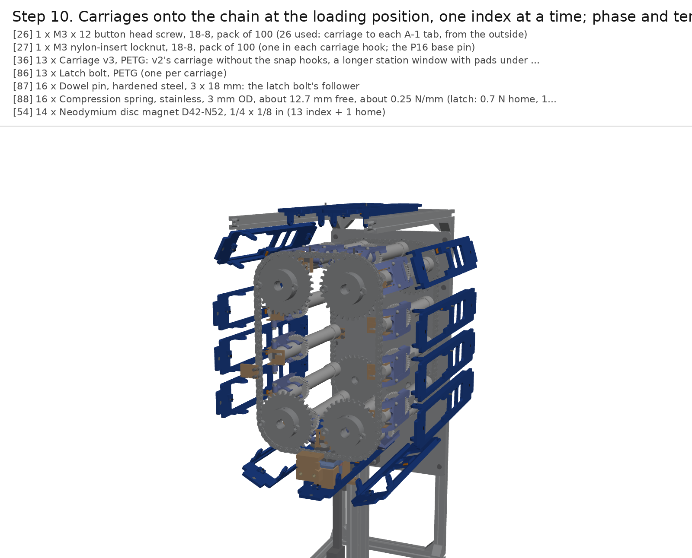

| # | Qty | Part |
|---|---|---|
| 26 | 1 | M3 x 12 button head screw, 18-8, pack of 100 (26 used: carriage to each A-1 tab, from the outside) |
| 27 | 1 | M3 nylon-insert locknut, 18-8, pack of 100 (one in each carriage hook; the P16 base pin) |
| 36 | 13 | Carriage v3, PETG: v2's carriage without the snap hooks, a longer station window with pads under the plate's back corners, and the latch housing; one per H2D plate on the bed's diagonal (351 mm > 325); break-off webs under the hooks' fingers |
| 86 | 13 | Latch bolt, PETG (one per carriage) |
| 87 | 16 | Dowel pin, hardened steel, 3 x 18 mm: the latch bolt's follower |
| 88 | 16 | Compression spring, stainless, 3 mm OD, about 12.7 mm free, about 0.25 N/mm (latch: 0.7 N home, 1.8 N open) |
| 54 | 14 | Neodymium disc magnet D42-N52, 1/4 x 1/8 in (13 index + 1 home) |

At the loading position (the +y side, mid-height): hold the unit beside the two A-1 tabs, 10 mm
up from position, push it in until the carriage plate touches the tabs, slide it 10 mm down so the printed hooks
take the tabs and the tongues go under the side tabs' lips, and drive an M3 x 12 button head from outside through the
plate and each tab into the locknut in the hook. Index one module (bottom run toward -y) and fit the next. After 13,
tighten the back sprockets' set screws on the round of the shaft and spot a dimple under each.

To tension, turn the four jack screws the same amount until each long side deflects 3-4 mm under a 5 N side push at
mid-span (about 80 N per chain). Do the front and back together, so the top shafts stay level, then tighten the top
bearings' bolts.

## Step 11. Electronics board: supply, driver, Pi, interface board, LAC, e-stop

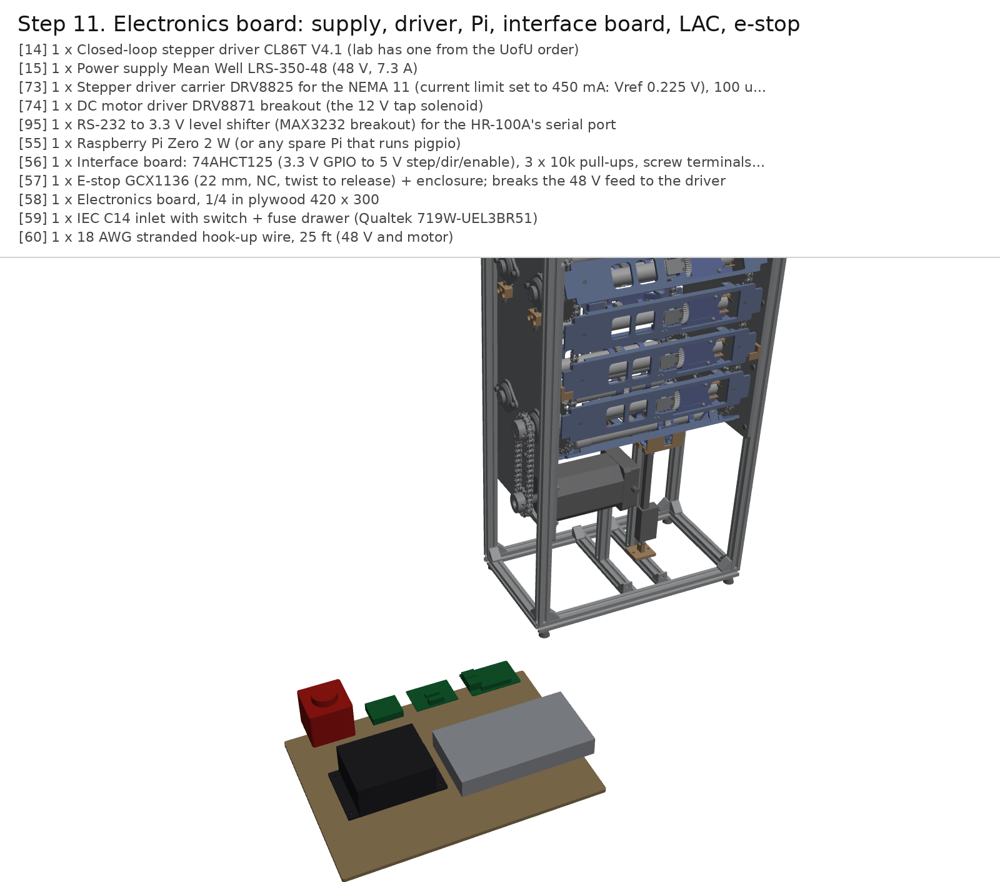

| # | Qty | Part |
|---|---|---|
| 14 | 1 | Closed-loop stepper driver CL86T V4.1 (lab has one from the UofU order) |
| 15 | 1 | Power supply Mean Well LRS-350-48 (48 V, 7.3 A) |
| 73 | 1 | Stepper driver carrier DRV8825 for the NEMA 11 (current limit set to 450 mA: Vref 0.225 V), 100 uF across VMOT |
| 74 | 1 | DC motor driver DRV8871 breakout (the 12 V tap solenoid) |
| 95 | 1 | RS-232 to 3.3 V level shifter (MAX3232 breakout) for the HR-100A's serial port |
| 55 | 1 | Raspberry Pi Zero 2 W (or any spare Pi that runs pigpio) |
| 56 | 1 | Interface board: 74AHCT125 (3.3 V GPIO to 5 V step/dir/enable), 3 x 10k pull-ups, screw terminals, perfboard |
| 57 | 1 | E-stop GCX1136 (22 mm, NC, twist to release) + enclosure; breaks the 48 V feed to the driver |
| 58 | 1 | Electronics board, 1/4 in plywood 420 x 300 |
| 59 | 1 | IEC C14 inlet with switch + fuse drawer (Qualtek 719W-UEL3BR51) |
| 60 | 1 | 18 AWG stranded hook-up wire, 25 ft (48 V and motor) |

The electronics board sits on the bench behind the rig. Wire it like this:

| From | To |
|---|---|
| Mains (IEC inlet, fuse, switch) | LRS-350-48 AC input |
| LRS-350-48 +V | E-stop (NC) -> 10 A fuse -> CL86T +VDC |
| LRS-350-48 -V | CL86T GND |
| NEMA 34 A+/A-/B+/B- | CL86T A+/A-/B+/B- |
| NEMA 34 encoder | CL86T encoder port |
| Pi GPIO 17 / 27 / 22 | 74AHCT125 inputs 1A / 2A / 3A (VCC 5 V, OE tied low) |
| 74AHCT125 outputs 1Y / 2Y / 3Y | CL86T PUL+ / DIR+ / ENA+ (logic selector at 5 V) |
| CL86T PUL- / DIR- / ENA- | Pi GND |
| Pi 3.3 V via 10k | GPIO 23 (INDEX), GPIO 24 (HOME), GPIO 25 (CL86T ALM+; ALM- to GND) |
| Pi GPIO 18 | LAC RC input (1.0-2.0 ms = 0-150 mm); LAC on its 12 V supply |
| Pi GPIO 13 / 21 | DRV8825 STEP / DIR for the NEMA 11 (current limit 0.45 A: Vref 0.225 V) |
| Pi GPIO 16 | Dock magnet MOSFET gate (IRLB8721), 1N4001 across the coil, 5 V supply |
| Pi GPIO 12 | DRV8871 IN1 for the tap solenoid |
| Pi UART RX/TX (GPIO 15 / 14) | MAX3232 -> HR-100A RS-232 (DB-9) |

Set the CL86T DIP switches to 4000 pulses/rev and the motor current to 6.0 A. Run `sudo pigpiod`, then
`python3 test/chain_rig.py --sim lap` to check the software and `python3 test/chain_rig.py home` to check the
hardware. At 4000 pulses/rev one module is exactly 1000 steps.

## Step 12. Enclosure: acrylic panels on standoffs, the front hatch (scale) and the side hatch (swaps); the HR-100A

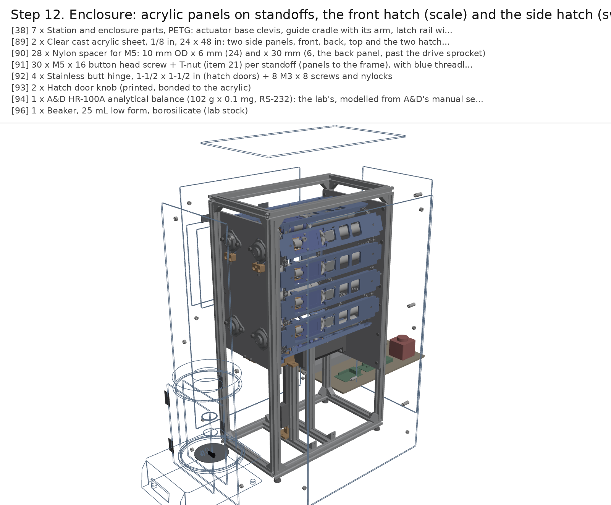

| # | Qty | Part |
|---|---|---|
| 38 | 7 | Station and enclosure parts, PETG: actuator base clevis, guide cradle with its arm, latch rail with its arm, 2 side tabs, 2 turn buttons |
| 89 | 2 | Clear cast acrylic sheet, 1/8 in, 24 x 48 in: two side panels, front, back, top and the two hatch doors (1.25 m^2), laser cut from dxf/ |
| 90 | 28 | Nylon spacer for M5: 10 mm OD x 6 mm (24) and x 30 mm (6, the back panel, past the drive sprocket) |
| 91 | 30 | M5 x 16 button head screw + T-nut (item 21) per standoff (panels to the frame), with blue threadlocker |
| 92 | 4 | Stainless butt hinge, 1-1/2 x 1-1/2 in (hatch doors) + 8 M3 x 8 screws and nylocks |
| 93 | 2 | Hatch door knob (printed, bonded to the acrylic) |
| 94 | 1 | A&D HR-100A analytical balance (102 g x 0.1 mg, RS-232): the lab's, modelled from A&D's manual section 22; v3 can't put it under the dose point yet (scale_fit) |
| 96 | 1 | Beaker, 25 mL low form, borosilicate (lab stock) |

Enclosure (item 5): laser-cut the panels and the two hatch doors from 1/8 in clear cast acrylic (`dxf/panel_*.dxf`,
`dxf/hatch_*.dxf`). Each panel stands 6 mm off the frame on nylon spacers (M5 x 16 button heads into T-nuts), so it
clears the side runs' carriages and the side tabs; the back panel's spacers are 30 mm, past the drive sprocket. The front
panel's hatch (180 x 230 mm, under the station) and the +y panel's hatch (330 x 230 mm, at the
loading position) each get a door 4 mm larger all round on two stainless butt hinges, a printed knob and a turn
button.

The HR-100A: v3 draws the balance where it has to stand, its pan under the dose point. It doesn't fit there yet: the
guide cradle, the EC and the P16 stand inside its breeze break's footprint (`check_interference.py --scale`,
`renders/features/scale_fit.gif`). Until the station is moved, test doses go into a beaker on a bench balance placed
by hand under the dose point with the station parked.

## Step 13. Test set-up (not in the CAD)

| # | Qty | Part |
|---|---|---|
| 62 | 1 | Digital indicator 0-1 in / 0.01 mm with arm and magnetic base (index, lift, sag tests) |
| 63 | 1 | Digital hanging scale 50 kg (torque lever, push-up and snap forces; a 50 N push-pull gauge is better if the lab has one) |
| 64 | 1 | ADXL343 accelerometer breakout (transit vibration) |
| 65 | 3 | Table salt, 26 oz (test fill for the augers) |

Fill the augers to a working mass with salt (or the powder under test). Clamp the dial indicator's magnetic base to a steel plate screwed to the front side plate's inner face beside the station, and stick the ADXL343 to module 1's mounting plate near the outlet. Then run [TEST-PLAN.md](TEST-PLAN.md).
