# Multi-doser chain carousel v3: kinematic dock, guide, outlet doors, latches, enclosure (#128)

v3 is [v2](../chain-carousel-v2/README.md) with Sam's review of 2026-10-29 applied, items 1-6. **The augers still ride inside the loop.** Its sibling [v4](../chain-carousel-v4/README.md) is the same design with the augers outside the loop (item 7). Everything not listed under "What changed" is v2's: the two #35 chains, the four 32T corners, the 13 carriages on A-1 tabs, the 2020 frame, the NEMA 34 drive and the P16 actuator. v2 and the [paternoster](../paternoster/README.md) are unchanged.

**Nothing here is built yet, so every number is a prediction.**

| Home: the acrylic enclosure (outlined), 13 modules, module 1 docked; the HR-100A drawn where it has to stand | Without the enclosure |
|---|---|
| 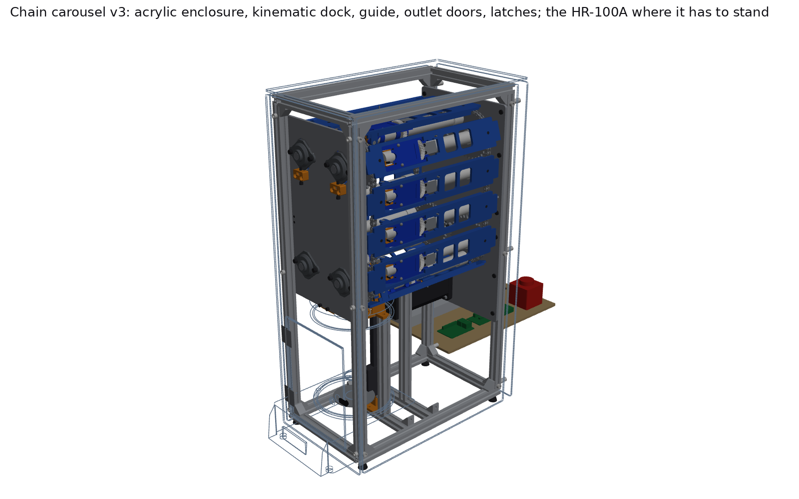 | 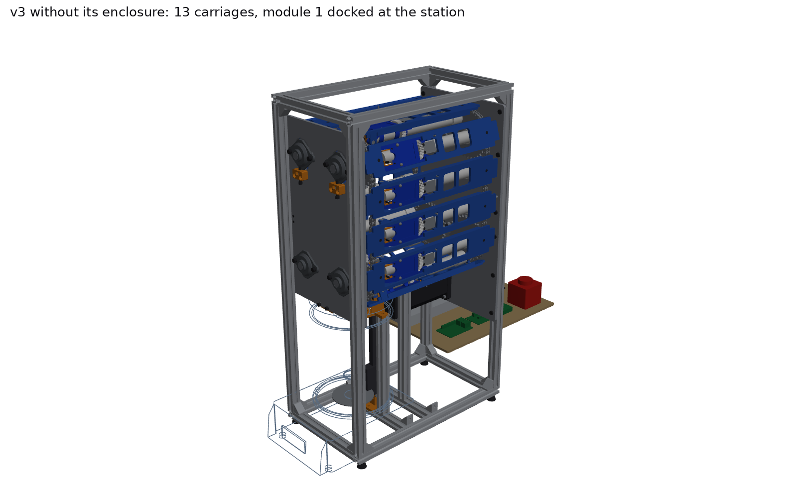 |
| **Station docked (cradle see-through)** | **Station parked: the EC 20 mm under the passing carriages** |
| 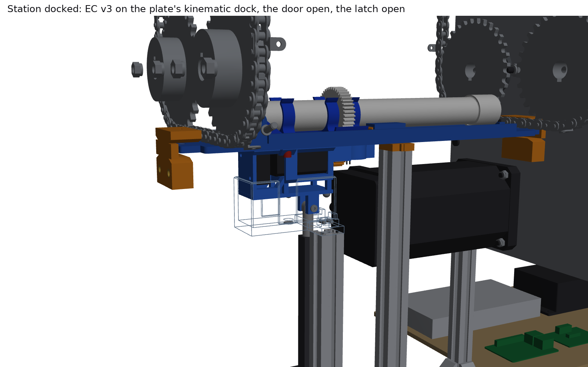 | 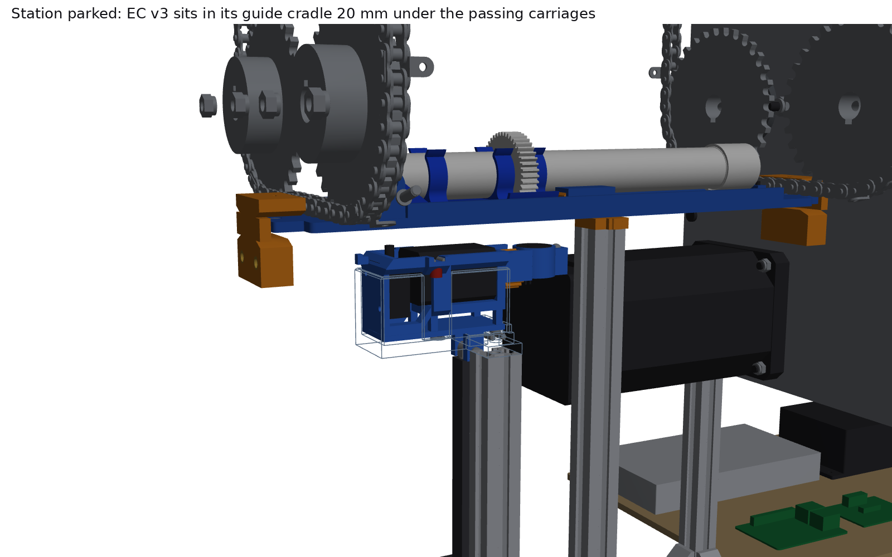 |

**Animation** ([MP4](renders/chain_carousel_v3.mp4)):
1. Assembly from scratch.
2. A module built on the bench: the auger into the v3 plate, the dock balls, the armature, the outlet door.
3. All 13 carriages loaded past the side tabs, one index at a time, then a lap.
4. The enclosure goes on.
5. One full station cycle.
6. Both hatches, and a carriage swap through the side hatch.

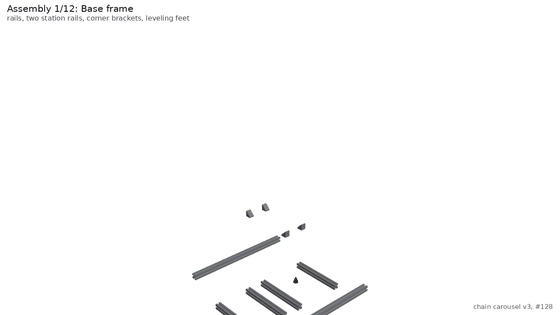

## What changed, item by item

Each item's GIF is in [`renders/features/`](renders/features), and each still is in [`renders/`](renders).

### 1. Kinematic couplings and magnets on Sam's small electronics carriage, and a plate to match

Sam asked to keep his compact Oct 13 electronics carriage (EC) and add the interface pieces his Aug 27 version had (kinematic couplings), plus magnets, with a new mounting plate to match.

- **Sam's Aug 27 carriage.** Onshape's API was out of calls this run (402), so I read his Aug 27 design from his fit-together video ([youtu.be/BSgpeKZgoXU](https://youtu.be/BSgpeKZgoXU), through the lab Pi). It has four cone-tipped posts that seat in four holes in the plate.
- **Why v3 has three contacts, not four.** Four cones over-constrain the dock. Between the printed parts' tolerances and the plate's flex, three posts seat and the fourth fights them, so where the EC ends up depends on which three won.
- **v3 uses a Kelvin clamp,** which is exactly six contacts:
  - **A:** a 1/4 in chrome-steel ball pressed into the plate's underside sits in a **cone** on the EC (3 contacts);
  - **B:** a second ball sits in a **vee** of two steel dowels, its groove pointing at A (2 contacts);
  - **C:** a ball on the EC presses on the plate's **steel armature**, which is the flat (1 contact).

  The EC lands in the same place on every plate, to microns, and nothing fights.
- **Magnets:**
  - one **N52 magnet** under the cone and one under the vee pull the plate's balls in, so the dock holds itself;
  - v2's switchable **dock electromagnet** (Adafruit 3872) now sits 14.5 mm in front of C and pulls the armature for the gear mesh's preload while the auger turns.
- **Why the balls go on the plate.** The 13 plates get the cheap, robust half (two pressed balls each). The single EC gets the precise half (the cone, the dowel vee, the magnets).
- **Sam's rim no longer locates.** His carriage's top rim is cut 1.8 mm so only the three contacts touch the plate. The pinion's centre distance stays v2's 32.25 mm.
- **Plate v3** is Sam's Oct 13 plate with additions (`parts3.plate_additions`):
  - two ball pockets at Sam's (30, ±18.5), 1 mm clear of the NEMA 11;
  - the armature's two inserts;
  - a 1 mm relief over the motor;
  - the latch keeper (item 4a);
  - inserts for the door housing (item 4).

  All 13 plates are reprinted, module 1's included.
- **EC v3** is Sam's Oct 13 carriage printed with additions (`parts3.ec_additions`):
  - two ears carrying the cone and the vee;
  - v2's magnet bracket as a back bracket holding the electromagnet and ball C;
  - a base with three balls and a slotted clevis (item 2);
  - the door finger (item 4).

| The dock, plate see-through | 12 mm before seating |
|---|---|
| 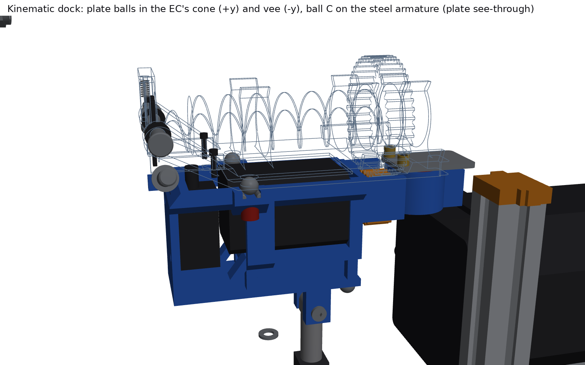 | 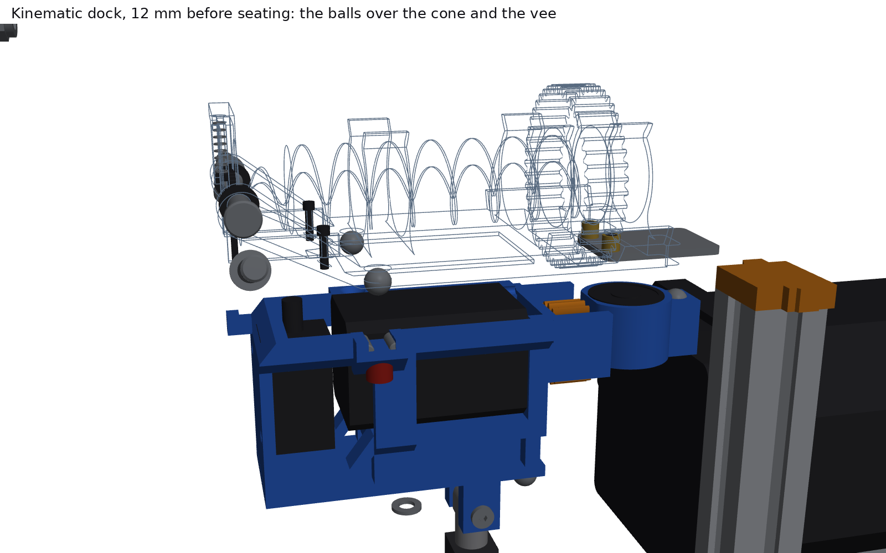 |

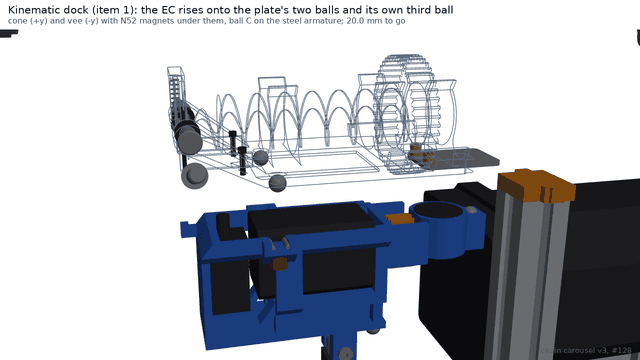

### 2. A guide the EC parks in, so it is never an inverted pendulum

Sam's original intent: the EC has a guide, almost like kinematic couplings on the bottom too, so it can interface with the auger and fully remove itself into the guide while the carriages pass, without being an inverted pendulum.

- **The cradle.** A printed **guide cradle** stands on a 2020 post beside the P16.
  - Its floor is a second Kelvin clamp: a cone, a dowel vee and a steel flat for three balls under the EC's new base.
  - The EC parks on that seat 20 mm under the passing carriages, so its parked position repeats as well as the dock does.
  - Side walls run 0.3 mm off the EC's body, with a front wall 0.3 mm ahead of it.
- **The rise.** The P16 lifts the EC through a pin under its back half, 6 mm behind its centre of mass. The EC leans on the front wall while it rises, and the walls hold it square until its balls are inside the dock's cone and vee.
- **No back wall.** The tilt carries the EC backward and up out of the cradle, parallel to the side walls.
- **What replaced v2's U-yoke.** v2's U-yoke with stub pins at the EC's centre-of-mass height, and its approach fork, are gone. The guide does their job: the EC is never balanced on its pin unsupported.
- **The pin rides in 2 mm slots (lost motion).** The P16 can stop anywhere near the dock or the seat without pushing on either. The magnets hold the dock and gravity holds the seat.
- **Fixed by the checks:**
  - **The rod at large tilt:** the P16's rod ends up lying along the EC's base. The clevis cheeks are now 9.6 mm apart so the rod swings between them at any angle (two PTFE washers each side take up the gap round the rod end's 6 mm tab), and the pin sits 12 mm under the base so the rod passes under the base's flat ball at 90°.
  - **The cradle's floor** is open behind the rod's path.

| Parked on its seat (cradle see-through) | The EC in the cradle |
|---|---|
| 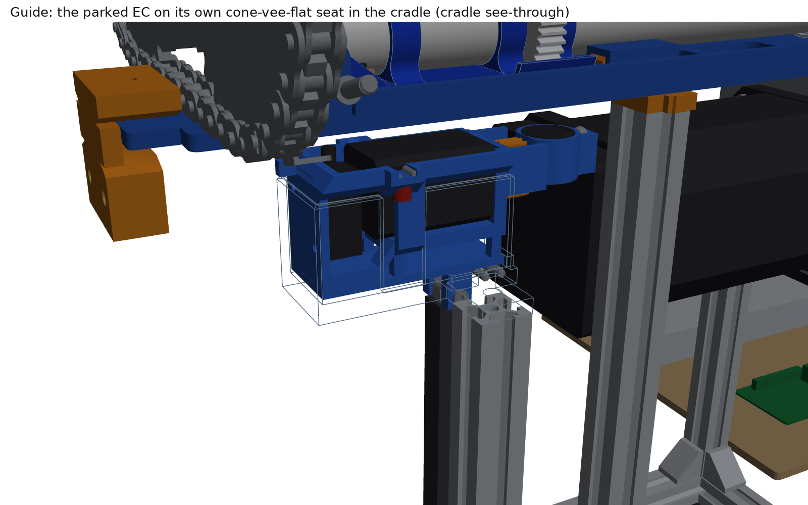 | 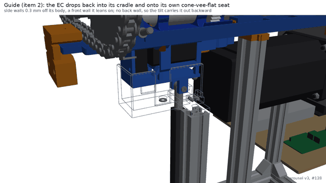 |

### 3. Simulations of the new interface

See [sim/README.md](sim/README.md), which has the model, each run, the plots, the video and what it changed. SIM_SUMMARY

### 4. A door on every auger's outlet that the station opens

Sam was worried that powder moves around in air, and that any open outlet contaminates. He asked for a cap on each auger that the station removes or opens, with the EC pushing a spring-loaded door.

- **The door.** A printed housing between the hinge knuckles holds a 1.5 mm **shutter**. It sits 0.3 mm in front of the auger's end face, because the auger turns and the shutter doesn't.
- **Closed:** a stainless spring holds the shutter over the 3 mm exit, overlapping it by 2-2.5 mm.
- **How it opens:**
  - The shutter's own +y strip runs down beside the exit, out of the dose stream, to below the plate.
  - A **finger on the EC** meets the strip in the dock's last 6 mm and lifts the shutter 6 mm. The exit opens only while the EC holds the module.
  - It stays open through the tilt. The shutter opens away from the stream at every tilt.
  - It shuts before the EC lets go: when the EC parks, the spring closes the shutter first.
- **Spring:** 0.27 N shut, 0.63 N open.
- **Travel cut from 8.5 to 6 mm.** At 8.5 mm the 3 mm spring ran nearly solid.

| Open (docked) | Shut (parked) |
|---|---|
| 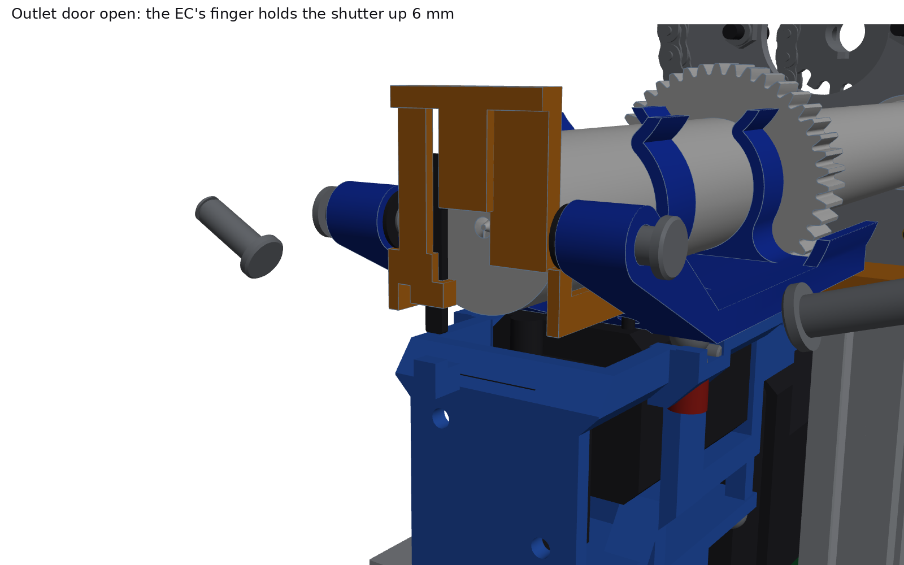 | 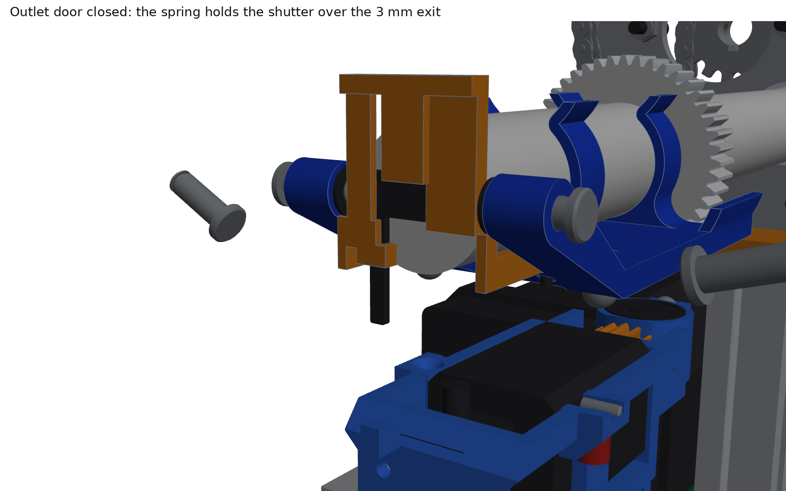 |

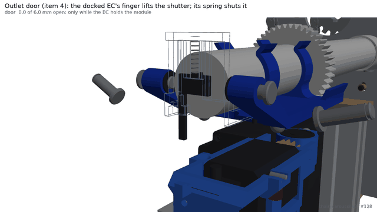

### 4a. A latch that holds the plate upside down and lets go at the station

Sam asked for a clip that keeps the mounting plate on its carriage upside down and comes unclipped at the dosing station.

- **The latch.** Each carriage has a printed **bolt** that slides along the auger behind the plate. A spring pushes it 3 mm over a keeper on the plate's back end.
- **Opening at the station.** A **fixed rail** draws the bolt back 4.5 mm through a dowel follower that sticks out under the carriage.
  - Every latch is open while its carriage is at the station: there the module is right side up, resting on the carriage.
  - It closes as the carriage leaves.
- **What it replaces.** v2's snap hooks had to be forced open by the tilt and pressed shut again through the magnet. This needs no force from the station.
- **Fixed by the checks:**
  - Carriages starting round the bottom corners tip, and their outer faces dip up to 7 mm more than 28 mm from the station. The latch therefore sits on the -y side, and the rail spans ±4 mm about the station with 25° ramps, inside that ±28 mm.
  - The rail's post is under it.
  - The housing sits 2.5 mm behind the keeper, because the keeper's corner swings back in the first 6° of tilt.

| At the station: the bolt drawn back | Half an index away: the bolt home |
|---|---|
| 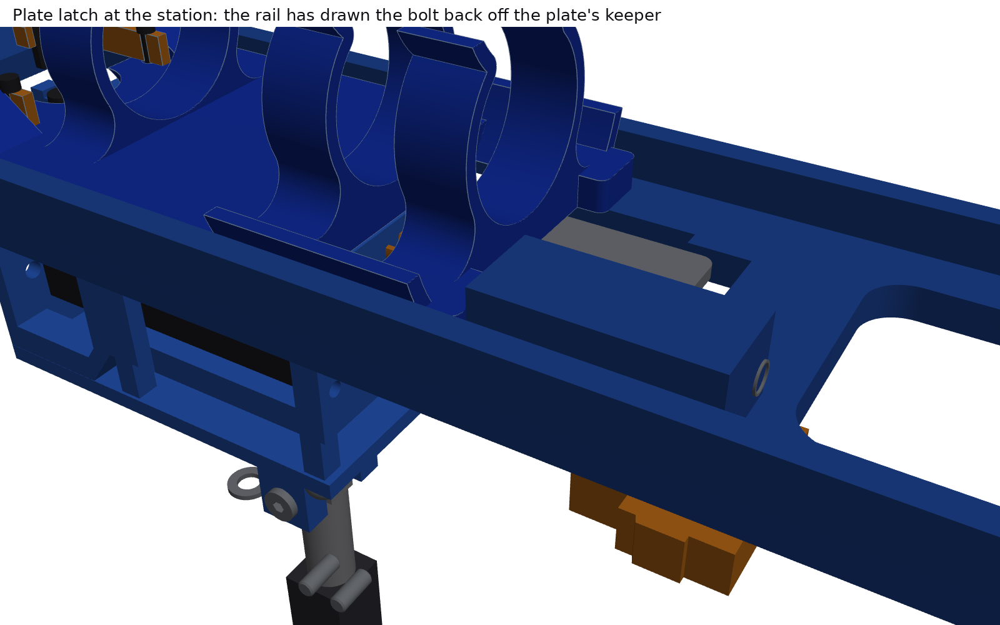 | 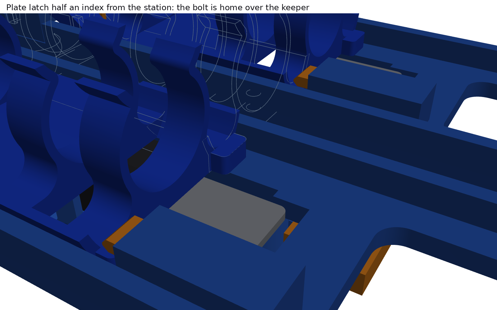 |

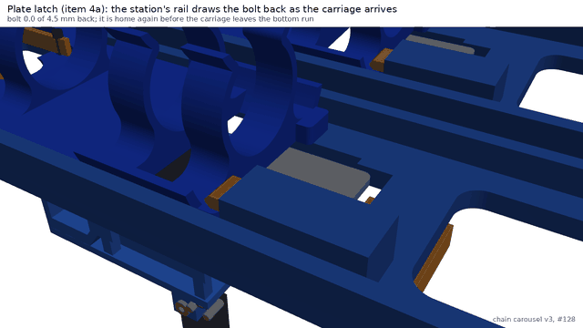

### 5. Acrylic walls and two hinged hatches

Sam loves the form factor and wants clear walls on the 8020 frame against drafts, with a hinged hatch at the front for the scale and one on the side for swaps.

- **Walls:** 3 mm clear cast acrylic on all four sides and the top.
  - The panels stand on **6 mm nylon spacers** outside the frame, because the side runs' carriages come to within 5 mm of the frame's faces.
  - At the back the spacers are **30 mm**, to clear the drive sprocket.
  - Outside: **455 x 262 x 740 mm**. The frame is 418 x 244.
- **Front hatch:** 180 x 230 mm, under the station, where the beaker goes in.
- **Side hatch:** 360 x 150 mm on +y, at the loading position. It is wide enough for a whole carriage.
- **Doors:** 4 mm larger than their openings all round, each on two stainless butt hinges, with a printed knob and a turn button.
- **Panels:** cut from `dxf/panel_*.dxf` and `dxf/hatch_*.dxf`.

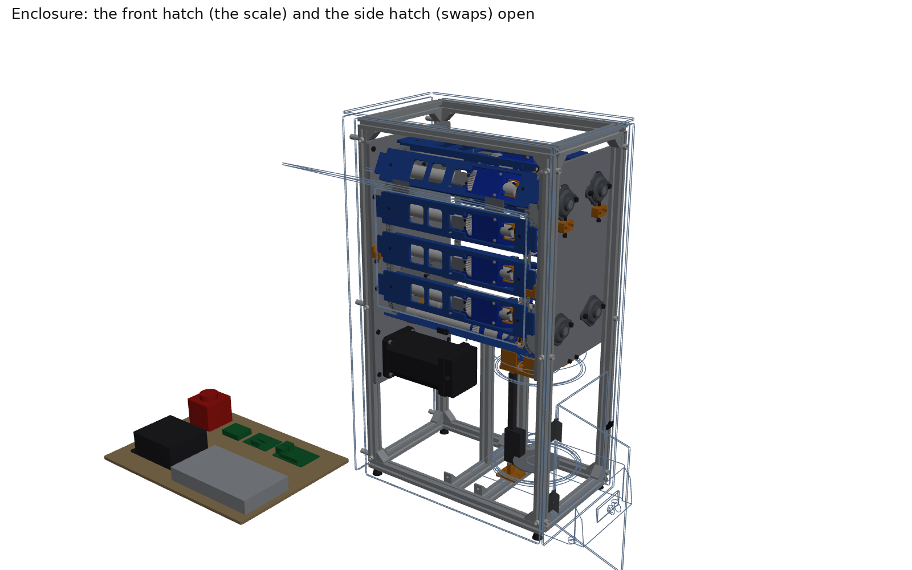

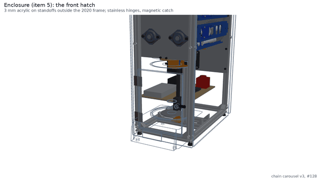

### 5a. Side tabs at the loading position

Sam asked for tabs like the station's hold-downs, on the side, so the swap pulls against the frame and not the chain.

- **The tabs.** Two printed tabs at the loading position, on the side plates' inner faces, wrap each carriage's tongues.
- **How they let go.** Their lips cover only the bottom 8 mm of a tongue. The carriage's own swap slide (10 mm up, which frees its hooks from the A-1 tabs) frees it from the side tabs too.
- **Fixing.** They screw in from inside, into tapped holes in the side plates; the frame's posts are right behind the plate there.
- **What they do in v3:**
  - The auger faces into the loop, so it can't come off its plate through the hatch. The whole carriage comes out instead, as in v2.
  - The tabs hold it while its two screws come out and go back in.
  - **v4's tabs take the pull of an auger coming off its plate.** That is what item 7 makes possible.

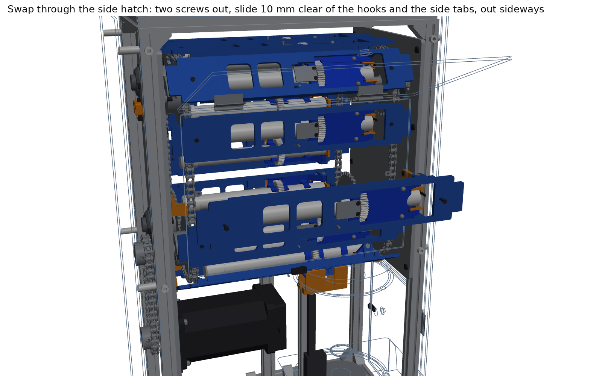

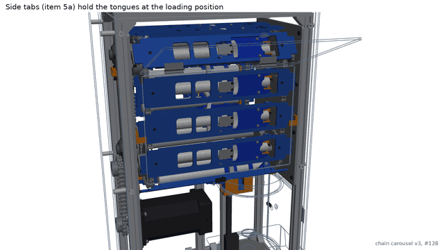

### 6. No funnel, and the scale in the assembly: why the EC is "too close to the front"

Sam ruled out a funnel, because it cross-contaminates. He asked for the scale to be modelled and put in the assembly. If the EC turns out to be too close to the front to be helpful, he wants a GIF showing why before anything about it changes.

**The scale is the lab's A&D HR-100A** (102 g x 0.1 mg, RS-232), modelled from A&D's manual (HR-A/HR-AZ section 22):
- base 198 wide x 253 deep;
- 315 mm tall over its round glass breeze break (156 mm inside, 198 mm high above the pan);
- pan Ø90 at 86.5 mm, its centre 162 mm behind the display edge.

**v3 draws it where it has to stand to take a dose without a funnel: its pan under the dose point.** The dose point doesn't move, because the auger's exit sits on the hinge axis.

**It can't stand there.** `check_interference.py --scale` lists every part inside it ([`checks/scale.json`](checks/scale.json)), and the GIF slides it in from the front:

| The balance first touches it when the pan is ... before the dose point | Part |
|---|---|
| 176-181 mm | the frame: the front base cross rail, the post-foot brackets, the +y base rail and a post |
| 148-155 mm | the front hold-down and its screw |
| 86-89 mm | EC v3 and its guide cradle |
| 55-62 mm | the NEMA 11, the P16 and its base clevis, a vee dowel, a seat magnet |
| 32-43 mm | the station rail, the cradle post, their corner brackets, the P16's base pin |
| 8 mm | the steel pinion |

That is 19 kinds of part (27 instances). Even the parts nearest the dose point stop it 8 mm short.

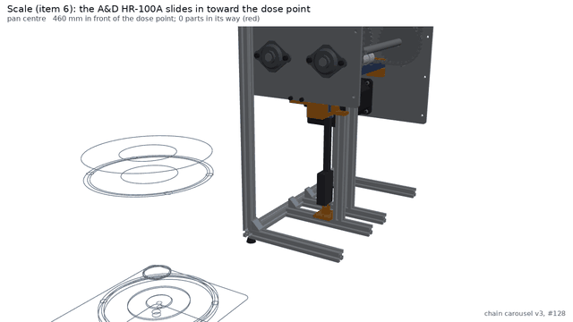

**Why:**
- **The EC sits right behind the outlet.** Sam's carriage docks 2 mm behind the auger's outlet: its front face is at his x 2.3 and the exit at 0.4.
- **Its whole column stands inside the breeze break.** The guide cradle and the P16 stand under the EC, 2-110 mm behind the dose point. That is inside the 86 mm the breeze break reaches round the pan.
- **Smaller vessels don't help either.** Even a 38 mm beaker with no balance can't sit under the dose stream at 30° without touching the parked EC.
- **The frame is in the way too.** Its front base rail and the front hold-down stand where the balance's base and lid would go.

**What a future version would have to do (not done here, as Sam asked):**
- **Move the EC's column out of the breeze break.** Either dock the EC behind the auger's gear (its NEMA 11 reversed behind the pinion), or lift it on an arm from behind the balance.
- **Make room in the frame.** Open the frame's front base rail, and raise the front hold-down's foot, so the balance slides in under the station.
- **Drop the dose through the top door.** The dose would then fall about 210 mm through the breeze break's top door, which is how the single doser doses today.

## How it works: one dose

1. **Index.** Carriage 1 indexes to the station.
   - Its tongues enter the hold-downs (v2's).
   - The station's rail draws its latch bolt back. The plate is free, resting on the carriage.
2. **Rise.** The P16 lifts the EC out of its cradle.
   - The guide walls keep it square while it leans on the front wall.
   - In the last 6 mm its finger lifts the outlet door.
   - In the last 3 mm the dock electromagnet comes on and the pinion turns slowly, so its teeth find the 44T gear's gaps (v2's docking seek).
3. **Seat.** The plate's balls seat in the cone and the vee, and ball C seats on the armature. The P16 backs off 1 mm so its pin floats in the slots; the magnets hold the dock.
4. **Tilt.** The P16 pushes on, and module and EC tilt together to the dose angle, out of the cradle. 30° is the default and needs 60.8 mm of the P16's stroke. The 150 mm stroke reaches 86.5°; nothing collides up to 90°.
5. **Dose.** The NEMA 11 turns the auger, and the solenoid taps. The dose falls from the exit, which sits on the hinge axis, straight down with no funnel.
6. **Back to level.** Hold 0.5 s, tilt back to level, and reverse the auger one turn at rest (v2's leakage findings).
7. **Undock.**
   - The electromagnet goes off.
   - The P16 pulls the EC off the seat magnets; the plate stays on its carriage.
   - The door shuts as the finger drops away.
   - The EC settles on its cradle seat.
8. **Leave.** The next index carries the carriage off the rail, and its latch closes over the keeper.

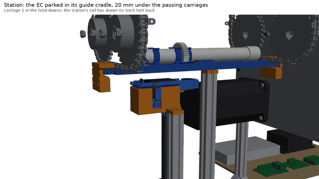

## The design in numbers

| | v3 | Why |
|---|---|---|
| Dock | Kelvin clamp. Plate balls (1/4 in 52100) at Sam's (30, ±18.5); EC ball C at (114.5, 0) on the armature. Cone 90°, vee of two 1/8 in dowels 6.7 mm apart | Exactly constrained. The triangle is 37 x 84.5 mm and contains the EC's centre of mass |
| Dock preload | D44-N52 under the cone and under the vee; Adafruit 3872 electromagnet at (100, 0), 10.6 N at 0.15 mm | The seat magnets keep the EC seated with the coil off; the coil holds the mesh. Pulls: [sim/README.md](sim/README.md) |
| Guide | Cradle, 0.3 mm side and front clearance. Parking seat: cone (69, 11.5), vee (69, -11.5), flat (40, 0) under the EC's base. Parks 20 mm below the dock | Square rise; the parked position repeats; clear of the passing carriages |
| Actuator link | Pin 4 x 20 shoulder screw at Sam's (58, -76), in 2 mm slots; cheeks 9.6 mm apart with PTFE washers | Lost motion, so the P16 never forces the dock or the seat; the rod swings between the cheeks at any tilt |
| Door | 1.5 mm PETG shutter 0.3 mm off the auger face; 6 mm travel; 3 mm stainless spring at 0.06 N/mm | Opens only while docked; shuts before undock |
| Latch | Bolt 3 mm over the plate's keeper; 4.5 mm stroke; rail flat ±4 mm + 25° ramps on the -y side | Holds the plate upside down; opens only at the station |
| Enclosure | 3 mm cast acrylic on 6 mm (back 30 mm) spacers; 455 x 262 x 740 mm; hatches 180 x 230 (front) and 360 x 150 (side) | Drafts off the balance and the powder; the side hatch passes a whole carriage |
| Side tabs | Lips over the tongues' bottom 8 mm, foot 4 mm outside, two M5 x 8 into tapped side plates | The swap's pushes go to the frame; the swap slide frees them |
| Scale | A&D HR-100A, drawn at the dose point | Collides with the station (item 6) |
| Cost | BOM_TOTAL ([BOM.md](BOM.md)) | Lines still marked estimate add up to BOM_EST |

## Checks

[`check_interference.py`](check_interference.py) computes the OCC boolean volume between every pair of instances and reports anything over 0.5 mm³. By-design contacts are skipped by part key: balls in their seats, dowels in their holes, magnets in pockets, the shutter in its grooves, the latch bolt in its housing, and screws in inserts. Results are in [`checks/`](checks).

| Check | What moves | Result |
|---|---|---|
| Home | Nothing: every pair of the 877 instances (the HR-100A left out, see `--scale`) | **0** |
| `--tilt` | The EC rising out of the cradle (0-20 mm, the door opening over the last 6), then module 1 + EC + P16 tilting 5-90° | **0** |
| `--swap` | Carriage 4 at the loading position, side hatch open: screws out 10 mm, slid 10 mm up, lifted 150 mm out | **0** |
| `--sweep --step 2` | The chain indexed one module the machine's way in 2-link steps (5 poses). Every latch rides the station's rail; the modules pass over the parked EC | **0**. A ±4-link, half-link sweep round the station (17 poses) is also clean |
| `--scale` | The HR-100A with its pan at the dose point | 27 instances of 19 parts in its way (item 6) |

What the checks found and changed this round:
- **The latch housing was turned the wrong way round** (a 120° rotation the wrong sign), which put it inside the loop. Fixed.
- **Sam's carriage's side posts** (his x 29-39, |y| 18) hit the cradle's walls. The walls are notched there.
- **The armature began inside the 44T gear's slot.** It now starts behind it, at x 89.5.
- **The EC's back bracket arms swept through the plate pads at small tilts.** The arms are 3 mm narrower and the pads start at |u| 15.5.
- **The P16's rod hit the clevis, and the flat ball at 90°** (item 2).
- **The latch rail collided with tipping carriages and its post with a follower.** The latch moved to -y, with a ±4 mm flat, the post under it, and an 18 mm follower.
- **The side tabs' screws had no room for their heads** (the frame's posts), and their feet stuck through the acrylic. They are now thin, screwed in from inside, and stop 1 mm short of the carriage's full-width body.
- **The door spring ran nearly solid.** The travel is now 6 mm.

## Things to look at before ordering or printing

1. **Measure the seat magnets (T6a) first.** Their pull on a 1/4 in ball through a printed cone, or through two dowels, is an estimate.
2. **Print EC v3 and the cradle, and check the guide by hand,** before buying the rest. The guide's 0.3 mm clearances need a calibrated printer.
3. **Reprint all 13 mounting plates.** v3's plate has pockets and a keeper that Sam's existing plate doesn't.
4. **The scale doesn't fit (item 6).** Weighed doses wait for the station that makes room for the balance (T8).
5. **The acrylic panels are laser cut** (SendCutSend or the BYU shop), from `dxf/`.
6. **The new McMaster parts:** McMaster's own part numbers and prices are in BOM.md where the lookup found them; the rest are marked estimate.

## How it goes together

[**ASSEMBLY.md**](ASSEMBLY.md) has 12 steps, each with a render and the BoM lines it uses.

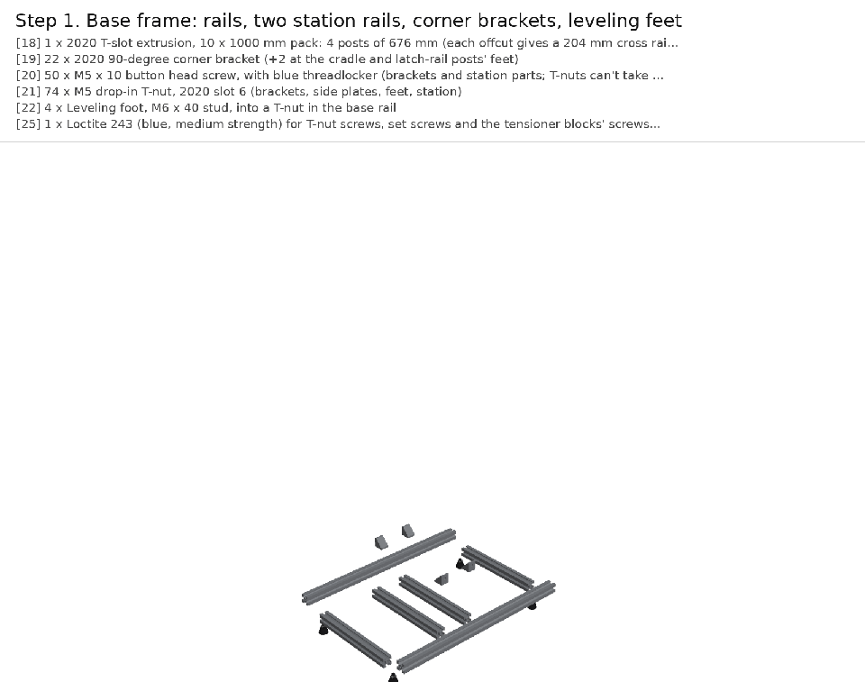

## Testing

[**TEST-PLAN.md**](TEST-PLAN.md) covers:
- T0-T3, the chain (v2's);
- T4 latches;
- T5 tilt clearance;
- T6 guide and dock (T6a seat magnets, T6b capture off-index, T6c seek and jam, T6d backlash);
- T7 the outlet door;
- T8 dosing, which is blocked by the scale;
- T9 transit and laps;
- T10 drafts with the enclosure;
- T11 side tabs and the swap.

[`test/chain_rig.py`](test/chain_rig.py) drives it from a Pi. Its v3 changes are the dock with the pin floating in its slots, the undock that pulls the EC off its seat magnets, and the HR-100A read over RS-232.

## Files

| File | What |
|---|---|
| [`params.py`](params.py) | v2's dimensions, then a v3 block: the dock, the guide, the door, the latch, the enclosure, the scale |
| [`parts3.py`](parts3.py) | The v3 parts: plate and EC additions, cradle, door, latch, carriage v3, panels, hatches, side tabs, HR-100A, beaker. [`parts.py`](parts.py) is v2's |
| [`layout.py`](layout.py) | Placements for any machine state: the station cycle, the latches, the door, the hatches, the swap, the scale |
| [`build.py`](build.py) | STEP assembly + components, STLs (including `electronics_carriage_v3.stl` and `mounting_plate_v3.stl`), DXFs (side plates, armature, acrylic) |
| [`check_interference.py`](check_interference.py) | Home, `--tilt`, `--swap`, `--sweep`, `--scale` |
| [`render.py`](render.py) | Stills, steps, the movie (`--movie`), the feature GIFs (`--features`), the scale-fit GIF (`--scale-fit`) |
| [`bom.py`](bom.py), [`docs.py`](docs.py) | BOM.md, bom.csv, ASSEMBLY.md |
| [`sim/`](sim) | MuJoCo models of the new interface |
| [`onshape/`](onshape) | The attempted export of Sam's Aug 27 Part Studios (402: the company's yearly API calls are used up), with its call ledger |

```bash
pip install cadquery vtk pillow imageio imageio-ffmpeg mujoco numpy scipy matplotlib
python build.py && python docs.py
python check_interference.py && python check_interference.py --tilt && python check_interference.py --swap \
  && python check_interference.py --sweep --step 2 && python check_interference.py --scale
xvfb-run -a python render.py --stills && xvfb-run -a python render.py --movie && xvfb-run -a python render.py --features \
  && xvfb-run -a python render.py --scale-fit
```

## Not done

- **Not built.** Every number is a prediction until the test plan runs.
- **Onshape:** no document was created or updated. The company's API calls for the year are used up (402 on the first call, logged in `onshape/api_calls.jsonl`). Sam's Aug 27 carriage came from his video, so its cone sizes are read off the frames, not measured.
- **The scale doesn't fit** (item 6). Sam asked to see why before the station moves.
- **The vendors' own CAD:** the P16, the NEMA 34 and the McMaster screws and nuts are v2's vendor geometry (v2's committed component STEPs). The new McMaster parts (balls, dowels, springs, spacers, hinges) are drawn from their catalogue dimensions.
- **Not sliced in Bambu Studio this round.** The STLs are exported for the new printed parts (EC v3, plate v3, cradle, door, latch, rail, side tabs, turn buttons). EC v3's ears need a 45° chamfer under them, which they have; nothing else overhangs.
