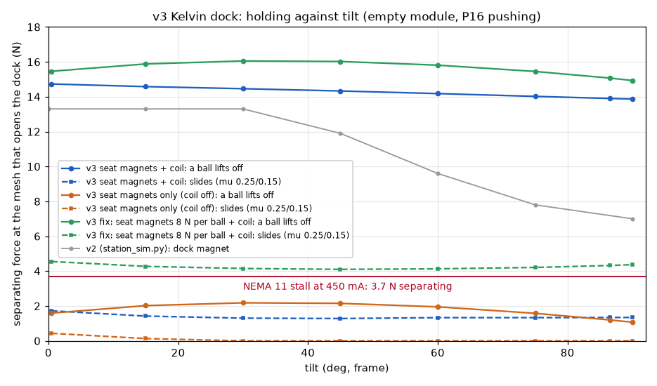
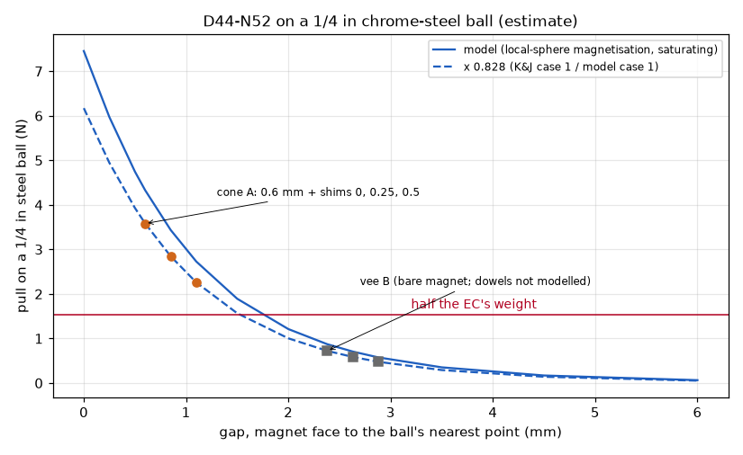
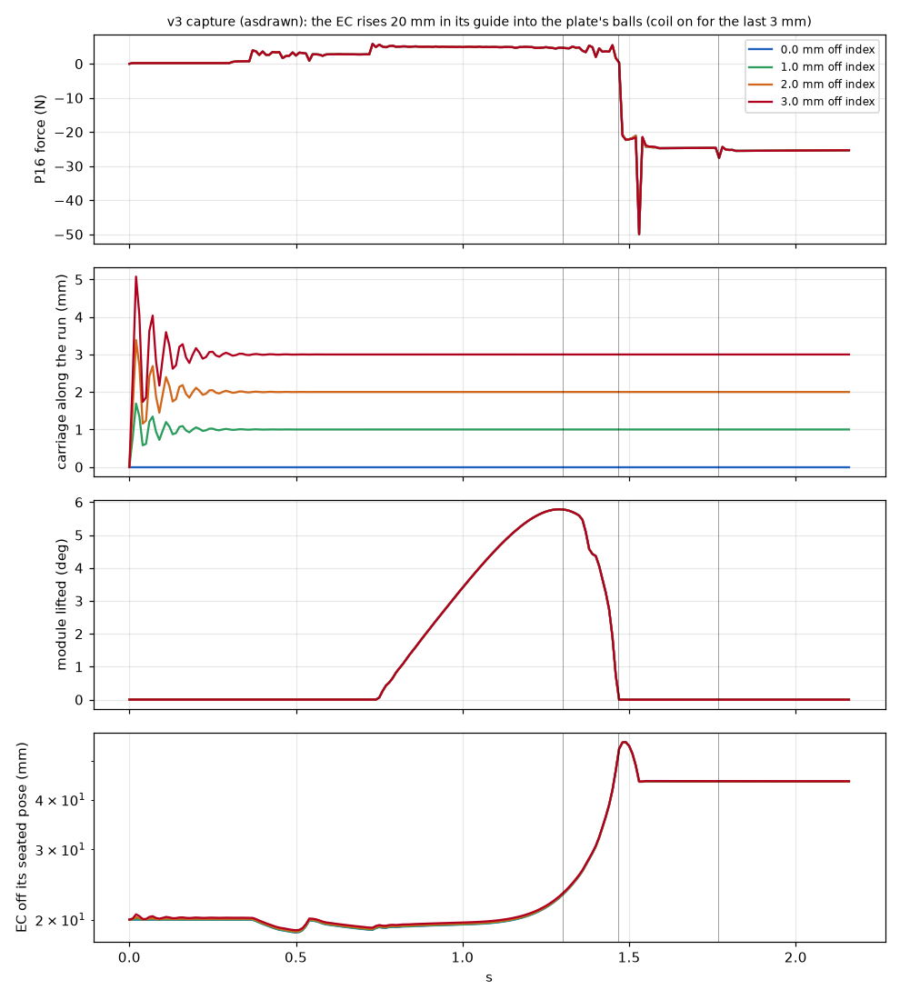
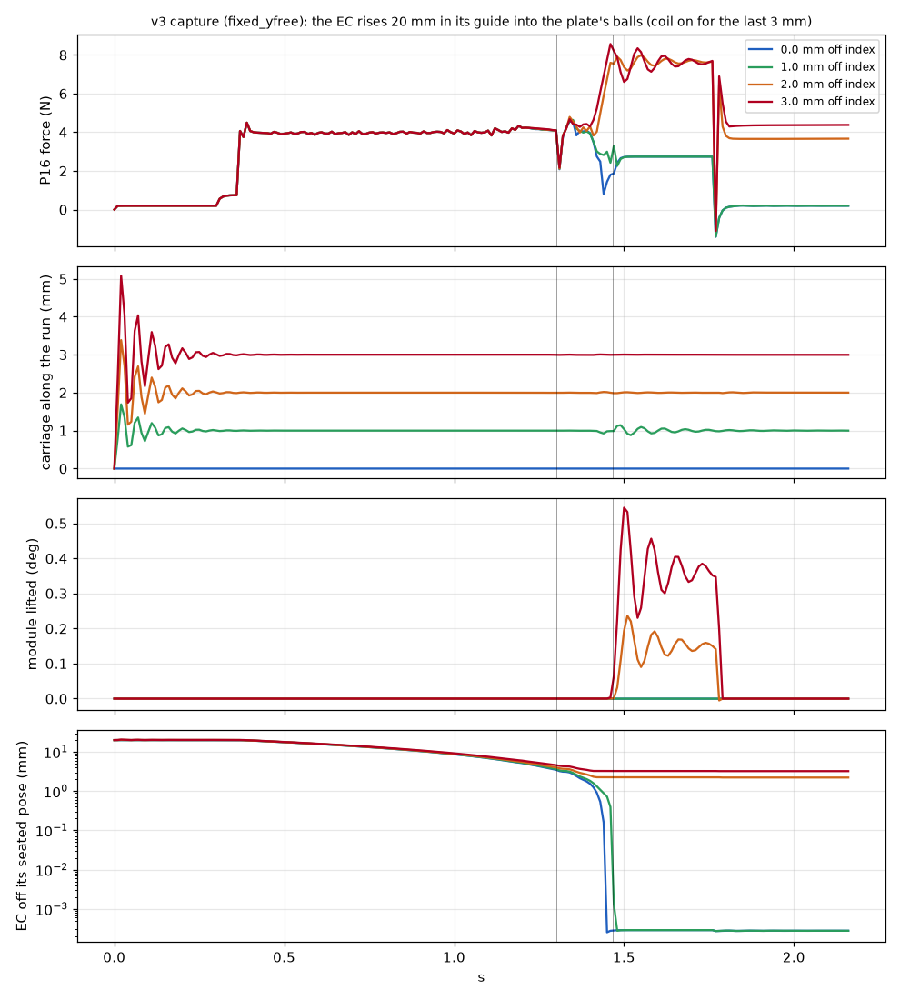
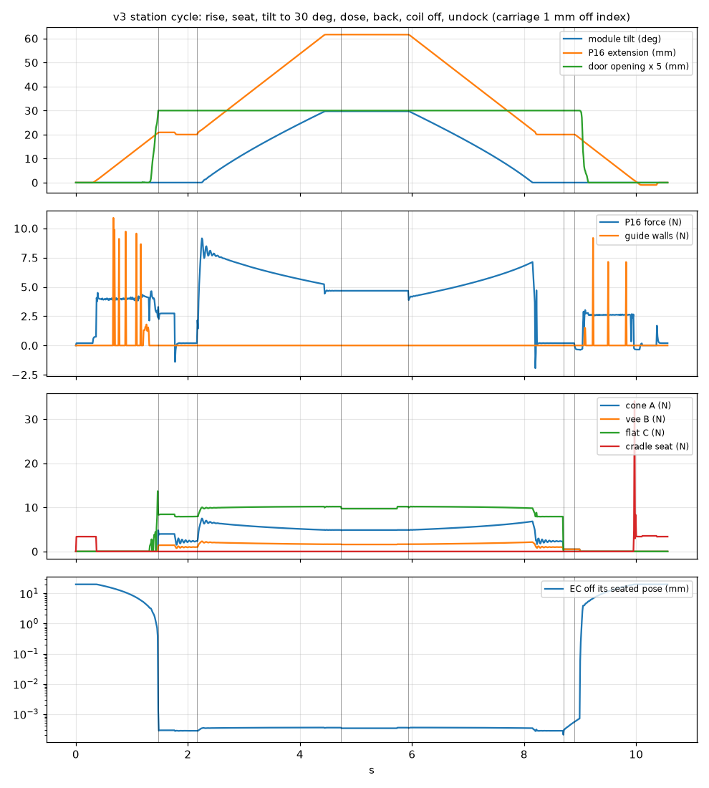
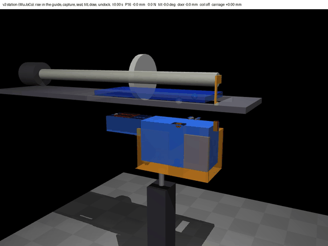
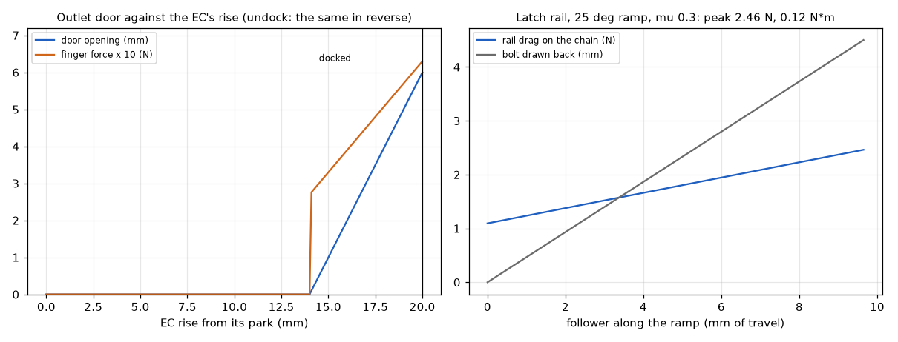

# Chain carousel v3: simulations of the new station interface (item 3)

Sam asked for "similar simulations to see how the interface will go with these new features". These are the v2 station models ([`../../chain-carousel-v2/sim/`](../../chain-carousel-v2/sim/README.md)) redone for v3's kinematic dock, seat magnets, guide cradle, outlet door and plate latch, plus a v4 dock run ([`../../chain-carousel-v4/sim/`](../../chain-carousel-v4/sim/README.md)).

**Simulated, not built: every number here is a prediction.** The tests that check them are in [`../TEST-PLAN.md`](../TEST-PLAN.md) (T4, T6a-c, T7).

| Script | Engine | What it answers | Results |
|---|---|---|---|
| [`kelvin.py`](kelvin.py) | numpy, scipy | Shared models: the seat magnet's pull on a 1/4 in ball, and the Kelvin-clamp statics (exact, and with friction as a linear program) | used by the two below and by v4 |
| [`dock_statics.py`](dock_statics.py) | numpy, scipy | Runs 1, 2, 4 and 5: dock holding against tilt, seat-magnet pull, the door, the latch | [`results/statics.json`](results/statics.json) |
| [`station_mj.py`](station_mj.py) | MuJoCo 3.17 | Run 3: the EC rising in its guide, capturing the plate's balls with the carriage off its index, seating, tilting, dosing and undocking (contacts only, no welds); the video | `results/station_mj_*.json` |
| [`collect.py`](collect.py) | | Gathers every run's JSON into [`results.json`](results.json) | |

```bash
cd cad/chain-carousel-v3
pip install mujoco numpy scipy matplotlib imageio imageio-ffmpeg pillow
python sim/dock_statics.py                      # runs 1, 2, 4, 5 (the magnet integrals take 2 min the first time, then cached)
python sim/station_mj.py capture --tag asdrawn  # run 3 as drawn: carriage 0, 1, 2, 3 mm off its index
python sim/station_mj.py capture --offs 0,0.5,1,2,3 --swing-preload 0.3 --finger-fix --tag fixed
python sim/station_mj.py capture --swing-preload 0.3 --finger-fix --ey-free 3 --tag fixed_yfree
python sim/station_mj.py cycle --off 1 --swing-preload 0.3 --finger-fix --ey-free 3 --tag fixed_yfree_cycle
MUJOCO_GL=glfw xvfb-run -a python sim/station_mj.py video --off 1 --swing-preload 0.3 --finger-fix --ey-free 3 --tag video
python sim/collect.py                           # results.json
```

## Summary (item 3)

- **Dock holding through the tilt (run 1).** With the seat magnets and the coil, a ball lifts off its seat only at 13.9-14.7 N of separating force at the mesh (tilt 0.5-90 deg). The NEMA 11 at 450 mA pushes 3.7 N, so the motor stalls first, with 3.8 times margin at 90 deg (v2: 7.0 N, 1.9 times).
  - **Sideways it is weaker.** The mesh's tangential force slides ball B sideways in its lightly loaded vee at 1.3-1.7 N with friction (0.1-0.6 N frictionless). That is enough for dosing (0.75 N) but not for a jam.
  - **With about 8 N on each seat ball,** it slides only at 3.8-4.6 N, above the stall.
- **Seat magnets (run 2, feeds T6a).** A D44-N52 pulls a 1/4 in ball with:
  - **cone:** 3.6 N at its 0.6 mm gap; 2.8 N and 2.3 N with 0.25 and 0.5 mm shims; +-40 %.
  - **vee:** 0.7 N through its dowels' 2.38 mm (then 0.6 and 0.5 N); a cruder estimate.
  - **Coil off, the EC does not stay seated at tilt 0.** Both magnets sit on the front ball line, and the EC's centre of mass is 22 mm behind it, so it pivots on its front balls. Ball C needs 0.8 N and gets none.
- **Capture (run 3, MuJoCo).**
  - **As drawn, the EC falls over in its guide.** The P16 is pinned at both ends and swings freely, so nothing holds the EC's bottom. It pivots on the front wall's top edge (28 deg lean, the P16 at 50 N).
  - **With two fixes it seats at 0 and 0.5 mm off index** (P16 under 5 N). The fixes: a 0.3 N*m spring holding the P16 on a stop at vertical, and 2.9 mm (not 0.8 mm) of overlap between the door finger and the push strip.
  - **It does not seat at 1-3 mm.** The chain's 5.6 N/mm along the run is too stiff for the cone to drag the carriage (0.27 mm at 1 mm off).
  - **Letting the EC float +-3 mm along the run** seats it at 1 mm. At 2-3 mm ball A rests on the cone's 3.49 mm rim either way.
- **Full cycle (1 mm off, all three fixes).** It seats, tilts to 29.7 deg and stays within 0.0003 mm of its seat while dosing. The P16 peaks at 9.2 N (rated 50 N). It comes back to level, undocks, and parks on its cradle seat.
- **Outlet door (run 4).**
  - **Opening:** only in the dock's last 6 mm. It is 6.0 mm open when seated, with 0.65 N on the finger, and stays open through the tilt.
  - **Shutting:** in the first 5-6 mm of the undock, about 4 mm after the balls leave their seats and 14 mm before the EC parks.
  - **Holding shut:** 0.27 N of spring against a 0.0032 N shutter, so it takes 83 g to open.
- **Plate latch (run 5).**
  - **Load:** 1.7 N on the bolt upside down, 2.2 N at 100 mm/s. The bolt's faces are square to its travel, so nothing pushes it back.
  - **Rail drag on the chain:** at most 2.5 N (0.12 N*m at the sprocket).
  - **Closing:** the bolt closes on its own, because the 25 deg ramp is steeper than friction's 17 deg.
- **v4 (run 6).** Without a coil, the auger-side dock lifts off at 2.3-3.2 N, under the 3.7 N stall, and slides at 0-0.5 N. It needs more preload or a lower motor current.

## The model

Common to all runs (Sam's frame: x along the auger from the hinge axis, y along the hinge axis and the run, z away from the plate; geometry from [`../params.py`](../params.py) and [`../layout.py`](../layout.py)):

- **Masses** (`dock_statics.py`, from the CAD's dimensions at 1.27 g/cm^3 for PETG plus the bought parts):
  - module v3, empty: 0.127 kg, centre of mass at x 90.1 mm (v2's parts with the 31.5 x 22 x 2 mm armature, the two dock balls, the door and the keeper); 50 g of powder adds 0.050 kg at x 125;
  - EC v3: 0.311 kg, centre of mass at x 51.9, z -34.2 mm docked (v2's 0.285 kg EC plus the ears, the ball C boss, the base, clevis cheeks, four balls, two dowels, two D44-N52 and the shoulder screw).
- **Dock (Kelvin clamp):** plate balls A (cone) and B (vee) at (30, +-18.5), ball C on the armature at (114.5, 0). Cone 90 deg, mouth radius 3.49 mm at the ear's top. Vee: two 1/8 in dowels 6.73 mm apart.
- **Preload:** seat magnets from run 2 (cone 3.58 N at its 0.6 mm gap, vee 0.72 N at 2.38 mm); coil F = 20 / (1 + g / 0.4 mm)^2 N (v2's law, 10.6 N at the 0.15 mm design gap) at x 100.
- **Gear mesh** (v2's): a force pair at the 44T pitch point (x 83.4, z -22). Separating force pushes the EC away from the plate; tangential force (along y) = separating / 0.55 (steel pinion on the printed gear, dry PTFE). NEMA 11 at 450 mA stalls at 0.067 N*m, so 6.7 N tangential and **3.7 N separating** at the pinion's 10 mm radius.
- **P16:** pinned at both ends, so it pushes only along its rod. While tilting, its force is whatever holds the module and the EC up about the hinge (3.2 N at 30 deg, empty module).
- **Door finger:** 0.63 N on the push strip when open, pushing the module away from the EC.

## Run 1: dock holding through the tilt

**What it models** (`dock_statics.py`, `run_dock`): the EC on its three contacts at each tilt, the P16 pushing (at tilt 0 the pin floats in its slots, as in the README's step 3). The separating force at the mesh (with its tangential share, worst sign) is raised until the contacts can no longer hold it. Three criteria:
- **a ball lifts off** its seat: the dock opens and the mesh's centre distance grows. This is v2's criterion.
- **a ball slides** out of its seat sideways, with friction (0.25 steel on printed PETG, 0.15 steel on steel): the best case of a frictional dock (a linear program over the friction cones).
- **frictionless**: the exact Kelvin clamp, statically determinate, the most conservative.

Module empty (the worst case: the powder's weight presses the dock shut through the P16).



| Separating force at the mesh that opens the dock (N) | 0 deg (pin floating) | 0.5 | 15 | 30 | 45 | 60 | 75 | 90 |
|---|---|---|---|---|---|---|---|---|
| Seat magnets + coil: a ball lifts off | 11.8 | 14.7 | 14.6 | 14.5 | 14.3 | 14.2 | 14.0 | 13.9 |
| Seat magnets + coil: slides (with friction) | 0.6 | 1.7 | 1.4 | 1.3 | 1.3 | 1.3 | 1.3 | 1.3 |
| Seat magnets + coil: frictionless | 0.06 | 0.6 | 0.3 | 0.2 | 0.2 | 0.15 | 0.1 | 0.1 |
| Seat magnets only (coil off): a ball lifts off | 0 | 1.6 | 2.0 | 2.2 | 2.2 | 2.0 | 1.6 | 1.1 |
| Seat magnets only (coil off): slides (with friction) | 0 | 0.4 | 0.1 | 0 | 0 | 0 | 0 | 0 |
| Coil only (no seat magnets): a ball lifts off | 9.3 | 12.2 | 12.1 | 11.9 | 11.8 | 11.7 | 11.5 | 11.3 |
| v2, dock magnet, weld read-back (`station_sim.py`) | 13.3 | | 13.3 | 13.3 | 11.9 | 9.6 | 7.8 | 7.0 |
| Fix, seat magnets 8 N per ball + coil: a ball lifts off | 13.0 | 15.5 | 15.9 | 16.1 | 16.0 | 15.8 | 15.5 | 14.9 |
| Fix, seat magnets 8 N per ball + coil: slides (with friction) | 3.8 | 4.6 | 4.3 | 4.2 | 4.1 | 4.1 | 4.2 | 4.4 |

- **Lifting off: the motor always stalls first, with the coil on.** The dock carries 13.9-14.7 N of separating force before a ball lifts, against the 3.7 N the NEMA 11 can push at 450 mA: 3.8 times margin at 90 deg (v2: 1.9 times). The Kelvin dock holds better than v2's rim at large tilt (13.9 N at 90 deg against v2's 7.0 N), because the coil now pulls 70 mm from the front balls and the P16's push lands between the contacts.
- **Sliding: the motor does not stall first.** The mesh's tangential force (1.8 times the separating force) yaws the EC about the cone. Ball B, 37 mm from the cone, has to take it sideways in its vee, and B is lightly loaded (its magnet is 2.38 mm away under the dowels, 0.7 N). With friction, ball B starts to slide at 1.3-1.7 N of separating force (2.4-3.1 N tangential, 0.024-0.031 N*m at the pinion). That is above dosing (0.75 N separating at the nominal 0.03 N*m at the auger: 1.7-2.3 times margin), but under the stall (3.7 N). On a jam, ball B creeps sideways in its vee before the motor stalls. The mesh stays in (no ball lifts) and the magnets pull it back when the load drops, but the dock is not exactly located while it happens, and repeated slips wear the printed cone.
- **The fix tried** (`CASES` in `dock_statics.py`): stronger seat magnets, about 8 N on each ball (for example a larger magnet under the cone, and the vee's magnet moved from under the dowels to directly under the ball). Then ball B slides at 3.8-4.6 N, above the stall. The coil alone does not do it: the slide threshold rises only to 2.3-2.8 N with 3.6 N under the vee, so it needs both balls preloaded. The alternative is software: run the NEMA 11 at about 150 mA while dosing (stall about 0.022 N*m, 1.6 times the dosing torque), which keeps the stall under the slide threshold.
- **Coil off, the dock does not hold.** With the coil off and the pin floating at tilt 0 the EC tips about the two front balls (run 2). While tilting with the coil off, a ball lifts at 1.1-2.2 N, under the stall. Keep the coil on whenever the pinion can be driven.
- At 30 deg while dosing (frictionless solution): cone A 4.0 N, ball C 9.7 N, the vee's two dowels 1.8 and -1.2 N. The negative dowel force is the sideways slip above: friction carries it.

## Run 2: seat magnet pull (feeds T6a)

**What it models** (`kelvin.py`, `run_magnets`): the K&J D44-N52 (1/4 x 1/4 in) as two uniformly charged discs, Br 1.45 T (K&J lists 1.48 T max). The ball (1/4 in 52100) is split into 0.3 mm cells, each magnetised as a highly permeable sphere in its local field would be (M = 3 H), capped at 1.7 T (hardened 52100 saturates at about 1.6-1.8 T). The pull is the derivative of the co-energy with the ball's height. Check: the same magnet model on an ideal thick plate (the image method, exact for coaxial discs) gives 22.3 N at contact, against K&J's published "case 1" pull of 4.15 lb (18.5 N). So the central estimates below are the model times 0.83. The low bound is the point-dipole estimate at the ball's centre.



| Seat | Gap, magnet face to ball (mm) | Shim 0 | Shim 0.25 mm | Shim 0.5 mm |
|---|---|---|---|---|
| Cone A (printed cone, magnet 0.6 mm under the seated ball) | 0.6 / 0.85 / 1.1 | **3.6 N** (2.4-4.3) | **2.8 N** (1.9-3.4) | **2.3 N** (1.6-2.7) |
| Vee B (magnet under the two dowels, 2.38 mm under the ball) | 2.38 / 2.63 / 2.88 | **0.7 N** (0.55-0.87) | **0.6 N** (0.45-0.71) | **0.5 N** (0.37-0.57) |

- **Uncertainty:** the range in brackets is the dipole estimate (low) to the uncalibrated model (high). The cone's estimate is good to about +-40 %. The vee's is cruder: the steel dowels sit between the magnet and the ball. They carry flux to the ball, which probably raises its pull, and the model leaves them out. T6a measures it.
- **T6a's pass mark** (1.5 N at contact) is met by the cone (3.6 N) and probably missed by the vee (0.7 N, bare magnet).
- **Does it hold the EC seated at tilt 0 with the coil off? No, and not because the magnets are weak.** Together they pull 4.3 N, more than the EC's 3.05 N weight. The problem is where they pull: both sit on the front line through A and B (x 30), and the EC's centre of mass is 21.9 mm behind it (x 51.9). Nothing pulls at the back contact C with the coil off. The EC pivots on its two front balls: C needs 0.79 N of pull and gets none (the statics give -0.55 N at C). It drops until the P16's pin meets the end of its slot (1 mm at the pin, about 3 mm at C), which takes the pinion half out of mesh.
- **Fixes:** keep the coil on whenever the EC is docked and the pin floats, or hold the pin at the top of its slot (the P16 at +1 mm) while the coil is off. Or add a small permanent magnet at C (0.8 N needed; a D42-N52 behind ball C, like v4's).

## Run 3: capture in the guide (MuJoCo)

**What it models** (`station_mj.py`; details in its docstring):
- **Carriage:** sits off its index along the run by 0-3 mm. It slides along the run and up on the chain's 2 x 2.8 N/mm.
- **Module:** resting on its pads (latch open), its door on its spring.
- **EC:** hangs on the P16's rod end through a pin in 2 mm slots, with +-1 mm along y. The cradle's side walls, 0.3 mm off its body, take the side loads.
- **P16:** pinned at both ends (a 30 N/mm position servo limited to 50 N). It lifts the EC 21 mm at 18 mm/s, then backs off 1 mm so the pin floats.
- **Magnets:** the coil comes on in the last 3 mm. The seat magnets pull with run 2's curve.
- **Seats:** the cone is 8 printed facets, the vee two capsules, ball C a sphere on the armature's box. Friction 0.25 (steel on PETG) and 0.15 (steel on steel).

"Seated" means the EC ends within 0.1 mm and 0.2 deg of its seated pose on the plate.



**As drawn, the EC falls over in its guide** ([`results/station_mj_asdrawn.json`](results/station_mj_asdrawn.json)), at every offset.
- **What happens:** as soon as it leaves its cradle seat, the EC leans onto the front wall's top edge. Its bottom then swings back with the P16, which is free to swing about its base pin. It leans 28 deg and ends 44 mm from the dock, with the P16 at its 50 N limit.
- **Why:**
  - The P16 is pinned at both ends, so it can only push along its own length. While its rod is vertical it can't push the EC's bottom forward.
  - The EC's weight acts 6 mm ahead of the pin, so it leans forward on the front wall's top edge.
  - The wall pushes the EC back, and nothing behind the EC (there is no back wall) or under it pushes forward. So the EC pivots on the wall's edge and its bottom swings back.
- This is Sam's inverted pendulum again: the front wall alone can't stop it.

**Fix 1: hold the P16 vertical while the EC rises** (`--swing-preload 0.3`). A spring at the P16's base clevis holds it against a stop at vertical with 0.3 N*m (about 1.5 N at the pin).
- The tilt swings it off the stop. At 30 deg it adds about 0.65 N*m, about 2.5 N at the pin, against the P16's 50 N. Run 1's dock statics leave this push out.
- With it, the EC rises against the front wall, leaning at most 3.3 deg about its pin. The wall force spikes to 11 N as the EC rises (contact chatter in the model).
- A back guide that stops just under the EC's base at the dock would do the same job, but only for the first 15 mm of the rise.

**Fix 2: the door finger.** As drawn, the finger overlaps the door's push strip by only 0.8 mm along x (the finger x -3.6 to -0.6, the strip -1.4 to 0.1).
- With Fix 1 alone, the leaning EC's finger met the strip's front face instead of its foot and wedged against it with 7.9 N.
- The door opened only 1.0 mm, and the wedge held the EC 0.55 mm short of its seat.
- `--finger-fix`: a 1.5 mm foot on the strip's lower end, and the finger to x 0. That makes a 2.9 mm overlap.

**With Fixes 1 and 2** ([`results/station_mj_fixed.json`](results/station_mj_fixed.json), [`results/capture_fixed.png`](results/capture_fixed.png)):

| Carriage off its index (mm) | 0 | 0.5 | 1 | 2 | 3 |
|---|---|---|---|---|---|
| Seats | **yes** | **yes** | no | no | no |
| Carriage pulled back (mm) | 0 | 0.20 | 0.27 | 0 | 0 |
| P16 peak while rising (N) | 4.6 | 4.6 | 4.9 | 8.0 | 8.6 |
| Contact forces seated, A / B / C (N) | 2.4 / 1.0 / 7.9 | 2.6 / 0.9 / 7.9 | 2.2 / 0 / 4.7 (ball A 0.43 mm off the cone's axis, 0.39 mm proud) | ball A on the cone's rim | ball A on the cone's rim |
| Module lifted off its pads (deg) | 0 | 0 | 0 | 0.24 | 0.55 |

- **The chain is too stiff along the run for the cone to pull the carriage over.** The cone can only push ball A sideways as hard as it pushes it up. Pushing up much more than about 7 N at A lifts the module off its pads (it is hinged and unlatched), so the sideways push stays small. At 1 mm it moved the carriage 0.27 mm (1.5 N against 5.6 N/mm).
- The EC itself has 0.3 mm to move along y in its guide, so 0.5 mm seats: the EC moves 0.3 mm and the carriage 0.2 mm.
- **At 2-3 mm, ball A lands on the cone's rim.** The mouth is 3.49 mm in radius at the ear's top, so the ball meets the rim's edge about 28 deg from vertical and stays there.

**Fix 3: let the EC float along the run** (`--ey-free 3`): side walls 3 mm further out, and the P16's base clevis slotted or on a ball joint so the EC can shift +-3 mm along y. The EC then moves to the ball instead of dragging the carriage ([`results/station_mj_fixed_yfree.json`](results/station_mj_fixed_yfree.json)):

| Carriage off its index (mm) | 0 | 1 | 2 | 3 |
|---|---|---|---|---|
| Seats | **yes** | **yes** | no (rim) | no (rim) |
| Carriage pulled back (mm) | 0 | 0 | 0 | 0 |
| P16 peak while rising (N) | 4.6 | 4.6 | 8.0 | 8.6 |



- **Below 2 mm** the EC finds the cone with Fix 3. At 2 and 3 mm ball A still rests on the rim.
- **Why it still fails at 2-3 mm:** ball A meets the rim's edge at about 28 deg from vertical, only 14 deg past the friction angle. Then the ball lifts the module (0.2-0.5 deg) rather than sliding in. The same thing happens without Fix 3.
- **Why the capture range is about +-1.2 mm along the run.** The ball's first touch is on the 45 deg face only while the offset is under 3.49 - 3.175 x sin 45 = 1.25 mm. Beyond that it is on the rim.
- **A bigger mouth is hard to get.** The ear's top sits only 1.6 mm under the plate, so a 45 deg cone can't grow past 3.49 mm at the top, and a flatter lead-in (about 14 deg) is no steeper than friction. A wider capture needs the ear's top lower and the balls longer (more proud), or a pre-centring feature on the carriage. *Not simulated.*
- **What T6b should check:** the index repeats to +-0.5 mm (the latch comment in `params.py`). That seats without Fix 3, so T6b's pass mark ("seats every time to 2 mm off") is optimistic for this cone.
- **Peak P16 force:** under 9 N in every case, against the 50 N rating.

**The cycle with all three fixes, carriage 1 mm off** ([`results/station_mj_fixed_yfree_cycle.json`](results/station_mj_fixed_yfree_cycle.json), [`results/cycle_fixed_yfree_cycle.png`](results/cycle_fixed_yfree_cycle.png)). The cycle: rise, seat, the pin floats, tilt to 30 deg at 18 mm/s, 1 s of dosing at 0.03 N*m, back to level, coil off, undock.

- **Seat:** seated at 1 mm off. The EC moved 1 mm along the run and the carriage stayed put. Contacts: cone A 2.4 N, vee B 1.0 N, flat C 7.9 N; coil 10.6 N at its 0.15 mm gap.
- **Tilt and dose:** tilted to 29.7 deg. The P16 peaked at 9.2 N over the cycle (rated 50 N). While dosing, the EC stayed within 0.0003 mm of its seat, and the door stayed 6.0 mm open through the tilt.
- **Undock:** back to level, coil off, and the P16 retracts.
  - The pin takes up its slot's lost motion first, then pulls the EC off the seat magnets with at most 0.4 N (the EC's weight does most of it).
  - The balls left their seats at 18.2 mm of P16 extension, and the door was shut by 15.6 mm.
  - The EC parked on its cradle seat (3.4 N), with a 30 N spike as it landed. The P16 lowers it at 18 mm/s right down to the seat, so slow the last 2 mm.
  - The module went back down onto its pads.





*MuJoCo, with the three fixes, carriage 1 mm off its index: the EC rises in its cradle (orange, see-through), seats under the plate (blue, see-through), tilts with the module to 30 deg, doses, comes back and parks. Grey: the carriage. Yellow: the door. [MP4](results/station_v3_cycle.mp4).*

## Run 4: the outlet door

**What it models:** kinematics from `layout.door_open`, forces from the spring (`DOOR_SPRING`), and the shutter's mass from its CAD dimensions (0.33 g). The door is also a sprung slide in the MuJoCo model (run 3), so its opening and the finger's force come from the contacts there.



- **When it opens:** only in the dock's last 6 mm. The finger meets the strip at 14 mm of the EC's 20 mm rise.
  - MuJoCo, with the finger fix: 6.0 mm open when seated, finger force 0.65 N.
  - As drawn, the finger can miss the strip's foot (run 3, Fix 2).
- **When it shuts:** in reverse, after the first 6 mm of the 20 mm undock.
  - The dock's balls leave their seats in the first millimetre of the undock, so the door is still open for about 5 mm after the EC has left the plate.
  - It is shut 14 mm before the EC parks, and long before the next index.
  - So "shuts before the EC leaves the plate" (T7's wording) is not what the geometry does. "Shuts before the EC parks" is.
  - The module is level throughout, and the exit faces down the auger's axis, so this is a timing note, not a leak path.
- **Forces:** the spring gives 0.27 N shut and 0.63 N open; with groove friction 0.3, the finger pushes at most about 0.8 N. That 0.63 N is in run 1's loads.
- **Holding shut:**
  - Upside down on the top run, the shutter's 0.0032 N weight pulls it open against the 0.27 N spring.
  - The loop's accelerations are under 0.7 m/s^2 (v2's `loop_sim.py`: 0.5 m/s^2 indexing, 0.12 centripetal round a corner, 0.69 in a hard stop).
  - The shutter would need 83 g to open: margin about 80.

## Run 5: the plate latch

**What it models:** the module's moment about its hinge upside down (empty plus 50 g of powder: 0.177 kg at x 100 mm), carried at the keeper (x 100.5). The dynamic factor is v2's `loop_sim.py` (4.44 N static to 5.62 N at 100 mm/s, times 1.27). The rail's drag is a follower on a 25 deg ramp with friction 0.3 on the ramp and in the follower's slot.

- **Load on the bolt:** 1.7 N static upside down, 2.2 N at 100 mm/s laps. v2's snap hooks carried 4.4 and 5.6 N, but at 52 mm from the hinge.
- **The bolt never backs off.** The keeper presses on the bolt square to the bolt's travel: the load is along z, the bolt slides along x. And x is across the loop, so neither gravity nor the chain's accelerations push along the bolt.
  - A draft angle a on the faces would push the bolt back with 2.2 N x tan(a). Friction (0.3, so 17 deg) makes it self-locking below 17 deg. Print the faces square.
  - T4's 10 N pass mark is about 4.5 times the lap load.
- **Drag on the chain while opening:** peak 2.5 N (1.8 N without the slot's friction).
  - That is 0.12 N*m at the 32T sprocket (48.6 mm pitch radius), and 17 mJ per opening.
  - Against the NEMA 34's 12 N*m, and v2's 0.5-1.4 N*m index peaks, it is negligible.
- **Closing:** the 25 deg ramp is steeper than the 17 deg friction angle, so the spring pushes the follower back down the ramp and the bolt closes by itself. It would jam only if the friction coefficient passed 0.47.

## Run 6: v4

See [`../../chain-carousel-v4/sim/README.md`](../../chain-carousel-v4/sim/README.md).

## What the sims change (proposals; the CAD is unchanged)

1. **The P16's base: a stop at vertical and a torsion spring of about 0.3 N*m** (or a back guide for the EC's base during the rise). Without it the EC topples in its guide (run 3). The spring adds about 2.5 N at the pin at 30 deg.
2. **Door finger and push strip:** a 1.5 mm foot on the strip's lower end and the finger extended to x 0. That gives 2.9 mm of overlap instead of 0.8 mm (run 3). Otherwise the leaning EC can wedge the finger against the strip's face, the door opens 1 mm, and the dock stays 0.55 mm short.
3. **Seat magnets: about 8 N on each plate ball** (a bigger magnet under the cone, and the vee's magnet directly under its ball rather than under the dowels). Then the dock can't slide before the motor stalls (run 1). Or run the NEMA 11 at about 150 mA while dosing.
4. **The coil on whenever the EC is docked and its pin floats** (or the P16 holding the pin at the top of its slot), or a magnet of at least 0.8 N at C (run 2).
5. **Capture:** let the EC float +-3 mm along the run in the last part of its rise (the side walls opened out there, and a slotted or spherical base clevis), and, for more than about 1.2 mm of index error, more room for the cone's mouth: the ear's top lower and the plate's balls more proud (not simulated) (run 3).
   - As drawn, with Fixes 1-2, it seats to 0.5 mm off index. That covers the index's +-0.5 mm.
   - T6b's "seats every time to 2 mm off" is not met by this cone.
6. **T7's wording:** the door shuts before the EC parks, not before it leaves the plate (run 4).
7. **The latch's bolt and keeper faces printed square** (draft under 17 deg) (run 5).

None of these is in the CAD: they are proposals for the next round.

## Limits

- **The magnets are estimates.**
  - The seat-magnet model is about +-40 % for the cone, and cruder for the vee (its dowels are left out).
  - The coil's law is v2's assumption.
- **Run 1 is statics.**
  - Friction is a best case (some set of friction forces exists that holds).
  - The frictionless numbers are the worst case.
  - The gear loads are v2's: separating = 0.55 x tangential.
- **Run 3 is a rigid-body MuJoCo model.**
  - The cone is 8 flat facets. Contacts are soft to about 0.01 mm.
  - The P16 is an ideal servo, and its pins are frictionless.
  - The EC's roll and yaw are locked to the rod.
  - The chain is two springs.
  - Real pin and wall friction will damp the topple seen as drawn, but cannot be relied on to stop it.
  - Why 2-3 mm offsets stay on the rim with Fix 3 was not explored further (no larger mouth was simulated).
- **Not modelled:** tooth contact (the gear-mesh study does that), the taps, the powder, chain stretch.
