# Multi-doser chain carousel v4: the augers outside the loop (#128)

v4 is [v3](../chain-carousel-v3/README.md) with Sam's item 7 of 2026-10-29 applied: **every auger rides on the outside of the loop**, so an auger can be pulled off its mounting plate at the side hatch while its carriage stays on the chain. Items 1-6 are v3's (kinematic dock and magnets, guide cradle, outlet doors, plate latches, the enclosure with two hatches, side tabs, the HR-100A in the assembly), each changed only as far as item 7 forces it. Those changes are listed under "What changed from v3". v2, v3 and the [paternoster](../paternoster/README.md) are unchanged.

**Nothing here is built yet, so every number is a prediction.**

| Home: the acrylic enclosure (outlined), 13 modules outside the loop, module 1 docked; the HR-100A drawn where it has to stand | Without the enclosure |
|---|---|
| 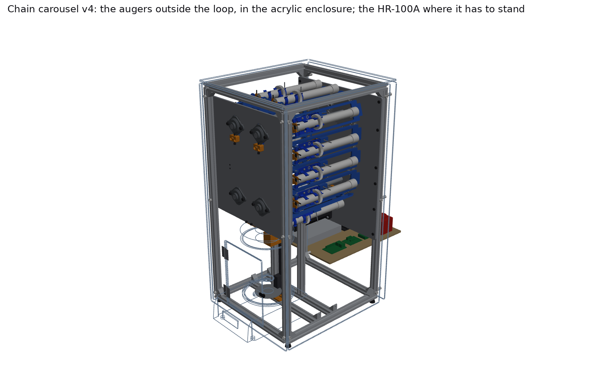 | 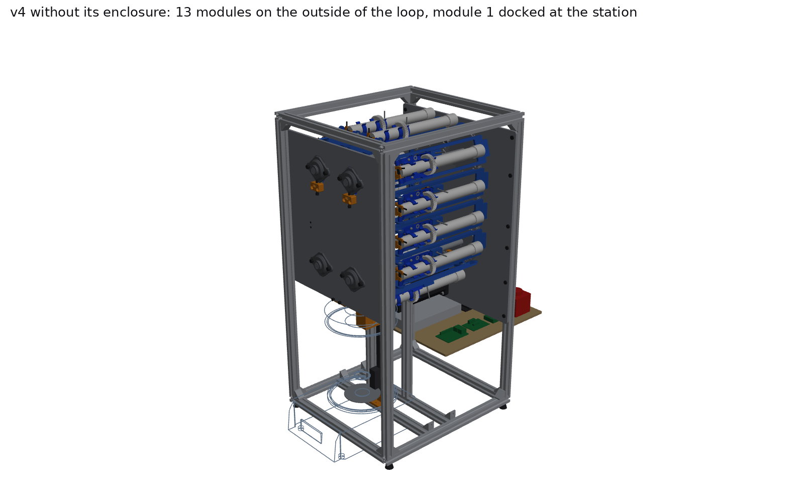 |
| **Station docked: EC v4 reaches round the auger to the plate** | **Dosing at 30°: module and EC tilt up through the carriage's opening** |
| 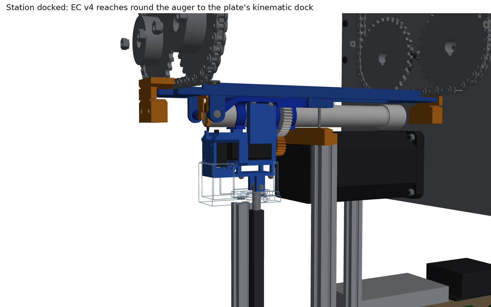 | 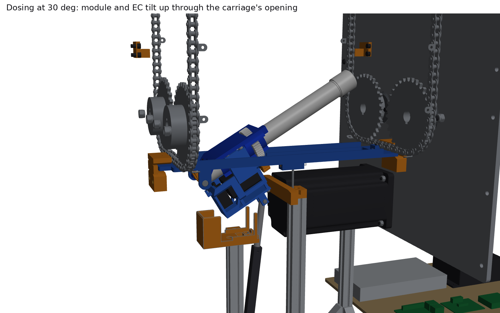 |

**Animation** ([MP4](renders/chain_carousel_v4.mp4)):
1. Assembly from scratch.
2. A module built on the bench: the auger into the v4 plate, the dock balls and washer, the outlet door, then onto a carriage's outer face.
3. All 13 carriages loaded at the loading position, one index at a time, then a lap.
4. The enclosure goes on.
5. One full station cycle.
6. Both hatches, and an auger pulled off its plate through the side hatch and a different powder's auger put on.

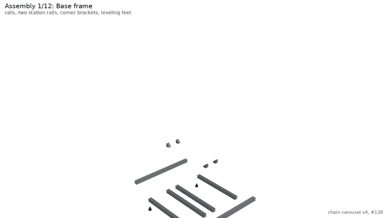

## What changed from v3

Each feature's GIF is in [`renders/features/`](renders/features), and each still is in [`renders/`](renders).

### 7. The augers ride outside the loop

Sam asked for a version of the auger carriage that holds the augers on the outside of the loop, so the augers can be swapped at the side brackets, with the electronics carriage reaching up and around the auger to dock.

- **Carriage v4.** The chain side is v3's: the 5 mm plate on the two A-1 tabs, the printed hooks, the tongues past both chains, the edge ribs, the magnet pockets. The module now sits on the carriage's **outer** face:
  - the hinge lugs stand out from the outer face round the plate's knuckles (|u| 26-30);
  - a **51.6 mm opening** runs from in front of the hinge to past the cap (carriage x 19-288), so the module can swing up through the carriage into the loop to dose. It widens to ±27.6 mm over Sam's x 52-104, where his plate is ±27.02 (the plate's back strip grazed the narrower edges at 5-10° of tilt);
  - the latch housing sits on the outer face behind the plate;
  - no snap hooks and no pads: the latch's pin holds the plate both ways.
- **Where the modules ride.** On the top run they sit on top of the loop. Down the sides they stand on edge, held by their hinges and latch pins. Under the bottom run they hang from them.
- **The frame grows** to make room: 380 mm wide (v3: 244) with the top rail at 751 mm (v3: 711), because the loop's outer envelope now carries the modules. The enclosure is 455 x 398 x 780 mm (v3: 455 x 262 x 740).
- **The swap (with item 5a):** open the side hatch, pull the auger straight off its plate's clamp rings, put a different powder's auger in. The door, the plate and the carriage stay on the chain. In v3 the whole carriage had to come out, because its auger faced into the loop.

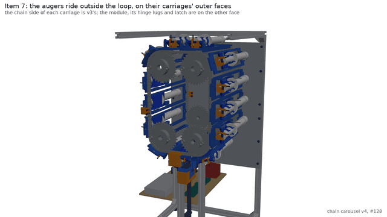

### 1, in v4: a kinematic dock on the plate's auger side, with no electromagnet

The EC now docks from outside the loop, so it meets the auger before the plate.

- **EC v4** is Sam's Oct 13 carriage turned over (mirrored through the auger's axis), so its NEMA 11 and pinion sit 32.25 mm beyond the auger, as in v2 and v3.
- **Two arms reach past the auger** (|y| 15.5-23.5: about 1 mm outside the clamp rings, inside the plate's ±25 mm edge) to the plate's auger-side face:
  - the +y arm carries the **cone** (A) and **ball C**;
  - the -y arm carries the **vee** of two dowels (B);
  - a D44-N52 magnet sits behind each of the three.
- **Plate v4:** two 1/4 in balls pressed into the auger side at Sam's (44, ±19.5), and an **M5 steel washer** bonded flush at (64, 19.5) as the flat. It is still exactly six contacts.
- **No dock electromagnet.** There is no room for v3's Adafruit 3872 beside the tube. At the station the module hangs under the bottom run and **rests on the EC**, so its weight presses the dock shut, and the three magnets add to it. **The simulations say that isn't enough** (item 3): it needs about 8 N on each ball, or a coil.

| Docked (plate see-through) | 12 mm before seating: the arms pass either side of the auger |
|---|---|
| 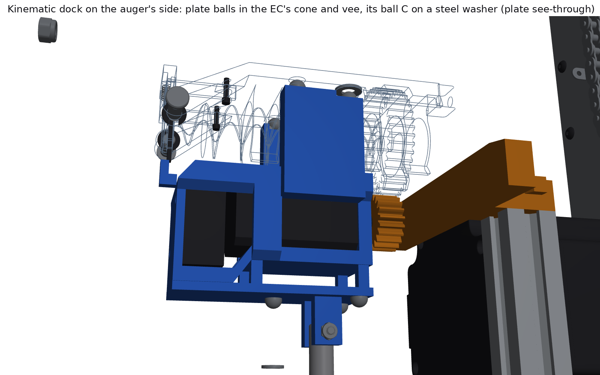 | 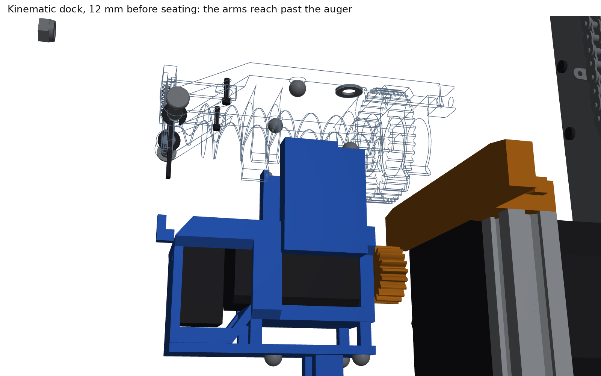 |

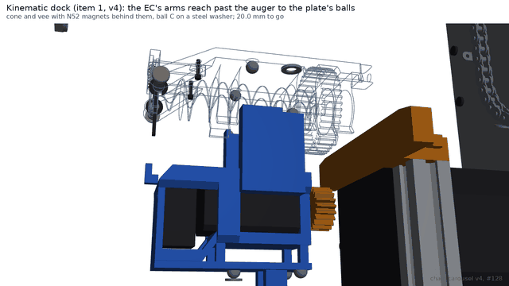

### 2, in v4: the guide cradle turned over

v3's cradle, turned over and notched where EC v4's arms pass. The EC parks on its own cone-vee-flat seat 20 mm below the passing augers, rises square between the walls and leans on the front wall, and its P16 pin rides in v3's 2 mm lost-motion slots.

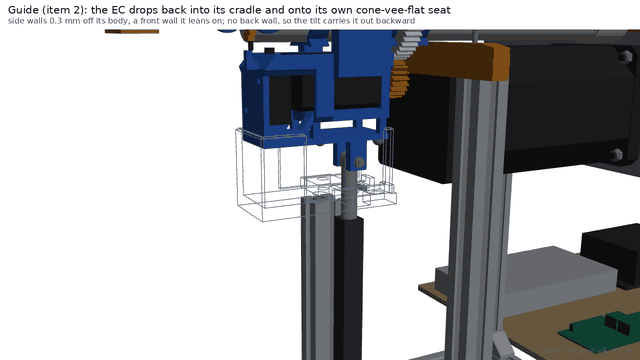

### 3. Simulations

v4's guide, door and latch are v3's turned over, so v3's simulations ([v3's sim/README.md](../chain-carousel-v3/sim/README.md)) apply to them: **as drawn, the EC topples in its guide** until the P16's base gets a stop and a 0.3 N·m spring, and the door finger needs more overlap with its push strip. v4's own run ([sim/README.md](sim/README.md), statics) is about its dock, which has no coil:

- **The P16 lifts the module off its tube rest** with 4.3 N; the module's 1.25 N weight presses the plate onto the EC's seats.
- **The motor doesn't stall first.** A ball lifts off at 2.3-3.2 N of separating force at the mesh (0.7-1.5 N if ball C's magnet pulls less than assumed), under the NEMA 11's 3.7 N at 450 mA.
- **Sideways it holds almost nothing once tilted.** With friction, the EC slides on its seats at 0.5 N at tilt 0 and at about 0 N once tilted: the magnets alone can't carry the along-plate share of the P16's push and the EC's weight.
- **So v4's dock needs a real preload:** about 8 N on each ball (v3's run shows that holds to 3.8-4.6 N), or a coil after all, and a lower motor current while dosing. This is v4's biggest open question. The MuJoCo docking round the auger was not run.

### 4, in v4: the outlet door turned over

v3's door, turned over: the shutter now slides **toward the plate** to open, and its push strip runs out past the auger to where EC v4's finger meets it. It still opens only in the dock's last 6 mm and shuts before the EC lets go.

| Open (docked) | Shut (parked) |
|---|---|
| 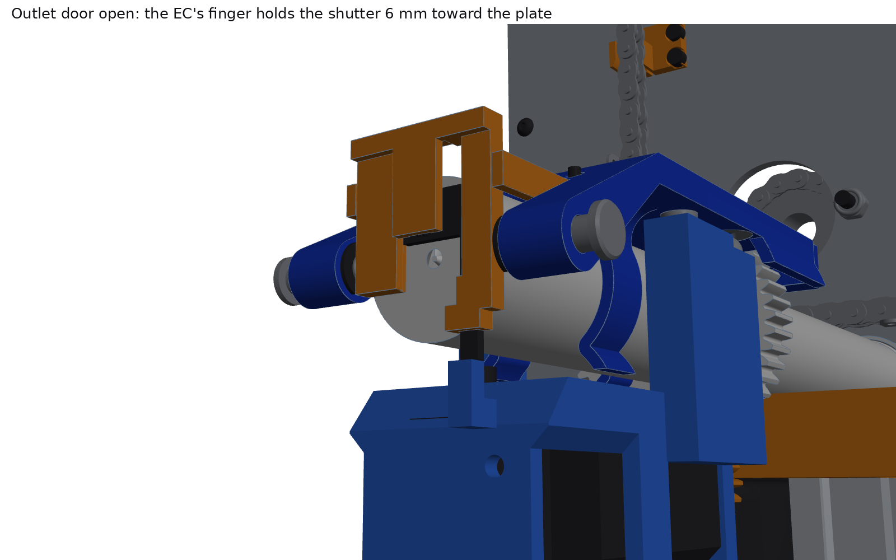 | 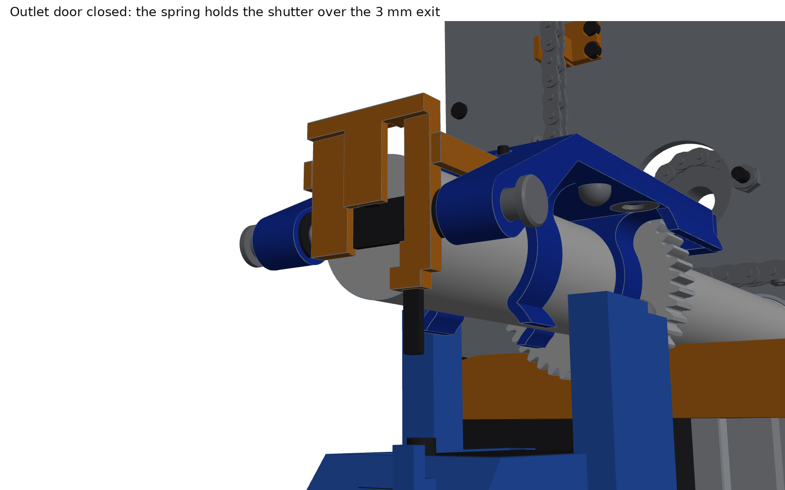 |

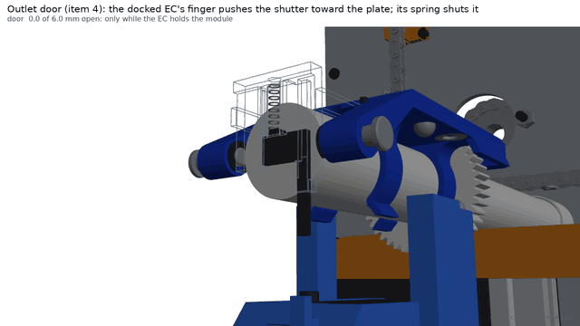

### 4a, in v4: a pin latch, and a tube rest at the station

The plate now hangs under the carriage on the bottom run, and nothing is under it (the carriage's opening), so v3's bolt over a keeper isn't enough.

- **The latch** is a 4 mm steel pin that goes 4 mm into a 4.2 mm hole in the plate's keeper. It holds the plate both ways.
- **At the station** the fixed rail draws the pin back 4.5 mm through a 3 mm follower that sticks out past the auger.
- **The tube rest.** While its latch is open the module drops 0.5 mm onto a printed rest under its tube, and the docking EC lifts it off. On the way back the EC sets it down on the rest before the carriage leaves, and the pin springs home into the keeper as the follower comes off the rail's ramp.

| At the station: the pin drawn back, the module on its tube rest | Half an index away: the pin home in the keeper |
|---|---|
| 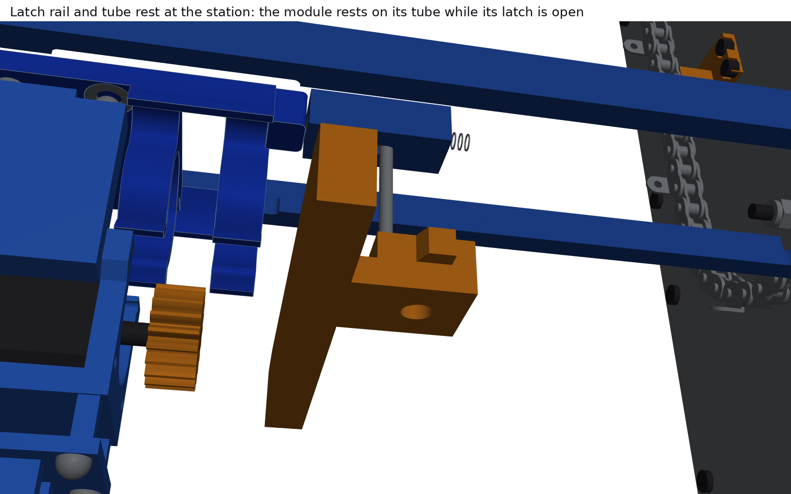 | 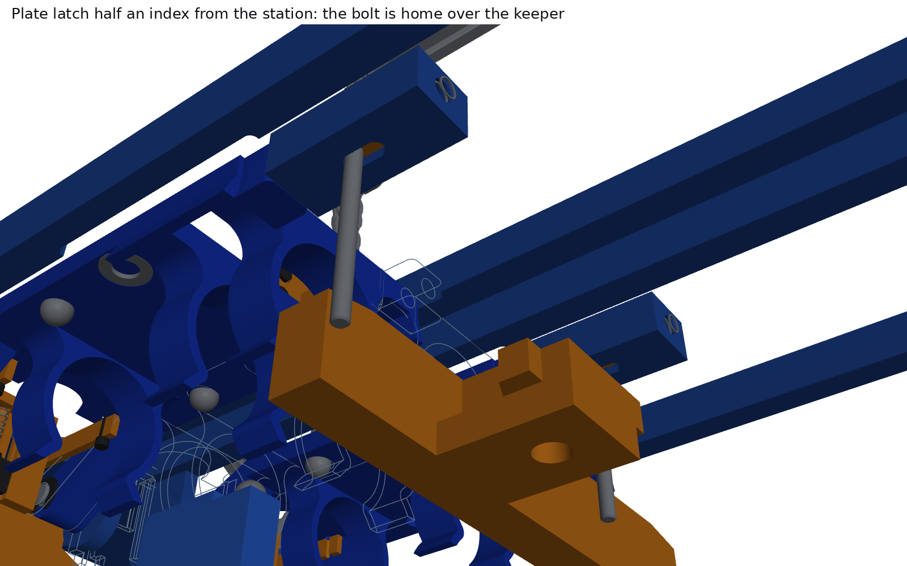 |

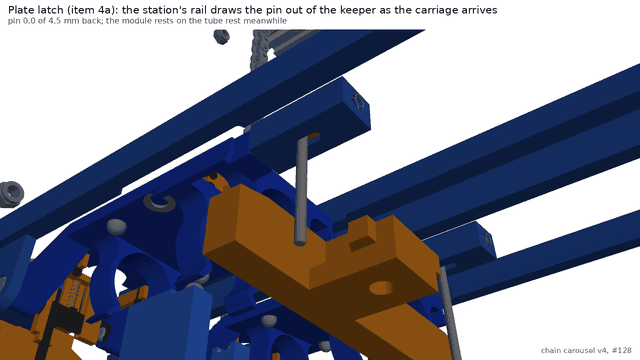

### 5 and 5a, in v4: the enclosure, and side tabs that take the auger's pull

- **Enclosure:** v3's, with bigger panels (455 x 398 x 780 mm outside). The front hatch is 180 x 230 mm under the station; the side hatch 330 x 230 mm on +y at the loading position.
- **Side tabs:** their feet now sit **1 mm** outside the carriage's tongues (v3: 4 mm). Pulling an auger off its plate pulls the carriage outward, and the tabs stop it after 1 mm, so the pull goes into the frame instead of the chain.

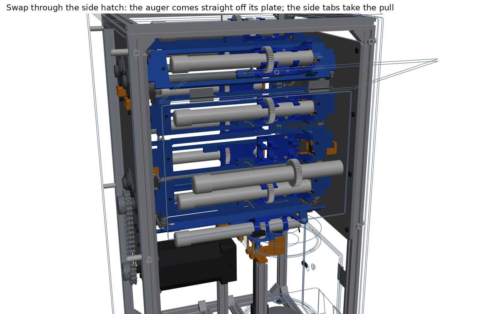

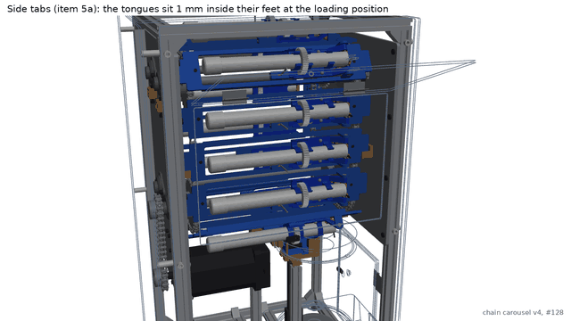

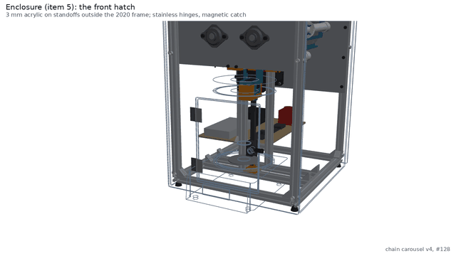

### 6, in v4: the scale still doesn't fit

The dose point is still on the hinge axis, now under the bottom run, and EC v4's column (the cradle, the P16 and the EC) stands right under it, inside the HR-100A's breeze break. [`checks/scale.json`](checks/scale.json) lists every part in the balance's way: the front base cross rail, the station rail, the P16 with its base clevis, pin and locknut, EC v4 with its NEMA 11 and pinion, and the guide cradle on its post. That is 11 kinds of part (14 instances), against v3's 19. v4's wider frame clears the posts, the +y base rail and the front hold-down, which stopped v3's balance 150-180 mm out; what is left in the way is the EC's column. So v4 doesn't solve item 6 either. The fixes v3's README lists (move the EC's column out of the breeze break, open the frame's front, drop the dose through the breeze break's top door) apply to both.

Sliding the balance in from the front (`render.py --scale-fit`), it first meets the front base cross rail 181 mm before the dose point, then EC v4 (89 mm), the guide cradle (86), the NEMA 11 (62), the P16 and its base clevis (59, 55), the cradle post and station rail (43), the P16's base pin (36) and the pinion (8): the same column, at the same distances, as v3.

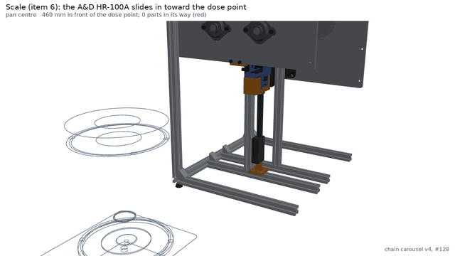

### Tilt: 50° at most

The module swings up through the carriage's opening into the loop. At about 55° its cap would reach the top run's modules, so v4 tilts to 50° at most (v3: 90°). 30° is the default and needs 60.8 mm of the P16's stroke; 50° needs 93.6 mm. `test/chain_rig.py` refuses anything past 50°.

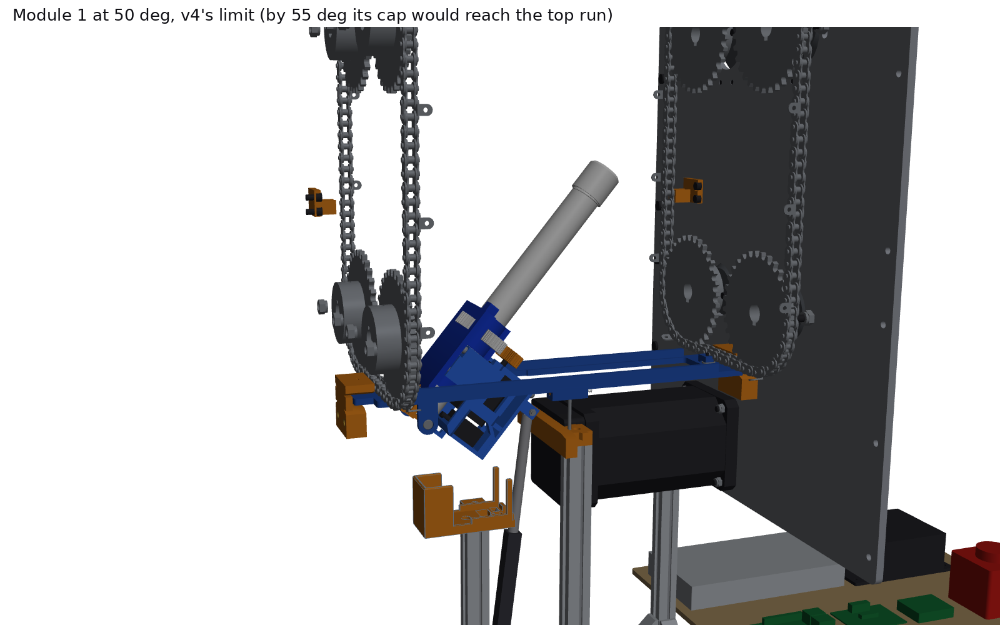

## How it works: one dose

1. **Index.** Carriage 1 indexes to the station.
   - Its tongues enter the hold-downs (v2's).
   - The station's rail draws its latch pin back, and the module drops 0.5 mm onto the tube rest.
2. **Rise.** The P16 lifts EC v4 out of its cradle.
   - The guide walls keep it square (with the P16 base stop v3's simulations call for); its arms pass either side of the auger.
   - In the last 6 mm its finger pushes the outlet door open.
   - In the last 3 mm the pinion turns slowly, so its teeth find the 44T gear's gaps (v2's docking seek).
3. **Seat.** The plate's balls seat in the cone and the vee, and ball C seats on the washer. The EC lifts the module 0.5 mm off its rest, so the module's weight now sits on the dock. The P16 backs off so its pin floats in the slots.
4. **Tilt.** Module and EC tilt together up through the carriage's opening, to 30° by default.
5. **Dose.** The NEMA 11 turns the auger, and the solenoid taps.
6. **Back to level.** Hold 0.5 s, tilt back to level, and reverse the auger one turn at rest (v2's leakage findings).
7. **Undock.** The P16 lowers the module onto its tube rest, then pulls the EC off the magnets; the door shuts as the finger drops away, and the EC settles on its cradle seat.
8. **Leave.** The next index carries the carriage off the rail, and its latch pin springs into the keeper.

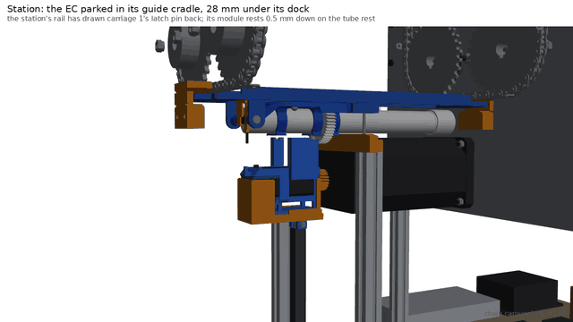

## The design in numbers

| | v4 | v3 | Why |
|---|---|---|---|
| Augers | Outside the loop, on the carriage's outer face | Inside | Item 7: swap an auger without taking its carriage off |
| Carriage | v2's chain side; a 51.6 mm opening (±27.6 at the plate's back strip), lugs and latch housing on the outer face | v2's with a longer window, pads, a bolt latch | The module tilts up through the carriage |
| Dock | Kelvin clamp on the plate's auger side: balls at Sam's (44, ±19.5), M5 washer flat at (64, 19.5) | Underside: balls at (30, ±18.5), armature flat | The EC reaches round the auger |
| Dock preload | The module's weight (it rests on the EC) and three D44-N52: too little, per the simulations | Two D44-N52 and the Adafruit 3872 electromagnet | No room for the electromagnet beside the tube |
| Latch | 4 mm pin, 4 mm into a 4.2 mm hole; 4.5 mm stroke | Bolt 3 mm over a keeper | The plate hangs under the bottom run |
| Station rest | Tube rest, 0.5 mm under the tube | None (the module rests on its carriage) | Holds the module while its latch is open |
| Door | v3's turned over: opens toward the plate | Opens away from the plate | The EC's finger comes from the auger's side |
| Tilt | 0-50° (30° = 60.8 mm of stroke) | 0-90° | The cap reaches the top run at about 55° |
| Side tabs | Feet 1 mm outside the tongues | 4 mm | The auger's pull goes into the frame |
| Frame | 418 x 380 mm, top rail at 751 | 418 x 244, 711 | The loop's envelope carries the modules |
| Enclosure | 455 x 398 x 780 mm | 455 x 262 x 740 | |
| Cost | $1,983.89, or $1,842.50 without test gear ([BOM.md](BOM.md)) | $1,920.33 | Lines still marked estimate add up to $306.45 |

## Checks

[`check_interference.py`](check_interference.py) computes the OCC boolean volume between every pair of instances and reports anything over 0.5 mm³. By-design contacts are skipped by part key (balls in their seats, dowels in their holes, magnets in pockets, the shutter in its grooves, the latch pin in its housing, screws in inserts). Results are in [`checks/`](checks).

| Check | What moves | Result |
|---|---|---|
| Home | Nothing: every pair of the 825 instances (the HR-100A left out, see `--scale`) | **0** |
| `--tilt` | The EC rising out of the cradle (0-20 mm, the door opening over the last 6), then module 1 + EC + P16 tilting 5-50° (16 poses) | **0** |
| `--swap` | Module 4's auger pulled 5-140 mm straight off its plate, out through the open side hatch; then the whole carriage out as in v3 | **0** |
| `--sweep --step 2` | The chain indexed one module the machine's way in 2-link steps (5 poses); every latch rides the station's rail and every module its tube rest | **6 clashes, not fixed:** the augers passing the station hit the parked EC's arms, ball C, a magnet and the vee's dowels, 2 links either side of it (up to 242 mm³). Parked 20 mm under its dock, the EC's arms still straddle the auger. Parking 8 mm deeper clears every pose (`checks/sweep.json`) |
| `--scale` | The HR-100A with its pan at the dose point | 14 instances of 11 parts in its way (item 6) |

What the checks found:
- **Not fixed: the passing augers hit the parked EC (sweep, above).** v3's 20 mm park was copied, but v4's EC reaches round the auger, so its arms still straddle the auger when parked. Moving the parked EC's parts a further 4 mm out leaves 0-17 mm³; 8 mm clears every pose tried (shifts of 1-3 and 5-7 links). So v4 should park 28-30 mm under its dock, which lowers the P16's base pin by the same amount (to about 20 mm above its rail) and costs 8-10 mm of stroke (50° then needs about 102-104 mm of the 150). That needs the checks and renders rerun, which didn't fit this round, so the movie and GIFs show the arms brushing the passing augers.

Changed while v4 was drawn:
- **The top rail's post-head brackets hit the side plates.** The top rail moved up to 751 mm.
- **The plate's back strip grazed the carriage's opening at 5-10° of tilt.** The opening widens to ±27.6 mm over Sam's x 52-104.
- **The latch pin ran through its own follower** (26 mm³). The checks skip that pair by design, so the BoM lookup found it, when it priced the pin at the drawn 22 mm. The pin is now 4 x 14 mm and its carrier block starts at Sam's x 110, 2.5 mm clear of the follower.

## Things to look at before ordering or printing

1. **The dock has no electromagnet, and the simulations say the module's weight and three magnets aren't enough** (item 3): a ball lifts at 2.3-3.2 N, under the motor's 3.7 N stall, and the EC slides on its seats once tilted. Give each ball about 8 N of preload (or find room for a coil) before printing the plates, then check it with T6a and T6c.
2. **The station also needs v3's simulated fixes:** the P16's base stop and spring, and the door finger's overlap.
3. **Park the EC 28-30 mm under its dock, not 20** (Checks): at 20 mm its arms hit the augers passing the station.
4. **Print EC v4 and the cradle and try the arms round a real auger** before buying the rest. The arms pass 1 mm from the plate's clamp rings.
5. **Reprint all 13 mounting plates:** v4's plate has the auger-side ball pockets, the washer pocket and a keeper with a pin hole.
6. **The carriage is 351 mm long** and prints only on the H2D (on the bed's diagonal), as v2's.
7. **The frame is bigger:** the side plates are 380 mm wide (v3: 244). Both still come out of one 24 x 36 in sheet.
8. **The scale doesn't fit** (item 6), as in v3.
9. **The new hardware is now real part numbers** (McMaster and K&J, read logged out through the Pi on 2026-10-29), with v3's caveats: the door and latch springs McMaster sells need longer pockets than the CAD draws, and the 1/4 in balls come in packs of 2 ($113 for 36; see v3's README).
10. **The latch pin is 4 x 14 mm** (McMaster 91595A158). The BoM lookup found the 22 mm pin first drawn ran straight through the 3 mm follower (26 mm³); the pin is now shorter and its carrier block starts 8 mm further forward, inside the same housing.

## How it goes together

[**ASSEMBLY.md**](ASSEMBLY.md) has 12 steps, each with a render and the BoM lines it uses.

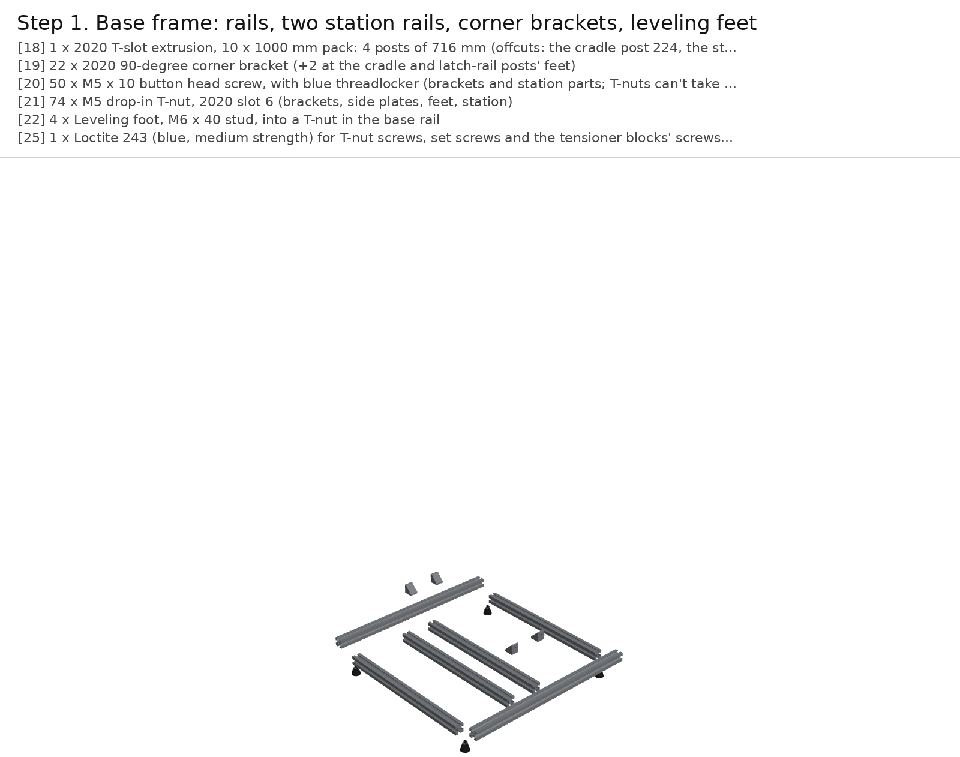

## Testing

[**TEST-PLAN.md**](TEST-PLAN.md) is v3's, changed for v4: T4 is the pin latch and the tube rest, T5 tilts to 50°, T6 tests a dock with no electromagnet, and T11 pulls augers off their plates at the side hatch.

[`test/chain_rig.py`](test/chain_rig.py) drives it from a Pi. Its v4 changes: no electromagnet, the tilt limit of 50°, and the undock that sets the module down on its tube rest before it pulls the EC away.

## Files

| File | What |
|---|---|
| [`params.py`](params.py) | v3's dimensions, then a v4 block: the opening, the auger-side dock, the arms, the pin latch, the rests, the side tabs |
| [`parts4.py`](parts4.py) | The v4 parts: plate additions, the washer flat, door v4, the pin latch, the station rails and tube rest, carriage v4, EC v4, the cradle. [`parts3.py`](parts3.py) is v3's and [`parts.py`](parts.py) v2's |
| [`layout.py`](layout.py) | Placements for any machine state: the station cycle, the latches, the rests, the door, the hatches, the auger swap, the scale |
| [`build.py`](build.py) | STEP assembly + components, STLs (including `electronics_carriage_v4.stl`, `mounting_plate_v4.stl`, `carriage.stl`), DXFs (side plates, acrylic) |
| [`check_interference.py`](check_interference.py) | Home, `--tilt`, `--swap`, `--sweep`, `--scale` |
| [`render.py`](render.py) | Stills, steps, the movie (`--movie`), the feature GIFs (`--features`) |
| [`bom.py`](bom.py), [`docs.py`](docs.py) | BOM.md, bom.csv, ASSEMBLY.md |
| [`sim/`](sim) | MuJoCo models of v4's dock |

```bash
pip install cadquery vtk pillow imageio imageio-ffmpeg mujoco numpy scipy matplotlib
python build.py && python docs.py
python check_interference.py && python check_interference.py --tilt && python check_interference.py --swap \
  && python check_interference.py --sweep --step 2 && python check_interference.py --scale
xvfb-run -a python render.py --stills && xvfb-run -a python render.py --movie && xvfb-run -a python render.py --features
```

## Not done

- **Not built.** Every number is a prediction until the test plan runs.
- **The park depth (28-30 mm), the P16's base stop and spring, the door finger's overlap and the dock's preload** are measured or simulated fixes, not drawn yet.
- **Onshape:** no document was created or updated (the company's API calls for the year are used up; see v3's `onshape/`).
- **The scale doesn't fit** (item 6), as in v3.
- **The vendors' own CAD:** as v3, the P16, the NEMA 34 and the McMaster screws and nuts are v2's vendor geometry; the new McMaster parts are drawn from their catalogue dimensions.
- **Not sliced in Bambu Studio this round.** The STLs are exported for the new printed parts.
