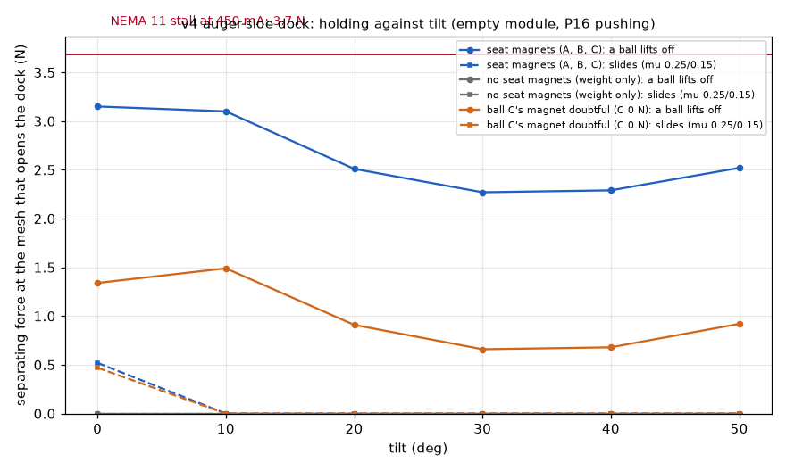

# Chain carousel v4: dock simulation (item 3, run 6)

v4 docks the EC on the auger's side of the plate (the augers ride outside the loop). [`dock_v4.py`](dock_v4.py) runs the same statics as v3's run 1 ([`../../chain-carousel-v3/sim/README.md`](../../chain-carousel-v3/sim/README.md)): it loads v3's `kelvin.py` and seat-magnet curve, and takes v4's geometry from [`../params.py`](../params.py) and [`../layout.py`](../layout.py).

**Simulated, not built: these are predictions.**

```bash
cd cad/chain-carousel-v4
python sim/dock_v4.py        # seconds; needs ../chain-carousel-v3/sim/results/magnet_curve_cache.json (run v3's dock_statics.py first)
```

## The model

- **The dock:** plate balls A (cone) and B (vee) at (44, +-19.5). The EC's ball C sits on a steel washer at (64, 19.5).
- **Seat magnets:** three D44-N52, and no electromagnet (v4 has no room for one beside the tube). The pulls come from v3's run 2:
  - behind the cone: 3.6 N at 0.6 mm;
  - beyond the vee's dowels: 0.8 N at 2.28 mm;
  - behind ball C: assumed 3.6 N, like the cone. The washer is pulled through the ball, and that is not modelled.
- **EC v4:** v3's EC mirrored, without the coil and its bracket, with the two arms past the auger: 0.299 kg, centre of mass at Sam's (47.2, 0.4, 32.4).
- **Module:** v3's, empty (the worst case).
- **The mesh:** on the auger's far side, so its separating force pushes the EC away from the plate. Tangential = separating / 0.55.
- **The P16:** pinned at both ends, carrying the module and the EC about the hinge, tilt 0-50 deg (`TILT_MAX_V4`).
- **The three criteria are v3's:** a ball lifts off; it slides with friction (0.25 cone, 0.15 steel on steel); frictionless.



| Separating force that opens the v4 dock (N) | 0 deg | 10 | 20 | 30 | 40 | 50 |
|---|---|---|---|---|---|---|
| Seat magnets A, B, C: a ball lifts off | 3.2 | 3.1 | 2.5 | 2.3 | 2.3 | 2.5 |
| Seat magnets A, B, C: slides (with friction) | 0.5 | 0 | 0 | 0 | 0 | 0 |
| Ball C's magnet doubtful (0 N): a ball lifts off | 1.3 | 1.5 | 0.9 | 0.7 | 0.7 | 0.9 |
| No seat magnets (weight only) | 0 | 0 | 0 | 0 | 0 | 0 |

Results in [`results/dock_v4.json`](results/dock_v4.json):

- **Lifting the module off the tube rest:** the P16 carries the EC and the empty module with 4.3 N at tilt 0. The module's 1.25 N weight presses the plate onto the EC's seats, so the module comes up with the EC. Over 0-50 deg the P16 carries 2.4-4.3 N.
- **The motor does not stall first in v4.** A ball lifts off at 2.3-3.2 N of separating force, under the NEMA 11's 3.7 N at 450 mA. If ball C's magnet pulls less than assumed, the figure is 0.7-1.5 N.
- **Sideways, v4 holds even less.** With friction, the EC slides on its seats at 0.5 N at tilt 0 and at about 0 N once tilted. There is no coil to press ball C down. The P16's push and the EC's weight both have components along the plate at tilt, and the three magnets alone can't carry them.
- **What v4 needs:**
  - About 8 N on each of its three balls, or a coil after all. With 8 N per ball, v3's slide threshold rose to 3.8-4.6 N.
  - And/or a NEMA 11 current limit while dosing.
  - **T6a-c must be run on v4's EC before printing its plates.**

**Not done for v4:** the MuJoCo docking (the EC rising round the auger from below and lifting the module 0.5 mm off its tube rest), the pin latch and the door. v4's door and latch are v3's mechanisms, turned over; v3's runs 4-5 apply to them qualitatively.
