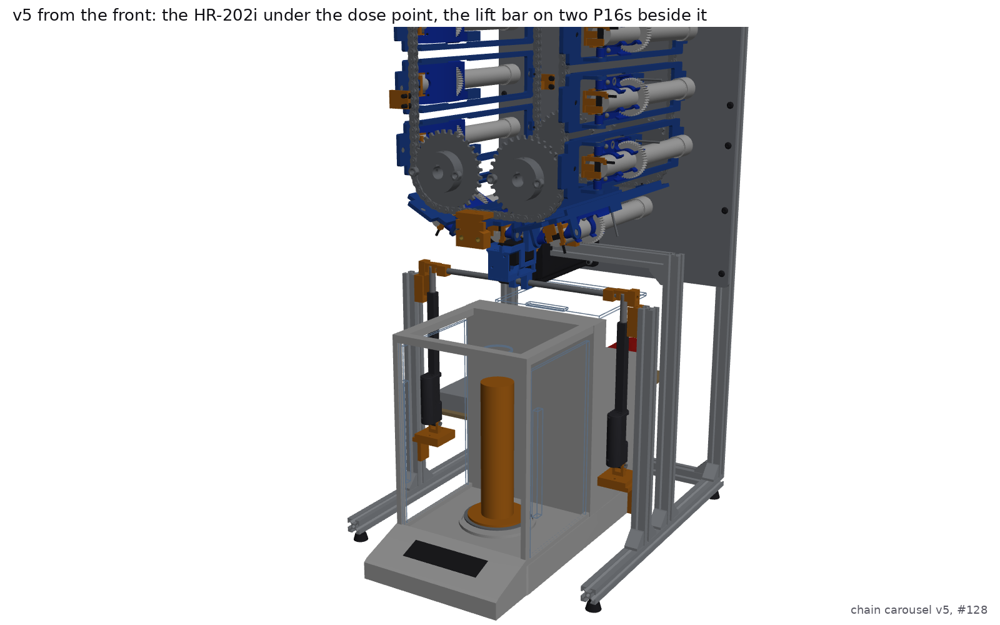
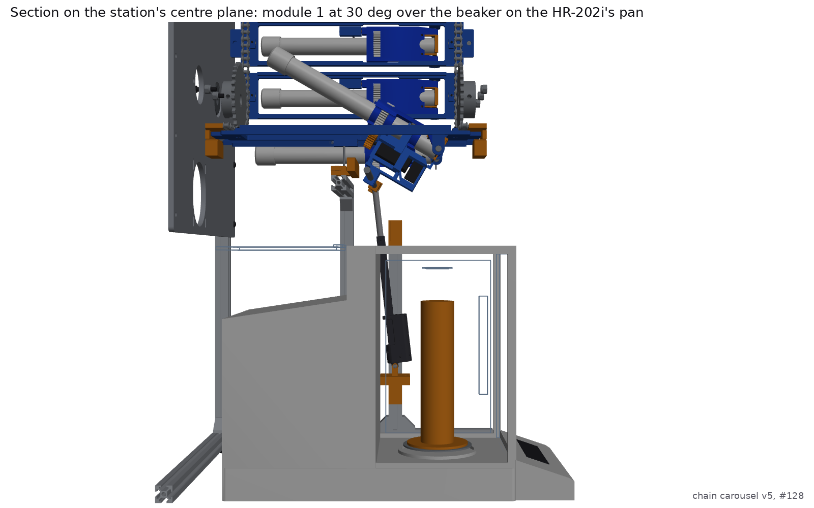
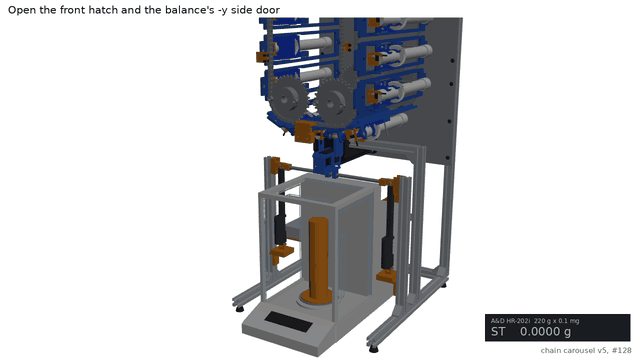
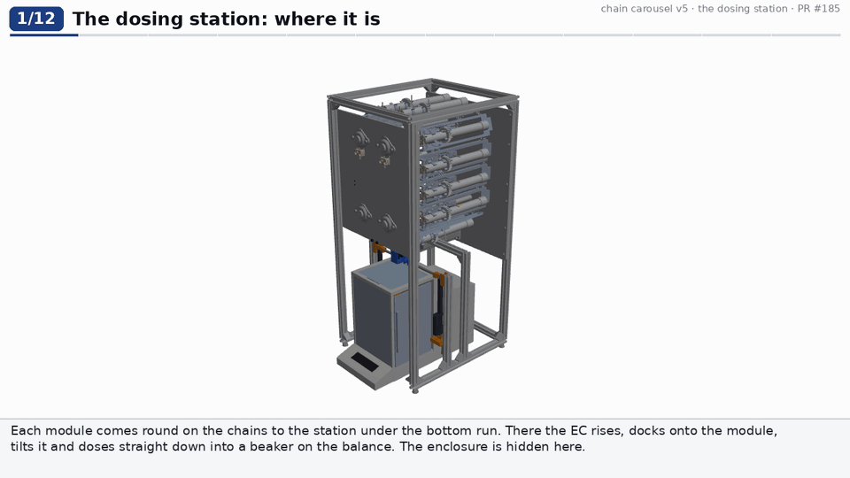
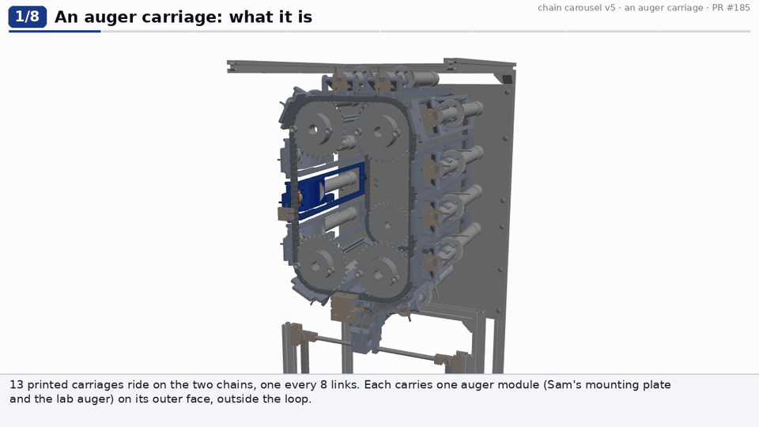

# Chain carousel v5: the dose falls onto a real balance

v5 is [v4](../chain-carousel-v4/README.md), with one change of requirement. Sterling asked on 2026-11-04 ([PR #185](https://github.com/vertical-cloud-lab/powder-doser/pull/185)): "the multi-doser needs to be using a real scale". Sam asked for the same thing in his item 6 of 2026-10-29: "Model the scale and put it into the assembly ... that's an essential part of this project".
- **In v5 the dose falls straight into a beaker on an A&D HR-202i analytical balance**: 220 g × 0.1 mg, with a 51 g × 0.01 mg fine range.
- The balance stands on the bench under the station. It touches nothing of the doser.
- v5 keeps v4's augers outside the loop, its kinematic dock, outlet doors, pin latches, enclosure and side tabs.

Nothing is built. Every number here is a prediction from the CAD.

| v5 from the front: the HR-202i under the dose point, the lift bar on two P16s beside it | Module 1 at 30° over the beaker (section on the station's centre plane) |
|---|---|
|  |  |



**Onshape (public):** see [`onshape/onshape_document.json`](onshape/onshape_document.json) for the current document's link
(imported from `step/chain_carousel_rig_v5.step` by [`onshape/onshape_build.py`](onshape/onshape_build.py)). Sam's own
document for the mounting plate and the electronics carriage is
[here](https://cad.onshape.com/documents/581956d5528927957a4c0b98/w/5778b22212c6736ada520515/e/24d73974055f92c0f2fa292f).

## How each part works, step by step

Two labelled clips ([`explain.py`](explain.py)), asked for by Sam on 2026-11-10. Every frame is the CAD in the state
that step describes, moving by the model's own kinematics. The parts each step is about keep their colours, the rest is
washed out, and the callouts name the parts.

**The dosing station** ([MP4](renders/explain/station_explained.mp4)), in 12 steps:
1. Where the station is.
2. The index.
3. The latch rail opening the plate's clip.
4. The two P16s lifting the bar.
5. The guide shoes.
6. The kinematic dock and its magnets.
7. The outlet door.
8. The tilt.
9. The auger drive.
10. The dose onto the balance.
11. Tilting back, reversing and parking.
12. The clip closing as the carriage leaves.



**An auger carriage** ([MP4](renders/explain/carriage_explained.mp4)), in 8 steps:
1. What it is.
2. How it hooks over and bolts to both chains.
3. The module's parts.
4. The hinge and the opening.
5. The spring latch pin.
6. A half lap: hanging, on its side, on top.
7. The outlet door.
8. A swap at the side hatch.



### The latch rail fix (2026-11-10)

Framing the latch close-up showed that the station's latch rail, inherited from v4, was drawn on the wrong side of the
followers.
- **Where it was:** on each follower's +x side, away from the keeper. Its face met a follower only once that follower was
  already 4.5 mm open, so it could stop a follower there but could never push one there.
- **Its pad:** the pad on its post stood in the open followers' path.
- **Why the checks missed it:** every check skips follower/rail pairs, because they touch by design.

In v5 now ([`parts4.latch_rail_v4`](parts4.py)):
- **The cam is on the followers' -x side**, between them and the keepers, 5 mm off the keepers.
- **Its profile:** the face is at the closed follower's edge (x 118.5) where its 25 deg ramps end, and 4.5 mm further on
  the flat, with 1.5 mm lead-ins. That pushes each follower, and the pin with it, out of the keeper by exactly
  `layout.latch_open`'s schedule.
- **How it's held:** it hangs from the part's existing web, which passes the followers' tips at z 25-31. The pad on the
  post is now z 25-31 only.

`check_interference.py --latch` checks the rail against every part over 27 poses:
- carriage 1 passing it in quarter-link steps over ±2.5 links;
- the EC rising;
- the module tilting to 40 deg.

It finds **0 clashes**. The follower rides the cam with at most a 0.57 mm³ sliver on the ramps (round dowel on a 25 deg
face) and none on the flat ([`checks/latch.json`](checks/latch.json)).

v4's rail has the same fault; v5 supersedes it.

## What the earlier versions weighed on

| Version | What the dose lands on | Why it isn't a real balance |
|---|---|---|
| v2, paternoster | A vial in a cup on a **TAL221 100 g load cell** (a bar strain gauge on an HX711), under a D-cut funnel | A $10 load cell, and a funnel shared by every powder. byu-vcl#303's animation uses v2, so it shows this load cell |
| v3, v4 | The lab's **HR-100A**, drawn at the dose point as a ghost | It doesn't fit there. The EC's column (the guide cradle on its post, the P16 and the EC itself) stands inside the balance's breeze break. The frame's front base rail and station rails run through its footprint. v3 has 19 kinds of part in its way, v4 has 11 ([v4's checks/scale.json](../chain-carousel-v4/checks/scale.json)). Sam asked to see why in a GIF before anything changed, so neither version moved anything |
| **v5** | **A 25 mL beaker on a printed riser on the HR-202i's pan** | The station is rebuilt round the balance. [`checks/scale.json`](checks/scale.json) finds nothing in its way, parked, docked, at 30°, and even at 50° |

## The balance

**Which one.** The lab's documented 0.1 mg A&D balance is the HR-100A, 102 g × 0.1 mg ([byu-vcl#2](https://github.com/vertical-cloud-lab/byu-vcl/issues/2), "Set up the 0.1 mg scale"). The single doser runs on it today.

Sterling asked for "the one with the higher capacity that still has 0.1 mg resolution". The higher-capacity 0.1 mg A&D model this repo names is the **HR-202i**:
- It is in [`design/brainstorming.md`](../../design/brainstorming.md) §1, next to the FZ-523 and HR-300i, and in [#159](https://github.com/vertical-cloud-lab/powder-doser/issues/159).
- byu-vcl's vertical-lab animation already uses it, from round 5 of [byu-vcl PR 318](https://github.com/vertical-cloud-lab/byu-vcl/pull/318) on.

I found no record that the lab has bought one. Those threads list it as a candidate.

**v5 is drawn for the HR-202i, and the HR-100A fits in the same place.** The HR-100A was checked against the same station:
- The station parked: nothing in its way.
- At 30°: nothing in its way.
- The one change it needs: its base is taller than the HR-202i's display unit, so the front hatch door's bottom edge goes up from 58 to about 92 mm.
- With the HR-100A, the beaker stands straight on its pan (86.5 mm up), loaded through its breeze break's sliding door; the fall is then 300 mm, so a taller vessel would help.

**The HR-202i as modelled** ([`parts5.hr202i`](parts5.py)). The figures are from A&D's [HR-i instruction manual](https://www.aandd.jp/products/manual/balances/hr-i.pdf), p.60 "External Dimensions", which byu-vcl's `lab_models` also uses. Every figure in this table is printed on that drawing:

| | mm |
|---|---|
| Overall (with doors and the top door's grip) | 217 W × 442 D × 316 H |
| Body | 200 × 428 × 310 |
| Pan | dia. 90, its centre 163 behind the front edge (265 in front of the back), its top 50 above the bench |
| Weighing chamber, inside | 183 × 164.5, 250 high above the pan; the pan's centre 86.5 behind the front glass's inner face |
| Side doors (slide back) | 148.5 × 251 |
| Top door (slides back over the rear housing) | 164 × 148.5 |

**Checked against A&D's own documents (2026-11-04):**
- **Sources:** the manual's p.59-60, and A&D Japan's 1:1 DXF of the outline ([`gh_hr-i.dxf`](https://www.aandd.co.jp/cad_storage/balance/gh_hr-i.dxf)).
- **The manual's drawing:** every number byu-vcl's model used is printed on it.
- **From the DXF,** for what the drawing doesn't dimension:
  - The display section is 73 deep, its top rising from 28 to 50 mm.
  - The chamber's floor and the side doors' sills are at 40 mm; the ceiling is at about 299 mm.
  - The side doors' opening runs from 40 to 291 mm up.
  - Behind the chamber, the rear housing (276-428 mm behind the front) is only 244 mm tall, falling to 221 at the back.
  - The top door and both side doors slide straight back about 205 mm.

**Specs from the manual:**
- **Repeatability:** 0.1 mg (0.02 mg in the fine range).
- **Stabilization:** about 3.5 s.
- **Interface:** RS-232C only (D-sub 9; factory 2400 baud, 7 data bits, even parity, 1 stop bit, CR LF; `Q` sends the weight now). USB needs A&D's converter.
- **Other:** 7.9 kg, with a built-in under-hook.

**A&D has discontinued the HR-202i.**
- A&D Japan's [HR-i page](https://www.aandd.co.jp/products/weighing/balance/bal-analytical/hr/) says production has ended.
- MNM Scales lists it at $2,989, out of stock, "replaced by GH-202".
- A&D draws the GH and HR-i series from one outline file, so a GH-202 should stand in the same place. Check its height first.

The lab's HR-100A: 198 × 294 × 315 mm, pan dia. 90 with its top 86.5 mm up (HR-A/HR-AZ manual p.74).

**Its place in v5:**
- **Position:** the pan centre sits under the dose point (x 33.4, y 4.76). The display faces the front hatch, and the mechanism tower stands under the back of the station.
- **Front:** the display unit sticks 64 mm out of the enclosure's front panel. The panel's opening runs down to the bench, and a brush strip closes the gap round the balance.
- **Clearance over its top:**

  | Part | Height |
  |---|---|
  | Parked EC and the lift bar | 328 mm |
  | NEMA 34 | 332.5 mm |
  | Lowest passing module | 412.6 mm |
  | Balance top | 316 mm |

- **Isolation:** the balance stands on the bench, or on the lab's isolating granite paver ([#146](https://github.com/vertical-cloud-lab/powder-doser/issues/146)), inside the doser's U-shaped base. It never touches the frame, so the motors' vibration reaches it only through the bench.
- **Reading it:** the Pi reads it over RS-232 with A&D's `Q` command, as the single doser reads its HR-100A ([`test/chain_rig.py`](test/chain_rig.py)). `chain_rig.py dose-to` doses by weight: it turns the auger a quarter turn at a time, reads the balance after each, and stops at the target.

## What changed from v4, and why

| Change | Why | How it works |
|---|---|---|
| **The carousel is 80 mm higher** (bottom run's pitch line 465 mm, was 385; top rail 831, was 751) | v4's parked EC hangs to 248 mm and its NEMA 34 to 252 mm, both under a 316 mm balance | Everything above the bench moved up together (`_DZ`), so the loop, the station geometry, the side plates and the enclosure are v4's, just higher |
| **The EC rides on a lift bar carried by two P16s beside the balance** (was one P16 under it, in a guide cradle on a post) | v4's whole column (the cradle, its post, the P16 and its base clevis) stood inside the chamber, 2-110 mm behind the dose point | An 8 mm steel bar runs along y through two saddles that replace EC v4's clevis, on the same axis as v4's clevis pin. Each end sits in a printed end block. Each block holds a P16's rod-end tab on a 4 × 16 mm shoulder screw in 2 mm slots (v4's lost motion), so the two P16s, on two LAC boards sent the same target, can stop anywhere without forcing the dock. The pins sit exactly where v4's were, so the rise (28 mm), the tilt (68.7 mm of stroke at 30°, 85.0 mm at v5's 40° limit) and v4's simulated dock forces carry over |
| **Guided shoes replace the cradle** | Without the cradle, nothing would keep the EC square as it rises. v3/v4's simulations found it pivots and topples on its pin even with the cradle's walls | Each end block carries a 14 × 10 × 20 mm shoe in a 14.2 mm vertical slot. The guide is a printed block on a 2020 station post on each side base rail. The bar is clamped in the EC, so the EC can't turn while either shoe is in its slot. The slots end where the EC seats. From there the dock and the module's hinge carry it, and the tilt lifts the shoes clear. This is the fix the v3/v4 simulations asked for, a back guide for the rise, but outside the balance |
| **No front base cross rail, no station rails** | The balance stands where they were | The base is U-shaped: the side rails and the back rail. The front posts are tied by the front side plate and the top cross rail |
| **The latch rail hangs from a 2020 beam off the -y side** (was a post at y -14) | v4's latch-rail post stood inside the tower's footprint | A post on the -y base rail carries a 166 mm beam along y. The rail's pad sits on the beam's end, at the same height as v4's post top, so the latch and tube rest work as in v4 |
| **No funnel; the beaker on a printed riser** | Sam ruled out a funnel because it cross-contaminates. A beaker on the pan would sit 340 mm under the exit | A PETG riser, about 30 g and tared with the beaker, puts the beaker's rim at 282 mm. That is a 154 mm fall from the exit, which stays on the hinge axis at every tilt. The rim is 9 mm under the side doors' opening (291 mm), so the beaker clears it lifted 6 mm out of the riser's cup and comes out through a side door; the top door is under the station |
| **Tilt: 40° at most** (v4: 50°) | The lift bar passes under the neighbouring modules; tilted past about 41° it rises into them (`--tilt`) | 20-40° is the range the dosing studies recommend, and 30° stays the default. `chain_rig.py` refuses more than 40° |
| **Front hatch 300 × 330 mm, opening down to the bench** (was 180 × 230) | A hand has to reach the balance's side doors, and the display sticks out under the door | The door's bottom edge is 58 mm up, over the display unit. Open the hatch, open the balance's -y side door, set the beaker on the riser, shut both |
| **Doors during a dose** | The chamber is the draft shield | Only the top door is open, slid back over the rear housing, while the module doses. The reading that counts is taken with every door shut |

## How it works: one dose

1. **Index.** Carriage 1 indexes to the station, as in v4. The rail opens its latch, and the module settles 0.5 mm onto the tube rest.
2. **Beaker in, tare.** Open the front hatch and the balance's -y side door, set the beaker on the riser, shut both, and tare.
3. **Top door back.** Slide the top door back by hand, or by an actuator still to be designed.
4. **Rise.** Both P16s lift the bar together, and the shoes keep the EC square in their guides. In the last 6 mm the EC's finger opens the outlet door. The arms reach round the auger, and the EC seats on the plate's dock, lifting the module off its rest.
5. **Tilt and dose.** Tilt to 30° (40° at most): 68.7 mm of stroke, with the shoes clear of their slots. The auger turns, and the dose falls 154 mm into the beaker. The Pi polls the balance with `Q` and stops at the target (`chain_rig.py dose-to`).
6. **After the dose.** Hold 0.5 s, tilt back, reverse one turn at rest, and undock. The shoes drop back into their slots on lead-ins, and the outlet door shuts before the EC parks.
7. **Read.** Shut the top door and read the stable mass.
8. **Next module.** Index to the next module. The parked EC is 28 mm under its dock and 12 mm over the balance.

## Checks

OCC boolean volume between every pair; anything over 0.5 mm³ counts. By-design contacts are skipped by part key ([`check_interference.py`](check_interference.py)). The balance is in every check.

| Check | What moves | Result |
|---|---|---|
| Home | Every pair of the 843 instances, the HR-202i and its beaker included | **0** |
| `--tilt` | The EC rising on its bar (0-28 mm in 7 poses), then module 1, the EC, the bar and both P16s tilting 5-50 deg (9 poses, plus 40 and 42), the balance's top door open | **0 through 40 deg.** At 42 deg the lift bar touches module 13's plate (4.8 mm^3), and at 45 and 50 deg it meets modules 2 and 13 (up to 306 mm^3): the bar passes under the neighbouring modules. So **v5 tilts to 40 deg at most** (v4: 50) |
| `--latch` | The station's latch rail against every part: carriage 1 passing it (±2.5 links in quarter links), the EC rising, the module tilting to 40 deg (27 poses) | **0** (2026-11-10, after the rail fix). Follower on the cam: at most 0.57 mm^3 on the ramps, none on the flat |
| `--sweep` | The chain indexing one module the way it runs, 5 poses (2.0-link steps), the EC parked over the balance | **0** |
| `--scale`, HR-202i | The balance at the dose point against everything: parked, docked, 30 and 50 deg | **0 parts in its way** (v4: 11 kinds of part, v3: 19) |
| `--scale`, HR-100A | The lab's HR-100A (stock breeze break) in the same place, parked and at 30 deg | 2 hits, both the front hatch door: the HR-100A's base is 80 mm tall where it leaves the enclosure, against the door's 58 mm bottom edge (raise the edge to 92 mm for it) |
| Stream | An 8 mm column under the exit, from 6 mm below it to the beaker's rim, at 15, 30 and 45 deg | Clear at 45 deg; a 0.4 mm^3 graze at 30 deg and 43 mm^3 at 15 deg, both the module's own auger tube: the column's back half is inside the outlet face, and the grains fall in front of it |

## Check before building

1. **The HR-202i isn't confirmed as the lab's.** If the lab has only the HR-100A, use it: it fits in the same place (raise the hatch door's bottom to about 92 mm), and the beaker goes straight on its pan.
2. **Get the balance first; the HR-202i is discontinued.** Its replacement, the GH-202, shares its outline drawing, but caliper whichever arrives before printing the riser. The riser's height sets the 154 mm fall and the beaker's 3 mm clearance under the side door's opening.
3. **The 154 mm fall through the open top door.** It is about twice the single doser's fall through its AutoTrickler lid. Measure drift with the top door open and the station running (TEST-PLAN T8a), and how far a fine powder strays (T8b). If either is too much, shorten the fall with a taller riser and a smaller beaker, or add a printed chimney on the riser, one per powder like the beaker.
4. **Two P16s instead of one.** Check that both LACs track within the 2 mm lost motion over the whole stroke (T6): log both pots through a 0-85 mm sweep (v5's 40°).
5. **The guides replace the cradle's Kelvin seat.**
   - The parked EC is now located by the shoes in their slots (about 0.1 mm of play) and the P16s' positions, not by three balls.
   - The slots' 2 mm lead-ins at the top hand the EC from the guides to the dock: in the last 2 mm the shoes can move ±2 mm, so the cone and vee, not the guides, decide where it seats.
   - If the guides and the dock don't line up within that, the EC will bind instead of seating. Shim the guides at assembly (T6), and docking still needs T6b's ±0.5 mm capture.
6. **v4's open items stand.**
   - Its dock has no coil, so it needs about 8 N of preload per ball (T6c).
   - The outlet door's finger overlap.
   - The springs.
   - The magnets.
7. **Height.** The rig is 860 mm tall in its enclosure, 80 mm more than v4. Byu-vcl's Kardex opening is 727.5 mm.

## Not done

- **`--swap` wasn't re-run.** The loading position, the side tabs and the side hatch are v4's, just 80 mm higher, and none of v5's new parts is near them.
- **Not re-simulated.** v4's MuJoCo models weren't re-run. The station's kinematics are v4's (the same pin positions), but the guide is new, and the bar and two P16s add mass to the EC.
- **Not regenerated:**
  - The step-by-step ASSEMBLY.md and its renders.
  - The full movie.
  - The Bambu slices.

  The CAD source builds all of them (`docs.py`, `render.py`). The STEP/STL/DXF exports (`build.py`) were made on 2026-11-10,
  with the latch rail fix. The stills, the balance-dose GIF and the explainer clips show v5.
- **The stills and `balance_dose` predate the latch rail fix.** The rail is a small part under the carriage, and those
  views barely show it.
- **The balance's top door is opened by hand** in this design. A robot-served station needs a small actuator for it, or a lid with a hole like the single doser's.
- **Prices:**
  - The new printed parts are filament.
  - The second P16 and LAC are Actuonix's list prices.
  - The 8 mm bar and the brush strip are estimates.

## Files

| File | What |
|---|---|
| [`params.py`](params.py) | v4's numbers with v5's at the end: the HR-202i, the riser, the lift bar, the shoes and guides, the raise |
| [`parts5.py`](parts5.py) | The HR-202i (body, display, front glass, pan, both side doors, top door), the riser, the lift bar, the bar end blocks, the guides, the P16 shelves, EC v5 |
| [`layout.py`](layout.py) | v4's layout with v5's frame, station and scale |
| [`check_interference.py`](check_interference.py) | home, `--tilt`, `--sweep`, `--swap`, `--scale` (the HR-202i and the HR-100A) |
| [`check_stream.py`](check_stream.py) | The dose stream's path from the exit to the beaker |
| [`render_balance.py`](render_balance.py) | v5's stills and the balance-dose clip |
| [`explain.py`](explain.py) | The two labelled explainer clips: the dosing station and an auger carriage, step by step |
| [`onshape/`](onshape) | The public Onshape document's ids, the import script and its API-call ledger |
| [`build.py`](build.py) | STEP assembly and components, the printed parts' STLs, the side plates' and acrylic's DXFs |
| [`bom.py`](bom.py) / [`BOM.md`](BOM.md) | The BoM, with the balance, the second P16 and LAC, the bar and the new printed parts |
| [`TEST-PLAN.md`](TEST-PLAN.md) | v4's tests with T6 and T8 rewritten for the balance |
| [`test/chain_rig.py`](test/chain_rig.py) | v4's driver with two LACs and the HR-202i |

The renders are in [`renders/`](renders): `rig_iso`, `rig_balance_front`, `rig_lift_bar`, `rig_dose30_section`, `rig_parked_section`, `rig_hr100a` and `features/balance_dose`.

To re-run:

```
pip install cadquery vtk pillow imageio imageio-ffmpeg numpy
python check_interference.py && python check_interference.py --tilt && python check_interference.py --sweep --step 2 && python check_interference.py --scale
xvfb-run -a python render_balance.py
python docs.py        # BOM.md, bom.csv, ASSEMBLY.md (v4's step texts)
```
