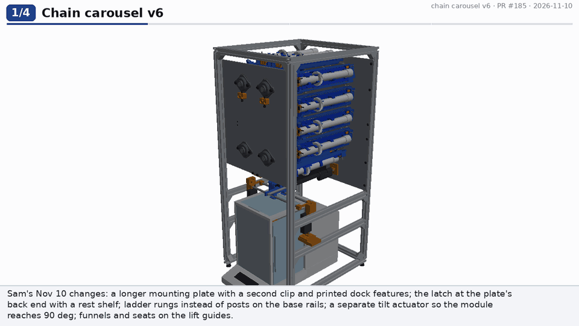
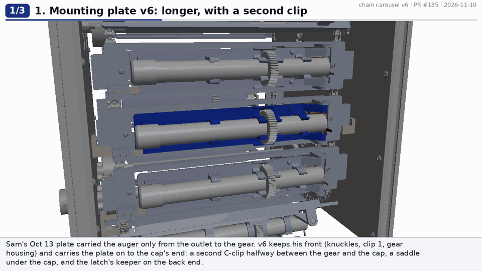
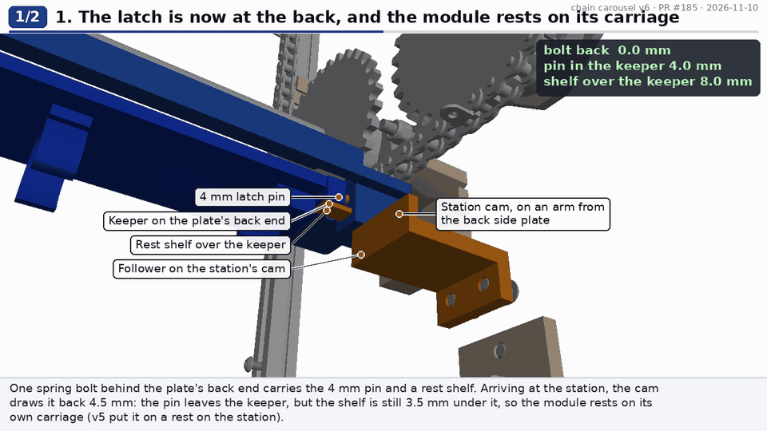
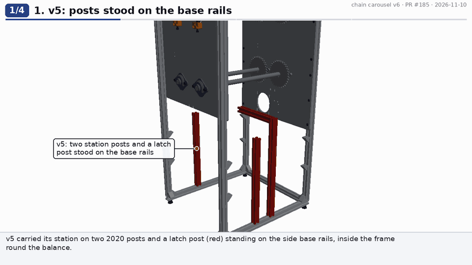
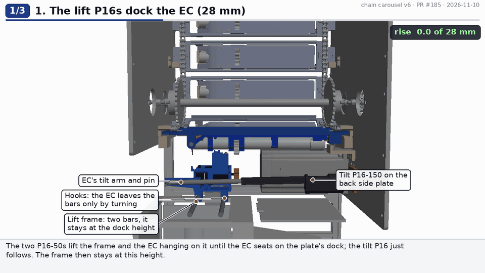
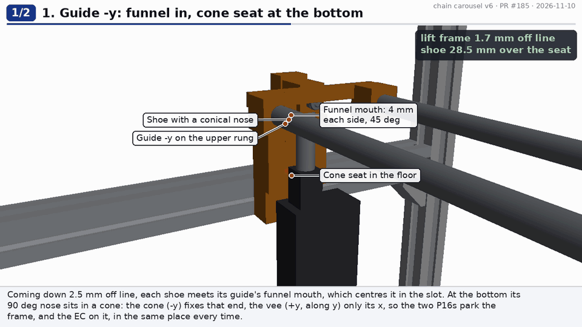

# Chain carousel v6: a longer plate, a ladder frame, and a full 90° tilt

v6 is [v5](../chain-carousel-v5/README.md) with Sam's changes of 2026-11-10 ([PR #185](https://github.com/vertical-cloud-lab/powder-doser/pull/185)).
Everything not listed below is v5's: the augers outside the loop, the kinematic dock round the auger, the outlet doors, the
enclosure and its hatches, the side tabs, and the dose onto a beaker on an A&D HR-202i. Nothing is built. Every number here
is a prediction from the CAD.

**Onshape (public):** [Multi-doser chain carousel, test rig v6](https://cad.onshape.com/documents/29870b97e25aa1033c07144d/w/3c2b496fc08f7472605d17c2/e/a75fe90d184f765ada5d65de) (ids in [`onshape/onshape_document.json`](onshape/onshape_document.json), 11 API calls in [`onshape/api_calls.jsonl`](onshape/api_calls.jsonl): 10 for the import, 1 to confirm it is public). It was imported from
`step/chain_carousel_rig_v6.step` by [`onshape/onshape_build.py`](onshape/onshape_build.py).



## What changed, and why

| # | Sam asked | v6 | How it works | Clip |
|---|---|---|---|---|
| 1 | "extend the mounting plate so it supports more of the auger. Add another clip about halfway between the gear and the cap" | **Mounting plate v6.** Sam's Oct 13 plate is kept from the knuckles to the gear housing (clip 1 and the housing as he drew them), then carried on to the cap's end (Sam x 252; v5 stopped at 106). It adds **clip 2** at x 150-162, halfway between the gear's back face (88.4) and the cap (224.4), and a **saddle under the cap** | Both clips are C-shapes round the 25 mm tube, open away from the plate (mouth 19.6 mm), so the auger still snaps in and pulls straight off at the side hatch | [plate](renders/v6/plate_v6.gif) |
| 2 | "this mounting plate can rest on the base carriage, and the pin that keeps the mounting plate pinned to the carriage can be moved to the back for maximum support and ease of mounting" | **The latch is at the plate's back end** (keeper at x 244-252, beside the cap; v5's was at x 98-106). One spring bolt on the carriage carries the **4 mm pin and a rest shelf** | Closed: the pin is 4 mm into the keeper's hole (it holds the plate either way up) and the shelf reaches 8 mm under the keeper. At the station the cam draws the bolt back 4.5 mm: the pin is out, but the shelf is still 3.5 mm under the keeper, so **the module rests on its own carriage** (v5 put it on a tube rest on the station). By hand, the bolt goes back 10 mm and both clear: that is how a module comes off | [latch](renders/v6/latch_v6.gif) |
| 3 | "for the kinematic couplings, alter the mounting plate design to integrate them (no need to use a washer, just add it to the 3D printed part" | **The plate's half of the dock is printed:** two domes at A and B, the shape of v5's balls' exposed caps (3.75 mm proud), and the plate's own face as the flat at C. No balls, no washer | The EC's cone, vee and ball C are unchanged. With no steel left in the plate, a **D42-N52 magnet is pressed into the plate's underside under each feature** (1.8 mm of plastic above it), for the EC's three magnets to pull on | [plate](renders/v6/plate_v6.gif), part 3 |
| 4 | "the 8020 mounts that come up from the bottom rail should be moved to the sides ... crossbars like a rung of a ladder to mount things to for the base dosing station" | **No posts on the base rails** except the four corner posts. On each side, **two 2020 rungs run between the front and back posts** (a ladder): the lower ones (z 185-205) carry the lift P16s' shelves, the upper ones (z 298-318) the guides. v5's two station posts, latch post and latch beam are gone | The tilt P16's bracket and the latch cam hang on the **back side plate**, which gets four new M5 holes. Both rungs pass under the back plate's bottom edge (325), so it needs no notches | [ladder](renders/v6/ladder_v6.gif) |
| 5 | "Can the auger go all the way to 90 degrees? If not, adjust the carriage until it can." | **v5 couldn't** (see below). **v6 tilts 0-90°.** The carriage's opening starts 5 mm further forward (Sam x -19), and widens to ±27.6 mm over the keeper. The station's **lift and tilt are separate** | Two P16-50s lift a frame of two 8 mm bars. The EC hangs on them in two hooks, and the frame only docks it (28 mm). A **third P16 (P16-150) on the back side plate**, pinned to an arm on the EC, then turns the docked EC and module about the hinge axis. Its pin stays 42-60 mm under the axis all the way, so nothing wide rises toward the neighbouring modules | [tilt90](renders/v6/tilt90_v6.gif) |
| 6 | "Add a small funnel-type kinematic coupling to the linear actuators guides so that they can easily return to the same position even if they're a little bit off" | **Funnel mouths and kinematic seats on the guides.** Each guide's slot opens into a 45° funnel, 4 mm each side, at its top. Each shoe has a 90° conical nose, which parks in a **cone** (-y guide) or a **vee along y** (+y guide) in the slot's floor | Coming down off line, the funnel takes each shoe back into its slot. At the bottom, the cone fixes one end of the frame and the vee only the other's x, so the frame and the EC on it park in the same place every time. The slot opens 0.5 mm each side over its bottom 8 mm, so the seats locate the shoes, not the slot walls. The slots' funnels also free the shoes in the dock's last 4 mm, so the dock, not the guides, decides where the EC seats | [guides](renders/v6/guides_v6.gif) |

| Mounting plate v6 | The latch at the back |
|---|---|
|  |  |

| The ladder | 0-90° |
|---|---|
|  |  |



## Why v5 stopped at 40°, and what reaching 90° took

v5's module, EC and plate were checked alone at 60°, 75° and 90°, without the lift bar and the P16s. 60° and 75° were clean.
At 90° the plate's front edge and the outlet door's screws met the carriage's opening (374 mm³). The cap never reaches the
top run: the module stands 252 mm tall on a hinge 355 mm under the top run's pitch line. Two things in v5's station stopped it
well before that:
- **The lift bar.** v5's 264 mm bar was clamped through the EC's base, 76 mm under the hinge axis and 58 mm behind it, so it
  swung up with the module. At 42° it touched module 13's plate, and at 90° it would sit 58 mm *above* the axis, through
  modules 2 and 13 on the corner sprockets.
- **The stroke.** 90° needed 161.5 mm from a 150 mm P16.

v6 keeps everything wide low:
- The lift frame never rises past the dock height (its bars at z 360.6, about 50 mm under the neighbouring modules' lowest points).
- The tilt pin is the only part of the drive that moves round the hinge axis. It starts 60 mm from the axis, in front of and
  below it (-135°), and ends behind and below it (-45°). It never comes within 42 mm of the axis's height.
- The tilt P16 lies almost flat at y = -30, outside the EC's arms (Sam y ±23.5) and 35 mm from the dose stream.

| Tilt | 0° | 30° | 45° | 90° |
|---|---|---|---|---|
| Tilt P16, mm out of 150 | 130.7 | 103.2 | 87.6 | 46.1 |
| Its lever arm about the hinge, mm | 45 | 58 | 60 | 39 |

At the P16's 50 N, 39 mm is 1.9 N·m about the hinge. That is far more than the module and the EC weigh, but **v6's station
hasn't been simulated** (below).

**Changing the carriage.** Sam's "adjust the carriage" came down to one change. The module's plate stands vertical at 90°,
13-18 mm in front of the hinge axis, so the opening has to start 19 mm in front of the axis; v5's started at 14. The front A-1
tab's screw hole (x 9.5) still has 2.8 mm of plastic behind it.

## How one dose works in v6

1. **Index.** The chain brings the module to the station. The latch cam draws its bolt back 4.5 mm. The pin leaves the keeper,
   and the module settles 0.2 mm onto the bolt's shelf, on its own carriage.
2. **Dock.** The tilt P16 holds the EC level (130.7 mm out). The two lift P16-50s raise the frame and the EC on it 28 mm. In
   the last 4 mm the shoes enter their funnels, so the cone and vee decide where the EC seats. In the last 6 mm the EC's
   finger opens the outlet door. The domes seat and lift the keeper off the shelf.
3. **Tilt.** The tilt P16 retracts and the EC and module turn about the hinge. The EC's hooks leave the bars, which stay at
   the dock height. 30° is the default. Any angle to 90° is available, for the dose-versus-tilt tests or to empty an auger.
4. **Dose.** The NEMA 11 turns the auger. The dose falls 154 mm into the beaker on the HR-202i, and the Pi doses by weight
   (`test/chain_rig.py dose-to`).
5. **Back.** Hold 0.5 s, tilt back (the hooks close round the bars again), reverse the auger one turn at rest, and lower the
   frame. The bars pull the EC off its magnets, the door shuts, and the shoes come down through the funnels onto their
   cone and vee.
6. **Leave.** The next index takes the bolt off the cam. The spring pushes the pin back into the keeper.

## Checks

Every pair is checked with OCC booleans, and anything over 0.5 mm³ counts. By-design contacts are skipped by part key
([`check_interference.py`](check_interference.py): v6's are listed at the end of SKIP). The balance is in every check.

| Check | What moves | Result |
|---|---|---|
| Home | Every pair of the 856 instances | **0** ([`checks/home.json`](checks/home.json)). The first run found 5 clashes, all fixed (below) |
| `--tilt` | The lift frame and EC rising 0-28 mm (4 poses), then module 1, the EC and the tilt P16 at 5, 10, 20, 30, 40, 50, 60, 70, 80 and 90°, with the balance's top door open | **0** apart from the lift P16-50s' tubes touching their guides (0.9 mm, 50-76 mm³; fixed). Rechecked with the lift P16s, guides, shelves, rungs, end blocks and bars at 0, 14 and 28 mm: **0** ([`checks/tilt_a.json`](checks/tilt_a.json), [`tilt_b.json`](checks/tilt_b.json), [`guide_recheck.json`](checks/guide_recheck.json)) |
| `--sweep` | The chain indexing one module the way it runs, 5 poses (2-link steps), the EC parked: every carriage's new latch and longer plate passing the NEMA 34, the tilt P16 and the latch cam | **0** ([`checks/sweep.json`](checks/sweep.json)) |

**The five clashes the first home run found, all fixed:**
1. **The latch followers on the NEMA 34.** At the plate's back end, the followers' tips (v5: 24 mm out past the plate) passed
   over the NEMA 34, which sits inside the frame under the bottom run's +y half. The follower is now 3 x 25 mm and ends 10 mm
   out, and the cam sits 2-8 mm out.
2. **The tilt P16's rod on the EC's tilt arm.** The arm moved 1.5 mm inboard (Sam y 23.5-29.5). The rod-end tab rides 2.3 mm
   off it on a PTFE washer.
3. **The tilt bracket and the latch cam's foot,** both on the back side plate. The cam's foot moved up and clears
   the bracket by 11 mm.
4. **and 5. The lift P16-50s' housings in the guides' lower blocks.** The guides are notched under their seats, and 1.5 mm
   shallower so the P16s' tubes pass 0.6 mm outside them.

## Check before building

1. **The station's mechanics are new and not simulated.** v3-v5's MuJoCo models weren't rerun. Print the EC's hooks, the tilt
   arm and the end blocks, and check by hand (TEST-PLAN T5):
   - the hooks release and re-take the bars cleanly at 0°;
   - the tilt P16 swings the docked module without the dock slipping.
2. **The printed dock (T6a, T6b).** Printed domes in the EC's printed cone and on the dowel vee repeat less well than ground
   balls, and the flat at C is the steel ball C on PETG (a few N, so expect a small dent to bed in). Print the plates with
   0.12 mm layers over the domes.
   - **Measure the seat magnets' pull plate-magnet to EC-magnet:** about 6 mm separates them, so expect less than v5's
     3.6 N per seat.
   - The simulations wanted about 8 N per seat (T6c).
3. **Two more actuators' worth of wiring.** v6 has three P16s and three LACs. The lift P16-50 is new, and its price ($75)
   is an estimate.
4. **The latch shelf.** The module's whole weight hangs on 3.5 mm of printed shelf while it sits at the station (T4). If it
   creeps, add a 2 mm steel pin across the shelf.
5. **v5's open items stand:** which balance the lab has, and the 154 mm fall through the open top door.

## Not done

- **Not simulated:** v3-v5's MuJoCo station and dock models weren't rerun for v6's hooks, tilt arm or third P16.
- **Not rerun:** `--swap` and `--latch`. Clip 2, the cap saddle and the keeper are on the plate, which the swap check skips
  against the auger by design; the latch cam is new, and its follower contact is a by-design pair.
- **Not regenerated:** the stills, the step-by-step ASSEMBLY renders and the full movie. The six clips above are v6's renders.
- **No Bambu slices.** The STLs are exported in `stl/`.
- **Prices:** the P16-50 is Actuonix's list price, not re-checked. The 4 x 10 latch dowel and the 3 x 25 follower are priced
  as their McMaster families' verified packs.

## Cost

**$2,377.50, or $2,236.11 without test gear** ([BOM.md](BOM.md)). v5 was $2,361.63 ($2,220.24).
- **Added:** two P16-50s and a third LAC for the lift, the second lift bar and 39 plate magnets.
- **Removed:** 34 of v5's 36 dock balls and the 13 plate washers.
- **Unchanged:** the P16-150 stays, now as the tilt actuator.

## Files

| File | What |
|---|---|
| [`params.py`](params.py) | v5's numbers with v6's at the end |
| [`parts6.py`](parts6.py) | Mounting plate v6 additions, latch bolt/housing/follower/spring v6, the latch cam, carriage v6, EC v6 (hooks, tilt arm), the lift frame's end blocks, the guides with funnels and seats, the lift shelves, the P16-50, the tilt bracket |
| [`layout.py`](layout.py) | v5's layout with the rungs, the v6 station and the v6 module |
| [`check_interference.py`](check_interference.py) | home, `--tilt` (to 90°, with `--angles/--exts/--tag` for parallel subsets), `--sweep`, `--latch`, `--swap`, `--scale` |
| [`explain6.py`](explain6.py) | The six clips in `renders/v6/` |
| [`build.py`](build.py) | STEP assembly and components, the printed parts' STLs, the DXFs |
| [`bom.py`](bom.py) / [`BOM.md`](BOM.md) | The BoM |
| [`TEST-PLAN.md`](TEST-PLAN.md) | v5's tests with T4-T6 rewritten for v6 |
| [`test/chain_rig.py`](test/chain_rig.py) | The Pi driver: two lift LACs and the tilt LAC (`tilt_to_tilt_ext`), 0-90° |

To re-run:

```
pip install cadquery vtk pillow imageio imageio-ffmpeg numpy
python check_interference.py && python check_interference.py --tilt && python check_interference.py --sweep --step 2
xvfb-run -a python explain6.py plate latch ladder tilt90 guides overview
python build.py && python docs.py
```
