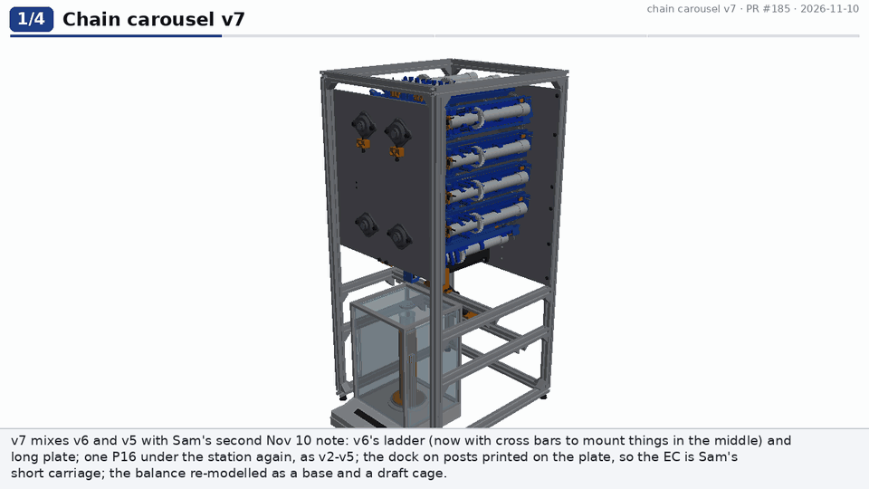
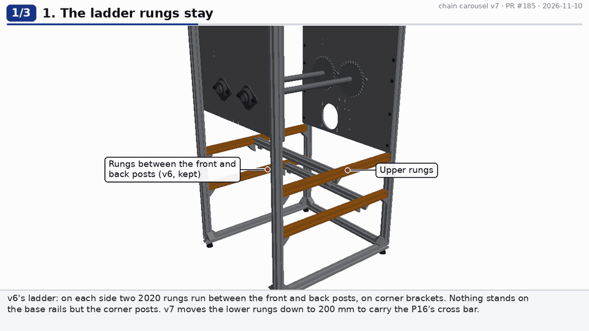
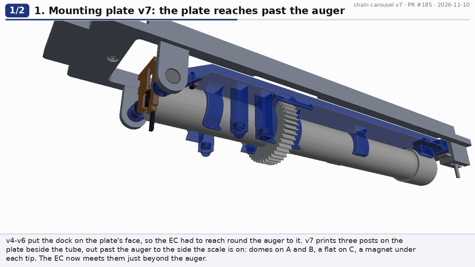
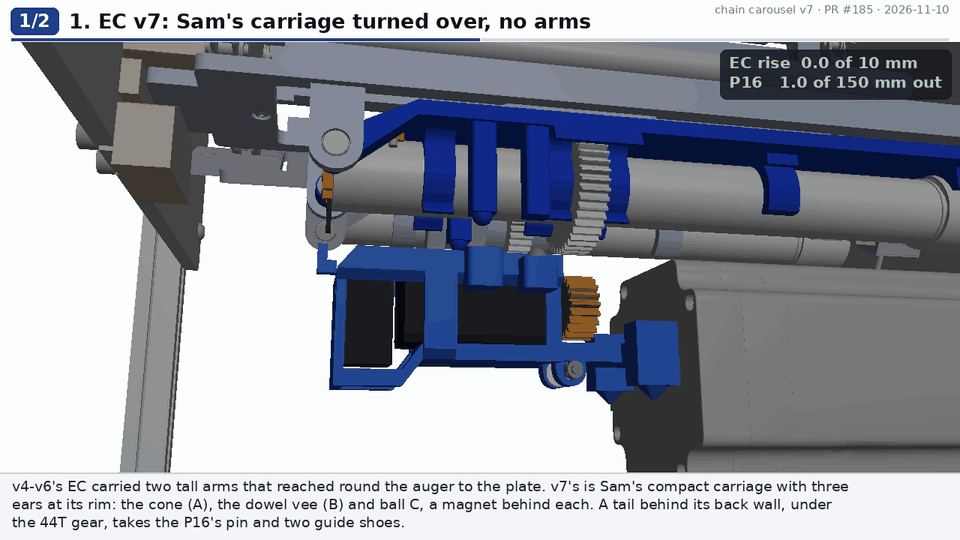
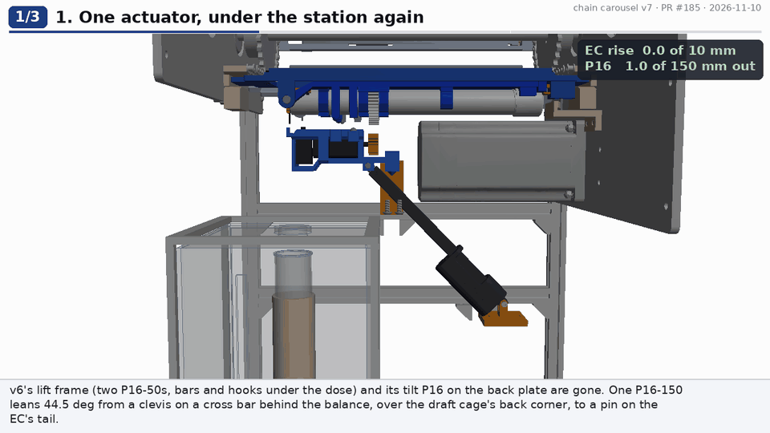
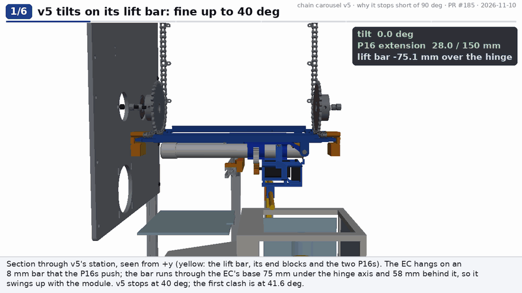
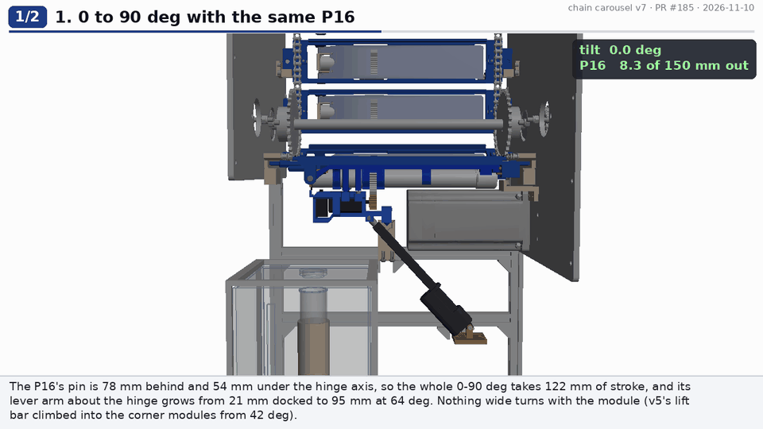
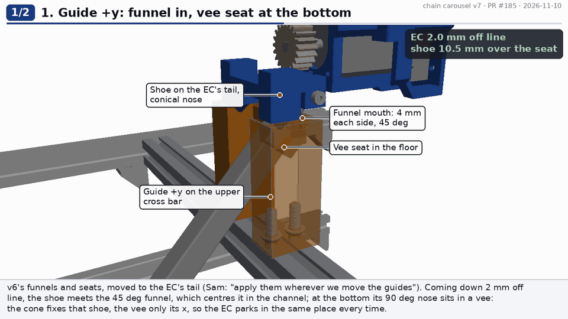
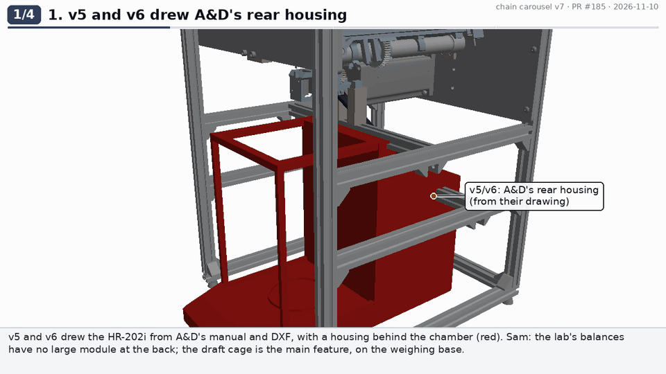
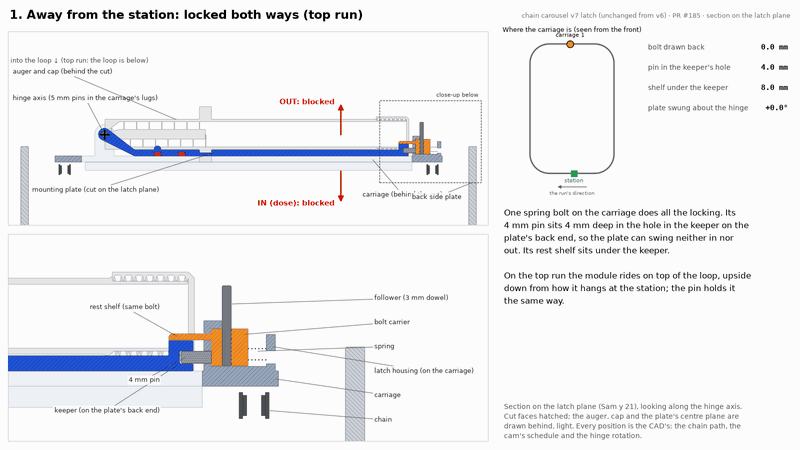

# Chain carousel v7: one P16 under the station, the dock on posts past the auger, and a balance with no rear module

v7 is a mix of [v6](../chain-carousel-v6/README.md) and [v5](../chain-carousel-v5/README.md), with Sam's second note of
2026-11-10 ([PR #185](https://github.com/vertical-cloud-lab/powder-doser/pull/185)):
- **Kept from v6:** the ladder rungs, the longer mounting plate (clip 2, the cap saddle, the keeper at the back), the latch at
  the plate's back end, the carriage's longer opening, and the guides' funnel mouths and cone/vee seats.
- **Back from v2-v5:** one Actuonix P16-150 under the station that both lifts and tilts. v6's lift frame (two P16-50s, two bars,
  the EC's hooks) and its tilt P16 on the back side plate are gone.
- **New:** the dock moved to the scale side of the auger, on three posts printed on the plate, so the EC is Sam's compact
  carriage with no arms; two cross bars between the rungs; the balance re-modelled as a base and a draft cage.

Nothing is built. Every number here is a prediction from the CAD.

**Onshape (public):** [Multi-doser chain carousel, test rig v7](https://cad.onshape.com/documents/291664f38c67a4672a86f025/w/e67d1b706aa4b873fa8c68e8/e/4802634f69ef3323004d7bf6) (ids in [`onshape/onshape_document.json`](onshape/onshape_document.json); 11 API calls in [`onshape/api_calls.jsonl`](onshape/api_calls.jsonl): 10 for the import, 1 to confirm it is public). It was imported from `step/chain_carousel_rig_v7.step` by [`onshape/onshape_build.py`](onshape/onshape_build.py). Earlier versions: [v6](https://cad.onshape.com/documents/29870b97e25aa1033c07144d/w/3c2b496fc08f7472605d17c2/e/a75fe90d184f765ada5d65de), [v5](https://cad.onshape.com/documents/7781103e41ea031038274d53/w/be93cab60ae7d8dd4c301dd0/e/c7483f9da46de0305e71e071), [v4](https://cad.onshape.com/documents/07e7ce814d25e75e52c09a86/w/25522f59a0ed7fbbe5b6befb/e/f5263287b1a00de2de17a17c), [v3](https://cad.onshape.com/documents/6b0ba196592dddf4d153b887/w/f8df3cb392da1117da5c65ab/e/16408e631d86575eee2bfeea), [v2](https://cad.onshape.com/documents/5263dae97a3922029b5cccf3/w/30f999cdf6cf5f4014d88b2a/e/f8db64562886e92e866b11ed).



## What changed, and why

| # | Sam asked | v7 | How it works | Clip |
|---|---|---|---|---|
| 1 | "I love the ladder rungs ... You can add another cross bar between walls and rungs to attach things to, so you can attach things in the middle" | **v6's rungs kept, plus two 2020 cross bars between them** (340 mm, corner brackets at each end): one on the lower rungs at x 250 for the P16's base clevis, one on the upper rungs at x 136 for the two guides | The lower rungs moved from z 195 to z 200 so the P16's clevis sits on its bar. Both bars run across the frame behind the balance; nothing stands on the base rails but the corner posts | [ladder](renders/v7/ladder_v7.gif) |
| 2 | "I like the longer mounting plate" | **v6's plate kept** (Sam's front, clip 2, the cap saddle, the keeper) | Unchanged apart from the dock (row 3) | [plate](renders/v7/plate_v7.gif) |
| 3 | "raise the kinematic couplings on the mounting plate up so that the electronics carriage can be as short as possible, i.e. they interface on the scale side of the auger" | **Three posts printed on the plate** beside the tube (8 x 8 mm at y +-15.5 to 23.5, 3 mm off it) reach from the plate's face out to 16.4 mm past the auger's axis. A and B carry v6's printed domes and C a flat tip; a D42-N52 sits in each post 1.8 mm under its tip (dropped in at a print pause). **EC v7 is Sam's Oct 13 carriage turned over with no arms**: the cone, the dowel vee and ball C sit on three ears at its rim, with v4's magnets behind them | The EC meets the posts just past the auger instead of reaching round it to the plate's face (v4-v6's arms were 41 mm tall). It parks only **10 mm** under the dock (v6: 28): the passing gears clear its pinion by 8.2 mm, the domes clear its ears by 7.8 mm, and the closed door strips clear its finger by 4 mm. The auger still snaps in and pulls straight out of the clips past the posts | [plate](renders/v7/plate_v7.gif), [EC](renders/v7/ec_v7.gif) |
| 4 | "The linear actuator on the back doesn't work. I like it the way it was before, underneath ... the cross bars with the hooks doesn't work ... the powder will dose directly onto them ... Try to keep it one actuator" | **One P16-150, pinned at both ends as in v2-v4:** its rod end on a tail behind the EC's back wall (under the 44T gear, 78 mm behind and 54 mm under the hinge axis), its base on a clevis on the P16 cross bar behind the balance. Nothing crosses under the dose point | The draft cage stands right under the EC, so the P16 can't stand straight under it as in v2. It leans 44.5 deg back from the EC, over the cage's back-top corner. Extending it first lifts the EC 10 mm out of its guides onto the posts (1.0 to 8.3 mm of stroke), then turns the docked EC and module about the hinge axis. One LAC | [station](renders/v7/station_v7.gif) |
| 5 | "For a 90 degree tilt, make a gif that shows exactly where and why it didn't work for v5 ... This design should allow for a 90 degree tilt" | **v5's limits, bisected in its own CAD** (clip and [`checks/v5_why_not_90.json`](checks/v5_why_not_90.json)). **v7 reaches 90 deg with 130 of the P16's 150 mm** and CHECK_TILT_SUMMARY | v5's lift bar turned with the module and climbed into the corner modules from 41.6 deg; its P16s ran out of stroke at 81.3 deg; its plate met its carriage at 84.0 deg. In v7 nothing wide turns with the module, the pin is close to the hinge (so 0-90 deg takes 122 mm of stroke), and v6's longer carriage opening clears the plate | [v5: why not 90](renders/v7/v5_why_not_90.gif), [v7: 0-90 deg](renders/v7/tilt90_v7.gif) |
| 6 | "the ramps for the guides are great! Apply them wherever we move the guides" | **v6's guides moved to the EC's tail:** two printed guides on the guide cross bar, each a vertical channel round one of the tail's two shoes, with v6's 45 deg funnel mouth (4 mm each side), its 0.5 mm relief over the bottom 8 mm and a cone (-y) or a vee (+y) in its floor for the shoe's conical nose | Coming down off line, each shoe meets its funnel, which centres it. Parked, the cone fixes one shoe and the vee only the other's x, so the EC parks in the same place every time. The shoes leave the funnels in the dock's last 4 mm, so the dock, not the guides, decides where the EC seats | [guides](renders/v7/guides_v7.gif) |
| 7 | "I think your model for the scale is wrong. None of the scales we've seen or used have the large module at the back ... This allows for some more room behind it" | **The balance re-modelled as a weighing base and a draft cage**, with nothing tall behind the cage. The cage keeps v5's HR-202i chamber (183 x 164.5 x 250 mm over the pan), so the pan, the beaker and the 154 mm fall are v5's; 200 wide, 253 deep over the base and 311 tall (the lab's HR-100A is 198 x 253 x 315). **The top door is replaced by a dosing lid**: 3 mm acrylic with a 30 mm hole on the pan's axis | The P16 stands in the room behind the cage. The auger's exit is on the hinge axis, so the stream falls through the same hole at every tilt; the beaker comes out through the -y side door (70 mm of travel, which keeps the door in front of the P16's bar) | [balance](renders/v7/balance_v7.gif) |
| 8 | "With the pin ... the mounting plate is usually locked in on both sides ... there's another pin on the bottom that can be removed by hand ... Is that right? Show a profile view" | **Nearly right, but there is no second pin.** One spring bolt on the carriage carries both a 4 mm pin and a rest shelf. **v7 keeps v6's latch and fixes its spring pocket** | See "The latch" below | [latch profile](renders/v7/latch_profile_v7.gif) ([v6's, with the fault](renders/v7/latch_profile_v6.gif)) |

| The ladder and the two cross bars | Mounting plate v7: the dock on posts |
|---|---|
|  |  |

| EC v7 docking on the scale side of the auger | One P16: lift, dock, tilt, dose |
|---|---|
|  |  |

| Why v5 stopped short of 90 deg | v7: 0-90 deg with the same P16 |
|---|---|
|  |  |

| The guides' funnels and seats on the EC's tail | The balance: a base and a draft cage |
|---|---|
|  |  |

## Why v5 couldn't reach 90 deg

Each first contact below was bisected to 0.25 deg in v5's own CAD (OCC booleans, over 0.5 mm^3 counts), by
[`../chain-carousel-v5/why_not_90.py`](../chain-carousel-v5/why_not_90.py):

| Tilt | What happens in v5 |
|---|---|
| 41.6 deg | The lift bar reaches module 13's plate (0.64 mm^3, 86 at 45 deg) |
| 44.6 deg | The lift bar reaches module 2's plate and module 13's auger |
| 48.2 deg | The lift bar reaches module 2's auger |
| 56.1 / 57.0 deg | The lift bar reaches carriages 2 and 13 |
| 60.9 deg | The lift bar reaches its own carriage 1 |
| 81.3 deg | The P16-150s run out of stroke (90 deg needs 161.5 mm) |
| 84.0 deg | Module 1's plate meets carriage 1's opening (374 mm^3 at 90 deg); the door housing's screws at 84.6 deg |
| 88.1 deg | The lift bar reaches carriage 12 on the -y side run |

The root cause is the lift bar: clamped through the EC's base 76 mm under the hinge axis and 58 mm behind it, it swung up with
the module, and at 90 deg it would sit 58 mm above the axis, through the corner modules. v6 fixed the plate-to-carriage contact
(the opening starts 5 mm further forward), and v7 keeps that.

## How v7 reaches 90 deg with one P16

The P16's pin is on the EC's tail, 78 mm behind and 54 mm under the hinge axis when docked, and its base pin is on the P16 cross
bar at x 250, z 230 (behind and below the balance). The pin swings on a 95 mm radius about the hinge:

| Tilt | 0 (docked) | 10 | 20 | 30 | 40 | 50 | 60 | 70 | 80 | 90 deg |
|---|---|---|---|---|---|---|---|---|---|---|
| P16 out, mm of 150 | 8.3 | 13.9 | 23.1 | 35.2 | 49.5 | 65.1 | 81.5 | 98.0 | 114.2 | **129.7** |

- **Stroke:** parked it is 1.0 mm out, docked 8.3, and 90 deg takes 129.7, so 20 mm is left over.
- **Moment arm:** the P16's line passes 21 mm from the hinge axis when docked, rising to 95 mm at 64 deg. At its 50 N that is
  1.05 N·m to start the tilt, three times what the module and the EC need (about 0.35 N·m) (2-D study, not simulated).
- **Clearances:** at 90 deg the P16 passes behind the EC's far face and through carriage 1's opening; at 0 deg it passes over
  the draft cage's back-top corner. CHECK_TILT_DETAIL
- **What it costs:** the P16 leans 44.5 deg during the lift, so the guides take about 0.7 of its push sideways. TEST-PLAN T6
  checks that the shoes don't bind.

## The latch: one bolt, a pin and a shelf (Sam's question)



**Is the plate locked on both sides, with the dosing side released at the station and a second pin by hand? Nearly: there is
no second pin.** One spring bolt on the carriage, behind the plate's back end, carries two features:
- **a 4 mm pin** that goes 4 mm into the keeper's hole on the plate. It stops the plate swinging **either way**, which is what
  holds it upside down on the top run;
- **a rest shelf** on the keeper's outer face. It stops only the **outward** swing.

| Where | Bolt | Swing in (to dose) | Swing out |
|---|---|---|---|
| Anywhere on the loop | Closed | Blocked by the pin | Blocked by the pin and the shelf |
| At the station | The station's fixed cam (v5's profile: 25 deg ramps) draws it back 4.5 mm as the carriage indexes in, with no human input | **Free**: the pin is out | Blocked: the shelf is still 2.5 mm under the keeper, so the module rests on its own carriage |
| By hand (maintenance only) | Pushed back 8 mm | Free | Free: the shelf clears by 1 mm |

So the dosing direction is released automatically at the station, as v5's cam did. The outward direction only opens by hand, to
take a plate off. Since nothing in operation needs the outward swing, the more robust version Sam suggests (a fixed stop instead
of the hand release) is a one-part change for v8.

**Found while drawing the profile, and fixed in v7:** v6's spring pocket was 6.0 mm long with the bolt closed.
- At the cam's 4.5 mm the spring would have been 1.5 mm long, i.e. solid.
- The carrier hit the housing's back wall at 6 mm, so v6's claimed 10 mm hand release was impossible.

v7's carrier is 8 mm long instead of 12, and its channel runs back to 1.5 mm from the housing's end: 11.5 mm of spring closed,
7.0 at the cam and 3.5 by hand. The shelf reaches 7 mm over the keeper (v6: 8). The spring itself (3 mm OD, about 14 mm free,
0.3 N/mm) is still to be chosen: none of the McMaster springs read so far compresses that far (TEST-PLAN T4b).

## How one dose works in v7

1. **Index.** The chain brings the module to the station. The latch cam draws its bolt back 4.5 mm: the pin leaves the keeper,
   and the module settles 0.2 mm onto the bolt's shelf.
2. **Dock.** The P16 extends from 1.0 to 8.3 mm and lifts the EC 10 mm out of its guides. In the last 4 mm the shoes are free
   in the funnel mouths, so the posts' domes, the EC's cone and vee and the flat at C decide where it seats. In the last 6 mm
   the EC's finger opens the outlet door. The domes lift the keeper off the shelf.
3. **Tilt.** The P16 keeps extending, and the docked EC and module turn about the hinge axis: 35.2 mm out at 30 deg, the
   default.
4. **Dose.** The NEMA 11 turns the auger. The dose falls 154 mm through the dosing lid's hole into the beaker, and the Pi doses
   by weight (`test/chain_rig.py dose-to`).
5. **Back.** Hold 0.5 s, tilt back, reverse the auger one turn at rest, and retract to 1.0 mm. The EC comes off its magnets, the
   door shuts, and the shoes come down through the funnels onto their cone and vee.
6. **Leave.** The next index takes the bolt off the cam. The spring pushes the pin back into the keeper.

## Checks

Every pair is checked with OCC booleans, and anything over 0.5 mm^3 counts. By-design contacts are skipped by part key
([`check_interference.py`](check_interference.py): v7's are at the end of SKIP). The balance is in every check.

CHECKS_TABLE

## Check before building

1. **The station isn't simulated.** v3-v5's MuJoCo models weren't rerun for one P16 doing the lift and the tilt again. Print the
   EC, its tail and the two guides first and work them by hand (TEST-PLAN T5, T6).
2. **The P16 leans 44.5 deg.** During the lift the guides take about 0.7 of its push sideways. If the shoes bind, give the guides
   PTFE strips, or move the P16's bar back (a steeper actuator has more stroke to spare: 20 mm now).
3. **The dock is printed.** Printed domes in the EC's printed cone and on the dowel vee repeat less well than ground balls. Each
   post magnet is 1.8 mm under its tip; measure the pull (T6a). The simulations wanted about 8 N per seat.
4. **The posts are 30 mm tall, 8 x 8 mm, printed upright.** Check for cracks at their roots after 500 docks (T6a).
5. **The dosing lid replaces the balance's top door.** Check the hole's draft effect on the reading (T8c).
6. **The latch spring** is still to be selected (T4b).
7. **Which balance the lab has** (v5's open item) still stands. The station fits any balance whose draft cage is no taller than
   311 mm and no deeper than 78 mm behind the pan's centre plus its frame; a shorter balance goes on a block (Sterling,
   2026-11-05).

## Not done

- **Not simulated:** the station's dynamics (one P16, the guides, the dock on posts).
- **Not rerun:** `--swap` and `--latch`. The posts are on the plate, and the plate against the auger is a by-design pair, so the
  swap check would skip them; the latch's parts only changed lengths.
- **Not regenerated:** the stills and the step-by-step ASSEMBLY renders. The clips above are v7's renders.
- **No Bambu slices.** The STLs are exported in `stl/`.
- **Prices:** the 4 x 20 shoulder screw and the 4 x 12 dowel are estimated from their McMaster families; the latch spring is
  still to be selected.
- **Found in passing, not fixed in v4-v6:** their vee dowels' holes were drawn 8 mm inboard of the dowels (`_cyl`'s "Y" axis
  runs +y from its start point). v7's are centred on the dowels.

## Cost

**$2,213.96, or $2,072.57 without test gear** ([BOM.md](BOM.md)). v6 was $2,377.50 ($2,236.11): $163.54 less.
- **Removed:** v6's two lift P16-50s, two of its three LACs, the lift bars and the lift frame's printed parts.
- **Added:** the two cross bars and their corner brackets (the 2020 cut plan now needs 11 bars, so a second pack), the rod-end
  shoulder screw and PTFE washers, and the dosing lid.
- **Unchanged:** the P16-150, now the only actuator, and the 39 plate magnets (now in the posts).

## Files

| File | What |
|---|---|
| [`params.py`](params.py) | v6's numbers with v7's at the end |
| [`parts7.py`](parts7.py) | Mounting plate v7 (the posts), EC v7 (ears, tail, shoes, clevis), the guides, the balance, the latch with its longer spring pocket, carriage v7 |
| [`layout.py`](layout.py) | v6's layout with the cross bars, the v7 station (one P16), the v7 balance and the latch spring's three lengths |
| [`check_interference.py`](check_interference.py) | home, `--tilt` (to 90 deg; `--angles/--exts/--tag` for parallel subsets), `--sweep`, `--latch`, `--swap`, `--scale` |
| [`explain7.py`](explain7.py) | The eight v7 clips in `renders/v7/` |
| [`latch_profile.py`](latch_profile.py) | The latch's profile view (a true section on the latch plane, drawn from the CAD) |
| [`../chain-carousel-v5/why_not_90.py`](../chain-carousel-v5/why_not_90.py) | v5's limits on the way to 90 deg, and its clip |
| [`build.py`](build.py) | STEP assembly and components, the printed parts' STLs, the DXFs (including the dosing lid) |
| [`bom.py`](bom.py) / [`BOM.md`](BOM.md) | The BoM |
| [`TEST-PLAN.md`](TEST-PLAN.md) | v6's tests with T4-T8 rewritten for v7 |
| [`test/chain_rig.py`](test/chain_rig.py) | The Pi driver: one LAC, tilt to extension from the v7 geometry |

To re-run:

```
pip install cadquery vtk pillow imageio imageio-ffmpeg numpy matplotlib
python check_interference.py && python check_interference.py --tilt && python check_interference.py --sweep --step 2
xvfb-run -a python explain7.py overview ladder plate ec station tilt90 guides balance
python latch_profile.py --src .
python build.py && python bom.py
```
