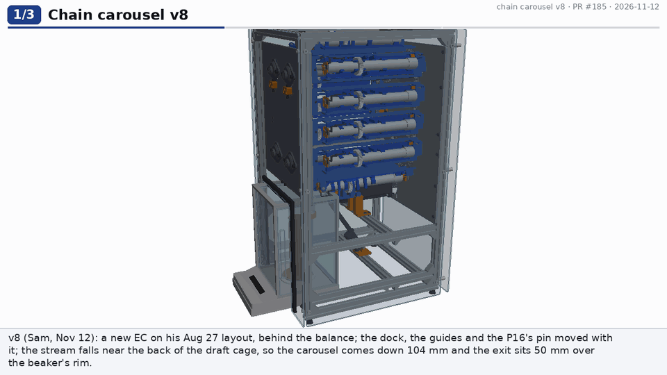
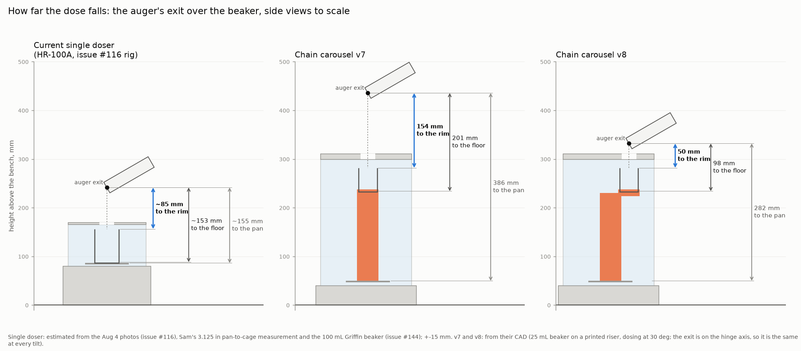
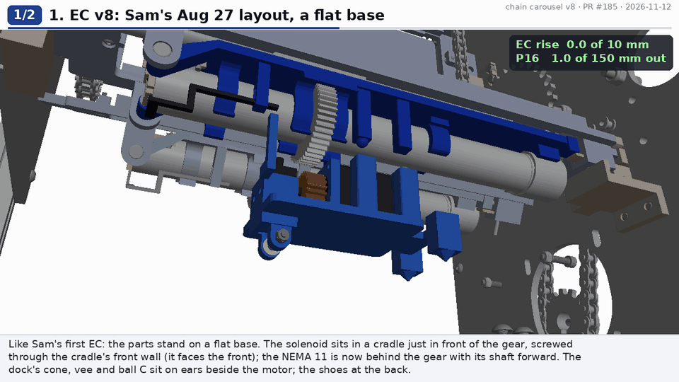
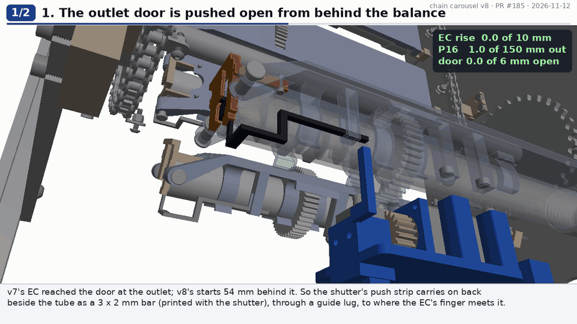
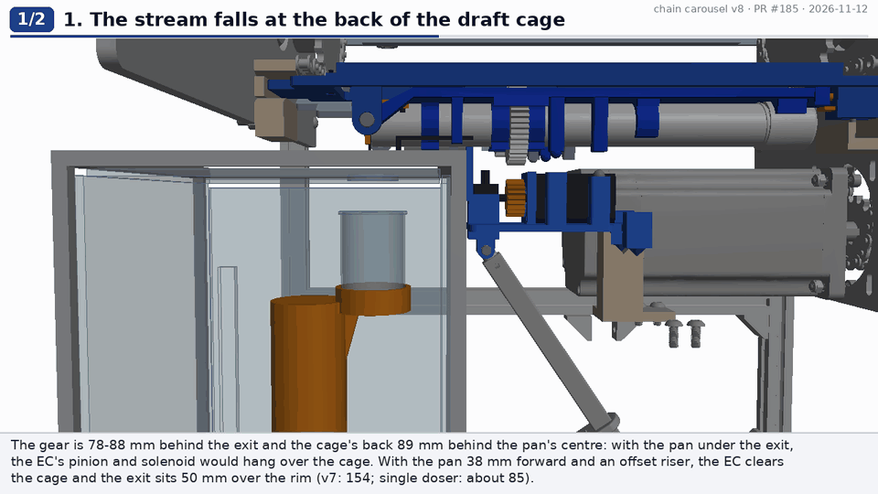
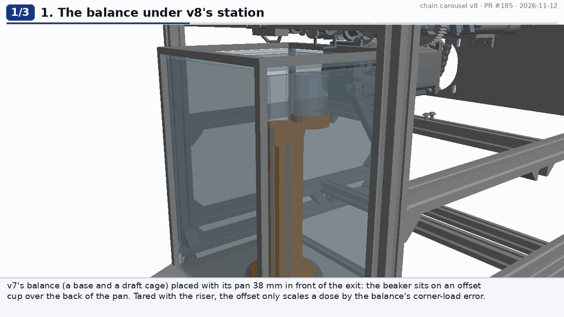
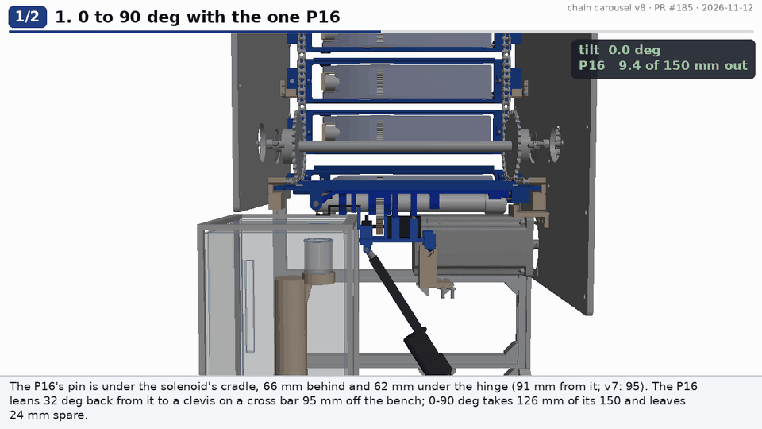
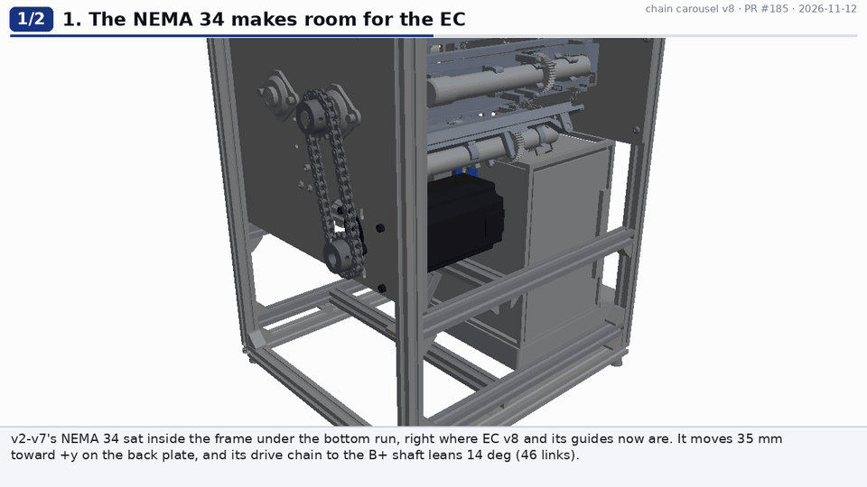

# Chain carousel v8: the auger 50 mm over the beaker, a new EC behind the balance

v8 is [v7](../chain-carousel-v7/README.md) with Sam's note of 2026-11-12
([PR #185](https://github.com/vertical-cloud-lab/powder-doser/pull/185)):
- **A new electronics carriage (EC), closer to Sam's first design.** Sam's Aug 27 EC was exported from Onshape for this.
  - The solenoid is just in front of the gear and faces the front.
  - The NEMA 11 is now behind the gear.
- **The dock, the guides and the P16's pin move with it.** The outlet door's push strip now runs back to the EC.
- **The auger comes down to the balance.** The EC sits wholly behind the draft cage, so the exit sits 50 mm over the beaker's rim.
  - v7: 154 mm.
  - The lab's single doser: about 85 mm.

Nothing is built. Every number here is a prediction from the CAD, except the single doser's, which is estimated from photos.

**Onshape (public):** [Multi-doser chain carousel, test rig v8](https://cad.onshape.com/documents/a093aef97b81fce9ce0f322f/w/7b029051ee0ec62ff198253f/e/7518535395874b79077ff86b) (ids in [`onshape/onshape_document.json`](onshape/onshape_document.json); 15 API calls in [`onshape/api_calls.jsonl`](onshape/api_calls.jsonl): 3 to export Sam's Aug 27 EC, 11 for the import, 1 to confirm it is public). Earlier versions:
[v7](https://cad.onshape.com/documents/291664f38c67a4672a86f025/w/e67d1b706aa4b873fa8c68e8/e/4802634f69ef3323004d7bf6),
[v6](https://cad.onshape.com/documents/29870b97e25aa1033c07144d/w/3c2b496fc08f7472605d17c2/e/a75fe90d184f765ada5d65de),
[v5](https://cad.onshape.com/documents/7781103e41ea031038274d53/w/be93cab60ae7d8dd4c301dd0/e/c7483f9da46de0305e71e071).



## How high is the auger over the beaker?

Sam asked for "a comparison between the auger-to-beaker height for the current powder doser and for v7".



| From the auger's exit | Single doser (HR-100A) | v7 | **v8** |
|---|---|---|---|
| to the beaker's rim | about 85 mm (+-15) | 154 mm | **50 mm** |
| to the beaker's floor | about 153 mm | 201 mm | **98 mm** |
| to the pan | about 155 mm | 386 mm | 282 mm |
| beaker | 100 mL Griffin (50 x 70 mm) on the pan | 25 mL low form (38 x 49) on a 188 mm riser | the same, on an offset riser |

- **Single doser.** There is no CAD of its stand or balance, so its numbers are pieced together:
  - Sam's measurement on the HR-100A: 3.125 in from the pan to the underside of the cage ([#144](https://github.com/vertical-cloud-lab/powder-doser/issues/144#issuecomment-5358640332)).
  - The 100 mL Griffin beaker it doses into (the same comment).
  - The exit's height over that beaker in the Aug 4 photos ([#116](https://github.com/vertical-cloud-lab/powder-doser/issues/116#issuecomment-5185277911)), scaled off the beaker's 50 mm rim.
  - PR #170's CAD puts its exit 37.5 mm over its board at 30 deg, which fits a board standing just above the cage.
- **v7 and v8.** From their CAD ([`drop_heights.py`](drop_heights.py), [`checks/drop_heights.json`](checks/drop_heights.json)). The exit is on the hinge axis, so these hold at every tilt.
- **So v7's fall was 1.8 times the single doser's.** v8's is about 60 % of it, measured to the rim.

## What changed, and why

| # | Sam asked | v8 | How it works | Clip |
|---|---|---|---|---|
| 1 | "design a new electronics carriage more similar to the first design. Flip the solenoid around so it faces the front, not the back, and move the solenoid to just in front of the gear" | **EC v8**, built new on the layout of Sam's Aug 27 EC (exported from his Onshape document, 3 API calls; [`reference/sam-aug27-electronics-carriage.step`](reference/sam-aug27-electronics-carriage.step)). That design is a flat 60 x 110 mm base with four cone-tipped posts, a motor plate and a solenoid plate. EC v8 is a flat base (96 x 50 mm) with its parts standing on it, from the front: the door finger; the solenoid's cradle just in front of the gear; the 20T pinion under the 44T gear; the motor plate with the NEMA 11 behind it; ears beside the motor for the dock; two guide shoes at the back | The solenoid stands just in front of the gear (its frame 5.4 mm from the gear's face), plunger up under the tube as before. Its frame is screwed through the cradle's front wall, so it faces the front and its leads come out toward the outlet. **The NEMA 11 is turned round:** in v7 its body was in front of the gear, shaft back; now it is behind the gear on a motor plate, shaft forward, cut 4.5 mm so it ends flush with the pinion | [ec](renders/v8/ec_v8.gif) |
| 2 | "You'll also have to move the kinematic couplings, guides, etc." | **The dock:** v7's three printed posts move from in front of the gear (x 46.5-64) to behind it (x 104, 104, 128). The EC's cone, vee and ball C sit on ears beside the motor. **The guides:** v7's funnel-mouthed guides and cone/vee seats move to the EC's back end, on a cross bar at x 205 behind the balance. **The door:** the shutter's push strip carries on back beside the tube as a 3 x 2 mm bar to x 58, where the EC's finger meets it | The EC still parks 10 mm under the dock. Parked, the pinion clears the passing gears by 8.25 mm, the ears clear the domes by 7.8 mm and the finger clears the closed bars by 4 mm. The bar runs high (10 mm under the axis) where it crosses the draft cage's back frame, and through a guide lug on the plate | [ec](renders/v8/ec_v8.gif), [door](renders/v8/door_v8.gif) |
| 3 | "Keep the linear actuator attachment point as close to the front as possible, or close to where it was in v7 ... the bigger priority is to shorten the z distance between the auger and the beaker. You can jump to a longer actuator if needed" | **The same P16-150.** Its pin is under the solenoid's cradle, the EC's front: 66 mm behind and 62 mm under the hinge axis, 90.6 mm from it (v7: 95). Its base is on a clevis on a cross bar between the lower rungs (the clevis pin 95 mm off the bench) | Parked it is 1.0 mm out and docked 9.4 mm. **0-90 deg takes 126.3 mm, so 23.7 mm is spare** (v7: 129.7 and 20). It leans 32 deg back from the EC (v7: 44.5). Its lever arm about the hinge is 22.7 mm docked, 74 mm at 30 deg and 90.6 mm at 62 deg. No longer actuator was needed | [tilt90](renders/v8/tilt90_v8.gif) |
| 4 | "This should allow the augers to get closer to the scale and the electronics carriage to sit mostly or totally behind the scale" | **Totally behind it.** The balance's pan is placed 38 mm in front of the exit, and the beaker sits on an offset cup over the back of the pan. The carousel then comes down 103.65 mm: the exit goes from 435.65 to 332 mm, 50 mm over the rim | See "Why the beaker moves" below | [drop](renders/v8/drop_v8.gif), [balance](renders/v8/balance_v8.gif) |
| 5 | "I have no idea how to do the front cover now---come up with something, or pitch a few ideas" | **Drawn: a notch round the balance, with brush strips, and no front hatch door.** The balance now stands 110 mm proud of the front panel | The front panel is notched round the balance, from the bench to 2 mm over the draft cage, with brush strips on the notch's sides and top. The balance's own draft cage closes the bottom of the front. The beaker goes in and out through the balance's side doors, whose grips stay outside the panel. Three other ideas are below | [frame](renders/v8/frame_v8.gif) |
| - | (found on the way) | **The NEMA 34 moves 35 mm toward +y** on the back plate, at v7's height under the bottom run. Its drive chain to the B+ shaft now has 46 links and leans 14 deg | v2-v7's motor stood exactly where EC v8 and its guides now are. Inside the loop, which was tried first, the tilting module sweeps through it between about 30 and 60 deg | [frame](renders/v8/frame_v8.gif) |

| EC v8: Sam's Aug 27 layout | The door's push bar runs back to the EC |
|---|---|
|  |  |

| The drop: 50 mm from the exit to the rim | The balance: the pan 38 mm ahead, an offset riser |
|---|---|
|  |  |

| 0-90 deg with the one P16 | The NEMA 34 moved; the front cover |
|---|---|
|  |  |

## Why the beaker moves, not just the EC

The 44T gear is moulded on the auger 78.4-88.4 mm behind the exit, and the pinion has to mesh under it. The draft cage's back
frame is 89.4 mm behind the pan's centre: v7's model of the lab's balance, which is within a few mm of the HR-100A's.

- **With the pan centred under the exit,** the pinion sits 43 mm under the axis, right over the cage's back frame. A solenoid
  just in front of the gear hangs 54 mm under the axis there. Parked, both are another 10 mm lower. That would set the exit
  at about 370 mm, or 88 mm over the rim: about the single doser's height. No layout of the EC fixes this, because the gear
  is where it is.
- **v8 puts the pan's centre 38 mm in front of the exit,** so the stream falls near the back of the chamber.
  - The cage's back frame now ends 2.2 mm in front of the EC's front face (its door finger).
  - The exit can then come down until the module's own front clears the cage: clip 1 over the back frame, and the door
    bar over the lid. That is at 330.5 mm; v8 uses 332.
- **The riser** ([`parts8.riser_v8`](parts8.py)) keeps v5's foot and tube on the pan's centre and carries the beaker's cup
  on a 38 mm arm.
  - The balance is tared with the riser and the beaker, so the offset only scales a dose by the balance's corner-load
    (eccentricity) error. T8 measures it.
  - The beaker comes out through the -y side door: 85 mm of travel (the NEMA 34 stands behind it), lift it 6 mm, bring it
    forward 66 mm and out.
- **Without the solenoid in front of the gear** (if it went behind the gear with the motor), a 14 mm offset would do.
  Sam's layout costs 24 mm of offset, but no height.

## The front cover: four ideas

1. **Drawn in v8: a notch round the balance, with brush strips, and no front hatch.**
   - The front panel is notched round the balance (225 x 313 mm), with brush strips on the notch's sides and top.
   - The balance's own draft cage and side doors become the bottom of the enclosure's front.
   - Cheapest: one panel, three strips, no hinges. Drafts inside the frame never reach the beaker, which sits in the cage.
   - The open question is whether the stream's 50 mm through the air over the lid is draft-free enough (T8c).
2. **A bay window.** An acrylic box bumps out of the front panel round the balance's top half, with a hinged lid for the
   beaker. It encloses everything, but the frame gets 120 mm deeper at the front, and you open two doors to reach the beaker.
3. **A sliding sash, like a fume hood's.** The front panel slides up in two channels. It closes down onto the balance's top,
   with a brush strip, and is raised to load the balance. It suits a robot-served station; it needs channels and a counterweight
   or a gas spring.
4. **An anti-static strip curtain** over a plain opening round the balance: PVC strips that a hand or a gripper can pass
   through. Easiest for a robot arm, and the least draft-tight.

## Checks

These are OCC boolean overlaps between parts; anything over 0.5 mm^3 counts as a clash. By-design contacts are skipped by
part key (v8's are at the end of SKIP in [`check_interference.py`](check_interference.py)). The balance is in every check.

| Check | What moves | Result |
|---|---|---|
| Home | Every pair of the 850 instances | **0** ([`checks/home.json`](checks/home.json)) |
| `--tilt` | The EC rising 0-10 mm (5 poses), then module 1, the EC and the P16 at 5, 10, 20-90 deg (every 10) and 85 deg, against everything else | **0** ([`checks/tilt_a.json`](checks/tilt_a.json), [`tilt_b.json`](checks/tilt_b.json)) |
| [`sweep_station.py`](sweep_station.py) | Every carriage and module within 2.2 modules of the station, over one module of travel in 1-link steps (9 poses), against the parked station, the balance, the rungs and the NEMA 34 | **0** ([`checks/sweep_station.json`](checks/sweep_station.json)) |

**What the first runs found, all fixed:**
1. **The NEMA 34 against EC v8 (3,701 mm^3), its NEMA 11 and the +y guide.** v2-v7's motor stood where the EC now is. It
   moved inside the loop first, but at 40 deg the tilting module's plate, auger and cap swept through it (1,795 mm^3). It is
   now 35 mm toward +y under the bottom run (above).
2. **The P16 against the guide cross bar at 40 deg (90 mm^3).** The bar moved back to x 205, and the guides' feet reach back to it.
3. **EC v8's base and ball C's ear against the guides' outer walls when parked (29 mm^3 each).** The base now ends at x 136
   with a neck between the guides, and C moved from x 140 to 128.
4. **The door bar: open, it met clip 1's underside (2.15 mm^3); closed, it would have crossed the draft cage's back frame
   2.5 mm low.** It now runs out beside the tube (|y| 18-21) and high (z 8-10) where it crosses the frame, through a lug on
   the plate.
5. **The lower rungs' corner brackets against the posts' foot brackets (2,653 mm^3 each).** The lower rungs moved up to
   z 65, with their brackets on top.
6. **The front hatch door against the balance.** The balance now stands 110 mm proud of the panel, so the front cover
   changed (above).

## Check before building

1. **The station isn't simulated.** Print EC v8, the guides and a plate, and work them by hand first (TEST-PLAN T5, T6).
2. **The offset beaker (T8).** Measure the balance's corner-load error with the riser's cup 38 mm off centre: a 50 mg dose
   should read the same on the offset cup as centred on the pan.
3. **The door bar** is a 3 x 2 mm printed bar 60 mm long, pushed at its end. If it bends or the shutter binds, print it in
   PETG-CF or use a 2 mm steel rod in a printed shutter.
4. **The NEMA 11's shaft is cut 4.5 mm** so it ends flush with the pinion (shop step).
5. **The 46-link drive chain** comes from the same 10 ft roll (2 x 104 + 46 = 254 of 320 links).
6. **The balance's side doors** open 85 mm before they meet the NEMA 34's corner. The beaker has to come forward 66 mm
   inside the chamber to get out.
7. v7's open items stand: the latch spring (T4b), the dock's magnet pull (T6a), and which balance the lab uses. The station
   fits a draft cage up to 311 mm tall whose back frame is no more than 89 mm behind its pan's centre.

## Not done

- **Not simulated:** the station's dynamics (MuJoCo), as in v7.
- **Not rerun:** `--swap` and `--latch`. The plate's posts and lug are the only module changes, and the plate against the
  auger is a by-design pair.
- **Not regenerated:** the stills, the step-by-step ASSEMBLY renders and the Bambu slices. The STLs are exported.
- **Prices:** the brush strips are estimated ($24). EC v8's filament is estimated from its volume.

## Cost

**$2,200.98, or $2,059.59 without test gear** ([BOM.md](BOM.md)). v7 was $2,213.96 ($2,072.57): $12.98 less.
- **Removed:** the front hatch's hinges and turn button, and the lid's collar.
- **Added:** longer brush strips for the notch.
- **The same:** the P16-150 and its one LAC, the NEMA 11, the solenoid and the magnets.

## Files

| File | What |
|---|---|
| [`params.py`](params.py) | v7's numbers with v8's at the end; `Z_RUN` 103.65 mm lower |
| [`parts8.py`](parts8.py) | EC v8, mounting plate v8 (the posts behind the gear, the bar's lug), the shutter with its bar, the guides, the riser, the lid, the brush strips |
| [`layout.py`](layout.py) | v7's layout with the v8 station (EC frame, P16 base, guides), the pan 38 mm ahead, the NEMA 34 at y 92, the front notch |
| [`drop_heights.py`](drop_heights.py) | The comparison figure: single doser, v7, v8 |
| [`check_interference.py`](check_interference.py), [`sweep_station.py`](sweep_station.py) | Home, `--tilt`, station sweep |
| [`explain8.py`](explain8.py) | The seven v8 clips in `renders/v8/` |
| [`build.py`](build.py) | STEP assembly and components, the printed parts' STLs, the DXFs (the notched front panel, the dosing lid) |
| [`bom.py`](bom.py) / [`BOM.md`](BOM.md) | The BoM |
| [`TEST-PLAN.md`](TEST-PLAN.md) | v7's tests with T5-T8 rewritten for v8 |
| [`test/chain_rig.py`](test/chain_rig.py) | The Pi driver: the P16's tables from v8's geometry |
| [`onshape/fetch_sam_aug27_ec.py`](onshape/fetch_sam_aug27_ec.py) | Exports Sam's Aug 27 EC from Onshape |

To re-run:

```
pip install cadquery vtk pillow imageio imageio-ffmpeg numpy matplotlib
python check_interference.py && python check_interference.py --tilt && python sweep_station.py
xvfb-run -a python explain8.py overview drop ec door balance tilt90 frame
python drop_heights.py && python build.py && python bom.py
```
