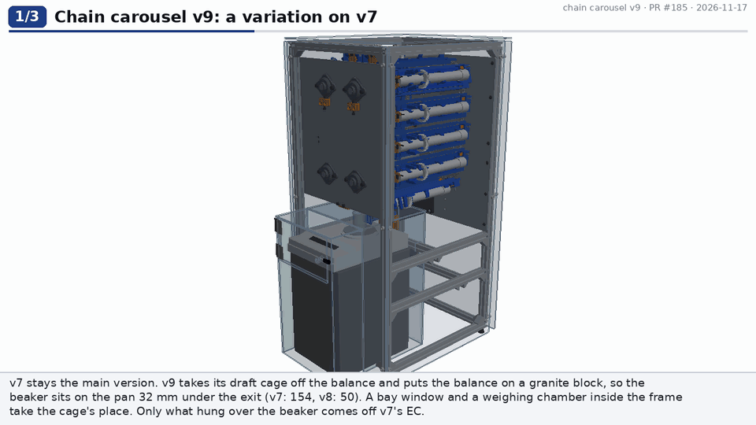
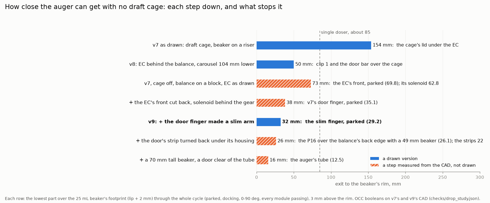
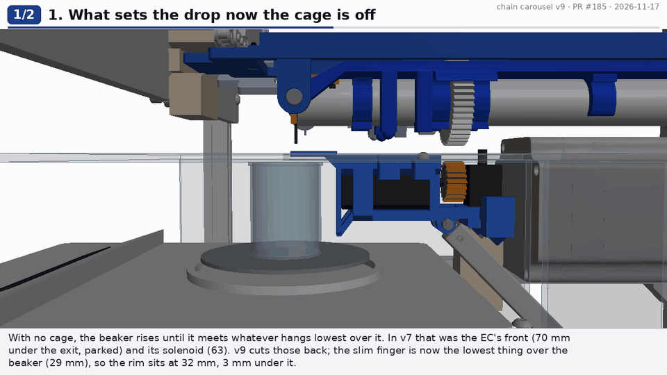
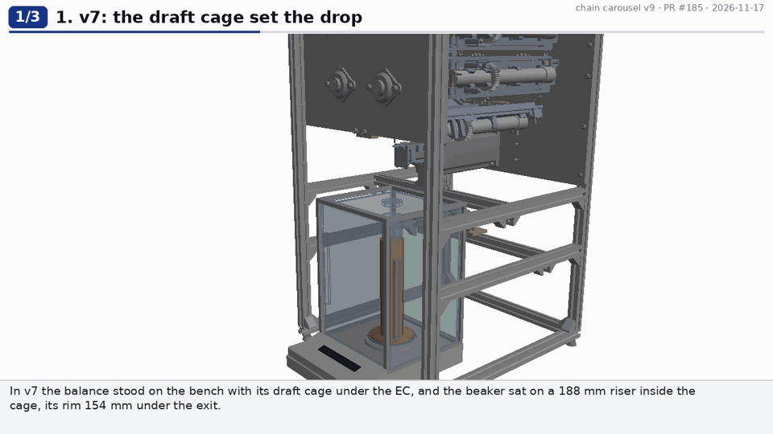
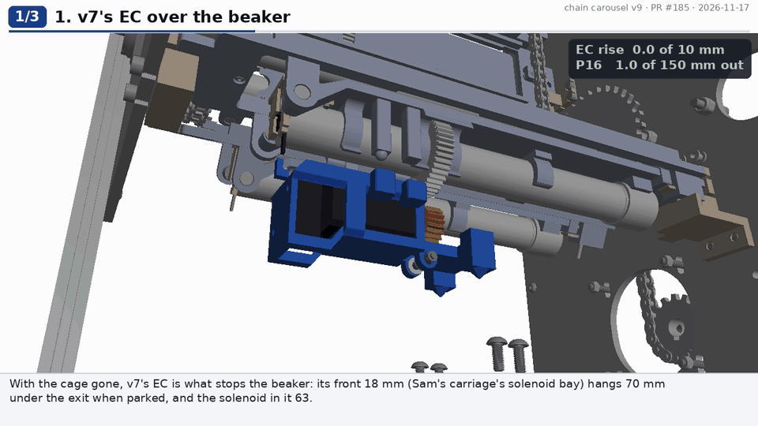
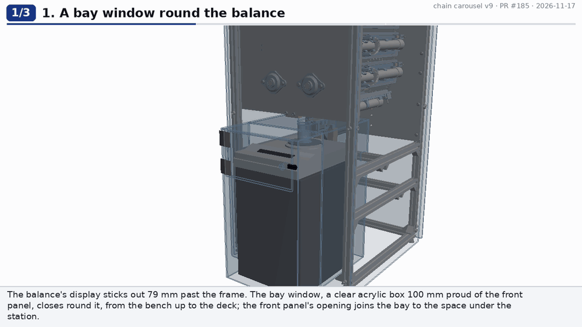
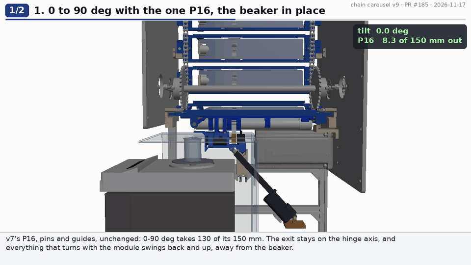
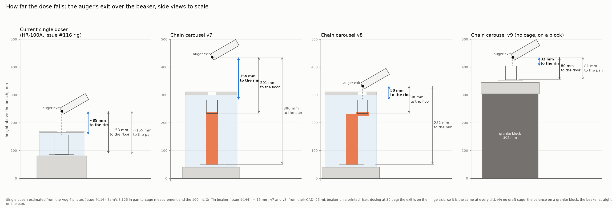

# Chain carousel v9: no draft cage, the balance on a block, the auger 32 mm over the beaker

> The next variation is [v10](../chain-carousel-v10/README.md) (2026-11-19): v9 with the station inside the loop (the EC on the plate's side, pulled up by a P16-100), a keyed rail instead of the kinematic dock, and the beaker 18 mm under the exit.

**v9 is a variation on [v7](../chain-carousel-v7/README.md), which stays the main version** (Sam, 2026-11-17: "I still like v7
more---keep v7 as a 'main' version we can come back to, but I want to try a few variations still"). [v8](../chain-carousel-v8/README.md)
is the other variation. v9 follows Sam's note of 2026-11-17 ([PR #185](https://github.com/vertical-cloud-lab/powder-doser/pull/185)):
- **The draft cage comes off the balance.** The closed enclosure round the doser does its job: a bay window round the balance
  and a weighing chamber inside the frame.
- **The balance goes up on a block** instead of the doser coming down, so the carousel stays at v7's height.
- **The beaker sits straight on the pan**, as close under the auger as the electronics carriage (EC) allows. The design point is
  **32 mm from the exit to the beaker's rim** (v7: 154, v8: 50, the single doser about 85).
- **Only what hung over the beaker comes off v7's EC.** That is its front 18 mm, with the solenoid moved behind the gear and the
  door finger made a slim arm. Everything else of v7's station is kept: the dock on the plate's posts, the 10 mm park, one P16
  for the lift and the tilt, the guides' funnels and seats, 0-90°, and the latch.

Nothing is built. Every number here is a prediction from the CAD, except the single doser's, which is estimated from photos.

**Onshape (public):** [Multi-doser chain carousel, test rig v9](https://cad.onshape.com/documents/9aadc21a931d5337ff05de71/w/1dea03d63eb704d060d84c2a/e/caa98ea728a9da9006767590)
(ids in [`onshape/onshape_document.json`](onshape/onshape_document.json); 13 API calls in [`onshape/api_calls.jsonl`](onshape/api_calls.jsonl):
12 for the import, 1 to confirm it is public). It was imported from `step/chain_carousel_rig_v9.step` by
[`onshape/onshape_build.py`](onshape/onshape_build.py). Earlier versions:
[v8](https://cad.onshape.com/documents/a093aef97b81fce9ce0f322f/w/7b029051ee0ec62ff198253f/e/7518535395874b79077ff86b),
[v7 (main)](https://cad.onshape.com/documents/291664f38c67a4672a86f025/w/e67d1b706aa4b873fa8c68e8/e/4802634f69ef3323004d7bf6),
[v6](https://cad.onshape.com/documents/29870b97e25aa1033c07144d/w/3c2b496fc08f7472605d17c2/e/a75fe90d184f765ada5d65de),
[v5](https://cad.onshape.com/documents/7781103e41ea031038274d53/w/be93cab60ae7d8dd4c301dd0/e/c7483f9da46de0305e71e071).



## How close can the auger get?

Sam asked: "assuming we have a beaker on top of a scale with no draft cage, how close can we get the auger while not
sacrificing the good aspects of the electronics carriage designs? Give me an attempt at that balance between parameters."

With the cage gone, the beaker on the pan can rise until it meets the lowest part that ever comes over it. That means the EC
parked, rising, docked or tilting; the module at the station; and every module passing the station.
[`drop_study.py`](drop_study.py) finds that part with OCC booleans: each part, through the whole cycle, against the 25 mL
beaker's footprint (its lip plus 2 mm). It does this for v7's CAD with the cage off and for v9's
([`checks/drop_study.json`](checks/drop_study.json)). The rim then goes 3 mm under that part.



| Step | Exit to rim | What stops it | What it costs |
|---|---|---|---|
| v7 as drawn | 154 mm | The cage's dosing lid under the EC | |
| v7, the cage off, the balance on a block, the EC as drawn | **73 mm** | The EC's front 18 mm (Sam's carriage's solenoid bay), 69.8 mm under the exit when parked; the solenoid in it, 62.8 | Nothing: no part changes |
| + the EC's front cut back, the solenoid moved behind the gear | 38 mm | v7's door finger, 35.1 mm under the exit when parked | A new front wall; the solenoid taps behind the gear instead of near the outlet |
| **+ the finger made a slim arm (v9)** | **32 mm** | The slim finger, 29.2 mm under the exit at its lowest (parked, or tilting) | A 3 x 4 mm printed arm instead of v7's L |
| + the door's push strip turned back under its housing (not drawn) | 26 mm | The P16's body over the balance's back edge (with the 49 mm tall 25 mL beaker); every module's strip is 22 mm under the exit | All 13 shutters reprinted; the finger meets the strip behind the beaker |
| + a 70 mm tall beaker and a door clear of the tube (not drawn) | 16 mm | The auger's own tube, 12.5 mm under the exit | A new door design on every module; a 100 mL Griffin beaker (the single doser's) |

**v9 stops at 32 mm** because that is as far as the EC can go without touching the modules: every change down to there is on
the EC alone. The next 6 mm need all 13 outlet doors reprinted, and the 10 after that a new door design. Every "good aspect" of
the EC designs stays: the kinematic dock on the plate's posts with its magnets, the short EC that parks 10 mm under the dock,
one P16 that lifts and tilts, the guides' funnels and cone/vee seats, 0-90°, and the finger that opens the door only while
docked. v8's aim of keeping the EC off the beaker holds for all of it but the slim finger: the EC's body now starts 7 mm behind
the beaker's lip.

**What 32 mm leaves:**
- The beaker's rim is 2.8 mm under the parked finger at its lowest, and 10 mm under every passing module's door strip.
- The rim is 19.5 mm under the auger's tube.
- The beaker slides in and out level under the deck and the bay window's top (1.35 mm) and under the finger.
- If that is too tight in use, a 5 mm thinner block gives 37 mm and changes nothing else (TEST-PLAN T5, T8e).

## What changed, and why

| # | Sam asked | v9 | How it works | Clip |
|---|---|---|---|---|
| 1 | "keep v7 as a 'main' version we can come back to" | **v7 is the main version.** Its README and v8's say so; v9 is a variation on v7, not on v8 | v9 is v7's source with the changes below. v7's and v8's folders are unchanged apart from a note at the top of each README | |
| 2 | "remove the draft cage on the scale. If we have close-able plexiglas surrounding the doser, that should be able to replace the draft cage" | **The balance is v7's model without its cage, doors or dosing lid:** the weighing base, the display and the pan ([`parts9.balance_v9`](parts9.py)). The beaker sits straight on the pan, with no riser | The cage's job, keeping air off the pan, moves to the enclosure: the bay window (row 5) and the weighing chamber (row 6). TEST-PLAN T8c compares the reading with the cage off inside the closed enclosure against the cage on in the open lab | [balance](renders/v9/balance_v9.gif) |
| 3 | "you can put the scale on a block instead of lowering the whole multidoser" | **A granite block, 252 x 210 x 305 mm, under the balance** ([`parts9.block_v9`](parts9.py)). The carousel stays at v7's height (exit 435.65 mm); v8 lowered it 104 mm | The block stands on the bench inside the frame's U-shaped base and touches nothing of the doser. Granite also damps the bench (the lab's paver, [#146](https://github.com/vertical-cloud-lab/powder-doser/issues/146)). The pan's centre is 7 mm in front of the exit, so the beaker clears the EC's new front face and the balance's back edge stays 4.5 mm in front of the guides. With the lab's HR-100A (pan 86.5 mm over its feet, against this model's 50) the block is 36.5 mm lower | [balance](renders/v9/balance_v9.gif) |
| 4 | "how close can we get the auger while not sacrificing the good aspects of the electronics carriage designs?" | **EC v9 is v7's EC with only what hung over the beaker cut back** ([`parts9.ec_mods_v9`](parts9.py)): its front 18 mm off, a 2.5 mm front wall in front of the NEMA 11, the solenoid moved behind the gear onto the tail, and v7's L-shaped finger replaced by a slim 3 x 4 mm arm | The solenoid sits in a cradle in the tail's web, between the guide shoes, with its plunger up under the tube as before. In v7's layout the NEMA 11's body fills the space in front of the gear, so "just in front of the gear" (v8) isn't free. The finger's top still holds the door's strip 6 mm up when docked, and clears the passing strips by 4 mm when parked | [ec](renders/v9/ec_v9.gif), [drop](renders/v9/drop_v9.gif) |
| 5 | "a bay window sort of enclosure in the front to give more space for the scale" | **A bay window round the balance:** a clear acrylic box 100 mm proud of the front panel, 236 mm wide, from the bench to 408 mm, with a door (200 x 115 mm) for the beaker. v7's front hatch is gone | The raised balance's display sticks out 79 mm past the frame; the bay closes round it. The front panel's opening joins the bay to the space under the station. To load: open the door, reach over the display, slide the beaker onto the pan under the exit, close the door | [enclosure](renders/v9/enclosure_v9.gif) |
| 6 | "add some internal panels or something to decrease the draft from the carousel moving around" | **A weighing chamber inside the frame:** two side baffles in line with the bay's sides, a back baffle with a slot for the P16, and a deck over them 4.6 mm under the passing modules | The air the moving chain and modules stir stays above the deck, and the NEMA 34 (heat) stays behind the back baffle. The deck is open only where the EC rises and tilts, the stream falls and the P16 swings; its opening runs out to the back, because the EC's tail sweeps out to x 156.5 below the deck as it tilts. The side baffles are notched round the guide cross bar | [enclosure](renders/v9/enclosure_v9.gif) |

| The drop: 32 mm, and what sets it | The cage off, the balance up on a block |
|---|---|
|  |  |

| EC v9: v7's, cut back where it hung over the beaker | The bay window and the weighing chamber |
|---|---|
|  |  |

**0-90° with the beaker in place** ([MP4](renders/v9/tilt90_v9.mp4)): v7's P16, pins and guides, unchanged (130 of its 150 mm
at 90°).



## Auger-to-beaker height: the single doser, v7, v8 and v9



| From the auger's exit | Single doser (HR-100A) | v7 | v8 | **v9** |
|---|---|---|---|---|
| to the beaker's rim | about 85 mm (+-15) | 154 mm | 50 mm | **32 mm** |
| to the beaker's floor | about 153 mm | 201 mm | 98 mm | **80 mm** |
| to the pan | about 155 mm | 386 mm | 282 mm | **81 mm** |
| beaker | 100 mL Griffin on the pan | 25 mL on a 188 mm riser | the same, on an offset riser | 25 mL on the pan |

The single doser's numbers are estimated as in [v8's README](../chain-carousel-v8/README.md#how-high-is-the-auger-over-the-beaker);
v7-v9's are from their CAD ([`drop_heights.py`](drop_heights.py), [`checks/drop_heights.json`](checks/drop_heights.json)).

## Checks

These are OCC boolean overlaps between parts; anything over 0.5 mm^3 counts as a clash. By-design contacts are skipped by
part key (v9's are at the end of SKIP in [`check_interference.py`](check_interference.py)). The balance, its block, the beaker
and the weighing chamber are in every check.

| Check | What moves | Result |
|---|---|---|
| Home | Every pair of the 854 instances | **0** ([`checks/home.json`](checks/home.json)) |
| `--tilt` | The EC rising 0-10 mm (5 poses), then module 1, the EC and the P16 at 0, 5, 10, 20-90° (every 10) and 85°, against everything else | **0** ([`checks/tilt_a.json`](checks/tilt_a.json), [`tilt_b.json`](checks/tilt_b.json)) |
| [`sweep_station.py`](sweep_station.py) | Every carriage and module within 2.2 modules of the station, over one module of travel in 1-link steps (9 poses), against the parked station, the balance, the block, the beaker, the deck and the baffles | **0** ([`checks/sweep_station.json`](checks/sweep_station.json)) |
| [`drop_study.py`](drop_study.py) | Every part over the beaker's footprint through the cycle | The rim 2.8 mm under the slim finger at its lowest; the P16's body 8.9 mm over the balance's back edge |

## Cost

**$2,406.05, or $2,264.66 without test gear** ([BOM.md](BOM.md)). v7 was $2,213.96 ($2,072.57): $192.09 more.
- **Added:** the granite block ($120, estimated), a sixth acrylic sheet for the bay window and the chamber ($70.99), and
  acrylic cement with printed corner clips ($14, estimated).
- **Removed:** v7's dosing lid, beaker riser and brush strip.
- **The same:** the P16-150 and its one LAC, the NEMA 11, the solenoid, the magnets, and the hinges (the bay door takes the
  front hatch's pair).

## Check before building

1. **Can the lab's balance run with its draft cage off?** Some A&D balances locate a draft ring round the pan with the cage's
   glass. If the HR-100A's can't come off, keep its glass walls and take only the top door off: the stream comes in from above,
   so the drop doesn't change (TEST-PLAN T8c).
2. **The beaker's clearances at 32 mm:** 2.8 mm under the parked finger, and 1.35 mm under the deck and the bay's top as it
   slides in and out. Glass beakers vary in height by about a millimetre; shim the block if needed (T5, T8e).
3. **The solenoid behind the gear (T8d):** check that its tap still reaches the exit.
4. **The granite block** is about 43 kg; set it before the balance, and level it with the balance's own feet.
5. v7's open items stand: the station isn't simulated (T5, T6), the latch spring (T4b), the dock's magnet pull (T6a), and which
   balance the lab uses.

## Not done

- **Not simulated:** the station's dynamics (MuJoCo), as in v7 and v8; and the air in the weighing chamber (no CFD). T8a and
  T8c measure them.
- **Not rerun:** `--swap` and `--latch` (v9 changes nothing at the side hatch or the latch).
- **Not drawn:** the last two steps of the drop study (26 and 16 mm). They need every module's door changed.
- **Not regenerated:** the stills, the step-by-step ASSEMBLY renders and the Bambu slices. The STLs are exported.
- **Prices:** the granite block and the acrylic cement are estimated.

## Files

| File | What |
|---|---|
| [`params.py`](params.py) | v7's numbers with v9's at the end |
| [`parts9.py`](parts9.py) | EC v9's cuts and additions, the balance without its cage, the block, the bay window, the weighing chamber |
| [`layout.py`](layout.py) | v7's layout with the balance on its block, the beaker on the pan, the bay window, the chamber (`State.chamber`) |
| [`drop_study.py`](drop_study.py) | The drop study (`--measure` runs the OCC booleans) and its figure |
| [`drop_heights.py`](drop_heights.py) | The single doser / v7 / v8 / v9 comparison |
| [`check_interference.py`](check_interference.py), [`sweep_station.py`](sweep_station.py) | Home, `--tilt`, station sweep |
| [`explain9.py`](explain9.py) | The six v9 clips in `renders/v9/` (GIF + MP4 each) |
| [`build.py`](build.py) | STEP assembly and components, the printed parts' STLs (`electronics_carriage_v9.stl`), the DXFs (the panels, the bay window's sheets and door, the baffles and the deck) |
| [`bom.py`](bom.py) / [`BOM.md`](BOM.md) | The BoM |
| [`TEST-PLAN.md`](TEST-PLAN.md) | v7's tests with T5, T7 and T8-T8e rewritten for v9 |

To re-run:

```
pip install cadquery vtk pillow imageio imageio-ffmpeg numpy matplotlib
python check_interference.py && python check_interference.py --tilt && python sweep_station.py
python drop_study.py --measure && python drop_study.py && python drop_heights.py
xvfb-run -a python explain9.py overview drop balance ec enclosure tilt90
python build.py && python bom.py
```
