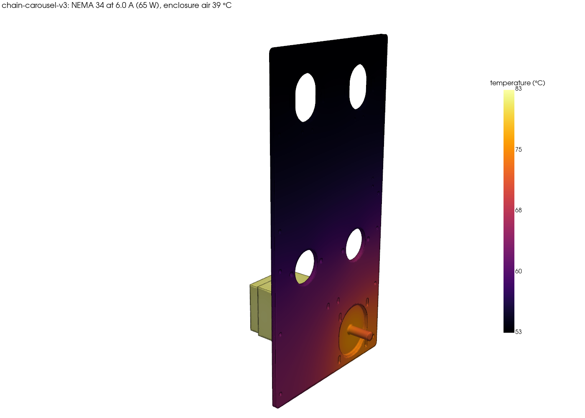
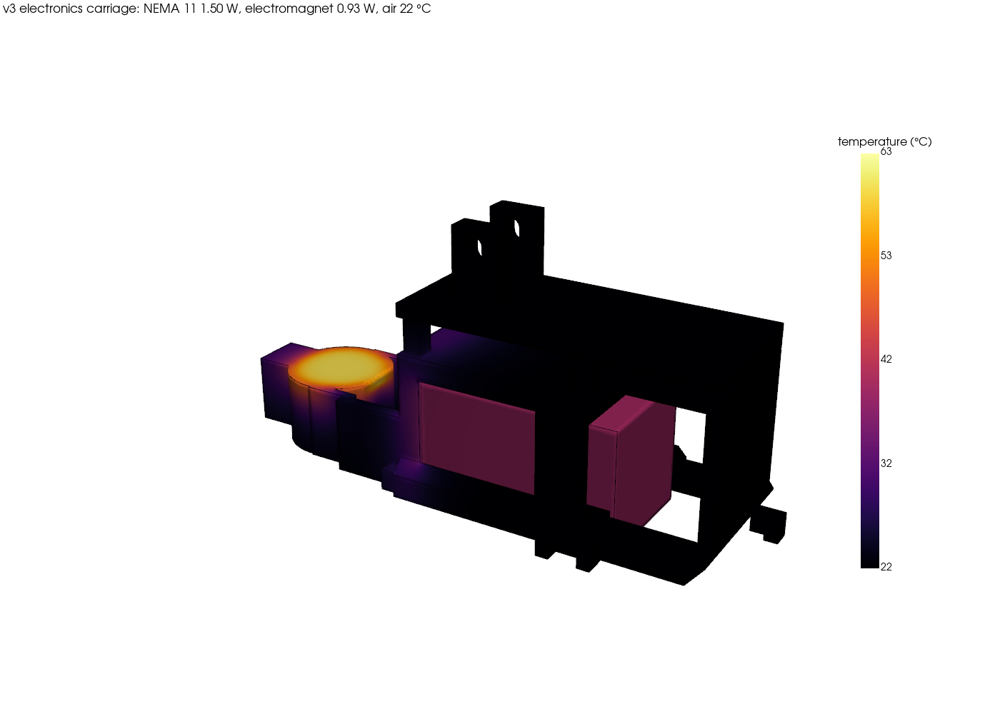
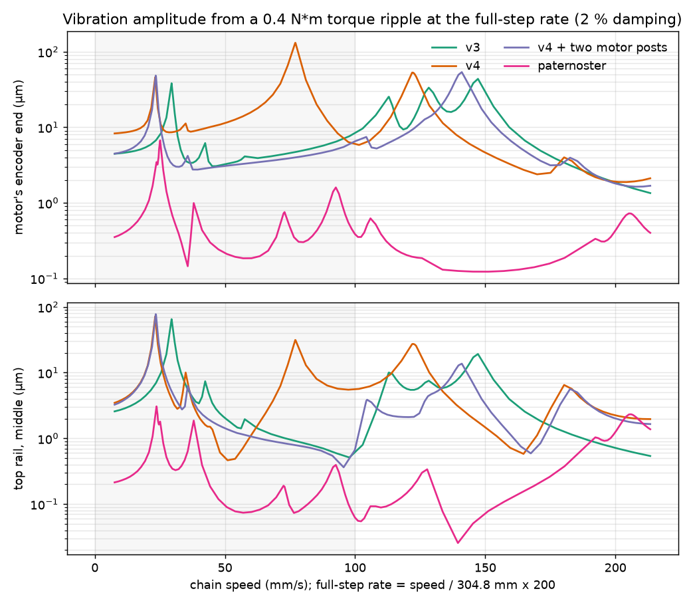

# Materials, vibration and heat

Asked for on [#188](https://github.com/vertical-cloud-lab/powder-doser/pull/188): material selection, vibration
tolerance (does the rig shake itself apart?), and heat buildup and transfer. These runs use the same models, designs and
commits as [RESULTS.md](RESULTS.md) (v3, v4 and the paternoster on #185). They add three new kinds of CalculiX analysis:
- heat transfer: DC3D10 elements with convection and radiation, coupled to an energy balance of the acrylic enclosure;
- forced response: `*STEADY STATE DYNAMICS`, by modal superposition;
- material substitution.

Nothing is built, so every number is a prediction. The detail is in [out/thermal/SUMMARY.md](out/thermal/SUMMARY.md),
[out/vibration/SUMMARY.md](out/vibration/SUMMARY.md) and [out/materials/SUMMARY.md](out/materials/SUMMARY.md). The code
is `cases/thermal.py`, `cases/vibration.py` and `cases/materials_study.py`.

**Checks against hand solutions** (added to `verify.py`):
- harmonic response: a cantilever under a 100 N harmonic tip load reads 0.0975 mm well below its first mode (static
  0.0983) and 2.365 mm at it (theory 2.386 at 2 % damping);
- heat: a pin fin's tip reaches 67.54 °C (fin equation 67.54);
- heat: a slab heated through its volume rises 23.39 K (q L^2 / 8k: 23.39).

## What to change

**Heat**

1. **Keep the NEMA 34's standstill current low.** Its loss is 2 I^2 R: about 50 W cold at the docs' 6.0 A and 0.7 Ω
   per phase, and 64 W once the winding is warm. v3 and v4 hang the motor inside their closed acrylic enclosures. With
   6.0 A held, v3's enclosure air settles at 39 °C:
   - the motor case reaches 83 °C, and so does the encoder on its rear end;
   - the back side plate reaches 75 °C at the motor;
   - the printed PETG parts screwed to that plate reach 54-65 °C: the hold-down 65 °C, the side tab 57 °C, the
     tensioner blocks 54 °C. PETG HF softens at 69 °C (HDT, 0.45 MPa).

   At 3 A (half current) it's 13.5 W: air 25.5 °C, motor 37 °C, those parts 30-33 °C. Closed-loop drivers of this kind
   adjust the current to the load, which with a balanced loop at standstill is small. (The CL-HSS86's manual says so;
   the CL86T's wasn't reachable from here.) Open-loop mode, or a holding current set to 100 %, gives the full 6.0 A at
   standstill.
   - Check the driver's mode and holding current through its RS232 tuning port.
   - Measure the motor's case after an hour holding at the station.
   - Check the E1000 encoder's temperature rating, since it sits on the motor's hottest end.

   v4 is similar: 63 W, air 35 °C, motor 76 °C, parts 48-56 °C. The paternoster's motor hangs outside in the room and
   reaches 75 °C at full current.
2. **The dock electromagnet cooks its own printed cup.** It dissipates 1.1 W for as long as the dock holds. In still
   air its PETG cup reaches 63 °C (66 °C at 25.5 °C enclosure air), within a few kelvin of PETG's HDT, under the
   magnet's sustained pull. On a fixed 5 V the warm coil also draws less current, so its pull falls to 72 % of cold:
   7.6 N instead of 10.6 N at the design gap.
   - With change 6 of RESULTS.md (the vee's magnet moved up), v3's dock still holds at every tilt and tap with the
     weaker pull. Its lowest contact force drops from 2.6 to 2.3 N. In fact, with that change the dock stays seated even
     with the electromagnet off (1.4 N), so the electromagnet only adds margin.
   - Fix: once it has pulled in, hold it at about half current (PWM, with the flyback diode it already has). That
     quarters its loss to about 0.3 W and its pull to about 2.6 N. Re-check the NEMA 11's mesh margin at that pull
     (station.py's `gear_capacity`). Or print the cup in PC or ASA, or seat the magnet in an aluminium cup.
   - The NEMA 11 next to it, at its 450 mA DRV8825 limit (1.4-1.5 W), stays at 39-43 °C. Disable it between doses
     anyway: a warm auger motor warms the powder and the air over the beaker.
3. **The balance shares the enclosure with the motor.** The HR-100A sits under the station, inside the acrylic. The
   enclosure air warms from the room's temperature to its steady value over about an hour after power-up: 3.5 K at
   half current, 17 K at full. A beaker brought in from the room is then colder than the air and reads heavy until it
   catches up. NIST's [GMP 10](https://www.nist.gov/document/gmp-10-weighing-operation-factors-20190506pdf) cites errors
   of up to 0.2 mg for a 4 °C difference between weights and the balance, two counts on the HR-100A.
   - Keep the motor's hold current low (change 1).
   - Let the rig warm up before taring or calibrating.
   - Keep the beakers inside the enclosure, or let them sit there a few minutes first.
   - If the motor has to run hot, put a baffle between the drive and the balance, or vent the drive end.
   - The station's own heat (2.4 W at the electronics carriage) rises away from the pan below it; the carriage's
     surfaces at 40-66 °C above the beaker are still a reason for change 2.
4. **Black-anodise or paint v3's and v4's back side plates.** Mill-finish 6061 radiates almost nothing (emissivity
   about 0.1, against 0.85 black). At half current in v3 a black plate runs the motor 2.5 K cooler and the printed
   parts on it 3-4 K cooler. At full current in v4 it takes 8 K off the motor (76 to 68 °C) and 12 K off those parts
   (56 to 45 °C at the hottest).

**Vibration**

5. **Nothing shakes loose while the motor microsteps.** The torque ripple at the full-step rate (taken as 3 % of the
   holding torque, 0.4 N*m) drives each frame through its modes. At the worst speed each bolted joint's sideways load
   stays far below what friction holds, and a joint that doesn't slip can't self-loosen:

   | frame | joint | sideways load at the worst speed | friction holds | safety factor | slips at a ripple of |
   |---|---|---|---|---|---|
   | v3 | motor's 4 M5s (3 N*m) | 6.6 N at 113 mm/s | 450 N | 69 | 27.4 N*m |
   | v3 | side plate's M5 T-nut screws (2.5 N*m) | 22.4 N at 30 mm/s | 375 N | 17 | 6.7 N*m |
   | v4 | motor's 4 M5s (3 N*m) | 11.3 N at 77 mm/s | 450 N | 40 | 16.0 N*m |
   | v4 | side plate's M5 T-nut screws (2.5 N*m) | 45.9 N at 77 mm/s | 375 N | 8 | 3.3 N*m |
   | v4 + two motor posts | motor's 4 M5s (3 N*m) | 6.4 N at 24 mm/s | 450 N | 70 | 28.1 N*m |
   | v4 + two motor posts | side plate's M5 T-nut screws (2.5 N*m) | 17.1 N at 24 mm/s | 375 N | 22 | 8.8 N*m |
   | paternoster | motor's 4 M5s (3 N*m) | 2.2 N at 92 mm/s | 450 N | 206 | 82.4 N*m |
   | paternoster | side plate's M5 T-nut screws (2.5 N*m) | 1.4 N at 92 mm/s | 375 N | 277 | 110.7 N*m |

   The side plates' T-nut screws come closest: at v3's first sway mode (30 mm/s) and at v4's motor mode (77 mm/s). They
   would slip at a ripple of 3.3 N*m in v4, 6.7 N*m in v3, 8.8 N*m in v4 + two motor posts, 110.7 N*m in paternoster. Full-stepping can produce ripples that size, since every step is then an
   impulse. So:
   - keep microstepping on (the docs' 4000 pulses/rev);
   - keep the blue threadlocker on the T-nut screws;
   - don't cruise in the sway band (RESULTS.md change 15).

   Plate fatigue is no concern: the stress amplitude is 4.3 MPa at most, against 6061-T6's 96 MPa endurance.
6. **Let the frame settle before reading the balance.** At 2 % damping the slowest sway mode (15-19 Hz) decays to
   0.1 % in 2.8-3.6 s after a stop, and in 5.7-7.2 s at 1 %. So wait 3-7 s, plus the HR-100A's own settling time, and
   keep the solenoid and the ERM off while it reads.
7. **The acrylic panels resonate inside the step-rate band** (v3's panels' first modes are 23-39 Hz; v4's panels' first modes are 22-26 Hz, and each has more modes up to 75 Hz). The full-step rate reaches the lowest at 34 mm/s and crosses more of them all the way to 100 mm/s, so some panel will buzz at most speeds. Cast acrylic cracks from its screw holes
   under vibration or overtightening. Put rubber or nylon shoulder washers under the panel screws and don't overtighten
   them, or cut the panels from polycarbonate.
8. **The chain's vertical runs** (228.6 mm between sprockets, 80 N, carrying the carriages) have their first
   transverse mode at about 12.4 Hz. The 32T tooth-pass rate reaches that at 118 mm/s, above v3's and v4's 100 mm/s.
   The 114 mm horizontal runs sit at 25 Hz, out of reach.
9. The other things that work loose on machines like this are already covered:
   - the back 32T sprockets' set screws: Loctite 243 and a dimple, holding about 35 N*m against a 6 N*m jam share;
   - the bearings' nylon-insert nuts;
   - the A-1 tab screws in printed seats, which lose preload as the PETG creeps: RESULTS.md change 11 (a DIN 433
     washer, and a re-check after a week).

**Materials**

10. **PETG stays the right default** for the printed parts: tough, cheap ($20/kg), easy to print, low moisture. But
    no printed material fixes the parts that are short of strength. Across the layers, for a safety factor of 2:
    - v4's bridged latch would need 63 MPa;
    - the guide cradle at a retract stall, 51-53 MPa;
    - the electronics carriage at a P16 stall, 40-53 MPa.

    PETG gives 23 MPa across the layers and PAHT-CF about 47 MPa. PAHT-CF would lift the cradle and the electronics
    carriage to about 1.8 and v4's latch to 1.5. So those parts need the geometry changes in RESULTS.md, with a stronger
    material as a supplement.
11. **Print the parts on the back plate, and the electromagnet's cup, in ASA or PC** if the motor's hold current can't
    come down. ASA's HDT is 100 °C and PC's 117 °C, against PETG's 69 °C. Keep a part under sustained load 20 K or more
    below its HDT.
12. **Don't make v4's back plate steel to stiffen it.** Steel is 3x stiffer but also 2.9x heavier. In 1/4 in steel the
    plate weighs 8.5 kg instead of 2.9 kg, and the motor mode only rises from 50.6 to 59.7 Hz. The full-step rate
    still reaches that at 91 mm/s, inside v4's range. The two 2020 posts of RESULTS.md change 5 reach 68.6 Hz for
    about 0.4 kg. Thermally steel is a wash: at full current the motor runs at 76 °C on steel against 76 °C on 6061, and the plate's hottest point is 67 °C against 66 °C. Steel conducts a third as well as 6061, but bare steel
    radiates far better than mill-finish aluminium.
13. **Static.** PETG and acrylic are insulators that charge when powder slides over them or someone wipes a panel.
    Charged powder clings to the module's printed walls, and a charged beaker, pan or nearby panel pulls on the
    balance. Options:
    - print the parts that touch powder (the outlet door, shutter and housing) in ESD-safe PETG, 10^6-10^9 ohm/sq;
    - ground the frame, the station and the balance to one point;
    - use an ionizer at the dose point.

    The project's own literature review
    ([docs/edison/multidoser-cap](../../docs/edison/multidoser-cap/literature.answer.md)) gives the same advice.
14. **The chain:** plain carbon-steel #35 needs oil, which collects powder and can reach the beakers. Nickel-plated or
    stainless #35 can run dry. Its lower rating doesn't matter at 80 N against a working load of about 2 kN.
15. **Moisture and cleaning.** Nylons (PAHT-CF, PA6-CF) take up water and lose about a third of their stiffness when
    wet, so dry them before printing. PC stress-crazes with IPA or acetone while under load. PETG, ASA and PET-CF are
    fine with IPA wipes.

## Heat in detail

The heat sources are copper losses (I^2 R). The motors turn too slowly for their iron losses to matter:
- the NEMA 34 at 25-100 % of its 6.0 A;
- the NEMA 11 at its 450 mA DRV8825 limit (I^2 R = 1.4 W cold);
- the dock electromagnet at 5 V and 0.22 A (1.1 W cold).

Each resistance rises 0.393 %/K and is iterated with its winding's temperature. The CL86T and the 48 V supply sit on the
electronics board outside the enclosure, so their losses don't count. The P16 at 20 % duty, the solenoid's 10 ms taps
and the ERM add a fraction of a watt.

Every exposed face sheds heat in two ways:
- natural convection, from laminar correlations iterated on each part's surface temperature;
- radiation: black paint 0.9, mill-finish 6061 0.10, black anodise 0.85, PETG 0.9.

Inside v3 and v4 the sinks are the enclosure's air and walls. The walls pass the heat to the room through 1.12 m^2 (v3)
or 1.44 m^2 (v4) of 3 mm acrylic, by convection and radiation outside, with no leakage, which would lower every rise.
The back side plate is modelled on its own, without the posts it's screwed to, which would carry some heat away, so the
plate temperatures are upper bounds.

| design | NEMA 34 current | loss | motor case | back plate, hottest | printed parts on it | enclosure air |
|---|---|---|---|---|---|---|
| v3 | 6.0 A | 65 W | 83 °C | 75 °C | 54-65 °C | 38.7 °C |
| v3 | 4.2 A | 28 W | 52 °C | 48 °C | 38-43 °C | 29.4 °C |
| v3 | 3.0 A | 14 W | 37 °C | 35 °C | 30-33 °C | 25.5 °C |
| v3 | 1.5 A | 3 W | 26 °C | 26 °C | 24-25 °C | 22.8 °C |
| v4 | 6.0 A | 63 W | 76 °C | 66 °C | 48-56 °C | 35.3 °C |
| v4 | 4.2 A | 28 W | 48 °C | 43 °C | 35-39 °C | 27.9 °C |
| v4 | 3.0 A | 13 W | 36 °C | 33 °C | 29-31 °C | 24.8 °C |
| v4 | 1.5 A | 3 W | 26 °C | 25 °C | 24-24 °C | 22.6 °C |
| paternoster | 6.0 A | 63 W | 75 °C | 40 °C (motor plate and standoffs 65 °C) | - | room (22 °C) |
| paternoster | 4.2 A | 28 W | 48 °C | 32 °C (motor plate and standoffs 44 °C) | - | room (22 °C) |
| paternoster | 3.0 A | 13 W | 36 °C | 27 °C (motor plate and standoffs 34 °C) | - | room (22 °C) |
| paternoster | 1.5 A | 3 W | 26 °C | 24 °C (motor plate and standoffs 25 °C) | - | room (22 °C) |
| v3, black back plate | 3.0 A | 13 W | 35 °C | 32 °C | 26-29 °C | 24.7 °C |
| v4, black back plate | 6.0 A | 62 W | 68 °C | 55 °C | 36-45 °C | 31.6 °C |
| v4, steel back plate | 6.0 A | 63 W | 76 °C | 67 °C | 33-49 °C | 32.5 °C |

The station's electronics carriage (v3), in still air:

| case | NEMA 11 | electromagnet | PETG next to the NEMA 11 | PETG next to the electromagnet | electromagnet's pull |
|---|---|---|---|---|---|
| v3, air 22.0 °C | 40 °C (1.50 W) | off | 39.1 °C | 22.2 °C | - |
| v3, air 22.0 °C | 39 °C (1.50 W) | 63 °C (0.94 W) | 39.0 °C | 62.6 °C | 73 % of cold |
| v3, air 25.5 °C | 43 °C (1.52 W) | 66 °C (0.93 W) | 42.5 °C | 65.5 °C | 72 % of cold |
| v4, air 22.0 °C | 40 °C (1.50 W) | off | 39.2 °C | - | - |

## Vibration in detail

The excitation is a microstepped hybrid stepper's torque ripple. It acts at the full-step rate, four per electrical
cycle, from the detent torque and the torque curve's departure from a sine. Here that rate is f = v / 304.8 mm x 200,
one 32T turn per motor turn. The ripple's size isn't on the datasheet. 3 % of the 12 N*m holding torque (0.4 N*m) is
the nominal, and every result scales with it. The ripple acts on the stator. At these frequencies the loop's inertia,
about 37x the rotor's, holds the rotor still, so the same ripple goes out through the drive chain. The frame therefore
sees the jam's load pattern from frame.py, oscillating, at 0.4 N*m instead of 12.

The frames are frame.py's screw-pad models, feet held, at 2 % damping in every mode. Sideways forces on the side plates'
screws come from the shear stress in each screw pad times its area. The motor's screws carry its inertial force, the
drive chain's pull and the ripple torque.

| frame | resonance | chain speed | motor's encoder end moves | top rail moves | peak plate stress | worst side-plate screw, sideways |
|---|---|---|---|---|---|---|
| v3 | 19.3 Hz | 30 mm/s | 38 µm | 65 µm | 0.7 MPa | 22 N |
| v3 | 74.1 Hz | 113 mm/s | 25 µm | 10 µm | 1.2 MPa | 21 N |
| v4 | 15.2 Hz | 23 mm/s | 45 µm | 71 µm | 0.6 MPa | 18 N |
| v4 | 50.6 Hz | 77 mm/s | 131 µm | 31 µm | 4.3 MPa | 46 N |
| v4 + two motor posts | 15.4 Hz | 24 mm/s | 47 µm | 77 µm | 0.7 MPa | 17 N |
| v4 + two motor posts | 68.6 Hz | 105 mm/s | 7 µm | 4 µm | 0.4 MPa | 7 N |
| paternoster | 16.5 Hz | 25 mm/s | 7 µm | 2 µm | 0.9 MPa | 1 N |
| paternoster | 47.6 Hz | 72 mm/s | 1 µm | 0 µm | 0.9 MPa | 1 N |
| paternoster | 60.0 Hz | 92 mm/s | 1 µm | 0 µm | 1.0 MPa | 1 N |

Amplitudes at a 0.4 N*m ripple and 2 % damping; at 1 % damping the resonant peaks double. Each frame's whole sweep (5-140 Hz) is in `out/vibration/<frame>_frf.json` and the plot below.

## Materials in detail

In a linear model of one material with applied loads, the stresses don't depend on its modulus. So each candidate's
safety factor is its strength over the FEA's peak, and its deflection scales with 1 / E. Where one part's stiffness
against another's decides the answer (v4's back plate under the motor), the FEA was rerun.

### Printed parts against their worst short-term load

| part and case | peak (MPa) | PETG HF safety factor (23 MPa across layers) | PAHT-CF (47 MPa) | across-layer strength for a safety factor of 2 (MPa) |
|---|---|---|---|---|
| v4 carriage, latch bridged: 40 N auger pull | 31.4 | 0.73 | 1.49 | 63 |
| v3 carriage: 40 N auger pull | 22.2 | 1.04 | 2.12 | 44 |
| v4 guide cradle: P16 retract stall | 26.6 | 0.87 | 1.77 | 53 |
| v3 guide cradle: P16 retract stall | 25.6 | 0.90 | 1.83 | 51 |
| v4 electronics carriage: P16 stall | 26.6 | 0.86 | 1.77 | 53 |
| v3 electronics carriage: P16 stall | 19.8 | 1.16 | 2.37 | 40 |
| v3 carriage: P16 stall at the station | 15.8 | 1.46 | 2.98 | 32 |
| v4 side tab foot: 25 N (1 mm off its sharp corner) | 14.0 | 1.65 | 3.36 | 28 |
| v3 side tab lip: 25 N (1 mm off its sharp corner) | 12.4 | 1.86 | 3.80 | 25 |
| hold-down: half a P16 stall | 6.5 | 3.52 | 7.19 | 13 |

### Sustained loads: creep, and the temperature each part runs at

| part | sustained stress (MPa) | where | at 50 % current: °C, PETG creep allowable (MPa), safety factor | at 100 % current: °C, PETG creep allowable (MPa), safety factor |
|---|---|---|---|---|
| v3 carriage, vertical runs, creep | 3.04 | air | 26, 7.6, 2.49 | 39, 5.3, 1.73 |
| tensioner block, bearing bolts slipped | 3.10 | tensioner | 30, 6.7, 2.16 | 54, 2.6, 0.82 |
| A-1 screw head on its printed seat (snug) | 18.00 | air | 26, 7.6, 0.42 | 39, 5.3, 0.29 |
| A-1 screw head with a DIN 433 washer | 15.00 | air | 26, 7.6, 0.50 | 39, 5.3, 0.35 |
| paternoster gondola, hanging | 0.49 | room | 22, 8.2, 16.68 | 22, 8.2, 16.68 |

PETG's 8 MPa (1000 h, room temperature) is derated here in proportion to how far the part sits below PETG HF's 69 °C HDT, falling to zero at it. That is a rule of thumb, not creep data. The practical rule is to keep a part under sustained load 20 K or more below its HDT: about 49 °C for PETG, 80 °C for ASA, 97 °C for PC and over 150 °C for the CF nylons and PET-CF.

The candidates (HDT, cost, moisture, notes) and v4's steel back plate: [out/materials/SUMMARY.md](out/materials/SUMMARY.md).

Sources:
- PETG HF: Bambu's TDS (as in materials.py).
- Heat deflection temperatures: Bambu's filament comparison table.
- PAHT-CF's strengths: Bambu's TDS V3.0 as quoted by a third-party review (check the current TDS).
- The others' across-layer strengths weren't in hand, so the table gives the strength each part needs instead.
- PETG's creep allowable is derated linearly from 8 MPa at 23 °C to zero at its HDT. That is a rule of thumb, not data.
