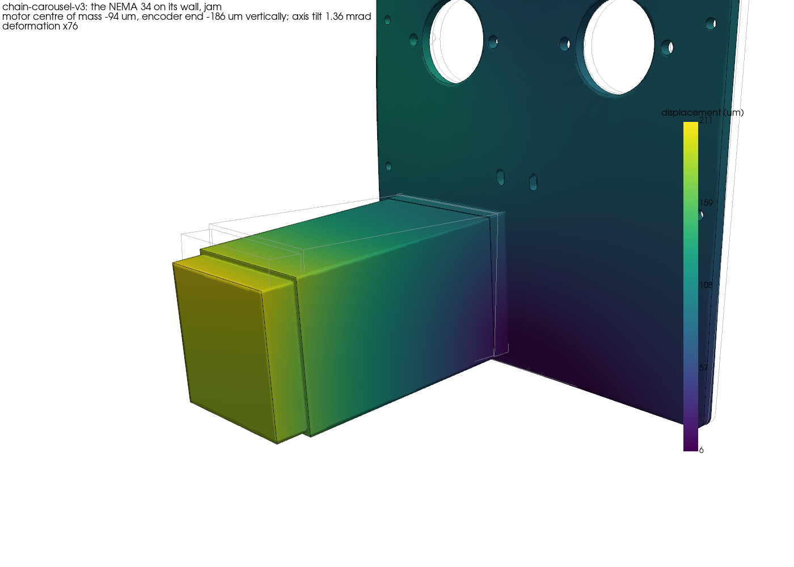
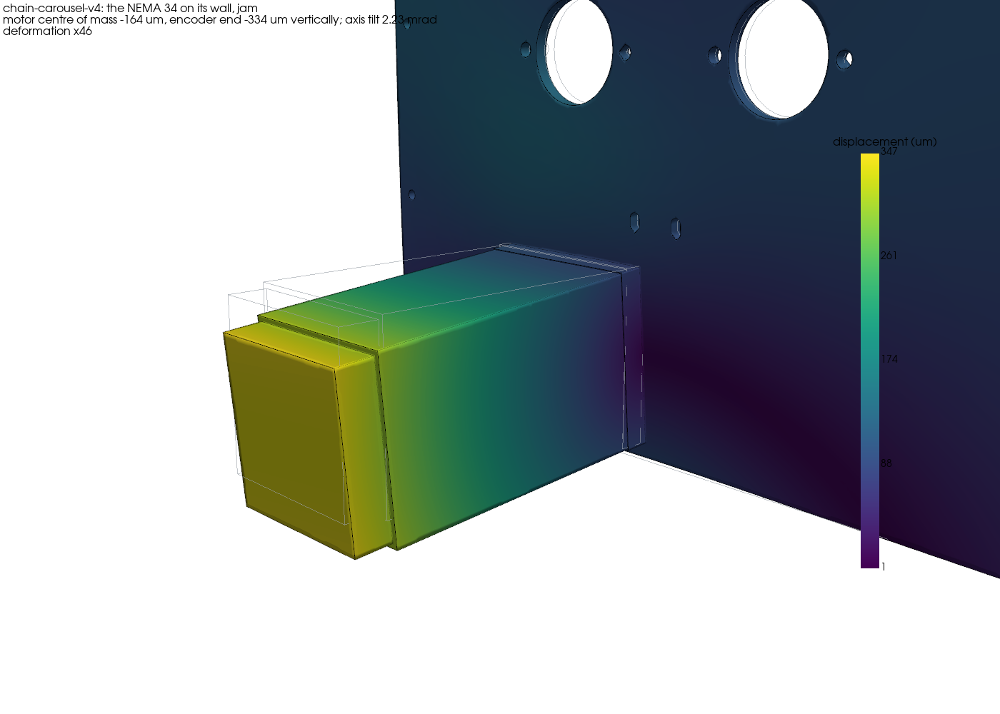
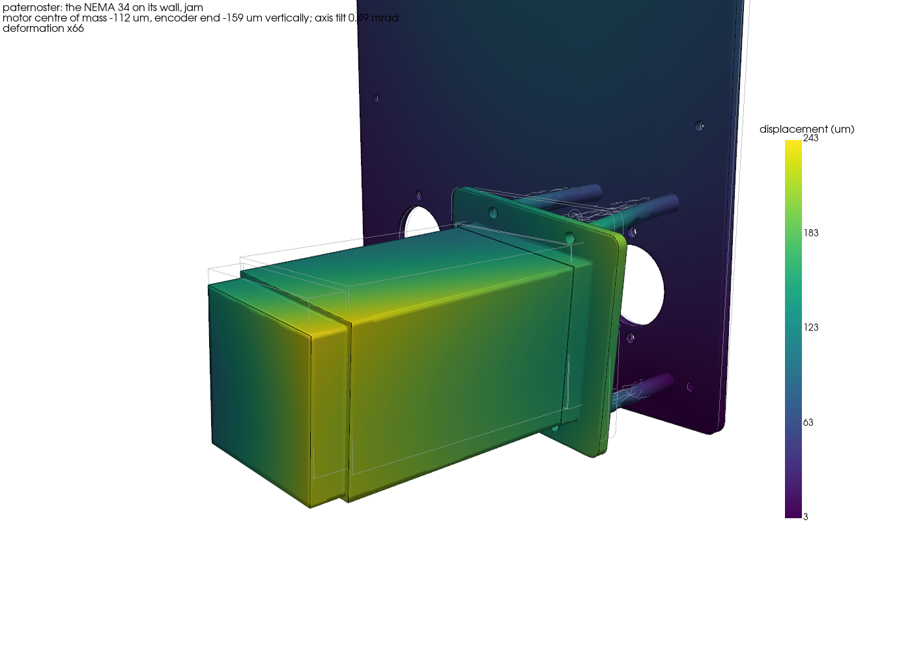
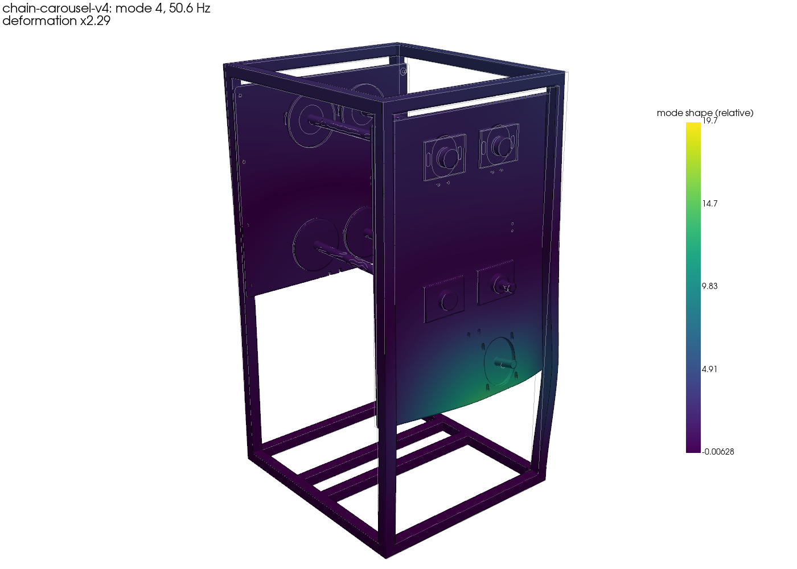
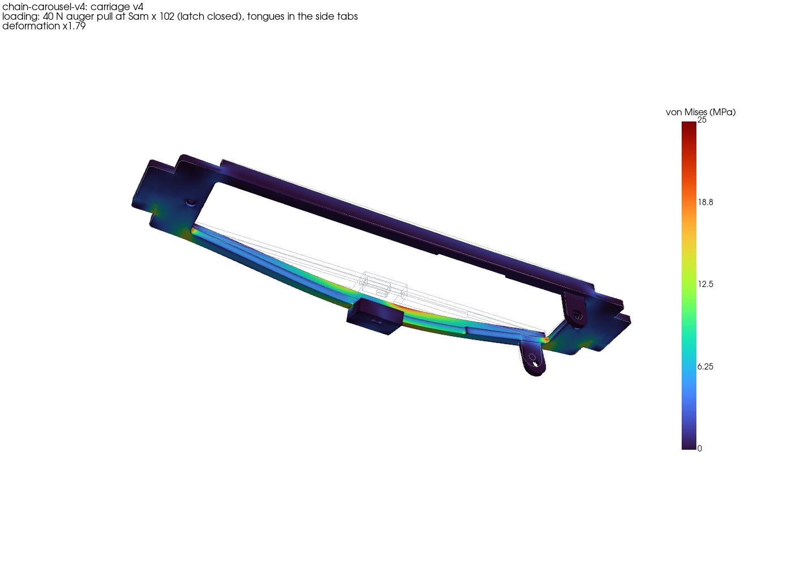
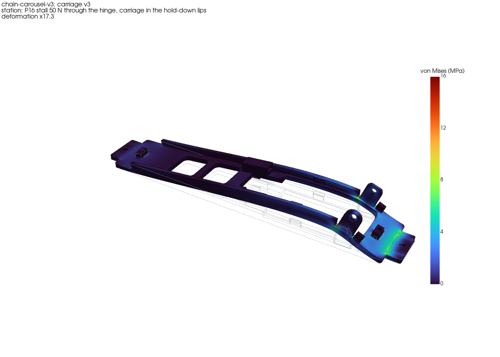
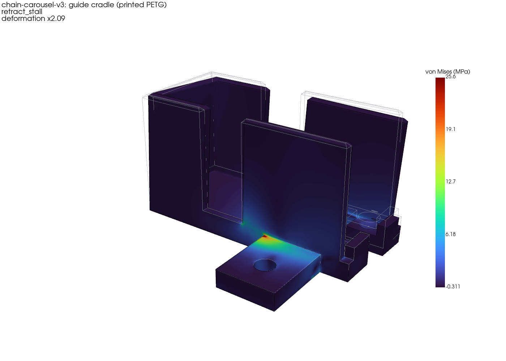
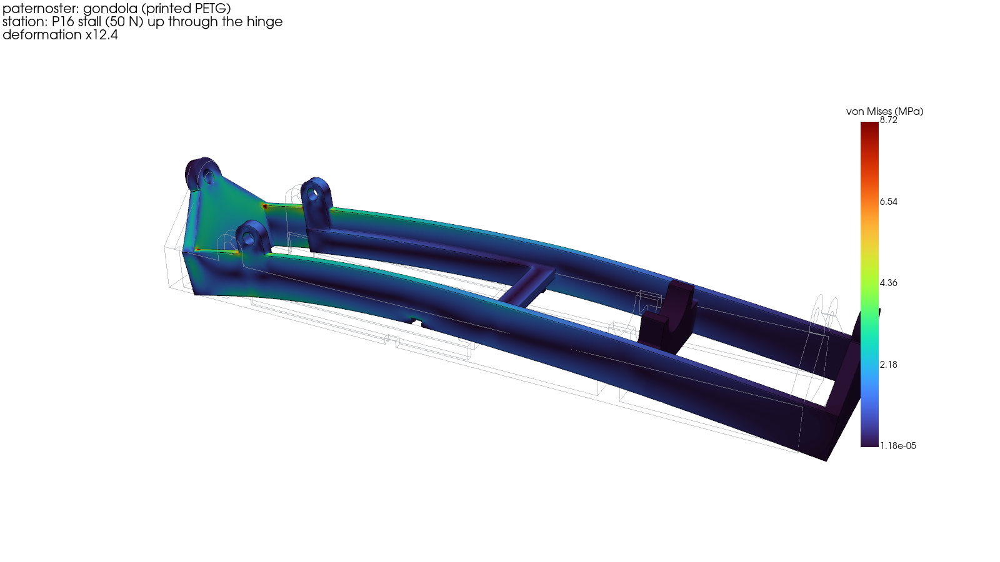

# What the FEA says about the designs

These are CalculiX results for chain carousels v3 and v4 and the paternoster, as they stand on #185 at
[`45e9740`](https://github.com/vertical-cloud-lab/powder-doser/tree/45e9740). Nothing is built yet, so every number is
a prediction. Every case is in [out/SUMMARY.md](out/SUMMARY.md), and the method and the checks against hand solutions
are in [README.md](README.md). The station and carriage results have their own write-ups in
[out/station/SUMMARY.md](out/station/SUMMARY.md) and [out/carriage/SUMMARY.md](out/carriage/SUMMARY.md).

## Design changes the results call for

**Fix before building:**

1. **Clamp every frame to the bench.** Each one is tall, narrow and top-heavy. A sideways push at the top rail tips
   v3 at 37 N and the paternoster at 35 N; v4 tips at 67 N. The paternoster also tips backward at 37 N, because its
   motor hangs outside the back plate. Someone leaning on it, or a bumped hatch, is enough. Two bench clamps on the
   base rails, or screws through them, fix this; widening the feet doesn't. To survive a 100 N push unclamped, v3's
   feet would have to sit at y ±282 mm instead of ±112.
2. **v4's plate latch holds nothing as drawn.** `parts4.latch_housing_v4` sits wholly inside the carriage's 51.6 mm
   opening, and the exported `carriage.step` is two separate solids. The latch is the only thing that holds v4's module
   both ways.
   - With the housing bridged to the -u side strip (the smallest fix), the module hangs on that one 7.2 mm strip. Its
     cap end sags 1.7 mm short-term and 3.1 mm with creep.
   - A 40 N pull on the auger at the loading position then gives a safety factor of 0.77.
   - v4 needs a latch on each strip (two pins, one each side of the tube), or a deeper strip or rib under the housing.
3. **v4's kinematic dock tips open as the module tilts.** From 15° the cone ball goes into tension: -2 to -4 N with the
   motor idle, -8 to -10 N during a solenoid tap.
   - The P16 pushes 88 mm below the contacts, which span only 20 mm along the auger.
   - It needs about 10-15 N more preload at the cone (v3's dock electromagnet), or a contact base as long as v3's
     84.5 mm, which means a contact behind the 44T gear.
4. **Pulling an auger off at the loading position loads the closed latch, at mid-span.** The side tabs catch only the
   carriage's tongues, 337 mm apart.
   - 40 N bends a v3 carriage 5.6 mm at the latch and takes its front tongue's root to a safety factor of 1.0 across
     the layers (1.5 along them).
   - Fixes: catch the carriage near the module at the loading position (a stop under the latch housing, or a third
     tab), release the latch before pulling, or keep the auger's grip on its plate well under 20 N.
5. **v4: stiffen the back plate under the motor.** v4's wider frame leaves the motor 123 mm from the nearest post
   (v3: 55 mm), so the motor and the bottom of the plate vibrate together at 50.6 Hz (v3: 74 Hz). The NEMA 34's
   full-step rate reaches 50.6 Hz at 77 mm/s, inside v4's 0-100 mm/s range.
   - Tested here: a 2020 post on the plate's outer face at y +120, standing on the back base rail, screwed to the plate
     level with the motor's screws and 110 mm above.
   - It raises the mode to 62.3 Hz and cuts the jam tilt from 2.2 to 1.5 mrad (v3: 1.4). That is still reached at
     95 mm/s.
   - Adding a second, shorter post on the motor's -y side (base rail to z 395, under the B- bearing's flange, screwed
     level with the motor's screws) raises it to 68.6 Hz, reached only at 105 mm/s, past v4's top speed. The jam tilt
     drops to 1.28 mrad, below v3's. It was tested at y -2; centring it on the -y hold-down screw at y -7.2 lets that
     screw take a T-nut in its slot instead of clashing with it.

**Fix in the next CAD pass:**

6. **v3's dock: move the vee's magnet up to 0.6 mm under its ball, like the cone's.** At 2.4 mm it pulls only 0.9 N,
   so a 3 N solenoid tap unseats the vee at every tilt. Moved up, the vee carries at least 2.3 N in every state.
7. **v3's electronics carriage has a loose piece in the CAD.** The electromagnet cup and ball C's boss are a separate
   solid, 3.6 mm from the bracket arms. The station FEA bridged them with two ribs (x 88-99.5, |y| 10.4-12.4).
8. **v3's hinge lugs sit in a 1 mm notch at each end,** inherited from v2: the edge rib is cut 18 mm for a 16 mm lug.
   The notch is the carriage's peak at a P16 stall (safety factor 1.4) and on the vertical runs (2.9 against creep).
   Cut the rib 16 mm or make the lug 18 mm.
9. **Limit the P16's retract into the guide cradle,** using its feedback pot in firmware, or add a 2-3 mm fillet or
   gusset at the cradle's arm or a second post. At a 50 N retract stall the single-post arm reaches a safety factor of
   0.9 at its sharp inside corner, and the cone seat sinks 1.4-1.6 mm.
10. **Fillet the side tabs' inside corner (2 mm) or add a gusset.** The lip (v3) and foot (v4) meet their web in a
    sharp corner. The stress 1 mm away is 12-14 MPa (safety factor 1.6-1.9), and the corner itself is where a printed
    tab cracks.
11. **Put a DIN 433 washer under each A-1 tab screw's button head.** A snug 300 N clamp presses 18 MPa into the
    printed seat, over twice PETG's creep allowable, so the clamp relaxes over days. The washer takes it to 15 MPa;
    re-check the screws after a week.

**Worth knowing:**

12. **A jammed latch follower at full motor torque would break the printed latch rails.** A jam puts about 585 N on a
    rail that holds about 350 N (v3) or 285 N (v4). This relies on the closed-loop driver faulting on following error
    first; set its following-error limit low.
13. **Tighten the motor's four M5s to a spec,** about 3 N*m on 18-8. At that preload, friction holds the motor in its
    slots with a safety factor of 2.0 in a 12 N*m jam, when the drive chain pulls it up with 534 N. Loosely tightened,
    it slides along its slots and slackens the drive chain. A backstop screw under the motor, like the tensioner
    blocks' jack screws, removes the question.
14. **The paternoster's motor on its standoffs is the softest mount.** It swings sideways at 16.5 Hz and bounces on the
    standoffs at 47.6 Hz. The full-step rate crosses those at 25 and 72 mm/s, inside its 0-130 mm/s range. Strength is
    not the problem: the safety factor is 7.7 in a jam. A brace from the motor's rear end down to the base would help.
15. **Don't cruise where the frames' sway modes are excited.** All three sway at 15-38 Hz, and the full-step rate
    reaches those between 23 and 58 mm/s. Accelerating through that band is fine; cruising in it is what to avoid.
    Microstepping weakens the excitation a lot. These modes come out low because the model leaves out the acrylic
    panels' stiffness and holds the feet; clamping the frame and screwing the panels on tight both raise them.

**Strong enough:** everything else has a safety factor of 3 or more and moves a few tenths of a millimetre at most:
- the shafts, bearings and idler axles, and the side plates;
- the tensioner blocks and the paternoster gondola;
- the clevis bracket, the clevis pins and the hinge pins;
- the latch bolt and the latch rails in normal running, and the hold-downs;
- the carriages under gravity at every orientation, after creep. Their lowest safety factor is 2.9, at the v3 notch
  (change 8).

## The motor on the wall

v3 and v4 hang the NEMA 34 inside the frame off the back side plate, on four M5 x 25 18-8 screws through slots. The
paternoster hangs it outside the back plate on a 1/4 in motor plate and four 10 mm standoffs. Displacements are
vertical, in micrometres:

| design | case | motor centre of mass | encoder end | axis tilt (mrad) | peak stress in its wall (MPa) | safety factor |
|---|---|---|---|---|---|---|
| v3 | gravity | -32 | -61 | 0.33 | 3.1 (back plate) | 77 |
| v3 | running (1.7 N*m) | -40 | -77 | 0.47 | 4.5 | 53 |
| v3 | jam (12 N*m) | -94 | -186 | 1.36 | 12.3 | 20 |
| v4 | gravity | -53 | -103 | 0.57 | 3.4 | 71 |
| v4 | running | -64 | -127 | 0.77 | 5.6 | 43 |
| v4 | jam | -164 | -334 | 2.23 | 15.2 | 16 |
| v4 + motor post | jam | -103 | -205 | 1.48 | 12.8 | 19 |
| v4 + two motor posts | jam | -85 | -169 | 1.28 | 11.9 | 20 |
| paternoster | gravity | -104 | -140 | 0.41 | 9.2 (a standoff) | 26 |
| paternoster | running (1.6 N*m) | -118 | -160 | 0.50 | 11.1 (a standoff) | 22 |
| paternoster | jam | -112 | -159 | 0.49 | 31.4 (a standoff) | 7.7 |

The jam is the 12 N*m holding torque against a stuck loop. The drive chain then pulls the motor's shaft toward the B+
shaft with 534 N, the stator's reaction twists the flange, and the loop's bottom runs pull B+ and B- together. All
three mounts are strong enough. In v3 and v4 the drive chain's pull tilts the motor about its flange, lifting the shaft
end and dropping the encoder end. In the paternoster gravity dominates, and the jaw coupling's parallel offset stays
at 0.036-0.063 mm in every case, well inside what a jaw coupling takes.

## Frames

| design | case | side plates move (mm) | peak plate stress (MPa) | safety factor |
|---|---|---|---|---|
| v3 | 100 N push along x at the top rail, feet held | 0.51 | 6.0 | 40 |
| v3 | 100 N push sideways | 0.21 | 3.4 | 72 |
| v4 | 100 N push along x | 0.84 | 6.6 | 37 |
| v4 | 100 N push sideways | 0.27 | 3.6 | 68 |
| paternoster | 100 N push along x | 1.13 | 11.6 (a motor standoff) | 21 |
| paternoster | 100 N push sideways | 0.28 | 9.1 (a motor standoff) | 27 |

The push cases hold the feet, as if the frame were clamped; unclamped, these frames tip first (change 1).

**Natural frequencies.** Screw-pad joints, feet held, every mass on (Hz):

| design | modes 1-3: the frame sways | the motor on its wall | full-step rate reaches the motor mode at |
|---|---|---|---|
| v3 | 19.4 (x), 27.8 (y), 37.8 (y) | 74.1, 84.2, 96.5 | 113 mm/s: outside the range, 13 % margin |
| v4 | 15.2, 22.9, 29.7 | **50.6**, 80.3, 81.1 | **77 mm/s** |
| v4 + motor post | 15.4, 23.3, 33.6 | 62.3, 82.3, 86.9 | 95 mm/s |
| v4 + two motor posts | 15.4, 23.5, 37.2 | 68.6, 83.2, 92.8 | 105 mm/s: just outside the range |
| paternoster | 15.5, 16.5 (motor swings sideways), 24.9 | **47.6** (vertical, 89 % motor), 60.0 | **72 mm/s** (and 91 mm/s for 60.0) |

With the side plates glued to the posts over their whole overlap (the stiff bound), v3's modes rise 3-11 %, to 20.0,
30.4, 41.9 and 80.5 Hz. That spread is how uncertain the joint model is. The 32T sprockets' tooth-mesh frequency, 10.5
Hz at 100 mm/s, stays below every mode. [out/SUMMARY.md](out/SUMMARY.md) lists the speed at which each excitation (the
full-step rate, the electrical frequency, the tooth mesh) lands on each mode.

## Shafts and axles

| shaft | case | peak von Mises (MPa) | static safety factor | sprocket deflection (mm) | bearing slope (mrad) | fatigue (Goodman, keyway counted) |
|---|---|---|---|---|---|---|
| v3/v4 drive shaft B+ | running | 16.8 | 22 | 0.055-0.057 | 1.4 | 4.9 |
| v3/v4 drive shaft B+ | jam, bottom run tight | 43.2 | 8.6 | 0.11-0.13 | 3.2 | 1.8 at the jam load (a few cycles, not a fatigue load) |
| v3/v4 drive shaft B+ | jam, side run tight | 48.3 | 7.7 | 0.13-0.15 | 3.8 | 1.5 at the jam load |
| v3/v4 top shafts T± | running | 14.2 | 26 | 0.053 | 1.3 | 6.5 |
| v3 bottom shaft B- | running | 12.1 | 31 | 0.045 | 1.1 | 7.3 |
| paternoster drive shaft | jam | 30.4 | 12 | 0.085 | 2.0 | 2.9 |
| paternoster idle shaft | running | 6.3 | 59 | 0.026 | 0.6 | 14 |
| paternoster idler stub axles | running | 8.1 | 38 | 0.002 at the end | | |
| v3/v4 printed tensioner block, sustained | the top bearing's bolts slipped | 3.1 | 2.6 (creep allowable, 8 MPa) | its nut seat drops 0.02 mm | | |

The shaft check against beam theory: at the v3 drive shaft's jam, the hand calculation gives 37.8 MPa of bending and
15.3 MPa of torsion at the back sprocket, a von Mises stress of 46.2 MPa; the FEA gives 43-45 MPa. The insert bearings
are self-aligning to about 2° (35 mrad), so 4 mrad of slope is nothing to them. The paternoster's idler sprockets sit outboard of
both their 6202s (tooth plane z 33, bearings at 16.2 and 27.2). The outer bearing therefore carries 1.5x the chain load
and the inner one is pulled the other way. That is fine at about 100 N on a 6202.

## Carriages, hinges, latches, side tabs (v3 and v4)

The details are in [out/carriage/SUMMARY.md](out/carriage/SUMMARY.md). The carriages are PETG, held at their two
A-1 tab screws, carrying the module (0.222 kg in v3, 0.213 kg in v4) through its hinge, pads and latch. Sustained cases
use the creep modulus; the loop's peak loads are 1.27x static (the v2 loop simulation's hook forces).

| case | v3: peak (MPa), safety factor | v3: what moves | v4 (latch bridged): peak, safety factor | v4: what moves |
|---|---|---|---|---|
| bottom run, creep | 0.68, 12 | mid-span 0.39 mm, cap end 0.84 mm | 2.09, 3.8 (x1.27) | cap end 3.1 mm |
| top run (upside down, on the latch), creep, x1.27 | 1.70, 4.7 | latch 0.84 mm, cap end 1.9 mm | 1.51, 5.3 (x1.0) | cap end 2.4 mm |
| vertical runs, creep | 2.80, 2.9 (at the lug notch) | under 0.2 mm | 2.17, 3.7 | under 0.1 mm |
| station: 50 N P16 stall through the hinge, carriage in the hold-down lips | 16.1, 1.4 (2.1 along the layers) | lugs rise 0.94 mm | 10.7, 2.2 | 0.67-0.78 mm |
| loading position: 40 N auger pull at the latch | 22.3, 1.0 (1.5 along) | latch 5.6 mm | 29.8, **0.77** | latch 9.8 mm |
| loading position: 40 N pull at mid-plate | 19.5, 1.2 | latch 3.5 mm | 17.9, 1.3 | latch 5.5 mm |

- **Latch bolt (v3):** 10.4 MPa at a 40 N pull (hand: 11.3), safety factor 3.3. Holding the module upside down at
  1.27x it sees 0.79 MPa.
- **Side tab lip (v3) and foot (v4) at 25 N:** 12.4 and 14.0 MPa 1 mm from their sharp corners (hand: 11.8).
- **Hinge pins, lugs, v4's latch pin, keepers (by hand):** safety factors 9-24.

## Station (v3 and v4)

The details are in [out/station/SUMMARY.md](out/station/SUMMARY.md). The dock's contacts were checked by hand (Hertz),
because FEA is the wrong tool for a ball's point-contact peak; the printed parts were checked by FEA. In short:
- **v3's dock stays seated through the 0-45° tilt with the motor idle,** but its vee has almost no margin (change 6).
- **v4's dock unseats from 15° of tilt** (change 3).
- **Ball C dents v3's mild-steel armature by about 1 µm** on the first docks (1236-1371 MPa against 288 MPa first
  yield), then stays elastic. That is harmless for the mesh, and v4's case-hardened washer avoids it.
- **The electronics carriage (v3, with the bridge ribs)** gives a safety factor of 1.16 at a 50 N P16 stall, and the
  pinion-to-gear centre distance opens 0.33 mm. Docked and running, it opens only 0.076 mm.
- **v4's reach-round arms** move 0.18-0.21 mm when docked and peak at a safety factor of 0.86 at a P16 stall, but the
  dock tips open before that load can arrive. Undocked, v4's electronics carriage rocks on its clevis cheeks at 39.3 Hz.
- **The guide cradle:** parked, its seats sink 0.08 mm (about 0.15 mm after creep). A P16 retract stall overloads it
  (change 9).
- **Everything else holds:**
  - the P16's base clevis bracket: safety factor 4.4 at the 75 N back-drive;
  - the clevis pins: 40;
  - the latch rails in normal running: 55 or more, the v4 tube rest moving 0.021 mm against its 0.5 mm gap;
  - the hold-downs: 3.5, the lip lifting 0.013 mm against a 2 mm gap.

## Paternoster gondola

The printed PETG gondola hangs from two shoulder screws in bronze bushings.
- **Hanging with its module:** its floor sags 0.15 mm, or 0.27 mm after creep. It peaks at 0.49 MPa, a safety factor
  of 16 against the creep allowable.
- **P16 stall:** if the P16 stalls with the module unable to tilt, the whole 50 N comes out through the hinge lugs. They
  lift 0.53 mm, and the corner where the side rail meets the front end plate peaks at 8.7 MPa, a safety factor of 2.6.
- **Shoulder screws (by hand):** 4 mm, 18-8, at a 4.4 mm lever. They see 1.5 MPa hanging and 17.5 MPa under half a
  stall, safety factors of 140 and 12.

