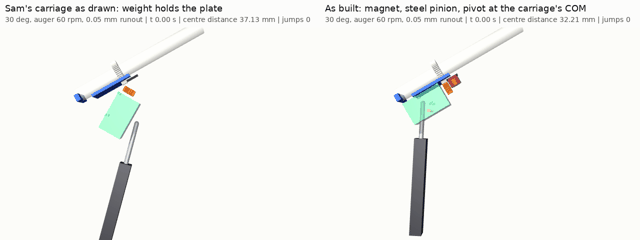
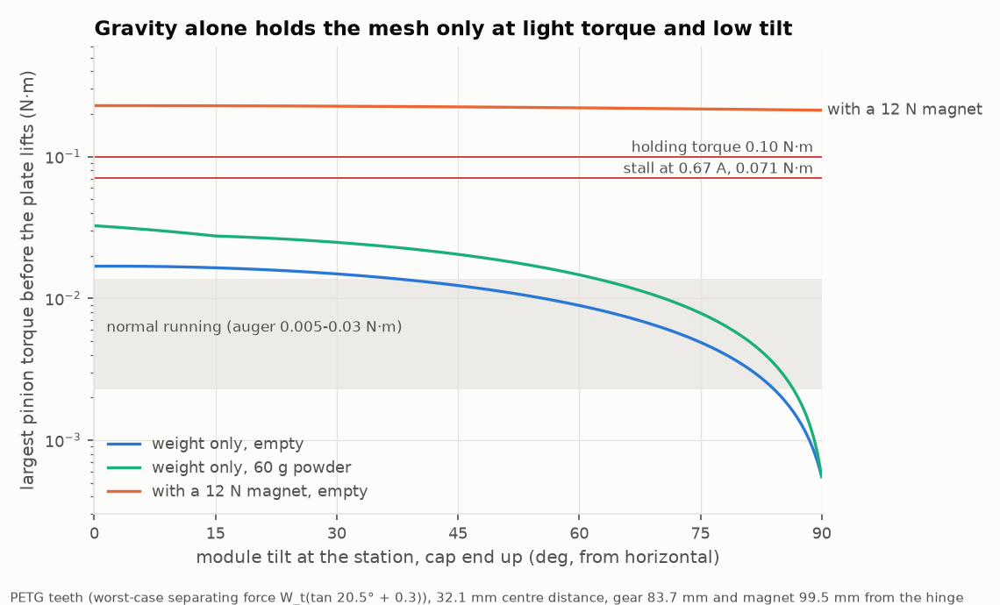
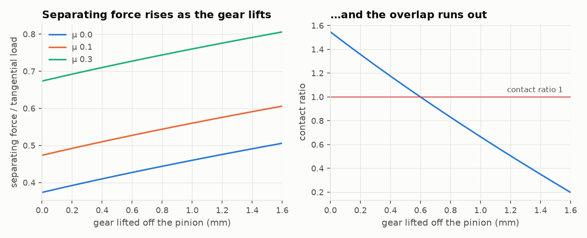
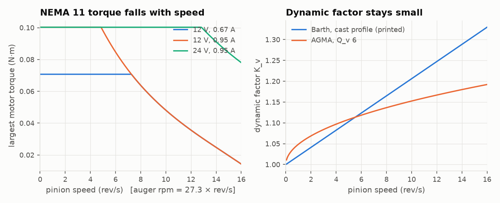
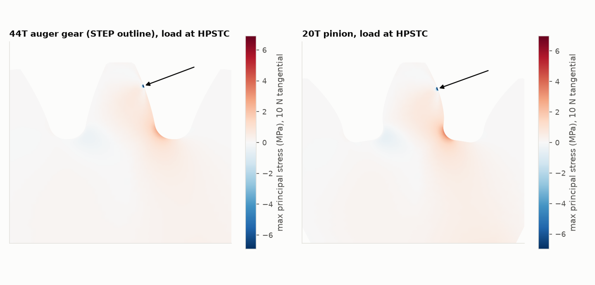
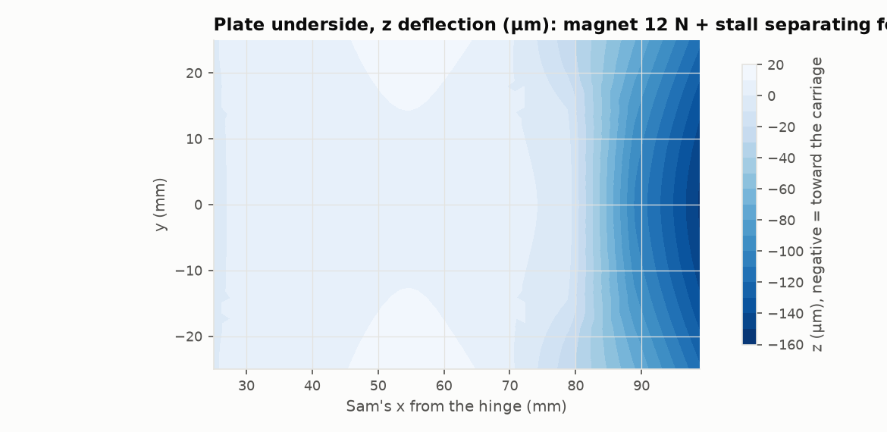
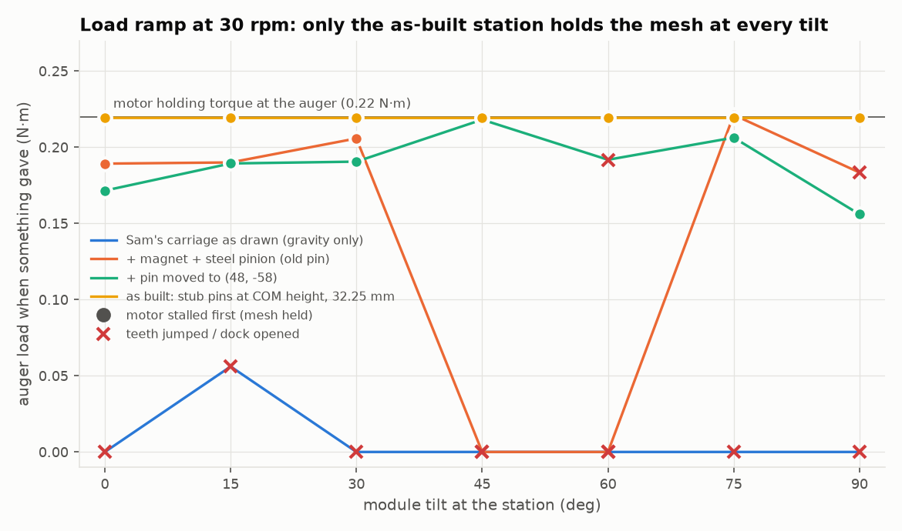

# Does the module's weight keep the auger gear in mesh? (both carousels)

At the station, Sam's electronics carriage docks under the module's plate. Its NEMA 11 turns the auger through a 20T pinion meshing with the auger's 44T gear from below. In Sam's design nothing holds the plate down on the carriage except the module's weight. Sterling asked in [PR 185](https://github.com/vertical-cloud-lab/powder-doser/pull/185) whether that weight is enough at higher speeds and at every tilt. This folder answers with:
- hand calculations (Shigley, Ch. 13-14);
- 2D FEA of both teeth and 3D FEA of Sam's plate;
- a MuJoCo model of the docked station with real tooth contact.

The answer changed the station of both designs. The [paternoster](../paternoster/README.md) and [chain carousel v2](../chain-carousel-v2/README.md) now share it.



*Left: the carriage, an inverted pendulum on its rod-end pin, tips off the plate and the gear runs free. Right: the
station as built holds the 32.21 mm centre distance. Full-resolution MP4: [`out/mujoco/compare_t30_r60.mp4`](out/mujoco/compare_t30_r60.mp4).*

## The answer

1. **No, weight alone is not enough.**
   - The empty module (plate, auger and cap) weighs 0.10 kg, with its COM 96 mm from the hinge. That presses the gear down with 1.13 N at 0 deg of tilt, 0.83 N at 45 deg and 0.04 N at 90 deg.
   - The mesh pushes the gear away from the pinion with W<sub>t</sub> tan 20 deg. At the NEMA 11's 0.10 N·m holding torque that is 3.6 N, and with dry printed teeth up to 6.6 N.
   - So a jam lifts the plate at any tilt. At an estimated heavy running torque (0.03 N·m at the auger) an empty module lifts beyond about 38 deg.
2. **The carriage was the second weak point.**
   - The P16 actuator is pinned at both ends, so only the dock contact holds the carriage's attitude on the plate.
   - The carriage's COM sits 39 mm above its rod-end pin, so it is an inverted pendulum on that pin.
   - In MuJoCo, Sam's carriage fell off the plate at 30 deg and above with no gear load at all. The v2 station sim found the same.
3. **Speed is not the main problem.**
   - The motor's torque falls with speed anyway.
   - Shigley's dynamic factor stays below 1.33 up to 16 rev/s at the pinion (436 auger rpm).
   - The proposed station ran clean at 30-240 auger rpm. What did matter was runout: with only 0.073 mm of backlash, a printed gear's runout made the mesh bind.
4. **What both designs now do:**

| Change | Why |
|---|---|
| **Dock electromagnet**, Adafruit 3872 (P20/15, 5 V, 0.22 A, 24.5 N holding, $7.50). On a printed bracket behind the pinion, it pulls a 2 mm steel tab under each plate. Switched on only once docked | A preload that doesn't depend on tilt. It is off while docking and undocking, so nothing yanks the module or the chain |
| **Carriage pivot at its COM height.** Two 4 mm steel stub pins through the carriage's side posts at Sam's (32, -34), carried by a U-yoke rigid on the P16's rod (2 mm steel arms outside the carriage, crossbar 60 mm below the pins) | Removes the inverted pendulum. The mesh then carries the motor's full torque at every tilt from 0 to 90 deg |
| **Steel pinion**, KHK SS1-20A (m1, 20T, 5 mm bore), hub faced off, PTFE dry lube | Friction raises the separating force from 0.37 W<sub>t</sub> to 0.67 W<sub>t</sub> on dry PETG; about 0.47 lubricated. A printed pinion also chattered and lost steps at a low load in one MuJoCo run |
| **Two locating pins** on the carriage rim, in a hole and a slot in each plate | Carry the along-plate load when tilted, so friction doesn't have to |
| **Centre distance 32.25 mm** instead of 32.1 (NEMA 11 axis 0.15 mm lower in the carriage). Backlash 0.18 mm, contact ratio 1.40 | At 32.1 mm a 0.05 mm runout made the mesh bind, stall the motor and jump teeth. The magnet also bends Sam's plate 78 µm toward the pinion (FEA) |
| **Docking "seek"**: turn the pinion at 0.25 rev/s during the last 3 mm of the approach, with the magnet on (it lifts the hanging carriage's back onto the plate) | Pinion held: about half the starting phases park the gear on the pinion's tooth tips 2 mm high. Seeking: every phase seated |
| **Driver current 0.45 A** (DRV8825 Vref 0.225 V): 0.067 N·m stall at the pinion, 0.15 N·m at the auger | A second safety. Stall stays below the dock's opening torque at every tilt, with margin (v2 station sim). That is still 5 times the estimated running torque |

## 1. Hand calculations ([`shigley.py`](shigley.py), [`out/shigley.json`](out/shigley.json))

The gear is the lab auger's own (PR #170), measured from the STEP by [`measure_gear.py`](measure_gear.py): 44T, module 1, a 19.97 deg involute (fit rms 0.002 deg), standard tooth thickness, 10 mm face. Its mid-plane sits 83.7 mm from the hinge. The module's mass properties come from the CAD ([`mass_props.py`](mass_props.py)): PETG, with the printed solid fraction.

| | Value |
|---|---|
| Centre distance as Sam drew it (rim on the plate) | 32.1 mm: backlash 0.073 mm, contact ratio 1.55 |
| NEMA 11 (11HS18-0674S), k<sub>t</sub> | 0.106 N·m/A. Peak torque 0.071 N·m at a 0.67 A driver setting, 0.100 N·m at 0.95 A |
| Torque falls from | 5.0 rev/s at 12 V, 13 rev/s at 24 V (pinion; auger rpm = 27.3 × rev/s) |
| Separating force at 0.10 N·m | 3.64 N frictionless; 4.64 N at mu 0.1, 6.64 N at mu 0.3 (worst point of the mesh cycle, W<sub>t</sub>(tan phi + mu)) |
| Weight preload at the gear, empty module | 1.13 N (0 deg), 1.00 (30), 0.83 (45), 0.60 (60), 0.04 (90) |
| Plate lifts, weight only, heavy running (0.03 N·m at the auger) | beyond 38 deg empty, 62 deg with 60 g of powder (mu 0.3) |
| Plate lifts, weight only, at stall | at any tilt |
| Magnet needed at x 99.5 for SF 1.5 against 0.10 N·m with nothing from gravity | 6.0 N (mu 0.1) to 8.5 N (mu 0.3) |
| Runaway | Once the gear lifts, phi' grows and the separating force with it. The contact ratio reaches 1 at 0.6 mm of lift, so no partial lift is stable |
| Docking | Tip lands 0.69 mm (pinion) and 0.77 mm (gear) on a 3.14 mm pitch: 47 % of random phases land tip on tip |
| Lewis bending at 0.10 N·m, 15 rev/s | Pinion 4.1 MPa, gear 3.3 MPa. Times the FEA root factor (1.6 and 1.4): 6.5 and 4.7 MPa against an assumed 12 MPa for printed PETG |
| Contact stress, steel pinion on the printed gear | 21 MPa at stall (SF 1.4 on an assumed 30 MPa); about 7 times lower while running |



| Separating force grows as the gear lifts | Motor torque and dynamic factor against speed |
|---|---|
|  |  |

## 2. FEA

### Teeth ([`fea_tooth.py`](fea_tooth.py), [`out/fea_tooth.json`](out/fea_tooth.json))

- Plane stress, quadratic triangles (gmsh + scikit-fem), three-tooth sectors clamped on an inner arc.
- The 44T teeth are the STEP's own outline at the gear's mid-plane, with Onshape's fillets. The 20T is a standard involute with a 0.38 m root fillet.
- Load: 10 N tangential (10.6 N normal) along the line of action, over the Hertz width.
- Converged: 7 times more nodes changed the stresses by 1-2 %.

| | 44T gear | 20T pinion |
|---|---|---|
| Root stress, tip load | 3.60 MPa (Lewis 2.51, ratio 1.43) | 4.98 MPa (Lewis 3.11, ratio 1.60) |
| Root stress, load at the highest point of single contact | 2.59 MPa | 3.54 MPa |
| Compliance along the line of action, PETG | 0.62 µm/N | 0.53 µm/N |
| Single-pair mesh stiffness | 0.87 N/µm PETG on PETG, 1.59 N/µm steel on PETG | |



### Sam's plate ([`fea_plate.py`](fea_plate.py), [`out/fea_plate.json`](out/fea_plate.json))

- Quadratic tets (gmsh from the STEP + scikit-fem), 227 k DOF, E 2000 MPa.
- Held at the four carriage rim pads and the hinge bores.
- Loaded by the magnet at the tab's two screws and by the gear's separating force in the two clamp rings beside the gear.

| Load | Gear seats move | Tab screws move |
|---|---|---|
| Magnet 12 N | 78 µm toward the pinion | 154 µm |
| Magnet 12 N + stall separating force 5.5 N | 60 µm | 120 µm |
| Magnet 20 N (touching) + stall | 109 µm | 218 µm |
| No magnet, stall separating force | 15 µm away | 28 µm |

The plate's back strip bends under the magnet about the rim's back edge, until the tab sits on the magnet face (0.15 mm gap). At 32.1 mm that bend alone takes the whole 0.073 mm backlash; at 32.25 mm about 0.12 mm remains. Peak stress is low (3 MPa).



## 3. MuJoCo station with real tooth contact ([`mesh_mujoco.py`](mesh_mujoco.py))

**Model.**
- The 44T and 20T teeth are convex prisms that collide, so the mesh can run, rattle, lift the module or jump a tooth on its own.
- The contact time constant gives the FEA's mesh stiffness.
- The module (plate + steel tab) hinges at Sam's origin above a rest stop; the auger turns in it with the CAD inertia.
- The P16 is a position-held rod (LAC, 50 N limit), pinned to the frame, with the carriage pinned to its end.
- The carriage has its rim pads, the magnet face and optional locating pins in sockets. Its mass and COM come from its parts.
- The NEMA 11 is a stepper torque-angle model: 50 rotor teeth, the torque-speed curve above, 24 V, 0.95 A.
- The magnet pulls F = 20 N / (1 + g/0.4 mm)<sup>2</sup> (the P20/15 derated for a 2 mm tab; 10.6 N at the 0.15 mm gap).
- Gravity is turned for the station tilt. Time step 20 µs.

**Load ramps at 30 rpm** (auger load ramped until a tooth jumps or the motor stalls):

| Configuration | 0 deg | 15 | 30 | 45 | 60 | 75 | 90 |
|---|---|---|---|---|---|---|---|
| Sam's carriage as drawn (weight only) | jump at 0 | jump at 0.06 | falls off | falls off | falls off | falls off | falls off |
| + magnet (PETG pinion, old pin) | stall 0.02 * | stall 0.09 | stall 0.14 | falls off | falls off | stall 0.12 | stall 0.04 |
| + magnet + steel pinion (old pin) | stall 0.19 | stall 0.19 | stall 0.21 | falls off | falls off | stall 0.22 | jump 0.18 |
| pin moved to (48, -58) | stall 0.17 | stall 0.19 | stall 0.19 | stall 0.22 | jump 0.19 | stall 0.21 | stall 0.16 |
| **proposed** (COM-height pin, 32.25 mm) | **stall 0.22** | **0.22** | **0.22** | **0.22** | **0.22** | **0.22** | **0.22** |

Values are N·m at the auger; the motor's ceiling is 0.22. "Falls off" means the carriage tipped off the plate before any load. "Stall" means the motor lost steps first and the mesh held: the proposed station's centre distance stayed at 32.21 mm throughout.

\* The dry printed pinion chattered (stick-slip at mu 0.3) and lost steps at a small load.



**Running at speed** (0.03 N·m at the auger, ±50 % once per revolution, at least 1.2 revolutions; tooth jumps per run):

| | 30 rpm | 60 | 120 | 240 |
|---|---|---|---|---|
| As drawn, ideal gears, 0/30/60/90 deg | 53-113 at every tilt | | | |
| Magnet + steel pinion (old pin), ideal gears | 0-51 at 0 deg; 54-113 at 60 deg | | | |
| **Proposed, ideal gears, 0/30/60/90 deg** | **0** | **0** | **0** | **0** |
| **Proposed, 0.05 mm runout + 13 µm pitch error** | **0** | **0** | **0** | **0** |

**Runout** (30 deg, 60 rpm, proposed pin): clean up to 0.1 mm eccentricity at both 32.1 and 32.25 mm. At 0 deg and 30 rpm, though, 32.1 mm stalled the motor and jumped teeth with 0.05 mm runout (two seeds: 129 and 170 jumps); 32.25 mm stayed clean. A 10 µs time step reproduced the failure.

**Docking engagement** ("proposed" pin; the carriage rises the last 3 mm at 10 mm/s, the LAC pushing at most 15 N, auger drag 0.02 N·m, magnet off until seated):

| Pinion's starting phase (fraction of a tooth) | 0 | 0.1 | 0.2 | 0.3 | 0.4 | 0.5 (tip on tip) |
|---|---|---|---|---|---|---|
| Pinion held | seated | seated | parked 2 mm high | parked | parked | parked |
| Pinion seeking at 0.25 rev/s | seated | seated | seated | seated | seated | seated |

### Final pass (as-built pin)

The station as both designs build it ("final" in `mesh_mujoco.py`) differs from "proposed" in two ways:
- the stub pins sit at (32, -33.1) docked, through the carriage's solid side posts, 20 mm ahead of its COM;
- yoke stops catch the hanging carriage's pin plates during the approach.

| Study | Result |
|---|---|
| Load ramp at 30 rpm, 0-90 deg | Motor stalls at 0.219 N·m (auger) at every tilt; no tooth jump; centre distance 32.21 mm throughout ([`stall_sweep_final.json`](out/mujoco/stall_sweep_final.json)) |
| Running, 0/30/60/90 deg x 30/60/120/240 rpm, 0.05 mm runout + 13 µm pitch error | 0 tooth jumps, no stall in all 16 runs ([`speed_sweep_final.json`](out/mujoco/speed_sweep_final.json)) |
| Runout 0-0.1 mm (30 deg, 60 rpm) | Clean; the centre distance never leaves 32.21-32.22 mm ([`runout_sweep_final.json`](out/mujoco/runout_sweep_final.json)) |
| Docking, pinion held | Seated from phases 0-0.2; at 0.3-0.5 the gear parks on the pinion's tips 1.9 mm high ([`engage_final.json`](out/mujoco/engage_final.json)) |
| Docking with the seek | Seated from phases 0-0.4. The tip-on-tip phase (0.5) seated with a 10 µs time step; at 20 µs the contact solver blew up and threw the auger, which a real dock can't do |

With these pins the carriage hangs back-down on its stops while it approaches. So the magnet goes on at the start of the last 3 mm, not after the plate seats: its pull is what lifts the carriage's back onto the plate.

## 4. Limits

- **Rigid plate in MuJoCo.** The FEA's 60-110 µm bend is covered by the 32.25 mm choice, not simulated.
- **No clearance in the clamp rings.** The auger runs in Sam's printed clamp rings, which have play. The model holds its axis rigidly.
- **Estimated running torque.** The auger torque (0.005-0.03 N·m) is an estimate; no torque has been measured on the rig. T5 in the test plans measures it.
- **The magnet curve** is the datasheet derated with a generic gap law. The test plans measure pull against shim thickness.
- **Printed-PETG allowables** (12 MPa bending, 30 MPa contact) are assumptions for one-way fatigue.
- **Single runs**, apart from the seeds noted.
- **MuJoCo's soft contact** lets teeth overlap by a few µm. Sub-millisecond rattle is resolved but not measured.

## Rerun

```bash
pip install cadquery mujoco gmsh scikit-fem numpy scipy matplotlib pillow imageio imageio-ffmpeg
python measure_gear.py && python mass_props.py && python shigley.py      # seconds
python fea_tooth.py                                                      # about 1 min
python fea_plate.py                                                      # about 13 min
python run_studies.py && python run_studies_final.py                     # about 45 min, one core
python mesh_plots.py
MUJOCO_GL=glfw xvfb-run -a -s "-screen 0 1920x1080x24" python mesh_render.py compare 30 60
```

## Files

| File | What |
|---|---|
| [`common.py`](common.py) | Gear, motor, module and material numbers, and their sources |
| [`measure_gear.py`](measure_gear.py), [`mass_props.py`](mass_props.py) | The 44T gear and the module's mass properties from the CAD |
| [`shigley.py`](shigley.py) | Hand calculations and the three figures |
| [`fea_tooth.py`](fea_tooth.py), [`fea_plate.py`](fea_plate.py) | 2D tooth FEA, 3D plate FEA |
| [`mesh_mujoco.py`](mesh_mujoco.py) | The station model with tooth contact, and every study (`calib`, `stall`, `engage`, `runout`, `speed`) |
| [`run_studies.py`](run_studies.py), [`run_studies_final.py`](run_studies_final.py) | All studies in order |
| [`mesh_plots.py`](mesh_plots.py), [`mesh_render.py`](mesh_render.py) | Figures and the comparison video |
| `out/` | JSON results, figures. `out/mujoco/`: per-run JSON and logs (the `.npz` logs are gitignored) |
