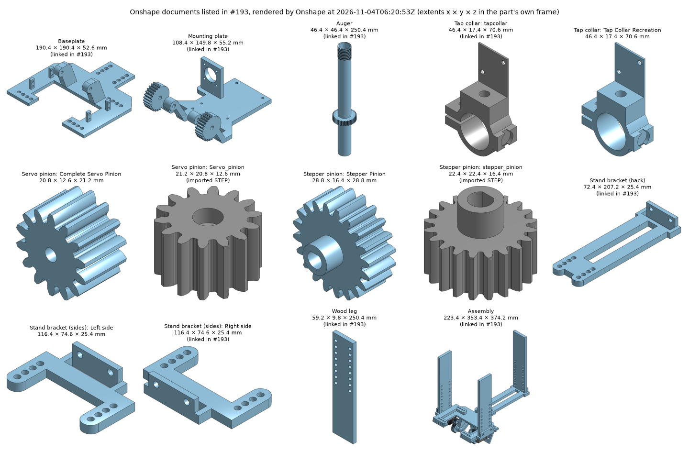

# Onshape documents in #193: snapshot without geometry, 2026-11-03 (re-checked 2026-11-04)

[#193](https://github.com/vertical-cloud-lab/powder-doser/issues/193) lists the current Onshape
document for each doser part. On [PR #200](https://github.com/vertical-cloud-lab/powder-doser/pull/200)
the request was to download them. **None of their geometry (STL or STEP) could be downloaded:**
- **API keys: HTTP 402.** `ONSHAPE_ACCESS_KEY`/`ONSHAPE_SECRET_KEY` still sign in (`users/sessioninfo` → 200).
  But every document request returns `402 "API limit exceeded"`: the company's yearly API cap
  (2,500 calls, shared), which has refused this repo since 2026-10-29. Refused calls aren't counted.

**Retry on 2026-11-04, 06:17 to 06:5x UTC: still 402.** At 04:42 UTC the limit was reported fixed
([PR #200](https://github.com/vertical-cloud-lab/powder-doser/pull/200#issuecomment-6622749892)).
The `@claude` run that retried started at 06:15 UTC, so it got the repo secrets as they stood then:
- **The keys still sign in** as the same kind of account, plan group `EDU Educator`. Onshape caps
  that plan at [2,500 calls per company per year](https://onshape-public.github.io/docs/auth/limits/).
- **Every keyed request is still refused with 402:** the Baseplate's document, its STL export and a
  STEP translation. See [`export.json`](export.json) for the run's retries; it made no counted calls.
- **The models haven't changed since the 2026-11-03 snapshot.** A fresh anonymous snapshot at 06:20 UTC
  had the same `sourceMicroversion` and modified time for every element, and the same renders.
- **One fix to the snapshot:** the Stepper pinion document's two Part Studios, "Stepper Pinion" and
  "stepper_pinion", slugged to the same folder, so the imported STEP's files had overwritten the
  native one's. They now have separate folders: `stepper-pinion/stepper-pinion/` (native) and
  `stepper-pinion/stepper-pinion-34e4bc/` (imported STEP).
- **Anonymous: no exports.** Without a key, Onshape answers a public (or link-shared) document
  with its metadata, element list, Part Studio feature lists and its own renders. Every
  geometry route refuses: STL, Parasolid, sketches, tessellation and parts return 401, and the
  uploaded STEP blobs return 403.

So this folder holds what Onshape *would* give, fetched by
[`scripts/onshape_public_snapshot.py`](../../scripts/onshape_public_snapshot.py) at 05:59 UTC on
2026-11-03 and again at 06:20 UTC on 2026-11-04 (136 anonymous requests each time, all 200, none
counted against the cap):

| File | What it is |
|---|---|
| [`manifest.json`](manifest.json) | Each document and element: ids, last modified, the Part Studio's `sourceMicroversion`, its feature names, extents |
| `<doc>/<element>/{top,front,right}.png` | Onshape's orthographic renders at 0.2 mm per pixel (alpha = part) |
| `<doc>/<element>/iso.png` | Onshape's isometric render |
| `<doc>/<element>/features.json.gz` | The Part Studio's full feature list as Onshape returned it |
| [`overview.png`](overview.png) | All of the above on one sheet |
| [`export.json`](export.json) | The last keyed export attempt by [`scripts/onshape_export.py`](../../scripts/onshape_export.py): every call and its status |



| #193 entry | Element (★ = the one #193 links) | Last modified (UTC) | Extent x × y × z (mm) |
|---|---|---|---|
| Baseplate | Base ★ | 2026-11-01 02:10 | 190.4 × 190.4 × 52.6 |
| Mounting plate | Part Studio 1 ★ (plate, hinge arms and two gears) | 2026-10-24 03:41 | 108.4 × 149.8 × 55.2 |
| Auger | Part Studio 1 ★ (auger, plus its tube) | 2026-10-29 18:15 | 46.4 × 46.4 × 250.4 |
| Tap collar | tapcollar ★ (imported STEP); Tap Collar Recreation | 2026-10-23 04:51 | 46.4 × 17.4 × 70.6 (both) |
| Servo pinion | Complete Servo Pinion; Servo_pinion (imported STEP) | 2026-10-27 03:19 | 20.8 × 12.6 × 21.2; 21.2 × 20.8 × 12.6 |
| Stepper pinion | Stepper Pinion; stepper_pinion (imported STEP) | 2026-10-21 01:21 | 28.8 × 16.4 × 28.8; 22.4 × 22.4 × 16.4 |
| Stand bracket (back) | Part Studio 1 ★ | 2026-10-29 23:52 | 72.4 × 207.2 × 25.4 |
| Stand bracket (sides) | Right side ★; Left side | 2026-10-30 23:43 | 116.4 × 74.6 × 25.4 (both) |
| Wood leg | Part Studio 1 ★ | 2026-10-20 22:24 | 59.2 × 9.8 × 250.4 |
| Assembly | Assembly 1 ★ | 2026-10-30 23:50 | 223.4 × 353.4 × 374.2 |

Notes:
- The two pinion links in #193 name a document only. Each document has a native Part Studio and
  one holding the imported STEP, so a person should say which one is current.
- The Auger document is not public (`public: false`), but its link is shared, so it answered anyway.
- Extents are measured from the renders' alpha masks, ±0.2 mm, in each part's modelled orientation.

## Getting the actual files

Any of these works. The first is the quickest.
1. **Export by hand.** In Onshape, right-click the part (or the Part Studio tab) → *Export* → STL
   (and STEP). Zip them, because GitHub won't attach `.stl`, and attach the zip to a comment
   here. A run can then check each STL against these renders:
   `python docs/prints/2026-11-03-baseplate-h2d/check_stl.py PART.stl cad/onshape-193/baseplate/base`.
2. **More API calls.** Wait for the yearly cap to reset, or ask Onshape for a larger allowance.
   Exporting every element here as STL and STEP takes under 100 calls. Once the keys answer,
   one command does it all:
   ```
   python scripts/onshape_export.py cad/onshape-193            # about 83 counted calls
   python scripts/onshape_export.py cad/onshape-193 --only Baseplate   # about 6
   ```
   It writes one STL per part (mm) to `<doc>/<element>/stl/` and a STEP per Part Studio (and
   the assembly) next to the renders. It checks each Part Studio's STLs against the renders and
   logs every call in `export.json`. The Baseplate goes first, and the first 402 stops the run.
   `--dry-run` lists the plan, and `--wait-until HH:MM` keeps retrying a capped key until then.
   **If the fix was new keys, or a raised limit on another Onshape account,** replace the
   repository secrets `ONSHAPE_ACCESS_KEY` and `ONSHAPE_SECRET_KEY` (Settings → Secrets and
   variables → Actions). An organization secret with the same name is shadowed by the repository
   one. A run gets the secrets as they stand when it starts, so comment `@claude` again after.
3. **Rebuild from the feature lists.** The features are plain sketches, extrudes, revolves,
   sweeps, fillets and mirrors, so they could be rebuilt locally and checked against these
   renders. But the result would be a copy, not the Onshape file #197 asks for.
