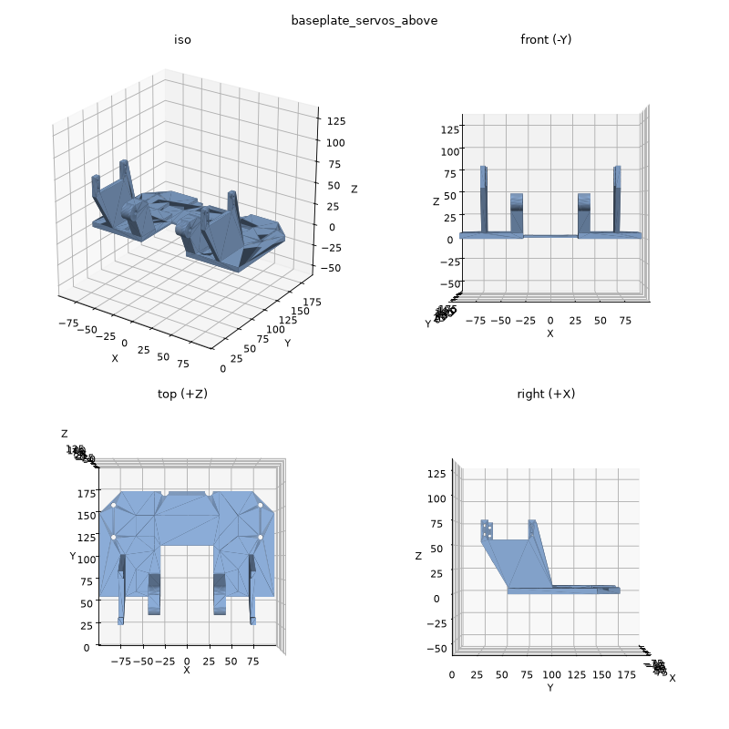
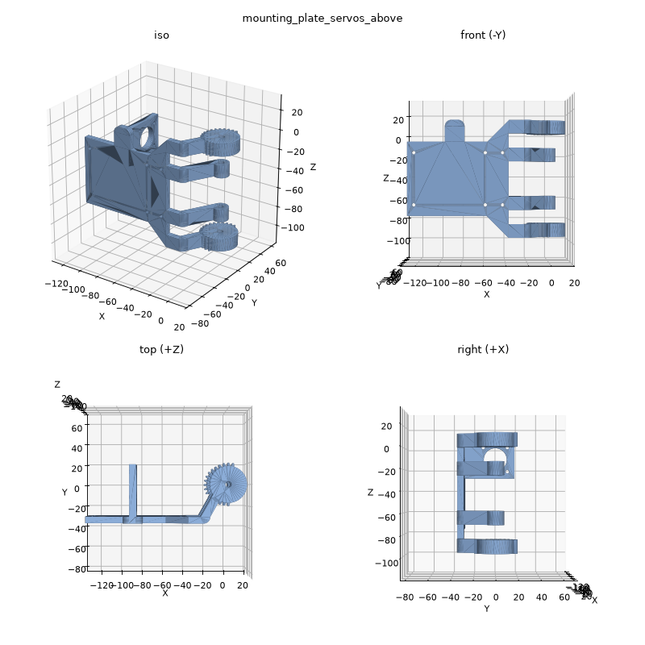
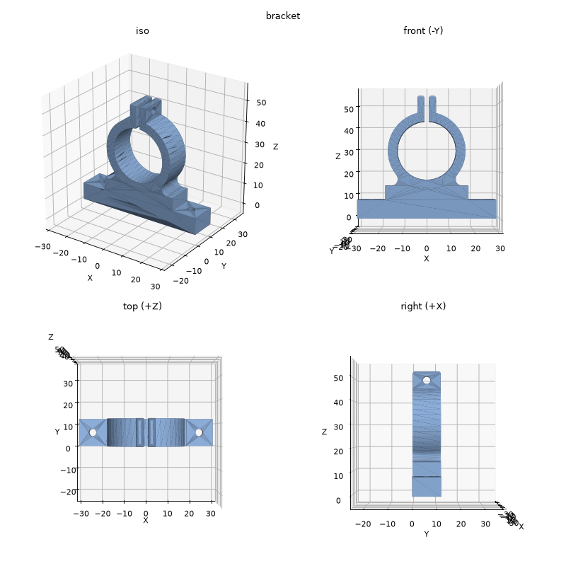
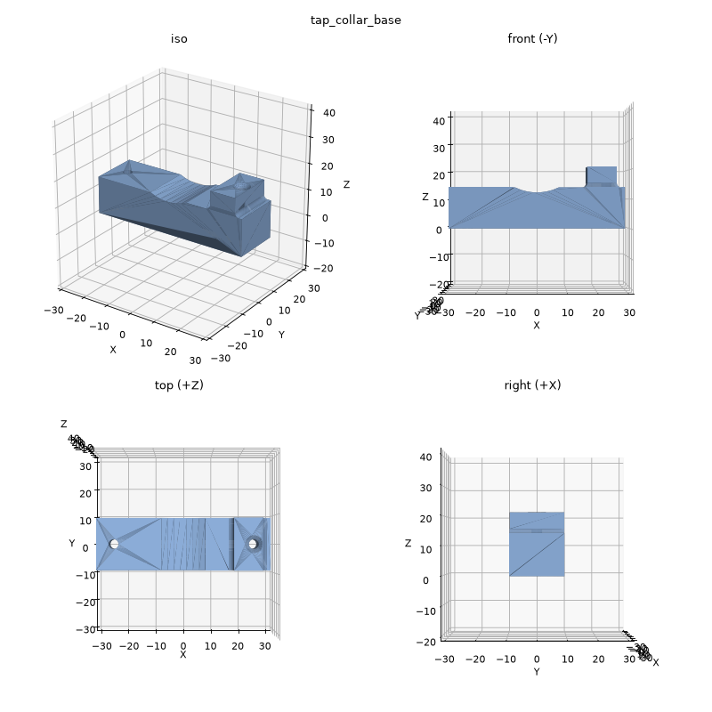
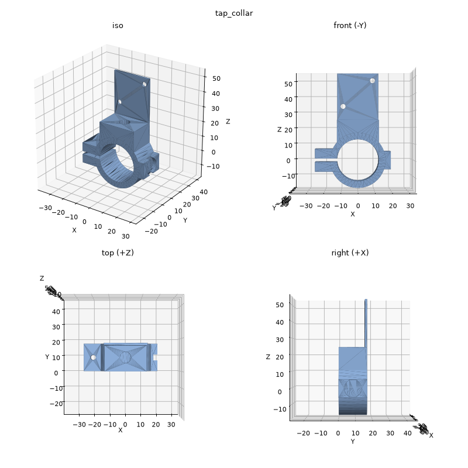
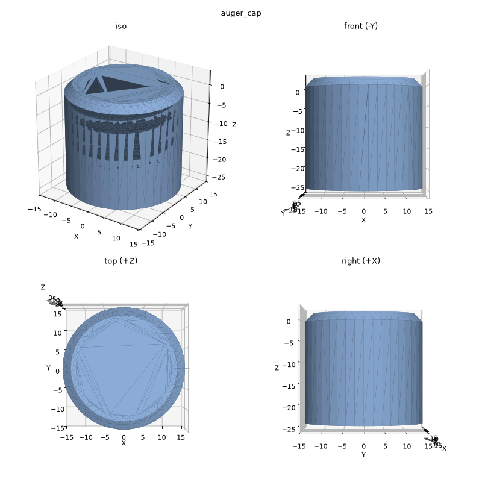
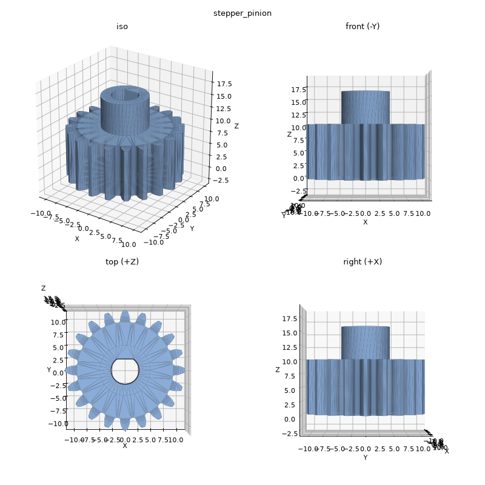
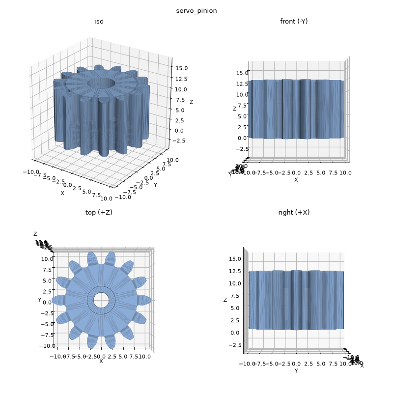
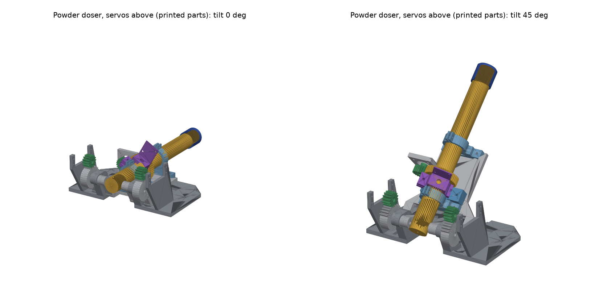

# The servos-above doser's printed parts as native Onshape feature trees (issue #172)

Every printed part of the servos-above powder doser has an [fsgen](https://github.com/Lucasfrit/onshape-fsgen)
script in [`parts/`](parts). fsgen pushes a script to Onshape through the REST API as a native,
variable-driven feature tree. Each script rebuilds text-to-cad's model of the part
([PR #176](https://github.com/vertical-cloud-lab/powder-doser/pull/176), `cad/text-to-cad/src/parts`). That model
matches the lab's Fusion 360 part, and each script was checked against its STEP with fsgen's local build, at
0 API calls.

**Status, 2026-10-27:** only the auger is in Onshape. It was pushed on 2026-10-20. The other parts couldn't
be pushed: from 2026-10-27, every Onshape document request returns **HTTP 402 `API limit exceeded`**. That
is the company's yearly API allowance (2,500 calls on the EDU plan). Until it resets or the limit is raised,
[`assemble_paste.py`](assemble_paste.py) gets the same parts into Onshape without the API, as paste-in custom
features. [`push_all.py`](push_all.py) is the native-tree push, ready for when the API answers again.

## What is in Onshape

[**Powder doser auger - native feature tree (#172)**](https://cad.onshape.com/documents/9662f77daa4bfa384f3ad49c/w/029e33c837c7bbdfeb9227a7/e/a3a513a97a514f37076b383e):
a private document owned by the Vertical Cloud Lab company, created on 2026-10-20 by
[run 39505642091](https://github.com/vertical-cloud-lab/powder-doser/actions/runs/39505642091).

- **Contents:** a Part Studio named "Part Studio 1" holds [`parts/auger.fs`](parts/auger.fs) as 21 features,
  and the "Auger variables" Variable Studio holds its 16 variables.
- **Checks (from that run's log):** all 21 features regenerate OK, and the result is one solid of 53,361.4 mm³.
  The Fusion auger's B-rep is 53,357.9 mm³. Against text-to-cad's auger, the exported STEP has IoU 0.9977 by
  mesh booleans.
- **Not shared yet.** Only the company owner, its admins and the document's creator can see a company-owned
  document. That run's share request failed with HTTP 400: it left out `entryType` (1 = company). This run
  couldn't retry it (HTTP 402). A company admin can share the document in the UI: **Share → Companies**.
- **Known defects:**
  - Its Variable Studio has `flightPitch = 10.4162 mm`, where the script says 10.41625. fsgen 0.2.0 wrote 6
    significant digits; see [fsgen patches](#fsgen-patches). The flight ends 0.0004 mm short.
  - The tab is still named "Part Studio 1".

  The next push fixes both, at 2–3 calls.

## Why the 2026-10-20 run stopped

Nobody cancelled it. Its log ends with `The runner has received a shutdown signal` (exit 143) at 22:46:45 UTC,
the same ending as two runs on 2026-10-03. Two minutes earlier it had started a surface-deviation comparison in
the background. That comparison meshed the Fusion auger at 0.003 mm (about 640k triangles), plus the Onshape
and text-to-cad augers, and built spatial indexes on them. The runner most likely ran out of memory.

The Onshape work was finished by then, but only the script had been committed. This folder rebuilds the
document record ([`onshape_document.json`](onshape_document.json)) and the API call ledger
([`.fsgen_api_ledger.jsonl`](.fsgen_api_ledger.jsonl), lines marked `"reconstructed": true`) from that run's log.
This run started `earlyoom` before any geometry work and ran one heavy OpenCascade job at a time.

## The parts

| Part (Part Studio name) | Script | Features | Variables | Volume, script vs. text-to-cad (mm³) | IoU | Push (calls) |
|---|---|---|---|---|---|---|
| Baseplate (servos above) | [`baseplate_servos_above.fs`](parts/baseplate_servos_above.fs) | 14 | 7 | 137,661.0 vs. 137,661.0 | 1.0 | 19 |
| Mounting plate (servos above) | [`mounting_plate_servos_above.fs`](parts/mounting_plate_servos_above.fs) | 22 | 17 | 91,263.9 vs. 91,263.8 | 0.999988 | 27 |
| Auger | [`auger.fs`](parts/auger.fs) | 21 | 16 | 53,361.4 in Onshape vs. 53,334.2 (Fusion B-rep 53,357.9) | 0.9977 (Onshape's STEP, by mesh) | in Onshape; 5 to update |
| Auger cap | [`auger_cap.fs`](parts/auger_cap.fs) | 11 | 9 | 4,379.4 vs. 4,379.5 | 0.999995 (ray sampling) | 16 |
| Bracket | [`bracket.fs`](parts/bracket.fs) | 12 | 16 | 13,123.9 vs. 13,123.9 | 1.0 | 17 |
| Tap collar base | [`tap_collar_base.fs`](parts/tap_collar_base.fs) | 8 | 12 | 15,743.1 vs. 15,743.1 | 1.0 | 13 |
| Tap collar | [`tap_collar.fs`](parts/tap_collar.fs) | 11 | 19 | 12,937.3 vs. 12,937.4 | 0.999996 | 16 |
| Stepper pinion | [`stepper_pinion.fs`](parts/stepper_pinion.fs) | 7 | 6 | 3,168.8 vs. 3,168.7 | 0.999783 | 12 |
| Servo pinion | [`servo_pinion.fs`](parts/servo_pinion.fs) | 5 | 7 | 2,906.1 vs. 2,906.0 | 0.999676 | 10 |

fsgen's local previews (0 calls; the auger's is left out because the local kernel drops part of its flight and thread):

| | | | |
|---|---|---|---|
|  |  |  |  |
|  |  |  |  |

The scripts keep text-to-cad's part frames, so the assembly placements
([`assembly/placements_servos_above.json`](assembly/placements_servos_above.json), from PR #176's
`lib/frames.py`) apply unchanged. Push estimates come from `fsgen studio check` (0 calls): new Part Studio 1,
Variable Studio 3, then 1 per feature.

## Into Onshape now, with no API calls: paste-in custom features

```bash
python assemble_paste.py --check --ref-dir <PR #176 checkout>/cad/text-to-cad/STEP/parts
```

This writes [`paste/<part>.fs`](paste), one custom feature per part (fsgen's `studio paste`), and
[`paste/powder_doser_servos_above.fs`](paste/powder_doser_servos_above.fs). The second file holds every part's
feature plus **"Powder doser, servos above (printed parts)"**, which builds all 11 printed parts where
text-to-cad's servos-above assembly puts them. Its parameters:

- **Tilt (outlet down)**, 0–45°: turns the mounting plate and everything on it about the hinge, with the servo
  pinions at 2:1.
- **Auger turn**: spins the auger and cap, with the stepper pinion at −44/20.

In Onshape:

1. Open a document and create a Feature Studio (**+ → Create Feature Studio**).
2. Select all of its text, paste the file, and click **Commit**.
3. In a Part Studio, open the custom-features menu on the toolbar and insert the doser feature, or any single
   part's feature.

Browser use doesn't count against the API allowance.

| fsgen's local FeatureScript interpreter running that feature (0 calls) |
|---|
|  |

What to know:

- **This is not a native feature tree.** Each part's history sits inside its custom feature: the variables
  become the feature's parameters, and the code is in the Feature Studio. The native trees come from the push
  below.
- **Each part's feature only touches the solids it made.** fsgen's paste export scopes a feature with no
  explicit boolean scope to every solid in the Part Studio. Pasted next to other parts, the auger's tooth-gap
  cut would cut them too. `assemble_paste.py` checks that each scoped feature still gives the native local
  build's volume.
- **Checks** ([`results/paste_assembly.json`](results/paste_assembly.json)): each placed part's box matches
  text-to-cad's STEP of it, placed by the same 4×4 matrix, to within 0.001 mm at tilt 0 and 45°. The one
  exception is the auger at 45°, at 1.17 mm. Its local build is incomplete: the local OpenCascade kernel fails
  some of the helical booleans that Onshape builds (local 48,287 mm³ vs. Onshape's 53,361 mm³). The cap's
  thread builds locally.
- **Not tried in Onshape yet.** fsgen runs the paste code with its own interpreter, not Onshape's. Expect to fix
  the odd FeatureScript error after pasting.

## Native trees, once the API answers again

```bash
python push_all.py --plan    # 0 calls: fsgen's estimate per part and the total
python push_all.py --go      # adopt the auger (2), push each part (budget = estimate + 3), rename, share
```

`--plan` gives **140 calls** in all: 135 for the parts, as in the table, and 5 for adopting the auger, renaming its tab, renaming the document and sharing it. That is 5.6 % of a year's 2,500. Each part's count is fsgen's offline estimate: new Part Studio 1, Variable Studio 3, 1 per feature, and 1 for the volume check. The plan is in [`results/push_plan.json`](results/push_plan.json).

`adopt` (in [`onshape_doc.py`](onshape_doc.py)) rebuilds fsgen's lost state for the auger from Onshape's
feature list, so the auger is updated in place rather than duplicated. Each part goes into its own Part
Studio in the same document. Placing the parts in an Onshape Assembly is cheaper by hand: browser use is free.
Over the API it would cost about 2 calls per instance.

### What might go wrong in the push

The local build can't catch everything; PR #178's mirror was the example. These features have not yet gone
through an fsgen push:

- **Mounting plate:** an INTERSECT extrude, through-all REMOVE cuts in both directions inside the reapplied ×28
  tooth pattern, and a mirrored NEW extrude.
- **Stepper pinion:** a sketch region picked with `qContainsPoint` (the D bore).
- **Bracket and tap-collar base:** fillet and chamfer edges picked with `qAdjacent`, `qIntersection`,
  `qFarthestAlong` and `qGeometry`.
- **Tap collar:** an expression of the form `0 mm - -#earLength`.

Fixing a failed feature in place costs 1 call, and `push_all.py` stops at the first part that fails. Every
offset plane uses a non-negative offset, with `oppositeDirection` for planes below their base. Onshape's own
`cplane.fs` bounds the offset at ≥ 0, so the cap's thread plane (−28.4 mm) was rewritten that way; the result
is identical.

Not every dimension follows the Variable Studio. fsgen dimensions arcs only at their ends, and the gear
outlines are fixed numbers, so the safe way to edit is to change the `.fs` and push again (as PR #178 found).
The mounting plate has no tooth-sector variable, because fsgen's `sin` and `cos` return plain numbers;
`gear_gap_mounting_plate.py --turn` regenerates the sector. In an assembly, the cap goes on turned 180° about
the auger's axis, as text-to-cad places it. That puts its groove on the auger's thread with no overlap; unturned,
they overlap by 526 mm³ (`results/local/auger_cap.json`).

## fsgen patches

[`fsgen_patches.diff`](fsgen_patches.diff), on top of fsgen 0.2.0 (`eabcc02`):

1. **Arc centres.** `sketch_json` reused the name `t` (the sketch's translation) as the loop variable for an
   arc's end angles. Arcs in sketches on offset planes were sent with centres metres away. The 2026-10-20 run
   found this in the auger's tooth-gap and thread-profile sketches.
2. **Precision.** Expressions sent to Onshape (variables, sketch dimensions, paste defaults) had 6
   significant digits; they now have 10.

## API calls

This run made 4 requests:

- 2 × `GET users/sessioninfo` (200, counted);
- 2 × document reads that returned HTTP 402 (failed requests aren't counted).

The 2026-10-20 run made 39 counted calls. Every request is in [`.fsgen_api_ledger.jsonl`](.fsgen_api_ledger.jsonl).

## Files

| | |
|---|---|
| [`parts/*.fs`](parts) | One fsgen Part Studio script per printed part |
| [`tooth_gap.py`](tooth_gap.py), [`gear_gap.py`](gear_gap.py), [`gear_gap_mounting_plate.py`](gear_gap_mounting_plate.py) | Generate the gears' tooth-gap sketches: the auger's 44T; any tooth count (the pinions); the 28T tilt gears and their toothless sector |
| [`compare_step.py`](compare_step.py) | Volume, box and IoU of a local build against text-to-cad's STEP ([`results/local/`](results/local)) |
| [`assemble_paste.py`](assemble_paste.py) | Paste-in custom features and the assembly feature, with their local checks |
| [`push_all.py`](push_all.py) | The native-tree push and its plan |
| [`onshape_doc.py`](onshape_doc.py) | Document-level calls: create, adopt, rename, share, mass, views, tree, export, version |
| [`assembly/placements_servos_above.json`](assembly/placements_servos_above.json) | Where each part goes, from text-to-cad |
| [`paste/`](paste) | The paste-in custom features (generated) |
| [`results/`](results) | Local checks and the push plan (`--check` also writes the assembly feature's local result as STEP at 0° and 45°, not committed) |
| [`renders/`](renders) | Local previews (fsgen's 4-view per part; the assembly feature at 0° and 45°) |
