# Paternoster carousel: assembly

Eleven steps from bare extrusion to a dosing station; each has a render and the BoM lines it uses ([BOM.md](BOM.md)). The animation [`renders/paternoster.mp4`](renders/paternoster.mp4) shows the same build from scratch, then loading all 12 modules, a lap, a dose at the station and a module swap.

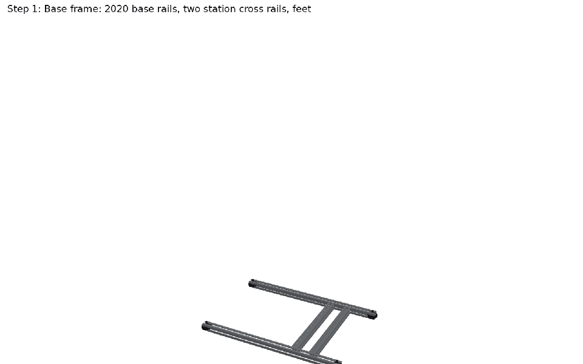

## Step 1: Base frame

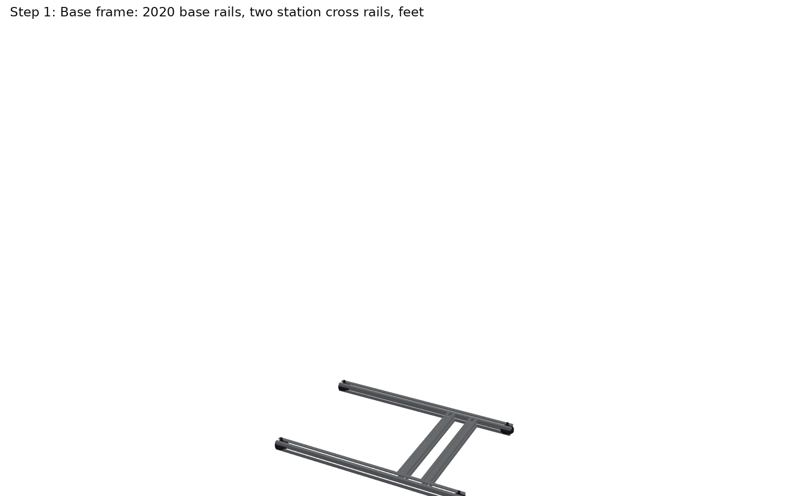

Cut the 2020 (80/20 20-2020, or any slot-6 2020): four x-rails of 444 mm, four posts of 710 mm, six cross
rails of 260 mm, and 200 mm and 170 mm for the two station posts. Lay two x-rails on the bench 280 mm apart
(centres) and put the two station cross rails between them, at x = 30 and 85 mm from the front chain's
plane (the vial post and the actuator stand on them). Screw the four M6 leveling feet into T-nuts in the x-rails'
bottom slots. Every frame screw is an M5 x 10 button head into a drop-in T-nut with a drop of Loctite 243 (T-nuts
can't take a nylock).

| # | Qty | Part |
|---:|---:|---|
| 22 | 1 | 80/20 20-2020 extrusion, cut to length: 4 x 444 (x-rails), 4 x 710 (posts), 6 x 260 (cross and station rails), 1 x 200 (fork post), 1 x 170 (vial post); $0.0131/mm + $3 per cut |
| 23 | 12 | Cast corner bracket for 20 series (posts to cross rails; +4 for the station posts) |
| 24 | 70 | M5 drop-in T-nut for 2020 (brackets, side plates, station) |
| 25 | 70 | M5 x 10 button head screw, with blue threadlocker (T-nuts can't take a nylock) |
| 26 | 1 | Loctite 243 (blue, medium strength) for the T-nut screws; Loctite 222 (purple, low strength) for the thumb screws |
| 27 | 4 | Leveling foot, M6 x 40 stud, into an M6 T-nut in the base rail |

## Step 2: Posts, top rails and cross rails

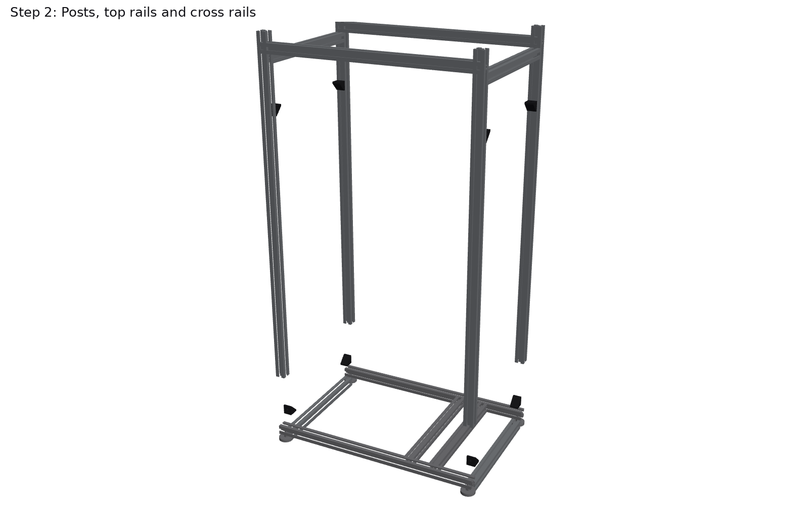

Stand the four posts on the x-rails' ends, put a cross rail between each pair at the bottom and at the top,
and fix each joint with a cast corner bracket. Put the two top x-rails on the posts. Square the box by its
diagonals (equal within 1 mm). Keep the posts' inner faces clear between 355 and 700 mm: the side plates go there.

| # | Qty | Part |
|---:|---:|---|
| 22 | 1 | 80/20 20-2020 extrusion, cut to length: 4 x 444 (x-rails), 4 x 710 (posts), 6 x 260 (cross and station rails), 1 x 200 (fork post), 1 x 170 (vial post); $0.0131/mm + $3 per cut |
| 23 | 12 | Cast corner bracket for 20 series (posts to cross rails; +4 for the station posts) |
| 24 | 70 | M5 drop-in T-nut for 2020 (brackets, side plates, station) |
| 25 | 70 | M5 x 10 button head screw, with blue threadlocker (T-nuts can't take a nylock) |

## Step 3: Side plates and the bottom flange bearings

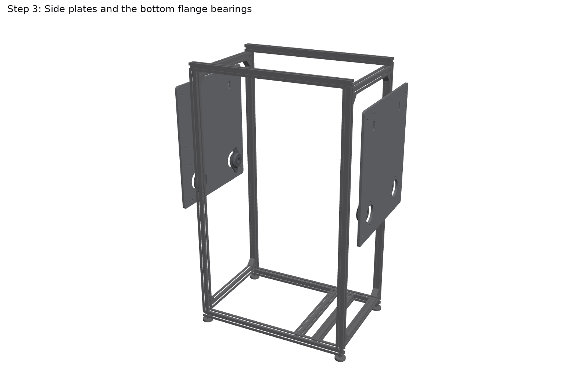

Have the two side plates and the motor plate cut from 1/4 in 6061 (`dxf/side_plate_front.dxf`, `dxf/side_plate_back.dxf`,
`dxf/motor_plate.dxf`, SendCutSend or the BYU shop). Bolt each side plate to its posts' inner faces with six M5 x 10
button heads into T-nuts, so the plates' inner faces are 391 mm apart, 33 mm outside each chain.
Bolt the four SBSFL202-10 flange bearings to the plates' outer faces at the two bottom corners, bolt line vertical,
rear dome in the 49 mm hole, with 1/4-20 x 1 in bolts and nylon-insert locknuts.

| # | Qty | Part |
|---:|---:|---|
| 7 | 4 | 2-bolt stamped-steel flange bearing SBSFL202-10, 5/8 in bore, set screws (bottom shafts; only 24 in stock) |
| 13 | 8 | Hex bolt 1/4-20 x 1 in, Grade 5 (flange bearings to the side plates) |
| 14 | 1 | 1/4-20 nylon-insert locknuts, pack of 100 |
| 24 | 70 | M5 drop-in T-nut for 2020 (brackets, side plates, station) |
| 25 | 70 | M5 x 10 button head screw, with blue threadlocker (T-nuts can't take a nylock) |
| 28 | 3 | 6061-T6 1/4 in plate, laser cut from dxf/: two side plates 320 x 345 mm and the 120 mm motor plate (SendCutSend quotes on upload) |

## Step 4: Bottom through shafts with their 32T sprockets (front keyed, back set after phasing)

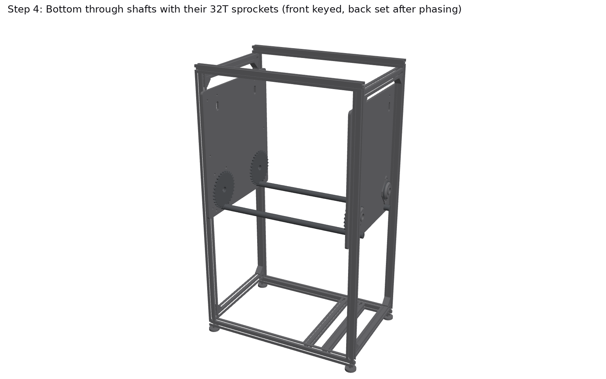

Cut the keyed bar into 435 mm (B-) and 463 mm (B+, the drive shaft, which runs on into the coupling).
Feed each shaft through its front bearing, slide on the front 32T with its hub toward the front plate, then
the back 32T with its hub toward the back plate, and on through the back bearing. Key the front sprockets.
Leave the back sprockets' set screws loose until step 6: both chains have to hang in phase, so the back
sprockets are set from the gondolas, not from their keyways.

| # | Qty | Part |
|---:|---:|---|
| 5 | 8 | Sprocket 35BS32-5/8: 32T, 2 in hub, 7/8 in through the bore. 4 for the bottom shafts (keyed); 4 re-bored to 35 mm H7 by the shop for two 6202s (top idlers) |
| 6 | 1 | Keyed shafting 5/8 in x 72 in, 3/16 in keyway: cut 1 x 435 mm and 1 x 463 mm (drive) |
| 8 | 1 | Key stock 3/16 x 3/16 in, 12 in (front sprockets keyed; back ones locked by set screws after phasing) |

## Step 5: Top idlers

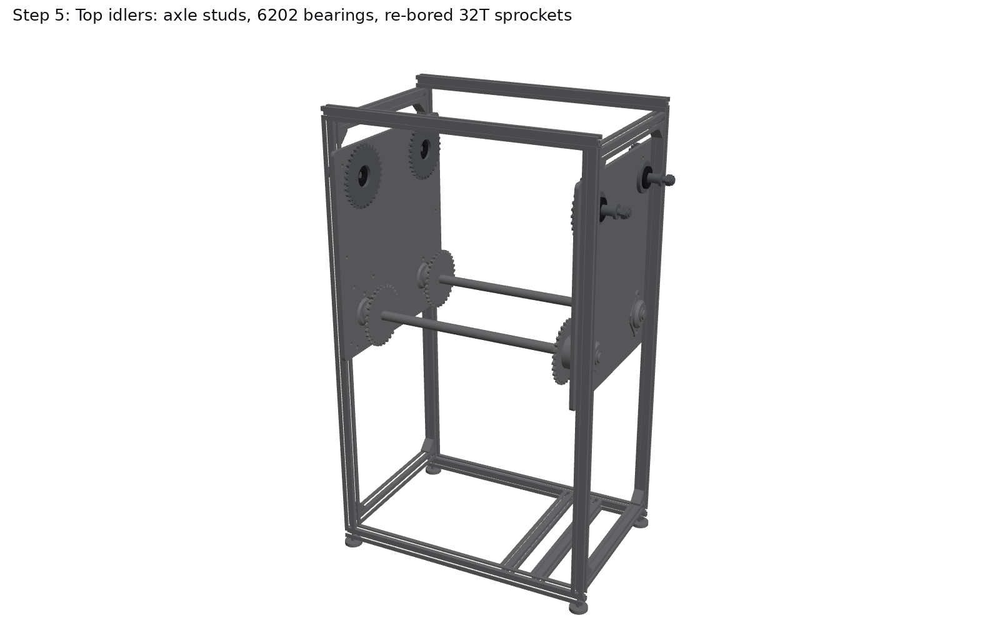

Top idlers: the shop re-bores four 35BS32 sprockets to 35 mm H7 and turns four axles (15 mm h6 seat, 22 mm
shoulder, M10 stem). Press two 6202-2RS into each sprocket. Put each axle's stem through the vertical slot at a
top corner of a side plate from the inside, slide the sprocket on (hub toward the plate) so its inner face ends
flush with the axle's end, and fit the M10 nylon-insert locknut outside, finger tight, with the axle at the bottom
of its slot (6 mm below its working height). Nothing may stick out past the sprocket's inner face:
the gondolas pass 6-odd mm from the axle's end when they go over the top.

| # | Qty | Part |
|---:|---:|---|
| 5 | 8 | Sprocket 35BS32-5/8: 32T, 2 in hub, 7/8 in through the bore. 4 for the bottom shafts (keyed); 4 re-bored to 35 mm H7 by the shop for two 6202s (top idlers) |
| 10 | 1 | Deep-groove ball bearing 6202-2RS, 15 x 35 x 11, 10-pack (two per top idler; McMaster 5972K368 is $8.46 each) |
| 11 | 1 | 1045 steel rod, 15 mm (-0.013/0), 1 ft: the shop turns four idler axles (31 mm seat, M10 stem; shoulder from a 22 mm washer) |
| 12 | 4 | M10 nylon-insert locknut + DIN 125A washer (idler axles, outside the side plates) |

## Step 6: Chains

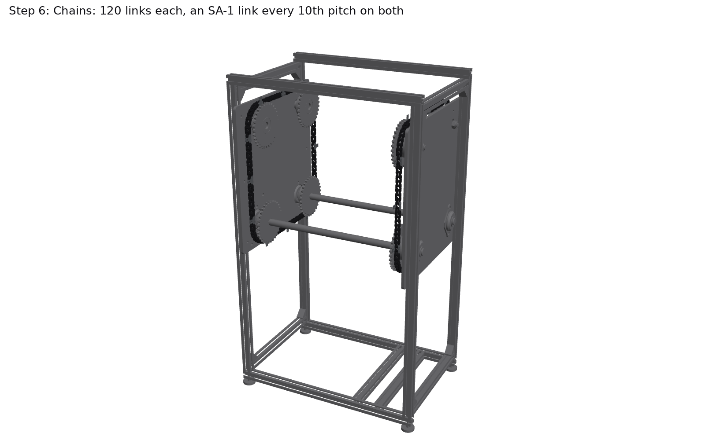

Break the 10 ft roll into two pieces of 96 plain pitches plus the SA-1 links: each loop is 120
pitches with an SA-1 connecting link every 10th pitch (12 per chain, always at an outer-link position).
Fit each SA-1 with its tab on the side facing the other chain (toward the gondolas), clip on the far side. Wrap
each loop round its four sprockets, close it with the last SA-1 link, then raise the four idler axles together
with the jack screws until each chain's longest span deflects 3-4 mm under a 10 N push; lock the axle nuts.
Turn the drive shaft until a front SA-1 link is at the middle of the bottom run, set the matching back SA-1
link exactly behind it (same height), and tighten the back sprockets' set screws: the two chains are now in
phase. Rotate a full lap by hand and check every SA-1 pair is level to 0.5 mm.

| # | Qty | Part |
|---:|---:|---|
| 1 | 1 | ANSI #35 roller chain, 10 ft roll (320 pitches): two 120-link loops use 216 plain pitches + the 24 SA-1 links |
| 2 | 26 | #35 SA-1 attachment connecting link, 0.134 in hole (M3 passes, no drilling), C1 0.375 in: 12 per chain (+2 spare) |
| 3 | 1 | Spring clips for #35 connecting links, pack of 5 (spares) |
| 4 | 1 | Roller chain breaker, #25-#60 |

## Step 7: Drive

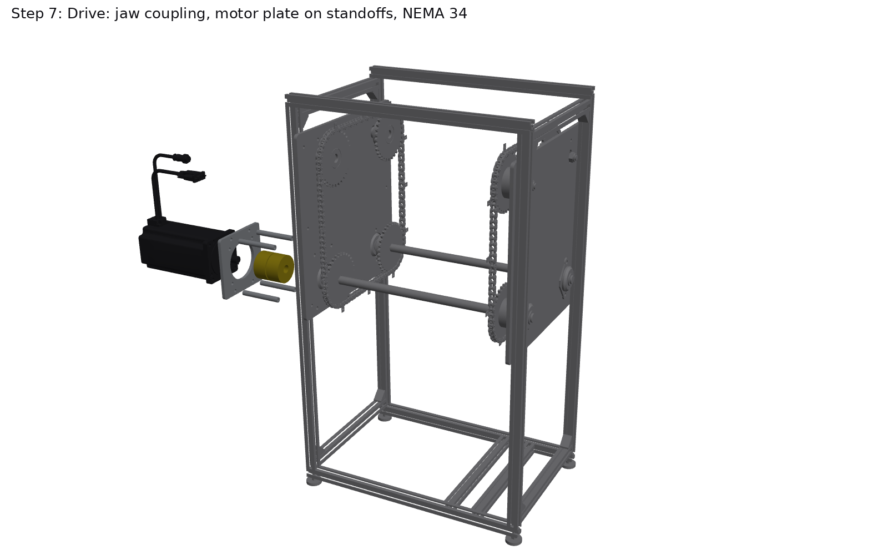

Key the L090 hubs: the 5/8 in hub on the drive shaft's end behind the back bearing, the 14 mm hub on the
NEMA 34. Put the spider in, screw the four 79 mm standoffs to the back plate, bolt the motor to the motor plate
(M5 x 16 + nylon-insert locknuts), slide the motor's hub into the spider and bolt the motor plate to the standoffs.
The motor drives the bottom +y shaft directly: one module (95.25 mm of chain) is 10/32 of a turn,
1250 steps at 4000 pulses/rev.

| # | Qty | Part |
|---:|---:|---|
| 9 | 1 | Metric key 5 x 5 mm (NEMA 34 shaft into the coupling hub) |
| 15 | 1 | NEMA 34 closed-loop stepper 34HS59-6004D-E1000, 12 N*m, 14 mm keyed shaft (StepperOnline STEP from PR #115) |
| 16 | 2 | Jaw coupling hub L090, iron, keyed: one 14 mm bore (5 mm keyway), one 5/8 in bore (3/16 keyway) |
| 17 | 1 | Jaw coupling spider L090, Buna-N, 15.8 N*m (the L075's 10.2 N*m is under the motor's 12) |
| 18 | 4 | Round standoff 10 mm OD x 79 mm, M6 female both ends, aluminium (motor plate to the back plate) + 2 M6 x 12 screws each |
| 19 | 4 | M5 x 16 socket head screw + M5 nylon-insert locknut (NEMA 34 flange to the motor plate) |
| 28 | 3 | 6061-T6 1/4 in plate, laser cut from dxf/: two side plates 320 x 345 mm and the 120 mm motor plate (SendCutSend quotes on upload) |

## Step 8: Gondolas

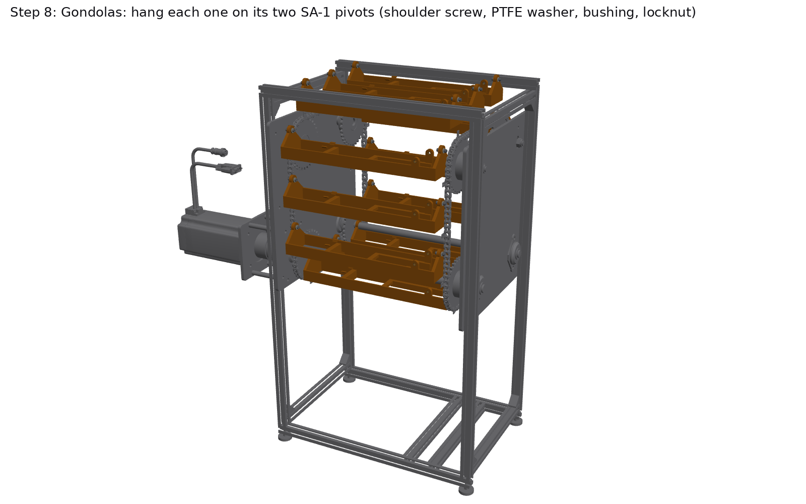

Gondolas (PETG, H2D: 313 x 62 x 55 mm). Press a 6659K65 bronze bushing into each end plate's 7 mm bore from
the inside, set a magnet in the -y rail's bottom pocket (gondola 1 gets the second, HOME, magnet), and heat-set
two M5 inserts into the hinge lugs. Hang each gondola between a front and a back SA-1 link: PTFE washer on the
tab, end plate, PTFE washer under the head, and the 4 x 10 mm shoulder screw from the inside through the
bushing and the tab, with an M3 nylon-insert locknut on the chain side. Tighten the screw to the shoulder (the
shoulder clamps on the tab; the gondola turns on the shoulder). The gondola must swing freely and come back to
hanging straight down: if it sticks off-vertical by more than about half a degree, the bushing is too tight.

| # | Qty | Part |
|---:|---:|---|
| 29 | 12 | Gondola, PETG, 313 x 62 x 55 mm, about 90 g (H2D only: 350 x 320 bed) |
| 30 | 24 | Shoulder screw, 18-8, 4 mm x 10 mm shoulder, M3 x 5 thread (the gondola pivots) |
| 31 | 24 | Flanged bushing, oil-embedded 841 bronze, 4 ID x 7.02 OD x 6, flange 10 x 1.5 (pressed into the end plates) |
| 32 | 1 | PTFE washer M4, 4.3 x 9 x 0.8, pack of 50 (two per pivot: on the tab and under the head; 48 used) |
| 33 | 1 | M3 nylon-insert locknut, 18-8, pack of 100 (pivots) |
| 34 | 2 | M5 brass heat-set insert, 5.7 mm long, 6.4 mm hole, pack of 25 (two per gondola, in the hinge lugs) |
| 36 | 13 | Neodymium disc magnet 1/4 x 1/8 in N52 (12 INDEX in the gondola rails + 1 HOME) |

## Step 9: Modules

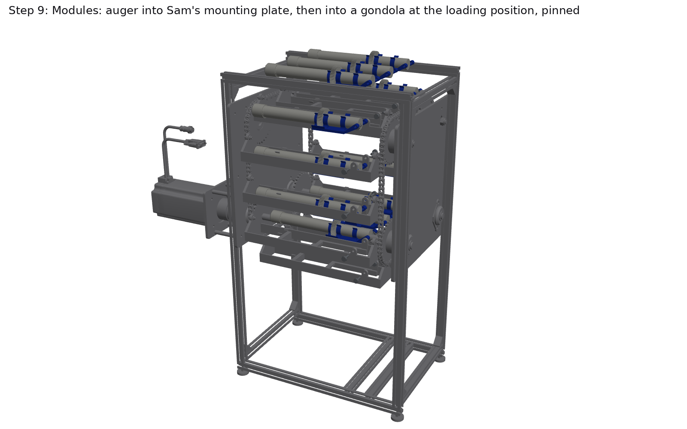

Modules: slide an auger (lab design, PR #170) into Sam's mounting plate and screw on the cap. Index the
carousel until an empty gondola is at the loading position (right side, mid-height; module k+3 is there when
module k is at the station). Hold the module with the auger's outlet toward the front, lower it 22 mm
above the floor and slide it in from the right (70 mm), lower it onto the floor between the lugs, and
turn the two M5 x 16 thumb screws in from outside: their tips are the hinge pins in Sam's 5.3 mm knuckle holes.
Index one module (1250 steps) and load the next. To swap a module, reverse it: two thumb screws out, lift, slide out.

| # | Qty | Part |
|---:|---:|---|
| 35 | 24 | M5 x 16 knurled low-profile thumb screw, 18-8, 11 x 5 mm head: its tip is the module's hinge pin in Sam's 5.3 mm knuckle hole (tool-free swap; Loctite 222) |
| 37 | 12 | Mounting plate (Sam's Oct 13 Onshape part), PETG/PLA, about 70 g |
| 38 | 12 | Auger (threaded storage, 44T) + cap, lab design (PR #170): from the #134 batch of 16 |

## Step 10: Station

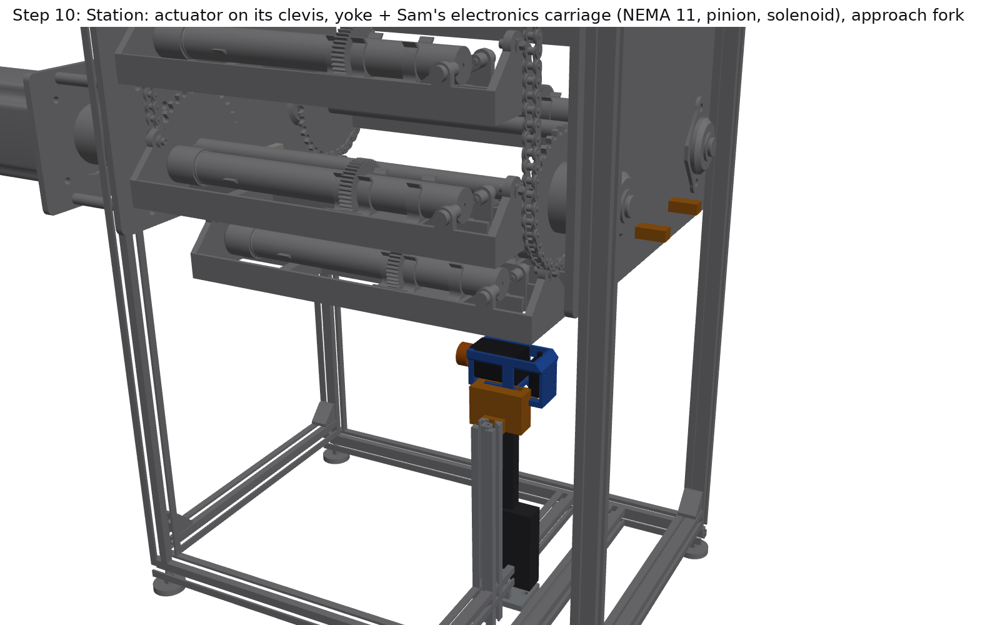

Station. Bolt the base clevis to the actuator cross rail under the hinge line and pin the Actuonix
P16-150-22-12-P's rear lug in it (197.4 mm hole to hole retracted). Bolt the printed yoke under Sam's
electronics carriage (with its NEMA 11, 20T pinion and solenoid), pin the rod end in the yoke, and set the
approach fork on its post so the yoke's tongue rides in it for the first 20 mm. Screw the two UHMW hold-down
strips to their brackets on the side plates' inner faces, 0.5 mm above the chains' bottom runs at the station:
when the module tilts, the gondola's front pivot is pulled upward (MuJoCo run, sim/README.md), and the strips stop the
chain from lifting. Wire the LAC board (12 V) to the actuator's motor and pot and set its limits so the retracted
carriage clears the passing gondolas.

| # | Qty | Part |
|---:|---:|---|
| 22 | 1 | 80/20 20-2020 extrusion, cut to length: 4 x 444 (x-rails), 4 x 710 (posts), 6 x 260 (cross and station rails), 1 x 200 (fork post), 1 x 170 (vial post); $0.0131/mm + $3 per cut |
| 24 | 70 | M5 drop-in T-nut for 2020 (brackets, side plates, station) |
| 25 | 70 | M5 x 10 button head screw, with blue threadlocker (T-nuts can't take a nylock) |
| 39 | 1 | Actuonix P16-150-22-12-P linear actuator, 150 mm stroke, potentiometer feedback, 46 mm/s, 50 N, includes #8-32 pins and brackets |
| 40 | 1 | Actuonix LAC linear actuator control board (closed-loop position from the pot; USB/RC/PWM/0-3.3 V in) |
| 41 | 1 | 12 V supply for the LAC and actuator (Actuonix) |
| 42 | 5 | Station printed parts, PETG: yoke under the electronics carriage, approach fork + arm, base clevis, vial cup |
| 43 | 1 | Electronics carriage (Sam's Oct 13) with the doser's NEMA 11, 20T pinion and 12 V solenoid |
| 55 | 1 | Shoulder screw 4 x 30 mm, M3 (actuator's rear clevis; cheeks 29.8 mm over) + M3 nylock |
| 56 | 1 | Shoulder screw 4 x 20 mm, M3 (rod end in the yoke; cheeks 19.8 mm over) + M3 nylock |

## Step 11: Dispense

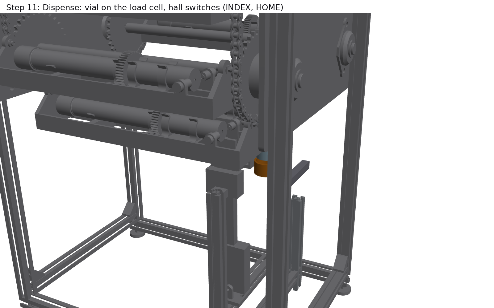

Dispense: screw the load cell to the vial post and the cup to its free end, and set a vial in the cup
(its mouth sits 32 mm under the gondolas' path). Mount the INDEX and HOME hall switches under the -y rail's line,
3 mm below the passing magnets. Wire the CL86T, the LAC, the HX711 and the two hall switches to the Pi
(test/paternoster_rig.py has the pin map), with the E-stop in the driver's 48 V feed.

| # | Qty | Part |
|---:|---:|---|
| 20 | 1 | Closed-loop stepper driver CL86T V4.1 (lab has one from the UofU order) |
| 21 | 1 | Power supply Mean Well LRS-350-48 (48 V, 7.3 A) |
| 22 | 1 | 80/20 20-2020 extrusion, cut to length: 4 x 444 (x-rails), 4 x 710 (posts), 6 x 260 (cross and station rails), 1 x 200 (fork post), 1 x 170 (vial post); $0.0131/mm + $3 per cut |
| 24 | 70 | M5 drop-in T-nut for 2020 (brackets, side plates, station) |
| 25 | 70 | M5 x 10 button head screw, with blue threadlocker (T-nuts can't take a nylock) |
| 42 | 5 | Station printed parts, PETG: yoke under the electronics carriage, approach fork + arm, base clevis, vial cup |
| 44 | 1 | Load cell 100 g (TAL221) under the vial |
| 45 | 1 | HX711 load-cell amplifier |
| 46 | 1 | 20 mL glass scintillation vial (lab stock; Wheaton 986546 is $383.77 per 500) |
| 47 | 2 | Hall-effect switch US5881 (unipolar, open drain): INDEX and HOME |
| 48 | 1 | Raspberry Pi Zero 2 W (or any spare Pi that runs pigpio) |
| 49 | 1 | Interface board: 74AHCT125 level shifter (step/dir/enable), pull-ups, screw terminals, perfboard |
| 50 | 1 | E-stop GCX1136 (22 mm, NC) + enclosure; breaks the 48 V feed to the driver |
| 51 | 1 | IEC C14 inlet with switch + fuse drawer |
| 52 | 1 | 18 AWG stranded hook-up wire, 25 ft |

