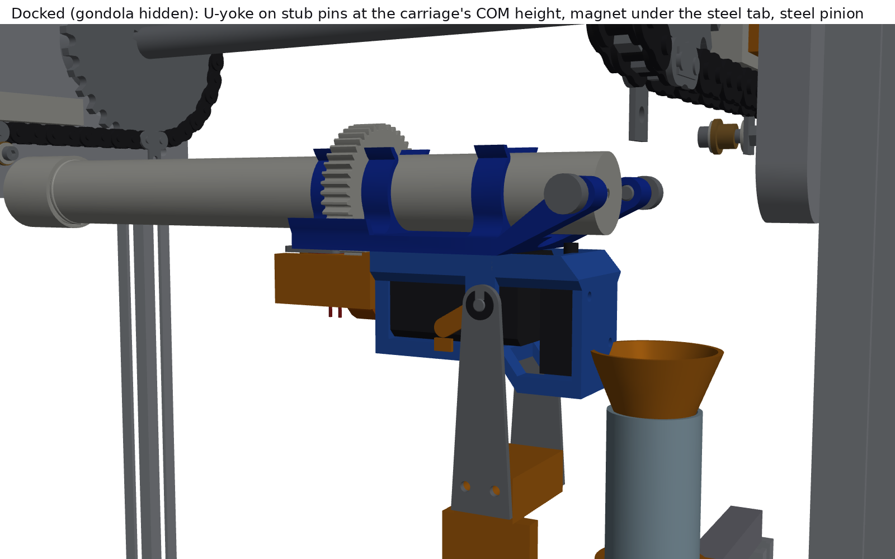
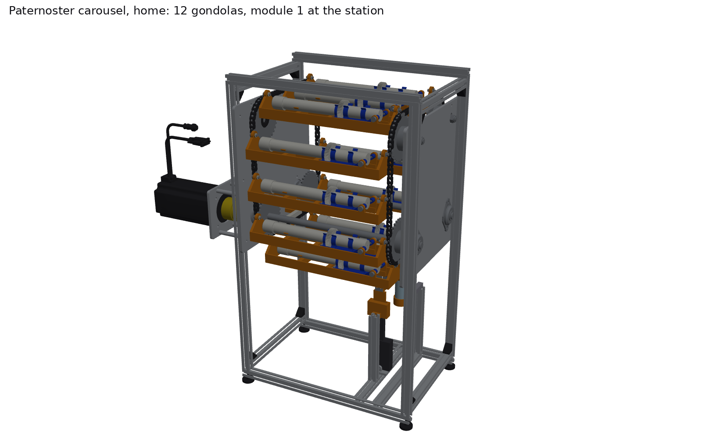
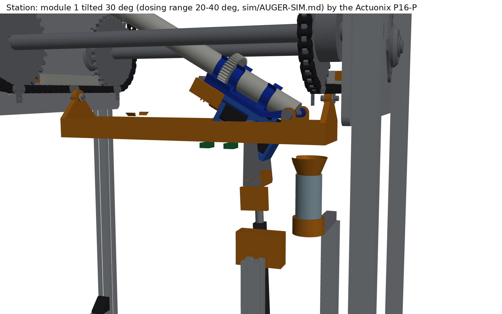
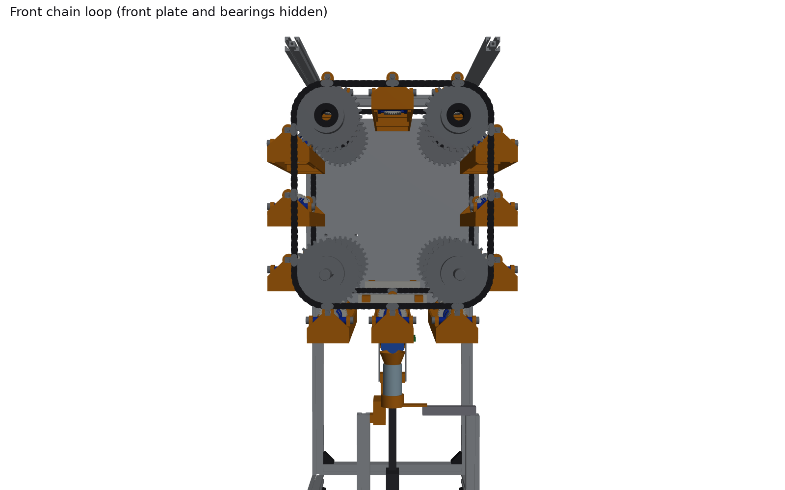
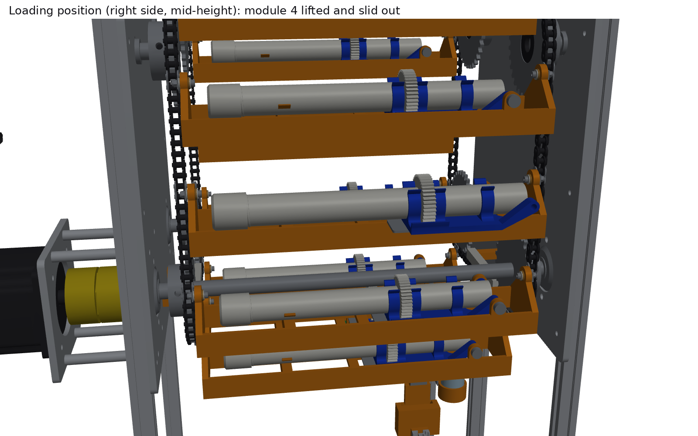
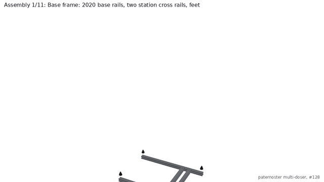

# Multi-doser paternoster carousel (#128)

A second, independent multi-doser design next to the [chain carousel v2](../chain-carousel-v2/README.md). Two #35 chains run in vertical planes at the front and back of the modules, each round four 32T corner sprockets. Every 10th pitch an **SA-1 attachment link carries a shoulder-screw pivot, and a printed gondola hangs between the front and back pivots**. Gravity keeps each gondola, and the doser module in it, upright all the way round: on the straights, over the top and round the corners. **No hinge, flap or outlet is ever sideways or upside down**, so nothing on a module needs latching against gravity. v2's modules roll a full turn per lap and need snap hooks to stay shut upside down.

The station is mid-way along the bottom run. An **Actuonix P16-150-22-12-P** (potentiometer feedback, on an Actuonix LAC board) lifts Sam's electronics carriage through the gondola's floor, docks it under Sam's mounting plate and tilts plate and carriage together about the hinge, cap end up into the empty middle of the loop. Modules come out sideways at a loading position on the right side: undo two thumb screws, lift 22 mm, slide out.

**Station update (2026-10-18), shared with [chain carousel v2](../chain-carousel-v2/README.md).** The [gear-mesh study](../gear-mesh/README.md) found that the module's weight can't keep the auger's 44T gear in mesh with the NEMA 11's pinion, and that Sam's carriage tips off the plate once tilted. The station therefore now has:
- a **dock electromagnet** (Adafruit 3872), pulling a 2 mm steel tab under each plate;
- the carriage **pivoting at its centre-of-mass height** on two stub pins, carried by a U-yoke on the P16;
- a **steel pinion** (KHK SS1-20A);
- **locating pins**;
- a **32.25 mm centre distance**;
- a **docking seek**.

The [leakage study](../auger-leakage/README.md) found no benefit in storing modules nozzle-up, so the gondolas stay level. After each dose the module holds 0.5 s at the dose tilt, tilts back, then reverses the auger one turn at rest.



| Home: 12 gondolas, module 1 at the station | Station: module 1 tilted 30° (cutaway) |
|---|---|
|  |  |
| **Front loop (front plate hidden): upright all the way round** | **Loading position: module 4 lifted and slid out** |
|  |  |

**Animation** ([MP4](renders/paternoster.mp4)). It runs in this order:
1. Assembly from scratch.
2. An auger goes into Sam's mounting plate, and the steel tab onto the plate.
3. All 12 modules are loaded one index at a time, then the carousel runs a full lap.
4. The station is built under the loaded carousel.
5. A dose: dock with the magnet on and the pinion seeking, tilt to 30°, dose with taps, hold 0.5 s, tilt back, reverse the auger one turn at rest, undock.
6. A module swap.

Every frame uses the exact chain kinematics.



## The design in numbers

| | Value | Why |
|---|---|---|
| Chains | 2 x ANSI #35, **120 links each**, in vertical planes 325 mm apart | One 10 ft roll (320 pitches) covers both |
| Loop | Four 32T corners (R 48.59 mm) on a 190.5 x 228.6 mm rectangle (20 x 24 links): 2(20+24) + 32 = 120 | Every 90° wrap is exactly 8 links, so the loop closes exactly ([`kinematics.py`](kinematics.py)) |
| Modules | **12, every 10 pitches (95.25 mm)**; one index = 10/32 of a turn = **1250 steps** at 4000/rev | 8 or 9 pitches don't fit: the clearance study (`sim/README.md`) needs 10 at the corners, and the SA-1 link must be an outer link (even spacing) |
| Pivot | McMaster 7321K31 SA-1 link (0.134 in hole, C1 0.375 in): **4 x 10 mm shoulder screw**, PTFE washer each side, **841-bronze flanged bushing** in the gondola, **M3 nylon-insert locknut** | The pivot sits 9.525 mm outside the pitch line, so the gondolas' corner radius is 57.9 mm. The bronze bushing's friction is the swing damper the MuJoCo run relies on |
| Gondola | PETG, 313 x 62 x 55 mm, about 90 g, prints on the H2D | It stays inside a 62 x 57 mm upright envelope round its pivot, which leaves 11 mm between neighbours |
| Bottom corners | Two 5/8 in keyed **through shafts** in SBSFL202-10 flange bearings: they keep the chains in phase; B+ is the drive | The gondolas hang below the bottom run, so nothing passes over these shafts |
| Top corners | **Idlers on fixed 15 mm stub axles** (35BS32 re-bored for two 6202-2RS), flush with the sprocket face, tensioned in slots | A gondola going over the top passes within 2 mm of the corner's axis, so a through shaft there is impossible |
| Drive | NEMA 34 34HS59-6004D-E1000 (**StepperOnline's own STEP**, PR #115) **direct** on B+ through an **L090 jaw coupling** | The L075's spider is rated 10.2 N·m, under the motor's 12 N·m. MuJoCo drive torque is 0.26-0.31 N·m averaged over 25 ms, 1.56 N·m raw peak on a 10 s lap |
| Station | P16-150-22-12-P with a U-yoke rigid on its rod: the yoke's 2 mm steel arms carry the carriage's two 4 mm stub pins, 32 mm behind / 33 mm below the hinge (the carriage's centre-of-mass height). Base pin 48 mm above the bench. **20 mm approach** in a printed fork, then **tilt to 90° using 85 of 150 mm** | Both ends pinned, so P16 + yoke is a two-force member (side-load limit 10 N). The old pin under the carriage made it an inverted pendulum that fell off the plate once tilted ([gear-mesh](../gear-mesh/README.md)). MuJoCo force: 10.5 N at 0° falling to 1.4 N at 90° (19.3 N transient peak), against 50 N available |
| Gear mesh | NEMA 11 on the inner face of the carriage's back wall; **steel 20T pinion KHK SS1-20A** on the 44T printed gear at **32.25 mm** (0.18 mm backlash), PTFE dry lube; **Adafruit 3872 electromagnet** behind the pinion pulls a **2 mm steel tab** under each plate; two locating pins in a hole and a slot in each plate; Tic current limit 450 mA | The module's weight holds only 1.1 N at the gear (0 at 90°) against 3.6-6.6 N of separating force at stall. With these changes the mesh carries the motor's full torque at every tilt 0-90° in MuJoCo. At 32.1 mm, printed-gear runout and the magnet's bending of the plate (78 µm, FEA) made the mesh bind |
| Chain hold-down | **UHMW strips 0.5 mm over each chain's bottom run at the station** | MuJoCo: below about 60° of tilt the actuator's push behind the hinge is more than the module + carriage weigh, and the front pivot is pulled up (7.5 N at 0°). The strips hold the chain to their 0.5 mm gap (up to 10.9 N on the strip with the stiff tab) |
| Dispense | 20 mL vial on a 100 g load cell, **D-shaped catch funnel** ahead of the docked carriage | Particle sim: at steep tilt 21% of grains miss a bare vial |
| Frame | 80/20 20-2020, 1/4 in 6061 side plates (DXF), 4 leveling feet; footprint 444 x 320 mm, plus 232 mm of motor out the back; 765 mm tall | Every T-nut screw takes blue Loctite (T-nuts can't take a nylock); every other nut on the machine is a nylock |
| Cost | **$1,773 total, $1,647 without test gear** ([BOM.md](BOM.md)) | Prices read on the vendors' pages on 2026-10-16 (station additions 2026-10-18) unless marked |

## What the simulations found, and what changed

Two MuJoCo models ([sim/README.md](sim/README.md), [sim/AUGER-SIM.md](sim/AUGER-SIM.md)) and the OCC interference checks drove these changes:

| Finding | Change |
|---|---|
| The chain model's span end pins switched at the seat angle, not at ±½ tooth, so pivots jumped up to 0.98 mm at every whole-number shift. MuJoCo turned the jumps into 500 N spikes | Fixed `kinematics.pin_positions` (tooth phase g in [-½, ½)); pivots now move continuously, 0.11 mm per 0.01-link step, with no pitch error |
| Loaded gondola: 0.38 kg, 2.54 Hz pendulum, COM 24 mm under the pivot. A 1 s S-curve index leaves 9.7° of swing at the station | Index with a **trapezoid whose ramps each last one pendulum period (0.394 s), 1.5 s per index**. Without pivot friction 0.52° remains, because chordal action keeps exciting the pendulum; with the bronze pivots (μ≈0.1) it settles in 0.03 s. A 12-index lap peaks at 4.4° with an 11.0 mm minimum gap. Coded in [`test/paternoster_rig.py`](test/paternoster_rig.py) |
| Fast laps: 6 s per lap swings 36° (7.2 mm gap); at 4 s a gondola flips over | Continuous moves capped at 130 mm/s (a lap of 10 s or more): 9.9° swing, 10.5 mm minimum gap, 14 mm to the shafts |
| Tilting pulls the station gondola's front pivot up (about 2.7 N quasi-static), which lifts the chain 6.4 mm at 40 N tension | UHMW chain hold-down strips at the station: the chain stays at 0.5 mm, and the plate rises 0.66 mm with a 50 N/mm tab/end-plate stack. A guide channel inside the gondola can't be supported clear of the passing gondolas, and the sim showed it does nothing for swing. Docked, taps and the turning auger move the gondola 0.012° or less |
| Dose per revolution peaks near 15° and collapses toward 90°: the powder rides round on the flight | Station default **20-40° tilt**. 90° is kept for cleaning and access |
| Gear mesh ([gear-mesh](../gear-mesh/README.md)): the plate lifts at stall at any tilt, and Sam's carriage falls off the plate at 30° and above. The rod-end pin made it an inverted pendulum | Dock electromagnet + steel tab, carriage pivot at its COM height (stub pins + U-yoke), steel pinion, locating pins. MuJoCo: the motor stalls (0.22 N·m at the auger) before any tooth jumps, at every tilt, and 0 jumps at 30-240 rpm |
| At 32.1 mm a 0.05 mm gear runout bound the mesh and jumped teeth; the magnet bends Sam's plate 78 µm toward the pinion (3D FEA) | Centre distance 32.25 mm: clean with up to 0.1 mm runout |
| Docking with the pinion held: half the starting phases park the gear on the pinion's tooth tips | Turn the pinion at 0.25 rev/s through the last 3 mm, magnet on: seated from every phase |
| Leakage ([auger-leakage](../auger-leakage/README.md)): nozzle-up storage (5-15°) changed nothing; a still auger doesn't leak. Reversing while tilted adds dose | Gondolas stay level. After a dose: hold 0.5 s, tilt back, reverse 1 auger revolution at rest (73 % less powder at the exit) |
| At 60°, 21% of grains miss a Ø24 vial 35 mm below; and the retracted carriage sat where the vial was | Vial moved 12 mm forward with a printed D-funnel whose mouth stops 1.3 mm ahead of the docked carriage |
| The actuator swings about 9° as the module tilts and hit the approach fork | Guide tongue and fork moved to y = 15 mm, beside the actuator's swing plane but still inside the floor window |
| A through quick-release hinge pin would hit the auger: the outlet sits on the hinge axis between Sam's knuckles (\|y\| 15-25) | Two **M5 x 16 knurled thumb screws** in heat-set inserts in the gondola's lugs; their tips are the hinge pins. Tool-free swap, Sam's part unchanged |
| With McMaster's real drawings: pin heads stand 0.95 mm proud of the SA-1 tab | End plate moved out to 0.75 mm clear; second PTFE washer under the screw head |

## Checks

[`check_interference.py`](check_interference.py): OCC boolean volume of every pair of instances, reporting anything over 0.5 mm³. Results are in [`checks/`](checks), re-run on 2026-10-19 with the ported station. **All four come out at 0 clashes:**

| Check | What moves | Result |
|---|---|---|
| Home | Nothing: every pair of the 571 instances | **0** |
| `--sweep` | The chain indexed one full module in half-link steps (21 poses). The 12 gondolas together pass every point of the loop, including all four corners, against the frame, shafts, sprockets, idlers, station and each other | **0** |
| `--tilt` | The electronics carriage rising 0-19.5 mm in the fork, then module + carriage + U-yoke + actuator tilting 5-90°, against everything | **0** |
| `--swap` | A module (with its steel tab) lifted 22 mm and slid 70 mm out at the loading position | **0** |

On the way they caught, and the design now fixes:
- the hold-down strips' ends touching the 32T tooth tips (shortened to 100 mm);
- the retracted carriage hitting the vial (vial moved, D-funnel);
- the swinging actuator hitting the fork (fork moved off its plane);
- the motor standoffs hitting a post, and the posts hitting the bottom bearings (moved);
- the 44T gear hitting the gondola floor (window lengthened);
- a module lifted only 16 mm catching its auger on the hinge lug while sliding out (lift is now 22 mm, leaving 18 mm under the gondola above);
- in the station port, the -y yoke stop and stub-pin plate turned 180° instead of mirrored, which put them ahead of the pins (now mirrored parts).

The MuJoCo model covers clearance with swing: the 12-index lap's tightest gap is 11.0 mm.

## Parts, OEM data and cost

Every purchased part is a catalogue part with its number, link and price in [BOM.md](BOM.md) / [bom.csv](bom.csv). Quantities are counted from the CAD.

- **McMaster-Carr**, read through the doser Pi (residential IP), logged out. Product pages and CAD downloads now work without a login, so the lab account wasn't used.
  - Dimensions measured from McMaster's own STEP files and drawings: SA-1 link 7321K31, shoulder screws 90265A, bushing 6659K65, PTFE washer 95630A630, locknuts, L090 hubs 6408K14 and spider 6408K75, thumb screw 92545A179.
  - The vendor CAD isn't committed: it has no redistribution licence. The models here match its dimensions.
- **Actuonix** (through the Pi; actuonix.com refuses datacenter IPs): P16-150-22-12-P, $90, 150 mm stroke, 46 mm/s no-load, 50 N lift, 75 N back-drive, 4.25 mm clevis holes, 197.4 mm retracted.
  - The envelope here is modelled from Actuonix's STEP: a 36 x 20 x 79 block with the rod axis 10.5 mm from one end, a 12 x 12 tube and a 9 mm rod.
  - The LAC board ($30) closes the loop on the pot.
- **Surplus Center** (sprockets, flange bearings, keyed shaft), **Nitro** (chain roll), **80/20**, **SparkFun**, **TRC**, **BelMetric**, **VXB**: verified on 2026-10-16.
- **Already in the lab, $0:** the NEMA 34 and CL86T, module 1, the augers (#134's batch of 16), and the electronics carriage's NEMA 11, pinion and solenoid.
- **Doser CAD:** the auger and cap are PR #170's current-design STEPs (the same ones v1/v2 use). Sam's mounting plate and electronics carriage are **his Oct 13 Part Studio**, exported for this design: it changed after the Oct 8 export that v1 and v2 still use.

## Files

| File | What |
|---|---|
| [`params.py`](params.py) | Every dimension, with its source |
| [`kinematics.py`](kinematics.py) | Exact chain kinematics: pins with polygonal action, SA-1 pivots, station and loading shifts |
| [`parts.py`](parts.py), [`layout.py`](layout.py) | CadQuery part models; placements of all instances for any machine state (shift, tilt, actuator extension, module out) |
| [`build.py`](build.py) | `step/paternoster_carousel.step` (one sub-assembly per assembly step), `step/components/`, `stl/` (printed parts), `dxf/` (plates), `placements.json` |
| [`check_interference.py`](check_interference.py) | Home, `--sweep`, `--tilt`, `--swap` |
| [`render.py`](render.py) | Stills, step images, assembly GIF, and the MP4/GIF animation (VTK, `xvfb-run`) |
| [`bom.py`](bom.py), [`docs.py`](docs.py) | BoM table and the generated BOM.md, ASSEMBLY.md, bom.csv |
| [`sim/`](sim) | MuJoCo carousel dynamics ([README](sim/README.md)) and auger particle dosing ([AUGER-SIM.md](sim/AUGER-SIM.md)), with plots, results JSON and videos |
| [`test/paternoster_rig.py`](test/paternoster_rig.py) | Pi driver: indexing with the sim's profile, homing, station dock/tilt via the LAC, taps, load cell, CSV log |
| [`reference/`](reference) | Sam's Oct 13 Onshape export, the lab auger + cap (PR #170), StepperOnline's NEMA 34 STEP (PR #115) |
| [`onshape/`](onshape) | API client and call ledger (6 calls, to read Sam's document) |

```bash
pip install cadquery mujoco vtk pillow imageio imageio-ffmpeg numpy scipy matplotlib
python build.py && python docs.py && python check_interference.py
python check_interference.py --sweep && python check_interference.py --tilt && python check_interference.py --swap
xvfb-run -a python render.py --stills && xvfb-run -a python render.py --movie
```

## Not done yet, and what to check first

- **Not built.** Every number is a prediction until [TEST-PLAN.md](TEST-PLAN.md) is run.
- **The station's linkage is new.** Sam's carriage docks with its own features; whether the yoke's tongue and the 20 mm approach suit his kinematic cones needs a print-and-try.
- **The particle sim is coarse**: 2 mm grains and a widened exit. It shows trends with tilt and taps, not milligrams.
- **No Onshape document this time.** The STEP assembly imports in one step if wanted, using the same script as v2's.
- **Estimated prices**: the plates (SendCutSend quotes only on upload), the standoffs and the motor screws. Together with other unverified lines they add up to the "estimate" total in BOM.md.
