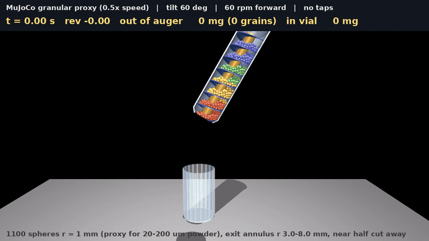
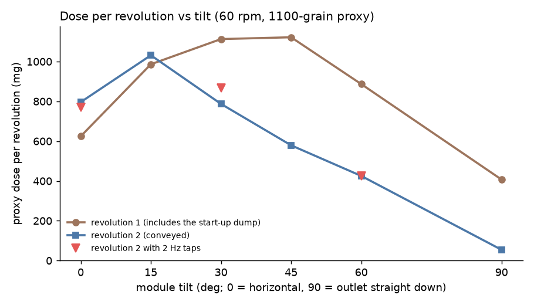
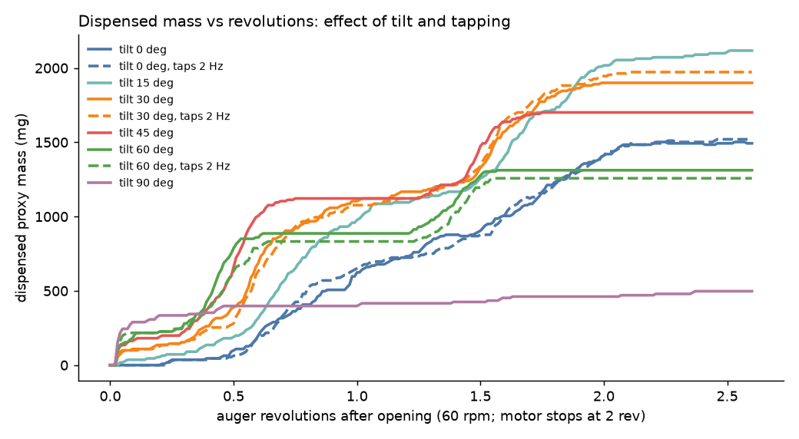

# Auger dosing in MuJoCo: a coarse granular proxy of the lab's rotating auger

This is a physics simulation (MuJoCo 3.16 rigid-body contact, about 1100 spheres) of the lab's
threaded-storage auger dosing into a vial on a balance, at the tilts the paternoster module uses.
It is a **coarse-grained proxy**. It shows trends with tilt, tapping, reversing and holding still.
It does **not** predict absolute milligram doses of a real powder. For those, use the real-size DEM
twin from PR #180 (`sim/dem/` on branch `claude/issue-158-20261010-0534`), which matched the rig's
salt yield at 105 mg/rev, or calibrate against the balance.



*Tilt 60 deg, 60 rpm: 1.5 revolutions forward, 1 revolution reverse, then stop (shown at 0.5x speed). The near half
of the tube wall and funnel is cut away: flight blue, core amber, grains coloured by their starting position along
the axis. Full-resolution MP4: [`out/auger/auger_t60_rev.mp4`](out/auger/auger_t60_rev.mp4).*

## Results at a glance

* **Tilt.** Over 2 revolutions the mean dose varies by about ±20 % from 0 to 45 deg (710 to 1009 mg/rev, highest
  at 15 to 30 deg), then drops: 656 at 60 deg and 231 at 90 deg. The second, conveyed revolution shows the trend
  more clearly. It peaks at 15 deg (1031 mg) and falls steadily: 787 at 30, 579 at 45, 425 at 60 and **54 mg at
  90 deg**.
  The cause is the rotating tube. The flight is part of the tube, so powder moves along the axis only if gravity
  holds the bed back while the tube and flight turn through it. At 90 deg gravity lies along the axis. The powder in
  each pocket then rests on the flight, whose 9 to 22 deg helix angle is below the friction angle, and turns with
  it. `corotation.py` measures this as the grains' mean angular speed about the axis divided by the auger's, over
  the rotation:

  | tilt | 0 deg | 30 deg | 60 deg | 90 deg |
  |---|---|---|---|---|
  | powder co-rotation (1 = turns with the tube, 0 = held still) | 0.68 | 0.67 (median 0.95) | 0.93 | **0.98** |

  At 90 deg, 98 % of the rotation is lost to co-rotation. The second video
  ([`auger_t90.mp4`](out/auger/auger_t90.mp4) / [`.gif`](out/auger/auger_t90.gif)) shows each pocket's powder riding
  on its own flight turn, with the colour bands still in order after 2 revolutions. Even at 0 deg two thirds of the rotation is lost this way, because this cohesionless, low-friction proxy is
  dragged round by the wall, flight and core together.
* **Tapping** (4 N for 10 ms at 2 Hz, during rotation and after the stop) changed the dose by -4.1 to +2.4 % at
  0, 30 and 60 deg. That is within the scatter of a single run, so taps do nothing measurable for this
  cohesionless proxy. Taps do matter for cohesive real powders, which this proxy cannot represent.
* **Stored horizontal (0 deg), motor off, outlet open, 2 s of taps:** no grains came out. A still, horizontal
  module did not spill, even when tapped. After the motor stops at 0 to 15 deg, 70 to 100 mg trickles out over
  0.6 s, roughly 0.1 revolution's worth.
* **Reverse to stop (60 deg):** reversing for one revolution did not pull powder back. While the motor ran in
  reverse, 7 grains (63 mg) fell out as the flight end swept back past the exit, and 4 more (36 mg) fell after the
  stop. In the matching forward run nothing came out in that window, and nothing after the stop. With this wide
  exit, reversing adds about 0.1 revolution of dose rather than cutting it.
* **The balance works as a balance.** The spring-force reading tracks the grain count in the vial to within a few
  percent, including the impact overshoot of each slug (see the per-run plots). Delivery is **pulsed, one slug per
  revolution**: the flight end sweeps past the low side of the exit once per turn, as PR #180 found for the
  open-end auger.

### Dose per revolution vs tilt (60 rpm, 2 revolutions, no taps)

| tilt | rev 1 (mg) | rev 2 (mg) | mean (mg/rev) = flow (mg/s) | after stop, 0.6 s (mg) | grains that missed the vial |
|---|---|---|---|---|---|
| 0 deg | 624 | 796 | 710 | 72 | 1 of 165 |
| 15 deg | 986 | 1031 | **1009** | 100 | 8 of 234 |
| 30 deg | 1113 | 787 | 950 | 0 | 11 of 210 |
| 45 deg | 1122 | 579 | 850 | 0 | 15 of 188 |
| 60 deg | 887 | 425 | 656 | 0 | 31 of 145 |
| 90 deg | 407 | 54 | 231 | 36 | 6 of 55 |

Revolution 1 includes the start-up dump: the powder that settled into the exit falls out as the plug is removed
(about 250 mg at 90 deg). Flow in mg/s equals mg/rev at 60 rpm. At 30 rpm (`t30_r30`, `t60_r30`) the dose per revolution rises slightly: 1027 against
950 mg/rev at 30 deg, and 724 against 656 at 60 deg; revolution 2 gives 932 and 498 mg. The flow in mg/s
halves (513 and 362 mg/s). So slower turning gives slightly more per turn, as PR #180 found
(rpm^-0.35 on the rig).





### Tapping (2 Hz, 4 N, 10 ms, during rotation and the 0.6 s stop)

| tilt | no taps (mg/rev) | taps (mg/rev) | change | rev 2: no taps / taps (mg) | after stop: no taps / taps (mg) |
|---|---|---|---|---|---|
| 0 deg | 710 | 715 | +0.6 % | 796 / 769 | 72 / 90 |
| 30 deg | 950 | 973 | +2.4 % | 787 / 869 | 0 / 27 |
| 60 deg | 656 | 629 | -4.1 % | 425 / 425 | 0 / 0 |
| 0 deg, motor off (stored) | none | 0 grains in 2 s | | | |

Each tap moves the auger mount by about 0.2 mm, with peaks of about 5 g.
Per-run plots: `out/auger/mass_vs_time_<tag>.png` (passed the outlet, in the vial, balance reading, tap times).

### What this means for the carousel

* **Station tilt: moderate, not steep.** In this proxy, conveying is best near 15 deg and falls steadily above
  it. Compared with 15 deg, revolution 2 is 24 % lower at 30 deg, 44 % at 45, 59 % at 60 and 95 % at 90. The
  auger stops conveying as the module approaches vertical: at 90 deg the first revolution dumps what sits in the
  exit, and then almost nothing follows. PR #180's real-size twin of the throttling CAD Ø3 mm exit found yield
  rising from 0 to 45 deg, because tilt pushes powder through the exit. My inference from the two together: a
  station tilt of about 20 to 40 deg, and the hinge never needs to go near 90 deg for dosing.
* **Keep the tilt repeatable to a degree or two.** Around 30 deg the conveyed dose per revolution changes by
  about 2 % per degree in this proxy, so a ±2 deg error in the tilt stop is about ±4 % of dose.
* **Holding still.** A stationary module stored horizontal in a gondola did not spill, even with 4 N taps, so
  ordinary carousel jolts while parked should not dump powder. Lab salt behaves much like this proxy; fine powders
  are cohesive and flow even less. What does leak is afterflow when the motor stops at low tilt (about 0.1 rev),
  and reversing does not fix it. Let the module settle for a moment before it moves, and never move it while the
  auger is still turning.
* **Catching the stream.** At 60 deg, 21 % of the grains missed a Ø24 mm vial 35 mm below, against 0.6 to 5 % at
  0 to 30 deg. Steeper tilt sprays the slugs wider. This is partly an artefact of the proxy's wide exit (Ø16 mm,
  against the real Ø3 mm). Still, it argues for a short outlet-to-vial gap or a catch funnel when the tilt is
  steep.


## 1. Geometry measured from the STEP

`measure_auger.py` loads `reference/auger-threaded-storage.step` with cadquery/OCP, tessellates it
(0.05 mm tolerance, 292 k triangles) and ray-casts it with trimesh: radial rays at 22 heights and
axial rays at 9 radii and 4 angles. The raw hits are in `out/auger/auger_geometry_raw.json`.
The auger runs along +z from the outlet plane (z = 0) to the cap end (z = 250 mm).

| feature | measured | notes |
|---|---|---|
| tube bore (ID) | **21.0 mm** (r 10.50) | z = 12 to 250 mm |
| tube OD | 25.0 mm (r 12.50) | 44T gear OD 46.0 mm at z of about 78 to 88 mm |
| solid core | **r 4.00 mm**, z = 12 to 83.33 mm | ends at 8 pitches; open storage bore above |
| core tip (cone) | r = 0.40 + 0.30 z | 0.40 mm at the exit plane, 4.0 mm at z = 12 |
| funnel (cone) | r = 1.50 + 0.75 z | 36.9 deg half-angle, 12 mm long |
| exit | **Ø3.0 mm hole with the Ø0.8 mm core tip in it**: annulus r 0.40 to 1.50 mm, 1.10 mm wide, 6.6 mm² | |
| flight | single start, **right-handed, pitch 10.417 mm** (250/24), **0.50 mm thick** (axial) | crossings at θ = 0, 90, 180, 270 deg: z = 10.43, 13.02, 15.62, 7.81 (+n·p) |
| flight extent | from the exit plane (inside the funnel, between the two cones) up to z = 83.33 mm (8 turns) | the flight spans core to wall |
| storage | open Ø21 mm bore, z = 83.3 to 250 mm | external thread at about z = 238 to 250 for the cap (`auger-cap-threaded.step`: Ø29 mm, 27 mm long) |
| internal volume | about 79 mL (funnel 1.4, flight section 20.1, storage 57.7) | PR #180 quotes the same 79 mL |

These agree with PR #180's measurements of `threaded-auger-final.stl` (bore 10.45, core 3.98,
pitch 10.4, flight 0.5, Ø3 exit with a 0.43 mm tip), so the PR #170 STEP is the same part.
Positive rotation (right-hand rule about the outlet-to-cap axis +z) drives the right-handed flight towards the
outlet.

## 2. Model

* **Auger** (`auger_geom.py`, `auger_model.py`). One rigid body with a hinge on its own axis, driven
  by a stiff velocity actuator (the NEMA 11 through 20T:44T is a speed source). Collision geometry,
  all built from the measured numbers above:
  * wall: a ring of 36 thin boxes, inner faces tangent to r = 10.5 mm;
  * funnel: 36 planks tangent to the r = 1.5 + 0.75 z cone;
  * core: a cylinder r = 4 mm; core tip: 24 planks tangent to the r = 0.4 + 0.3 z cone;
  * flight: one flat 0.5 mm box per 10 deg of helix (36 per turn), tilted to the local helix angle,
    spanning core to wall, 8 turns (the axial error of a flat 10 deg segment is under 0.07 mm);
  * a plug that closes the exit while the powder settles, removed at t = 0.
  The tube is closed at z = 100 mm (powder never gets that far in these runs).
* **Tilt.** The auger is attached to a frame rotated about a horizontal y axis through the outlet
  (the module hinge), so the cap end rises by the tilt angle (0 deg = horizontal, 90 deg = outlet straight down).
* **Tapping.** The auger sits on a mount with one compliant degree of freedom perpendicular to its axis,
  in the vertical plane (100 g moving mass, 25 kN/m, so 80 Hz, damping ratio 0.1). The solenoid tap is a force
  pulse on the mount: 4 N for 10 ms at 2 Hz (0.04 N·s each). Each tap moves the mount by about 0.2 mm
  (logged), with peaks of about 5 g (0.2 mm × ω²).
* **Vial and balance.** A Ø24 mm vial (ring of 20 boxes + base), its mouth 35 mm below the outlet,
  on a body with a vertical slide joint, a 500 N/m spring and critical damping. The balance reading is the
  spring force divided by g, tared after settling. The grain count in the vial is logged too.
* **Units and solver.** The model is written in mm, g and s (in SI units the 4 mg grains made the
  rolling-friction rows ill-conditioned and the pile exploded). Time step 1 ms, CG solver (20 iterations),
  elliptic friction cones, `implicitfast` integrator, contact `solref` 4 ms, `solimp` (0.9, 0.95, 0.5 mm).

## 3. Powder proxy and its scaling

* **Grains:** 1100 rigid spheres, **radius 1.0 mm** (2 mm diameter), density 2160 kg/m³ (NaCl), 9.05 mg each,
  9.95 g in total. Sliding friction 0.5, rolling friction 0.2 mm (0.2 r), torsional 0.2 mm, the same on walls,
  no cohesion and no air.
* **Scaling.** Real dosing powders are 20 to 200 µm; the lab's salt is about 0.43 mm (87 µg per grain). So the proxy
  is **10 to 100 times too coarse in diameter**, and 10³ to 10⁶ times in grain mass. It is a coarse-grained
  "granular proxy", not a DEM model of a real powder:
  * the masses shown are proxy masses (number of grains × 9.05 mg). They show trends with tilt, rpm, tapping and
    reversing, not the mg a real powder would give;
  * cohesion, which dominates below about 50 µm, is absent. Real fine powders arch, rat-hole and need taps, and none
    of that appears here.
* **Fill.** The grains are seeded in the outlet half and settled with the exit plugged at each tilt. They occupy
  z = 9.6 to about 80 mm (the flight section), a bulk volume of about 7.7 mL. That is **21 % of the outlet half's
  internal volume** (z = 0 to 125 mm, 35.9 mL) and 10 % of the whole 79 mL tube. The upper storage section is not
  modelled, so there is no feed from above.
* **Exit scaling (the main geometric compromise).** The CAD exit annulus is 1.10 mm wide, narrower than one proxy
  grain (2 mm), so no proxy grain can ever leave through the real hole. With real salt the annulus is about 2.5
  grain diameters wide (1.10 / 0.43). The runs keep that ratio. The funnel and core tip are truncated at
  z = 8.67 mm, where the annulus is 5.0 mm (2.5 d) wide: hole r = 8.0 mm, tip r = 3.0 mm, area 173 mm². That is
  26 times the CAD exit, but a similar number of grain cross-sections (55, against about 45 for salt in the CAD
  exit). The proxy therefore behaves like a wide-open exit, close to PR #180's printed open-end variant
  (0.6 to 0.7 g/rev of salt), not like the throttled Ø3 mm cone (105 mg/rev).
* **Angle of repose: below the target, and this is the main limitation.** A cylinder-collapse heap (600 to 1200
  grains on a fixed-grain base, `auger_sim.py heap`) settles at a flank angle of **14 to 18 deg** with the
  production contacts. I tried sliding friction up to 1.0, rolling friction up to 1.0 mm, `impratio` 10 and 10
  no-slip iterations. The best was 23 deg (friction 0.8, rolling 0.5 mm, `impratio` 10, no-slip 10), at three
  times the cost per step, so the dosing runs keep the cheaper contacts. Two things lower the measured angle:
  * MuJoCo's soft friction lets piles creep;
  * a column collapse gives a run-out angle, which is lower than the static angle of repose.

  Either way the proxy is **more free-flowing than salt (about 32 to 35 deg) or fine powders (40 to 50 deg)**. It
  overstates flow over the flight edges and afterflow, and understates what tapping is for. The 35 to 45 deg
  target was not reached in the time available; `auger_results.json` lists every heap test.
* **One run per setting.** Each case is a single deterministic realization with 2 revolutions, so differences under
  about 10 % (all of the tapping comparisons) are within noise.
* **Compute.** About 12 steps/s (1 ms step) with 1100 grains and about 3000 contacts on one CPU core. A
  2.6 s run takes about 3.5 min.


## 4. Rerun

```bash
cd cad/paternoster/sim
python measure_auger.py                                   # STEP -> geometry numbers (10 s)
python auger_sim.py heap --n 600 --settle 1.0             # angle of repose of the grain model (30 s)
python auger_sim.py run --tilt 30 --revs 2 --stop 0.6 --record --tag t30          # 3 to 4 min each, 1 core
python auger_sim.py run --tilt 30 --tap-hz 2 --revs 2 --stop 0.6 --record --tag t30_tap
python auger_sim.py run --tilt 60 --revs 2 --stop 0.6 --record --tag t60
python auger_sim.py run --tilt 60 --tap-hz 2 --revs 2 --stop 0.6 --record --tag t60_tap
python auger_sim.py run --tilt 0  --revs 2 --stop 0.6 --record --tag t0
python auger_sim.py run --tilt 0  --tap-hz 2 --revs 2 --stop 0.6 --record --tag t0_tap
python auger_sim.py run --tilt 60 --revs 1.5 --reverse-revs 1 --stop 0.6 --record --tag t60_rev
for t in 15 45; do python auger_sim.py run --tilt $t --revs 2 --stop 0.6 --tag t$t; done
python auger_sim.py run --tilt 90 --revs 2 --stop 0.6 --record --tag t90
python corotation.py t0 t30 t60 t90
python auger_sim.py run --tilt 30 --rpm 30 --revs 2 --stop 0.6 --tag t30_r30
python auger_sim.py run --tilt 60 --rpm 30 --revs 2 --stop 0.6 --tag t60_r30
python auger_sim.py heap --n 600 --settle 1.0 --mu 0.8 --mu-roll 0.5 --impratio 10 --noslip 10   # stiffest friction tried
python auger_sim.py run --tilt 0  --revs 0 --stop 2 --tap-hz 2 --record --tag t0_store_tap
python auger_plots.py                                     # PNGs + out/auger/auger_results.json
MUJOCO_GL=glfw xvfb-run -a -s "-screen 0 1920x1080x24" python auger_render.py t60_rev   # MP4 + GIF (about 1.5 min)
MUJOCO_GL=glfw xvfb-run -a -s "-screen 0 1920x1080x24" python auger_render.py t90
```

## 5. Files

Code (all in `cad/paternoster/sim/`):
* `measure_auger.py`: STEP -> measured geometry (`out/auger/auger_geometry_raw.json`).
* `auger_geom.py`: the measured constants and the collision boxes (wall, funnel, core, tip, flight).
* `auger_model.py`: the MJCF builder (tilt frame, compliant tap mount, spinning auger, vial on the balance, grains).
* `auger_sim.py`: `run` (settle, open, rotate, reverse, stop, taps, logging) and `heap` (angle of repose).
* `auger_plots.py`: per-run PNGs, summary PNGs and `out/auger/auger_results.json`.
* `auger_render.py`: cut-away MP4 (H.264, 1280x720, 30 fps, 0.5x speed) and GIF (720 px, 12 fps).
* `corotation.py`: how much the powder turns with the auger (`out/auger/corotation.json`).

Outputs (`out/auger/`):
* `auger_t60_rev.mp4` (1.41 MB), `auger_t60_rev.gif` (0.66 MB), `auger_t60_rev_still.png`: 60 deg, forward then reverse.
* `auger_t90.mp4` (0.96 MB), `auger_t90.gif` (0.45 MB), `auger_t90_still.png`: 90 deg, where the powder turns with the auger.
* `corotation.json`: powder co-rotation per tilt.
* `auger_results.json` (15 kB): settings, every run's numbers (per-revolution doses, flow, afterflow, vial and floor
  counts, balance reading, fill extent) and the heap tests.
* `dose_per_rev_vs_tilt.png`, `dose_vs_rev_summary.png`, and `mass_vs_time_<tag>.png` for each of the 13 runs.
* `run_<tag>.json` / `run_<tag>.npz`: per-run summary and 100 Hz log (t, auger angle, grains in the vial / past the
  outlet / on the floor, balance reading, mount displacement, contacts). Recorded runs also hold 30 fps grain positions.
* `heap_*.json`: angle-of-repose tests; `logs/`: console output of every run.
