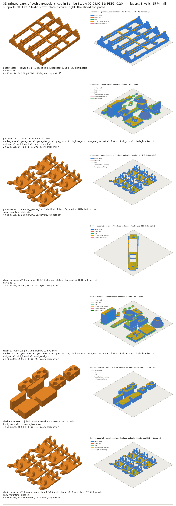
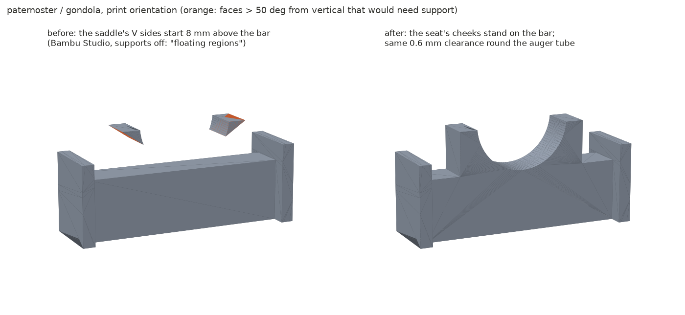
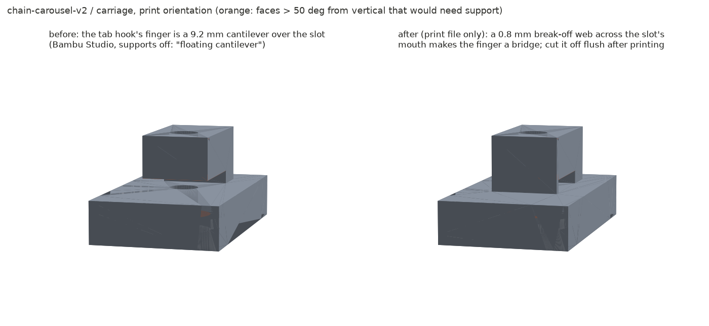
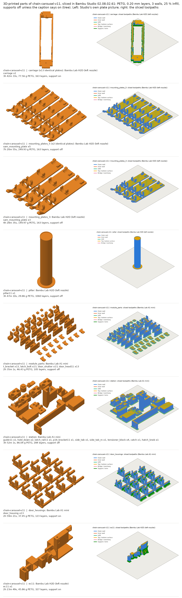

# Print files for the printed parts of both carousels (Bambu Studio)

Every 3D-printed part of [`cad/paternoster/`](../paternoster/) and [`cad/chain-carousel-v2/`](../chain-carousel-v2/), plus Sam's mounting plate (printed for the extra modules in both), oriented, laid out on plates and sliced with Bambu Studio's own CLI. Quantities are the BoMs' (counted from each design's `layout.placements()`).

[`cad/chain-carousel-v11/`](../chain-carousel-v11/) (PR #185) is sliced the same way in its own section: [chain-carousel-v11 (PR #185)](#chain-carousel-v11-pr-185).



## Re-running

```bash
# Bambu Studio for Linux (no login), extracted
curl -LO https://github.com/bambulab/BambuStudio/releases/download/v02.08.02.61/BambuStudio_ubuntu24.04-v02.08.02.61-20260820225108.AppImage
chmod +x BambuStudio_*.AppImage && ./BambuStudio_*.AppImage --appimage-extract    # -> squashfs-root/
sudo apt-get install -y xvfb libosmesa6 libosmesa6-dev weston libwebkit2gtk-4.1-0 libgstreamer-plugins-base1.0-0 gstreamer1.0-plugins-good
pip install trimesh shapely rtree                 # audit.py's sections (cadquery for export_printed.py)
# optional, for Studio's plate pictures: a headless Wayland display for its OSMesa renderer (glxshim.c is built by slice.py)
export XDG_RUNTIME_DIR=/tmp/xdg WAYLAND_DISPLAY=wayland-pd; mkdir -p -m 700 $XDG_RUNTIME_DIR
weston --backend=headless --socket=$WAYLAND_DISPLAY --idle-time=0 &

python export_printed.py                         # STLs from each design's layout.shape() -> <design>/stl/, parts.json
python slice.py --bambu squashfs-root --parts     # plates -> <design>/plates/, slice_report.json; --parts: audit.json
python previews.py                               # toolpath pictures and plates.png
python before_after.py                           # <design>/changes/*_before_after.png
python report.py                                 # this README

# chain-carousel-v11 (PR #185): its own STLs, plates, audit and overview picture
python export_printed.py chain-carousel-v11
python slice.py --bambu squashfs-root --design chain-carousel-v11 --parts
python previews.py chain-carousel-v11              # -> chain-carousel-v11/plates.png
python report.py
```

| File | What it does |
|---|---|
| [`export_printed.py`](export_printed.py) | exports each printed part's STL in its CAD frame from the design's own builders (does not run build.py); the v2 carriage is exported with its print-only break-off webs |
| [`slice.py`](slice.py) | flattens Bambu's system presets (`flatten_bambu_profiles.py`, this repo's script from the `copilot/programmatic-access-bambu-h2d` branch), turns each part into its print orientation (`ORIENT`, with the reason), packs the plates, runs the Studio CLI once per plate, and parses time, grams, layers and Studio's warnings |
| [`audit.py`](audit.py) | mesh checks in print orientation: overhang faces > 50 deg from vertical, layer-by-layer floating islands and unsupported area, walls under two line widths, first-layer area |
| [`glxshim.c`](glxshim.c) | lets Studio's CLI render on an OSMesa context under Wayland (fakes the GLX calls its GLEW makes) |
| [`previews.py`](previews.py) | draws each plate's extrusion moves from the G-code in its .gcode.3mf, coloured by feature (arcs included: Studio's arc fitting writes circles as G2/G3) |
| [`chain-carousel-v11/print_variants.py`](chain-carousel-v11/print_variants.py) | v11's printed forms that differ from its assembly shapes (the carriage with its break-off webs, the latch carrier without its steel dowel, the side hatch's knob off its acrylic door), built from v11's own builders |
| [`check_changes.py`](check_changes.py) | intersects the material a change added with every neighbouring instance at the home pose |
| [`before_after.py`](before_after.py) | close-ups of the changed parts before and after, in print orientation |

## Settings

Bambu Studio 02.08.02.61 (Linux AppImage, CLI only; nobody logged in). PETG, Bambu's system presets:

| Printer | Machine | Process | Filament | Area used |
|---|---|---|---|---|
| H2D | Bambu Lab H2D 0.4 nozzle | 0.20mm Standard @BBL H2D | Bambu PETG Basic @BBL H2D 0.4 nozzle | left nozzle, x 0-325, y 0-320 |
| A1 mini | Bambu Lab A1 mini 0.4 nozzle | 0.20mm Standard @BBL A1M | Bambu PETG Basic @BBL A1M 0.4 nozzle | 180 x 180 |

On top of the presets: 3 walls and 25% sparse infill (functional parts), Textured PEI Plate, supports off (every plate slices clean without them). The H2D slices use the repo's recipe from `a1_mini_slice_and_send.py`: the filament loaded once per tool, `--filament-map-mode Manual --filament-map 1,2 --slice 1`. All parts are on filament 1, the left nozzle, which reaches x 0-325 (the right one x 25-350), so the H2D plates are laid out in 325 x 320. Each plate is its own run and its own `.gcode.3mf` (all under 3 MB, so all are kept).

## Plates

### paternoster

| Plate | Printer | Parts (quantity) | Time | PETG | Layers | Files |
|---|---|---|---|---|---|---|
| gondolas_1 | Bambu Lab H2D (left nozzle) | gondola x4 | 8 h 45 min | 340.88 g | 275 | [3mf](paternoster/plates/gondolas_1.gcode.3mf) [Studio](paternoster/plates/gondolas_1.png) [toolpaths](paternoster/plates/gondolas_1_toolpath.png) |
| gondolas_2 | Bambu Lab H2D (left nozzle) | gondola x4 | 8 h 45 min | 340.88 g | 275 | [3mf](paternoster/plates/gondolas_2.gcode.3mf) [Studio](paternoster/plates/gondolas_2.png) [toolpaths](paternoster/plates/gondolas_2_toolpath.png) |
| gondolas_3 | Bambu Lab H2D (left nozzle) | gondola x4 | 8 h 46 min | 340.88 g | 275 | [3mf](paternoster/plates/gondolas_3.gcode.3mf) [Studio](paternoster/plates/gondolas_3.png) [toolpaths](paternoster/plates/gondolas_3_toolpath.png) |
| station | Bambu Lab A1 mini | uyoke_base x1, yoke_stop x1, yoke_stop_m x1, pin_boss x1, pin_boss_m x1, magnet_bracket x1, fork x1, fork_arm x1, clevis_bracket x1, vial_cup x1, vial_funnel x1, hold_bracket x4 | 2 h 21 min | 64.71 g | 195 | [3mf](paternoster/plates/station.gcode.3mf) [toolpaths](paternoster/plates/station_toolpath.png) |
| mounting_plates_1 | Bambu Lab H2D (left nozzle) | sam_mounting_plate x6 | 4 h 55 min | 131.36 g | 163 | [3mf](paternoster/plates/mounting_plates_1.gcode.3mf) [Studio](paternoster/plates/mounting_plates_1.png) [toolpaths](paternoster/plates/mounting_plates_1_toolpath.png) |
| mounting_plates_2 | Bambu Lab H2D (left nozzle) | sam_mounting_plate x6 | 4 h 55 min | 131.35 g | 163 | [3mf](paternoster/plates/mounting_plates_2.gcode.3mf) [Studio](paternoster/plates/mounting_plates_2.png) [toolpaths](paternoster/plates/mounting_plates_2_toolpath.png) |

Totals: Bambu Lab H2D (left nozzle): 5 plates, 36 h 06 min, 1285 g; Bambu Lab A1 mini: 1 plate, 2 h 21 min, 65 g; all: 38.5 h of printing, 1350 g of PETG.

The station plates (A1 mini) get a 3 mm outer brim for the small parts; everything else prints without brim or support.

### chain-carousel-v2

| Plate | Printer | Parts (quantity) | Time | PETG | Layers | Files |
|---|---|---|---|---|---|---|
| carriage_01 | Bambu Lab H2D (left nozzle) | carriage x1 | 1 h 52 min | 58.57 g | 145 | [3mf](chain-carousel-v2/plates/carriage_01.gcode.3mf) [toolpaths](chain-carousel-v2/plates/carriage_01_toolpath.png) |
| carriage_02 | Bambu Lab H2D (left nozzle) | carriage x1 | 1 h 52 min | 58.57 g | 145 | [3mf](chain-carousel-v2/plates/carriage_02.gcode.3mf) [toolpaths](chain-carousel-v2/plates/carriage_02_toolpath.png) |
| carriage_03 | Bambu Lab H2D (left nozzle) | carriage x1 | 1 h 52 min | 58.57 g | 145 | [3mf](chain-carousel-v2/plates/carriage_03.gcode.3mf) [toolpaths](chain-carousel-v2/plates/carriage_03_toolpath.png) |
| carriage_04 | Bambu Lab H2D (left nozzle) | carriage x1 | 1 h 53 min | 58.57 g | 145 | [3mf](chain-carousel-v2/plates/carriage_04.gcode.3mf) [toolpaths](chain-carousel-v2/plates/carriage_04_toolpath.png) |
| carriage_05 | Bambu Lab H2D (left nozzle) | carriage x1 | 1 h 53 min | 58.57 g | 145 | [3mf](chain-carousel-v2/plates/carriage_05.gcode.3mf) [toolpaths](chain-carousel-v2/plates/carriage_05_toolpath.png) |
| carriage_06 | Bambu Lab H2D (left nozzle) | carriage x1 | 1 h 52 min | 58.57 g | 145 | [3mf](chain-carousel-v2/plates/carriage_06.gcode.3mf) [toolpaths](chain-carousel-v2/plates/carriage_06_toolpath.png) |
| carriage_07 | Bambu Lab H2D (left nozzle) | carriage x1 | 1 h 53 min | 58.57 g | 145 | [3mf](chain-carousel-v2/plates/carriage_07.gcode.3mf) [toolpaths](chain-carousel-v2/plates/carriage_07_toolpath.png) |
| carriage_08 | Bambu Lab H2D (left nozzle) | carriage x1 | 1 h 52 min | 58.57 g | 145 | [3mf](chain-carousel-v2/plates/carriage_08.gcode.3mf) [toolpaths](chain-carousel-v2/plates/carriage_08_toolpath.png) |
| carriage_09 | Bambu Lab H2D (left nozzle) | carriage x1 | 1 h 53 min | 58.57 g | 145 | [3mf](chain-carousel-v2/plates/carriage_09.gcode.3mf) [toolpaths](chain-carousel-v2/plates/carriage_09_toolpath.png) |
| carriage_10 | Bambu Lab H2D (left nozzle) | carriage x1 | 1 h 52 min | 58.57 g | 145 | [3mf](chain-carousel-v2/plates/carriage_10.gcode.3mf) [toolpaths](chain-carousel-v2/plates/carriage_10_toolpath.png) |
| carriage_11 | Bambu Lab H2D (left nozzle) | carriage x1 | 1 h 53 min | 58.57 g | 145 | [3mf](chain-carousel-v2/plates/carriage_11.gcode.3mf) [toolpaths](chain-carousel-v2/plates/carriage_11_toolpath.png) |
| carriage_12 | Bambu Lab H2D (left nozzle) | carriage x1 | 1 h 53 min | 58.57 g | 145 | [3mf](chain-carousel-v2/plates/carriage_12.gcode.3mf) [toolpaths](chain-carousel-v2/plates/carriage_12_toolpath.png) |
| carriage_13 | Bambu Lab H2D (left nozzle) | carriage x1 | 1 h 52 min | 58.57 g | 145 | [3mf](chain-carousel-v2/plates/carriage_13.gcode.3mf) [toolpaths](chain-carousel-v2/plates/carriage_13_toolpath.png) |
| station | Bambu Lab A1 mini | uyoke_base x1, yoke_stop x1, yoke_stop_m x1, pin_boss x1, pin_boss_m x1, magnet_bracket x1, fork x1, fork_arm x1, clevis_bracket x1, vial_cup x1, vial_funnel x1, level_wedge x1 | 2 h 21 min | 65.03 g | 195 | [3mf](chain-carousel-v2/plates/station.gcode.3mf) [toolpaths](chain-carousel-v2/plates/station_toolpath.png) |
| hold_downs_tensioners | Bambu Lab A1 mini | hold_down x2, tensioner_block x4 | 2 h 00 min | 46.51 g | 115 | [3mf](chain-carousel-v2/plates/hold_downs_tensioners.gcode.3mf) [Studio](chain-carousel-v2/plates/hold_downs_tensioners.png) [toolpaths](chain-carousel-v2/plates/hold_downs_tensioners_toolpath.png) |
| mounting_plates_1 | Bambu Lab H2D (left nozzle) | sam_mounting_plate x6 | 4 h 55 min | 131.44 g | 163 | [3mf](chain-carousel-v2/plates/mounting_plates_1.gcode.3mf) [Studio](chain-carousel-v2/plates/mounting_plates_1.png) [toolpaths](chain-carousel-v2/plates/mounting_plates_1_toolpath.png) |
| mounting_plates_2 | Bambu Lab H2D (left nozzle) | sam_mounting_plate x6 | 4 h 55 min | 131.44 g | 163 | [3mf](chain-carousel-v2/plates/mounting_plates_2.gcode.3mf) [Studio](chain-carousel-v2/plates/mounting_plates_2.png) [toolpaths](chain-carousel-v2/plates/mounting_plates_2_toolpath.png) |

Totals: Bambu Lab H2D (left nozzle): 15 plates, 34 h 13 min, 1024 g; Bambu Lab A1 mini: 2 plates, 4 h 21 min, 112 g; all: 38.6 h of printing, 1136 g of PETG.

The station plates (A1 mini) get a 3 mm outer brim for the small parts; everything else prints without brim or support.

## Printability audit

Per part, in print orientation, from `audit.py` (mesh) and from slicing the part alone with supports off. Overhang: downward faces more than 50 deg from vertical, not on the bed (bridges and hole roofs included). Floating islands: regions with nothing under them in the layer below. Thin: layers with a region under 0.84 mm (two 0.42 mm lines) wide.

### paternoster

| Part | Qty | Orientation | On the bed (mm) | First layer | Overhang > 50 deg | Floating islands | Thin layers | Studio, supports off | Alone | Notes |
|---|---|---|---|---|---|---|---|---|---|---|
| gondola | 12 | as it hangs: end plates, rails, ribs, lugs and saddle all stand on the bed; pivot and insert holes horizontal (small) | 312.3 x 62 x 55 | 4117.6 mm2 | 881.0 mm2 | 0 | 0 | no warnings | 2h 30m 32s, 85.25 g | As it hangs. 312.3 mm long: fits the left nozzle's 325 mm with 6 mm to spare each side, 4 per plate (4118 mm2 on the bed each, no brim needed). CHANGED: the saddle's V cheeks started 8 mm up in mid-air (Studio: floating regions); now they stand on the bar. Remaining unsupported areas are bridges: floor strips between rib and rail, the INDEX magnet pocket's roof (open to the bed), the 7.0 mm bushing bores and the 6.4 mm M5 heat-set insert holes in the hinge lugs (horizontal; 3.8 mm of wall round the inserts). |
| uyoke_base | 1 | +180 deg about x: crossbar's top face on the bed, guide tongue up: socket opens upward, no support in it | 30 x 39 x 39 | 780.0 mm2 | 353.4 mm2 | 0 | 0 | no warnings | 53m 46s, 10.8 g | The lead's P16 version (9.3 x 3.1 counterbore, 9.3 x 6.3 x 7.2 slot, 3.96 mm press hole for the 4 x 38 dowel). Upside down (crossbar's top face on the bed): counterbore and slot open upward. The 30 mm tongue overhangs the 20 mm crossbar by 5 mm each side at the top: two 5 x 6 mm flat ledges, which Studio prints without a warning (not a mating face). Dowel hole and the two 4.0 mm arm holes horizontal; ream the dowel hole if the press is too hard. |
| yoke_stop | 1 | +90 deg about x: flat, 6 x 4 mm on the bed, 1.3 mm tall | 6 x 4 x 1.3 | 24.0 mm2 | 0.0 mm2 | 0 | 0 | no warnings | 7m 7s, 0.1 g | 6 x 4 x 1.3 mm: only 24 mm2 on the bed, hence the station plate's 3 mm brim (Studio's auto brim adds none). Bonded to the steel arm. |
| yoke_stop_m | 1 | +90 deg about x: flat, 6 x 4 mm on the bed, 1.3 mm tall | 6 x 4 x 1.3 | 24.0 mm2 | 0.0 mm2 | 0 | 0 | no warnings | 7m 7s, 0.1 g | As yoke_stop (mirror image). |
| pin_boss | 1 | +90 deg about x: flat: the 1.5 mm plate on the bed, pin hole vertical | 22 x 16 x 1.5 | 148.7 mm2 | 0.0 mm2 | 0 | 0 | no warnings | 7m 59s, 0.31 g | 1.5 mm plate flat on the bed. The 4.0 mm hole takes a pressed 4 mm steel pin: printed holes come out 0.1-0.2 mm small, so ream to 4.0 if the press is too hard. |
| pin_boss_m | 1 | +90 deg about x: flat: the 1.5 mm plate on the bed, pin hole vertical | 22 x 16 x 1.5 | 148.7 mm2 | 0.0 mm2 | 0 | 0 | no warnings | 7m 59s, 0.31 g | As pin_boss (mirror image). |
| magnet_bracket | 1 | as drawn: foot, arms and cup floor on the bed, magnet pocket opens upward | 38.2 x 36 x 18.1 | 888.7 mm2 | 83.7 mm2 | 0 | 0 | no warnings | 32m 6s, 9.18 g | As drawn; magnet cup opens upward. The M2.5 clearance holes (2.8 mm) in the 3 mm foot are horizontal. |
| fork | 1 | as drawn: slot and lead-in vertical, no overhangs | 50 x 19 x 36 | 745.4 mm2 | 0.0 mm2 | 0 | 0 | no warnings | 50m 31s, 15.95 g | Slot and lead-in vertical: no overhangs. No fastener holes are modelled (to the fork arm / post). |
| fork_arm | 1 | +90 deg about x: flat, largest face on the bed | 20 x 12 x 5.5 | 240.0 mm2 | 0.0 mm2 | 0 | 0 | no warnings | 12m 17s, 1.06 g | Plain 20 x 5.5 x 12 block (layout._fork_arm), flat. No fastener holes are modelled. |
| clevis_bracket | 1 | as drawn: foot on the bed, cheeks up; pin hole horizontal (5 mm, prints without support) | 44 x 40 x 16.6 | 1712.5 mm2 | 22.2 mm2 | 0 | 0 | no warnings | 28m 47s, 7.2 g | The lead's P16 version (CLEVIS_GAP 8.4, R4 cheeks, web). Foot on the bed; 3.7 mm cheeks, 4.15 mm pin hole horizontal with 1.9 mm of wall (ream to 4.2 for the 4 mm shoulder screw); two 5.5 mm foot holes vertical. |
| vial_cup | 1 | as drawn: cup floor and arm on the bed | 69 x 34 x 18 | 1357.2 mm2 | 0.0 mm2 | 0 | 0 | no warnings | 29m 36s, 8.18 g | As drawn: cup and arm on the bed, no overhangs. |
| vial_funnel | 1 | +180 deg about x: mouth on the bed: cone narrows upward (24 deg from vertical), largest first layer | 35.6 x 39.2 x 22 | 155.7 mm2 | 0.0 mm2 | 0 | 10 | no warnings | 30m 1s, 3.54 g | Mouth on the bed: the 1.6 mm cone wall (3-4 lines) leans in 24 deg from vertical, so no support. |
| hold_bracket | 4 | as drawn, 28 x 12 on the bed | 28 x 12 x 9 | 336.0 mm2 | 0.0 mm2 | 0 | 0 | no warnings | 16m 21s, 2.06 g | Plain 28 x 12 x 9 block (parts.hold_down_bracket). No holes are modelled for the M4 screws the UHMW strip is drilled for, or for the side plate. |
| sam_mounting_plate | 12 | as drawn (Sam's part): base on the bed | 103.8 x 54 x 32.6 | 3260.9 mm2 | 1007.1 mm2 | 0 | 0 | no warnings | 1h 11m 14s, 21.74 g | Sam's Onshape part plus our cuts, underside on the bed: the two M3 heat-set insert holes (4.0 mm, 4.0/4.5 mm deep) open to the bed with 2.8 mm of wall round them and 6.4 mm of plate above; the 4.2 mm locating-pin hole and 4.2 x 6 slot also open to the bed. Hinge knuckle holes horizontal. |

### chain-carousel-v2

| Part | Qty | Orientation | On the bed (mm) | First layer | Overhang > 50 deg | Floating islands | Thin layers | Studio, supports off | Alone | Notes |
|---|---|---|---|---|---|---|---|---|---|---|
| carriage | 13 | +90 deg about x: plate's outer face on the bed, ribs, lugs, hooks and snap arms up; on the H2D bed's diagonal (351 mm > 325) | 60 x 351 x 29 | 11895.8 mm2 | 194.3 mm2 | 0 | 8 | no warnings | 1h 52m 37s, 58.62 g | Plate's outer face on the bed (11 900 mm2 first layer), on the H2D bed's diagonal: 351 x 60 mm needs (351 + 60) / sqrt 2 = 291 mm in each direction of the left nozzle's 325 x 320 area. One per plate. CHANGED (print file only): the two tab-hook fingers were 9.2 mm cantilevers over the 1.55 mm tab slot (Studio: floating cantilever); the print file has a 0.8 mm break-off web across each slot's mouth that makes them bridges. Cut both webs off flush before fitting the carriage to the tabs. Remaining: 5.15 mm hinge-pin holes horizontal, 0.8 mm snap-hook lips (35 deg), counterbores open to the bed. |
| hold_down | 2 | as drawn: side-plate face on the bed: foot, web and lip stack without overhang; insert holes vertical | 40 x 42 x 23 | 1573.6 mm2 | 99.6 mm2 | 0 | 16 | no warnings | 40m 48s, 14.24 g | Side-plate face on the bed: foot, web and lip stack with no overhang; M5 heat-set insert holes (6.4 mm) open to the bed with 4.8 mm of wall. The hall switch looks through a 0.8 mm window on purpose (prints as two thin lines). |
| tensioner_block | 4 | as drawn: back face on the bed: screw holes and nut slot vertical, jack-screw hole horizontal | 30 x 18 x 14 | 489.1 mm2 | 46.6 mm2 | 0 | 0 | no warnings | 26m 7s, 4.6 g | Back face on the bed: M5 screw holes and the locknut slot vertical, the 5.5 mm jack-screw hole horizontal. |
| uyoke_base | 1 | +180 deg about x: crossbar's top face on the bed, guide tongue up: socket opens upward, no support in it | 30 x 39 x 39 | 780.0 mm2 | 353.4 mm2 | 0 | 0 | no warnings | 53m 46s, 10.8 g | The lead's P16 version (9.3 x 3.1 counterbore, 9.3 x 6.3 x 7.2 slot, 3.96 mm press hole for the 4 x 38 dowel). Upside down (crossbar's top face on the bed): counterbore and slot open upward. The 30 mm tongue overhangs the 20 mm crossbar by 5 mm each side at the top: two 5 x 6 mm flat ledges, which Studio prints without a warning (not a mating face). Dowel hole and the two 4.0 mm arm holes horizontal; ream the dowel hole if the press is too hard. |
| magnet_bracket | 1 | as drawn: foot, arms and cup floor on the bed, magnet pocket opens upward | 38.2 x 36 x 18.1 | 888.7 mm2 | 83.7 mm2 | 0 | 0 | no warnings | 32m 6s, 9.18 g | As drawn; magnet cup opens upward. The M2.5 clearance holes (2.8 mm) in the 3 mm foot are horizontal. |
| clevis_bracket | 1 | as drawn: foot on the bed, cheeks up; pin hole horizontal (5 mm, prints without support) | 44 x 40 x 15.1 | 1712.5 mm2 | 22.2 mm2 | 0 | 0 | no warnings | 27m 14s, 7.1 g | The lead's P16 version (CLEVIS_GAP 8.4, R4 cheeks, web). Foot on the bed; 3.7 mm cheeks, 4.15 mm pin hole horizontal with 1.9 mm of wall (ream to 4.2 for the 4 mm shoulder screw); two 5.5 mm foot holes vertical. |
| fork | 1 | as drawn: slot and lead-in vertical, no overhangs | 50 x 19 x 36 | 745.4 mm2 | 0.0 mm2 | 0 | 0 | no warnings | 50m 31s, 15.95 g | Slot and lead-in vertical: no overhangs. No fastener holes are modelled (to the fork arm / post). |
| fork_arm | 1 | as drawn: the 6 mm plate flat on the bed, M6 clearance and insert holes vertical | 20 x 29.5 x 6 | 555.8 mm2 | 0.0 mm2 | 0 | 0 | no warnings | 14m 45s, 2.62 g | Was 20 x 0.5 x 12 mm (under two line widths: the fork's side face sat 0.5 mm from the post); the lead redrew it (layout._fork_arm) as a 20 x 29.5 x 6 mm plate on the post's top: printed flat, 6.6 mm M6 clearance hole, two 4.0 mm insert holes with 2.5 mm of wall. |
| vial_cup | 1 | as drawn: cup floor and arm on the bed | 95 x 34 x 18 | 1687.4 mm2 | 0.0 mm2 | 0 | 0 | no warnings | 31m 6s, 9.05 g | The lead's version with the 63 mm arm for the 47 mm TAL221 (95 mm long overall). As drawn, no overhangs. |
| vial_funnel | 1 | +180 deg about x: mouth on the bed: cone narrows upward (24 deg from vertical), largest first layer | 35.6 x 39.2 x 22 | 155.7 mm2 | 0.0 mm2 | 0 | 10 | no warnings | 30m 1s, 3.54 g | Mouth on the bed: the 1.6 mm cone wall (3-4 lines) leans in 24 deg from vertical, so no support. |
| level_wedge | 1 | as drawn: flat | 40 x 40 x 6 | 1600.0 mm2 | 0.0 mm2 | 0 | 0 | no warnings | 17m 8s, 6.08 g | 40 x 40 x 6 block as modelled, flat. |
| pin_boss | 1 | +90 deg about x: flat: the 1.5 mm plate on the bed, pin hole vertical | 22 x 16 x 1.5 | 148.7 mm2 | 0.0 mm2 | 0 | 0 | no warnings | 7m 59s, 0.31 g | 1.5 mm plate flat on the bed. The 4.0 mm hole takes a pressed 4 mm steel pin: printed holes come out 0.1-0.2 mm small, so ream to 4.0 if the press is too hard. |
| pin_boss_m | 1 | +90 deg about x: flat: the 1.5 mm plate on the bed, pin hole vertical | 22 x 16 x 1.5 | 148.7 mm2 | 0.0 mm2 | 0 | 0 | no warnings | 7m 59s, 0.31 g | As pin_boss (mirror image). |
| yoke_stop | 1 | +90 deg about x: flat, 6 x 4 mm on the bed, 1.3 mm tall | 6 x 4 x 1.3 | 24.0 mm2 | 0.0 mm2 | 0 | 0 | no warnings | 7m 7s, 0.1 g | 6 x 4 x 1.3 mm: only 24 mm2 on the bed, hence the station plate's 3 mm brim (Studio's auto brim adds none). Bonded to the steel arm. |
| yoke_stop_m | 1 | +90 deg about x: flat, 6 x 4 mm on the bed, 1.3 mm tall | 6 x 4 x 1.3 | 24.0 mm2 | 0.0 mm2 | 0 | 0 | no warnings | 7m 7s, 0.1 g | As yoke_stop (mirror image). |
| sam_mounting_plate | 12 | as drawn (Sam's part): base on the bed | 103.8 x 54 x 32.6 | 3260.9 mm2 | 1007.1 mm2 | 0 | 0 | no warnings | 1h 11m 18s, 21.76 g | Sam's Onshape part plus our cuts, underside on the bed: the two M3 heat-set insert holes (4.0 mm, 4.0/4.5 mm deep) open to the bed with 2.8 mm of wall round them and 6.4 mm of plate above; the 4.2 mm locating-pin hole and 4.2 x 6 slot also open to the bed. Hinge knuckle holes horizontal. |

## Changes made for printability

1. **paternoster `gondola()`** (`cad/paternoster/parts.py`, saddle under the auger): the seat was a V-shaped prism standing on its apex, cut by the 13.1 mm tube clearance, which left two cheeks at |y| 12.2-18 whose undersides started 8 mm above the cross bar. Studio (supports off): "floating regions". The seat is now a 36 x 12 mm block on the bar minus the same R 13.1 tube cut, so the cheeks stand on the bar: same 0.6 mm clearance round the tube, same top and width, +1.7 cm3. The added material is under the old cheeks, inside the gondola's own outline; `check_changes.py` (added material against the neighbouring instances) did not finish on the loaded runner, so the clearance rests on the full interference check.

   

2. **chain-carousel-v2 `tab_hook()` / `carriage()`** (`cad/chain-carousel-v2/parts.py`): new `print_web=False` argument. Printed plate-down (the only orientation without big overhangs: on edge it has six floating islands and 3800 mm2 of overhang), each tab hook's finger is a 9.2 mm cantilever from its spine over the 1.55 mm tab slot; Studio: "floating cantilever". With `print_web=True` a 0.8 mm web closes the slot's -u mouth so the finger prints as a bridge; cut it off flush after printing. The assembly (`layout.shape('carriage')`, build.py's stl/, the interference checks) is drawn without it, so nothing that mates with the carriage changed; `export_printed.py` exports the print variant.

   

## Open points (not changed)

* No fastener holes are modelled in paternoster's `hold_bracket` and `fork_arm`, or in either design's `fork`.
* Press and pin holes (4.0 mm stub pin, 4.15 mm clevis pin, 7.0 mm bushings) are drawn at nominal size; printed holes run 0.1-0.2 mm small, so plan to ream. Studio's circle compensation is off (stock).

## chain-carousel-v11 (PR #185)

Every printed part of [`cad/chain-carousel-v11/`](../chain-carousel-v11/) (its `bom.py`'s "Printed" lines: items 36-39, 77, 83, 86, 93, 106 and 117), exported from v11's own builders by `export_printed.py`: the same solids as v11's `stl/`, volume for volume (the carriage with its break-off webs and the latch bolt's carrier as v11's `build.py` exports them, built here by [`chain-carousel-v11/print_variants.py`](chain-carousel-v11/print_variants.py)), plus the side hatch's knob, which v11 draws as part of the acrylic door. They are oriented, laid out and sliced with the settings above. Quantities are v11's `layout.placements()` counts: 13 of every module part and all 13 mounting plates (BoM item 39: "Print all 13"). Identical plates are sliced once and printed as many times as the Prints column says.



**Status, 2026-11-27:** the first slicing of v11 found the electronics carriage (EC v11) and the outlet door housing in pieces, the T-bracket's head off its stem, the steel dowel printed as part of the latch carrier and the pillar twice the BoM's weight. All of these were fixed in v11's CAD the same day (items 1-4 and 6 below) and everything here is re-exported and re-sliced from the fixed CAD: every part is one solid and every plate is ready to print. Still open: the door shutter has no hole for its rod (item 5).

### Plates

| Plate | Printer | Parts (quantity) | Prints | Time (each) | PETG (each) | Layers | Support | Files |
|---|---|---|---|---|---|---|---|---|
| carriage | Bambu Lab H2D (left nozzle) | carriage x1 | 13 | 3 h 43 min | 77.56 g | 163 | tree, build plate only | [3mf](chain-carousel-v11/plates/carriage.gcode.3mf) [Studio](chain-carousel-v11/plates/carriage.png) [toolpaths](chain-carousel-v11/plates/carriage_toolpath.png) |
| mounting_plates_5 | Bambu Lab H2D (left nozzle) | sam_mounting_plate x5 | 2 | 7 h 21 min | 249.93 g | 163 | off | [3mf](chain-carousel-v11/plates/mounting_plates_5.gcode.3mf) [Studio](chain-carousel-v11/plates/mounting_plates_5.png) [toolpaths](chain-carousel-v11/plates/mounting_plates_5_toolpath.png) |
| mounting_plates_3 | Bambu Lab H2D (left nozzle) | sam_mounting_plate x3 | 1 | 4 h 29 min | 149.97 g | 163 | off | [3mf](chain-carousel-v11/plates/mounting_plates_3.gcode.3mf) [Studio](chain-carousel-v11/plates/mounting_plates_3.png) [toolpaths](chain-carousel-v11/plates/mounting_plates_3_toolpath.png) |
| pillar | Bambu Lab H2D (left nozzle) | pillar11 x1 | 1 | 3 h 47 min | 29.86 g | 1060 | off | [3mf](chain-carousel-v11/plates/pillar.gcode.3mf) [Studio](chain-carousel-v11/plates/pillar.png) [toolpaths](chain-carousel-v11/plates/pillar_toolpath.png) |
| module_parts | Bambu Lab A1 mini | t_bracket x13, latch_bolt x13, door_shutter x13, door_head11 x13 | 1 | 2 h 35 min | 46.43 g | 105 | off, 3 mm brim | [3mf](chain-carousel-v11/plates/module_parts.gcode.3mf) [Studio](chain-carousel-v11/plates/module_parts.png) [toolpaths](chain-carousel-v11/plates/module_parts_toolpath.png) |
| station | Bambu Lab A1 mini | guide11 x1, hold_down x2, latch_rail11 x1, p16_bracket11 x1, side_tab x1, side_tab_m x1, tensioner_block x4, catch x1, hatch_knob x1 | 1 | 3 h 52 min | 86.04 g | 284 | off, 3 mm brim | [3mf](chain-carousel-v11/plates/station.gcode.3mf) [Studio](chain-carousel-v11/plates/station.png) [toolpaths](chain-carousel-v11/plates/station_toolpath.png) |
| door_housings | Bambu Lab A1 mini | door_housing x13 | 1 | 2 h 59 min | 37.45 g | 123 | tree, build plate only | [3mf](chain-carousel-v11/plates/door_housings.gcode.3mf) [Studio](chain-carousel-v11/plates/door_housings.png) [toolpaths](chain-carousel-v11/plates/door_housings_toolpath.png) |
| ec11 | Bambu Lab H2D (left nozzle) | ec11 x1 | 1 | 2 h 24 min | 45.86 g | 327 | tree, build plate only | [3mf](chain-carousel-v11/plates/ec11.gcode.3mf) [Studio](chain-carousel-v11/plates/ec11.png) [toolpaths](chain-carousel-v11/plates/ec11_toolpath.png) |

Totals, Studio's estimates: Bambu Lab H2D (left nozzle): 18 prints, 73 h 35 min, 1734 g; Bambu Lab A1 mini: 3 prints, 9 h 26 min, 170 g; together 21 prints, 83.0 h of printing, 1904 g of PETG.

The carriage, EC and door-housing plates have tree supports (Studio 2.08 turns `tree(auto)` into organic trees), from the build plate only. The two A1 mini plates of small parts get the 3 mm outer brim (door heads: 34 mm2 on the bed each). Every H2D file uses filament 1 only, on one 0.4 mm nozzle (extruder 1, the left: `filament_map` 1,2), with no prime tower or wipe on the other nozzle (`filaments_used`, `nozzles` and `prime_tower_in_gcode` in [slice_report.json](chain-carousel-v11/slice_report.json), read from each file's slice_info.config and G-code). The carriage goes on the H2D bed's diagonal, one per plate.

### Printability audit

As for the other designs: `audit.py` on the mesh in print orientation, and each part sliced alone with supports off.

| Part | Qty | Orientation | On the bed (mm) | First layer | Overhang > 50 deg | Floating islands | Thin layers | Studio, supports off | Alone | Notes |
|---|---|---|---|---|---|---|---|---|---|---|
| carriage | 13 | -90 deg about x: inner face (the A-1 tabs' side) down: the two tab hooks' fingers on the bed, the plate 6.55 mm up on tree supports, ribs, hinge lugs and latch housing up; on the H2D bed's diagonal (391 mm > 325) | 66 x 391 x 32.5 | 156.2 mm2 | 9665.4 mm2 | 0 | 8 | It seems object carriage_1 has floating cantilever. Please re-orient the object or enable support generation. | 2h 5m 44s, 56.47 g | Since v10 neither face is flat: the hinge lugs (21 mm), the ribs (7 mm) and the latch housing stand on the outer face, the two tab hooks (6.55 mm) on the inner face. Inner face down, only the hooks' fingers touch the bed (156 mm2) and the plate's 9300 mm2 are 6.55 mm up: Studio, supports off: "floating cantilever". So it prints on tree supports from the build plate (none inside the 1.55 mm tab slots, which stand on the fingers): 77.6 g with them, 56.5 g without, about 21 g of support each. Outer face down would be worse (the plate 21 mm up on the lugs' rounded ends). On the H2D bed's diagonal: the 391 x 66 mm outline is 305 x 301 mm at 44.6 deg (the 40 mm tongues cut its corners), inside the left nozzle's 325 x 320 with about 10 mm to spare each side (toolpaths x 6-317, y 6-313). The file keeps the break-off webs across the tab slots' mouths (`print_web=True`, as v11's own stl/): cut them off flush. The support comes off the inner face, which seats on the A-1 tabs: sand any nubs flat. |
| sam_mounting_plate | 13 | as drawn (Sam's part plus v11's additions): underside on the bed | 257 x 54 x 32.6 | 10959.1 mm2 | 972.8 mm2 | 0 | 0 | no warnings | 1h 42m 11s, 50.01 g | Sam's plate with v11's additions (`parts11.plate_additions_v11`: carried on to the cap's end with clip 2, the cap saddle and the latch keeper, the door housing's inserts, the T-bracket's two M3 heat-set insert holes; no motor relief; since 2026-11-27 the door housing's M2 inserts at |y| 14.35 and the channel wall cut back to |y| 16.3 beside its arms), 257 mm long. Underside on the bed (10 959 mm2), no floating regions; 380 mm2 of bridges and hole roofs. Five per H2D plate (5 x 54 mm plus gaps: 302 of the 320 mm); all 13 are printed (BoM item 39). |
| t_bracket | 13 | +90 deg about x: on its side: the T's profile (foot, stem, head) flat on the bed, 16 mm tall; the head's bearing face is a wall and the stem's layers run along its pull | 32 x 9 x 16 | 103.7 mm2 | 17.7 mm2 | 0 | 0 | no warnings | 24m 19s, 2.21 g | One solid since v11's fix (item 3). On its side: the T's profile on the bed (104 mm2), 16 mm tall, so the head's underside, which rides on the rail's lips, is a wall, and the head pulls along the layers, not across them. The two M3 clearance holes (3.4 mm, 6 mm counterbores) are horizontal. |
| door_housing | 13 | as drawn: the cap's top face on the bed, rails and spring tower up; the mounting arms, 22 mm cantilevers off the rails 6.5 mm up, on tree supports | 26.6 x 32.5 x 24.5 | 115.0 mm2 | 186.6 mm2 | 0 | 0 | It seems object door_housing_1 has floating cantilever. Please re-orient the object or enable support generation. | 34m 7s, 2.4 g | One solid since v11's fix (item 2). As drawn: the cap's top face on the bed (115 mm2), rails and spring tower up; the two mounting arms leave the rails 6.5 mm up as 22 mm cantilevers (Studio, supports off: floating cantilever), so the housings print on tree supports under the arms. The shutter's grooves and the tower's channel open upward, so nothing grows inside them. |
| door_shutter | 13 | +90 deg about y: flat: its 11.5 x 14 face on the bed (as v11's stl/) | 11.5 x 14 x 3.3 | 116.9 mm2 | 0.0 mm2 | 0 | 0 | no warnings | 8m 32s, 0.3 g | Flat, no overhang. No hole is modelled for the 1.5 mm door rod, which the BoM says is pressed in (item 5, still open). |
| door_head11 | 13 | as drawn: flat, 6 x 6 on the bed, the rod's hole vertical | 6 x 6 x 2.5 | 33.7 mm2 | 0.0 mm2 | 0 | 0 | no warnings | 8m 34s, 0.17 g | 6 x 6 x 2.5 mm, flat, the rod's 1.5 mm hole vertical (printed holes run 0.1-0.2 mm small: a press fit, then glue as the BoM says). Only 34 mm2 on the bed: the module_parts plate's 3 mm brim holds it. |
| latch_bolt | 13 | +90 deg about y: on its back face: the dowel's bore opens upward (round, for the press fit), the shelf stands up as a fin, the follower's 3 mm hole horizontal | 12.1 x 8 x 21 | 96.8 mm2 | 25.3 mm2 | 0 | 0 | no warnings | 21m 6s, 1.03 g | The carrier and its rest shelf with the dowel's 4.0 mm hole, 2 mm deep (item 4: the builder fuses the dowel for the assembly; v11's build.py and `print_variants.latch_bolt` export this carrier). On its back face (97 mm2): the hole opens upward and prints round (press the dowel in; ream to 4.0 if too tight), the shelf is a 2 mm fin, the follower's 3.0 mm hole is horizontal, and the faces that slide in the latch housing are walls. |
| ec11 | 1 | +90 deg about x: on its -y side (the motor cheek and side bar on the bed): the rail's T-slot, the door ramp's lips and the P16's pin hole run vertical, so their working faces are walls; spine, collar and ramp over tree supports | 155.6 x 31.5 x 65.5 | 1594.8 mm2 | 2812.7 mm2 | 2 | 0 | It seems object ec11_1 has floating cantilever. Please re-orient the object or enable support generation. | 1h 52m 26s, 36.73 g | One solid since v11's fix (item 1). On its -y side: the motor cheek and the side bar on the bed (1595 mm2), so the rail's T-slot, the door ramp's lips and the P16's pin hole run vertical and the faces the T-brackets, door heads and pin ride on are walls, not supported ceilings. The door ramp's end and the solenoid collar start in mid-air, 5.5 and 8.7 mm over the bed (Studio, supports off: floating cantilever): tree supports from the build plate, none inside the T-slot. The motor plate's 22.4 mm hole lies on its side (its top arches over). |
| pillar11 | 1 | as drawn: the 60 mm foot on the bed, the tube up; the deck under the beaker's socket bridges the bore | 60 x 60 x 212 | 1674.6 mm2 | 1280.4 mm2 | 0 | 0 | no warnings | 3h 47m 10s, 29.86 g | 212 mm tall: H2D only (the A1 mini stops at 180). Its wall is two 0.42 mm lines since v11's fix (item 6: 0.85 mm, was 1.6). The deck under the beaker's socket bridges the tube's bore (1222 mm2 unsupported); Studio prints it without a warning. |
| p16_bracket11 | 1 | +180 deg about x: the flange (its bar face) on the bed, cheeks up, the 4.15 mm pin hole horizontal | 20.3 x 40 x 14 | 752.5 mm2 | 23.3 mm2 | 0 | 0 | no warnings | 23m 52s, 3.58 g | The flange's bar face on the bed (752 mm2), the cheeks up: the 4.15 mm pin hole (for the 4 mm shoulder screw; ream to 4.2) horizontal through the R6 bosses, the two 5.5 mm M5 holes vertical. |
| guide11 | 1 | -90 deg about y: on its side: its L-shaped profile (flange, plate, seat block) on the bed; the cone and funnel mouth horizontal (45 deg walls) | 110.9 x 42.3 x 22 | 724.3 mm2 | 30.7 mm2 | 0 | 0 | no warnings | 36m 48s, 12.48 g | Rebuilt from the EC's moved shoe (item 1): its seat now behind the arm. On its side: its L-shaped profile (flange, plate, seat block) on the bed (724 mm2), 22 mm tall; the seat's 90 deg cone and 45 deg funnel mouth lie on their side (45 deg walls, no support), the flange's two 5.5 mm M5 holes horizontal. Standing as drawn it would be 111 mm tall with 393 mm2 overhanging. |
| latch_rail11 | 1 | -90 deg about x: on its side: the cam's and the foot's +y ends on the bed, the cam's flat and ramps walls | 46 x 28 x 56.8 | 390.1 mm2 | 46.1 mm2 | 0 | 0 | no warnings | 1h 11m 15s, 12.86 g | On its side: the cam's and the foot's +y ends on the bed (390 mm2), 57 mm tall. The cam's flat and 30 deg ramps, which the follower rides, print as walls (0.2 mm steps along the ramps); the web and foot stand on the cam; the foot's two M5 holes horizontal. As drawn, the web and foot would hang 1650 mm2 over the bed. |
| hold_down | 2 | as drawn: side-plate face on the bed: foot, web and lip stack without overhang; insert holes vertical | 40 x 42 x 23 | 1573.6 mm2 | 99.6 mm2 | 0 | 16 | no warnings | 40m 48s, 14.24 g | Side-plate face on the bed: foot, web and lip stack with no overhang; M5 heat-set insert holes (6.4 mm) open to the bed with 4.8 mm of wall. The hall switch looks through a 0.8 mm window on purpose (prints as two thin lines). |
| tensioner_block | 4 | as drawn: back face on the bed: screw holes and nut slot vertical, jack-screw hole horizontal | 30 x 18 x 14 | 489.1 mm2 | 46.6 mm2 | 0 | 0 | no warnings | 26m 7s, 4.6 g | Back face on the bed: M5 screw holes and the locknut slot vertical, the 5.5 mm jack-screw hole horizontal. |
| side_tab | 1 | as drawn: the side-plate face on the bed, lip, foot and web stand on it (no overhang) | 22 x 28 x 21 | 564.0 mm2 | 0.0 mm2 | 0 | 0 | no warnings | 30m 55s, 3.48 g | As drawn: the side-plate face on the bed (564 mm2); lip, foot and web stand on it with no overhang; the two 5.5 mm clearance holes and their 9.2 mm counterbores vertical. |
| side_tab_m | 1 | as drawn: the side-plate face on the bed, lip, foot and web stand on it (no overhang) | 22 x 28 x 21 | 564.0 mm2 | 0.0 mm2 | 0 | 0 | no warnings | 30m 57s, 3.48 g | As side_tab (mirror image). |
| catch | 1 | +180 deg about x: the tab on the bed, the spacer up | 24 x 10 x 6.2 | 222.7 mm2 | 0.0 mm2 | 0 | 0 | no warnings | 13m 20s, 0.96 g | The 24 x 10 x 3 mm tab on the bed (223 mm2), the 10 mm spacer up; the M4 hole (4.2 mm) vertical. |
| hatch_knob | 1 | as drawn: the face bonded to the acrylic on the bed | 16 x 16 x 18 | 201.0 mm2 | 0.0 mm2 | 0 | 0 | no warnings | 25m 41s, 2.07 g | Cut out of `parts3.hatch_door`, which draws the knob as part of the acrylic door: a 16 x 14 mm cylinder with a 10 x 4 mm cap, its bonded face on the bed (201 mm2). |

Thin layers: the carriage's are its 0.8 mm break-off webs, the hold-down's its 0.8 mm hall window (both on purpose).

### What the slicing found in v11's CAD, and what was changed

Found by splitting each exported mesh into its connected bodies, measuring the gaps in the CAD (OCC distances) and slicing each part alone; the proposed fixes were built from v11's own functions in a scratch copy and checked for one solid and for overlaps with the parts round them. Items 1-4 and 6 were then made in v11's CAD on 2026-11-27, and everything above is re-exported and re-sliced from it; item 5 is still open.

1. **EC v11** (`parts11.ec_v11`, `params.py`), **fixed in v11.** It was five separate solids: the front (door ramp walls and roof, spine, solenoid collar, rail block: 17 860 mm3), the back (motor plate, cheeks, strap, arm, the P16's clevis: 25 869 mm3), the door ramp's two lips (393 mm3 each) and the guide shoe (490 mm3). The lips stopped 0.05 mm short of the channel's walls; the spine ran to x 93.5 and ended inside the motor plate's 22.4 mm hole, 1.6 mm from its edge, after running through the 24T pinion (652 mm3 at rest) and the NEMA 11's shaft; the shoe hung 1.0 mm off the arm (v11 had moved the arm to z -30 to -20 and left v10's shoe at -38 to -31), and `guide11`, built from its tip, put its seat block inside the arm (1759 mm3). `check_interference.py` skipped all three pairs ("ec11" with "pinion24", "nema11" and "guide11"). Now: `DOOR11_LIP_W` 2.2 -> 2.3; the spine stops at x 71.5, widens to |y| 19.5 over x 69.5-71.5, and two 4 x 4.5 mm bars at |y| 15.5-19.5 run beside the pinion to the cheeks (x 69.5-89.91); the shoe sits behind the arm (`SHOE11` = (133, 145, -24.5, -31.6), `SHOE11_Y` 36) on a bracket (`SHOE11_BRACKET`) with a riser onto the arm's far face, its nose a true 90 deg cone, and `guide11` follows its tip. One solid (45 068 mm3); EC-pinion 0, EC-guide 0, EC-NEMA 11 4.3 mm3 (the face it is bolted to). It still needs supports in every orientation; on its side, as printed here, two regions start in mid-air (the door ramp's end and the solenoid collar) and 2710 mm2 is unsupported.

2. **Door housing** (`parts4.door_housing_v4`, which `parts10.door_housing_v10` and v11 reuse), **fixed in v11.** It was five solids: the mounting arms (|y| 12.8-14.6) stood 0.3 mm off the rails (|y| <= 12.5), and each arm's 2.2 mm M2 hole (at |y| 13.7) was wider than the 1.8 mm arm, so it cut the arm in two. Now the arms run |y| 12.45-16.25 with the M2 holes at |y| 14.35 (`DOOR_M2_Y11`, 0.8 mm of wall each side); the mounting plate's M2 inserts moved to |y| 14.35 (`parts10.plate_additions_v10`) and its channel wall is cut back to |y| 16.3 over x 4.8-22 (`parts11.plate_additions_v11`). One solid (2161 mm3), clear of the plate. The arms are 22 mm cantilevers off the rails, so in every orientation something needs support; as drawn it is the arms' undersides, 6.5 mm up, and the housings print on tree supports.

3. **T-bracket** (`parts11.t_bracket_v11`), **fixed in v11.** Its stem started at `zu + 0.01` (z -23.99) and the head ended at `zu` (-24.00): the head was a separate solid 0.01 mm off the stem. Now `zu - 0.01`: one solid, and the print file is the CAD's part again (the earlier print variant is gone).

4. **Latch bolt** (`parts7.latch_bolt_v7`), **fixed in v11's `build.py`.** The builder returns the steel dowel fused to the printed carrier (`pin.union(blk)`, which the assembly wants), and `build.py` exported that as `stl/latch_bolt.stl`, so the dowel would have been printed in PETG with no hole for the real one. `build.py` now exports the carrier with the dowel's 4.0 mm hole, 2 mm deep; these files use the same carrier (`print_variants.latch_bolt`).

5. **Door shutter and rod** (`parts10.door_shutter_v10`, `parts11.door_rod_v11`), **still open: not fixed.** The shutter prints fine but can't take its rod. The 1.5 mm rod is "pressed into each shutter's boss" (BoM item 116), but no hole is modelled: the rod is drawn 1 mm into the shutter (z -5 to -4), and its axis (the spring's, x -2.85) is 0.35 mm inside the face of the 1.8 mm boss (x -3.2 to -1.4), which can't grow past the housing tower's channel (x -3.3). A 1.5 mm hole there breaks 0.4 mm out of the boss. Pressing the rod in needs a hole about 3 mm deep (`DOOR11_ROD_Z0` -4 -> -2) with 0.8 mm of boss round it, i.e. the boss 3.1 mm across on the rod's axis, so the tower's channel, the spring's axis and the cap's 1.8 mm hole have to be laid out again round it. (The rod also runs 0.3 mm into the tower's wall along its length, 2.6 mm3; the check skips ("door_rod11", "door_housing").)

6. **Beaker pillar** (`params.PILLAR11`), **fixed in v11.** Its 1.6 mm wall (3-4 lines) sliced to 53.6 g, not the BoM's "near 30 g" (item 117: "vase-mode walls (two 0.4 mm lines)"), and spiral vase mode can't print it: the deck and the beaker's socket need top layers, which vase mode doesn't print. Now `PILLAR11` = (40.0, 0.85), two 0.42 mm lines printed normally: 29.9 g, 3 h 47 min sliced.

7. **Carriage** (not a defect; unchanged): it prints, but only on supports, about 21 g and 1 h 37 min more per carriage (13 times). Printing it flat with no support would need a flat inner face, e.g. the two tab hooks made as separate printed clips held by the tab's M3 screw, which changes how the carriage slides onto the tabs; not proposed here.

## Not verified

* Nothing here has been printed. Times and grams are Studio's estimates.
* The plates use the H2D's left nozzle only; the bed type is assumed (Textured PEI) and must match the plate on the printer.
* The toolpath pictures are drawn from the G-code, not screenshots of Studio's Preview tab.
