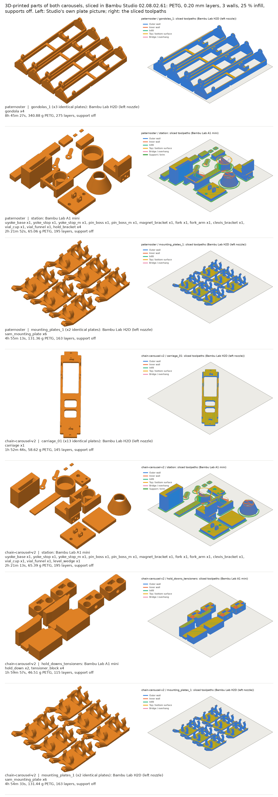
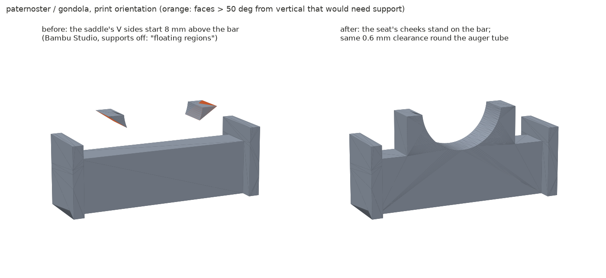
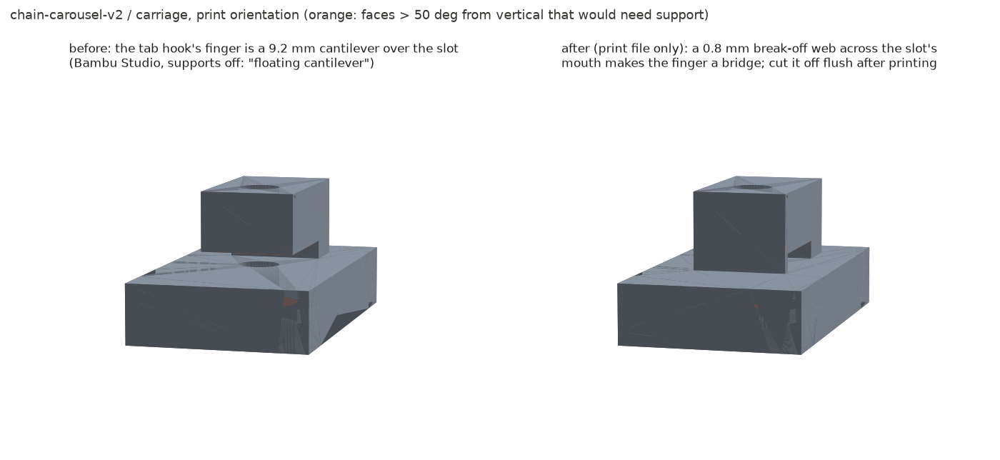

# Print files for the printed parts of both carousels (Bambu Studio)

Every 3D-printed part of [`cad/paternoster/`](../paternoster/) and [`cad/chain-carousel-v2/`](../chain-carousel-v2/), plus Sam's mounting plate (printed for the extra modules in both), oriented, laid out on plates and sliced with Bambu Studio's own CLI. Quantities are the BoMs' (counted from each design's `layout.placements()`).



## Re-running

```bash
# Bambu Studio for Linux (no login), extracted
curl -LO https://github.com/bambulab/BambuStudio/releases/download/v02.08.02.61/BambuStudio_ubuntu24.04-v02.08.02.61-20260820225108.AppImage
chmod +x BambuStudio_*.AppImage && ./BambuStudio_*.AppImage --appimage-extract    # -> squashfs-root/
sudo apt-get install -y xvfb libosmesa6 weston libwebkit2gtk-4.1-0 libgstreamer-plugins-base1.0-0 gstreamer1.0-plugins-good
# optional, for Studio's plate pictures: a headless Wayland display for its OSMesa renderer (glxshim.c is built by slice.py)
export XDG_RUNTIME_DIR=/tmp/xdg WAYLAND_DISPLAY=wayland-pd; mkdir -p -m 700 $XDG_RUNTIME_DIR
weston --backend=headless --socket=$WAYLAND_DISPLAY --idle-time=0 &

python export_printed.py                         # STLs from each design's layout.shape() -> <design>/stl/, parts.json
python slice.py --bambu squashfs-root --parts     # plates -> <design>/plates/, slice_report.json; --parts: audit.json
python previews.py                               # toolpath pictures and plates.png
python before_after.py                           # <design>/changes/*_before_after.png
python report.py                                 # this README
```

| File | What it does |
|---|---|
| [`export_printed.py`](export_printed.py) | exports each printed part's STL in its CAD frame from the design's own builders (does not run build.py); the v2 carriage is exported with its print-only break-off webs |
| [`slice.py`](slice.py) | flattens Bambu's system presets (`flatten_bambu_profiles.py`, this repo's script from the `copilot/programmatic-access-bambu-h2d` branch), turns each part into its print orientation (`ORIENT`, with the reason), packs the plates, runs the Studio CLI once per plate, and parses time, grams, layers and Studio's warnings |
| [`audit.py`](audit.py) | mesh checks in print orientation: overhang faces > 50 deg from vertical, layer-by-layer floating islands and unsupported area, walls under two line widths, first-layer area |
| [`glxshim.c`](glxshim.c) | lets Studio's CLI render on an OSMesa context under Wayland (fakes the GLX calls its GLEW makes) |
| [`previews.py`](previews.py) | draws each plate's extrusion moves from the G-code in its .gcode.3mf, coloured by feature |
| [`check_changes.py`](check_changes.py) | intersects the material a change added with every neighbouring instance at the home pose |
| [`before_after.py`](before_after.py) | close-ups of the changed parts before and after, in print orientation |

## Settings

Bambu Studio 02.08.02.61 (Linux AppImage, CLI only; nobody logged in). PETG, Bambu's system presets:

| Printer | Machine | Process | Filament | Area used |
|---|---|---|---|---|
| H2D | Bambu Lab H2D 0.4 nozzle | 0.20mm Standard @BBL H2D | Bambu PETG Basic @BBL H2D 0.4 nozzle | left nozzle, x 0-325, y 0-320 |
| A1 mini | Bambu Lab A1 mini 0.4 nozzle | 0.20mm Standard @BBL A1M | Bambu PETG Basic @BBL A1M 0.4 nozzle | 180 x 180 |

On top of the presets: 3 walls and 25% sparse infill (functional parts), Textured PEI Plate, supports off (every plate slices clean without them). The H2D slices use the repo's recipe from `a1_mini_slice_and_send.py`: the filament loaded once per tool, `--filament-map-mode Manual --filament-map 1,2 --slice 1`. All parts are on filament 1, the left nozzle, which reaches x 0-325 (the right one x 25-350), so the H2D plates are laid out in 325 x 320. Each plate is its own run and its own `.gcode.3mf` (all under 3 MB, so all are kept).

## Plates

### paternoster

| Plate | Printer | Parts (quantity) | Time | PETG | Layers | Files |
|---|---|---|---|---|---|---|
| gondolas_1 | Bambu Lab H2D (left nozzle) | gondola x4 | 8 h 45 min | 340.88 g | 275 | [3mf](paternoster/plates/gondolas_1.gcode.3mf) [Studio](paternoster/plates/gondolas_1.png) [toolpaths](paternoster/plates/gondolas_1_toolpath.png) |
| gondolas_2 | Bambu Lab H2D (left nozzle) | gondola x4 | 8 h 45 min | 340.88 g | 275 | [3mf](paternoster/plates/gondolas_2.gcode.3mf) [Studio](paternoster/plates/gondolas_2.png) [toolpaths](paternoster/plates/gondolas_2_toolpath.png) |
| gondolas_3 | Bambu Lab H2D (left nozzle) | gondola x4 | 8 h 46 min | 340.88 g | 275 | [3mf](paternoster/plates/gondolas_3.gcode.3mf) [Studio](paternoster/plates/gondolas_3.png) [toolpaths](paternoster/plates/gondolas_3_toolpath.png) |
| station | Bambu Lab A1 mini | uyoke_base x1, yoke_stop x1, yoke_stop_m x1, pin_boss x1, pin_boss_m x1, magnet_bracket x1, fork x1, fork_arm x1, clevis_bracket x1, vial_cup x1, vial_funnel x1, hold_bracket x4 | 2 h 22 min | 65.06 g | 195 | [3mf](paternoster/plates/station.gcode.3mf) [Studio](paternoster/plates/station.png) [toolpaths](paternoster/plates/station_toolpath.png) |
| mounting_plates_1 | Bambu Lab H2D (left nozzle) | sam_mounting_plate x6 | 4 h 55 min | 131.36 g | 163 | [3mf](paternoster/plates/mounting_plates_1.gcode.3mf) [Studio](paternoster/plates/mounting_plates_1.png) [toolpaths](paternoster/plates/mounting_plates_1_toolpath.png) |
| mounting_plates_2 | Bambu Lab H2D (left nozzle) | sam_mounting_plate x6 | 4 h 55 min | 131.35 g | 163 | [3mf](paternoster/plates/mounting_plates_2.gcode.3mf) [Studio](paternoster/plates/mounting_plates_2.png) [toolpaths](paternoster/plates/mounting_plates_2_toolpath.png) |

Totals: Bambu Lab H2D (left nozzle): 5 plates, 36 h 06 min, 1285 g; Bambu Lab A1 mini: 1 plate, 2 h 22 min, 65 g; all: 38.5 h of printing, 1350 g of PETG.

The station plates (A1 mini) get a 3 mm outer brim for the small parts; everything else prints without brim or support.

### chain-carousel-v2

| Plate | Printer | Parts (quantity) | Time | PETG | Layers | Files |
|---|---|---|---|---|---|---|
| carriage_01 | Bambu Lab H2D (left nozzle) | carriage x1 | 1 h 53 min | 58.62 g | 145 | [3mf](chain-carousel-v2/plates/carriage_01.gcode.3mf) [Studio](chain-carousel-v2/plates/carriage_01.png) [toolpaths](chain-carousel-v2/plates/carriage_01_toolpath.png) |
| carriage_02 | Bambu Lab H2D (left nozzle) | carriage x1 | 1 h 53 min | 58.62 g | 145 | [3mf](chain-carousel-v2/plates/carriage_02.gcode.3mf) [Studio](chain-carousel-v2/plates/carriage_02.png) [toolpaths](chain-carousel-v2/plates/carriage_02_toolpath.png) |
| carriage_03 | Bambu Lab H2D (left nozzle) | carriage x1 | 1 h 53 min | 58.62 g | 145 | [3mf](chain-carousel-v2/plates/carriage_03.gcode.3mf) [Studio](chain-carousel-v2/plates/carriage_03.png) [toolpaths](chain-carousel-v2/plates/carriage_03_toolpath.png) |
| carriage_04 | Bambu Lab H2D (left nozzle) | carriage x1 | 1 h 53 min | 58.62 g | 145 | [3mf](chain-carousel-v2/plates/carriage_04.gcode.3mf) [Studio](chain-carousel-v2/plates/carriage_04.png) [toolpaths](chain-carousel-v2/plates/carriage_04_toolpath.png) |
| carriage_05 | Bambu Lab H2D (left nozzle) | carriage x1 | 1 h 53 min | 58.62 g | 145 | [3mf](chain-carousel-v2/plates/carriage_05.gcode.3mf) [Studio](chain-carousel-v2/plates/carriage_05.png) [toolpaths](chain-carousel-v2/plates/carriage_05_toolpath.png) |
| carriage_06 | Bambu Lab H2D (left nozzle) | carriage x1 | 1 h 53 min | 58.62 g | 145 | [3mf](chain-carousel-v2/plates/carriage_06.gcode.3mf) [Studio](chain-carousel-v2/plates/carriage_06.png) [toolpaths](chain-carousel-v2/plates/carriage_06_toolpath.png) |
| carriage_07 | Bambu Lab H2D (left nozzle) | carriage x1 | 1 h 53 min | 58.62 g | 145 | [3mf](chain-carousel-v2/plates/carriage_07.gcode.3mf) [Studio](chain-carousel-v2/plates/carriage_07.png) [toolpaths](chain-carousel-v2/plates/carriage_07_toolpath.png) |
| carriage_08 | Bambu Lab H2D (left nozzle) | carriage x1 | 1 h 53 min | 58.62 g | 145 | [3mf](chain-carousel-v2/plates/carriage_08.gcode.3mf) [Studio](chain-carousel-v2/plates/carriage_08.png) [toolpaths](chain-carousel-v2/plates/carriage_08_toolpath.png) |
| carriage_09 | Bambu Lab H2D (left nozzle) | carriage x1 | 1 h 53 min | 58.62 g | 145 | [3mf](chain-carousel-v2/plates/carriage_09.gcode.3mf) [Studio](chain-carousel-v2/plates/carriage_09.png) [toolpaths](chain-carousel-v2/plates/carriage_09_toolpath.png) |
| carriage_10 | Bambu Lab H2D (left nozzle) | carriage x1 | 1 h 53 min | 58.62 g | 145 | [3mf](chain-carousel-v2/plates/carriage_10.gcode.3mf) [Studio](chain-carousel-v2/plates/carriage_10.png) [toolpaths](chain-carousel-v2/plates/carriage_10_toolpath.png) |
| carriage_11 | Bambu Lab H2D (left nozzle) | carriage x1 | 1 h 53 min | 58.62 g | 145 | [3mf](chain-carousel-v2/plates/carriage_11.gcode.3mf) [Studio](chain-carousel-v2/plates/carriage_11.png) [toolpaths](chain-carousel-v2/plates/carriage_11_toolpath.png) |
| carriage_12 | Bambu Lab H2D (left nozzle) | carriage x1 | 1 h 53 min | 58.62 g | 145 | [3mf](chain-carousel-v2/plates/carriage_12.gcode.3mf) [Studio](chain-carousel-v2/plates/carriage_12.png) [toolpaths](chain-carousel-v2/plates/carriage_12_toolpath.png) |
| carriage_13 | Bambu Lab H2D (left nozzle) | carriage x1 | 1 h 53 min | 58.62 g | 145 | [3mf](chain-carousel-v2/plates/carriage_13.gcode.3mf) [Studio](chain-carousel-v2/plates/carriage_13.png) [toolpaths](chain-carousel-v2/plates/carriage_13_toolpath.png) |
| station | Bambu Lab A1 mini | uyoke_base x1, yoke_stop x1, yoke_stop_m x1, pin_boss x1, pin_boss_m x1, magnet_bracket x1, fork x1, fork_arm x1, clevis_bracket x1, vial_cup x1, vial_funnel x1, level_wedge x1 | 2 h 21 min | 65.39 g | 195 | [3mf](chain-carousel-v2/plates/station.gcode.3mf) [Studio](chain-carousel-v2/plates/station.png) [toolpaths](chain-carousel-v2/plates/station_toolpath.png) |
| hold_downs_tensioners | Bambu Lab A1 mini | hold_down x2, tensioner_block x4 | 2 h 00 min | 46.51 g | 115 | [3mf](chain-carousel-v2/plates/hold_downs_tensioners.gcode.3mf) [Studio](chain-carousel-v2/plates/hold_downs_tensioners.png) [toolpaths](chain-carousel-v2/plates/hold_downs_tensioners_toolpath.png) |
| mounting_plates_1 | Bambu Lab H2D (left nozzle) | sam_mounting_plate x6 | 4 h 55 min | 131.44 g | 163 | [3mf](chain-carousel-v2/plates/mounting_plates_1.gcode.3mf) [Studio](chain-carousel-v2/plates/mounting_plates_1.png) [toolpaths](chain-carousel-v2/plates/mounting_plates_1_toolpath.png) |
| mounting_plates_2 | Bambu Lab H2D (left nozzle) | sam_mounting_plate x6 | 4 h 55 min | 131.44 g | 163 | [3mf](chain-carousel-v2/plates/mounting_plates_2.gcode.3mf) [Studio](chain-carousel-v2/plates/mounting_plates_2.png) [toolpaths](chain-carousel-v2/plates/mounting_plates_2_toolpath.png) |

Totals: Bambu Lab H2D (left nozzle): 15 plates, 34 h 16 min, 1025 g; Bambu Lab A1 mini: 2 plates, 4 h 21 min, 112 g; all: 38.6 h of printing, 1137 g of PETG.

The station plates (A1 mini) get a 3 mm outer brim for the small parts; everything else prints without brim or support.

## Printability audit

Per part, in print orientation, from `audit.py` (mesh) and from slicing the part alone with supports off. Overhang: downward faces more than 50 deg from vertical, not on the bed (bridges and hole roofs included). Floating islands: regions with nothing under them in the layer below. Thin: layers with a region under 0.84 mm (two 0.42 mm lines) wide.

### paternoster

| Part | Qty | Orientation | On the bed (mm) | First layer | Overhang > 50 deg | Floating islands | Thin layers | Studio, supports off | Alone | Notes |
|---|---|---|---|---|---|---|---|---|---|---|
| gondola | 12 | as it hangs: end plates, rails, ribs, lugs and saddle all stand on the bed; pivot and insert holes horizontal (small) | 312.3 x 62 x 55 | 4117.6 mm2 | 881.0 mm2 | 0 | 0 | no warnings | 2h 30m 32s, 85.25 g | As it hangs. 312.3 mm long: fits the left nozzle's 325 mm with 6 mm to spare each side, 4 per plate (4118 mm2 on the bed each, no brim needed). CHANGED: the saddle's V cheeks started 8 mm up in mid-air (Studio: floating regions); now they stand on the bar. Remaining unsupported areas are bridges: floor strips between rib and rail, the INDEX magnet pocket's roof (open to the bed), the 7.0 mm bushing bores and the 6.4 mm M5 heat-set insert holes in the hinge lugs (horizontal; 3.8 mm of wall round the inserts). |
| uyoke_base | 1 | +180 deg about x: crossbar's top face on the bed, guide tongue up: socket opens upward, no support in it | 30 x 39 x 39 | 780.0 mm2 | 353.4 mm2 | 0 | 0 | no warnings | 53m 46s, 10.8 g | The lead's P16 version (9.3 x 3.1 counterbore, 9.3 x 6.3 x 7.2 slot, 3.96 mm press hole for the 4 x 38 dowel). Upside down (crossbar's top face on the bed): counterbore and slot open upward. The 30 mm tongue overhangs the 20 mm crossbar by 5 mm each side at the top: two 5 x 6 mm flat ledges, which Studio prints without a warning (not a mating face). Dowel hole and the two 4.0 mm arm holes horizontal; ream the dowel hole if the press is too hard. |
| yoke_stop | 1 | +90 deg about x: flat, 6 x 4 mm on the bed, 1.3 mm tall | 6 x 4 x 1.3 | 24.0 mm2 | 0.0 mm2 | 0 | 0 | no warnings | 7m 7s, 0.1 g | 6 x 4 x 1.3 mm: only 24 mm2 on the bed, hence the station plate's 3 mm brim (Studio's auto brim adds none). Bonded to the steel arm. |
| yoke_stop_m | 1 | +90 deg about x: flat, 6 x 4 mm on the bed, 1.3 mm tall | 6 x 4 x 1.3 | 24.0 mm2 | 0.0 mm2 | 0 | 0 | no warnings | 7m 7s, 0.1 g | As yoke_stop (mirror image). |
| pin_boss | 1 | +90 deg about x: flat: the 1.5 mm plate on the bed, pin hole vertical | 22 x 16 x 1.5 | 148.7 mm2 | 0.0 mm2 | 0 | 0 | no warnings | 7m 59s, 0.31 g | 1.5 mm plate flat on the bed. The 4.0 mm hole takes a pressed 4 mm steel pin: printed holes come out 0.1-0.2 mm small, so ream to 4.0 if the press is too hard. |
| pin_boss_m | 1 | +90 deg about x: flat: the 1.5 mm plate on the bed, pin hole vertical | 22 x 16 x 1.5 | 148.7 mm2 | 0.0 mm2 | 0 | 0 | no warnings | 7m 59s, 0.31 g | As pin_boss (mirror image). |
| magnet_bracket | 1 | as drawn: foot, arms and cup floor on the bed, magnet pocket opens upward | 38.2 x 36 x 18.1 | 888.7 mm2 | 83.7 mm2 | 0 | 0 | no warnings | 32m 6s, 9.18 g | As drawn; magnet cup opens upward. The M2.5 clearance holes (2.8 mm) in the 3 mm foot are horizontal. |
| fork | 1 | as drawn: slot and lead-in vertical, no overhangs | 50 x 19 x 36 | 745.4 mm2 | 0.0 mm2 | 0 | 0 | no warnings | 50m 31s, 15.95 g | Slot and lead-in vertical: no overhangs. No fastener holes are modelled (to the fork arm / post). |
| fork_arm | 1 | +90 deg about x: flat, largest face on the bed | 20 x 12 x 5.5 | 240.0 mm2 | 0.0 mm2 | 0 | 0 | no warnings | 12m 17s, 1.06 g | Plain 20 x 5.5 x 12 block (layout._fork_arm), flat. No fastener holes are modelled. |
| clevis_bracket | 1 | as drawn: foot on the bed, cheeks up; pin hole horizontal (5 mm, prints without support) | 44 x 40 x 16.6 | 1712.5 mm2 | 22.2 mm2 | 0 | 0 | no warnings | 28m 47s, 7.2 g | The lead's P16 version (CLEVIS_GAP 8.4, R4 cheeks, web). Foot on the bed; 3.7 mm cheeks, 4.15 mm pin hole horizontal with 1.9 mm of wall (ream to 4.2 for the 4 mm shoulder screw); two 5.5 mm foot holes vertical. |
| vial_cup | 1 | as drawn: cup floor and arm on the bed | 69 x 34 x 18 | 1357.2 mm2 | 0.0 mm2 | 0 | 0 | no warnings | 29m 36s, 8.18 g | As drawn: cup and arm on the bed, no overhangs. |
| vial_funnel | 1 | +180 deg about x: mouth on the bed: cone narrows upward (24 deg from vertical), largest first layer | 35.6 x 39.2 x 22 | 155.7 mm2 | 0.0 mm2 | 0 | 10 | no warnings | 30m 1s, 3.54 g | Mouth on the bed: the 1.6 mm cone wall (3-4 lines) leans in 24 deg from vertical, so no support. |
| hold_bracket | 4 | as drawn, 28 x 12 on the bed | 28 x 12 x 9 | 336.0 mm2 | 0.0 mm2 | 0 | 0 | no warnings | 16m 21s, 2.06 g | Plain 28 x 12 x 9 block (parts.hold_down_bracket). No holes are modelled for the M4 screws the UHMW strip is drilled for, or for the side plate. |
| sam_mounting_plate | 12 | as drawn (Sam's part): base on the bed | 103.8 x 54 x 32.6 | 3260.9 mm2 | 1007.1 mm2 | 0 | 0 | no warnings | 1h 11m 14s, 21.74 g | Sam's Onshape part plus our cuts, underside on the bed: the two M3 heat-set insert holes (4.0 mm, 4.0/4.5 mm deep) open to the bed with 2.8 mm of wall round them and 6.4 mm of plate above; the 4.2 mm locating-pin hole and 4.2 x 6 slot also open to the bed. Hinge knuckle holes horizontal. |

### chain-carousel-v2

| Part | Qty | Orientation | On the bed (mm) | First layer | Overhang > 50 deg | Floating islands | Thin layers | Studio, supports off | Alone | Notes |
|---|---|---|---|---|---|---|---|---|---|---|
| carriage | 13 | +90 deg about x: plate's outer face on the bed, ribs, lugs, hooks and snap arms up; on the H2D bed's diagonal (351 mm > 325) | 60 x 351 x 29 | 11895.8 mm2 | 194.3 mm2 | 0 | 8 | no warnings | 1h 52m 37s, 58.62 g | Plate's outer face on the bed (11 900 mm2 first layer), on the H2D bed's diagonal: 351 x 60 mm needs (351 + 60) / sqrt 2 = 291 mm in each direction of the left nozzle's 325 x 320 area. One per plate. CHANGED (print file only): the two tab-hook fingers were 9.2 mm cantilevers over the 1.55 mm tab slot (Studio: floating cantilever); the print file has a 0.8 mm break-off web across each slot's mouth that makes them bridges. Cut both webs off flush before fitting the carriage to the tabs. Remaining: 5.15 mm hinge-pin holes horizontal, 0.8 mm snap-hook lips (35 deg), counterbores open to the bed. |
| hold_down | 2 | as drawn: side-plate face on the bed: foot, web and lip stack without overhang; insert holes vertical | 40 x 42 x 23 | 1573.6 mm2 | 99.6 mm2 | 0 | 16 | no warnings | 40m 48s, 14.24 g | Side-plate face on the bed: foot, web and lip stack with no overhang; M5 heat-set insert holes (6.4 mm) open to the bed with 4.8 mm of wall. The hall switch looks through a 0.8 mm window on purpose (prints as two thin lines). |
| tensioner_block | 4 | as drawn: back face on the bed: screw holes and nut slot vertical, jack-screw hole horizontal | 30 x 18 x 14 | 489.1 mm2 | 46.6 mm2 | 0 | 0 | no warnings | 26m 7s, 4.6 g | Back face on the bed: M5 screw holes and the locknut slot vertical, the 5.5 mm jack-screw hole horizontal. |
| uyoke_base | 1 | +180 deg about x: crossbar's top face on the bed, guide tongue up: socket opens upward, no support in it | 30 x 39 x 39 | 780.0 mm2 | 353.4 mm2 | 0 | 0 | no warnings | 53m 46s, 10.8 g | The lead's P16 version (9.3 x 3.1 counterbore, 9.3 x 6.3 x 7.2 slot, 3.96 mm press hole for the 4 x 38 dowel). Upside down (crossbar's top face on the bed): counterbore and slot open upward. The 30 mm tongue overhangs the 20 mm crossbar by 5 mm each side at the top: two 5 x 6 mm flat ledges, which Studio prints without a warning (not a mating face). Dowel hole and the two 4.0 mm arm holes horizontal; ream the dowel hole if the press is too hard. |
| magnet_bracket | 1 | as drawn: foot, arms and cup floor on the bed, magnet pocket opens upward | 38.2 x 36 x 18.1 | 888.7 mm2 | 83.7 mm2 | 0 | 0 | no warnings | 32m 6s, 9.18 g | As drawn; magnet cup opens upward. The M2.5 clearance holes (2.8 mm) in the 3 mm foot are horizontal. |
| clevis_bracket | 1 | as drawn: foot on the bed, cheeks up; pin hole horizontal (5 mm, prints without support) | 44 x 40 x 15.1 | 1712.5 mm2 | 22.2 mm2 | 0 | 0 | no warnings | 27m 14s, 7.1 g | The lead's P16 version (CLEVIS_GAP 8.4, R4 cheeks, web). Foot on the bed; 3.7 mm cheeks, 4.15 mm pin hole horizontal with 1.9 mm of wall (ream to 4.2 for the 4 mm shoulder screw); two 5.5 mm foot holes vertical. |
| fork | 1 | as drawn: slot and lead-in vertical, no overhangs | 50 x 19 x 36 | 745.4 mm2 | 0.0 mm2 | 0 | 0 | no warnings | 50m 31s, 15.95 g | Slot and lead-in vertical: no overhangs. No fastener holes are modelled (to the fork arm / post). |
| fork_arm | 1 | as drawn: the 6 mm plate flat on the bed, M6 clearance and insert holes vertical | 20 x 29.5 x 6 | 555.8 mm2 | 0.0 mm2 | 0 | 0 | no warnings | 14m 45s, 2.62 g | Was 20 x 0.5 x 12 mm (under two line widths: the fork's side face sat 0.5 mm from the post); the lead redrew it (layout._fork_arm) as a 20 x 29.5 x 6 mm plate on the post's top: printed flat, 6.6 mm M6 clearance hole, two 4.0 mm insert holes with 2.5 mm of wall. |
| vial_cup | 1 | as drawn: cup floor and arm on the bed | 95 x 34 x 18 | 1687.4 mm2 | 0.0 mm2 | 0 | 0 | no warnings | 31m 6s, 9.05 g | The lead's version with the 63 mm arm for the 47 mm TAL221 (95 mm long overall). As drawn, no overhangs. |
| vial_funnel | 1 | +180 deg about x: mouth on the bed: cone narrows upward (24 deg from vertical), largest first layer | 35.6 x 39.2 x 22 | 155.7 mm2 | 0.0 mm2 | 0 | 10 | no warnings | 30m 1s, 3.54 g | Mouth on the bed: the 1.6 mm cone wall (3-4 lines) leans in 24 deg from vertical, so no support. |
| level_wedge | 1 | as drawn: flat | 40 x 40 x 6 | 1600.0 mm2 | 0.0 mm2 | 0 | 0 | no warnings | 17m 8s, 6.08 g | 40 x 40 x 6 block as modelled, flat. |
| pin_boss | 1 | +90 deg about x: flat: the 1.5 mm plate on the bed, pin hole vertical | 22 x 16 x 1.5 | 148.7 mm2 | 0.0 mm2 | 0 | 0 | no warnings | 7m 59s, 0.31 g | 1.5 mm plate flat on the bed. The 4.0 mm hole takes a pressed 4 mm steel pin: printed holes come out 0.1-0.2 mm small, so ream to 4.0 if the press is too hard. |
| pin_boss_m | 1 | +90 deg about x: flat: the 1.5 mm plate on the bed, pin hole vertical | 22 x 16 x 1.5 | 148.7 mm2 | 0.0 mm2 | 0 | 0 | no warnings | 7m 59s, 0.31 g | As pin_boss (mirror image). |
| yoke_stop | 1 | +90 deg about x: flat, 6 x 4 mm on the bed, 1.3 mm tall | 6 x 4 x 1.3 | 24.0 mm2 | 0.0 mm2 | 0 | 0 | no warnings | 7m 7s, 0.1 g | 6 x 4 x 1.3 mm: only 24 mm2 on the bed, hence the station plate's 3 mm brim (Studio's auto brim adds none). Bonded to the steel arm. |
| yoke_stop_m | 1 | +90 deg about x: flat, 6 x 4 mm on the bed, 1.3 mm tall | 6 x 4 x 1.3 | 24.0 mm2 | 0.0 mm2 | 0 | 0 | no warnings | 7m 7s, 0.1 g | As yoke_stop (mirror image). |
| sam_mounting_plate | 12 | as drawn (Sam's part): base on the bed | 103.8 x 54 x 32.6 | 3260.9 mm2 | 1007.1 mm2 | 0 | 0 | no warnings | 1h 11m 18s, 21.76 g | Sam's Onshape part plus our cuts, underside on the bed: the two M3 heat-set insert holes (4.0 mm, 4.0/4.5 mm deep) open to the bed with 2.8 mm of wall round them and 6.4 mm of plate above; the 4.2 mm locating-pin hole and 4.2 x 6 slot also open to the bed. Hinge knuckle holes horizontal. |

## Changes made for printability

1. **paternoster `gondola()`** (`cad/paternoster/parts.py`, saddle under the auger): the seat was a V-shaped prism standing on its apex, cut by the 13.1 mm tube clearance, which left two cheeks at |y| 12.2-18 whose undersides started 8 mm above the cross bar. Studio (supports off): "floating regions". The seat is now a 36 x 12 mm block on the bar minus the same R 13.1 tube cut, so the cheeks stand on the bar: same 0.6 mm clearance round the tube, same top and width, +1.7 cm3. The added material is under the old cheeks, inside the gondola's own outline; `check_changes.py` (added material against the neighbouring instances) did not finish on the loaded runner, so the clearance rests on the full interference check.

   

2. **chain-carousel-v2 `tab_hook()` / `carriage()`** (`cad/chain-carousel-v2/parts.py`): new `print_web=False` argument. Printed plate-down (the only orientation without big overhangs: on edge it has six floating islands and 3800 mm2 of overhang), each tab hook's finger is a 9.2 mm cantilever from its spine over the 1.55 mm tab slot; Studio: "floating cantilever". With `print_web=True` a 0.8 mm web closes the slot's -u mouth so the finger prints as a bridge; cut it off flush after printing. The assembly (`layout.shape('carriage')`, build.py's stl/, the interference checks) is drawn without it, so nothing that mates with the carriage changed; `export_printed.py` exports the print variant.

   

## Open points (not changed)

* No fastener holes are modelled in paternoster's `hold_bracket` and `fork_arm`, or in either design's `fork`.
* Press and pin holes (4.0 mm stub pin, 4.15 mm clevis pin, 7.0 mm bushings) are drawn at nominal size; printed holes run 0.1-0.2 mm small, so plan to ream. Studio's circle compensation is off (stock).

## Not verified

* Nothing here has been printed. Times and grams are Studio's estimates.
* The plates use the H2D's left nozzle only; the bed type is assumed (Textured PEI) and must match the plate on the printer.
* The toolpath pictures are drawn from the G-code, not screenshots of Studio's Preview tab.
