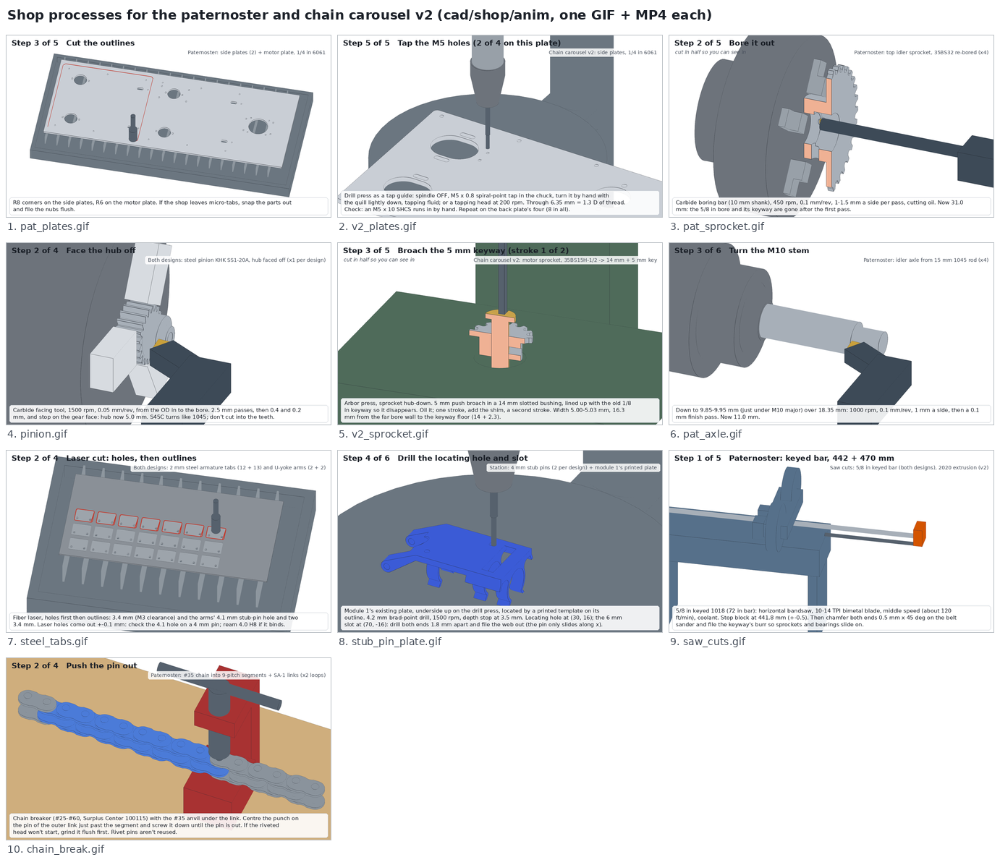

# Shop work: how each part we make or modify gets made

Animated walk-throughs of every part the two carousel designs need from a shop (or from SendCutSend) rather than
off a shelf: what to put in the machine, which tool, what speed and feed, what tolerance, and how to check it. Each
process has a GIF and an MP4 in [`anim/`](anim/), and [`shop_processes.png`](shop_processes.png) is a contact sheet
with one frame from each.



The geometry comes from the designs' own CAD. `shop_anim.py` imports each design's `parts.py` / `layout.shape()`,
and every frame is the CAD with the cuts made so far:

- **Plates and sheet parts** start as a blank (the part's outline with no holes). The CAD's own holes (blank minus
  part, split into solids) come out one at a time, then the outline, then the part lifts out of the skeleton.
- **Modified bought parts** start from the bought part. The sprockets are built with the design's own `sprocket()`
  builder at the catalogue bore; the pinion is the CAD pinion plus KHK's hub. Material comes off pass by pass.
- **Turned parts** are revolved from the profile cut so far.

The script checks that the last state matches the CAD, by volume difference:

| process | difference |
|---|---|
| idler sprocket | 0.2 mm3 of 46,158 |
| motor sprocket | 0.0 |
| pinion | 0.00 |
| countersunk tab | 0.0 |
| module 1 plate | 0.6 mm3 (the slot's 0.01 mm start offset) |

So the last frame of each process is the part as drawn.

```
cd cad/shop
xvfb-run -a python shop_anim.py all     # or name processes: pat_plates v2_plates pat_sprocket ...
python shop_anim.py sheet               # rebuild shop_processes.png from anim/*_key.png
```

The two designs both have modules named `params`, `parts` and `layout`, so `design()` purges them from
`sys.modules` before importing the other design's copies.

Speeds and feeds are starting points for a manual lathe and drill press with carbide or HSS tooling. Adjust them to
the machine.

## Paternoster (`cad/paternoster/`)

| Part | Qty | Process | Machine / tool | Settings | Tolerance | How to check | Time | Animation |
|---|---|---|---|---|---|---|---|---|
| Side plates (front, back) + motor plate | 2 + 1 | Cut from `dxf/` (holes first, then outlines), deburr | Waterjet or fiber laser (SendCutSend, or the BYU shop); deburring tool and file | 1/4 in 6061-T6; all three nest on a 14 x 36 in piece | +-0.2 mm on holes; every hole is a clearance hole, nothing to tap | A flange unit's two 1/4-20 bolts drop through; an M10 bolt slides the full 10.5 x 24.5 slot; bearing holes 190.5 mm apart (+-0.3) | 3-5 days from SendCutSend, or about 20 min of waterjet + 30 min deburring | [pat_plates.gif](anim/pat_plates.gif) ([mp4](anim/pat_plates.mp4)) |
| Top idler sprocket, 35BS32 re-bored | 4 | Dial in on the teeth, bore 5/8 in to 35 H7, chamfer, press in 2 x 6202-2RS | Lathe, 4-jaw chuck on the 2 in hub, parallels; dial test indicator on a 0.200 in pin in a tooth gap; carbide boring bar (10 mm shank); arbor press with a 34 mm driver | 450 rpm, 0.1 mm/rev, 1-1.5 mm a side; finish with two 0.1 mm passes + spring pass; cutting oil | Bore 35.000-35.025 mm through all 22.2 mm; under 0.05 mm TIR to the pitch circle | Bore gauge set on a 35 mm ring (or telescoping gauge + mic); both bearings spin free; sprocket face runs true within 0.2 mm | About 1 h each | [pat_sprocket.gif](anim/pat_sprocket.gif) ([mp4](anim/pat_sprocket.mp4)) |
| Idler axle (15 mm seat, M10 stem) | 4 | Face, turn the stem, thread M10 x 1.5, part off at 49.35, flip, face, chamfer 0.6; a 22 x 4 mm washer is the shoulder | Lathe, 15 mm ER collet; carbide turning tool; M10 round die in a tailstock die holder; 2.2 mm parting blade | 1000 rpm, 0.1 mm/rev for turning; die by hand with the lathe in neutral; parting at 400 rpm | Stem 9.85-9.95 mm; length 49.35 +-0.1; leave the 15 mm OD (-0.013/0) as bought, it is the bearing seat | An M10 nut runs on by hand to the shoulder; a 6202 slides on the seat | About 40 min each | [pat_axle.gif](anim/pat_axle.gif) ([mp4](anim/pat_axle.mp4)) |
| Keyed shaft 5/8 in: 441.8 + 469.8 drive as drawn now (BOM.md: 435 + 463) | 1 + 1 | Saw to length against a stop, chamfer 0.5 x 45 deg, deburr the keyway | Horizontal bandsaw, 10-14 TPI bimetal blade; belt sander or file | Middle speed (about 120 ft/min), coolant | +-0.5 mm | Tape against the CAD; sprockets and flange units slide on | 20 min | [saw_cuts.gif](anim/saw_cuts.gif) (steps 1, 5) |
| #35 chain, two 120-link loops (optional item) | 24 segments of 9 pitches + 24 SA-1 links | Break the 10 ft roll into 9-pitch segments (an inner link at each end); join them with SA-1 connecting links, tab out of the loop, clip on the far side | Chain breaker #25-#60 (Surplus Center 100115), #35 anvil | Grind a pin's riveted head flush if it won't start | Every segment exactly 9 pitches | Count 120 links per loop; lay the segments side by side | About 1 h | [chain_break.gif](anim/chain_break.gif) ([mp4](anim/chain_break.mp4)) |

## Chain carousel v2 (`cad/chain-carousel-v2/`)

| Part | Qty | Process | Machine / tool | Settings | Tolerance | How to check | Time | Animation |
|---|---|---|---|---|---|---|---|---|
| Side plates, front 244 x 375, back 244 x 485 | 1 + 1 | Cut from `dxf/` out of one 12 x 36 in plate (holes first), deburr; tap the eight M5 holes | Waterjet (or SendCutSend); drill press used as a tap guide, M5 x 0.8 spiral-point tap | 1/4 in 6061-T651; tap by hand with the spindle off (or a tapping head at 200 rpm), tapping fluid | +-0.2 mm on holes; tap-drill holes 4.2 mm | An M5 x 10 SHCS runs in by hand; a 1/4-20 bolt slides the full 14 mm of each bearing slot; plates flat within 0.5 mm | About 30 min of waterjet + 15 min tapping + 30 min deburring | [v2_plates.gif](anim/v2_plates.gif) ([mp4](anim/v2_plates.mp4)) |
| Motor sprocket, 35BS15H-1/2 re-bored | 1 | Bore 1/2 in to 14 H7, chamfer; broach a 5 mm keyway in line with the old 1/8 in one | Lathe, 3-jaw chuck on the 34.1 mm hub (4-jaw if the teeth run out); boring bar (8 mm shank); arbor press, 5 mm push broach + 14 mm slotted bushing + shim | 700 rpm, 0.05-0.08 mm/rev; passes 0.4, 0.2, 0.05 mm a side; broach oiled, 2 strokes | Bore 14.000-14.018; keyway 5.00-5.03 wide, 16.3 mm from the far bore wall | The motor's 14 mm shaft slides in with no shake; with the key in, the sprocket slides on with no rock | About 45 min | [v2_sprocket.gif](anim/v2_sprocket.gif) ([mp4](anim/v2_sprocket.mp4)) |
| Keyed shaft 5/8 in: 3 x 409.8 + 434.2 drive as drawn now (BOM.md: 403 + 427) | 3 + 1 | Saw, chamfer, deburr | Horizontal bandsaw | as above | +-0.5 mm | as above | 20 min | [saw_cuts.gif](anim/saw_cuts.gif) (steps 2, 5) |
| 2020 extrusion | 4 x 676, 5 x 204, 4 x 417.7, 155, 197 | Saw against a stop; cut all of one length at one stop setting; file the burrs | Miter saw with a carbide non-ferrous blade (or the bandsaw's top speed) | Extrusion clamped, slow feed | +-0.3 mm within a set (posts and rails must match) | Square on the ends; pieces of one length match side by side | About 1 h | [saw_cuts.gif](anim/saw_cuts.gif) (steps 3-5) |

The extrusion counts above come from `layout.placements()`: 4 `ext_post`, 5 `ext_y` (4 cross rails and the
station rail), 4 `ext_x`, 1 fork post and 1 vial post. They match BOM.md's cut list (7 of the 10 bars).

## Both designs (station)

| Part | Qty | Process | Machine / tool | Settings | Tolerance | How to check | Time | Animation |
|---|---|---|---|---|---|---|---|---|
| Steel pinion KHK SS1-20A, hub faced off | 1 per design | Face the 10 mm hub off flush with the gear face, chamfer the bore | Lathe, aluminium soft jaws bored to 22.0 mm (the tip diameter) with a step (the gear face seats on it); carbide facing tool | 1500 rpm, 0.05 mm/rev, 2.5 mm passes then 0.4 / 0.2 mm | Width 10.00 (-0.1/0); faced side true to the bore within 0.02 mm | Micrometer at 3 places; indicate on a 5 mm pin | About 30 min | [pinion.gif](anim/pinion.gif) ([mp4](anim/pinion.mp4)) |
| Armature tabs + U-yoke arms, 2 mm low-carbon steel | 12 + 13 tabs, 2 + 2 arms | Laser cut from `dxf/armature_tab.dxf` and `dxf/uyoke_arm.dxf`; countersink the tab holes; deburr | Fiber laser (SendCutSend); drill press, 90 deg countersink with a depth stop | Countersink at 300 rpm until the head sits flush to 0.05 mm below (6.0 mm across for DIN 7991 heads, about 6.7 mm for ISO 10642) | Holes +-0.1; tab dead flat; screw heads flush or below | M3 x 6 FHCS + straightedge; a 4 mm pin goes through each arm's 4.1 hole | About 30 min for all 29 (plus SendCutSend lead time) | [steel_tabs.gif](anim/steel_tabs.gif) ([mp4](anim/steel_tabs.mp4)) |
| Stub pin 4 x 7.5 mm with an e-clip groove | 2 per design (+2 spare) | Face, chamfer 0.3, groove to 3.2 mm, part off at 7.5, flip, chamfer | Lathe, 4 mm ER collet; 0.6 mm grooving insert; 1.5 mm parting blade | 2500 rpm turning, 800 rpm grooving and parting | Groove 3.2 mm across, 0.64 wide (see problem 7) | A DIN 6799-3.2 e-clip snaps in and can't be pulled off | About 30 min for 4 | [stub_pin_plate.gif](anim/stub_pin_plate.gif) (steps 1-3) |
| Module 1's printed plate (already in the lab) | 1 | Drill the 4.2 mm locating hole and the 4.2 x 6 slot, 3.5 mm deep; two 4.0 x 4.5 mm holes; set two M3 heat-set inserts | Drill press, printed locating template, 4.2 / 4.0 mm brad-point drills with a depth stop; soldering iron with an M3 insert tip | 1500 rpm; iron at 230-245 C for PETG | Hole positions +-0.1 (template); inserts flush | The locating pins drop into the hole and slot; an M3 x 6 FHCS pulls the tab down without spinning the insert | About 20 min | [stub_pin_plate.gif](anim/stub_pin_plate.gif) (steps 4-6) |

Modules 2-13 get their plates printed with these holes already in them. Only module 1's existing plate needs
drilling.

## Problems found while working the processes out

The design files were not changed. Each item below is for the design owner to decide.

1. **Paternoster idler: the bearings don't sit on the axle as drawn.** From `layout.placements()` (front, +y idler):
   - The axle's 15 mm seat runs from x = -33.0 to x = -2.00.
   - The two 6202s span x = -20.10 to +1.90 (`xb = -14.6, -3.6` in `layout.py`). The sprocket spans -20.09 to +2.14.
   - So the outer bearing overhangs the end of the seat by 3.9 mm: only 7.1 of its 11 mm sits on the shaft.
   - There is also an 8.9 mm gap between the 22 mm washer (the shoulder, x -33 to -29) and the first bearing, so
     nothing locates the bearings along the axle.

   `IDLER_AXLE_L = 31` looks like it was measured from the washer's face rather than from the plate. A fix: make the
   seat 35 mm (cut length 53.35), so it ends flush with the sprocket face at +2.1. Then replace the 4 mm washer with
   a 12.9 mm long spacer, 15 mm ID and about 20 mm OD. A 6202's inner-ring shoulder is only about 21 mm across, so a
   22 mm shoulder can touch the seal; check against the bearing maker's abutment table. A DIN 471-15 circlip at the free end would also
   stop the sprocket walking off the axle.
2. **Idler sprocket bore fit.** An H7 bore is a slip fit, and these outer rings turn with the load, so they will
   creep. Bond them with Loctite 641, or bore 34.975-35.000 (M7) for a light press. The bore runs straight through
   with no shoulder, so the bond or press fit is the only thing holding the bearings axially in the sprocket.
3. **Idler axle stem vs the locknut.** The stem is 18.35 mm (plate 6.35 + 12). The BoM adds a DIN 125A washer
   (2 mm) under the M10 nylock (DIN 985, 10 mm tall), which the CAD doesn't draw. With the washer, the thread ends flush with the
   top of the nut and nothing passes through the nylon ring. Make the stem 3 mm longer (2 threads proud). Also add a
   1 x 45 deg chamfer at the stem end; the die and the nut need one to start, and the CAD has none.
4. **Paternoster plate stock.** The BoM line quotes a raw 12 x 24 in plate for reference. Both sides of a side plate
   (320 x 345 mm) are over 12 in, so that plate can't make even one. If the BYU shop cuts them, buy 14 x 36 in
   (all three plates nest on it, as in the GIF). SendCutSend supplies its own stock.
5. **Armature tab countersink vs the dock magnet.** The CAD's 90 deg countersink is 6.0 mm across, which seats a
   DIN 7991 M3 head (6.0 mm) flush. An ISO 10642 M3 head is 6.72 mm theoretical, so in a 6.0 mm countersink it
   stands about 0.36 mm proud. The docked gap to the magnet face is 0.15 mm, and the screws at (94, +-10) sit
   11.4 mm from the magnet's axis, so the heads overlap its 10 mm rim. Either specify DIN 7991 screws in the BoM, or
   countersink to about 6.7 mm. That is 1.65 mm deep in a 2 mm tab and leaves about 0.35 mm of straight hole; it
   works, but it is thin. Either way, check every head with a straightedge (step 3 of `steel_tabs`).
6. **"2 mm" steel isn't a US gauge.** 14 ga mild steel is about 1.9 mm. With 1.9 mm tabs the docked gap grows from
   0.15 to about 0.25 mm, which loses some holding force. Either buy 2.0 mm metric (DC01) or put the real thickness
   into `ARMATURE_T` so the magnet face height follows. The U-yoke arms don't care.
7. **Stub pin: hardened dowel, groove width and edge distance.**
   - BOM.md calls it a hardened steel dowel. A 58-62 HRC dowel can't be grooved or parted with HSS, and it is
     brittle at a 0.4 mm groove. Use unhardened 4 mm ground rod (1045 or silver steel), or buy a 4 mm clevis pin with
     an e-clip groove, as the lead suggested.
   - The CAD groove is 0.6 mm wide, which is the clip's own thickness. DIN 6799-3.2 specifies a 0.64 mm groove.
   - The groove sits 0.5 mm from the pin's end, which leaves 0.2 mm of land after the 0.3 mm chamfer. DIN 6799 asks
     for about 1 mm of shaft beyond the groove; check the clip maker's table. Lengthen the pin to about 8.5 mm if the
     space outside the yoke arm allows.
8. **Module 1 plate: the insert holes are close to the back edge.** The 4.0 mm insert holes at (94, +-10) leave
   2.8 mm of plastic to the plate's back edge (x = 98.8). A heat-set insert pushes plastic outward, so set it slowly
   at the low end of the temperature range, with the edge clamped against a block. Or move the inserts 1.5-2 mm
   toward -x on the printed plates, which also needs the tab's holes moved.
9. **Small tap-drill holes from a waterjet or laser.** The eight 4.2 mm holes in the v2 plates are smaller than the
   plate is thick, so they can come out tapered or undersize. Either order them tapped (SendCutSend taps as a
   service, to its own hole size), or cut 2 mm pilots and drill 4.2 mm on the drill press before tapping.
10. **Pinion: the hub carries the only set screw.** KHK's page for SS1-20A
    ([`cad/vendor/files/khk/gear_SS1-20A.txt`](../vendor/files/khk/gear_SS1-20A.txt)) lists a 16 x 10 mm hub with an
    M4 set screw 5 mm from the hub end, S45C, not hardened (under 194 HB). Facing the hub off removes the set screw,
    so the Loctite 638 bond is the only drive, as the design intends. Clean the shaft and bore with acetone first.
    KHK USA lists the gear at $14.77 (10 on hand), against the BoM's $27.21 + $12.99 shipping from ibspot.
11. **Shaft lengths moved after the BoM was written.** The flange-unit update of 2026-10-27 (`BRG["OUT"]` 12.6 to
    16.05) lengthened every through shaft by 6.9 mm. The paternoster's are now 441.8 and 469.8, and v2's
    3 x 409.8 + 434.2. BOM.md still lists 435 + 463 and 3 x 403 + 427. Both sets still come out of one 72 in bar each.
    `saw_cuts` reads the lengths from `layout.shape()` when it renders, so re-render it if they change again.

Assumptions in the animations:

- The bought 35BS15H-1/2 comes with a 1/8 x 1/16 in keyway, which the 5 mm broach removes if it is lined up with it.
- The keyed bar is drawn without its keyway, because the designs' `shaft()` has none.
- Threads are drawn as a helix line over the CAD's plain 10 mm stem.

## Not animated

- **Chain for chain carousel v2.** The same chain breaker works; see v2's BOM.md for its link and A-1 counts. Only
  the paternoster's SA-1 scheme is animated, in `chain_break`.
- **Pressing bronze bushings, and setting inserts in the other printed parts** (optional item 12). Only module 1's two
  armature inserts are shown, in `stub_pin_plate` step 6. The U-yoke crossbar's four M3 inserts and the gondolas' M5
  inserts follow the same steps.
- **Chamfers and deburring** that the CAD doesn't draw are in the captions only, so the last frame stays equal to
  the CAD.
