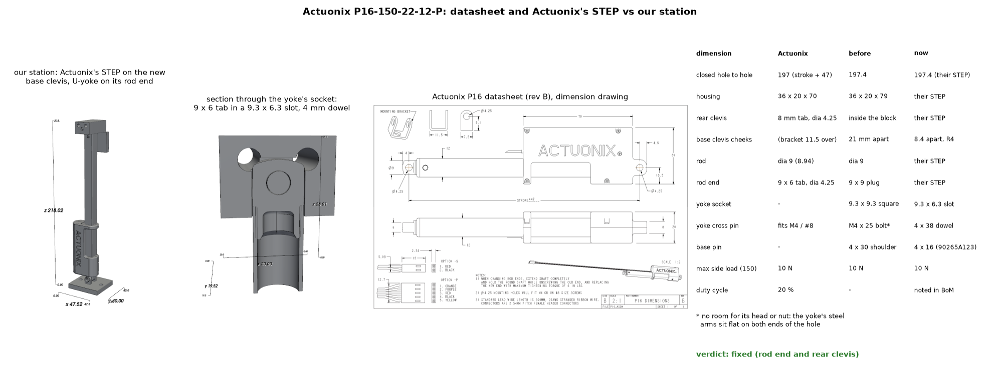
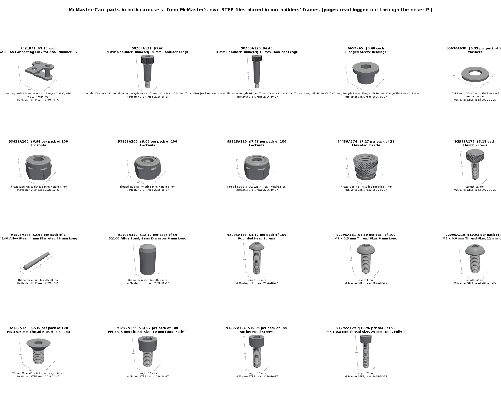

# Purchased parts checked against the vendors' own data (both carousels)

Asked for on PR #185 (2026-10-27): every bought part in [`../paternoster/`](../paternoster/README.md) and
[`../chain-carousel-v2/`](../chain-carousel-v2/README.md) checked against the vendor's spec sheet, drawing or CAD, with
the real CAD in the model wherever it can be had. All browsing went through the doser Pi: a headed Chromium (Playwright
on Xvfb) whose traffic leaves through the Pi as a SOCKS proxy, with real pointer moves and clicks, throttled to 400 kB/s
for the Pi's Wi-Fi. No account was logged in to anywhere.

| | Where | What |
|---|---|---|
| Actuonix P16 | [`actuonix.py`](actuonix.py), [`fetch_actuonix.py`](fetch_actuonix.py) | Actuonix's own STEP (`P16_STP.zip`) and datasheet; both carousels' station draws the STEP |
| McMaster-Carr | [`mcmaster.py`](mcmaster.py), [`fetch_mcmaster.py`](fetch_mcmaster.py), [`mcmaster_catalog.py`](mcmaster_catalog.py) | 30 part numbers: each page's spec table and price ([`mcmaster_specs.json`](mcmaster_specs.json)), 28 STEPs and 27 2-D PDF drawings; family tables for the parts that were "estimate" ([`mcmaster_catalog_rows.json`](mcmaster_catalog_rows.json)) |
| Everything else | [`AUDIT_other.md`](AUDIT_other.md), [`vendor_other.py`](vendor_other.py), [`fetch_other.py`](fetch_other.py) | Surplus Center / Martin sprockets, flange bearings, Nitro chain and A-1 links, KHK pinion, Adafruit magnet and solenoid, NEMA 11/34, 80/20 and VEVOR extrusion, brackets, foot, load cell, hall switch, magnets, bearing, vial |
| Side by side | [`compare/`](compare) ([`compare_lead.py`](compare_lead.py), [`compare_other.py`](compare_other.py)) | each model next to the vendor's drawing or photo, with the numbers |

The vendor files themselves (STEP, PDF, page captures) are in the git-ignored `files/`: the vendors give no licence to
redistribute them and this repo is public, the rule `cad/full-assembly/` already follows. `manifest_<vendor>.json` pins
every file by sha256, so a rebuild can check it has the same bytes; the `fetch_*.py` scripts download them again. The part
builders fall back to a dimension-table stand-in when a file isn't on disk, and `common.report_missing()` lists which did.

## Actuonix P16-150-22-12-P



Read on actuonix.com on 2026-10-27: $90, in stock (85), 150 mm stroke, 22:1, 46 mm/s, 50 N, 75 N back-drive,
**10 N side load**, 197 mm closed hole to hole, 125 g, 0.6 mm repeatability with the LAC, **20 % duty cycle**, 1 A stall at
12 V, IP54 (datasheet rev B). LAC board $30, 12 V supply $10. The product page doesn't say brackets come with it, so the
BoM no longer claims they do. Two things in our model didn't match, and both mattered:

- **The rod end is a 9 x 6 mm tab** (on a dia 9 x 1 mm collar), not the 9 x 9 mm plug we drew. The U-yoke's 9.3 mm square
  socket would have let the tab rock 1.65 mm each side. The socket is now a dia 9.3 counterbore for the rod tube and collar
  plus a 9.3 x 6.3 slot for the tab.
- **The rear clevis is an 8 mm tab** 4.5 mm behind the housing. Our base clevis had its cheeks 21 mm apart, to clear the
  20 mm housing, so the tab would have slid 6.5 mm along the pin. The cheeks now straddle the tab (8.4 mm gap, R4 ends that
  the housing swings over) on a McMaster 90265A123 shoulder screw (4 x 16 mm), which is now in the assembly with its nylock.

Checking the rod end found a third problem, in our own part: the U-yoke's M4 cross bolt could never have been fitted.
Its hole runs the crossbar's full 39 mm width and the two steel arms sit flat on both ends of it, so there was no room for
a head or a nut. It is now a 4 x 38 mm hardened dowel (McMaster 91595A128) pressed into the crossbar and held in by the arms.

## McMaster-Carr



McMaster's product pages, CAD menu and drawings open logged out again (on 2 and 18 Oct they asked for a login). For each
part number `fetch_mcmaster.py` moves the pointer to the CAD menu, picks "3-D STEP", clicks Download, then does the same
for "2-D PDF". `mcmaster.py` places each STEP in the frame of the builder it replaces; each frame was found by measuring
the STEP (axis, ends, holes) and checked by its overlap with the old stand-in (61-100 % common volume, the rest being real
chamfers, nylon crowns and knurls).

| McMaster part | Where | Model before | Now |
|---|---|---|---|
| 7321K31 SA-1 link | paternoster chain, 24 | parametric, matched to McMaster's drawing | McMaster's STEP (tab face 0.016 mm proud of our old model: the PTFE washer bears on it) |
| 90265A121 shoulder screw 4 x 10 | gondola pivots, 24 | ISO 7379 stand-in | STEP; $3.14 at 5 or more ($3.66 below) |
| 6659K65 bronze bushing, 95630A630 PTFE washer | gondola pivots | stand-ins at McMaster's sizes | STEP |
| 93625A100 / 93625A200 / 95615A120 nylocks | everywhere | 1/4-20 drawn 7.1 tall | STEP: the 1/4-20 is 7.95 tall |
| 94459A774 M5 insert, 92545A179 thumb screw | gondola hinge lugs | hole-sized stand-ins | STEP (the insert's knurl melts into the lug by design) |
| 90265A123 shoulder screw 4 x 16 | P16 base pin, both | "90265A992 4 x 30" in the BoM, not modelled | STEP, placed |
| 91595A128 dowel 4 x 38 | U-yoke pin, both | M4 x 25 bolt (could not fit) | STEP, placed |
| 91595A150 dowel 4 x 8 | locating pins, both | "4 mm dowel pins, estimate" | STEP |
| 98543A103 / 98543A112 DIN 6799 e-clips | stub pins / v2 hinge pins | 7.3 and 9.0 OD, 0.6 thick | 6.9 OD x 0.6 and 8.85 OD x 0.7: v2's hinge-pin groove is now 0.74 wide (was 0.6, narrower than the clip) |
| 92095A181 / 183 / 210, 92125A126, 91292A124 / 126 / 129 | v2 screws, yoke-arm screws | BelMetric "estimate" | McMaster STEP and pack prices |
| 6413K145 + 6408K147 L090 hubs, 6408K75 spider | paternoster drive | "6408K14" for both hubs | 6408K14 is the family page: the 14 mm hub is 6413K145, the 5/8 in one 6408K147 ($21.35 each) |

Still generic or estimated: the M5 x 30 jack screws (91292A130 turned out to be M4), the M10 nylock, the 1/4-20 hex bolts,
the standoffs, Loctite, dry lube, the DIN 471 circlip and the stub pins' 303 rod.

## Re-running

```bash
./pi_socks.sh                                       # SOCKS5 through the Pi on 127.0.0.1:1080 (see common.py)
xvfb-run -a python fetch_actuonix.py
xvfb-run -a python fetch_mcmaster.py                   # or name part numbers
xvfb-run -a python fetch_other.py
xvfb-run -a python compare_lead.py && xvfb-run -a python compare_other.py
```
