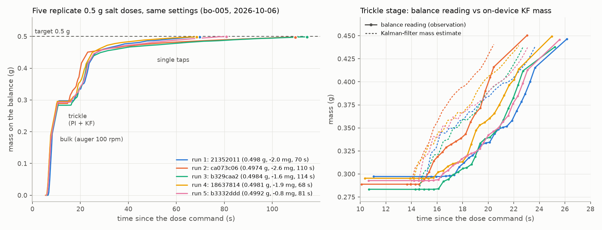
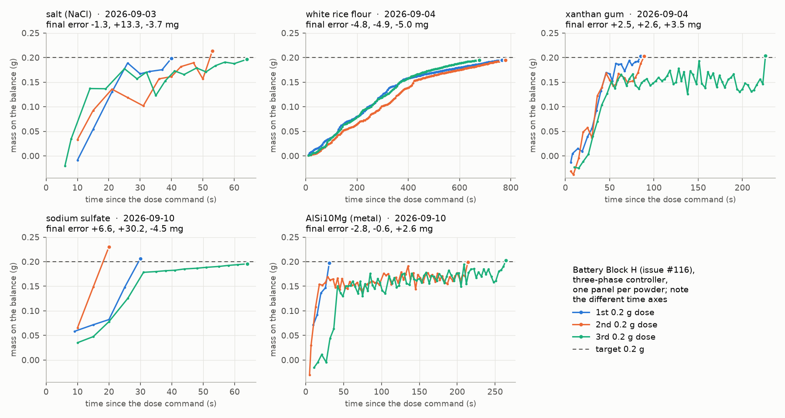

# Powder-doser runs that all dosed the same mass (issue #210)

Issue [#210](https://github.com/vertical-cloud-lab/powder-doser/issues/210) asked for five powder
runs on the doser that all dosed the same amount, for a data assimilation project. This folder
has two sets, so you can use either reading of "5 different powder runs":

| set | what | target | time series |
|---|---|---|---|
| **A** [`salt-0p5g/`](salt-0p5g/) | five replicate doses of **one powder** (table salt) at **identical settings**, back to back on 2026-10-06 | **0.5 g** | balance reading every 0.29–0.40 s while the auger runs (every 3 s during taps), plus the doser's own **Kalman filter** estimates |
| **B** [`five-powders-0p2g/`](five-powders-0p2g/) | five battery runs, **one per powder** (salt, white rice flour, xanthan gum, sodium sulfate, AlSi10Mg), three doses each | **0.2 g** | one balance reading per poll or control cycle, timestamps in whole seconds, no filter |

Set A is the better fit for data assimilation: the same powder, controller, firmware and settings
every time, back to back in one session, and each run carries a filter you can compare against.
Use set B if you need different powders.

The data was already on unmerged branches. Nothing here was re-measured.
[`extract.py`](extract.py) copies the original files into each set's `source/` folder from pinned
commits and builds the tidy CSVs and figures from them.

## Set A: five 0.5 g salt doses (`salt-0p5g/`)



*Left: the balance reading for each run, with the scored final reading as a dot. Right: the
trickle stage, where the doser's Kalman filter runs. Solid lines with dots are balance readings
and dashed lines are the filter's mass estimate. The filter leads the balance because it models
the balance's 0.7 s lag.*

| run | trial (`opt_trials.trial_uuid`) | started (UTC) | final | error | time | taps | file |
|---|---|---|---|---|---|---|---|
| 1 | `21352011-eb91-4001-b4f0-95315ebae310` | 2026-10-06 03:35:20 | 0.4980 g | −2.0 mg | 69.8 s | 17 | [`run1_21352011.csv`](salt-0p5g/run1_21352011.csv) |
| 2 | `ca073c06-e01c-4a60-bcbf-26307d0e6735` | 2026-10-06 03:36:50 | 0.4974 g | −2.6 mg | 109.6 s | 30 | [`run2_ca073c06.csv`](salt-0p5g/run2_ca073c06.csv) |
| 3 | `b329caa2-f3d7-4353-85ca-27ebd40eb937` | 2026-10-06 03:38:58 | 0.4984 g | −1.6 mg | 114.4 s | 32 | [`run3_b329caa2.csv`](salt-0p5g/run3_b329caa2.csv) |
| 4 | `18637814-04d9-4379-83a4-6cc25f08c65a` | 2026-10-06 03:41:12 | 0.4981 g | −1.9 mg | 68.5 s | 17 | [`run4_18637814.csv`](salt-0p5g/run4_18637814.csv) |
| 5 | `b3332ddd-9d2f-473a-a18c-72b92ea13939` | 2026-10-06 03:42:39 | 0.4992 g | −0.8 mg | 81.0 s | 21 | [`run5_b3332ddd.csv`](salt-0p5g/run5_b3332ddd.csv) |

All five are status `ok`. [`runs_summary.csv`](salt-0p5g/runs_summary.csv) has the phase times,
auger turns, learned feed factor, bulk afterflow and cup load for each.

**Where they come from.** These are replicates 0 to 4 of the 8-replicate validation block of
point `bo-005` in the salt optimization campaign `salt-20260929T014732Z` (trial indices 44–48).
The block was run unattended on 2026-10-06 on firmware `trickle_tap/2026-09-30b` (commit
`6fc5f79`). See the campaign's
[report](https://github.com/vertical-cloud-lab/powder-doser/blob/d14a50d/data/opt/salt-20260929T014732Z/report.md)
and [validation notes](https://github.com/vertical-cloud-lab/powder-doser/blob/d14a50d/data/opt/salt-20260929T014732Z/validation_20261006.md)
on branch `claude/issue-164-20260922-1928`. The same documents are in MongoDB
`powder_doser.opt_trials` (checked 2026-11-11). Fetch them with
`{"trial_uuid": {"$in": [...the five uuids above...]}}`.

**Settings (identical for all five).** Bulk at 40° plate tilt and 100 rpm, with one 60 ms tap
every 500 ms. The auger halts at 0.35 g to go, and 0.10–0.13 g of afterflow lands after the halt.
Trickle at 10°. Single taps at 15° with the auger stopped. Tolerance 3 mg.

### Columns in `runN_<uuid8>.csv`

One row per controller step. Bulk polls and trickle rows are 0.29–0.40 s apart (mean 0.36 s in
the trickle). Tap rows are about 3 s apart, one per tap cycle, each a settled read.

| column | meaning |
|---|---|
| `t_s` | seconds since the dose command. The tare takes the first ~6 s |
| `phase` | `bulk` (auger polls), `bulk_settled` (settled read after the auger halts), `trickle` (Kalman filter + PI rate control), `trickle_end` (settled read), `tap` (settled read after each tap), `final_scored` (the reading the dose was scored on, 2 s after the last tap) |
| `mass_g` | **the balance reading** (net of the tare). This is the observation |
| `fresh` | 1 if the balance returned a new reading that step (all rows in these five runs are 1) |
| `kf_mass_g`, `kf_rate_gps` | Kalman-filter estimates of the mass in the cup (g) and the delivery rate (g/s). Trickle rows only |
| `kf_sigma_g` | standard deviation of the filter's prediction of the mass that will end up in the cup, `m + r·τ` with τ = 0.8338 s. It is not the standard deviation of `m` alone |
| `kf_clamp_hits` | how many times the filter clipped a negative rate to 0 (0 in all five runs) |
| `ff_gpr` | learned feed factor (g per auger turn), the filter's input gain |
| `rate_setpoint_gps`, `rate_err_gps`, `pi_integ` | the PI rate controller's set-point, error (set-point minus `kf_rate_gps`) and integrator |
| `pred_g`, `cutoff_g` | `m + r·τ + 1·σ`, the filter's one-sigma-high prediction of the final mass, and the 0.465 g cutoff (0.5 g − 35 mg margin). The trickle stops at the first row where `pred_g ≥ cutoff_g` |
| `tilt_deg_cmd`, `auger_rpm_cmd`, `tap_mode` | commanded actuators. Only the trickle rpm is logged on each row. The others are filled in from the executed settings for that phase |

`source/trial_<uuid>.json` is the full `opt_trials` document: the result, stop events, parameters
as executed and raw telemetry. `source/serial_<uuid>.log` is the raw serial session, including the
firmware's full parameter dump.

### The filter on the doser

The trickle stage runs a 3-state linear Kalman filter,
[`trickle_kf.py`](https://github.com/vertical-cloud-lab/powder-doser/blob/6fc5f79/hardware/test-module/firmware/trickle_tap/trickle_kf.py),
called from
[`trickle_controller.py`](https://github.com/vertical-cloud-lab/powder-doser/blob/6fc5f79/hardware/test-module/firmware/trickle_tap/trickle_controller.py#L812-L925)
with the measured interval `dt` between polls. It is a natural baseline for an assimilation
method:

- state `x = [m, r, b]`: the mass in the cup, the delivery rate, and the balance reading, which
  lags the cup mass;
- `m ← m + r·dt`; `r ← (1 − a)·r + a·ff·u`, with `u` the commanded auger rev/s and
  `a = min(1, dt / 0.5 s)`; `b ← b + β·(m − b)`, with `β = 1 − exp(−dt / 0.7 s)`;
- observation `z = b + v`. The noise s.d. is 8 mg while the auger turns and 0.5 mg while it is
  stopped;
- process noise: the white-noise-acceleration form on `(m, r)` with `q = 2e-4`, and `1e-8` on `b`;
- seeded from a settled read at the start of the trickle stage, with `r = 0`;
- the rate is clipped at 0 without correcting `P`, and `ff` is updated as
  `ff ← 0.9·ff + 0.1·(m − m0)/turns` once the auger has made 0.3 turns.

The filter runs only in the trickle stage, so the `kf_*` columns are empty in every other row.

### More doses at the same target

0.5 g of salt is by far the most repeated dose on the doser. 105 of the 125 documents in
`opt_trials` are salt at 0.5 g. If you want more than five:

- the rest of the same block: replicates 5–7 (`29561c29`, `07bc9c97`, `d08e89fb`, trial indices
  49–51), with the same settings and telemetry;
- two earlier replicates (`f5d1e487`, `69cc8509`, indices 42–43), which ran before a restart and
  have no telemetry rows (console log only);
- the campaign's other 50 doses at 0.5 g (indices 0–41 and 52–59), at other settings except
  index 33 (`d48311a0`, the campaign's own `bo-005` dose), and the 43 doses of
  `salt-margin-20261013T191339Z`;
- two production doses of 0.5 g with the same `bo-005` settings and firmware, `5843f717`
  (2026-10-06) and `9046eb75` (2026-10-08), in
  [`data/opt/production-salt`](https://github.com/vertical-cloud-lab/powder-doser/blob/5bc4cc9/data/opt/production-salt/README.md)
  on branch `claude/issue-130-20260721-1807`.

## Set B: five powders at 0.2 g (`five-powders-0p2g/`)



| powder | battery run (UTC start) | 0.2 g doses: final error | time per dose | run notes |
|---|---|---|---|---|
| salt (NaCl) | `20260903T214049Z_salt` | −1.3, +13.3 (overshoot), −3.7 mg | 40–64 s | [notes](https://github.com/vertical-cloud-lab/powder-doser/blob/f754450/docs/battery-runs/2026-09-03-salt-block-h-new-hood.md) |
| white rice flour | `20260904T190011Z_white-rice-flour` | −4.8, −4.9, −5.0 mg | 677–780 s | [notes](https://github.com/vertical-cloud-lab/powder-doser/blob/f754450/docs/battery-runs/2026-09-04-white-rice-flour-block-h.md) |
| xanthan gum | `20260904T203727Z_xanthan-gum` | +2.5, +2.6, +3.5 mg | 85–226 s | [notes](https://github.com/vertical-cloud-lab/powder-doser/blob/f754450/docs/battery-runs/2026-09-04-xanthan-gum-block-h.md) |
| sodium sulfate | `20260910T133932Z_sodium-sulfate` | +6.6 (overshoot), +30.2 (overshoot), −4.5 mg | 20–64 s | [notes](https://github.com/vertical-cloud-lab/powder-doser/blob/f754450/docs/battery-runs/2026-09-10-sodium-sulfate-blocks-gh.md) |
| AlSi10Mg | `20260910T194447Z_alsi10mg` | −2.8, −0.6, +2.6 mg | 31–264 s | [notes](https://github.com/vertical-cloud-lab/powder-doser/blob/f754450/docs/battery-runs/2026-09-10-alsi10mg-blocks-gh.md) |

These are the Block H doses of issue #116's powder battery (battery version 3), from branch
`claude/issue-116-20260915-1622` at `f754450`. In Block H each run dosed 0.05 g three times and
then 0.2 g three times (the sodium sulfate and AlSi10Mg runs dosed 1 g three times first, in
Block G). Every dose used the older three-phase controller, with no Kalman filter:

1. bulk: 45° tilt, auger at 55 rpm. It runs only when more than 0.2 g is left, so it ran in 4 of
   the 15 doses;
2. fine: 22.5° tilt, 45° auger steps at 30 rpm, a settled read after each step;
3. taps: 0° tilt, auger stopped, 2 taps per cycle, a settled read after each cycle.

The same runs are in MongoDB `powder_doser.battery_runs`. Silicon −110/+200 mesh
(`20260915T025556Z_silicon-110-200`: −1.5, −1.8, +32.6 mg) would be a sixth powder.

- [`doses_summary.csv`](five-powders-0p2g/doses_summary.csv): one row per dose (15 rows), with the
  final mass, error, status, time, auger turns, taps, and the tare's baseline, drift and read noise.
- [`doses_series.csv`](five-powders-0p2g/doses_series.csv): every balance reading of those 15 doses
  in long format: `powder_id, run_dir, dose_n, dose_rep, t_s, phase` (`bulk`, `bulk_settled`,
  `fine`, `tap`, `final_scored`), `cycle, read` (`poll`, `poll_unstable` or `settled`),
  `mass_g`, `tilt_deg_cmd` and `actuation`.
- **The timestamps are whole seconds**, as printed on the console, so several bulk polls can share
  one `t_s`. Some readings in the first 15 s are negative (down to −38 mg), so check them before
  treating a series as monotone.
- `source/<run>__raw_serial_<powder>.log` and `source/<run>__doses_<powder>.csv` are the originals.
  `extract.py` checks that its parsed `DOSE` lines match the run's own `doses_*.csv`.

## Rebuilding

```bash
git fetch origin                                   # the pinned source commits must be present
python3 data/assimilation/extract.py --fetch       # recopy source/ from the pinned commits
python3 data/assimilation/extract.py               # rebuild the CSVs and figures from source/
```

The CSVs need only the Python standard library. The figures need matplotlib.
