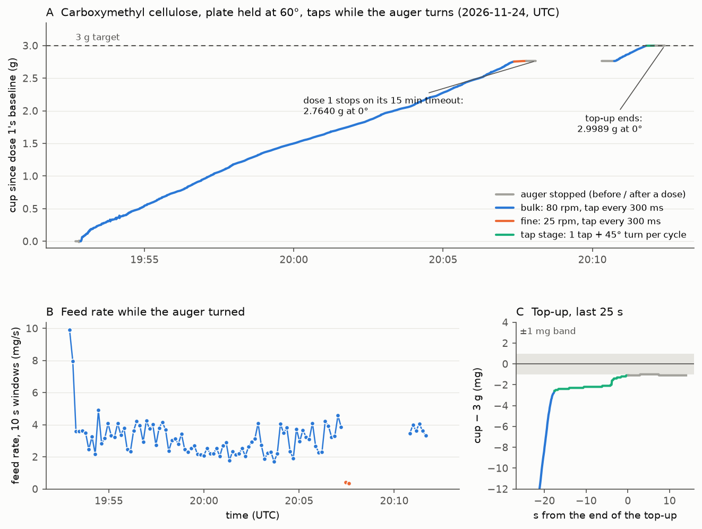

# 3 g of carboxymethyl cellulose at 60° with tapping (2026-11-24)

Asked by @XZaitzeff on [PR #131](https://github.com/vertical-cloud-lab/powder-doser/pull/131)
at 19:43 UTC: "carboxymethyl cellulose is in the auger. Dose 3 g at 60 degrees with tapping".

**Outcome:** the cup reads **2.9989 g** against the start (−1.1 mg), plate back at 0°. That took two
doses, both at 60° with taps:

| dose | start (UTC) | asked | result | final at 60° | final at 0° | time | auger revs | taps |
|---|---|---|---|---|---|---|---|---|
| 1 (`2026-11-24a`) | 19:52:41 | 3.0000 g | `timeout` (900 s) | 2.7641 g | 2.7640 g | 900.6 s | 1169.1 | 2975 |
| 2, top-up (`2026-11-24b`) | 20:10:18 | 0.2365 g | `ok` | 0.2356 g | 0.2356 g | 87.6 s | 84.4 | 211 |
| **cup, both doses** | | **3.0000 g** | | | **2.9989 g (−1.1 mg)** | 988 s | 1253.5 | 3186 |

- **At 60°, CMC fed steadily but slowly:** about **2.4 mg per auger revolution**, or 3.0 mg/s at 80 rpm
  (median of 10 s windows; range 1.7–9.9 mg/s, and the two fastest windows are the first 20 s of
  dose 1). That is close to what the 2026-08-05 battery measured at a 45° tube angle once the powder had
  arched over the intake, about 2 mg per revolution, and about a tenth of the 26 mg per revolution it gave
  at 22.5° ([battery notes](../../../docs/battery-runs/2026-08-05-carboxymethyl-cellulose.md)). Nothing
  stalled: the flow never paused for the 8 s that the stall rule allows.
- **Dose 1 ran out of time.** The bulk stage (80 rpm with a 60 ms tap every 300 ms) took **873 s** to
  reach 2.7502 g, where it stops at 0.25 g to go. The fine stage at 25 rpm then added only 9.6 mg in 24 s
  (0.4 mg/s, about 1 mg per revolution), and the 900 s dose timeout ended the dose at 2.7638 g.
- **Afterflow is tiny for CMC.** After the 80 rpm auger stopped, only **4.0 mg** (dose 1) and
  **3.8 mg** (top-up) more landed. That is about 1.2–1.5 s of flow at the rate just before the stop.
  Xanthan gum and calcium lactate in the November trials had 84–136 mg.
- **The top-up finished the dose in 88 s.** It started from the balance's reading at 0° (2.7635 g since
  dose 1's baseline, so 0.2365 g to go). The bulk at 60°, 80 rpm with taps ran to 7.2 mg short,
  3.8 mg landed after it stopped, and three tap-stage cycles at 60° (one tap and a 45° auger turn each)
  added 2.4 mg: 0.2 mg, 0.1 mg and 1.0 mg. The controller stopped inside its ±1 mg tolerance on its own
  reading (−1.0 mg).
- The final error is −1.1 mg against dose 1's baseline. The 0.1 mg difference from the controller's
  −1.0 mg is because dose 1's last reading (2.8069 g) and the top-up's first (2.8064 g) differ by 0.5 mg.
  A 45 s idle read afterwards (`rest_read_after.log`) gave 3.0416 → 3.0413 g displayed (−0.4 mg/min), so
  the cup holds 2.998–2.999 g against the start.

- **A:** the cup against dose 1's baseline (0.0429 g displayed, plate at 0°), coloured by controller stage.
  Grey: the auger is stopped (pre-roll, post-roll, and the gap between the doses).
- **B:** the feed rate while the auger turned, in 10 s windows.
- **C:** the top-up's last 25 s, as mg off 3 g, with the ±1 mg band.
- [`scripts/plot_fixed_tilt_dose.py`](../../../scripts/plot_fixed_tilt_dose.py) draws it from the per-dose
  CSVs and prints the feed-rate figures quoted above.

## What ran

[`fixed_tilt_dose.py`](../../../hardware/test-module/firmware/fixed_tilt_dose.py) runs from Pico RAM
(`mpremote run`; nothing written to the Pico). It is the November
[`three_phase_tilt_trials.py`](../../../hardware/test-module/firmware/three_phase_tilt_trials.py)
(`2026-11-20e`) cut down to one dose, on the Pico's own `main_three_phase.ThreePhaseDoser` (sha256 prefix
`6b2111e1b2447096`, unchanged since 11-18). It uses the same logging hooks: balance frames at about
8–9 Hz, no A&D tare, so every dose is a difference from its own baseline.

| | dose 1, `2026-11-24a` ([`657197e`](https://github.com/vertical-cloud-lab/powder-doser/commit/657197e)) | top-up, `2026-11-24b` ([`89b4ebe`](https://github.com/vertical-cloud-lab/powder-doser/commit/89b4ebe)) |
|---|---|---|
| plate | **60° in every stage** | **60° in every stage** |
| bulk | 80 rpm continuous, one 60 ms tap per 300 ms, no anticipation | same |
| fine | 25 rpm continuous, same taps, 20 mg anticipation | skipped (the bulk exits at 8 mg to go) |
| tap stage | stock (1 tap + 15° turn per cycle, 1.5 s settle, 5° nudges) | 1 tap + **45°** turn per cycle, otherwise stock |
| thresholds (bulk → fine → tap → tolerance) | stock 0.25 / 0.025 / 0.001 g | 0.008 / 0.008 / 0.001 g |
| dose timeout | 900 s (stock 600 s) | 420 s |
| target | 3.0 g | 3.0 g minus what the cup gained since dose 1's baseline (0.0429 g) |
| pre-roll | 5 s | 20 s (for a drift fit) |

After each dose the cup was read at 60° (post-roll 8 s, median of 8 reads), then the plate went to 0°
and it was read again after 6 s. The 0° reading is the one that matches the baseline, which was taken
at 0° before the plate tilted. At the end of these doses the two readings differed by at most 0.1 mg.

Why the top-up changed the stages: at 60° the stock fine stage (25 rpm, about 0.4 mg/s) and the stock tap
stage (a 15° turn, about 0.1 mg) are too slow to close 0.24 g in reasonable time. CMC barely flows after
the auger stops, so the 80 rpm bulk can safely run to within a few mg. The tap stage's turn went from 15°
to 45° (about 0.3 mg of CMC) so each cycle still adds less than the ±1 mg tolerance.

## Checks before the run (19:44–19:52 UTC, nothing moving)

- Tailnet up; the Zero was idle (no other login, port free, clock synchronised).
- Pico files read off the board with `mpremote fs cp` (read-only): `main_three_phase.py`, `config.py`,
  `scale.py`, `balance_filter.py`, `tic.py`, `main.py`, all unchanged since 11-18.
- Ten balance reads: **0.0559 g, stable**, so the beaker had been emptied since the 11-20 xanthan gum run.
  When dose 1 started six minutes later it read 0.0432 g, 12.7 mg lower with nothing on the pan, so the
  absolute zero wanders by about 2 mg/min at times. Each dose's pre-roll fit was flat (+0.06 mg/min for
  dose 1, −0.5 mg/min for the top-up), and the final −1.1 mg is measured against dose 1's own baseline.
- CPython dry runs on copies of the Pico files
  ([`tests/sim_three_phase_tilt_trials.py`](../../../hardware/test-module/firmware/tests/sim_three_phase_tilt_trials.py)
  with the plant's 60° feed set by an environment variable). They covered a powder that feeds well
  (`ok`, +0.7 mg), one that never feeds (two `stalled` doses, the second a top-up), one that feeds too
  slowly (`timeout`, no top-up after it), and the `2026-11-24b` top-up from 2.80 g (`ok`, −0.2 mg).
- Rig notice posted on the Zero (`~/RIG-NOTICE-20261124-cmc-3g.txt`) and marked done at 20:14.

## Timeline (UTC, 2026-11-24)

| time | what |
|---|---|
| 19:43 | Request |
| 19:44–19:52 | Preflight (above); script `2026-11-24a` pushed (`657197e`) |
| 19:52:34 | Dose 1 launched, detached on the Zero ([`run.sh`](run.sh)) |
| 19:52:51 | Plate 0 → 60°; bulk starts at 80 rpm with taps |
| 20:07:20 | Bulk stops at 2.7502 g (0.25 g to go); 4.0 mg lands after the stop |
| 20:07:22 | Fine stage starts at 25 rpm with taps |
| 20:07:47 | Dose timeout (900 s) at 2.7638 g; post-roll at 60° |
| 20:07:58 | Plate to 0°; 2.7640 g at 0° |
| 20:08:06 | Dose 1's script exits; plate at 0°, stepper off |
| 20:10:12 | Top-up `2026-11-24b` launched ([`run_topup.sh`](run_topup.sh), pushed as `89b4ebe`) |
| 20:10:44 | Plate 0 → 60°; bulk starts |
| 20:11:46 | Bulk stops at 7.2 mg to go; 3.8 mg lands after it |
| 20:11:49–20:12:06 | Tap stage, 3 cycles: `ok`, 0.2355 g |
| 20:12:18 | Plate to 0° after the post-roll; 3.0418 g displayed, 2.9989 g against dose 1's baseline |
| 20:12:26 | Top-up script exits |
| 20:13:07–20:13:55 | 45 s idle balance read: 3.0416 → 3.0413 g displayed |
| 20:14 | Pico soft-rebooted into its power-on `main.py` (`[rig] ready`, servo at 0.0°); port free; rig notice marked done |

## Files

- `dose1_1952Z/`, `dose2_topup_2010Z/`: each has the raw session log (every Pico line, with the Zero's UTC
  receipt time), the per-frame CSV (`trial_01_…`, `trial_02_…`; columns as in the
  [stepped-tilt trials](../../stepped-tilt-trials/README.md)), `trials_summary.csv` and the three standard
  figures from [`scripts/analyze_tilt_trials.py`](../../../scripts/analyze_tilt_trials.py). The top-up's
  `trials_summary.csv` lists `target_g` 3.0, the session target. Its own target was 0.2365 g, and its
  `error_mg` (−0.9) is against that.
- `cmc_3g_60deg.png`: the figure above.
- `rest_read.py`, `rest_read_after.log`: the 45 s idle balance read after the doses.
- `run.sh`, `run_topup.sh`: the launchers on the Zero.
- MongoDB: one `doc_type: "fixed_tilt_dose"` document in `powder_doser.dose_runs`
  (`session_id: "fixed-tilt-dose-2026-11-24T19:52:41Z"`, `powder_id: "carboxymethyl-cellulose"`). It
  holds both doses' parameters, records and full series.

**The beaker now holds about 3.0 g of CMC.** Empty it before the next run.
