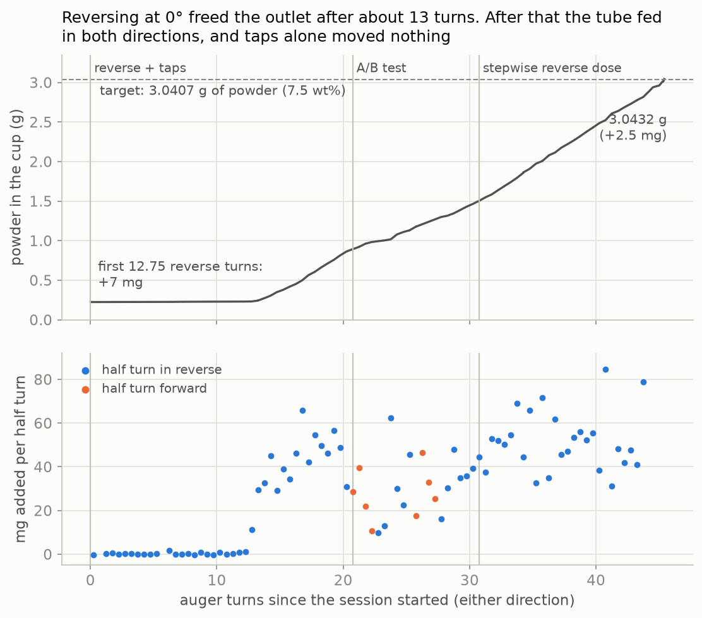
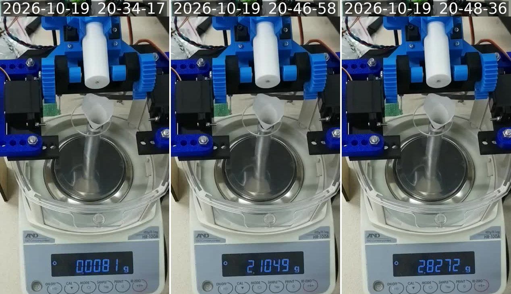
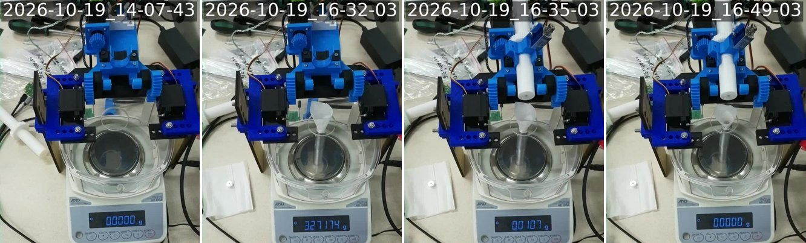
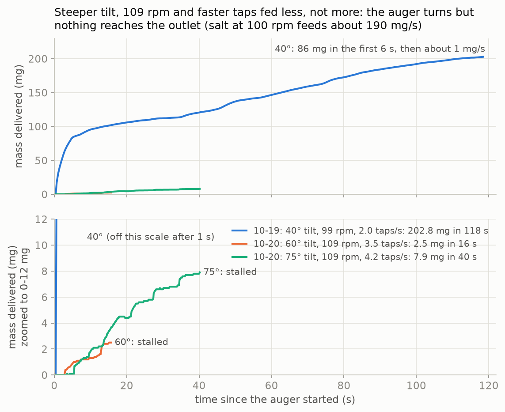
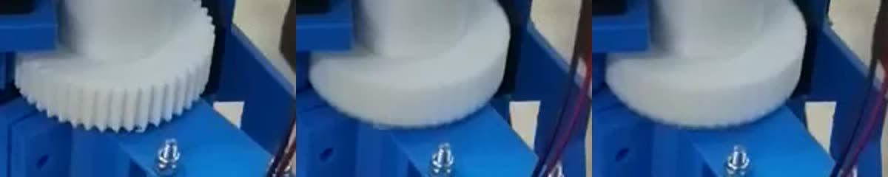
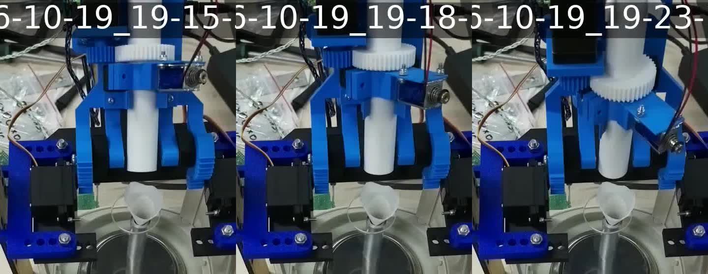
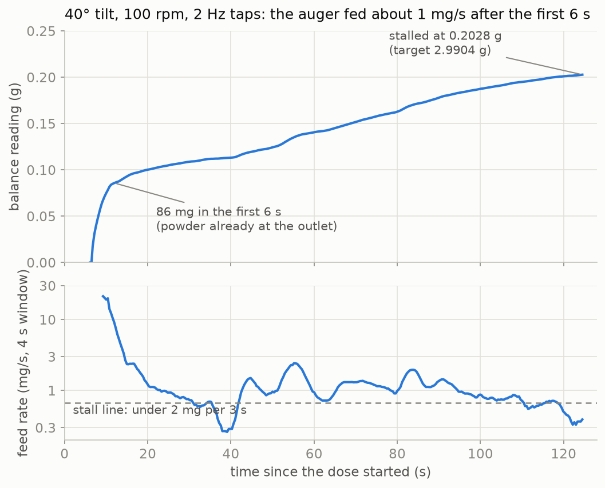
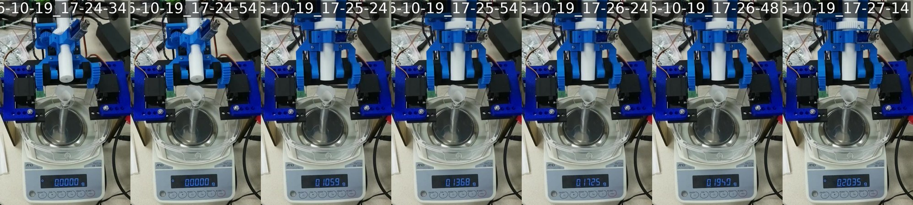

# Al 4047 doses into atomizer cups (byu-vcl composition spread)

## 2026-10-20, 02:30–02:50 UTC: reversing at 0° freed the outlet. The cup was dosed to 3.0432 g (target 3.0407 g)

@sgbaird asked in issue #186 to try reversing the auger "a bunch" at 0° tilt, tapping as well. They
also asked to compare the mass dosed so far with the mass loaded, in case the auger had run out
or was the wrong one.

| UTC | | balance over `f6a3403f`'s tare |
|---|---|---|
| 02:33 | `--takeover`, `/trickle_tap` runner booted at 0° plate and 60 auger rpm | stable 0.0080 g |
| 02:34 | ¼ and ½ turn in reverse (`r -90`, `r -180`) | 0.0083, 0.0081 g |
| 02:34:55–02:35:38 | 10 × (½ turn in reverse + one `t`, 3 taps): 5 turns | 0.0082 → 0.0099 g |
| 02:36:51–02:38:48 | 30 × (½ turn in reverse + 3 taps): 15 turns. The first 7 added 5 mg; **then the outlet freed** and the last 8 turns added 662 mg | 0.0099 → 0.0152 → 0.6769 g |
| 02:40:58–02:42:20 | A/B test at 0° (table below) | 0.6765 → 1.2873 g |
| 02:45:32–02:48:30 | stepwise reverse dose to a reading of 2.8247 g: 27 half turns, then 6 smaller steps | 1.2873 → 2.8270 g |
| 02:49 | stable read after 30 s; then the Pico was soft-rebooted into its power-on `main.py` | **2.8272 g** |

**Twelve and three-quarter reverse turns added only 7 mg. Then each half turn added roughly 30–65 mg,
and the livestream shows a thin stream from the outlet into the funnel on every step.**

| A/B test at 0° | turns | added | per half turn |
|---|---|---|---|
| 4 tap bursts (12 taps), no rotation | 0 | 0.0 mg | |
| forward + one tap burst per half turn | 2 | 100.9 mg | 28.7, 39.6, 21.9, 10.7 mg |
| reverse + one tap burst per half turn | 3 | 183.5 mg | 9.9, 13.0, 62.5, 30.1, 22.5, 45.5 mg |
| forward, no taps | 2 | 122.5 mg | 17.7, 46.4, 33.0, 25.4 mg |
| reverse, no taps | 3 | 204.1 mg | 16.3, 30.2, 47.8, 34.8, 35.7, 39.3 mg |

- **The outlet was blocked. The auger was not empty and not pumping backwards.** Once the outlet
  freed, the tube fed 60–80 mg per turn in either direction. Taps without rotation moved nothing.
- About 13 reverse turns at 0° cleared what about 300 forward turns at 40–75° on 10-19 and 10-20
  (198 + 29 + 73 turns) could not.
  The 09-30 doses fed 11–17 mg/s at 40° and 100 rpm, which is only 7–10 mg per turn. So the
  chunks were probably already throttling the outlet then.
- Whether forward rotation packs the chunks back into the outlet over a longer dose is untested.
  If a dose stalls again, try a few reverse turns at 0° first.

### The stepwise dose

The firmware's closed-loop dose only turns the auger forward, and nothing on the Pico was changed.
So `rig_cmd.py dose:2.8247:0.002` dosed with the runner's own `r <deg>` (60 auger rpm, reverse),
taking a stable read (three agreeing ST reads) after every step:

- Half turns while more than 150 mg remained. Smaller steps after that, each sized so that, at the
  steepest flow seen so far, it would add at most half of what remained. One step can't overshoot
  unless the flow suddenly jumps.
- Half turns added 31–85 mg (median 50 mg). The flow is lumpy: one 90° step added 42 mg and the
  next added 12 mg.
- **The last step overshot.** At 26.5 mg to go, a 24.9° step added 28.8 mg (1.2 mg per degree, more
  than twice the steepest half turn), which left the reading 2.3 mg over its target.
- The reading stayed at 2.8271–2.8272 g for over a minute afterwards, so nothing was still falling.

### State after this session

| | g |
|---|---|
| leaked into the cup when the auger was fitted on 10-19 (operator) | 0.0103 |
| `a5fdadaa`, over its tare | 0.2028 |
| `b13e5997`, over its tare | 0.0029 |
| `f6a3403f` plus today, over `f6a3403f`'s tare (stable, 02:49 UTC) | 2.8272 |
| **powder in the cup, or on the funnel** | **3.0432** |
| target for 7.5 wt% | 3.0407 |
| **difference** | **+2.5 mg** |

- **That is 7.5056 wt%:** 3.0432 / (32.5074 + 4.995 + 3.0432). The 4.995 g plug is still PR #232's
  computed value. Each 0.1 g error in it moves the composition by 0.019 wt%, far more than the
  2.5 mg overshoot.
- Some powder may sit on the funnel. Tap it into the cup before removing the funnel.
- The rig is free: the plate is at 0° and the Pico is on its power-on `main.py`. `/trickle_tap`,
  `config.py` and the Zero's checkout (`306bbee`) are unchanged.
  `~/RIG-NOTICE-20261020b-atomizer-cup-reverse.txt` on the Zero records the session.

### Mass dosed vs. mass loaded, and which auger this is

- **The loaded mass was never recorded.** It isn't in PR #166, the trial documents, PR #174's video notes
  or the byu-vcl threads. sgbaird said during the 09-30 dose: "Unless I didn't load enough in"
  ([dXRB7c6GeDw at 1:31](https://youtu.be/dXRB7c6GeDw?t=91)).
- **The loading video doesn't show it either.** In [QXSj0j1OqL8](https://youtu.be/QXSj0j1OqL8?t=349),
  the tube is filled at the back of the bench (5:49–16:39) and fitted straight onto the doser. It
  never goes on the balance. I read the balance display in the 720p stream wherever someone
  touches the balance (3:00–4:52, 17:09–17:46, 20:38–21:40, from a pass over the whole video at
  one frame per 10 s):

  | time | reading |
  |---|---|
  | 3:41–4:10 | a blue-capped item, 48.1–48.4 g |
  | 4:15–4:29, again at 17:30 and 20:40 | 35.885 g, probably the cup that took the 09-30 dose |
  | 4:38–4:48 | a 36.713 g item |
  | 21:10–21:40 | about 86.76 g |

  None of these is the tube or the powder jar weighed before and after filling.
- **If this is the 09-30 tube, 11.044 g has come out of it so far:**
  - 09-30: 8.0010 g
  - 10-19 and 10-20: 0.0103 + 0.2028 + 0.0029 + 2.8272 g
  
  It still gave about 50 mg per half turn at the end, so it isn't close to empty.
- **The livestream DVR shows when the auger went in** (local time is UTC−6):
  - From 13:00 until 16:33 on 10-19, no auger was on the rig. A white auger with a white gear lay on
    the bench beside it.
  - 16:30: the cup went on the balance (about 32.508 g). By 16:32, with the funnel, it read 32.717 g.
  - 16:34: the auger was fitted. The balance, tared with the cup and funnel, then read 0.0107 g,
    settling to 0.0103 g. That is the leak in the issue.
  - 16:49: re-tared with that leak in the cup.
  
  The filling itself is not on the stream, which reaches back only to 13:00.
- **It is probably not a salt auger.** This one is white. The augers printed from about 10-01, before
  the salt runs of 10-06 to 10-15, are black (PR #176's as-built notes). The 09-30 4047 tube was
  white with a red band (PR #174's storyboard). No log records which tube held which powder, so the
  only real check is to look at the powder in the cup.

### How it was run

`rig_cmd.py` gained three commands: `rot<deg>` (the runner's signed `r`), `tap<n>` (the runner's
`t`, 3 taps at 60/150 ms) and `dose:<g>:<tol>` (the stepwise dose above). They reuse the executor's
serial session class, with the same port lock and raw-log format. The commands ran from `/tmp` on
the Zero, and the dose ran detached so a dropped SSH session couldn't stop it halfway. The executor
(`opt_dose_capture.py`) was not used, so there is no `opt_trials` document for this session; the
raw serial log is the record. Livestream frames are from the `picam-d1pr` stream's DVR, fetched
through the Zero by HLS media-sequence number (2 s segments).

### Files (2026-10-20, second session)

- `zero/serial_readback_20261020b.log`: every command, scale read and the handback, raw.
- `zero/dose_rev_20261020b.out`: `rig_cmd.py`'s output for the stepwise dose (each step's mass).
- `reverse_trace.png` (made by `plot_reverse.py` from the raw log), `livestream_reverse.jpg`,
  `livestream_auger_install.jpg`.

## 2026-10-20: steeper tilt, 109 rpm and faster taps all at once. Both tries stalled (2.9 mg and 8.3 mg)

@sgbaird asked in issue #186 to retry with a higher tilt, fast rotation and frequent tapping all at
once, because the outlet was probably still clogged with larger chunks (the 09-30 load in
[PR #166](https://github.com/vertical-cloud-lab/powder-doser/pull/166#issuecomment-5920101018)).

| trial | tilt | auger | cadence taps | no-flow window | result |
|---|---|---|---|---|---|
| `a5fdadaa` (10-19) | 40° | 99 rpm | 60/440 ms at a 250 ms poll: 2.0/s | 15 s | `stalled` at 124.5 s, 202.8 mg (86 mg in the first 6 s) |
| `b13e5997` | 60° | 109 rpm | 60/140 ms at a 100 ms poll: 3.5/s | 15 s | `stalled` at 20.4 s, 2.5 mg (2.9 mg read 2 min later) |
| `f6a3403f` | 75° | 109 rpm | 60/90 ms at a 50 ms poll: 4.2/s | 40 s | `stalled` at 44.6 s, 7.9 mg (8.3 mg read 1 min later) |

- **The auger turned at full speed and fed almost nothing.** The drive gear's teeth are sharp at rest and
  fully blurred during `f6a3403f`. That is 0.09 mg (60°) and 0.11 mg (75°) per auger turn, against
  about 0.6 mg per turn at 40° after the first 6 s and 113 mg per turn for salt.
- **A steeper tilt should only help gravity feed, and the auger turned without stalling.** So either
  nothing reaches the flights (an empty or bridged hopper), or the outlet is blocked and the auger
  spins inside packed powder. Settings on the rig can't tell these apart; someone has to look.
- **109 rpm is the firmware ceiling** (240 motor rpm through the 44:20 gearing), so this was only 9% faster
  than 10-19's 100 rpm.
- **The tap rate is capped near 4 taps/s by the balance poll.** In `bulk_only` the loop fires at most one
  cadence tap per balance poll. Each poll is the sleep, the 60 ms tap and the balance read (about 70–120 ms here).
  More taps per second would need a firmware change (several taps per poll).

### Checks before spinning at a steeper tilt

- The plate was stepped up in 5° steps with the auger stopped, from 40° to 60° before `b13e5997` and
  from 60° to 75° before `f6a3403f`. At every step `rig_cmd.py` waited for three agreeing stable reads.
  They stayed at 0.2028–0.2030 g and then 0.0029 g, so the outlet never touched the funnel and nothing
  fell out.
- The livestream shows the outlet still over the funnel at 60° and 75°. The tilt pivot sits close
  to the outlet, so the outlet barely moves while the drive end swings. The hopper looks coaxial with the
  tube, above the drive gear, so a steeper tilt raises its open end.
- Each try was a 0.5 g target with the 20 mg overshoot guard, so a clog breaking at 60–75° could
  not run on to the whole remainder. A halt doesn't level the tube. The tube would have to be tilted
  back after the dose to stop any afterflow.

### Timeline (UTC)

| | |
|---|---|
| 01:10 | Zero read-only: idle since the 10-19 handback, nothing held the Pico's port, checkout at `306bbee`. |
| 01:14 | Livestream: the cup and funnel still on the pan, the plug on the wipe, balance 0.2028 g. |
| 01:15 | `--takeover` of the power-on `main.py`, `/trickle_tap` runner booted. Stable 0.2030 g at 0° and at 40°. |
| 01:16–01:18 | Plate stepped 40→60°: stable 0.2028–0.2030 g at each step. |
| 01:20:36 | `b13e5997` started: 0.5 g at 60°. It stalled at 20.4 s with 2.5 mg. |
| 01:22–01:23 | Stable 0.0029 g over `b13e5997`'s tare; plate stepped 60→75°, 0.0029 g at each step. |
| 01:23:54 | `f6a3403f` started: 0.5 g at 75°, 40 s no-flow window. It stalled at 44.6 s with 7.9 mg. |
| 01:26 | Stable 0.0083 g over `f6a3403f`'s tare. Plate eased 75→40→0° (0.0083 g throughout), then the Pico was soft-rebooted into its power-on `main.py`. |

### State after this session

| | g |
|---|---|
| powder target for 7.5 wt% (see 10-19 below) | 3.0407 |
| already in the cup before 10-19 (operator) | 0.0103 |
| `a5fdadaa`, last read over its tare before the next tare (01:18 UTC) | 0.2028 |
| `b13e5997`, read over its tare (01:23 UTC) | 0.0029 |
| `f6a3403f`, read over its tare (01:26 UTC) | 0.0083 |
| **in the cup, or on the funnel** | **0.2243** |
| **still to dispense** | **2.8164** |

- The rig is free: the plate at 0°, the Pico on its power-on `main.py`, `/trickle_tap` and the Zero's
  checkout unchanged. `~/RIG-NOTICE-20261020-atomizer-cup.txt` on the Zero records the session.
- **Before the next try, someone needs to look at the rig:** whether there is 4047 in the hopper, and
  whether the outlet and tube are blocked by chunks (or salt left from 10-15). Sieving out the larger
  chunks before reloading would avoid a repeat. Once it flows, 40° fed 4047 well on 09-30.
- **Not tried: reversing the auger.** A turn or two backwards might back a wedged chunk off the
  outlet. Reverse rotation has never been used on this rig, and I couldn't check that the auger's
  coupling tolerates it, so it needs a go-ahead.

### How it was run

The same executor as on 10-19 (`scripts/opt_dose_capture.py` at `306bbee`, `--mode production`), started
detached on the Zero. `--frozen` was 10-19's push with these changes: `bulk_poll_ms` 100 / 50,
`tap_cadence_off_ms` 140 / 90, `bulk_taper_start_g` 0.1, `dose_timeout_s` 180 / 120, and for
`f6a3403f` `bulk_settle_ms` 4000 (a 40 s no-flow window). The campaign parameters set all three tilts
to 60° / 75° and `bulk_rpm` to 109. `bulk_tap` stays the campaign's on/off categorical (`2hz` = on).
The cadence actually run is in each document's `parameters_executed`.

`rig_cmd.py` is the helper for the scale reads, the guarded tilt steps and the handback. It reuses
the executor's own serial session class, with the same port lock and raw-log format.
`grab_live.py` fetched livestream segments (`picam-d1pr`) through the Zero, because YouTube blocks
the runner's IP. Both ran from `/tmp` on the Zero, which a reboot clears.

### Files (2026-10-20)

- `zero/trial_b13e5997-….json`, `zero/trial_f6a3403f-….json`: the `opt_trials` documents (also in MongoDB).
- `zero/serial_b13e5997-….log`, `zero/serial_f6a3403f-….log`: the raw serial sessions, including every `set` echo.
- `zero/serial_readback_20261020.log`: the takeover, every tilt step and scale read, and the handback.
- `zero/run_B_b13e5997.out`, `zero/run_C_f6a3403f.out`: the executor's stderr and summary line.
- `zero/trials.jsonl`: the spool index, now three trials. Home paths are scrubbed to `~`.
- `unclog_trace.png` (made by `plot_unclog.py`), `livestream_tilt_steps.jpg`, `livestream_gear_blur.jpg`.
- `rig_cmd.py`, `grab_live.py`: the session helpers above.

## 2026-10-19: one as-made cup at the 7.5 wt% point (issue #186). Stopped at 0.2028 g because the auger wasn't feeding

@sgbaird asked in issue #186 for the 7.5 wt% point of
[byu-vcl PR #232](https://github.com/vertical-cloud-lab/byu-vcl/pull/232#issuecomment-6032144024)
(3.1 g of 4047 powder in one as-made cup), rescaled to this cup's weighed mass, with 0.0103 g
already in the cup.

### Target

PR #232 defines the point as powder / (cup + plug + powder) = 7.5 wt%, and its 3.1 g comes from a
computed 38.71 g of 6063 for the cup and plug together (`composition_spread.py` at byu-vcl `e639fbd`).

| | g |
|---|---|
| cup, weighed without its plug (operator) | 32.5074 |
| plug, not weighed; PR #232's computed .508" × .5625" plug with a #60 vent | 4.995 |
| powder for 7.5 wt%: 0.075 / 0.925 × (32.5074 + 4.995) | **3.0407** |
| already in the cup (operator) | 0.0103 |
| **to dispense** | **3.0304** |

Why the 32.5074 g has to be the cup without its plug: by PR #232's dimensions, an as-made cup alone
is 33.0–34.4 g and 38.0–39.4 g with its plug, and a thin-wall cup alone is 22.1–24.6 g. Each 0.1 g
of error in the plug estimate moves the powder target by 8.1 mg (0.02 wt%). `target_mass.py`
reproduces the table.

### What happened

| UTC | |
|---|---|
| 23:14 | Zero read-only: idle since 10-15, nobody held the Pico's port, checkout at `306bbee`. |
| 23:17 | `--takeover` of the power-on `main.py`, then the `/trickle_tap` runner (`trickle_tap/2026-10-15`) booted. The balance read a stable 0.0 g, so it had been tared with the cup on. |
| 23:19 | Livestream frame (`livestream_setup.jpg`): the cup stands on the pan with a funnel in its mouth under the auger outlet. The tare includes the funnel. A small disc with a centre hole sits on a wipe beside the balance, presumably the plug. |
| 23:24:42 | Trial `a5fdadaa`, dose A: target 2.9904 g, 40 mg short of 3.0304 g on purpose. A slower top-up was to follow. |
| 23:26:47 | `stalled` after 124.5 s at **0.2028 g**. |
| 23:30 | Five scale reads: stable **0.2035 g** over dose A's tare. The Pico was soft-rebooted back to its power-on `main.py`. |

Dose A settings: bo-005's bulk settings (40° tilt, 100 rpm, 2 Hz cadence taps) in the `bulk_only`
mode that finished the 2026-09-30 Al 4047 dose, so the tube held one tilt over the funnel throughout.
Other settings: τ_afterflow 0.8338 s, tolerance 3 mg, one pass, and an rpm taper from 100 to 15 over
the last 0.5 g, which never started. The overshoot guard was 20 mg and the dose timeout 1200 s. Every
other setting was the salt campaign's frozen value, with `log_to_flash 0`.

**The auger turned but moved almost no powder.**
- 86 mg fell in the first 6 s. That powder was already at the outlet.
- After that, 198 auger turns gave about 1 mg/s. That is about 1 mg per turn, against about 113 mg
  per turn for salt and 250 mg/s at 100 rpm for AlSi10Mg on 09-29.
- At about 0.5 mg per tap, the 237 cadence taps alone account for that trickle.
- In the video the drive gear blurs during the dose (turning), and the funnel stays empty with the
  outlet right above it (`livestream_dose.jpg`).
- This matches the last two salt doses on 10-15, which stalled after 184 and 155 mg. So the hopper
  is probably empty or bridged, or caked salt is still in the tube.

### State after this session

- **The cup holds about 0.2138 g:** the 0.0103 g already in it, plus the 0.2035 g read over dose A's
  tare. Some of that 0.2035 g may be on the funnel rather than in the cup.
- **The first material out may not be 4047.** If the tube still held salt from 10-15, look at what's
  in the cup before you use it.
- **To reach 7.5 wt%, 2.8269 g more is needed** (3.0407 − 0.2138), with the cup left on the pan. Every
  dose tares first.
- **The rig is free.** `/trickle_tap` and the Zero's checkout are unchanged.

### How it was run

`scripts/opt_dose_capture.py` (PR #166 branch, `306bbee`) ran on the Zero in `--mode production`,
with campaign id `production-al4047-atomizer-cups`, powder id `al4047` and `--takeover`. It was
started detached from the Actions runner, so a dropped SSH session couldn't affect it. The trial
document is also in MongoDB `opt_trials`. The livestream frames are from `picam-d1pr`
(`@byu-vcl-hardware-streams`), fetched through the Zero because YouTube blocks the runner's IP.

### Files

- `zero/trial_a5fdadaa-….json`: the `opt_trials` document (RESULT, parameters as executed,
  telemetry), the same one as in MongoDB.
- `zero/serial_a5fdadaa-….log`: the raw serial session, including every `set` echo. It's
  force-added past the `*.log` ignore.
- `zero/serial_readback_20261019.log`: the scale reads before and after the dose, and the handback
  to `main.py`.
- `zero/trials.jsonl`: the Zero's spool index. The home-directory path is scrubbed to `~`.
- `dose_trace.png`: made by `plot_dose.py`. `target_mass.py` reproduces the target table.
- `livestream_setup.jpg`, `livestream_dose.jpg`: frames from the bench livestream at 23:19 and
  23:24–23:27 UTC (the clock burned into the frames is local time, UTC−6).
