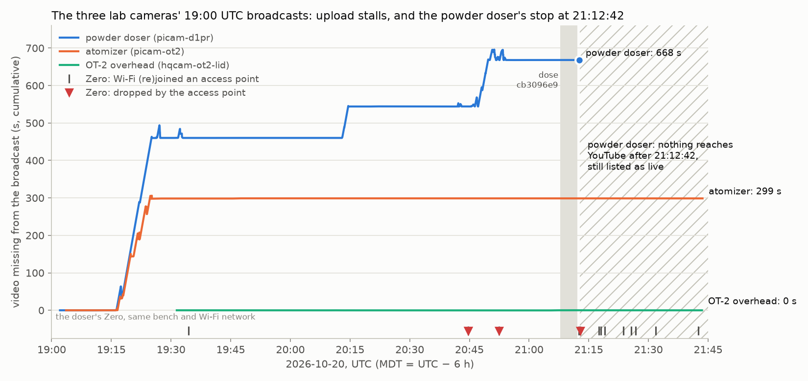
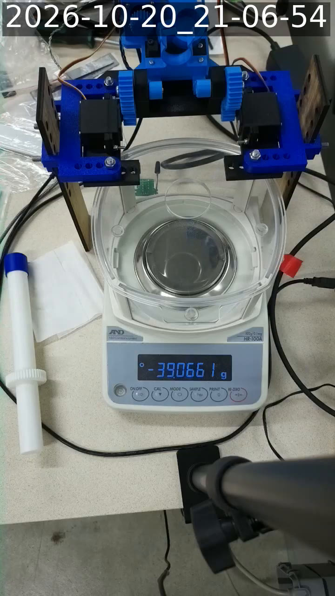
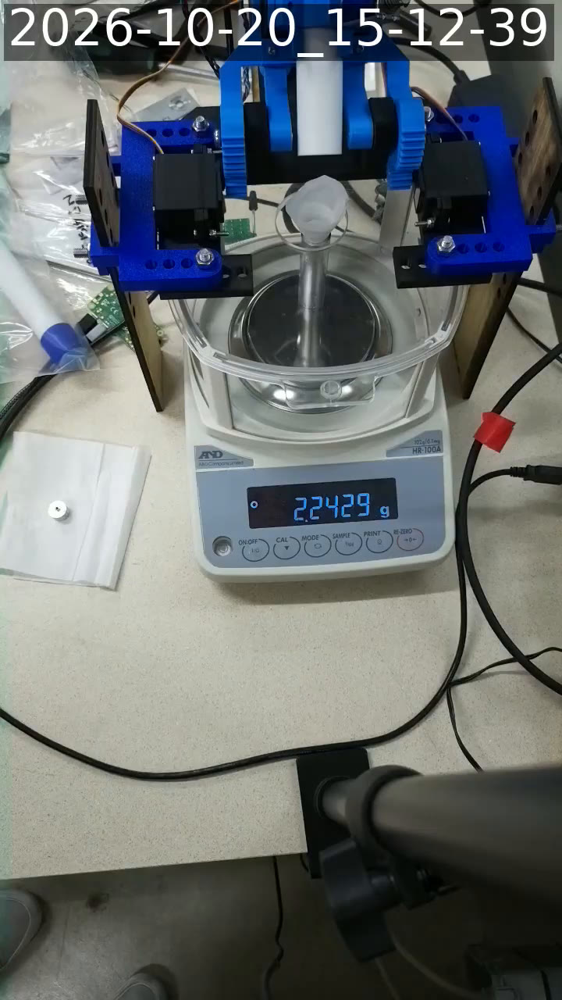

# Why the powder-doser livestream froze on 2026-10-20

@sgbaird asked in issue #186 what was going on with the powder-doser livestream, which the third and
fourth 10-20 sessions found frozen at 21:12 UTC while YouTube still listed it as live, and noted that
[`3CvBrmkv2xE`](https://www.youtube.com/watch?v=3CvBrmkv2xE) looked to be the latest broadcast.
Everything here was read on 2026-10-21 between 01:38 and 03:07 UTC, through the Zero, because YouTube
refuses the Actions runner.

## Short answer

- **The camera stopped sending at 21:12:42 UTC (15:12:42 MDT) on 10-20 and has sent nothing since.**
  A freshly resolved playlist for `3CvBrmkv2xE` still ends with segment 3613, which YouTube received at
  21:12:40. The server's live head is segment 3615 (`X-Head-Seqnum`), 7226 s of video. So it isn't a
  stale link cached by `grab_live.py`. The camera's last frame is ordinary (`last_frame_3CvBrmkv2xE_sq3613.jpg`).
- **YouTube still says "live" because nothing ended the broadcast.** The streaming Lambda creates
  broadcasts with `enableAutoStop` off, and only the camera's next start ends the old one
  ([byu-vcl `docs/stream-cams.md`](https://github.com/vertical-cloud-lab/byu-vcl/blob/22fa33a/docs/stream-cams.md#renaming-the-workflow)).
  `3CvBrmkv2xE` is the newest powder-doser broadcast on the channel, so you linked the right one.
- **YouTube and the lab's internet were fine.** At 01:43 UTC the atomizer stream (`picam-ot2`) and the
  OT-2 overhead stream (`hqcam-ot2-lid`) were both live to within 10 s.
- **The bench's Wi-Fi was bad that afternoon.** The camera's upload stalled four times before it stopped,
  and 668 s of video never reached YouTube. The Zero, on the same bench and Wi-Fi network, was dropped by
  its access point at 20:44:43 and 20:52:24, during the camera's third bout of stalls. **At 21:12:28 it
  roamed to another access point, and at 21:12:53 it was knocked off again** (reason 6). That straddles the
  camera's last segment, received at 21:12:40. From then until 21:42 the Zero hopped between two access
  points (channels 1 and 6) 8 more times.
- **The camera Pi didn't recover, and its watchdog should normally have done that.** Since 09-26 the
  camera has had the watchdog from
  [streamingLambda #9](https://github.com/vertical-cloud-lab/streamingLambda/issues/9). It restarts the
  stream after 3 minutes without RTMP progress, and retries once YouTube's RTMP server is reachable
  again. Every restart starts a new broadcast, and none appeared for almost 6 hours. I couldn't look at
  the Pi itself: it isn't on this repo's tailnet, and its login is a streamingLambda secret.
- **It came back by itself at the scheduled 03:00 UTC reboot** (below), as
  [`UgADayIM87s`](https://www.youtube.com/watch?v=UgADayIM87s), live from 03:01:06 UTC. So the Pi was
  running the whole time, most likely off the Wi-Fi. The stream was down for 5 h 48 min.

## It came back at the 03:00 UTC reboot

The camera Pi reboots on a schedule at 05:00, 13:00 and 21:00 MDT (03:00, 11:00 and 19:00 UTC), which
is where the 8-hour broadcasts come from ([streamingLambda #9](https://github.com/vertical-cloud-lab/streamingLambda/issues/9)).
I waited for the 03:00 UTC one:

- **At 03:02 UTC the channel listed a new live broadcast,
  [`UgADayIM87s`](https://www.youtube.com/watch?v=UgADayIM87s), *powder doser stream picam-d1pr,
  2026-10-21 UTC 03:00*.** Its first segment arrived at 03:01:06 UTC, and at 03:06:56 its playlist was
  3 s behind real time with no reconnects. So the Pi had been running all along, and the stream was
  down for **5 h 48 min** (21:12:42 to 03:01:06 UTC).
- **Starting it ended `3CvBrmkv2xE`,** which is now `post_live`. YouTube gives it a duration of
  28,777 s, but that is just the time from its start to its end: the archive lists 3,612 segments,
  the last one received at 21:12:40, and segment numbers after 3616 return 404
  (`zero/after_reboot_20261021T0303Z.json`). The camera really sent nothing between 21:12:42 and the
  reboot.
- The new stream shows the bench normally at 21:06:54 MDT. The pan is empty (the balance reads
  −39.0661 g against its last zero) and the auger tube is out of the doser, lying on the bench.

**So a running Pi went almost 6 hours without streaming and without its watchdog starting a new
broadcast.** That fits a Pi that dropped off the Wi-Fi at 21:12 and didn't rejoin until the reboot:
the watchdog only retries once YouTube's RTMP server is reachable. It would also fit a watchdog that
wasn't running. The camera Pi's journal from the previous boot (`journalctl -b -1`, from 15:12 MDT on,
for NetworkManager, `wpa_supplicant`, `device.service` and `stream-watchdog`) would say which. Its login
is a streamingLambda secret, so that check needs an `@claude` run there.

## Evidence

### The frozen broadcast

| | `3CvBrmkv2xE` |
|---|---|
| title | powder doser stream picam-d1pr, 2026-10-20 UTC 19:00 |
| `live_status` (yt-dlp, 01:38 UTC) | `is_live` |
| started | 19:01:13 UTC (`release_timestamp`) |
| playlist fetched 01:39:40 UTC | media sequence 3164–3613, 450 × 2 s, first segment's `PROGRAM-DATE-TIME` 20:57:41.954 UTC, so it ends at 21:12:42. No `ENDLIST` |
| `#EXT-X-DISCONTINUITY-SEQUENCE` | 7: the encoder reconnected 7 times before 20:57:42 |
| live head at 01:40:33 UTC | `X-Head-Seqnum` 3615, `X-Head-Time-Sec` 7226 |
| last segment received | 3613, `Ingestion-Walltime-Us` 21:12:40.09 UTC |

`playlist_3CvBrmkv2xE_20261021T0139Z.json` has the playlist's tags and counts. The playlist itself isn't
committed, because its URLs carry the Zero's public IP address.

### The other two cameras (01:43 UTC)

| stream | broadcast | playlist ends | behind real time | reconnects (`DISCONTINUITY-SEQUENCE`) |
|---|---|---|---|---|
| powder doser, `picam-d1pr` | `3CvBrmkv2xE` (19:00) | 21:12:41 | 16,244 s | 7 |
| atomizer, `picam-ot2` | `z13xp1AcKag` (19:02) | 01:43:25 | 6 s | 7 |
| OT-2 overhead, `hqcam-ot2-lid` | `jjnM7zFM6YE` (19:29) | 01:43:28 | 10 s | 1 |

The channel's 40 newest streams, as yt-dlp listed them at 01:42 UTC, are in
`zero/channel_streams_20261021T0142Z.csv`. Each camera starts a broadcast at 03:00, 11:00 and 19:00 UTC,
and the archived powder-doser broadcasts back to 10-17 each ran their full 8 hours (28,605 to 28,740 s).

### Stalls in the 19:00 UTC broadcasts

Every 2 s segment of a YouTube live broadcast starts with a short text header that includes
`Ingestion-Walltime-Us`, the time YouTube received it. While the encoder keeps up, that time minus
2 s × the segment number is constant. A stall raises it by the video that never arrived, and the
burst that follows (segments 0.2–0.5 s apart) lowers it a little as ffmpeg empties its buffer.
`gap_map.py` reads that header from the first 2 kB of the 144p segments: every 60th segment,
then a bisection of every interval where the difference changed by 1 s or more.

| UTC | powder doser (`picam-d1pr`) | atomizer (`picam-ot2`) | the Zero (same bench) |
|---|---|---|---|
| 19:16–19:27 | +464 s, longest stall 251 s | +298 s, longest 111 s | nothing logged |
| 19:31–19:33 | +2 s (one 20 s stall, then caught up) | | roamed at 19:34:23 |
| 20:13–20:15 | +84 s, longest 57 s | | its Tailscale relay connection was reset at 20:03:15 and 20:04:57 |
| 20:42–20:54 | +145 s, longest 51 s | | dropped by the access point at 20:44:43 (authentication timed out) and 20:52:24 |
| 21:12:42 | **stops for good** | | roamed at 21:12:28, dropped at 21:12:53 (reason 6), then roamed 8 more times by 21:42 |

- **19:16–19:27 hit both cameras at once, so it was the network, not one Pi.** The OT-2 overhead
  stream only started at 19:29 and has had no stall since.
- **After that, only the powder-doser camera stalled,** and its last bout and the final stop line up
  with the Zero losing its access point. The Zero shares the powder-doser camera's bench; the atomizer
  camera is in another room.
- In all, 668 s of the camera's first 2 h 11 min never reached YouTube, against 299 s for the atomizer
  camera over its whole broadcast so far.

### The Zero's Wi-Fi

`zero/zero_wifi_journal_20261020.txt` is the Zero's journal from 12:55 to 19:40 MDT, cut to Wi-Fi
association, DHCP and Tailscale relay lines, with addresses, MAC addresses and the network's name
removed. Times there are MDT. The Zero roams between two access points on channels 1 (2412 MHz) and
6 (2437 MHz); three access points show up that afternoon. It was on the network the whole time apart
from the drops above, each of which it recovered from within 11 s.

### Why the watchdog didn't bring it back

From the [`stream-watchdog.sh`](https://github.com/vertical-cloud-lab/streamingLambda/blob/829b3eb/pi/stream-watchdog.sh)
that streamingLambda #9 installed on this camera's Pi on 09-26 (byte-identical to byu-vcl's
[copy](https://github.com/vertical-cloud-lab/byu-vcl/blob/5c6b417/wireless-color-sensor/ot2/livestream-pi/stream-watchdog.sh)),
run every minute:

- If `device.service` is running but its RTMP socket's acknowledged byte count hasn't moved for
  3 checks in a row, it restarts the service. That is the dead-socket case; it would have shown up
  as a new broadcast within about 4 minutes.
- If the service has failed (e.g. `device.py` couldn't reach the Lambda, 3 times within the hour), it
  waits until `a.rtmp.youtube.com:1935` accepts a connection and then starts it again.
- Either path is limited to 6 restarts in a rolling 24 hours. No powder-doser broadcast outside the
  03:00/11:00/19:00 schedule appears in the channel's list since 10-17, so restarts that made it
  as far as a broadcast didn't use that up.

So a Pi that was up and online would have been streaming again by about 21:17. Nothing appeared until
the 03:00 UTC reboot, and the Pi was running (it streamed within a minute of the reboot). So either it
was off the network the whole time (no route to YouTube, so the watchdog kept waiting), or the watchdog
wasn't running. The Pi's journal from the previous boot would tell which.

## Files

- `gap_map.py` (on the Zero): the stall map. `python3 gap_map.py VIDEO_ID 60 999999 dump.json`.
- `live_edge.py` (on the Zero): how far behind real time each broadcast's playlist is.
- `plot_stalls.py`: the plot, from `zero/dump_*.json` and the Zero's journal extract.
- `zero/gaps_<video>.jsonl`, `zero/dump_<video>.json`: `gap_map.py`'s output for the three 19:00 UTC
  broadcasts (every step of 1 s or more, and every segment it read with its ingest time).
- `zero/channel_streams_20261021T0142Z.csv`, `zero/playlist_3CvBrmkv2xE_20261021T0139Z.json`,
  `zero/zero_wifi_journal_20261020.txt`: described above.
- `last_frame_3CvBrmkv2xE_sq3613.jpg`: the first frame of segment 3613 at 720p.
- `zero/channel_check_20261021T0302Z.jsonl`: the channel's 8 newest streams at 03:02 UTC.
- `zero/after_reboot_20261021T0303Z.json`: the ended broadcast's archive probe and the new broadcast's
  live edge. `frame_UgADayIM87s_20261021T030654Z.jpg`: the new broadcast at 03:06:54 UTC.

Nothing on the Zero, the rig or any camera was changed. All YouTube requests went through the Zero:
about 20 yt-dlp page loads (1–2 MB each, not rate-capped), four 720p and 144p segments for frames,
and about 1,600 reads of 2 kB segment headers, spaced at least 0.15 s apart. Its `/tmp` copies were
deleted afterwards.
