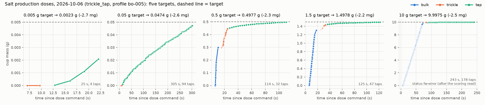

# Salt production doses (`scripts/dose.py`, campaign id `production-salt`)

On 2026-10-06 (16:48–17:16 UTC), @williamulbz ran five production doses of salt by hand on the
Zero, each to a different target: **0.005, 0.05, 0.5, 1.5 and 10 g**. The command was PR #166's
`scripts/dose.py --powder-id salt --takeover --profile salt-20260929T014732Z-bo-005-20261006T034908Z`.
All five used the same settings: the salt campaign's validated `bo-005` profile on the
`trickle_tap/2026-09-30b` firmware, built from PR #166 commit `6fc5f79`.

`dose.py` saved its files to the Zero's spool (`~/powder-doser/data/opt/production-salt/`) and
uploaded each trial to MongoDB `powder_doser.opt_trials`, but they were never committed to a branch.
This folder copies the spool as it stood on 2026-11-11. Only one change was made: the home-directory
path in `trials.jsonl` was replaced with `~`.

| target | settled result | error | status | time | taps | auger rev | trial | tidy series |
|---|---|---|---|---|---|---|---|---|
| 0.005 g | 0.0023 g | −2.7 mg | ok | 25 s | 4 | 0.0 | `73469530` | [`dose_0p005g_73469530.csv`](doses/dose_0p005g_73469530.csv) (6 rows) |
| 0.05 g | 0.04744 g | −2.56 mg | ok | 305 s | 94 | 0.02 | `2ad2984a` | [`dose_0p05g_2ad2984a.csv`](doses/dose_0p05g_2ad2984a.csv) (97 rows) |
| 0.5 g | 0.49772 g | −2.28 mg | ok | 114 s | 32 | 6.0 | `5843f717` | [`dose_0p5g_5843f717.csv`](doses/dose_0p5g_5843f717.csv) (59 rows) |
| 1.5 g | 1.4978 g | −2.2 mg | ok | 125 s | 47 | 16.4 | `db6420f4` | [`dose_1p5g_db6420f4.csv`](doses/dose_1p5g_db6420f4.csv) (85 rows) |
| 10 g | 9.99752 g | −2.48 mg | fw-error* | 243 s | 178 | 107.3 | `676d8b4b` | [`dose_10g_676d8b4b.csv`](doses/dose_10g_676d8b4b.csv) (235 rows, from the console) |

\*The 10 g dose finished in tolerance at its scoring read (`DoseResult(ok: 9.9975/10.0000 g)`).
After that, building the RESULT line hit `MemoryError` on the Pico, so the status became
`fw-error` and the telemetry buffer was lost. Its time series is parsed from the console lines of
its serial log instead, which gives 1 s time resolution in the bulk and tap rows and no raw balance
reading in the trickle rows.

The same spool also holds a sixth dose from 2026-10-08 01:07 UTC: 0.5 g to 0.4997 g (−0.3 mg),
trial `9046eb75`. `serial_f82717a0-….log` is an attempt from just before it that never reached a
dose, so it has no trial file.

## Files

- `zero/trial_<uuid>.json`: the full `opt_trials` document. It has the RESULT, per-phase times,
  stop events, parameters as executed, and the controller telemetry (`telemetry.header` /
  `telemetry.rows`). The same document is in MongoDB `opt_trials`.
- `zero/serial_<uuid>.log`: the raw serial session. It includes every `set` echo, the console
  trace and the `--- BEGIN trickle telemetry CSV ---` block.
- `zero/trials.jsonl`: the Zero's spool index.
- `doses/dose_<target>g_<uuid8>.csv`: one tidy time series per dose, made by `extract_doses.py`.
- `doses_summary.csv`: one row per dose.
- `production_salt_doses.png`: the figure above, made by `python3 data/opt/production-salt/extract_doses.py`.

### Tidy series columns

| column | meaning |
|---|---|
| `t_s` | seconds since the dose command (the tare takes the first ~6 s) |
| `phase` | `bulk` (auger polls), `bulk_settled` (settled read after the auger halts), `trickle` (PI + Kalman-filter steps), `trickle_end` (settled read), `tap` (settled read after each tap cycle) |
| `mass_g` | balance reading (`z_g`) |
| `kf_mass_g`, `kf_rate_gps`, `kf_sigma_g` | Kalman-filter mass, rate and sigma (trickle rows only) |
| `ff_gpr`, `rate_setpoint_gps`, `pred_g`, `cutoff_g` | feed-factor estimate, PI rate set-point, predicted settled mass and the cutoff it is compared to (trickle rows only) |
| `tilt_deg_cmd`, `auger_rpm_cmd`, `tap_mode` | commanded actuators. Only trickle `auger_rpm_cmd` is logged per row. The rest come from the executed parameters by phase: bulk 40° at 100 rpm with cadence taps (60 ms on, 440 ms off); trickle 10°; tap 15° with the auger stopped and single taps |
| `source` | `telemetry` (trial document) or `console` (parsed serial log) |

Rows are controller steps, not the raw balance stream. Bulk and trickle rows are about 0.38 s
apart; tap rows are about 3 s apart (one per tap cycle). The 0.005 and 0.05 g doses skip bulk,
because the target is below the 0.35 g handoff.
