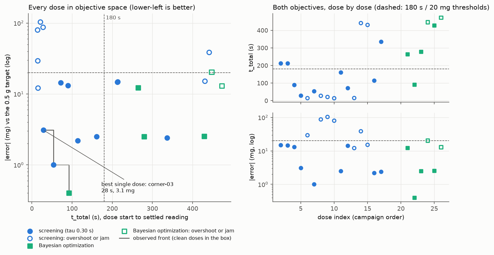

# Campaign salt-margin-20261013T191339Z

- **three-stage + cutoff margin** campaign: the PI trickle's hand-over margin is searched too (0-35 mg); overshoots are scored like jams; warm-started from `salt-20260929T014732Z` (60 of its doses attached at 35 mg)
- powder `salt`, target 0.5 g, status **finished**; the search loop stopped on: deadline: 472 s left before 2026-10-13T21:30Z, the next dose needs about 556 s
- 27 doses: 18 screen, 2 recenter, 7 bo
- tau_afterflow fit: 0.8338 s (linear model, 26 stop events, rates 0.0221-0.1586 g/s)
- powder in the cup at the end: 12.55 g

## Best observed dose (knee of the observed front)

`corner-03` (screen): t_total 28.4 s, |error| 3.1 mg, a single dose, not yet validated with replicates.

```json
{
 "bulk_tilt_deg": 15.0,
 "trickle_tilt_deg": 10.0,
 "tap_tilt_deg": 0.0,
 "bulk_rpm": 20.0,
 "trickle_start_remaining_g": 0.05,
 "tolerance_g": 0.003,
 "bulk_tap": "off",
 "trim_tap": "off",
 "cutoff_margin_g": 0.0
}
```

## Model Pareto set (Ax, predicted means)

The dose column is the label `--validate-point` takes.

| Ax trial | dose | t_total (s) | abs_error (mg) | taps bulk/trim, bulk tilt, trim tilt, tap tilt, RPM, threshold g, tol mg, margin mg |
|---|---|---|---|---|
| 33 | salt-20260929T014732Z/bo-005 | 129.1 | 1.8 | 2hz/off, 40.0, 10.0, 15.0, 100, 0.300, 3.0, 35.0 |
| 38 | salt-20260929T014732Z/bo-010 | 125.9 | 11.1 | 2hz/off, 40.0, 10.0, 15.0, 100, 0.300, 15.0, 35.0 |
| 31 | salt-20260929T014732Z/bo-003 | 157.4 | 1.3 | 2hz/off, 40.0, 30.0, 15.0, 100, 0.300, 3.0, 35.0 |
| 6 | salt-20260929T014732Z/corner-05 | 159.7 | 0.8 | off/2hz, 40.0, 10.0, 15.0, 20, 0.300, 3.0, 35.0 |

## Margin: the parent's corners at 35 mg and at 0 mg

Each corner of `salt-20260929T014732Z`'s 2^(8-4) fraction, dosed there at its 35 mg margin and here at 0 mg, both on the screening tau. Over the 16 pairs: t_total changes by -56.2 s (mean of the 7 pairs where both ended ok), |error| by +4.7 mg, and 5 of the 0 mg doses overshot.

| corner | taps bulk/trim, bulk tilt, trim tilt, tap tilt, RPM, threshold g, tol mg | 35 mg: status, t (s), error (mg) | 0 mg: status, t (s), error (mg) |
|---|---|---|---|
| corner-00 | 2hz/2hz, 40.0, 10.0, 0.0, 20, 0.050, 15.0 | overshoot, 19.3, +83.2 | ok, 213.3, -14.8 |
| corner-01 | off/off, 40.0, 30.0, 0.0, 20, 0.300, 15.0 | ok, 197.6, -14.3 | ok, 212.7, -14.7 |
| corner-02 | 2hz/off, 15.0, 10.0, 15.0, 20, 0.300, 15.0 | ok, 70.7, -14.8 | ok, 89.7, -13.1 |
| corner-03 | off/off, 15.0, 10.0, 0.0, 20, 0.050, 3.0 | ok, 226.7, -2.6 | ok, 28.4, -3.1 |
| corner-04 | 2hz/off, 15.0, 30.0, 0.0, 100, 0.050, 15.0 | overshoot, 14.7, +47.6 | overshoot, 14.6, +29.3 |
| corner-05 | off/2hz, 40.0, 10.0, 15.0, 20, 0.300, 3.0 | ok, 65.5, -0.6 | ok, 53.6, -1.0 |
| corner-06 | off/2hz, 15.0, 30.0, 15.0, 20, 0.050, 15.0 | ok, 110.2, -14.3 | overshoot, 27.8, +87.0 |
| corner-07 | 2hz/2hz, 40.0, 30.0, 15.0, 100, 0.300, 15.0 | overshoot, 22.1, +22.1 | overshoot, 21.1, +103.2 |
| corner-08 | off/2hz, 40.0, 30.0, 0.0, 100, 0.050, 3.0 | overshoot, 14.0, +34.0 | overshoot, 14.1, +79.7 |
| corner-09 | 2hz/off, 40.0, 30.0, 15.0, 20, 0.050, 3.0 | ok, 51.8, -0.7 | ok, 161.2, -2.5 |
| corner-10 | off/2hz, 15.0, 10.0, 0.0, 100, 0.300, 15.0 | ok, 352.0, -14.8 | ok, 72.0, -14.4 |
| corner-11 | 2hz/2hz, 15.0, 10.0, 15.0, 100, 0.050, 3.0 | overshoot, 14.9, +62.9 | overshoot, 15.2, +12.1 |
| corner-12 | 2hz/off, 40.0, 10.0, 0.0, 100, 0.300, 3.0 | ok, 113.9, -2.0 | cycle-budget, 441.4, -38.5 |
| corner-13 | off/off, 40.0, 10.0, 15.0, 100, 0.050, 15.0 | overshoot, 15.3, +25.2 | cycle-budget, 430.8, -15.1 |
| corner-14 | off/off, 15.0, 30.0, 15.0, 100, 0.300, 3.0 | ok, 160.7, -1.7 | ok, 114.3, -2.2 |
| corner-15 | 2hz/2hz, 15.0, 30.0, 0.0, 20, 0.300, 3.0 | cycle-budget, 403.0, -16.5 | ok, 336.6, -2.4 |

The margin's effect split by each other factor's level (a margin x factor interaction is a difference between the two columns):

| Factor | low / high | change in t_total, at low -> at high (s) | change in abs_error, low -> high (mg) | overshoots at 0 mg, low / high |
|---|---|---|---|---|
| Bulk taps | off / 2 Hz | -104.3 (n=5) -> +64.2 (n=2) | +13.7 -> -4.2 | 2 / 3 |
| Trim taps | off / 2 Hz | -20.3 (n=5) -> -146.0 (n=2) | +1.2 -> +8.3 | 1 / 4 |
| Bulk tilt (deg) | 15 / 40 | -126.4 (n=4) -> +37.5 (n=3) | -1.5 -> +10.9 | 3 / 2 |
| Trim tilt (deg) | 10 / 30 | -117.8 (n=4) -> +26.0 (n=3) | -11.8 -> +21.2 | 1 / 4 |
| Tap tilt (deg) | 0 / 15 | -154.4 (n=3) -> +17.5 (n=4) | -2.3 -> +11.7 | 2 / 3 |
| Bulk RPM | 20 / 100 | -13.4 (n=5) -> -163.2 (n=2) | -1.1 -> +10.5 | 1 / 4 |
| Bulk->trim threshold (g) | 0.05 / 0.3 | -44.5 (n=2) -> -60.9 (n=5) | -3.4 -> +12.8 | 4 / 1 |
| Trim tolerance band (g) | 0.003 / 0.015 | -36.8 (n=4) -> -82.0 (n=3) | +2.6 -> +6.9 | 2 / 3 |

## Screening main effects (16 corners)

8 corners sit at each level of every factor. Time is averaged over the corners that ended `ok` (an overshoot ends in seconds and would look fast); |error| is averaged over all of them.

| Factor | low / high | mean t_total of ok doses, low -> high (s) | mean abs_error, low -> high (mg) | overshoot or jam, low / high |
|---|---|---|---|---|
| Bulk taps | off / 2 Hz | 96.2 (n=5) -> 200.2 (n=4) | 27.1 -> 27.0 | 3 / 4 |
| Trim taps | off / 2 Hz | 121.3 (n=5) -> 168.9 (n=4) | 14.8 -> 39.3 | 3 / 4 |
| Bulk tilt (deg) | 15 / 40 | 128.2 (n=5) -> 160.2 (n=4) | 20.4 -> 33.7 | 3 / 4 |
| Trim tilt (deg) | 10 / 30 | 91.4 (n=5) -> 206.2 (n=4) | 14.0 -> 40.1 | 3 / 4 |
| Tap tilt (deg) | 0 / 15 | 172.6 (n=5) -> 104.7 (n=4) | 24.6 -> 29.5 | 3 / 4 |
| Bulk RPM | 20 / 100 | 156.5 (n=7) -> 93.2 (n=2) | 17.3 -> 36.8 | 1 / 6 |
| Bulk->trim threshold (g) | 0.05 / 0.3 | 134.3 (n=3) -> 146.5 (n=6) | 30.5 -> 23.7 | 5 / 2 |
| Trim tolerance band (g) | 0.003 / 0.015 | 138.8 (n=5) -> 146.9 (n=4) | 17.7 -> 36.5 | 3 / 4 |

## Every dose

| # | label | taps bulk/trim, bulk tilt, trim tilt, tap tilt, RPM, threshold g, tol mg, margin mg | status | t_total (s) | error (mg) | taps |
|---|---|---|---|---|---|---|
| 0 | corner-00 | 2hz/2hz, 40.0, 10.0, 0.0, 20, 0.050, 15.0, 0.0 | not-tared | 2.8 | -500.0 | 0 |
| 1 | corner-00 | 2hz/2hz, 40.0, 10.0, 0.0, 20, 0.050, 15.0, 0.0 | not-tared | 2.9 | -500.0 | 0 |
| 2 | corner-00 | 2hz/2hz, 40.0, 10.0, 0.0, 20, 0.050, 15.0, 0.0 | ok | 213.3 | -14.8 | 71 |
| 3 | corner-01 | off/off, 40.0, 30.0, 0.0, 20, 0.300, 15.0, 0.0 | ok | 212.7 | -14.7 | 59 |
| 4 | corner-02 | 2hz/off, 15.0, 10.0, 15.0, 20, 0.300, 15.0, 0.0 | ok | 89.7 | -13.1 | 28 |
| 5 | corner-03 | off/off, 15.0, 10.0, 0.0, 20, 0.050, 3.0, 0.0 | ok | 28.4 | -3.1 | 0 |
| 6 | corner-04 | 2hz/off, 15.0, 30.0, 0.0, 100, 0.050, 15.0, 0.0 | overshoot | 14.6 | +29.3 | 7 |
| 7 | corner-05 | off/2hz, 40.0, 10.0, 15.0, 20, 0.300, 3.0, 0.0 | ok | 53.6 | -1.0 | 29 |
| 8 | corner-06 | off/2hz, 15.0, 30.0, 15.0, 20, 0.050, 15.0, 0.0 | overshoot | 27.8 | +87.0 | 2 |
| 9 | corner-07 | 2hz/2hz, 40.0, 30.0, 15.0, 100, 0.300, 15.0, 0.0 | overshoot | 21.1 | +103.2 | 9 |
| 10 | corner-08 | off/2hz, 40.0, 30.0, 0.0, 100, 0.050, 3.0, 0.0 | overshoot | 14.1 | +79.7 | 0 |
| 11 | corner-09 | 2hz/off, 40.0, 30.0, 15.0, 20, 0.050, 3.0, 0.0 | ok | 161.2 | -2.5 | 58 |
| 12 | corner-10 | off/2hz, 15.0, 10.0, 0.0, 100, 0.300, 15.0, 0.0 | ok | 72.0 | -14.4 | 27 |
| 13 | corner-11 | 2hz/2hz, 15.0, 10.0, 15.0, 100, 0.050, 3.0, 0.0 | overshoot | 15.2 | +12.1 | 8 |
| 14 | corner-12 | 2hz/off, 40.0, 10.0, 0.0, 100, 0.300, 3.0, 0.0 | cycle-budget | 441.4 | -38.5 | 123 |
| 15 | corner-13 | off/off, 40.0, 10.0, 15.0, 100, 0.050, 15.0, 0.0 | cycle-budget | 430.8 | -15.1 | 120 |
| 16 | corner-14 | off/off, 15.0, 30.0, 15.0, 100, 0.300, 3.0, 0.0 | ok | 114.3 | -2.2 | 21 |
| 17 | corner-15 | 2hz/2hz, 15.0, 30.0, 0.0, 20, 0.300, 3.0, 0.0 | ok | 336.6 | -2.4 | 140 |
| 18 | check-bo-005-00 | 2hz/off, 40.0, 10.0, 15.0, 100, 0.300, 3.0, 35.0 | fw-error | 428.5 | -40.6 | 123 |
| 19 | check-bo-005-00 | 2hz/off, 40.0, 10.0, 15.0, 100, 0.300, 3.0, 35.0 | fw-error | 416.6 | -12.6 | 132 |
| 20 | bo-000 | 2hz/2hz, 27.5, 22.5, 6.0, 40, 0.277, 12.5, 3.2 | fw-error | 440.8 | -36.9 | 177 |
| 21 | bo-000 | 2hz/2hz, 27.5, 22.5, 6.0, 40, 0.277, 12.5, 3.2 | ok | 264.5 | -12.2 | 137 |
| 22 | bo-001 | off/off, 15.0, 10.0, 15.0, 20, 0.300, 3.0, 14.2 | ok | 91.9 | -0.4 | 7 |
| 23 | bo-002 | 2hz/off, 33.2, 17.7, 15.0, 20, 0.300, 3.0, 16.2 | ok | 279.4 | -2.5 | 87 |
| 24 | bo-003 | 2hz/off, 40.0, 17.9, 15.0, 67, 0.300, 5.7, 35.0 | cycle-budget | 447.3 | -20.3 | 129 |
| 25 | bo-004 | off/off, 15.0, 10.0, 15.0, 45, 0.300, 3.0, 26.3 | ok | 428.6 | -2.5 | 114 |
| 26 | bo-005 | off/off, 15.0, 10.0, 15.0, 20, 0.228, 3.0, 0.0 | stalled | 472.9 | -13.0 | 115 |


