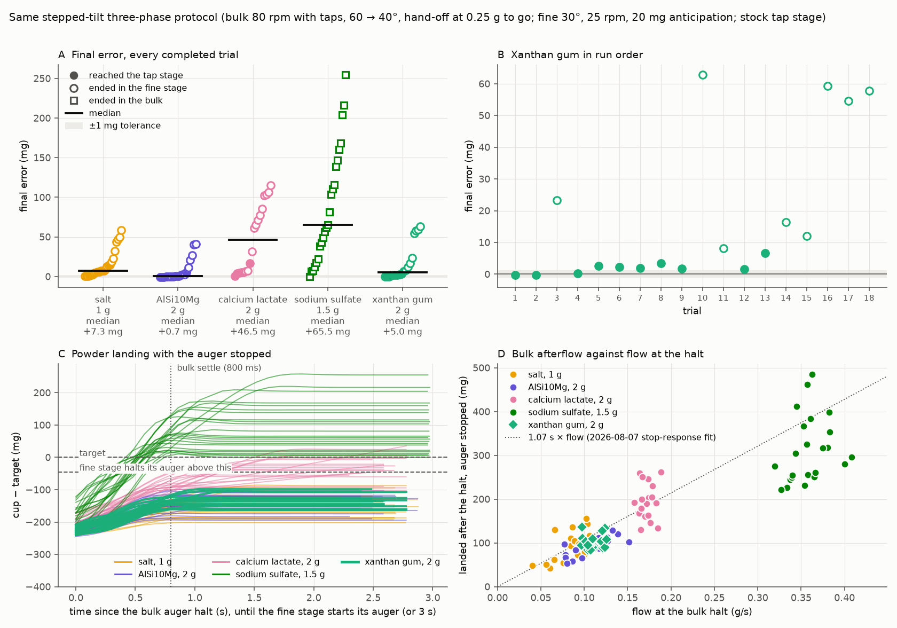

# Stepped-tilt three-phase trials, one folder per powder

These are the 30-trial dosing runs @XZaitzeff asked for on [PR #131](https://github.com/vertical-cloud-lab/powder-doser/pull/131).
They start with salt on 2026-11-18 and end with xanthan gum on 2026-11-20. Every run uses
[`three_phase_tilt_trials.py`](../../hardware/test-module/firmware/three_phase_tilt_trials.py), a
three-phase dose (bulk, fine, tap). In the bulk stage the plate steps down through five tilt angles as
the cup fills. The balance is logged as often as it answers, about 9–10 frames a second, and each trial
is saved to its own CSV.

Each powder has its own folder, and the folder name is the `powder_id` written on every CSV row. Inside
a powder's folder, each run keeps the folder name it was first committed under (in `data/three-phase/`
on PR #131) and its own README with the full write-up.

| Powder | Target | Runs | Trials | Doses |
|---|---|---|---|---|
| [Salt](salt/) | 1 g | 5 and the stall analysis | 44 | 24 |
| [AlSi10Mg](alsi10mg/) | 2 g | 1 | 26 | 20 |
| [Calcium lactate](calcium-lactate/) | 2 g | 1 | 18 | 18 |
| [Barium chloride](barium-chloride/) | 1.5 g | 1 | 4 | 0 |
| [Sodium sulfate](sodium-sulfate/) | 1.5 g | 1 | 23 | 23 |
| [Xanthan gum](xanthan-gum/) | 2 g | 1 | 18 | 18 |
| **All** | | **10** | **133** | **103** |

## Every run, in the order it ran

| Started (UTC) | Powder | Run folder | Setup | Script version | Trials | Doses | Within ±1 mg | Median error | How it ended |
|---|---|---|---|---|---|---|---|---|---|
| 2026-11-18 06:45 | Salt | [`2026-11-18_salt_tilt-schedule`](salt/2026-11-18_salt_tilt-schedule/) | 1 g; bulk 55 rpm, 60 → 40° | 18a, 18b | 4 | 0 | – | – | All 4 stalled in the bulk: the tube was full to the brim and the salt plugged at 60–40° |
| 2026-11-18 16:06 | Salt | [`2026-11-18_salt_tilt-schedule-50-30deg`](salt/2026-11-18_salt_tilt-schedule-50-30deg/) | 1 g; bulk 50 → 30° | 18c | 4 | 0 | – | – | All 4 stalled: almost no salt reached the outlet at any angle |
| 2026-11-19 19:47 | Salt | [`2026-11-19_salt_tilt-schedule-new-auger`](salt/2026-11-19_salt_tilt-schedule-new-auger/) | 1 g; new tube, bulk 60 → 40° | 19a | 4 | 0 | – | – | All 4 stalled: one 166 mg slug at 60°, then very little at any angle |
| 2026-11-19 | Salt | [`2026-11-19_why-stalls`](salt/2026-11-19_why-stalls/) | Analysis only: summer vs November salt flow | – | – | – | – | – | Why the November trials stall when summer runs at the same angles didn't |
| 2026-11-19 20:41 | Salt | [`2026-11-19_salt_tilt-schedule-bulk-taps`](salt/2026-11-19_salt_tilt-schedule-bulk-taps/) | 1 g; new tube, taps in the bulk (19c: in the fine stage too) | 19b, 19c | 5 | 0 | – | – | The taps got the salt moving, then the flow fell trial by trial and the tube stopped feeding |
| 2026-11-19 21:43 | Salt | [`2026-11-19_salt_tilt-schedule-old-auger-80rpm`](salt/2026-11-19_salt_tilt-schedule-old-auger-80rpm/) | 1 g; old tube, bulk 80 rpm with taps | 19d | 27 | 24 | 3 | +7.4 mg | The tube ran dry: trial 25 stalled at 0.781 g, trials 26–27 got nothing |
| 2026-11-19 22:43 | AlSi10Mg | [`2026-11-19_alsi10mg_tilt-schedule-2g`](alsi10mg/2026-11-19_alsi10mg_tilt-schedule-2g/) | 2 g; the 19d protocol | 19e, 20a | 26 | 20 | 11 | +0.7 mg | Launch 1 (trials 1–20): the tube ran dry. After a refill, launch 2 (trials 21–26): the balance went over range |
| 2026-11-20 03:05 | Calcium lactate | [`2026-11-20_calcium-lactate_tilt-schedule-2g`](calcium-lactate/2026-11-20_calcium-lactate_tilt-schedule-2g/) | 2 g; the 19d protocol | 20b | 18 | 18 | 1 | +46.5 mg | Stopped on the beaker cap (36.87 g in the beaker) |
| 2026-11-20 17:35 | Barium chloride | [`2026-11-20_barium-chloride_tilt-schedule-1p5g`](barium-chloride/2026-11-20_barium-chloride_tilt-schedule-1p5g/) | 1.5 g; the 19d protocol | 20c | 4 | 0 | – | – | Nothing came out of the tube in about 113 auger revolutions |
| 2026-11-20 18:04 | Sodium sulfate | [`2026-11-20_sodium-sulfate_tilt-schedule-1p5g`](sodium-sulfate/2026-11-20_sodium-sulfate_tilt-schedule-1p5g/) | 1.5 g; the 19d protocol | 20d | 23 | 23 | 1 | +65.5 mg | Stopped on the beaker cap. Every dose ended in the bulk (11–13 s each) |
| 2026-11-20 18:59 | Xanthan gum | [`2026-11-20_xanthan-gum_tilt-schedule-2g`](xanthan-gum/2026-11-20_xanthan-gum_tilt-schedule-2g/) | 2 g; the 19d protocol | 20e | 18 | 18 | 3 | +5.0 mg | Stopped on the beaker cap |

*Script version* is the script's `SCRIPT_VERSION` without the leading `2026-11-`. *Doses* counts the trials that reached the target; *within ±1 mg* and the *median error* are over those doses.

## The five powders that fed, side by side

This figure is from the xanthan gum run. It shows every completed trial of the five powders that fed,
on the same stage settings; barium chloride has no completed trials. The
[xanthan gum README](xanthan-gum/2026-11-20_xanthan-gum_tilt-schedule-2g/README.md) explains each panel,
and [`plot_five_powders.py`](xanthan-gum/2026-11-20_xanthan-gum_tilt-schedule-2g/plot_five_powders.py)
redraws it. The calcium lactate and sodium sulfate runs drew the earlier versions:
[`three_powders.png`](calcium-lactate/2026-11-20_calcium-lactate_tilt-schedule-2g/three_powders.png) and
[`four_powders.png`](sodium-sulfate/2026-11-20_sodium-sulfate_tilt-schedule-1p5g/four_powders.png).

## How the protocol changed

The settings come from @XZaitzeff's answers on 2026-11-18 ("1a, 2a"). There are 30 trials per run.
In the bulk stage the auger turns continuously while the plate steps down one angle for each equal mass
band. In the fine stage the auger turns steadily at 25 rpm with the plate at 30°. The stock tap stage
comes last. The script's docstring records every version; in short:

- **18a, 18b:** 1 g of salt, bulk at 55 rpm, plate 60 → 55 → 50 → 45 → 40°.
- **18c:** bulk at 50 → 30°.
- **19a:** back to 60 → 40°, on a new auger tube.
- **19b, 19c:** taps during the bulk, one 60 ms pulse every 300 ms (the summer rate). From 19c the
  fine stage taps too.
- **19d:** the old tube back on, with the bulk at 80 rpm. The stage settings, thresholds and stall
  rules stay the same from here on.
- **19e and 20a–20e:** the 19d settings on AlSi10Mg (2 g), calcium lactate (2 g), barium chloride
  (1.5 g), sodium sulfate (1.5 g) and xanthan gum (2 g). Only the powder, the target and what scales
  with it (the tilt bands, the low-delivery rule and the start margin), the cup caps and the time
  budget change.

## What's in a run folder

- `launch*/`: one folder per launch of the script. It holds `trial_NN_<date>_<HHMMSS>Z.csv` (one row
  per balance frame), `trials_summary.csv` (one row per trial), `session_launch*.log` (the raw Pico
  output with the Zero's UTC stamp on every line) and three figures.
- `README.md`: what was asked, what happened, and the figures.
- Other files: bench-camera frames, the probes and plotting scripts each run used, and `run.sh` (the
  launcher on the Zero).

The column list is in the
[first salt run's README](salt/2026-11-18_salt_tilt-schedule/README.md#files). The trial numbers
restart at 1 in each launch, except the second AlSi10Mg launch, which numbers from 21.

Each trial is also in MongoDB, in `powder_doser.dose_runs`: one `doc_type: "three_phase_tilt_trial"`
document per trial with the full time series, and one `"three_phase_tilt_session"` document per launch.
`find({"doc_type": "three_phase_tilt_trial", "powder_id": "<powder>"})` returns a powder's trials. On
2026-11-24 the counts per launch matched the CSVs above (133 trials).

## Code

- [`hardware/test-module/firmware/three_phase_tilt_trials.py`](../../hardware/test-module/firmware/three_phase_tilt_trials.py)
  runs the trials. It runs from Pico RAM with `mpremote run` and imports the Pico's resident
  `main_three_phase.py` and `config.py`, which are not in this repo.
- [`hardware/test-module/firmware/tests/sim_three_phase_tilt_trials.py`](../../hardware/test-module/firmware/tests/sim_three_phase_tilt_trials.py)
  is a CPython dry run of it against a simulated plant. It needs copies of the Pico's files.
- [`scripts/analyze_tilt_trials.py`](../../scripts/analyze_tilt_trials.py) turns a session log into the
  per-trial CSVs, `trials_summary.csv` and the three figures, and `--upload` writes the MongoDB
  documents.
- [`scripts/compare_salt_flow_summer_vs_november.py`](../../scripts/compare_salt_flow_summer_vs_november.py)
  draws the [stall analysis](salt/2026-11-19_why-stalls/). It also reads three summer salt runs that are
  only on PR #131:
  [`data/tap-characterization/2026-07-31_salt_angles`](https://github.com/vertical-cloud-lab/powder-doser/tree/68d19ba/data/tap-characterization/2026-07-31_salt_angles),
  [`data/afterflow/2026-08-12_salt`](https://github.com/vertical-cloud-lab/powder-doser/tree/68d19ba/data/afterflow/2026-08-12_salt) and
  [`data/kf-bangbang/2026-08-17_salt`](https://github.com/vertical-cloud-lab/powder-doser/tree/68d19ba/data/kf-bangbang/2026-08-17_salt). Its
  November glob now also matches the two salt runs that came after the analysis, so a rerun has more
  rows than the committed `flow_then_vs_now.csv`.

Each run's plotting scripts sit in its folder and find the other runs' data relative to their own
location, so run them from anywhere in a checkout.

## Adding a run

Put it in `data/stepped-tilt-trials/<powder_id>/<YYYY-MM-DD>_<powder_id>_tilt-schedule-<target>/`
(for example `2026-11-20_xanthan-gum_tilt-schedule-2g`). Then add a row to the table above and to
the powder's README.
