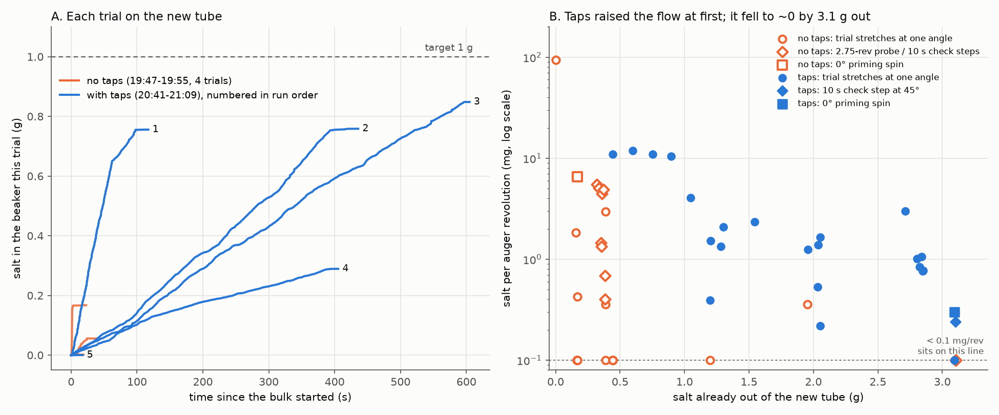
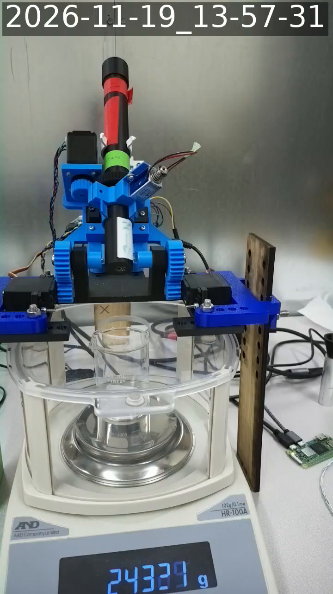

# 30 × 1 g salt trials on the new auger with taps during the bulk: 5 trials, then the tube stopped feeding (2026-11-19)

Asked by @XZaitzeff on [PR #131](https://github.com/vertical-cloud-lab/powder-doser/pull/131)
at 20:32 UTC: "Add taps into the bulk session to shake up the salt like what was done in the
summer. Still try to do different angles. Run the 30 experiments."

**Outcome:** the taps got the salt moving at first, but no trial reached 1 g, and the run stopped
after 5 trials.

- **With bulk taps,** the first trial finished the bulk in 102 s at about 11 mg per auger
  revolution. Without taps, the same tube an hour earlier stalled at 0.17 g or less in every
  trial.
- **The flow then fell, trial by trial,** whatever the plate angle: 11 → about 2 → 1.5 → 0.8 →
  0 mg per revolution.
- **A check at 21:12 found almost nothing reaching the outlet.** A tapped priming spin at 0° gave
  8.3 mg from 27.5 revolutions. The same spin without taps gave 147 mg from 22.5 revolutions at
  19:52.

In all, **≈ 3.1 g** has come out of the new tube since it was installed, 2.66 g of it in this
session.



- **Panel A:** each trial's salt against time since its bulk started.
  - Orange: the four tap-free trials from 19:47–19:55 ([that README](../2026-11-19_salt_tilt-schedule-new-auger/README.md)).
  - Blue: the five trials with taps, numbered in run order.
- **Panel B:** salt per auger revolution in every stretch at one plate angle while the auger
  spun, against how much salt had already come out of the new tube.
  - The balance read 0.0000 g with the empty beaker at 19:45, so its absolute reading is the
    running total.
  - Filled marks had taps; hollow marks didn't. Circles are trial stretches (bulk and fine
    stages), squares the 0° priming spins, diamonds the short probe and check steps.
  - Stretches under 0.1 mg per revolution sit on the dotted line.
  - The table behind the panel is `flow_segments.csv`.

## What ran

[`three_phase_tilt_trials.py`](../../../../hardware/test-module/firmware/three_phase_tilt_trials.py),
on the Pico's own `main_three_phase.py` (sha256 prefix `6b2111e1b2447096`, unchanged since 11-18).

- **The summer tap rate.** The summer tap-while-rotating runs fired one 60 ms pulse every third
  poll while the auger spun at 55 rpm: 3.2–3.5 taps/s on 08-07 (stop response) and 08-12/13
  (afterflow battery C6/C8).
  - Here the controller's own cadence taps do the same: `taps_per_cycle` > 0 in velocity mode,
    the issue #164 code, with one 60 ms pulse per 300 ms while the auger spins.
  - Measured in the trials: 3.2–3.3 taps/s.
- **Version `2026-11-19b`** ([`8b7cc4e`](https://github.com/vertical-cloud-lab/powder-doser/commit/8b7cc4e)),
  launch 1: taps in the bulk only. Everything else was as in `2026-11-19a`:
  - bulk at 55 rpm with the plate stepping 60 → 55 → 50 → 45 → 40°, one step per 0.15 g, or
    after 3 s without a 2 mg gain
  - fine stage at 30° and 25 rpm, steady, with 20 mg anticipation
  - stock tap stage, thresholds and stall rules
- **Version `2026-11-19c`** ([`a679c29`](https://github.com/vertical-cloud-lab/powder-doser/commit/a679c29)),
  launch 2. Two changes, made because launch 1's trials stalled in the tap-free fine stage. Both
  are easy to revert:
  1. **The fine stage gets the same taps.** It is still 30° at 25 rpm.
  2. **The two-failed-in-a-row stop counts only failed trials that delivered under 0.5 g.** It
     still catches an empty or blocked tube, which is what it is for.
  The session budget went from 95 to 110 min, so that the last trial would end inside the
  Actions job's time limit.
- **Simulation first.** A CPython dry run of each version against copies of the Pico's
  controller files (`hardware/test-module/firmware/tests/sim_three_phase_tilt_trials.py`) ran all
  30 trials with no errors. The sim's fake tap now honours `off_ms=0`.
- **Preflight checks:**
  - the Zero was idle and the Pico port free
  - the Pico's controller files matched their 11-18 hashes
  - the balance read 0.4429 g, stable: the beaker from 11-19 19:56 was still on the pan

## Trials

| launch | trial | start (UTC) | result | salt in the beaker | dose time | bulk | taps | auger revs |
|---|---|---|---|---|---|---|---|---|
| 1 (19b) | 1 | 20:41:16 | stalled in the fine stage | 0.7557 g | 113 s | 102 s; 149, 141, 142 and 145 mg at 60, 55, 50 and 45°, then 40° to the hand-off | 322 | 93 |
| 1 (19b) | 2 | 20:43:24 | stalled in the fine stage | 0.7586 g | 431 s | 397 s; nothing at 60°, then 1.3–2.4 mg/rev at 55–40° | 1304 | 373 |
| 2 (19c) | 1 | 20:51:57 | dose timeout (600 s) | 0.8482 g | 601 s | 523 s; 74 mg at 60°, then mostly 40° at 1.7 mg/rev; the fine stage with taps added 92 mg | 1971 | 507 |
| 2 (19c) | 2 | 21:02:14 | stalled in the bulk | 0.2891 g | 401 s | 0.8–1.1 mg/rev at every angle | 1315 | 363 |
| 2 (19c) | 3 | 21:09:11 | stalled in the bulk | 0.0002 g | 13 s | nothing at 60 or 55°; the 8 s stall rule ended it | 23 | 8 |

The fine stage without taps (launch 1) added 0.4 and 5.4 mg before its 7.5 s stall rule. With
taps (launch 2, trial 1) it ran at 3.0 mg per revolution at 25 rpm until the dose timeout.

## Timeline (UTC)

| time | what | result |
|---|---|---|
| 20:38–20:41 | Preflight, nothing moving | Zero idle, port free, Pico files unchanged, balance 0.4429 g. Rig notice posted on the Zero. |
| 20:41 | **Launch 1** ([`launch1_2041Z/`](launch1_2041Z/)), `2026-11-19b` | Two trials, both stalled in the tap-free fine stage. The script stopped itself on the two-stalls rule. |
| 20:52 | **Launch 2** ([`launch2_2052Z/`](launch2_2052Z/)), `2026-11-19c` | Three trials (0.848, 0.289 and 0.000 g). It stopped itself after two trials in a row under 0.5 g. |
| 21:11:27 | Tapped priming check ([`prime_check_taps.py`](prime_check_taps.py), [`primecheck_2111Z/`](primecheck_2111Z/)) | 0° with taps for 30 s, then 45° for 10 s each of auger only, taps and auger only. Results below. |
| 21:13 | Rig restored | Plate at 0°. The Pico was soft-rebooted into its power-on `main.py` (`[rig] ready`). The rig notice on the Zero was marked done. |

The balance read 0.4429 g before launch 1 and 3.1051 g after the check, so this session put
**2.662 g** of salt into the beaker. The beaker now holds about 3.1 g.

### The tapped priming check (21:12)

| step | plate | revs | taps | salt | per rev |
|---|---|---|---|---|---|
| auger with taps | 0° | 27.5 | 100 | 8.3 mg | 0.30 mg |
| auger only | 45° | 9.2 | 0 | 0.0 mg | 0 |
| auger with taps | 45° | 9.2 | 34 | 2.2 mg | 0.24 mg |
| auger only | 45° | 9.2 | 0 | 0.0 mg | 0 |

At 19:52 the same tube gave 147 mg from 22.5 revolutions at 0° without taps (6.5 mg/rev).



The bench camera at 20:57:31 UTC (overlay clock in lab time, UTC−7), during launch 2, trial 1,
at 40°. The balance shows 2.4332 g, about 0.48 g into the trial. No stream is visible, which fits
the 1–2 mg/s the balance was logging.

## What the data say

- **The taps work as intended at first.** With the same tube, angles and speed, the tap-free
  trials stalled at 0.17 g or less. The first tapped trial ran its bulk at about 11 mg per
  revolution at 60–45° and 4 mg at 40°, with no stall. The tapped fine stage also kept flowing
  where the tap-free one stalled.
- **The decline follows the salt taken out, not the angle or the stage.** Flow per revolution
  fell with every trial at all five bulk angles, and at 0° (6.5 → 0.3 mg/rev).
- **So salt is no longer reaching the outlet.** About 3.1 g has come out of this tube in total.
  Two causes fit, and only the bench can tell them apart:
  1. **The tube held little salt** that can reach the outlet. Nobody weighed it when it went in.
  2. **The salt has packed or arched** above the outlet, with a hole down the middle (a
     rathole), so the taps no longer bring more down.
- **Trials are slow even when the tube feeds.** At 1–2 mg per revolution a 1 g trial needs
  500–1000 revolutions, about 9–18 min at 55 rpm, past the 600 s dose timeout. At the summer
  rates (33–220 mg per revolution) the bulk took seconds. Thirty trials need a tube that feeds
  near those rates.

## What would let the 30 trials run

Someone at the bench needs to:

1. **Weigh the new tube** and note its empty mass. The ledger's 56.716 g is the old tube's.
2. **Look inside, then refill or loosen the salt.** The summer steep-angle runs used a part-full
   tube of loose salt, 50–70 g, weighed.
3. **Comment `@claude` to rerun.** Version `2026-11-19c` is ready, with taps in the bulk and fine
   stages. If you'd rather keep the fine stage tap-free, or keep the original two-stalls rule,
   say so; each is a one-line change.

## Files

- `launch1_2041Z/`, `launch2_2052Z/`: the same layout and columns as the 11-18 and 11-19
  launches (see the [11-18 README](../2026-11-18_salt_tilt-schedule/README.md#files)).
  - `trial_NN_<date>_<HHMMSS>Z.csv`: every balance frame of one trial, about 8 per second.
    `taps_cum` counts the taps.
  - `trials_summary.csv`
  - `session_launch*.log`: the raw stamped telemetry
  - the three figures from `scripts/analyze_tilt_trials.py`
  - Trial numbers restart at 1 in each launch.
- `primecheck_2111Z/prime_check_frames.csv` has every balance frame of the check, and
  `prime_check_steps.csv` one row per spin. `session_primecheck.log` is the raw log, and
  [`primecheck_csv.py`](primecheck_csv.py) splits it.
- `flow_segments.csv` has one row per point in panel B. The figure comes from
  [`plot_taps_vs_no_taps.py`](plot_taps_vs_no_taps.py).
- `prime_check_taps.py` is the check, run from Pico RAM.
- `run.sh` (launch 1), `run2.sh` (launch 2) and `run_check.sh` (the check) are the Zero-side
  launchers. Each pipes `mpremote run` through `stamp.py` into the session log, as in the
  [11-18 morning reproduce section](../2026-11-18_salt_tilt-schedule/README.md#reproduce).
- `camera_2057Z_launch2_trial1_40deg.png`: the bench-camera frame above.

## Reproduce

```bash
mpremote connect /dev/ttyACM0 run three_phase_tilt_trials.py \
  | python -u stamp.py session.log      # stamp.py writes "<time.time()>\t<line>"
python scripts/analyze_tilt_trials.py session.log --out <dir> [--upload --extra-json '{...}']
python primecheck_csv.py primecheck_2111Z/session_primecheck.log primecheck_2111Z
python plot_taps_vs_no_taps.py
```

MongoDB `powder_doser.dose_runs` has one document per trial (`doc_type: "three_phase_tilt_trial"`)
and one per launch (`doc_type: "three_phase_tilt_session"`), 7 in all. Their `script_version` is
`2026-11-19b` (launch `e1`) or `2026-11-19c` (launch `e2`). Launch 2's session document carries
the priming check under `prime_check_after`.
