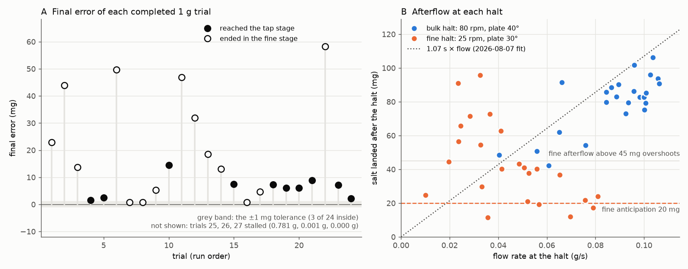
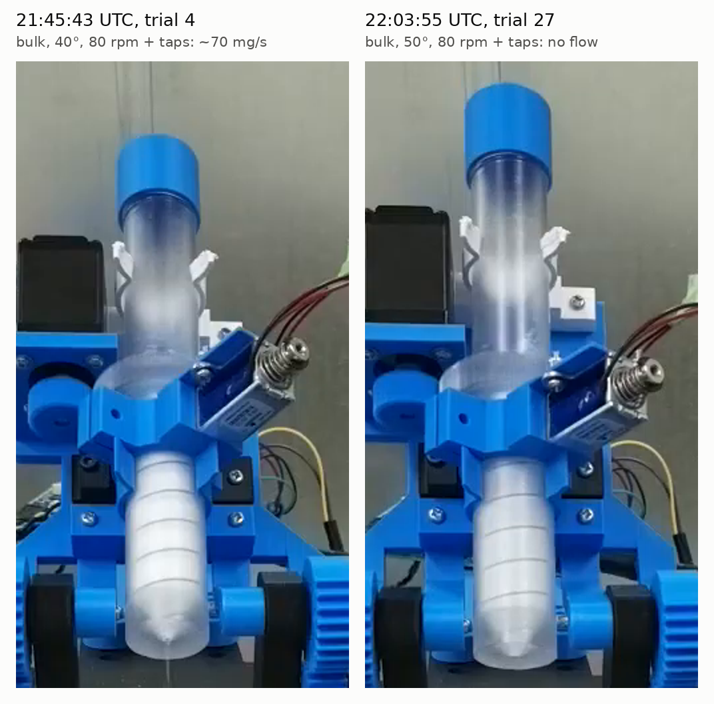

# 30 × 1 g salt trials on the old auger, bulk at 80 rpm with taps: 24 doses, then the tube ran dry (2026-11-19)

Asked by @XZaitzeff on [PR #131](https://github.com/vertical-cloud-lab/powder-doser/pull/131)
at 21:36 UTC: "I put the auger from before back on the doser. Do the 30 experiments with the
tapping during the bulk session. Increase the rotate speed of the bulk session to 80 rpm."

**Outcome:** the old tube fed well. Trials 1–24 each delivered a full 1 g dose, and none
stalled in the bulk. Then the tube stopped feeding: trial 25 stalled at 0.781 g, and trials 26
and 27 got nothing. The run stopped itself at 22:04 on the two-failed-in-a-row rule.

- **Speed:** the median dose took 27 s (21–65 s). The bulk took 11–18 s at about 0.09 g/s.
- **Accuracy:** 3 of the 24 finished within ±1 mg (+0.7, +0.8 and +0.8 mg). Every other trial
  went over the target, by 1.5–58.3 mg (median of all 24: +7.4 mg; 7 within 5 mg, 14 within
  10 mg). None finished under the target.
- **What overshot:** the fine stage. It stops the auger once the cup passes 0.955 g, 20 mg
  (its anticipation) before its 0.975 g hand-off. But 12–96 mg landed after it stopped,
  median 40 mg. In 8 trials it was more than 45 mg, which by itself carries the dose past 1 g.
- **The tube:** 25.16 g went into the beaker (balance 3.1784 → 28.3375 g). The bench camera
  shows the lower tube paler at the end than during trial 4 (below), so the tube most likely
  ran dry. Weighing it would confirm: the old tube's empty mass is 56.716 g
  ([ledger](https://github.com/vertical-cloud-lab/powder-doser/blob/68d19ba/docs/salt-inventory.md)).



- **Panel A:** final error of trials 1–24 in run order.
  - Grey band: the ±1 mg tolerance.
  - Filled marks reached the tap stage; hollow marks ended in the fine stage, because the
    fine stage's afterflow already carried them to or past 0.999 g.
  - Trials 25–27 stalled and are left out.
- **Panel B:** salt that landed after each auger halt, against the flow rate at the halt.
  - Blue: the bulk halt (80 rpm, plate at 40°). It stops at 0.75 g, so its 42–106 mg of
    afterflow never threatens the goal. It sits near the dotted line (afterflow = 1.07 s ×
    flow), the summer stop-response fit ([2026-08-07](https://github.com/vertical-cloud-lab/powder-doser/tree/68d19ba/data/stop-response/2026-08-07_salt)).
  - Orange: the fine halt (25 rpm, plate 30°, taps on). Dashed line: its 20 mg anticipation.
    Points above the grey line at 45 mg overshoot without help from the tap stage.
  - The fine afterflow doesn't follow the flow at the halt. Six of the slowest fine halts,
    at 0.02–0.03 g/s, had 54–96 mg of afterflow, as much as the fastest bulk halts. The taps
    may knock loose salt sitting at the outlet, which the flow rate doesn't show, but this run
    can't tell.
- The figure comes from [`plot_afterflow_vs_anticipation.py`](plot_afterflow_vs_anticipation.py).



Bench camera, cropped to the tube. The overlay clock is lab time (UTC−7); the captions give UTC.

- **Left, 21:45:43, trial 4,** in the bulk at 40° and 80 rpm with taps, about 70 mg/s into
  the beaker. The tube below the clamp is solid white, and a thin stream leaves the outlet.
- **Right, 22:03:55, trial 27,** in the bulk at 50° with the auger at 80 rpm and the taps
  running. Nothing reached the beaker. The same part of the tube is paler and partly
  see-through.

The frames are from the livestream's replay window, fetched on the Zero (see Files).

## What ran

[`three_phase_tilt_trials.py`](../../../../hardware/test-module/firmware/three_phase_tilt_trials.py)
version `2026-11-19d` ([`0c726d0`](https://github.com/vertical-cloud-lab/powder-doser/commit/0c726d0)),
on the Pico's own `main_three_phase.py` (sha256 prefix `6b2111e1b2447096`, unchanged since 11-18).
Only the bulk speed changed from `2026-11-19c`
([bulk-taps README](../2026-11-19_salt_tilt-schedule-bulk-taps/README.md)):

- **Bulk:** **80 rpm** (was 55), continuous, with one 60 ms tap per 300 ms while the auger
  spins. The plate steps 60 → 55 → 50 → 45 → 40°, one step per 0.15 g, or after 3 s without a
  2 mg gain. No anticipation; the bulk hands off at 0.75 g.
  - Measured: 2.9 taps/s (2.5–3.2), about 2.2 taps per auger revolution. At 55 rpm the same
    cadence gave about 3.5 per revolution.
- **Fine:** 30° and 25 rpm, steady, with the same taps (3.1 taps/s measured). 20 mg
  anticipation; the hand-off to the tap stage is at 25 mg to go (0.975 g).
- **Tap stage:** stock (0°, one tap and a 15° turn at 25 rpm per cycle, ±1 mg tolerance).
- **Stall rules, thresholds and dose timeout (600 s):** stock.
- **Safety stops:** 45 g in the cup; two failed trials in a row that each deliver under
  0.5 g; a 95 g display ceiling; a 110 min budget.

I kept the fine-stage taps from `2026-11-19c`, because without them the fine stage stalled
earlier today. 80 rpm is under the firmware's 109 auger-rpm ceiling, so it isn't clamped.

Checks before the run:

- A CPython dry run of `2026-11-19d` against copies of the Pico's controller files
  (`hardware/test-module/firmware/tests/sim_three_phase_tilt_trials.py`) ran all 30 trials
  without errors, for two seeds.
- The Zero was idle and the Pico port free.
- The Pico's controller files matched their 11-18 hashes.
- The balance read 3.1785 g, stable, with this afternoon's beaker still on the pan.

## Trials

| trial | start (UTC) | result | final | error | dose | bulk | fine | tap stage | bulk afterflow | fine afterflow | taps | auger revs |
|---|---|---|---|---|---|---|---|---|---|---|---|---|
| 1 | 21:43:26 | overshoot | 1.0229 g | +22.9 mg | 24.1 s | 13.3 s | 7.7 s | — | 73 mg | 66 mg | 38 | 14.1 |
| 2 | 21:44:06 | overshoot | 1.0439 g | +43.9 mg | 25.0 s | 15.6 s | 6.5 s | — | 89 mg | 72 mg | 43 | 17.3 |
| 3 | 21:44:46 | overshoot | 1.0137 g | +13.7 mg | 22.1 s | 12.7 s | 6.2 s | — | 106 mg | 57 mg | 31 | 13.3 |
| 4 | 21:45:24 | overshoot | 1.0015 g | +1.5 mg | 65.3 s | 14.6 s | 13.1 s | 6 cycles, 34.6 s | 42 mg | 25 mg | 66 | 17.3 |
| 5 | 21:46:44 | overshoot | 1.0024 g | +2.4 mg | 32.3 s | 14.7 s | 7.9 s | 1 cycle, 6.7 s | 62 mg | 30 mg | 46 | 15.5 |
| 6 | 21:47:31 | overshoot | 1.0497 g | +49.7 mg | 27.4 s | 14.5 s | 9.6 s | — | 54 mg | 91 mg | 50 | 15.8 |
| 7 | 21:48:14 | **ok** | 1.0008 g | +0.8 mg | 31.1 s | 17.6 s | 10.3 s | — | 49 mg | 44 mg | 61 | 20.3 |
| 8 | 21:49:01 | **ok** | 1.0008 g | +0.8 mg | 27.5 s | 17.0 s | 7.2 s | — | 51 mg | 40 mg | 51 | 17.7 |
| 9 | 21:49:44 | overshoot | 1.0053 g | +5.3 mg | 22.7 s | 13.3 s | 6.2 s | — | 83 mg | 43 mg | 34 | 13.3 |
| 10 | 21:50:22 | overshoot | 1.0145 g | +14.5 mg | 29.4 s | 13.1 s | 6.3 s | 1 cycle, 6.7 s | 80 mg | 40 mg | 33 | 12.9 |
| 11 | 21:51:06 | overshoot | 1.0469 g | +46.9 mg | 23.2 s | 13.4 s | 6.5 s | — | 92 mg | 73 mg | 36 | 13.3 |
| 12 | 21:51:45 | overshoot | 1.0319 g | +31.9 mg | 22.4 s | 12.6 s | 6.5 s | — | 86 mg | 41 mg | 31 | 11.9 |
| 13 | 21:52:23 | overshoot | 1.0185 g | +18.5 mg | 22.9 s | 13.6 s | 6.2 s | — | 90 mg | 63 mg | 35 | 12.8 |
| 14 | 21:53:02 | overshoot | 1.0130 g | +13.0 mg | 22.5 s | 12.6 s | 6.6 s | — | 83 mg | 55 mg | 33 | 11.9 |
| 15 | 21:53:40 | overshoot | 1.0074 g | +7.4 mg | 45.6 s | 12.5 s | 6.5 s | 4 cycles, 23.3 s | 86 mg | 19 mg | 36 | 12.1 |
| 16 | 21:54:40 | **ok** | 1.0007 g | +0.7 mg | 21.5 s | 12.2 s | 6.0 s | — | 83 mg | 37 mg | 29 | 11.5 |
| 17 | 21:55:17 | overshoot | 1.0046 g | +4.6 mg | 21.0 s | 11.7 s | 6.1 s | — | 102 mg | 38 mg | 27 | 11.9 |
| 18 | 21:55:54 | overshoot | 1.0073 g | +7.3 mg | 38.6 s | 12.5 s | 5.2 s | 3 cycles, 17.6 s | 96 mg | 12 mg | 29 | 11.2 |
| 19 | 21:56:47 | overshoot | 1.0061 g | +6.1 mg | 49.2 s | 12.0 s | 5.2 s | 5 cycles, 28.7 s | 94 mg | 22 mg | 32 | 11.7 |
| 20 | 21:57:51 | overshoot | 1.0061 g | +6.1 mg | 34.0 s | 12.0 s | 6.3 s | 2 cycles, 12.4 s | 75 mg | 24 mg | 33 | 12.0 |
| 21 | 21:58:39 | overshoot | 1.0089 g | +8.9 mg | 48.5 s | 11.1 s | 5.3 s | 5 cycles, 29.0 s | 91 mg | 21 mg | 27 | 10.4 |
| 22 | 21:59:43 | overshoot | 1.0583 g | +58.3 mg | 21.8 s | 12.2 s | 6.3 s | — | 80 mg | 96 mg | 28 | 10.6 |
| 23 | 22:00:20 | overshoot | 1.0071 g | +7.1 mg | 45.2 s | 12.5 s | 6.0 s | 4 cycles, 23.3 s | 85 mg | 12 mg | 34 | 11.7 |
| 24 | 22:01:20 | overshoot | 1.0022 g | +2.2 mg | 49.8 s | 11.8 s | 6.2 s | 5 cycles, 28.8 s | 79 mg | 17 mg | 35 | 10.4 |
| 25 | 22:02:24 | stalled in the fine stage | 0.7808 g | | 27.7 s | 12.0 s | 12.4 s | — | 17 mg | | 59 | 15.7 |
| 26 | 22:03:08 | stalled in the bulk | 0.0006 g | | 13.4 s | 10.3 s | | — | | | 24 | 12.0 |
| 27 | 22:03:37 | stalled in the bulk | 0.0002 g | | 13.6 s | 10.5 s | | — | | | 25 | 12.0 |

- **Dose** runs from the start of the bulk to the controller's finish, and **final** is the
  median of 8 readings taken 8 s after it.
- **Afterflow** is the salt that landed between the halt and the settled reading.
- In trials 1–25 every bulk angle stepped on its 0.15 g band; no angle hit the 3 s no-flow
  step. In trials 26 and 27 the plate stepped from 60 to 55 to 50° on that no-flow step,
  and the stock 8 s stall rule then ended the trial.
- **Trial 25** finished its bulk at 0.762 g in 12 s, but only 17 mg landed after the halt,
  against 42–106 mg in trials 1–24. The fine stage then added 2 mg in 12 s and stalled.

### Bulk flow by plate angle (trials 1–24)

Each bulk angle got one 0.15 g band, about 1–2 s at 80 rpm. That is short against the salt's
time in flight, so some of each angle's salt lands while the plate is at the next one.

| plate | salt per auger rev, median (range) | g/s, median | time at the angle, median |
|---|---|---|---|
| 60° | 58 mg (43–92) | 0.077 | 2.1 s |
| 55° | 78 mg (44–89) | 0.105 | 1.1 s |
| 50° | 70 mg (35–90) | 0.093 | 1.2 s |
| 45° | 71 mg (38–81) | 0.094 | 1.3 s |
| 40° | 69 mg (38–80) | 0.092 | 1.4 s |

## Timeline (UTC)

| time | what | result |
|---|---|---|
| 21:36 | Request | |
| 21:37–21:43 | Script `2026-11-19d` pushed; preflight, nothing moving | Zero idle, port free, Pico files unchanged, balance 3.1785 g stable. Rig notice posted on the Zero. CPython dry run: 30/30 trials, two seeds. |
| 21:43:19 | **Launch** ([`launch1_2143Z/`](launch1_2143Z/)) | Trials 1–24 dosed, about 40 s per trial including the pre- and post-roll. |
| 22:02:24 | Trial 25 | Bulk to 0.762 g, then stalled in the fine stage at 0.781 g. |
| 22:03:08–22:04:07 | Trials 26, 27 | 0.6 and 0.2 mg in 12 revolutions each; the script stopped itself (two trials in a row under 0.5 g). |
| 22:06 | Rig restored | The script's own exit stopped the auger and put the plate at 0°. The Pico was soft-rebooted into its power-on `main.py` (`[rig] ready`, servo at 0.0°). The rig notice on the Zero was marked done. |

The balance read 3.1784 g at the start (the session baseline) and 28.3375 g at the end, so this
session put **25.159 g** of salt into the beaker. The beaker now holds about 28.3 g and needs
emptying before the next run.

## What the data say

- **The old tube, the bulk taps and 80 rpm together give a bulk that doesn't stall.** On 11-18
  the same tube, at 55 rpm with no taps, stalled in the bulk in all 8 trials. Here it ran
  every bulk to 0.75 g in 11–18 s until the salt ran out.
  - Several things changed since 11-18: the taps, the speed, and the tube being taken off and
    put back on, which can loosen packed salt. It may also have been refilled; no refill was
    logged. This run can't separate these.
- **The fine stage sets the accuracy.** Its 20 mg anticipation was set for 25 rpm without
  taps. With taps, 12–96 mg landed after the halt (median 40 mg).
  - In 14 trials that afterflow carried the cup to 0.999 g or more, so the dose ended in the
    fine stage. Three finished within ±1 mg (+0.7, +0.8, +0.8 mg); the other 11 went over by
    4.6–58.3 mg. All 8 trials with more than 45 mg of afterflow are in this group (+13.0 to
    +58.3 mg).
  - In the other 10, the cup settled at 0.970–0.997 g and the tap stage ran.
  - Four fine halts came late, at 0.972–0.991 g instead of about 0.956 g, because the cup
    passed 0.955 g between two polls. Trial 12's came at 0.991 g and finished +31.9 mg.
- **The tap stage overshoots by a few mg.** The 10 trials that reached it finished 1.5–14.5 mg
  over (median +6.6 mg), after 1–6 cycles. Each cycle is one tap plus a 15° auger turn, and
  the turn can bring several mg at once.
- **Trial times are short while the tube feeds:** median 27 s, and 34–65 s when the tap stage
  ran. Thirty trials would take about 25 minutes.
- **The tube held about 25 g that could reach the outlet.** It fed steadily through trial 24
  and stopped within one trial. That fits a tube running dry better than salt arching above
  the outlet, which tends to slow flow over several trials, as with the new tube this
  afternoon. The camera frames above point the same way.

## What would let the 30 trials finish

Someone at the bench needs to:

1. **Weigh the old tube** before refilling. If it reads about 56.7 g, it is empty.
2. **Refill it, weigh it, and post the total.** 30 trials need about 31 g in the beaker plus
   what stays in the tube; the summer runs used 50–70 g of salt.
3. **Empty the beaker** (about 28.3 g on the pan now).
4. **Comment `@claude` to rerun.** `2026-11-19d` is unchanged and ready.

These would change the experiment, so they are for the requester. Each is a one-line change:

- **A larger fine anticipation,** about 60 mg (`FINE_ANTICIPATION_G`), so that most fine
  stages hand off below 0.975 g and the tap stage does the last few mg.
- **No taps in the fine stage** (`FINE_TAPS = False`). The 20 mg anticipation came from the
  tap-free 25 rpm afterflow (about 10–45 mg). But the tap-free fine stage stalled on the new
  tube this afternoon.

## Files

- `launch1_2143Z/`: the same layout and columns as the earlier launches (see the
  [11-18 README](../2026-11-18_salt_tilt-schedule/README.md#files)).
  - `trial_NN_<date>_<HHMMSS>Z.csv`: every balance frame of one trial, about 9 per second.
    `taps_cum` counts the taps.
  - `trials_summary.csv`
  - `session_launch1.log`: the raw stamped telemetry
  - the three figures from `scripts/analyze_tilt_trials.py`
- `afterflow_vs_anticipation.png` and its script
  [`plot_afterflow_vs_anticipation.py`](plot_afterflow_vs_anticipation.py).
- `camera_tube_2145Z_vs_2203Z.png`: the camera crops above.
  - [`camgrab.sh`](camgrab.sh) fetches the newest segment of the livestream and
    [`camat.py`](camat.py) the segment covering a given UTC time. Both run on the Zero, at a
    capped rate, because YouTube blocks datacenter addresses from the player.
  - Frames were decoded with `ffmpeg` on the runner.
- `run.sh`: the Zero-side launcher. It pipes `mpremote run` through `stamp.py` into the session
  log, as in the [11-18 morning reproduce section](../2026-11-18_salt_tilt-schedule/README.md#reproduce).

## Reproduce

```bash
mpremote connect /dev/ttyACM0 run three_phase_tilt_trials.py \
  | python -u stamp.py session.log      # stamp.py writes "<time.time()>\t<line>"
python scripts/analyze_tilt_trials.py session.log --out <dir> [--upload --extra-json '{...}']
python plot_afterflow_vs_anticipation.py
```

MongoDB `powder_doser.dose_runs` has one document per trial (`doc_type: "three_phase_tilt_trial"`,
27) and one for the launch (`doc_type: "three_phase_tilt_session"`), all with
`session_id: "tilt30-2026-11-19T21:43:26"`, `script_version: "2026-11-19d"`, `bulk_rpm: 80`,
`launch: "f1"` and `commit: "52ac2e7"`.
