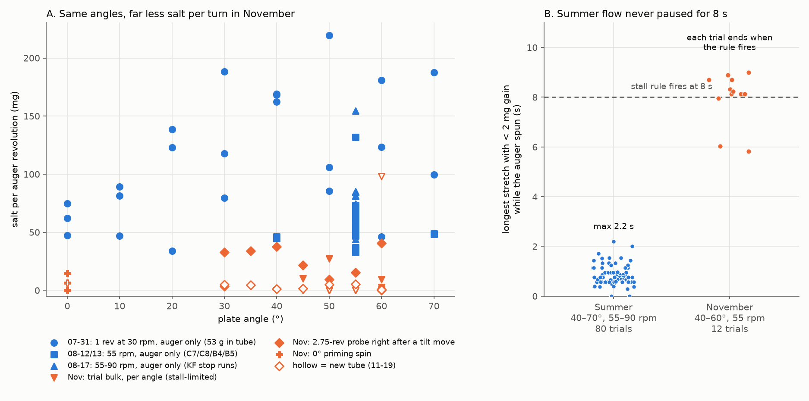

# Why the November stepped-tilt salt trials stall when summer runs at the same angles didn't

Asked by @XZaitzeff on [PR #131](https://github.com/vertical-cloud-lab/powder-doser/pull/131)
(2026-11-19). Analysis only: built from data already on this branch, with no hardware run.

- **Panel A:** salt per auger revolution against plate angle.
  - **Summer, blue:** 07-31 single re-feed revolutions, the auger-only trials of the 08-12/13
    afterflow battery (C7, C8-auger, B4, B5), and the 08-17 KF stop runs.
  - **November, orange:** the 2.75-revolution angle probes, the 0° priming spins, and the
    trials' bulk stage split by commanded angle.
  - Hollow markers are the new tube (11-19).
  - Tap-while-rotating runs are left out, because the November bulk had no taps.
- **Panel B:** per trial, the longest stretch with less than a 2 mg gain while the auger spun.
  This is the November controller's stock bulk stall test (no 2 mg gain in 8 s), replayed on
  every frame:
  - **Summer:** 80 trials at 40–70°. 48 of them were auger-only, and none went past 2.2 s.
  - **November:** all 12 trials reached the rule and ended there.

Files:

- `flow_then_vs_now.csv`: one row per point in both panels, with its source.
- `../../../../scripts/compare_salt_flow_summer_vs_november.py`: rebuilds the CSV and the figure.
  The November probe and priming values come from the
  [11-18](../2026-11-18_salt_tilt-schedule/README.md),
  [11-18 pm](../2026-11-18_salt_tilt-schedule-50-30deg/README.md) and
  [11-19](../2026-11-19_salt_tilt-schedule-new-auger/README.md) READMEs.
