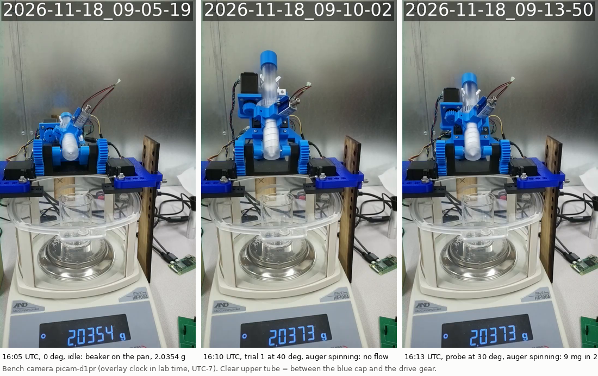

# 30 × 1 g salt trials, bulk tilt 50 → 30°: stopped after 4 stalled trials (2026-11-18, afternoon)

Asked by @XZaitzeff on [PR #131](https://github.com/vertical-cloud-lab/powder-doser/pull/131)
at 15:56 UTC: rerun this morning's [stepped-tilt trials](../2026-11-18_salt_tilt-schedule/README.md)
with the bulk stage at **50, 45, 40, 35 and 30°**, keep all the other settings, and run the
30 trials.

**Outcome:** no trial put any salt in the beaker. Both launches stopped on the agreed safety rule
(two stalled trials in a row). A priming spin and a flow probe showed that almost no salt
reaches the auger outlet at any angle. The auger turns on camera, so the motor is not the
problem. The tube is either nearly empty or the salt is stuck above the auger. This can only be
checked at the bench.



Bench-camera frames (overlay clock in lab time, UTC−7): at 16:05 UTC, idle at 0°, with the beaker
on the pan; at 16:10 in launch 2, trial 1 at 40°, with the auger spinning and nothing coming out;
and at 16:13 in the probe at 30°, with the auger spinning and 9 mg landing. In the last two frames,
the clear upper part of the tube, between the blue cap and the drive gear, is mostly see-through.

## What changed from this morning

Only `BULK_TILTS`, from (60, 55, 50, 45, 40) to (50, 45, 40, 35, 30) plate degrees, in
[`three_phase_tilt_trials.py`](../../../hardware/test-module/firmware/three_phase_tilt_trials.py)
version `2026-11-18c`. Everything else is as in this morning's launch 2 (version `2026-11-18b`):

- **Bulk:** 55 rpm, continuous, no taps. The plate steps down one angle per 0.15 g, or after 3 s
  without a 2 mg gain.
- **Fine:** 30° and 25 rpm, steady, with 20 mg anticipation.
- **Tap stage:** stock.
- **Stall rules and thresholds:** stock (bulk: 2 mg within 8 s).
- **Logging:** the balance at about 10 Hz.
- **Safety stops:** 45 g in the cup, two failed trials in a row, 95 g display, a 95 min budget.

The Pico's controller files were unchanged since this morning. Their sha256 prefixes match the
`M,*_sha16` lines in the logs (`main_three_phase.py` `6b2111e1b2447096`). Before the launch, a
CPython dry run against those files ran all 30 trials without errors.

## Timeline (UTC)

| time | what | result |
|---|---|---|
| 16:02–16:05 | Preflight, nothing moving | The Zero was idle, the Pico port was free, and the rig notice was posted. The bench frame showed the plate at 0°, the beaker on the pan and the balance at 2.0354 g, as this morning's run left it. |
| 16:06 | **Launch 1** ([`launch1_1606Z/`](launch1_1606Z/)) | Trials 1 and 2: 0.0 mg each. In each trial the plate spent 3 s at 50°, then 3 s at 45°, then 2 s at 40°, all with no flow (8.25 auger revolutions). Then the stock stall rule ended the trial. The script stopped itself. |
| 16:08:52 | Priming spin, as at 06:48 this morning: 40 s at 55 rpm with the plate at 0° ([`prime_spin.py`](prime_spin.py)) | **+1.6 mg** in 36.7 revolutions. This morning the same spin gave +0.542 g. |
| 16:09:47 | **Launch 2** ([`launch2_1609Z/`](launch2_1609Z/)), the identical script | Same as launch 1: 0.0 mg in trials 1 and 2. The script stopped itself. |
| 16:13:34 | Flow probe ([`flow_probe.py`](flow_probe.py)): 5 single taps at 0°, then 2.75 revolutions at 55 rpm with the plate at 30° | Taps: 0.0 mg. 30°: **9.2 mg**, most of it landing in the 3 s after the auger stopped. This morning's probe gave 90 mg at 30°. |
| 16:14 | Rig restored | Plate at 0°. The Pico was soft-rebooted into its power-on `main.py` (`[rig] ready`). The rig notice on the Zero was marked done. |

The balance read 2.0354 g before launch 1 and 2.0465 g after the probe. So the whole session put
**11 mg** of salt into the beaker.

## Why nothing flowed

- **The auger turns.** In the camera segments, the tube's pattern changes from frame to frame while
  the auger is commanded to spin. The stream's segment sizes also jump during each spin, which
  means more motion in the frame. So the stepper drove the auger in every trial, the priming spin
  and the probe.
- **Almost nothing reaches the outlet.** The balance stayed `ST` (stable) for 402 of 419 frames
  during the 40 s priming spin, with no powder landing.
- **The tube may be nearly empty.** At 30–45° the clear upper part of the tube looks mostly
  see-through on camera. It is not packed white like a full column. The camera cannot tell an
  empty tube from salt stuck higher up, though. This morning the same tube gave 0.54 g from the
  priming spin and 26–112 mg per angle in the probe, and only about 1.6 g left it in total.
- **The schedule never reached 35° or 30°.** With no flow, 50° and 45° each use the 3 s no-flow
  step, so the stock 8 s stall rule ends the trial 2 s after the plate reaches 40°. Those settings
  were kept as asked. Even at 30°, flow was a tenth of this morning's.

## What would let the 30 trials run

Someone at the bench needs to:

1. **Look at the tube.** Is there salt above the auger, and is it loose?
2. **Refill it, or loosen the salt.** If you refill it, please weigh the tube on the bench scale.
   The empty tube is 56.716 g. Then the [salt ledger](../../../docs/salt-inventory.md) can track
   what is left.
3. **Comment `@claude` to rerun.** The script and the logging are ready, so a rerun starts within
   minutes.

## Files

- `launch1_1606Z/`, `launch2_1609Z/`: the same layout and columns as this morning's launches (see
  [that README](../2026-11-18_salt_tilt-schedule/README.md#files)):
  - `trial_NN_<date>_<HHMMSS>Z.csv`: every balance frame of one trial
  - `trials_summary.csv`
  - `session_launch*.log`: the raw stamped telemetry
  - the three figures
  - Trial numbers restart at 1 in each launch.
- `launch2_1609Z/prime_spin_0deg.csv`: every balance frame of the priming spin. Its lines are at
  the top of `session_launch2.log`.
- `flow_probe_1613Z.csv` and `flow_probe_1613Z.log`: every balance frame of the flow probe.
- These two CSVs have one row per balance frame. The columns are `powder_id`, `date_utc`,
  `time_utc`, `t_s`, `balance_status`, `mass_abs_g` (absolute display, no tare), `tilt_deg`,
  `auger_rpm`, `poll_ms`, `step` and `events`.
- `prime_spin.py`, `flow_probe.py`: the two helper scripts. Both run from Pico RAM.
- `camera_0_40_30deg.png`: the bench-camera frames above.

## Reproduce

```bash
mpremote connect /dev/ttyACM0 run three_phase_tilt_trials.py \
  | python -u stamp.py session.log      # stamp.py writes "<time.time()>\t<line>"
python scripts/analyze_tilt_trials.py session.log --out <dir> [--upload]
```

For launch 2, `prime_spin.py` ran first through the same `mpremote run | stamp.py` pipe, into the
same log. `--upload` puts one document per trial (`doc_type: "three_phase_tilt_trial"`) and one per
launch (`doc_type: "three_phase_tilt_session"`) into `powder_doser.dose_runs`.
