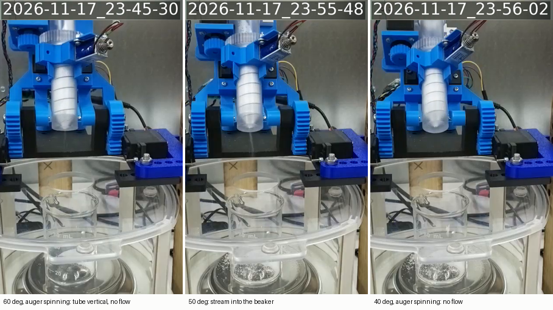

# 30 × 1 g salt trials with a stepped bulk tilt: stopped after 4 stalled trials (2026-11-18)

Asked by @XZaitzeff on [PR #131](https://github.com/vertical-cloud-lab/powder-doser/pull/131):
30 trials of 1 g of salt. The bulk stage runs at 55 rpm with the plate at 60, 55, 50, 45 and
40°. The fine stage runs at 30° and 25 rpm. Then the usual tap stage. The balance is logged as
often as it answers. The answers "1a, 2a, yes" chose:

- **1a:** one tilt schedule inside every trial. The bulk starts at 60° and steps down one angle
  per 0.15 g as the cup fills (0 to 0.75 g, the bulk span for 1 g).
- **2a:** the fine stage turns the auger steadily at 25 rpm until the hand-off to the tap stage.
- **yes:** run with nobody at the bench.

**Outcome:** no trial reached 1 g. Both launches stopped on the agreed safety rule (two stalled
trials in a row). Every stall happened in the bulk stage at the requested angles. The camera shows
why. At 60° the tube hangs near vertical, and with the tube filled to the brim the salt plugs inside it.
Nothing leaves the outlet, so the powder is not missing the cup. At 50° a stream went into the
beaker. Flow at 40–60° came in bursts, and the stock stall rule (no 2 mg gain in 8 s) ended each
trial in a pause between bursts.



Bench-camera frames (overlay clock in lab time, UTC−7) while the auger spun at 55 rpm: 60° in
launch 1 with no flow, 50° in launch 2 with a stream into the beaker, and 40° in launch 2 with no
flow. The file is `camera_60_50_40deg.png`.

## Timeline (UTC)

| time | what | result |
|---|---|---|
| 06:37–06:44 | Preflight, nothing moving | Balance climbed 0.22 → 0.45 g (up to 0.9 mg/s, all frames unstable), then settled (stable frames, ±0.5 mg). The camera showed nothing landing in the beaker, so this was balance drift. |
| 06:45 | **Launch 1** ([`launch1_0645Z/`](launch1_0645Z/)) | Trials 1–2 stalled at 60°: 18 auger revolutions, no powder. The reading moved −22 mg and +12 mg during the spins, which are balance artifacts. The script stopped itself. |
| 06:48 | Priming: 40 s at 55 rpm with the plate at 0° | +0.542 g into the beaker (≈ 15 mg per revolution). The camera shows a thin stream into the beaker. |
| 06:53 | Flow probe: 2.75 revolutions at 55 rpm per angle | 55° +42 mg, 50° +26 mg, 45° +60 mg, 40° +103 mg, 35° +93 mg, 30° +90 mg; then 60° twice: +112 mg, then −11 mg (no flow). |
| 06:55 | **Launch 2** ([`launch2_0655Z/`](launch2_0655Z/)), with a no-flow step added to the schedule (see below) | Trial 1: 57 mg at 60° then nothing, nothing at 55°, 0.39 g at 50°, 0.12 g at 45°, nothing at 40° → stalled at 0.568 g after 43 s of bulk. Trial 2: nothing at 60, 55 or 50° → stalled at 8 s. The script stopped itself. |
| 07:00 | Rig restored | Plate at 0°, Pico soft-rebooted into its power-on `main.py` (`[rig] ready`), rig notice on the Zero marked done. |

About **1.6 g** of salt went into the beaker in total, from the priming spin, the probes and the
partial trials. The balance read 0.458 g before launch 1 and about 2.05 g at the end.

## Balance offsets with the plate tilted

The balance reading moves when the plate tilts, even with no powder flowing. In launch 1, trial 1,
the reading fell by 20–35 mg while the plate sat at 60° with the auger spinning, and it ended 23 mg
low after the plate came back to 0°. In each post-roll the plate was still at the last bulk angle,
and the reading drifted by −31 to −54 mg/min (`postroll_drift_mg_per_min` in the summaries). The
pre-rolls, at 0°, drifted by −7 to +4 mg/min, except launch 1, trial 2 (+42 mg/min), which
started right after the plate returned from 60°. Treat mass changes of a few tens of mg at 40–60°
with care. The raw absolute readings and the commanded tilt are on every CSV row, so this offset
can be modeled.

## The no-flow step (launch 2 only)

Launch 1 showed that a mass-banded schedule waits forever at an angle that delivers nothing. So
launch 2 also stepped to the next angle after **3 s without a 2 mg gain** while the auger spun.
Mass bands still drove every step when powder flowed. Each step is logged with its reason, for
example `step 1 (55.0 deg, no flow for 3.0 s)` or `step 3 (45.0 deg, band)`. This was not enough,
because three dry steps take 9 s and the stock stall rule ends the dose after 8 s without flow.

## Files

Each launch folder holds:

- `trial_NN_<date>_<HHMMSS>Z.csv`: one file per trial, one row per balance frame (about 10 per
  second, settle waits included). Columns:
  - `powder_id`, `trial`, `date_utc`, `time_utc`: the label on every row
  - `t_s`: seconds since the trial started (the 5 s pre-roll comes first)
  - `mass_abs_g`: the balance display. No tare was used, so this is absolute.
  - `mass_g`: mass above this trial's baseline bracket
  - `balance_status`: `ST` stable or `US` unstable
  - `fresh`: 1 if the value changed since the previous frame
  - `source`: `poll` (a controller read), `bracket` (a controller weighing) or `fill` (an extra
    read taken while the controller waited, logged only)
  - `stage`: `pre`, `bulk`, `fine`, `tap` or `post`
  - `tilt_deg`, `auger_rpm`, `taps_cum`: the commanded plate angle, auger speed and taps so far
  - `poll_ms`: how long the balance took to answer
  - `events`: actuator and stage events since the previous row
- `trials_summary.csv`: one row per trial. It has the status, the final mass, the time in each
  stage, the bulk tilt steps with their reasons, the drift in the pre-roll and post-roll, and the
  frame rate.
- `session_launch*.log`: the raw telemetry as the Pico printed it. Each line has the Zero's UTC
  receipt time in front, which anchors the Pico's millisecond clock.
- `tilt_trial_example.png`, `tilt_trials_overview.png`, `tilt_trials_summary.png`: the figures.
  The scripts that make them were written for 30 trials, so with two trials per launch they are sparse.

The trial numbers restart at 1 in each launch.

## Reproduce

Firmware: [`hardware/test-module/firmware/three_phase_tilt_trials.py`](../../../hardware/test-module/firmware/three_phase_tilt_trials.py).
Launch 1 ran version `2026-11-18a` (commit `d717d09`) and launch 2 ran `2026-11-18b` (commit
`ac343fe`). Both use the Pico's resident `main_three_phase.py` (sha256 `6b2111e1b2447096…`, the
issue #164 build). It runs from Pico RAM with `mpremote run`, and its output is piped through a
line stamper on the Zero:

```bash
mpremote connect /dev/ttyACM0 run three_phase_tilt_trials.py \
  | python -u stamp.py session.log      # stamp.py writes "<time.time()>\t<line>"
python scripts/analyze_tilt_trials.py session.log --out <dir> [--upload]
```

`--upload` adds one document per trial (`doc_type: "three_phase_tilt_trial"`, with the full
time series) and one per launch (`doc_type: "three_phase_tilt_session"`) to
`powder_doser.dose_runs`.

## What would let the 30 trials run

These choices change the experiment, so they are for the requester:

1. **Fewer grams in the tube.** In summer the same angles flowed well with a part-full tube
   (about 53–71 g of salt): 40° was the best auger angle on 2026-07-31, and 60° gave 0.15 g/s on
   2026-08-07 (with taps during rotation).
2. **Taps during the bulk** (`taps_per_cycle` on phase 1, the issue #164 cadence taps). The
   October salt production profile used 2 Hz taps at 40°.
3. **A longer bulk stall window**, so the plugs have time to clear by themselves. In launch 2,
   trial 1, flow restarted at 50° after a pause.
4. **Lower bulk angles.** 30–45° flowed in the probe.
