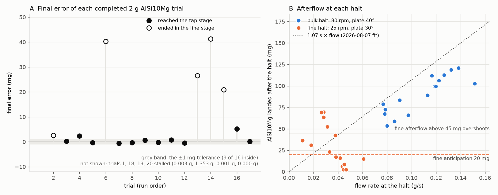
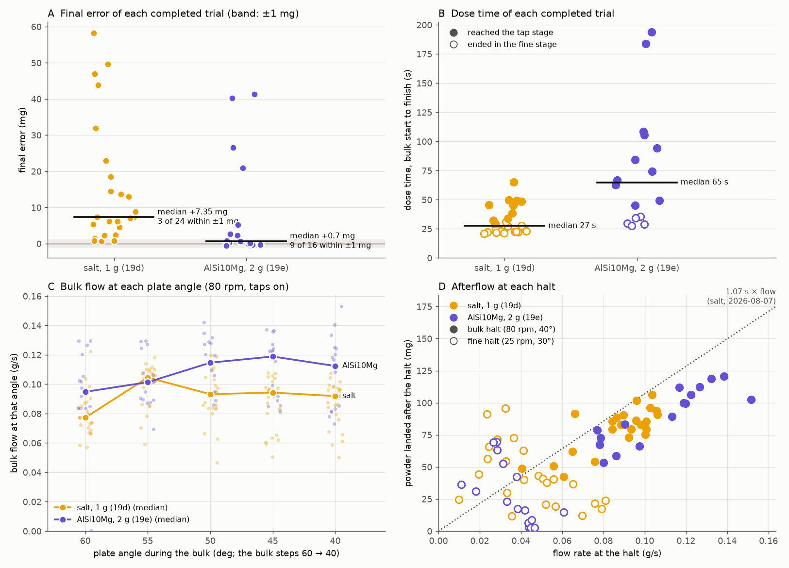
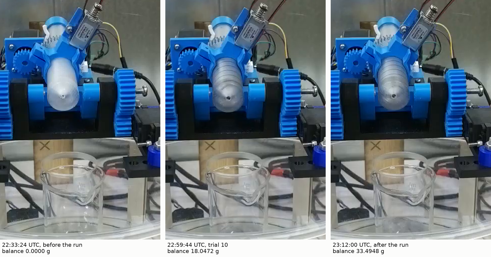

# 30 × 2 g AlSi10Mg trials on the salt protocol: 16 doses, then the tube ran dry (2026-11-19)

Asked by @XZaitzeff on [PR #131](https://github.com/vertical-cloud-lab/powder-doser/pull/131)
at 22:25 UTC: "Now there is alsi10mg powder in the doser. Run the same experiments as done for
salt but for this powder. Aim for 2 g this time instead of 1. Try for 30 trials."

**Outcome:** 20 of the 30 trials ran before the tube stopped feeding. Trial 1 primed the tube: the
powder took its 12 auger revolutions to reach the outlet, and the trial stalled with 1.7 mg.
Trials 2–17 each delivered a full 2 g dose. Trial 18 slowed down and stalled at 1.353 g, and
trials 19 and 20 got nothing. The run stopped itself at 23:11 on the two-failed-in-a-row rule.

- **Accuracy:** 9 of the 16 doses finished within ±1 mg (−0.6 to +0.8 mg). The median final
  error was +0.7 mg. The other 7 went over, by 2.3–41.3 mg, and none finished below the
  tolerance. On the same protocol this afternoon, 1 g of salt landed within ±1 mg in 3 of 24
  trials (median +7.35 mg).
- **The tap stage made the accurate doses.** 11 trials reached it, and 9 of those finished within
  ±1 mg; the other two finished at +2.3 and +5.2 mg. Each cycle (one tap and a 15° turn) added a
  median 1.7 mg of AlSi10Mg, against 5.0 mg of salt. Salt's 10 tap-stage trials all finished
  1.5–14.5 mg over.
- **The fine stage made the big overshoots, as with salt.** It stops the auger once the cup
  passes 1.955 g, 20 mg (its anticipation) before its 1.975 g hand-off. The 5 trials that ended
  in the fine stage all went over. In 4 of them (trials 6, 13, 14 and 15), 52–70 mg landed after
  that halt, which ended the dose 20.9–41.3 mg over.
- **Speed:** the median dose took 65 s (28–194 s). The bulk delivered 1.75 g in 18–26 s, at
  about 0.1 g/s, and the fine stage took 5–10 s. The tap stage, when it ran, took 12–157 s
  (median 57 s). The 5 doses that ended in the fine stage took 28–35 s.
- **The tube:** 33.49 g went into the beaker (balance 0.0000 → 33.4948 g). On the bench camera
  the lower tube is full of grey powder at 22:59 and paler at 23:12 (below), so it most likely ran
  dry, as the salt tube did at 22:02. How much AlSi10Mg was loaded wasn't logged.



- **Panel A:** final error of trials 2–17 in run order.
  - Grey band: the ±1 mg tolerance.
  - Filled marks reached the tap stage. Hollow marks ended in the fine stage, because its
    afterflow carried them to 1.999 g or past it.
  - Trials 1, 18, 19 and 20 stalled and are left out.
- **Panel B:** AlSi10Mg that landed after each auger halt, against the flow rate at the halt.
  - Blue: the bulk halt (80 rpm, plate at 40°). It stops at 1.75 g, so its 54–121 mg of
    afterflow never threatens the goal. It follows the flow: afterflow ÷ flow is 0.86 s (median;
    0.67–1.02 s), a little under salt's 0.90 s today and the summer stop-response fit of 1.07 s
    (dotted line, [2026-08-07](../../stop-response/2026-08-07_salt/)).
  - Orange: the fine halt (25 rpm, plate 30°, taps on). Dashed line: its 20 mg anticipation.
    Points above the grey line at 45 mg overshoot without help from the tap stage.
  - As with salt, the fine afterflow doesn't follow the flow at the halt. It splits into
    2.6–42 mg and 52–70 mg, at the same 0.01–0.06 g/s. All four large ones came with a late halt,
    at 1.963–1.972 g (on time is about 1.957 g): powder arrived in a burst that passed the
    threshold between two polls and kept landing after the halt. Three other late halts
    (trials 2, 8 and 17) had 15–42 mg.
- The figure comes from [`plot_afterflow_vs_anticipation.py`](plot_afterflow_vs_anticipation.py).



AlSi10Mg (2 g, this run) against salt (1 g, script `2026-11-19d`, launch 21:43 UTC,
[README](../2026-11-19_salt_tilt-schedule-old-auger-80rpm/README.md)), completed trials only:

- **A:** final error. Black bars are the medians.
- **B:** dose time. Filled marks reached the tap stage.
- **C:** bulk flow at each plate angle. Big marks are the medians, small ones single trials.
  AlSi10Mg rises from 0.095 g/s at 60° to 0.12 g/s at 45°; salt sat at 0.09–0.10 g/s from 55°
  on.
- **D:** afterflow at each halt for both powders. Filled marks are bulk halts, hollow marks fine
  halts.
- The figure comes from [`plot_alsi10mg_vs_salt.py`](plot_alsi10mg_vs_salt.py).



Bench camera, cropped to the tube and the beaker. The overlay clock is lab time (UTC−7); the
captions give UTC.

- **22:33, before the run:** the lower tube is pale and the beaker empty. The balance reads
  0.0000 g.
- **22:59, trial 10:** the lower tube is grey with powder. The balance reads 18.05 g; at this
  camera angle the bottom of the beaker is hidden behind the draft-shield ring.
- **23:12, after the run:** the lower tube is paler again and its inner ridges show through. A
  grey pile shows at the bottom of the beaker (33.49 g).

## What ran

[`three_phase_tilt_trials.py`](../../../hardware/test-module/firmware/three_phase_tilt_trials.py)
version `2026-11-19e` ([`fb61215`](https://github.com/vertical-cloud-lab/powder-doser/commit/fb61215)),
on the Pico's own `main_three_phase.py` (sha256 prefix `6b2111e1b2447096`, unchanged since 11-18).
Every stage setting is the salt run's `2026-11-19d`:

- **Bulk:** 80 rpm, continuous, with one 60 ms tap per 300 ms while the auger spins. The plate
  steps 60 → 55 → 50 → 45 → 40°, one step per **0.35 g** (the bands are always
  (target − 0.25 g) ÷ 5, so 0.15 g at 1 g), or after 3 s without a 2 mg gain. No anticipation;
  the bulk hands off at 0.25 g to go (1.75 g).
- **Fine:** 30° and 25 rpm, steady, with the same taps. 20 mg anticipation; the hand-off to the
  tap stage is at 25 mg to go (1.975 g).
- **Tap stage:** stock (0°, one tap and a 15° turn at 25 rpm per cycle, ±1 mg tolerance).
- **Stall rules, thresholds and dose timeout (600 s):** stock.

What changed for the powder and the 2 g target:

- `POWDER_ID = "alsi10mg"`, `TARGET_G = 2.0`.
- **Safety stops:**
  - 62.5 g in the cup (64.0 g mid-trial; 45 / 46.5 g for 30 × 1 g), since 30 × 2 g is 60 g.
    A balance overload frame also ends the session.
  - Two failed trials in a row that each deliver under **1.0 g** (half the target; 0.5 g at 1 g).
  - A 95 g display ceiling.
  - A 100 min budget (110 min before).

Checks before the run:

- A CPython dry run of `2026-11-19e` against copies of the Pico's controller files
  ([`tests/sim_three_phase_tilt_trials.py`](../../../hardware/test-module/firmware/tests/sim_three_phase_tilt_trials.py))
  ran all 30 trials without errors (60.02 g into the simulated cup).
- The Zero was idle and the Pico port free.
- The Pico's controller files matched their 11-18 hashes.
- The balance read 0.0000 g, stable, with the empty beaker on the pan (camera, 22:33).
- **Static-tilt pour probe** ([`alsi_static_probe.py`](alsi_static_probe.py),
  [log](static_tilt_probe.log)): the plate went 0 → 30 → 40 → 50 → 60 → 0°, 4 s at each angle,
  with the auger still and no taps. All 120 balance frames read 0.0000 g, so AlSi10Mg doesn't
  pour out of a still tube at the bulk angles. Salt didn't either, up to 72°, on 2026-07-31.

## Trials

| trial | start (UTC) | result | final | error | dose | bulk | fine | tap stage | bulk afterflow | fine afterflow | taps | auger revs |
|---|---|---|---|---|---|---|---|---|---|---|---|---|
| 1 | 22:43:48 | stalled in the bulk | 0.0027 g |  | 13.5 s | 10.3 s |  |  |  |  | 25 | 12.0 |
| 2 | 22:44:18 | overshoot | 2.0026 g | +2.6 mg | 35.4 s | 26.3 s | 6.2 s | — | 121 mg | 42 mg | 78 | 30.6 |
| 3 | 22:45:09 | **ok** | 2.0003 g | +0.3 mg | 84.4 s | 19.2 s | 5.3 s | 10 cycles, 56.7 s | 119 mg | 3 mg | 58 | 21.2 |
| 4 | 22:46:48 | overshoot | 2.0023 g | +2.3 mg | 74.2 s | 19.0 s | 6.5 s | 8 cycles, 45.6 s | 103 mg | 6 mg | 63 | 21.6 |
| 5 | 22:48:17 | **ok** | 1.9997 g | −0.3 mg | 94.5 s | 19.8 s | 6.2 s | 11 cycles, 65.2 s | 106 mg | 17 mg | 67 | 23.1 |
| 6 | 22:50:06 | overshoot | 2.0403 g | +40.3 mg | 34.4 s | 22.5 s | 8.6 s | — | 83 mg | 70 mg | 72 | 27.4 |
| 7 | 22:50:56 | **ok** | 1.9994 g | −0.6 mg | 105.5 s | 24.2 s | 8.6 s | 12 cycles, 69.5 s | 66 mg | 23 mg | 89 | 29.3 |
| 8 | 22:52:56 | **ok** | 1.9997 g | −0.3 mg | 66.8 s | 24.6 s | 8.3 s | 5 cycles, 30.8 s | 72 mg | 16 mg | 82 | 29.0 |
| 9 | 22:54:18 | **ok** | 2.0006 g | +0.6 mg | 183.9 s | 23.5 s | 9.2 s | 26 cycles, 148.0 s | 67 mg | 3 mg | 103 | 28.5 |
| 10 | 22:57:36 | **ok** | 1.9998 g | −0.2 mg | 108.4 s | 25.6 s | 9.3 s | 12 cycles, 70.3 s | 79 mg | 36 mg | 95 | 32.3 |
| 11 | 22:59:39 | **ok** | 2.0008 g | +0.8 mg | 49.2 s | 24.6 s | 9.6 s | 2 cycles, 12.2 s | 59 mg | 31 mg | 84 | 29.2 |
| 12 | 23:00:43 | **ok** | 1.9995 g | −0.5 mg | 193.8 s | 25.2 s | 8.5 s | 28 cycles, 157.2 s | 54 mg | 3 mg | 108 | 31.2 |
| 13 | 23:04:12 | overshoot | 2.0265 g | +26.5 mg | 29.7 s | 20.5 s | 6.3 s | — | 112 mg | 63 mg | 58 | 22.6 |
| 14 | 23:04:57 | overshoot | 2.0413 g | +41.3 mg | 27.8 s | 18.4 s | 6.5 s | — | 100 mg | 69 mg | 53 | 19.9 |
| 15 | 23:05:40 | overshoot | 2.0209 g | +20.9 mg | 28.8 s | 18.4 s | 7.2 s | — | 89 mg | 52 mg | 52 | 21.7 |
| 16 | 23:06:25 | overshoot | 2.0052 g | +5.2 mg | 62.8 s | 18.6 s | 6.7 s | 6 cycles, 34.3 s | 112 mg | 9 mg | 60 | 20.2 |
| 17 | 23:07:42 | **ok** | 2.0001 g | +0.1 mg | 45.3 s | 18.6 s | 6.5 s | 3 cycles, 17.0 s | 99 mg | 15 mg | 54 | 20.0 |
| 18 | 23:08:42 | stalled in the bulk | 1.3526 g |  | 72.6 s | 69.5 s |  |  |  |  | 220 | 90.7 |
| 19 | 23:10:11 | stalled in the bulk | 0.0005 g |  | 14.2 s | 10.9 s |  |  |  |  | 27 | 12.0 |
| 20 | 23:10:41 | stalled in the bulk | 0.0004 g |  | 13.6 s | 10.6 s |  |  |  |  | 26 | 12.0 |

- **Dose** runs from the start of the bulk to the controller's finish, and **final** is the
  median of 8 readings taken 8 s after it.
- **Afterflow** is the powder that landed between the halt and the settled reading.
- **Trial 1** primed the tube. The plate stepped 60 → 55 → 50° on the 3 s no-flow step, and the
  stock 8 s stall rule ended the trial after 12 revolutions. Trial 2 still needed one no-flow
  step at 60°. From trial 3 every bulk angle stepped on its 0.35 g band.
- **Trial 18** ran its bulk for 69.5 s (90.7 revolutions) and got 1.353 g: it stepped to 45° on
  its bands, then to 40° on the no-flow step, and stalled there. Trials 19 and 20 got 0.4–0.5 mg in 12 revolutions
  each. Trial 18 delivered more than 1 g, so only 19 and 20 counted towards the stop.

### Bulk flow by plate angle (trials 2–17)

Computed the same way as the salt table: the mass gained while the auger spins at each angle,
over the time spent there. Each 0.35 g band took about 3 s at 80 rpm, longer than salt's
1–2 s per 0.15 g band. Powder in flight still lands after a step, though, so some of each angle's
mass lands while the plate is at the next one.

| plate | AlSi10Mg per auger rev, median (range) | AlSi10Mg g/s, median | time at the angle | salt per rev (19d) | salt g/s (19d) |
|---|---|---|---|---|---|
| 60° | 71 mg (0–97) | 0.095 | 3.6 s | 58 mg | 0.077 |
| 55° | 76 mg (52–97) | 0.101 | 3.2 s | 78 mg | 0.105 |
| 50° | 86 mg (65–107) | 0.115 | 2.8 s | 70 mg | 0.093 |
| 45° | 89 mg (61–103) | 0.119 | 2.7 s | 71 mg | 0.094 |
| 40° | 84 mg (55–115) | 0.112 | 2.8 s | 69 mg | 0.092 |

The 0 mg at 60° is trial 2, which still took the no-flow step there.

## Timeline (UTC)

| time | what | result |
|---|---|---|
| 22:25 | Request | |
| 22:27–22:42 | Preflight, nothing moving | Zero idle, port free, Pico files unchanged, balance 0.0000 g stable, empty beaker on camera. Rig notice posted on the Zero. CPython dry run: 30/30 trials. Script `2026-11-19e` pushed (`fb61215`). |
| 22:42:50 | Static-tilt pour probe | 0.0 mg at 30, 40, 50 and 60° with the auger still. |
| 22:43:42 | **Launch** ([`launch1_2243Z/`](launch1_2243Z/)) | Trial 1 primed the tube; trials 2–17 dosed, 45–200 s per trial including the pre- and post-roll. |
| 22:59:44 | Bench-camera check | Balance 18.05 g, powder low in the beaker, nothing spilled. |
| 23:08:42 | Trial 18 | Bulk slowed to a stall at 1.353 g. |
| 23:10:11–23:11:11 | Trials 19, 20 | 0.5 and 0.4 mg in 12 revolutions each; the script stopped itself (two trials in a row under 1 g). |
| 23:12 | Rig restored | The script's own exit stopped the auger and put the plate at 0°. The Pico was soft-rebooted into its power-on `main.py` (`[rig] ready`, servo at 0.0°). The rig notice on the Zero was marked done. |

The balance read 0.0000 g at the start (the session baseline) and 33.4948 g at the end, so this
session put **33.495 g** of AlSi10Mg into the beaker, which needs emptying before the next run.
Fine Al-alloy powder is a combustible dust and picks up moisture
([handling notes](../../../docs/candidate-powders.md#handling-and-storage)), so it is best capped
and stored dry.

## What the data say

- **The salt protocol carries over to AlSi10Mg at 2 g with no retuning, and lands closer.**
  Same stages, same speeds, same thresholds: 9 of 16 doses within ±1 mg, against 3 of 24 for
  1 g of salt.
  - The difference is the tap stage. AlSi10Mg's tap-stage cycles add a median 1.7 mg (90 % of
    them under 5.8 mg), against 5.0 mg for salt (90 % under 11.2 mg). At that size the stage can
    walk the last 3–41 mg in without jumping past the ±1 mg band. (Each cycle's gain is the
    change in the cup between successive tap commands, from the per-trial CSVs.)
  - The price is time: the tap stage ran 2–28 cycles (median 10), and two trials took over 3
    minutes.
- **The fine stage still sets the overshoot.** Its 20 mg anticipation was set for salt at 25 rpm
  without taps.
  - With AlSi10Mg, 2.6–70 mg landed after the fine halt (median 20 mg). In 5 trials that carried
    the cup to 1.999 g or more, so the dose ended in the fine stage: trial 2 at +2.6 mg, and
    trials 6, 13, 14 and 15 at +20.9 to +41.3 mg.
  - The large afterflows came with late halts (1.963–1.972 g against about 1.957 g), i.e. a burst
    of powder that was already falling. The taps may knock loose powder sitting at the outlet,
    as suspected for salt; this run can't tell.
- **The bulk is predictable.** Its afterflow follows its flow, with a time constant of 0.86 s
  (0.67–1.02 s). AlSi10Mg fed 0.10–0.12 g/s at 80 rpm, a little faster than salt, and best at
  45–50°.
- **Flow came in stretches.** Trials 3–5 and 13–17 fed fast: 0.11–0.15 g/s at the bulk halt,
  20–23 auger revolutions per dose and 89–119 mg of bulk afterflow. Trials 6–12 fed slower:
  0.08–0.10 g/s, 27–32 revolutions and 54–83 mg. Three of the four big overshoots (13, 14 and 15)
  came in the last fast stretch, just before the tube ran dry, and the fourth (6) in the slow
  one.
- **The tube held about 33.5 g that could reach the outlet.** Flow faded within one trial (18)
  and stopped. The camera shows the lower tube emptying between 22:59 and 23:12. That fits a tube
  running dry better than powder arching above the outlet, which tends to slow flow over several
  trials.

## What would let the 30 trials finish

Someone at the bench needs to:

1. **Weigh the tube** before refilling. If this is the old tube, its empty mass is 56.716 g
   ([ledger](../../../docs/salt-inventory.md)).
2. **Refill it, weigh it, and post the total.** The remaining 10 trials need about 21 g in the
   beaker, and all 30 in one go about 61 g, plus whatever stays in the tube. AlSi10Mg is denser
   than salt, so the tube holds more of it by mass.
3. **Empty the beaker** (about 33.5 g of AlSi10Mg on the pan now).
4. **Comment `@claude` to rerun.** `2026-11-19e` is unchanged and ready. The first trial after a
   refill may only prime the tube, as trial 1 did here.

These would change the experiment, so they are for the requester. Each is a one-line change:

- **A larger fine anticipation,** about 60–70 mg (`FINE_ANTICIPATION_G`), so the fine stage
  hands every dose to the tap stage, which landed AlSi10Mg within ±1 mg in 9 of 11 trials. The
  cost is a longer tap stage.
- **No taps in the fine stage** (`FINE_TAPS = False`), if the taps are what shakes the bursts
  loose.

## Files

- `launch1_2243Z/`: the same layout and columns as the salt launches (see the
  [11-18 README](../2026-11-18_salt_tilt-schedule/README.md#files)).
  - `trial_NN_<date>_<HHMMSS>Z.csv`: every balance frame of one trial, 8–9 per second.
    `taps_cum` counts the taps. Every row carries `powder_id` `alsi10mg`.
  - `trials_summary.csv`
  - `session_launch1.log`: the raw stamped telemetry
  - the three figures from `scripts/analyze_tilt_trials.py` (`tilt_trials_overview.png`: one
    panel per trial; `tilt_trials_summary.png`; `tilt_trial_example.png`)
- `afterflow_vs_anticipation.png` and its script
  [`plot_afterflow_vs_anticipation.py`](plot_afterflow_vs_anticipation.py), adapted from the
  salt run's.
- `alsi10mg_vs_salt.png` and its script [`plot_alsi10mg_vs_salt.py`](plot_alsi10mg_vs_salt.py).
  It prints the bulk-by-angle table above, for both powders.
- `camera_tube_beaker_2233Z_2259Z_2312Z.png`: the camera crops above. The frames are the newest
  livestream segment at each time, fetched on the Zero with the salt run's
  [`camgrab.sh`](../2026-11-19_salt_tilt-schedule-old-auger-80rpm/camgrab.sh) and decoded with
  `ffmpeg` on the runner.
- `alsi_static_probe.py` and `static_tilt_probe.log`: the pour probe.
- `run.sh`: the Zero-side launcher. It pipes `mpremote run` through `stamp.py` into the session
  log, as in the [11-18 morning reproduce section](../2026-11-18_salt_tilt-schedule/README.md#reproduce).

## Reproduce

```bash
mpremote connect /dev/ttyACM0 run three_phase_tilt_trials.py \
  | python -u stamp.py session.log      # stamp.py writes "<time.time()>\t<line>"
python scripts/analyze_tilt_trials.py session.log --out <dir> [--upload --extra-json '{...}']
python plot_afterflow_vs_anticipation.py
python plot_alsi10mg_vs_salt.py
```

`scripts/analyze_tilt_trials.py` now takes the powder and target for its figure titles and
y-ranges from the log's metadata (it had salt and 1 g written in).
