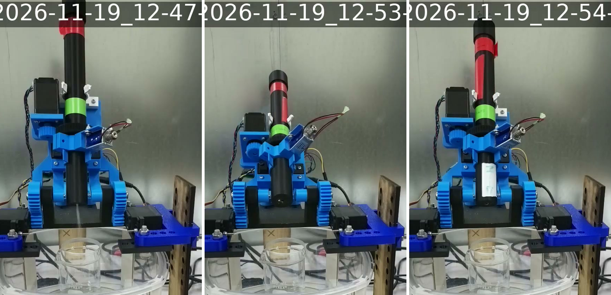
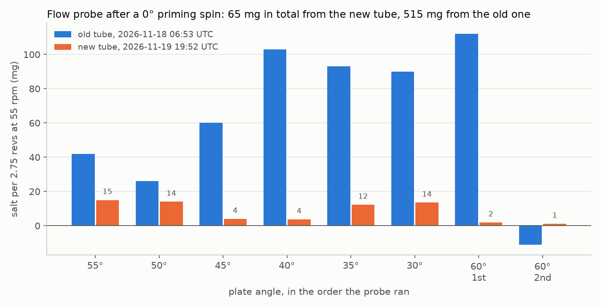

# 30 × 1 g salt trials on the new auger, bulk tilt 60 → 40°: stopped after 4 stalled trials (2026-11-19)

Asked by @XZaitzeff on [PR #131](https://github.com/vertical-cloud-lab/powder-doser/pull/131)
at 19:31 UTC: "we replaced the auger with a new one. So run the 30 experiments with the 60, 55,
50, 45, and 40 degree bulk regime from the first attempt and the same for everything else."

**Outcome:** no trial reached 1 g. Both launches stopped on the agreed safety rule (two stalled
trials in a row), as on 2026-11-18. The new tube gave one 166 mg slug when it first tilted to 60°.
After that it delivered very little at any angle:

- a priming spin at 0° gave 0.147 g in 22.5 revolutions
- a flow probe gave 1–15 mg per 2.75 revolutions at every angle from 30 to 60°, 65 mg in all.
  The same probe on the old tube on 11-18 gave 515 mg
- launch 2, trial 1 got 56 mg, all of it at 50°

The tube turns on camera, so the drive is fine. The new tube is opaque, so the camera can't show
how much salt is in it or where it sits. About **0.44 g** of salt went into the beaker in total.



Bench-camera frames (overlay clock in lab time, UTC−7), with the auger at 55 rpm in each:

1. **Launch 1, trial 1 at 60°, 19:47:33 UTC.** A faint stream runs from the outlet to the
   beaker. These are the 2 s that delivered most of the 166 mg slug.
2. **The flow probe at 30°, 19:53:24.** No stream is visible. 13.5 mg landed in this step.
3. **Launch 2, trial 1 at 50°, 19:54:24.** No stream is visible. The balance shows a trickle of
   about 3.5 mg/s.

The file is `camera_60_30_50deg.png`.



Each bar is the salt from 2.75 auger revolutions at 55 rpm, in the order the probe ran. Both
probes came right after a priming spin at 0°. The old-tube values are from the 06:53 row of the
[11-18 morning README](../2026-11-18_salt_tilt-schedule/README.md#timeline-utc). Its −11 mg at
the second 60° step is the tilt offset of the balance, not salt leaving the beaker. The script is
`plot_probe_comparison.py`.

## What ran

[`three_phase_tilt_trials.py`](../../../hardware/test-module/firmware/three_phase_tilt_trials.py)
version `2026-11-19a` (commit `c95164a`). Its code is the same as `2026-11-18b`, the first
attempt's launch 2. Only the version string and the docstring changed: `BULK_TILTS` is back to
(60, 55, 50, 45, 40) from version c's (50, 45, 40, 35, 30).

- **Bulk:** 55 rpm, continuous, no taps. The plate steps down one angle per 0.15 g, or after 3 s
  without a 2 mg gain.
- **Fine:** 30° and 25 rpm, steady, with 20 mg anticipation.
- **Tap stage:** stock.
- **Stall rules and thresholds:** stock (bulk: 2 mg within 8 s).
- **Logging:** the balance at about 10 Hz, settle waits included.
- **Safety stops:** 45 g in the cup, two failed trials in a row, 95 g display, a 95 min budget.

Checks before the run:

- The Pico's controller files were unchanged since 11-18. Their sha256 prefixes match the
  `M,*_sha16` lines in the logs (`main_three_phase.py` `6b2111e1b2447096`).
- A CPython dry run against copies of those files ran all 30 trials without errors, for two
  seeds (`hardware/test-module/firmware/tests/sim_three_phase_tilt_trials.py`).
- The bench frame at 19:45 UTC showed an empty beaker on the pan, the balance at 0.0000 g and
  the plate at 0°.

## Timeline (UTC)

| time | what | result |
|---|---|---|
| 19:35–19:47 | Preflight, nothing moving | The Zero was idle and the Pico port was free. The rig notice was posted on the Zero. |
| 19:47 | **Launch 1** ([`launch1_1947Z/`](launch1_1947Z/)) | Trial 1: 155 mg in the first 2 s at 60°, so the plate stepped to 55° on the mass band. The tail of that slug added 11 mg in the next second at 55°. Then nothing at 55, 50 or 45° (the 3 s no-flow steps), and it stalled at 0.1672 g after 12.8 revolutions. Trial 2: nothing at 60, 55 or 50°, stalled at 1.7 mg. The script stopped itself. |
| 19:52:08 | Priming spin, as at 06:48 on 11-18: 55 rpm with the plate at 0° ([`prime_spin.py`](prime_spin.py)) | **+0.147 g** in 24.6 s (22.5 revolutions). The spin was planned for 40 s. At 26.6 s on the Pico clock the script's logging list hit a `MemoryError`. Its `finally` stopped the auger, and the stop is logged (`PRIME_SPIN_STOP`). The probe's first readings, at 0°, give the mass after the spin. On 11-18 the full 40 s gave +0.542 g. |
| 19:52:37 | Flow probe, as at 06:53 on 11-18: 2.75 revolutions at 55 rpm per angle ([`angle_probe.py`](angle_probe.py)) | 55° +15.0 mg, 50° +14.0 mg, 45° +4.0 mg, 40° +3.7 mg, 35° +12.2 mg, 30° +13.5 mg, then 60° twice: +1.9 mg and +1.1 mg. |
| 19:53:48 | **Launch 2** ([`launch2_1953Z/`](launch2_1953Z/)), the identical script | Trial 1: nothing at 60 or 55°. At 50° a trickle started after 2 s and ran for about 15 s at roughly 3.5 mg/s (55 mg). Then nothing at 45 or 40°, and it stalled at 0.0559 g after 30.3 revolutions. Trial 2: nothing at 60, 55 or 50°, stalled at 0.5 mg. The script stopped itself. |
| 19:56 | Rig restored | Plate at 0°. The Pico was soft-rebooted into its power-on `main.py` (`[rig] ready`). The rig notice on the Zero was marked done. |

The balance read 0.0000 g before launch 1 and 0.4429 g after launch 2, so the session put
**0.443 g** of salt into the beaker. The beaker doesn't need emptying before a rerun.

## What the data say about the new tube

- **The auger turns.** In the camera segments, the white label and the red tape on the tube move
  around it from frame to frame while the auger is commanded to spin.
- **Loose salt sat at the outlet, and the tube fed little after it was gone.** The 166 mg slug
  came in the first 3 s of the first spin at 60°. After it, every angle gave a few mg per
  revolution at most, and the priming spin at 0° gave 6.5 mg per revolution. The old tube gave
  about 15 mg per revolution in the same spin on 11-18.
- **Two causes fit, and only the bench can tell them apart.**
  - The new tube may hold only a little salt.
  - The salt may be packed or bridged above the outlet.

  On 11-18 the old tube was "full to the brim" in the morning and gave about 8× more in the
  same probe (515 mg against 65 mg).
- **The two-stalls rule ended both launches within 90 s.** With almost no flow, the 3 s no-flow
  steps use up the bulk angles. The stock 8 s stall rule then ends the trial 2–3 s after the
  plate reaches its third or fourth angle.

## What would let the 30 trials run

Someone at the bench needs to:

1. **Look at the new tube.** How full is it, and is the salt loose? If it can be weighed, please
   post the total and the new tube's empty mass. The ledger's 56.716 g is the old tube's.
2. **Refill or loosen the salt** if it's low or packed.
3. **Comment `@claude` to rerun.** The script and the logging are unchanged and ready, so a
   rerun starts within minutes.

If the tube is full and loose and the salt still won't feed, these change the experiment, so
they are for the requester:

- **taps during the bulk:** the controller's built-in bulk taps
- **a longer bulk stall window**
- **lower bulk angles**

## Files

- `launch1_1947Z/`, `launch2_1953Z/`: the same layout and columns as the 11-18 launches (see
  [that README](../2026-11-18_salt_tilt-schedule/README.md#files)):
  - `trial_NN_<date>_<HHMMSS>Z.csv`: every balance frame of one trial (9.5–9.9 per second)
  - `trials_summary.csv`
  - `session_launch*.log`: the raw stamped telemetry
  - the three figures from `scripts/analyze_tilt_trials.py`
  - Trial numbers restart at 1 in each launch.
- `launch2_1953Z/prime_spin_0deg.csv` and `launch2_1953Z/flow_probe_by_angle.csv`: every balance
  frame of the priming spin and of the probe. Their lines are at the top of
  `session_launch2.log`, and [`prime_probe_csv.py`](prime_probe_csv.py) splits them out.
- These two CSVs have one row per balance frame. The columns are `powder_id`, `date_utc`,
  `time_utc`, `t_s`, `balance_status`, `mass_abs_g` (absolute display, no tare), `tilt_deg`,
  `auger_rpm`, `poll_ms`, `step` and `events`.
- `prime_spin.py`, `angle_probe.py`: the two helper scripts. Both run from Pico RAM.
- `run.sh` (launch 1) and `run2.sh` (priming spin, probe, launch 2): the Zero-side launchers.
  Each pipes `mpremote run` through `stamp.py` into the session log, as in the
  [11-18 morning reproduce section](../2026-11-18_salt_tilt-schedule/README.md#reproduce).
- `camera_60_30_50deg.png`, `probe_old_vs_new_tube.png` (`plot_probe_comparison.py`): the
  figures above.

## Reproduce

```bash
mpremote connect /dev/ttyACM0 run three_phase_tilt_trials.py \
  | python -u stamp.py session.log      # stamp.py writes "<time.time()>\t<line>"
python scripts/analyze_tilt_trials.py session.log --out <dir> [--upload]
python prime_probe_csv.py launch2_1953Z/session_launch2.log launch2_1953Z
python plot_probe_comparison.py
```

`--upload` puts one document per trial (`doc_type: "three_phase_tilt_trial"`) and one per
launch (`doc_type: "three_phase_tilt_session"`) into `powder_doser.dose_runs`. These have
`script_version: "2026-11-19a"` and `auger: "new tube, installed 2026-11-19"`.

`prime_spin.py` keeps every reading of the spin in a list. On this run, growing that list failed
with a `MemoryError` (allocating 2048 bytes) after about 25 s. On 11-18 the same script ran the
full 40 s. A rerun should keep only the last 8 readings, which are all the script uses.
